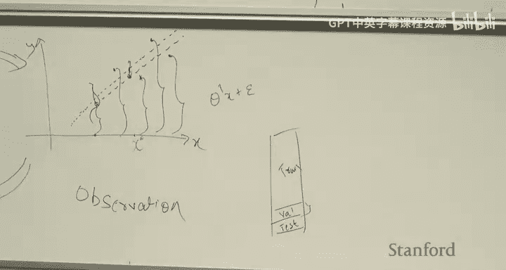
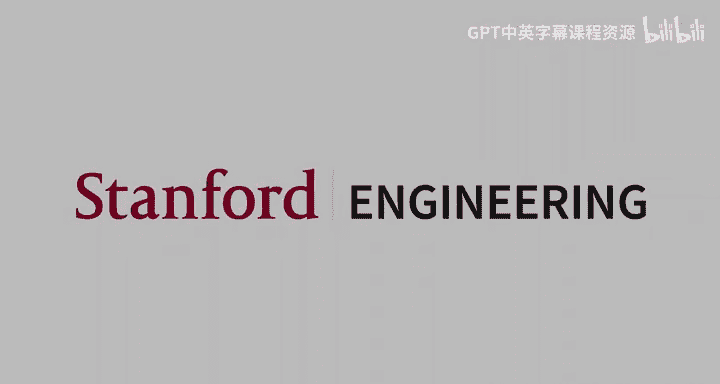

# 斯坦福大学《机器学习｜Stanford CS229 Machine Learning Course  Summer 2019 (Anand Avati)》 - P6：-06-.Lecture 6 - Exponential Family & GLM.zh_en - GPT中英字幕课程资源 - BV1NDopY4ECg

Okay， let come back。Let's continue。 So this is our sixth lecture。The topics for today are。

The exponential family，'s it's a family of probability distributions。

 and the generalized linear models are GLMs。The two topics are kind of tightly coupled。

 so we covered them in the same lecture。And before we get started， a quick recap to kind of。

See the motivation for exponential families and GLM。 So we've seen two。Two models so far。

 a regression model and a classification model， and they were linear regression and logistic regression。

Right， and。For both the linear regression and the logistic regression。

 we saw their probabilistic interpretations。And for the linear regression the assumption that we made was y given x is sampled from a normal distribution with mean theta transpose x and some variant sigma square it did not matter what sigma square was and that is fine。

In the case of classification， Y U X was sampled from a Bernoulli distribution。

 whose parameter was  one over1 plus E to the minus theta transpo x， right， And this was also。

 we call this G of。Z equals 1 over 1 plus e to the minus z and G of theta transpo x。Becomes the。

Becomes a parameter of the Bernoulli distribution。Right and then we had a smaller aside mostly a digression in terms of what were going to cover today。

 but you know this is going to be useful next week。

 think of functions as points and an infinite dimensional functional space and you kind of get a one to one mapping between the domain of the function and the axes of the functional space。

Anyway so this is not relevant for today but you know just kind of keep this in the back of your mind So we are going to continue along the lines of of the probabilistic interpretations and we are going to cover generalized linear models。

 So off the back we we see a few things that are common between these two。Al right， first of all。

 we are modeling y given x in both the cases。The difference is that in one case y is real valued and in the other case y is binary valued0 and 1。

And the， the data type of why， whether it is， you know， a real valued or or。

A discretere binary valued informed our choice of the distribution that we are that we used right it doesnt make sense to define anoul a Brnoulli over real value similar it doesn't make sense to define a normal distribution on discrete valued so the choice of the data type of the y variable informed the choice of the distribution that we used。

The other thing that we see in both， both of these is the occurrence of。Hta transpose x。喂。

We have a theta transpose x here， and we have a theta transpose x here。And。

These two seem to be know somewhat somewhat superficial similarities。

 but what we will see today is that there is actually a much much deeper and richer theory that kind of unifies these two and a lot more different kinds of models under a common umbrella。

So。And that's called the that's called the GLM or the generalized linear models。

 We call it linear because you know， theta transpose exists linear。

And we call it generalize because we generalize not just to you know two types of date types of y。

 but you know for。More general kinds of why in general。Okay。

 so let's get started with exponential families。Use a different pen。Exponential family。 So the。

Exponential family can be written in the form。So this is the probability density P。Our PMF。

So an exponential family distribution is a probability distribution whose density has the form P of Y parameterized by Ata。

一 good。Me of Y。Heer transpose。T of y。Minus a of。Right this， this。

 this is a crypttic lu cake expression。 Let's add some color to this。 So the data that we are。

On which。Probably is defined。 It's call it y。Wi。😔，Wai。Right， and the parameter。

Of such a distribution。好那。系得。A的。可以的。Right， so this is the Greek letter Eta。

 And if you are using latex， you use。E T A heta to get that symbol。It， it kind of looks like n。

 but it's just。Eta so the parameter of the distribution is eta and the support of the distribution that is y。

Now， we call it why。And not x because it is a hint we are trying to model the output of our models with exponential families。

 so so the probability density of y parameterized by Eta is going by this expression。Right。

 and there are kind of three functions over here。 So we have。B of y。

And this is purely a function of y， and it's generally called the base measure。Right， and we have。

T of y， this is called a sufficient statistic。And we have a of theta。

Eta is called the log partition function。So a few observations。The base measure or the function B。

Is purely a function of y only。And it has no atta terms。And similarly， the lock partition function。😊。

Is purely a function of Eta， and it has no y in it。 and similarly， T of y is， is。Is again。

 a function of y alone and for pretty much， you know， most of this course and you know。Most commonly。

 t of y will just be equal to y。I think of it as the identity function。

 but for most of the cases t of y will just be y。And。Why are these called these particular names so。

One way to think of it is。The way an exponential family can be constructed。

Is by starting with some base measure， B of y。Right。Assume it is some probability density。

And come up with a new。New distribution， whose。Density is。So what's happening here。

 we have some base measure datata and。We we can define a new distribution whose density is proportional to the density of the base measure times the exponent of the parameter times times the data to make the simple lets lets。

Now， consideror。A scalar case and where the base measure is。

And now because it is a probability density measure， if we normalize this， we have to。😊，嗯。

Normalize this。P up why。Eta is equal to。B of y times E of minus theta root y。

Over the integral of this with respect to y。Integrate out why。Be。Y times e of minus。你的。Why。D外。

Doest make sense。 So we are just defining a new new probability distribution whose density is。

I is defined by the you know some base probability measure y times the exponent of you know a parameter times E of y。

And then we just renormalize it。 And this is also in in， in some literature。

 this is called exponential tilting。And now what is this is。D of y times C of minus theta transpo y。

And this is just the expectation of。Expectation of E to the minus。Ne way。Does that make sense。

This is just the definition。 So this is the the density。 and this is some function。

 And you're integrating out。 So this is the expectation。

 And this also happens to be called the anybody。It is a log partition function。

 but just this form alone is also called a moment generating function。And， and。

But that's not that's not relevant to to our， our。I study here。

 So we can just call the sum function off。You know。

 let's call it capital a of Eta because you are integrating out y the only variable here is Eta。

And this comes from the form， P of y times。E of minus。Eter transpo， y。So I put the same here。

That was why， minus。Log。He有。哎。So。Yeah， so the question is。

 should you know should be of why satisfy the properties of a property distribution function？

In this form， it need not because， you know。There could be some common constant that gets cancel between the two so here you can actually think of it as some B B prime B prime B prime you know and you know B prime and after you cancel the common constant you end up with the B of y but the main idea you want to think of here is to get an exponential family distribution you start with some base measure。

B。Do an element wise multiplication at each term with the A E of a you know you introduce a new parameter and。

Multiplied by exponent of。That parameter times y and then just normalize it。

 And once you normalize it， what you get is the kind of the it called the exponentially tilted version of B of y。

 and that will be。And ex a member of the exponential family。

That that is one way to think of how exponential family distributions are constructed and kind of gives you a motivation of why it is called the base measure。

 So this is this is also called like the pre tilting measure。

 And once you perform this process called tilting you get a member a distribution in the exponential file。

😊，Allright， so that's， that's just a side。 That's just some motivation for。

AndW the names you call this the base measure and the partition function is another common name for a normalizing constant。

 right？I think that term comes from statistical physics where you you use a normalizing constant are called partition functions。

 and because this is a normalizing constant。And when you take it up here。

 you know you take because the exponent this becomes a log of an normalmalizing constant。

 and this is called a of eta。And therefore， it's called the log partition function。

RightThat's that's that's just some intuitions for， you know。

 why the names base measure and lock partisan function， why those names came into picture。

 but you know。Everything inside this box is not really relevant for our study as such。

All right so and the claim is that a lot of probability distributions that we encounter， for example。

 the Bernoulli distribution or the Gaussian distribution。

 the normal distribution and many more they are all part of the exponential family。😊。

It means you can express these distributions in this form。

And any distribution that can be represented in this form belongs to the exponential family。

 The only constraint is that。Is that the choices of B。T and A should be such that the。

This whole term is always non negative and integrates to one when you integrate out y。

Subject to those constraints。For any choice of B， P and A。You have。

A distribution in the exponential family。那。Any any questions before we see how the Gaussian and and Bernoli belong to this family。

 Any any questions with with this so far。也说是。Go ahead。すご。This one， just a capital A。

 I just called it some you know， capital A of Eta and use law capital A。This question。

Oh so the question is why are we dividing by the the expectation So we divide by the integral of of the numerator with respect to y which will make it normalized to one。

So so think of it as so you have some a set of numbers，1，5。

7 and you want to maintain their ratios but still make them add up to1 so you divide it by 1 plus 5 plus 71 plus 5 plus 7。

1 plus5 plus 7 right。And this makes them normalized into a probability distribution。

 They sum up to one now。And here we are doing the same thing for in a continuous scale。

So integrate out the numerator。And， and divided by the that integral。 So this。

 this is called normalization。So you think of1 plus 5 plus 7 as the the the different values this evaluates to for different values of y。

😊，Right。Alright， so maybe to， to answer this theor。 So let's see what happens here。Now。

 we have some function， B of。好了。got B prime of white。It E of。Hta times Y。 Now， let's assume this。

P of Y。 And let's assume the integral of P of y。Equal to integral of。B prime of y times E of。

The a times y is equal to some k。 let's say equal to 100。Right， but now we want。

We want this to be a valid probability distribution， which means when you integrate out y。

 we want it to be equal to1。RightSo what what you do is you want to divide it by 100 so that when you integrate the whole thing。

 you get one。Right，And and this hundred comes because that's what you got by integrating it out in the first place。

Right， so， so the。Inral of。B prime of y times。Exponent of。8 at y。In they go of。喂。Now， this term。

 this the the entire denominator is just a constant and this will be equal to  one over entire half。

Weぱ white。X of8 or y times the numerator is integral of。Right。

And you just cancel them equal to one that that you're just normalizing it。

Such that the integral is always one。So that makes that question。So why you。他そ。好。

Yeah so this is just this is this is the process of what you call as an exponential tilting and there are there are good reasons why you want to tilt something using the exponent function there are there is a lot of theory of why the exponent is the right choice to do you know think of that as beyond the scope of this class。

😊，Yes， question。So here， you know。Just to give the intuition。

 we are considering EA to be a scalar in this case。So yeah， if this was a w， then sure， you know。

 think of this as。And then the integral would be， you know， would be integrating over y 1， D etc。

Yes question。那。結婚し？The very first line。So。So this is， this is the assumption we are making， you know。

 where。Taking a base measure B prime of y， we want to construct new measure。

Such that the new measure is proportional to B prime of y times exponent of some parameter times y。

そから。没好。So the， the intuition is that youre just defining a new distribution which is defined like this。

 And this is called。You know， the tilted distribution， the exponentially tilted distribution。

But the main point here is that， you know， we went through this just to get get a flavor of why the names came into picture。

RightAnd and we can we can go into details after the class， you know。

 come up to the come up to the stage we can can go into the details。 but the main point is that。😊。

If you can decompose a probability density into this form into these components， then you know。

 that distribution belongs to the exponential family。Now， let's look at a few distributions， which。

Which actually followed this。发生。So let's start with the Bnoulli distribution。

So the Bernoulli distribution， P of y parameterized by phi。Is it the naS。Phi to the y times 1 minus。

Phi to the1 minus y。This is the Bnoli distribution and the claim is that this。This， this form of。

 of the B distribution can be。Rewritten in the exponential family form。How do we do that？So。

The first thing we can think of is。We can take the exponent。Of the log。Of。F to the way。

1 minus3 to the1 minus y。just took the exponent and the log that and the reason why we can take the log is because this is positive and this is positive so you can take the log and then you know take the exponent again。

Right。And now we can re this as。Exponent。So， this will be why。Log。Fi。Plus 1 minus y。Log。1 minus phi。

哎。And this rearranging terms， again。Exponent。So。I'm going to collect terms that have y in them to the left and to the right terms that do not have y。

 So we will get。Log。Phi over1 minus phi。Times， why。Plus。Log 1 B。

So all we have done here is pure algebraic manipulation。

We started with this sm and brought it to this form and now we can see you know start doing a pattern matching So the exponential family says p of y given ata is equal to B of。

Why。Exponent。Eta transpose， y minus。A of Eta。Now we want to pattern match these two， so。

First thing we notice is that， you know。This。Is Eta， so。Eta equals。Log。Phi over1 minus phi。And。

This implies。If we invert this。We get。P equals。1 over1 plus e to the minus eta。And。

Surprisingly and not coincidently， this is the logistic function。嗯。And。Moving on。

So we have eta equals this and p equals this and。T of y equals。T of y is just y in this case。

So this should be some T of1。T O5 is just white。And。E of Eta。So a of theta is equal to。

Minus because a has a negative sign minus。Log。1 minus phi。

 And if you plug in phi from this expression， a of Eta will end up being log。Of one plus。E to the8。

And B of y。Is just one。So we start with the Bnoli distribution。

And did a whole bunch of just pure algebraic manipulation。

 you know nothing more than algebraic manipulation we didn't use any kind of logical reductions or anything anything like that and just kind of massaged it into this form and did a pattern match。

To extract the corresponding B function， sufficient statistic， lock partition function and， and。

ma and data。And Eta over here are for what to mention。E is called the natural parameter。所以呀说。

Start with the， the density function。Massage it into the form and using pattern matching。

 just extract out the relevant， relevant terms of the exponential family。

 And so we have shown that the Bernoulli distribution belongs to the exponential family。

That's what we that's what we showed that Bno distribution belongs to the exponential family。

 Yes question。い行しす。職者す分。こ新だ。の。顔のずし。So the question is how does this fee relate to the G function that we saw in logistic regression you know last class right hold on a few more minutes。

 you know the relation will become clear。Now similarly。

 lets repeat this exercise for the Gaussian distribution。

So the Gaussian distribution has the form P of y given mu commma sigma squared。Now。

 we are just considering the univariate Gaussian， not the multivariate。

And this will be one over square root of2 pi。time sigma。Exponent off。inus half。Y minus。

Mio squared by sigma square。 This is the， the standard Gaussian distribution。In our case。

 we will be assuming a constant variance。And。For the sake of derivation。

 we are just gonna assume sigma squared equals  one。

You can leave it sigma squared as some constant sigma squared itself and we will get the same results。

 but you know the des will look a little more complex yes question。suppose on。

How come the transpose in the Eta disappeared。 Good question， Thank you。

 So in this case8 has just a scalar。So， yeah， when you have two scalrs。

 transposing them will is is is is the same as just leaving aacs。Right。

 so here we gonna assume sigma squared equals one， which gives us a simplified version of the Gaussian here。

New is equal to one over square root。Dupaii。Exponent of。Mus half， y minus。Me a squared。And this。

We can see is， you know， expand the square and。Get one over square root。Toupai。Exponent of。Mイナ。

Ha y squared。Times。Exponent。Meanwhile外。Minus。Ha。你是鬼。So。

 what happened here basically expanded the square and one of the terms have be will have only y so guard that out and the other two terms are here。

And with this， we can again， now do。You know。The same pattern matching exercise， T of y。Eta equals。

B of y。Exponent。Eta transpose。T of y minus。A of。Eta。And。Yeah， doing this pattern pattern matching。

 we see that 8 equals mu in this case。Eta equals。Mu and similarly， mu equals Eta。

The sufficient statistic T of y is just equal to y。A of theta。Equals。Can you squared over two？

And that's the same as。Eta squared over 2。And， finally。B of y。Equals。1 over。To pay。Exponent of。Minus。

Y squared by 2。 any questions in this。すますく。You can assume sigma squared to be some constant and you know this is going to have a few sigma squares in a few places。

 but you know it' is just a constant and as far as you know constructing generalized linearmorph is concerned you know that has no bearing so were just going to just make just to make the algebra simple you're going to assume sigma square equals1 and that' is completely harmless。

any questions on this。So and here we can see that。From the the point of view of exponential tilting it it kind of suggests that you get the Bernoulli if you start with a uniform distribution and perform an exponential tilting and over here we actually see that。

For the Gaussian distribution this is actually a standard normal distribution that has mean zero standard deviation 1 and it is still a Gaussian distribution right so for the Gaussian distribution if you perform an exponential tilting then you still get a Gaussian distribution which is you know different。

😊，Different parameters。Anyway， that's just， you know， that's just a tied back to。

The the tilting interpretation that we spoke about。Now。Exponential families have。

A few nice properties。Properties of。Exponential families。嗯。One property。Is that。Log P of y。Eta。Is。

Concave in 8 that is。Emily。Yes。Concave。Which is the same as the loss function。

 negative log likelihood is convex。Cons。Eta。8。Right。Another property。Is that。L。Expectation。Of why。

Equal to。So， the first derivative of the lock partition function is the expectation of the distribution。

😊，This might look a little， you know why is this the case？没。I see。Similarly， the variance。Of why。

Is the second derivative of。The lot partition function。And。

This might look a little surprising initially， but。

It should not be so surprising when we see the fact that the lock partition function came from the moment generating function right and the moment generating function is the property that as you keep taking derivatives it keeps generating the moments of the distribution。

So the first derivative of the log partition function。

 which is also the log moment generating function gives the first moment the second derivative gives you the second moment also on yes question。

Good question。What I was about to gonna say is that you have these three questions as your homework question。

 So I'm not going reveal a lot about that。 And， and I think you know。

 question number 4 in your homework one is， is you're asked to prove exactly this。Yeah。

 so these are these are some very nice properties about the exponential family and they are especially nice because in general。

 if you are given a distribution and asked to calculate the expectation。😊。

You are required to take the integral of something you are expect to take the integral of your your variable multiplied by the density And if you want to take the calculate the variance you you know you're supposed to take the integral of the square square of the variable with respect to the density and and you know in general。

 performing integration is hard it's messy。 It's not nice right but for the exponential family instead of doing integration。

 you can actually you know just differentiate the lock partisition function differentiated twice you get the second moment。

😊，ど。These are some nice properties about the lock partition about exponential families。Any questions？

 Yes question。Is this obvious or is there a proof it is I mean there is a proof and you know your homework question number four homework one is your are asked to prove this。

Why is it concave， I mean， it it's， it's in your homework。 You need to show it。야， 어디 살냐？Lets in the。

Our NLL is negative log likelihood。😊，So the maximum likelihood estimate is to calculate the maximum likelihood estimate。

 you take the probability， you know， the log of the probability。😊。

And you maximize this with respect to data。 Now， if you just switch the sign。

 you get the negative of this and that's generally considered as the loss function which you want to minimize。

 So you know if in the in the maximum likelihood interpretation you' are trying to maximize something and you know from a loss function perspective you want to minimize something。

 So you just flip the sign you know and that's generally considered the loss function。😊。

Next question。What's。 can you please explain what's conve down in concave up。

Oh okay I see I see I see So so the question is by concave do I mean this or do I mean this is is is the function shaped like this or the function shape like this。

 So the common nomenclature is when you have a global maxima when there is a maxima you call it concave。

😊，And when there is a global minima， you call it convex。So if you have a convex function。

 the negative of that will be a conve function and vice versa。Good question。Any other questions？

Alright， so thats that you know that thats set about exponential families。

 And now we are going to see how the exponential family kind of ties into generalized linear models。

😊，So generalized linear。So the exponential families， so far。We were dealing with y， the variable y。

 So we were defining a probability distribution over y。 and the parameter was Eta right and。

There was no x anywhere in super ways learning youre trying to learn a mapping from x to y。😊，So。

In generalized linear models， we we now use the exponential family to introduce a relation between a set of variables x to the variable y。

And how do we do that？We make the following。3 assumptions are are。

These are like the three the three steps for constructing a GLM so first is。

We make the assumption Y given x。Belongs to。Exponential family。Eta。That is given x and some theta。

Why now belongs to some exponential family whose parameters is Eta。So far。So far in this lecture。

 we assumed we were are we didn't assume， but we were considering the cases when why belong to。

Exponential family。Prameter Eta， but now we say y given x。

Belongs to an exponential family with parameter Eta。And。Our。The goal of prediction。Will be。

To predict the mean。 So the hyposes that we want to learn。Is the expectation of why given。X。

And the third。Assumption that we are going to make is now connecting x theta and Eta。So。

 here we're going to make。A reasonably strong assumption that theta will be equal to theta transpose x。

So， these two seem somewhat reasonable。 you know， we are just assuming y given x follows some exponential family distribution。

😊，And also， the second assumption was that the hypothees or the。

 the value that we want to predict for an input x is going to be the expectation of this distribution if。

 if， you know， in general， when you。When you know that a variable is distributed according to some distribution and you are asked to make a prediction of what value is。

 you know predicting the mean of the distribution is a pretty reasonable you know pretty reasonable value to predict so this seems pretty reasonable and then we make yet another assumptionsumption of the way we tie the parameter of the exponential family with the inputs as a equals theta transpoex。

RightNow， together with these three assumptions， we can are these three steps， we can construct。

Exponential family are generalized linear models for different exponential family distributions。No。

Let's see what happens。 How do we construct。Kind of in， in。Victorial v。B。

These three assumptions or these three steps can be kind of visualized like this。 So we have some。X。

 I。Going to R D。喂。然后。You're gonna run it through。It know。Tterran suppose。X， I。

And that is going to output。比た i。And this Eta I。It comes the parameter of some exponential family that has you know some particular sufficient statistic。

 lock partition function。The of why， by choosing the three different functions of an exponential family。

 you know， you completely determine the exponential family and。The output of， of， of。

The dot product between theta and x become the natural parameter。Of that exponential family。

 And from this， we sample。Y， this is the big picture you want to have in your mind。So yes question。

我 do。So the question is。Shouldn't， shouldn't these functions also be somewhat parameterized by the model。

Yeah， yeah， yeah。Yeah， so I would， I would， I would。

The general process of how you go about constructing a GLM is to first choose。A distribution。

 for example， choose that you want to model your output as Gaussian or choose that you want to model your output as a Posan distribution or choose that you want to model your output as Bernouli and by making that initial choice of what distribution you want to use。

These get fixed。So these get fixed know the T function， a function and B function， they get fixed。😊。

Up front when we make the choice of the distribution for y And then the question becomes what is going to be the parameter for a particular y I right and the parameter。

 the natural parameter is then。Assumed to be theta transpose x for a given example。

 So theta transpose x will give you the natural parameter and from this Yi is is obtained。

 so this is the assumption that we are going to make of how our data was generated。

 any questions about this。And。So think of this as as like the flow chart of the data generating process of how we believe。

嗯嗯。The data generated。 a few things to note here is that。될있다？Is。

Global in the sense that you have just one theta for know for the full model。

 but whereas the parameter of the exponential family theta is different for each example so each example each x will output。

A particular natural parameter of the exponential family。Now， we can now see how this relates to。

 for example， linear regression。So， ordinary least squares or。Linear regression。This question。

was the question go why is theta local to one family Eta so the the question is why is theta local to one family so the exponential family corresponds to distributions that have this form。

Now。Once you choose T A and B， you fix the functional form of your exponential family and by for example by choosing your D T and A according to you know that set of choices you get the Gaussian by choosing B T and A according to this set of choices you get a Brnoulli right。

追到追到。所以我。你几。So now if if I understood you correctly， the question is theta is， is local to x。

 is that a quot。Yes。I'm kind of trying to understand what you mean by local tier data or local tier。

Yeah， so Eta is you get a different Eta for different example。

 so each example will output its own Eta。😊，so in this process。

 X I take a dot product with theta will give you Eta I of the I example。Yes， question。Exactly。

 exactly I'm going to draw a picture about that shortly。Right， so。So， for the ordinary Lee squares。

 if we make the choice that our exponential family is Gaussian。😊。

Then a natural consequence of that is so if you construct a generalized linear family where the exponential family distribution is Gaussian。

 then you naturally get least square regression is what you should be doing why is that。😊，嗯。So。

Assuming， exponential。Family。Yes。Gauian。Very good。H theta of x。

We want h state of x to be the expectation。Expectation of y， given x。嗯。And we saw that the mean of。

Of Gaussian is just。み。mean of a Gaussian is mu and mu as a function of eta was just。에タ？

And theta is equal to theta transpose x。So we basically get h theta of x equals theta transpose x。

And that was our hypothesis for linear regression。Similarly for logistic regression。是。

So logistic regression is again， basically a generalized linear model where we choose the exponential family to be Bernoulles。

😊，But by just making that choice that the exponential family is Bernoulli。

Logistic regression pops out as a natural consequence。So。Again， so assume exponential。Family。

Is Bulli。H theta of x again， is it should be expectation of y given x。I by theta。

And in case of Bernoulli， the the mean of the Bernoulli verse is just phi。

And phi as a function of eta， what we serve as is equal to 1 over 1 plus e to the minus eta。

And then we make the third assumption about GLM was that 8 equals theta transpose x。

 So1 over1 plus e to the minus theta transpose x。Eachhi state of x equals。It was this。And。

And what we see here is that， this is exactly equal to。G of。

Theta transpose x where g of z equals 1 over1 plus e to the minus c when we introduce logistic regression。

 we arbitrarily chose G to take this form， something that that。

Squiishes minus infinity to plus infinity into the range 0 to 1。

 but this is a more principled way of deriving it where you think of your output to be following。

Following a Bernoulli distribution and construct a GLM and。With just those two assumptions。

 we see that our hypothesistheses must take this form。Yes question。不是。

Was there a mathematical reason for our third assumption， so。

This is a modeling choice where you you're making an assumption that the natural parameter is is。

A linear combination of your axis。You can make this relation as complex as possible in general you know。

 beyond GLM， you can you can， for example， say your Eta equals you know， some neural network。

Prameterterized by some， some some theta of your x。 And this is totally fine。 You can construct。

Generalized models， except now it's no model linear。 you can't call it GLM。 but， you know， you。

 you can absolutely do something like this。But for GLMs。

 it's a linear model because we are making the assumption that。Eta is a linear function of x。あ十？

So the question is。GLMs are convex or concave。 And when you look at your scatter plot of your data。

 if it does not look convex or concave should be still fit GLMs to that data one thing to note is that the GLMs and exponential families are all conts are conve with respect to the parameters And in a scatter plot。

 you're looking at data right know they are two different things Now your data is generally kind of embedded in your loss function in some way。

 It's kind of know the shape of the loss function is decided by your data and the shape of the loss function is going to be very。

 very different from。Looking at the scatter plot of the data itself right your data may look may look in any shape or form right。

 but that tells you nothing about how the shape of the loss function is going to look。使用。

So maybe this the next next diagram I' am about to draw might answer your question。

 if not you know please ask the question again。Yeah， so。

What we whatSo here we see that the the linear regression and logistic regression。😊。

Pop out as natural consequences by just choosing， by just making the choice of our exponential family distribution。

And now。How does this kind of look visually？So， for linear regression。So for linear regression。

 I assume this to be。OrX axis， the data。And there is some datata that。So x is in R D， Theta is in。RD。

 but for this picture， we are just assuming it's one dimensional。And here， this line， for example。

This line is basically eta equals。Data transpose x for some theta。And then what we， what we saw was。

Eta for in case of the Gaussian distribution is also equal to mu。For the Gausian distribution。

8 equals mu。And y for a given x is now distributed as a Gaussian。With mean mu。

 So if we take the example Xi， we get a mu I。Which means for this value of x， we assume that。

Cented around here， we have a Gaussian distribution。So this is white。And this is X。

And from this Gaussian distribution， we sample a y。Lxii。We got this one， And this is。Wi。Similarly。

 for a different， say xj。There's a Gaussian distribution。And from this Gaussian distribution。

 we sample， let's say。Thisis。Wj。So for every different value of input， for every input value。😊。

For every x。We dotted with theta， we get theta。And that eta is equal to mu of a Gaussian distribution。

Cented at that centered at that at that eta or mu and from that Gaussian distribution。

 you know it is a distribution along this axis we sample a y。And that makes the X， X， I， Y。

 I pair or the X J， Y J pair， so。Let's look at a few more。Another Gaussian distribution here。

At this point。Yes。this point。So this。 and from this。We assume that the data is generated this way。

From this we get。This is x。This is white。So I'm just gonna try to draw this。Points again。

So this is x， this is y。The data was。Genrated。So， this is the。Data generation process。And now。

 when we start our machine learning analysis， we start from here right this is the observation or the data。

😊，And from this observation。😊，We now want to infer what theta is。So each point over here。Has。

 you know， so the， so the true theta might， might be something like this， but。We don't know。

Each example。Each Yhi has two parts。So。Each of this is， is basically。

Theta transpose x plus epsilon where epsilon is the Gaussian noise， So theta transpose x。

 you know think of this as the signal and you have a noise and you are trying to separate the signal from the noise right we want to get what the signal is what is theta What is the the the invisible dotted line over here from which the yar sample。

Okay， and。The way this relates to generalized linear models is that we assume for each example there is an exponential family distribution in this case。

 the Gaussian。😊，For each example， there is a Gaussian distribution。

And the Y was sampled from the Dusian distribution。And now by just starting with the x and y pairs。

Without seeing anything else。We want we want to learn what theta is and thats where you know that's basically statistics。

 machine learning where you start on the data and you are trying to construct what the model is yes question。

兄じ。どど。So， the question is in practice， how do we know whether you know the noise actually follows a Gaussian distribution or not right and the the short answer to that is。

Might sound funny， but in machine learning， we don't care， but in statistics。

 you care a lot because in in machine learning， our， our goal is。😊。

Are we able to learn a model that you know that just you know does well in terms of prediction on unseen data right whereas in in in classical statistics we are trying to your data is is kind of you know hopefully。

Genrated with a well designed experiment where if you perform a regression analysis。

 the values of theta are meaningful in some way you can test a hypothesisthes right and over there the assumption of whether the noise is actually Gaussian or not are very important but from a machine learning point of view you are mostly interested in how well our model predicts on unseen data so for example if Y is if there is a new test example X star our model suppose。

Learned this other line to be the。To be the hypothesis then it it is going to say this is you know going to be your prediction and the yeah。

 so in general we are we are interested in you know what is this。😊。

Gap basically right and in practice， it is not even possible to measure this gap because we don't know the first dotted line。

😊，So。So were going to make this prediction but the true data was sampled from you know from a distribution centered on the first dotted line so your data might be here and what we care is how far was our prediction from you know the observed data and that's all is our focus in machine learning we are not trying to we care less about you know what was the specific value of data is it meaningful you know those are questions thats more classically handled by statistics and not machine learning。

Good question。 Yes question。你都。予作品。We trying different models to be good。どした。No。存在てる。Those。どしべか？

The just the of。So I guess to summarize your question you know is there a more principled way of choosing what our distribution should be right the short answer there is you know so in machine learning when we are given a set of data right let us assume you have some training set right？

Generally， what we do is we we split it into a training set。And a validation set and a test set。

RightAnd for， for， you know， questions such such as the one you posed about， you know。

 what's the choice of。You know， the exponential family distribution we want to make the answer almost always is going to be。

 you know try both approaches， try two different distributions。

 say Gaussian and Laplace and see how well that performs on the validation test on the validation set and which are of the choices work better on your validation set。

 go with that。Yes， that's just the limitation that we live with。 exactly。Yes， question。メージなりま。本流さ。

WellSo the question is here we are sampling why the sampling is the assumption that we are making of how the data was generated under the covers。

So what we are predicting is so with linear regression。

We saw two different interpretations right One was just minimize the cost function。

 take the data that we have minimize the cost function。

 The other was the the probabilistic interpretation right and right there we had made the assumption that your Yi was sampled from a normal distribution whose mean was theta transpose X right and we are making that assumption which may or may not be true and if we believe in that assumption。

Then the maximum likelihood principle tells us that we need to minimize the squared loss。

And similarly over here。😊，If we make a generalized if we assume that our data is from a generalized linear model where the exponential family is is is Gaussian。

 then our hypotheses should be you know。Maybe I era it hypothesisthe should be just theta transpo X。

 you know， which is basically the linear linear regression hypotheses。

 And if you perform maximum likelihood expectation on your generalized linear models。

 then you get the squared loss as well。So these linear regression and logistic regression are exactly specific cases of generalized linear models where。

😊，We chose the family exactly。 By making a choice of the family to be Gaussian。

 we get exactly linear regression。 By making a choice to be benoli。

 we get exactly logistic regression。😊，So thats thats， you know。

 this this is the picture you want to have in mind for a linear regression that the assumption is that there is there is。

😊，Some theta， some truth data。Which acts as the mean for each。

Y I that you are going to sample from and the yI that we are going to observe are going to be sampled from this。

 so there is some noise coming in。And we start with these noisy observations and we are you know the the the hope is that we kind of。

😊，You know， prune away the noise and can extract the signal in there。 right That's that's。

That's the picture you want have。 And similarly， for logistic regression。Yes， question。Yeah。伊藤さん。

So we we don't get a theta。 you when you start your machine learning task。

 you are just given your data set， your xs and y， right And then we make an assumption that。

The way the the data was generated was you know， through a generalized linear model if we。

Make that assumption。 then the you know。The set of actions we need to take is to perform maximum likelihood on a generalized linear model。

 which which and if the generalized linear model has a Gaussian distribution。

 then you get linear regression。We don't generate wise。

 we we just we just take the observed x's and ys and start from there。 exactly。

 We don't we don't sample。 We don't know any kind of sampling as part of our analysis。I'm sorry。

 can you please repeat that？

So， what we。嗯。Effectively what we are doing is we are trying to estimate what theta hack is。

 we are trying to come up with an estimate theta hack that is as close as possible to the true theta。

 that's essentially what we are trying to do right the output of our model is always some parameter vector theta like for example。

 you know you do linear regression say use the normal equations。

 The output of the normal equation is some theta hack。 and that's our estimate of what the slope was。

😊，So for logistic regression。😊，The picture looks， again， somewhat similar。So this is x。And assume。

This is Eta equals。Theta transpose x。 and now。We have yet another function， which is。

The activation function。I messed this up， sorry。This is why you got  zero。Why equal one。

So for logistic regression again。😊，This is。Phi equals also。G of。多。It one。Right， again。

 for logistic regression。NowAs excess our data access for simplicity we are just drawing it as one dimensional but in general this is in d dimensional and8 equals theta transpose x is this you know hyperplane or you a line in one dimension。

And。What we then have in case of linear regression。😊，Eta was mu。

But in case of logistic regression phi， that is， you know， the mean is not equal to eta。

 but g of eta where， you know， it takes this form。 this is basically our our。

 our logistic regression hypothesis。 is also。Each state of expo。And now the， the。

The way the we the way the data is generated， the way you want to think about it is that for any given value of x。

Right。Calculate G of Eta。This is the P Phi I corresponding to X I。And from this PI。Sample away。Right。

 now， if。If it is close to one， if if the mean of the Bernoulli is close to one。

 then it is more likely that you are going to sample a 1 instead stuff for 0。So， for example。

 here you might get here。And for this， again， market get here this。

maybe you know one of them might be here。And similarly for for low probabilities。

 for those regions of x where the G theta of x will be a low probability you're mostly going to get。

Thanks here。And maybe occasionally one of them will be here。

 And for the region where your your h theta of x is close to 05， you would expect。You know， roughly。

An equal number to be you know both up and down and from this data generation process。

We get a data set that might look like this x。And why。So。So。

 you might get a data set that looks like this。Again。

 this is just visualize in one dimension and from this we want to now work backwards towards you know the theta。

That gave rise to you know the hyper plane， which then gave rise to this logistic function from which data was in sample。

喂。Does that make sense。From here， we want to then。Backwards and ask what was theta？수배ら。

Any questions on this。Yes。是是。So， in the， in。I said， in case of linear regression。

Eta equals mu precisely because we made the Gaussian assumption。Allright， so。

A few things to kind of keep in mind。There are lots of parameters moving around here， right。

 so we have Eta， we have muse， we have fees， we have thetas， and its you know。😊。

It's quite easy to kind of get lost in all these different parameters。

And so it can be useful to have a big picture of where the different parameters kind of lie and what role they play and what's their relationship with each other。

😊，So。we have。Model parameters。naturaluralブ。Then we have me。So， theta。Part0。Is the model parameter？

Eta I is a natural parameter。And the mean parameter is going to be different for disturb distributions。

 if it is mu for。Gosin。Fee for。Mennuly。Lambda for。someone。No， and， and。Whatever it could be。And。

The choice of。The distribution implicitly chooses。Which mean parameter we are working with？

And the relation between the model parameters， which must the the dimension must match with x。

The model parameters dotted with x give the natural parameters。Theater transport。X i。

Gives the natural parameters。 So that's the relation between model parameters and the natural parameters。

 the natural parameters is one per example。And。Then from the natural parameter to the mean parameters。

 we have something called the G function。 So the G function takes us from。

Natural parameter to the mean parameter。In case of Gaussian， G equals， you know， just。You know， G of。

In case of Gaussian。G of Eta is just equal to Eta。And， and similarly， in case of you know。Bernoli。

Phi equals G of。Eta equals 1 over1 plus8 minus eta， and so on。And this function。

 the function G that takes you from the natural parameter to the mean of the distribution is generally called the canonical response function。

And the canonical response function has this property that it will always have an inverse it is always an invertible function and the inverse which takes you from the mean back to the natural parameter is generally called the canonical link function。

It is certainly called the canonical response function because generally y is also called the response variable sometimes。

And so it is taking you from ats to like the mean of your y So it' is also called the canonical response function。

 and the canonical link function is is basically the inverse of it。

And the thing you want to keep in mind is， you know。That， there are。

Three different kinds of parameters we can talk about。 the first is the theta。And when you perform。

Craadient descent to perform maximum likelihood on your Gaus on your generalized linear models。

 these are the parameters that get trained。These are the parameters that we are adjusting in each step of gradient descent to stochastic gradient。

And once you fix these the natural parameters are just the output of theta transpose x for different values of x。

 So these are kind of ephemeral in some way you know we don't store them whereas you know we train and store the theta parameters。

😊，And the the natural parameters are just the output for different values of inputs and then you take them through the the canonical response function and you get the mean of your you know y variables and this is the prediction that we do right so the prediction is。

Is， is。H state of x equal to the expectation of y given。X。Theta， and this is always。

G of theta transpo X。Yeah， so are there are other kinds of generalized linear models。

 thats the next thing we are going to discuss。 so。So we we saw two examples。

For generalizing your models， classification and regression。 And let's see if， if。

 let's see a few other。Types of Gms。

So in order to first construct a GLM， right。In order to first construct a GLM。

 the first thing that we do is first look at our data。😊，you are given pairs of x and y'。

The first thing you want to do is look at your why and find out what data type it is。

Your y variable might be binary just zeros and one。 it can be real valued。

Which means it can take a value between minus infinity and plus infinity。It can be counts。

 which means it exists only as integers， you know like counts of how many click that is my website going to have or count of number customers who are going walk through the door。

 can be just counts。It could be。It could be multi class discrete and in the sense if trying if you are trying to perform classification of whether a given given image is I dont know。

 a cat or a dog or an elephant right it can be discrete but and not binary but a set of set of classes。

And it can also be just positive real value， for example， you know。

 if the y value is the time until some event happens， then it is real valued。

 but just limited to positive values。So the first thing that you want to do is look at the data type of y。

And supposing the data type of y is real valued。Then。Then。

The next thing you want to do is make a choice about which exponential family distribution you want to use that has a support compatible with your data type。

For example， if it is real value from minus infinity or infinity look up the table of exponential families say on Wikipedia Wikipedia's know page of exponential families gives you a table of all exponential family distributions and look at those that have support equal to the full real line and those are all you know eligible options for you so for example you can choose Gausian。

😊，Or you can use a plus。Right。And。And there may be a few more， right。

 but they need to be limited to the exponential family。And when your data type is real valued。

 then the thing that we the name that we give it is regression。😊，Similarly， if it is0 or1。Then。

We chose Bnoulli。And we call it classification。For the choice of Gaussian。

 we got linear regression as our algorithm for choice of flu class， you are going to get a different。

😊，Algorithm， but it is still a valid algorithm。For Bnouloli， we got logistic regression。😊，Now。

It could be one through。오케이。And here it can be categorical。Distribution。

And we call that multiclass classification。If it is。Natural numbers or counts。

And one example would be Poisson。This is there in your homework。 So in your homework。

 question4 or question3 or something you're going to construct generalized linear model for Poson。

 you know， take a data set fit it， make predictions， etc cetera。

 And you call this you know either count regression or。For sound regression。Similarly， if it is。

Positive real values。 And specifically， if it is like。If your y variable is timed to some event。

 then you have choices like exponential。 So the exponential distribution is distinct from exponential family。

 and the exponential distribution is a member of the exponential family。It may be confusing。

 but there is the exponential distribution， not the exponential family。Exponential， or you can use。

Gmma distribution， there are a few more。 And generally。

 when you are trying to predict the time to some event， you call it survival analysis。Right， and。

You can also have your data type to be probability distributions themselves。So。

This may be a little little advance， but if you are doing patientesian statistics， for example。

 you can define a probability distribution over Bnoulli distributions。

In which case the exponential family for Bernoulli would be a beta distribution。

And you can give it some name similarly， you know your y variable can be a categorical distribution itself in which case you know you want to have a distribution over distributions like for example。

 the digitallay distribution and all of these can be fit to the generalized linear model framework。

That you start with what your y variable is data type of y。And。

The data type of y is going to inform the choice of distributions that you can use。

So if somebody know if you are wondering is generalized linear models used for regression or for classification。

 the answer is it can be used for anything， just use the appropriate choice of exponential family distribution。

😊， question， yes。ご対の企較る。I'm not going to go deep into that。 You You can ask me after the lecture。

 I can I can explain more。Any any， any any questions。No。

What was the what what did we gain by putting them all in a common framework， We saw that， you know。

Yes， you know， it's kind of mathematically elegant to kind of put them all into a common framework。

 but but have we gained anything as such。The answer is， yes， we have actually gained。

Once we make a choice of distribution。We can go through the exercise of， you know。

 algebraically massaging it and doing a pattern matching to find out what。Our G function is。

 So first thing you want to do is。Make a choice of distribution。According to the data type。Right。Now。

 and for that distribution， express it in exponential family。Exponential family， which means。

 you know， find out what is a， what is you know， a of Ata， B of y。T of Y， and most importantly。

Your mu or phi or the the mean parameter。 know， express it as a function of。Eta right。

 So calculate the G function。That's the most crucial part。

And this G function will decide what your hypothesis is， So the hypothesisthees。H theta of x。now。

G of。Theta transpose x。And。Probably the most。The most useful benefit of going through of building a GLM is that once you do this。

😊，In order to perform maximum likelihood estimation。

You don't really need to write out the lock probability。

 take the gradient you know and and derive an update rule the update rule。

For all generalized linear models is the same rule。

 And that that rule is theta equals theta plus some step size alpha times Y I minus。H theta of。X。

 I times。We have seen this update rule over and over。And what you can see is。

If you start for any generalizing linear your model。For any choice of the distribution。

You take the lock probability。Perform maximum likelihood estimation to get the gradient and。

The update rule that you end up with will always take this form。

Right so in case of logistic regression， your Y eyes are zeros and ones。 Your H theta is， you know。

 goes according to this。And for linear regression your y could be could be you know a real value for personson regression there are going to be counts no matter what data hype you have the update rule that you are going to end up with is always the same just that each data f x will be different according to the choice of G。

And finally， for prediction。😊，Right。Prediction Y hat is always H theta of。X star。 And this， again。

 is equal to G of。Pa transport both。エクスとか。So basically by by。With GLMs。

 not only did do we have a nice and elegant unifying theory。

 but it also gives you an update rule that you can go directly without writing out the loss likelihood without taking the gradients。

 you know you can just go and start using the update rule and you know and run it till your model converges。

😊，Yes question。That is a very good point so the question is when we use this Y hat according to this then our prediction that we are making will not line the support of the data type right that that is that is true and for example for logistic regression the hypothesistheses will output a probability value and then it is up to us to choose some kind of a threshold to say you know anything about this threshold we classify it as as as。

As positive and anything below you know we class as negative and similarly for even for percentson regression right your data types are going to be counts but the value that comes out of this is going to be real valued。

😊，Again， in which case， you can either round it to the minimum to the nearest integer or you can。

 you know， just sample from the Poisson。 know you can do something like that。Yes question。

The symbol on the exhibition。This one。this one， this was just X star just to say some test example。

 you know， some unseen example。So。Yes， question。So the question is the threshold that we want to choose to decide whether the output of a logistic regression was 1 or 0。

 can we adjust that threshold， Yes， you can adjust that threshold it's generally you know it's generally a post processingces step。

 which means you fit the model as it is and after you fit the model you on a validation set you can decide what threshold you actually want to use you don't always have to use 0。

5 you can use a different threshold。Its generally not something that you learn from the training data。

 so the threshold is not something that you learn from your training data。

 the threshold is something that you tune on a validation set and we'll probably cover we're going to have a lecture on evaluation metrics in one of the future lectures and there we're going to talk about thresholds and things like that。

Allright， so moving on。The last topic I want to cover today is softm regression。

Softm regression So softmax regression is again a type of it is part of the exponential family or a generalized linear model when you make a choice of you know categorical as your。

As your choice of exponential family you get multiclass classification and this is also called softm regression。

So the lecture notes has you know a pretty detailed。

It walks you step by step of how you actually construct softmax regression as a generalized linear model and higher you entry you you know you need to kind of go through that in the lecture notes to kind of you know go through the mechanics of it but but during the lecture instead I want to provide some kind of。

Some intuitions about how softmax regression works so that what you read in the lecture notes。

 you know which is pretty heavy on notation so that it makes a little more sense。😊。

So soft pack regression is for multiclass classification。😊，And。Let's start with some pictures。

In case of。Next one。X D。In case of logistic regression。😊，We started off with two classes。

Let's say this is class 1。Then we have。Another glass over here。嗯。These are some examples。

In the the picture we drew for the generalized linear model。

We just had one dimension for the x axis and y was on the other dimension over here。

 this is x1 and Xd and the y or the label is basically embedded in the shape or the color over here。

嗯。And then our goal was to come up with some theta。Such that。Theta transpose。

Tta transpose x equal to 0， this line。Da他。Separating hyperplane。That was logistic impression。

And theta transpose x。Greater than 0 was like the positive classes and theta transpose x less than0 was the negative classes。

This assumes that， you know， P of y given x。Theta equals 0。5 is the separating hyperplane。

 So if you assume know0。5 is is the separating probability。

 then the theta that you learn has this property that is the separating hyperplane on one side。It's。

 it's greater than 0。 You get plus5 is positive， and the other side is negative。Right now。

 what happens？In case of multi classes， what if we have multiple classes。Ex one。Xd。Let's assume。

There are some。There's one class over here。And。Another class over here。Some examples over here。

Letュ of that color。And say some examples over here。And let's say this， you know。That's say。

 this belongs to。Y equals one。Y equals2 and similar， whatever y equals k。

We have k different classes living in a D dimensional input space and we want to now build a multi class classifier。

So the first thing we want to。We want to change from this view is first we want to figure out what。

Where is the theta vector So in this case， the theta vector。Will be like this。

 So this is the theta vector。Because any vector which is less than 90 degrees from theta。

 will give you a dot product that is positive。Any， any vector that is you know more than 90 degree will give a dark product that is negative。

So this is about the vector。When we。When we move on to multiclass classification。😊。

Here we will now have one theta per class。So this， I'm going to call it。Theta 2。This would be。

Theta 1。系。Theta K。 So for every class you get your own theta vector。And。

Over here was it was clear so if theta times was x was you know bigger than 0。

 it was one class it was less than 0 than other class。

 but now we have you know multiple theta vectors。😊。

And the way we are going to classify something as belonging to one class is to take that input vector x。

😊，Calculate。テタ。1。Transpose x calculate theta 2 transpose x。And so on， until theta。Ki。Transpo x。Right。

Each is a scalar。And。Pick the。Pick the corresponding K for which the theta K transpose x is the largest。

 so each of these is in R。And from this， what we want to do is to take the max。Or rather， the arcm。

As the， as the， as the predicted class。The intuition to have there is that for the set of examples。

That belong to a class the the theta k is is。I kind of pointed in that direction so that only those examples。

Belonging to the class will give a dot product with this vector to be much larger than their dot products with the other thetas。

For example， pick this blue。The dark product between this example and theta K。Because they are。

 you know。So well aligned is going to be much bigger than the dot product of this with say the red。

Because in fact， this is greater than 90 degrees so this will be a negative value and similarly the rock product between this and the black vector will be negative value。

 but。Between the blue vectors can be positive。 And so， you know。

 the the class cable will win out as the max。And this set of thetas。

We want to write it out in a matrix form。Where each。Each row is d dimensional。

And you multiply this with vector x。Which is also。Do you dimension me。

And this will give you and you have K such vectors。You have one theta vector specific to each class。

And you dot it， you get a real value。And for some example， let's call it X I。The different。

Theta transpose access might look like this。So for i equals0， for class 0。You might get。

Theta transform of x， but plus  one。The dot product might be negative。For class 2。

 then the dot product might be know positive。And the way soft regression works is to take the set of these scalar valued。

😊，Dot products and convert them into a probability distribution。Now。

 given a set ofalar valued scalar valued numbers， how do we now convert this into a probability distribution？

So， for a probability distribution there are two properties。

 the first thing is that all the value should be non negative and the second property is that they should sum over to one。

So the first thing we do is make them all positive while still maintaining the relative orders。😊。

And how many and。Can you suggest one way how we can。

How we can convert all of these into positive values while still maintaining the relative orders。

You can add a constant very good another way is to。I'm sorry。

You can the absolute function will make it positive， but it might not maintain the order。

 for example， a highly negative one become might become larger enough。😊。

You can use the sigmoid function very good。 the sigmoid function will squash everything between 0 and 1。

 a simple simple technique is to just exponentiateiate them。😊，So。Exponentiateiate each。X I。

Transferse the。はい。And this will now make them all positive。So if， if。

If the input to exponent is minus is infinite it maps it to 0。

 if it is highly negative it maps it to a very small positive number。😊，And if the value is positive。

 it will make it much， much more positive。And then we normalize it。

You can normalize it such that the heights are up to one。Right。And how do we normalize it？😊。

Dividing it by the integral， if this was continuous in case of discrete， you。

 we sum them up and divide them， right and you get。I'm just going to continue it here。So。

 you get exponent of。Ex transpose。Daた。I over。Smation or G。Exponent of。X transpo。Daタ。

And this will be probability that。喂。Equals I given x。And this function is called the softm function。

The softmax function takes a set of scalrs， real value scalrs and converts them into a probability distribution。

Where the the larger valued scalers will have a higher probability。

 the smaller value scalers will have a smaller probability and they all add up to one that's the soft max function。

All right， any questions， yes。Can I write a little bit sure sorry about the writing。

 so maybe Ill just try to write it a little more clearly here probability y equals I given x。

Theta is equal to。Exponent of。X transpose。データアイ。Divided by。The sum overall J。Exponent of。

Fix transpose theta。J， did that here。So this is this is basically the softm function and the reason why it' is called softmax function is because if you are given a vector。

X， and you want to find you want to extract the maximum value or of you know the maximum the largest component of x。

One way to do it is to do x。Transpose。Softm。Of x。 And it will give you something that is similar to the max。

The largest component of x。 But， and this is you know， differentiable。 You can do gradient descent。

 etc cetera。 And you know， it's it's。It's a differentiable。

 smooth way of extracting the maximum value of of maximum component of some x。

 So that's why it's called the softm。All right。 that's。

 that's about it in terms of generalizing your models。

This is the big picture you want to have in your mind and exponential family which we already discussed and generalize media your models take exponential families and relate it to some inputex with the assumption a I theta transpose x that is the big picture Thank you。

