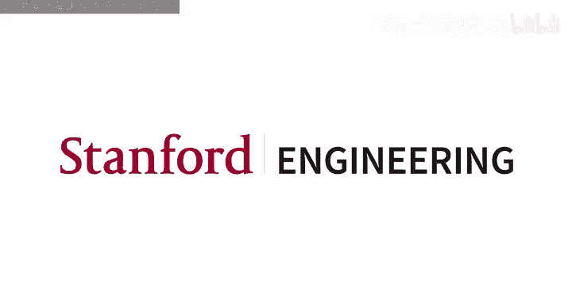
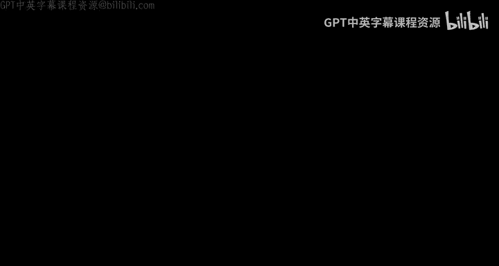
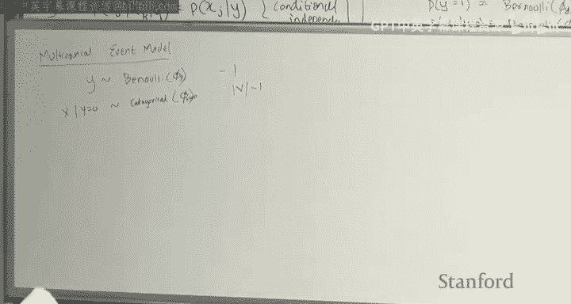
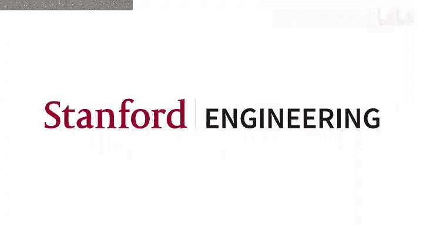

# 斯坦福大学《机器学习｜Stanford CS229 Machine Learning Course  Summer 2019 (Anand Avati)》 - P7：-07-.Lecture 7 - GDA, Naive Bayes & Laplace Smoothing.zh_en - GPT中英字幕课程资源 - BV1NDopY4ECg

Okay， let's get started。 Wele back。

So we're going to continue on to lecture 7 today and。

topicpic for today is going to be generative learning algorithms。

So the plan for today is to cover Gaussian discriment analysis， GA。

 this is also on your homework and then move on to naive base， another generative learning algorithm。

And before we dive into generative models let us look at what we have covered so far so so far we have covered linear regression logistic regression and generalized linear models all three of these are what you may call discriminative algorithms。

We call them discriminative algorithms because they directly model p of y given x where y is the desired output and x is the input and supervised learning in the supervised learning setting we are interested in learning mappings from x to y。

And when y given x is assumed to be a normal distribution。

 what we get as a consequence is linear regression。😊。

And when y given x is assumed to be Bernoulli as a consequence。

 we get logistic regression and when y given x is assumed to be in the exponential family。

 we get generalized linear models。😊，And we saw that generalized linear models is a broad family。

 and it includes。😊，Normal and Bernoulli are special cases。

 So linear regression and logistic regression are special cases of generalized linear models。😊。

And now。Now we're going to start focusing on x。In discriminative algorithms。

 X is assumed to be given。😊，In fact， when we were looking at these methods。😊。

Each of the X J features are attributes。Could have been real valued， could have been imp valued。

 could have been bulloleanions。 And we were kind of agnostic to it。

 But now we are going to focus on x。And。We will model。P of x commma y。

Instead of modeling p of y given x， that was the conditional distribution。

 you now Im going to model P of。Xcoma Y。 That's the full joint distribution。

And this joint distribution is also commonly called as the model。Right。

 and we see that this can be factorized using the chain rule of probability into P of。X given y。

Times。P ofY。Its。P of y is also commonly called as the class prior。Why is it called the class prior。

We will be focusing mostly on the cases where y is discrete valued。

Which means these generative models that we are going to discuss today Gaussian discriment analysis and N base are best suited for classification problems。

So why is？Indicates the class of of a given example。 And P of y is just the marginal probability of。

 of， of y。 And the class prior generally。You think of it as what is the fraction of examples which belong to a particular class without even looking at you know the X features。

 you know， overall in your in your population， what fraction of your examples belong to a particular class。

And。P of x given y is generally high dimension。So p of y given x。In these in these two examples。

 why was a scalar， it is either a real valued or a0 or 1。

Whereas generally p of x  Q and y is high dimensional where x is the set of volume of features and so p of x q and y we are trying to model high dimensional probability distribution because your features can be very high valued and thats in general a harder problem high dimensional probability is in general。

😊，Harder both for you know analytical and computational reasons， yes question。まブ。是的。

so the question is you know why do we want to do generative modeling why do we want to model p of x because x is generally given to us is that the question yeah so there are a few reasons why you want to do this and we will touch upon that towards the end of Gaussian discriminment analysis you know at this point we will kind of compare you know when we want to do one versus the another and that may be a good time to kind of reas that question。

嗯。 so this is。So we want to model P of x Q and Y。 And at prediction time。

 when we want to make a prediction on， on。A new example X test that is given to us。So P of y given x。

Where x is like a new， new example。We can use the base rule to。Swap around。

 This will be P of x given y times P of y。Over。P of x。

P of x Q and y and p of y are are is the direct chain rule expansion of the joint and we get a p of x in the denominator and this can also generally in cases when y is。

Is binary。We can write this as P of。X， Q and Y。namess P of Y。Over。P of x given y equals 0。

P of y equals 0 plus P of。X given y equals 1 times p of y equals 1。

And and we can write it this way because p of x is exactly equal to this when y is。Wise binary。

So this is the base rule。To get P of y given x and P of y given x is generally called the posterior distribution。

And when we want to make a prediction as a class rather than a probability。😊。

So p of y given x will give you the probability of say y equals 1 given x or y equals 0 given x。

But when you want to make a prediction of whether。Example x belongs to the class y equals0 or y equals 1。

We generally。Do it this way。 So y hat equals。Arc max of y。P of y given x。Which is the y？

That has the highest posterior probability。 does y equals 0 have a higher probability or does y equals one have a higher posterior probability And this is。

 this is the the the common recipe for making predictions。

 whether were using Gaussian discriminment analysis or naive ways or you know。

 any generative model in general。And in order to do this。😊，Prediction。You may observe that。

P of y given X。 you can write it like this。 P of this is the R max。Or y and P of y U x was。

B of X given and Y。Pf。Y over P of x。In order to calculate the R max over y。We observe that p of x。

 the denominator。Is just some constant。 and it's going to evaluate to the same value。

For the cases of y equals 0 and for the case of y equals  one， which means。This is the same mass。

Arg max over away。P of x given y times。Pwe。So， for the purposes of making。A prediction。

Of which class we want to assign an example to， we don't even have to calculate the denoator。Yes。

 yes question。うく。こ後？オストワイ。で。情報がふ。Yeah， so the question is， P of y has。

A meaningful interpretation you can think of it as a fraction of examples that are positive you know what what what does p of x mean and p of x means it can mean different things and different problems So p of x you can think of it as what is the probability that you are going to encounter this example this input。

In your population， that's one way to think of it。 And it could have， you know。

It could be could belong to class 0 or class1， but you you know given given an input example。

 you know you are trying to answer the question， what is the probability of encountering that input？

That's that's rough intuition， Yes， question。What's the significance of maximizing y， so。

What we are calculating here is。We are trying to find out which value of y results in the highest posterior probability because we want to we want to consider that value of y as our prediction。

Does that make sense。So if our goal is to just make a decision of。Choosing y equals 0 or y equals 1。

Then for that problem of making a decision of y equals 0 or y equals1。

 we don't even have to calculate the denominator。 But if you want to calculate the probability of。

Of y given x， then we absolutely need to calculate the denominator。 The two are different problems。

If you want to calculate the exact probability， is it 077 or 05 or 0。

2 then you absolutely need to calculate the denominator。

 but if your problem is to only decide whether。Probability of y equals0 given x is greater than or lesser than probability of y equals1 given x just to do the the greater than or less than then you don't need the denominator。

Yes question。So in this case， the question is when the probability of x change depend on what class it came from。

 so in this case we have marginalized out the class。

So you're just considering all the examples in in one common pool where， you know， you know。

 they're mixed with all the classes and just going to pick one example at random of and ask what's what's the probability that you observe the input。

So。So in this setting， we are going to cover two different algorithms。😊，喂。

Two algorithm algorithms for today。And for both the algorithms。Why will be discrete？

So the first algorithm is GD， Gaussian discriment analysis。And this axis continues。When。

And the other algorithm you can consider is naive base。In this。X is discrete。And， you know。

 the example that you're going to use is text classification。So indiscrmative algorithms when。

We we had two different kinds of algorithms， depending on whether y was continuous or discrete。

Over here， our focus is on x。And we are going to get two different kinds of algorithms depending on whether x was continuous or x was discrete。

 but we are limiting ourselves to the case of classification only so we are going to limit ourselves to you know y equals 0 or 1 but your x's can be continuous or discrete。

😊，And。Before we jump into our。First， learning algorithm。First jump into GDA。Just some terminology。

So the model。We call the joint probability of p of x comma y as the model so this is。The joint。

P of x comma y。And it is common practice to。Define our model or express our model as a data generating process。

Data generating process。And this process is。Is represented as a hierarchy of。Of steps。

With which we generate our model and this has a one to one correspondence with the way we factorize our joint probability。

Now what does this mean， lets let's see the case of GD to。

To get a concrete sense of what we mean by this。The GD。This is our first gender to model。So in G。

 we define the model like this as a data generating process。So why？A sample from。

Bernoulli with parameter fee。X given y。Sample x equals y equal 0， a sample from。

A normal distribution。With mean mu nu。And covariance， sigma。

X given y equals1 is sampled from a normal distribution with mean mu1 and covariance sigma。

So this is a hierarchy of how。A hierarchy of steps。With which we can generate our data。

 So first sample。A class variable from a beernoulli distribution with parameter phi that decides whether the example that we are about to generate belongs to the class y equals 0 or does it belong to the class y equals 1。

And then， we generate。The input x given y equals 0 according to a normal distribution with some mean and covariance and if y equals1 we generate the example as a sample from a different normal distribution with mean new one but in this case we are sharing the covariance matrix and we will go into the details of why we do that later but for now assume both the normal distributions share the covariance matrix but have different means。

And。For this sequence of steps。The corresponding distributions will be。P of y。It was。

Phi y times 1 minus phi to the1 minus y。 And this is the Bernoulli。The Bnoli distribution。And。P of x。

 given y equals 0。Z equal2。On over。2 pi to the D by 2。One half。half。😔，X minus new。Transpo。Similarly。

 P of。It one。Right。And。Here， why is in。0，1。X is in。AlD。 so。What do we have here。

 So p of y is is a simple Bernoulli and let me just write the parameters in a different color。

So these are all parameters。F。And P of x given y equals 0 is。Prameter here。Not。Sick mind verse。

You not， and similarly。This case。So y is is is discrete。

 its either 0 or 1 and depending on what why we sample。We generate an x。

 that is the input based on one either one of the two Gaussian distributions with different means。

 but they share the same covariant structure。The generative algorithms。

 one way to think of them is indicrminative algorithms。You are asked to。

Differentiate or given given an input example， you are asked to decide whether that example belong to you know。

 one class or another class right where you are kind of acting like a critic where you know。

 you're given an X and you are asked to classify it as x versus y。 whereas in generative algorithms。

 the way you think of them is you are asked to kind of。Generate the input。 You're kind of here。 Now。

 you're kind of acting like an artist。 You're kind of come up with construct an example X。

 which look different for different different examples。 right and for different classes。 So the the。

So， the goal here are kind of different in some way where in one case。In discriminative algorithms。

 all you are asked to do is。Have good。Power to discriminate whether an example belongs to x equal y equals 0 or y equals 1。

 which means you may limit yourself to just look for certain certain cues in the input that help you discriminate it and just ignore the rest of rest of the example whereas in generative algorithms you are asked to generate an entire example right you're expected to come up with a full description of what makes up a good algorithm of a good image or a good you know example of y equals0 or y equals one class right so in general generative model generative modeling is is。

A harder problem。Compar to discriminative modeling。 and you can also see that because。Now。

 p of x comma y is equal to p of y given x times p of x。

 which means in order to learn a generative model， you have to learn a discriminative model and also learn something else。

So， generative modeling in general is a harder problem compared to just the problem of learning one of the conditional。

😊，So this is think of this as discriminative。And this is。Gender to。

 and you have something extra as well。 you know， compared to discal model。 Yes question。こちらあ。そいこいくの。

So the question is with a generative model given some training set for example。

 we learn how to generate new training examples but we won't make a prediction is that the question so so the the question the answer to that is is no。

Because。We are studying these in the context of supervised learning。

 which means our end goal at least in this part of the course is still making predictions right and what we are doing is that we are learning the joint distribution。

 which means。Not only can we generate new examples， we can also discriminate them。Rightい。Dos。

Exactly so when we want to discriminate we will use the base rule to construct a posterior distribution and the posterior distribution you know and here is a recipe to construct the posterior distribution using the generative modeling components and we can use this recipe to make predictions on new examples。

😊，All right。Back to GD。We have defined the model like this where y is in。

Y is binary 0 or 1 x continuous。And。TheThe parameters of this model。parametersmeter are。

Phi that belong to the Bnoulli。Me not。That belonged to this distribution， new one that belongs to。

The second third distribution and sigma that' is common to both。

So first we define the data generating process in order to come up with with with this step you don't need any data right this is just math you are making an assumption that this is the way your data is generated right and with this assumption we have already defined our probability densities we have determined what our parameters are。

And then， we observe data。And when we observe data。

 we can use the data to fit our model and learn these parameters using maximum likelihood。😊，Right。So。

Maximum likelihood。To learn parameter。In order to perform maximum likelihood。

 the first step is to write out the likelihood function or the log likelihood function and in this case the log likelihood。

Looks like this so it is the likelihood is a function over p parameters。

 not the data right a probability density is a function of the data and assumes parameters and the likelihood is a function of p parameters。

Fi。😔，You not。The one sigma。And this is。Eals 1，2 n。The joint P of。アイか onワイアイ。

And this is where generative modeling differs from discriminative modeling right in discriminative models。

 we use p of y given x。😊，And in case of gender to models， we use the join P of x comma y。

And this is the key key difference between generative models and discriminative models in generative models。

 we are interested in the joint probability of p of x comma y。And in this cognitiveive models。

 we only care about P of y given x。This question。More business so be also excellent。

Yeah so the question is what' is the intuition about this and yeah so the intuition is exactly that what the what is the probability or you know what probability is wrong word in this case you know it' is the likelihood but if you just focus on this then you know it' is the probability of finding a specific X Y pair if you just sample it from your population of examples。

もお。So in， in the， the。The analogy in case of p of y given x is you are given an x you had no x is not sample you know somebody gave it to you right and now for that given x what values of y could it possibly have。

Right， we we kind of limit ourselves to a universe where we have only one example， right。

P of y given x。And given that x， you know， most of the times it could be say y equals one。

 but sometimes it can be y equals 0。 And that's your probability of y given x。こしおわ。

On the extra way to busy。So you want to make。没包度。Where is the proof？

So the question in the discrimative sense， why did this product make sense？

So in the in the discrimative case， we had， you know product I equals1，2 n P of。Why I given。

X I in this case， for each example， we are。We are assuming x got decided somehow beyond our scope。

 you know， somebody else decided x for us for this example right and for and there are in such situations where x got decided to different values in each situation and we are only interested in modeling why。

For those specific examples。And so here we get one probability， here we get a different probability。

 another probability and the joint is just the product of them because of the independence assumption。

And similarly here， in this case， you know， the joint is just the product of the individuals because of the IID assumption。

And this we can write it as log of。I equals 1，2， n。Ill just break it down P of。X， I given。Why I。

Times P of。Yhy I？And we know what P of X I given Y I and P of Y IR， and they are right here。

 So we plug them in here。Right。Take these， take these definitions of X Q and Y and P of Y。

 P them in here。Right， and solve。喂。Solve， take the log likelihood。

And maximize it with respect to the parameters。Right， and you get。Estimates for。Theta Phi hat。Mha。

Sma。Once you solve for the gradient of this with respect to your parameters is equal to 0。

 solve for them， and those are your estimates。We have done this for weve done this for linear regression。

 and you can follow something very similar。Next question。同じな。Re you。比经行。

So the question is in this case why don't we just maximize the condition of y given x right and in order to make to define what is y given x in this case。

Going by this data generative process， you know， y U next does not have a straight answer。

RightSo the the the data generating process only tells us what is x given y， And that's a normal。

 So what's y given x here。 You have to apply base rule。

And in order to apply base rule you need to be able to compute the individual parts of the base rule and in order to compute them you need to have solve for the parameter values and the way we solve for the parameter values is by doing maximum like your。

Right， so。Maximize the joint likelihood you get the you get the parameter values which fit the data。

 and then you apply base rule to get your conditional p of y given x。Yes question。ではこ想する。

Its always a cool concert。難し。Y， so coming to that next， was there another question？Yes。それとそんな。そじ？

So the question is， should I be dividing by P of x over here？So， so。So the question is， you know。

 do we need a p of x here over here and we need the p of x over here only to get p of y given x。

But in generative modules we are you know for p of x comm y you don't need a p of x in the denominator right in generative modeling this is our likelihood objective。

And that that's the fundamental difference between discriminative models and generative models right in discrimative models this will Vp of y given x in which case。

You technically need a P of x here。 But for generative models， we want to。

 we want to have the ability to generate a new。You know， full data set by just sampling from。

 from the model。So。Yeah， so。Movinging on， so take the derivative set it equal to 0。

 solve solve for the different parameters and what we get is。C hat。Equals 1 over n。I equals 1，2， n。

こトワ。And these are the closed form solutions for。If you take this objective。

 plug in the density street as a likelihood。😊，Differentiate。

 take the partials with respect to each parameter of this entire expression sat set the partials equal to 0 and solve for the parameters。

These are these solutions you get。 And this is what is there in your homework。Right， yes of course。

So so the question is， okay， so let us go deeper into what what each of these terms mean。Over here。

We are using this， this notation。Right， so this is know， supposing there's some expression here。

 This is basically equal to。1， if。Expression。Is true。And 0。You know， if， if it's false。Right， so。

Each of these， So Y I。Is one for a few examples，0 for a few other examples。

 So here we are basically counting the number of examples for which Y I equals 1。

And dividing it by n So what fraction of your examples are labeled1 is what P hat will evaluate2。

Over here。For mu not。We are。Summing over those excs for which Y I equals 0。Right， because。

This indicator function。 So this notation is called an indicator variable。

 So this indicator function will evaluate to。This indicator function。

Will evaluate to1 only for those examples for which y i equals0 so you are only summing over x size for which y i equals0 and you here you are counting the number of examples for which Y equals0 right and similarly here you have you are doing the same for mu1。

Now what is what what is the deal with sigma here， there are no indicator variables here。

But what we observe here is that for each example， we are subtracting it from。

The mean that is specific to that example， so we have two means one mean for Y i equals 0 and another mean for y i equals 1。

What this means is subtract from x。The mean， which belongs to its Yi。Does inflation make sense？

Subtract from x。The mean that corresponds to its label。

And this is basically you know these are the solutions。

 and in your homework you will be deriving it and proving that these are actually these solutions。

 which is basically just calculus。 It's the the computation can be a little。Were both。

 but you know it' is pretty straightforward。And yeah， so these are these are the。ELly。

 the maximum likelihood estimates of the Gaussian discriment analysis。 So we start with。

Defining a model。Get the corresponding。Denssities are the probability distributions。

Identify what our parameters are。Write out the log likelihood objective as the product of the joints。

Because that's what we model in generative models。 We model the joint distribution。

And break it down into components and the way we break down broke this down as p of x times x cube y times p of y was because that is the factorization that we readily have at our hand。

Plug in the appropriate。Denssities for p of x con y and p of y in this likelihood objective and take the derivative of the entire likelihood objective with respect to the parameters。

 set them equal to 0， solve for them and you get these。Yes question。Yes， this should be my heart。

 Thank you。Yes question。这是你是个。I didn just like。不足？もします。Yeah， so if we don't like indicator functions。

 you could， for example， write this as。指動選手。Yeah， yeah。 this is just equal notation。 I such that。Why。

😔，I equals 1。X I over summation over I， such that。Y， I equals 1。1。So this is。

 this is just another notation which calculates or results in the same same value。

 right Here we are explicitly multiplying。😊，Some of the x is by 0。

 And here we are just skipping over them in the index。What are equal notations。Yes question。我 is这。

the same focused deployment。So the question is， can we have。Normal for one class Poson for another。

I mean。You technically can。 you can define your model any you want。 The question is。

 is that meaningful。Right。APoson is basically counts so you know you know and a normalist is real valued so if you already know that some of your data is counts belong to one class and the data that take real values belong to another class then you know you kind of already you know why why go through this exercise in a way but you know from a statistical point of view you can absolutely do that except you know those x's that have Poisson must be。

Count valued or or or integers， positive integers。 And those x belong to the normal must be real valued。

 So if you have a way to kind of。You know， make your math compatible with， you know。

 some Xs having a different data type versus other Xs。 then yes， you can， you can absolutely do that。

Yes， question。不上品的。That so problem。So the question is。In this case。

 will this be a concave function in this particular case I believe it is。

 but in general it need not be。In general， it need not be， but I think in this particular case it is。

そう。Yeah， so in cases when so the question is you know。

 is this is this concave and how can we do this without knowing in this case it is concave and so this works。

In general， just taking the derivative and setting it equal to0 may not work。

 but in those cases where you know so。😊，If you it so happens that for cases where closed form solutions exist。

 they tend to be concave。😊，And for cases where you don't have closeform solutions。

 you tend to do gradient decent。So you you can optimize this using gradient ascent and in that case you know if you are doing gradient ascent。

 you will reach some kind of a local maximum。Yes， question。Yes， well you're coming to that next。

Right， so let's one。So， here we see that。by following the above steps。

 we we calculate the parameter values for the joint and using the recipe given here you can construct a posterior distribution for y given x。

Using you know a plugin P of x Q and y， which is Gausian， P of y， Bnoulli， Gaussian， Bernoulli。

 Gaussian Bernoulli， and you will get an expression for P of y given x。

And it so happens that for the case of Gaussian discriment analysis。

With the with with the shared sigma variable， shared covariance。

We see that the posterior distribution takes the form of the logistic regression。

What do I mean by that， let me write it out to make it more concrete。Right。

 so if you go through this exercise of calculating the posterior distribution for Gaussian discriminant analysis。

 we get。P of y equals one， given x。can be written in the form1 over one plus。

E Xp of minus theta transpose x where theta。Depends。Only on。Mu， not Mi 1。Pe and sigma。

 And this is also on your homework where you need to where you show that given Gausian discriment analysis model。

You can represent the posterior distribution of y given x。

Can be represented in this form where theta is theta has a。

Theta can be represented only with mu not mu1 sigma and phi。

So this means the intuition to have here is。This says you have you not here。So here， these。

 this is x1。X， B。Let's say this is。New zero。1。Different color for this。Man。And。

They share so we have different two different means。Each mean is specific to each class。

 a blue class and a red class。And both of them share the same covariant structure so if we write out the contour lines for some for these examples。

 they might look like this。But these are the control plot for the density of class  one。

 and these are the。Contour plots。OrD。Denssity of of。The other class， and。

Our examples are sampled from these Gaussians， so。Let's say we have。Rely for the red class。Exles。

So we start with just the。With just the data points。

And we fit the GD model and your GD model would learn these to be your muse or values sufficiently close to be the two mus and the two sigmas and the common shared covariance structure。

And Phi would just be the the fraction of examples in the red and fraction of to the total fraction。

 for example。And。The posterior distribution。Which you can think of as the。As the。

Or the separating hyperplane， which will， which corresponds to P of。Y equals1 given x equals 0。5。

 which is also equal to p of y equals 0 given x。 So the the set of all points， x points for which。

Y equals one class and y equals0 class assign know。

Where the point has equal probability of belonging to the y equals1 class or the y equals0 class would be something like this。

And the claim here is that for any Gaussian discriment analysis model that share the same sigma。

The posterior distribution of y given x。Can be represented as a logistic regression model。

Where the thetas。Only depend on on the parameters of the model。So which means GD。

Any GDA can be written as a logistic regression model。Right。Now。

 the reason why the two covariant structures are the two。

The two covariance structures are similarly oriented and similar in shape and size is because they you know they come off the same covariance matrix and these ellipsoids。

Are are are the shape and and orientation and size are completely determined by the。

The covariance matrix and the principal aes of these。

covariance matrix are basically the eigenvectors of this covariance matrix and the eigenvalues tell you how how spread they are in each of those axes。

Yes question。Yes， the fee fee also decides where the hyperplane will at， yes。

The hybrid plane will will depend on fee。 It's going to depend on。Phi， mu， not mu1 and sigma。

 all the variables。Exactly， so this theta over here。😊。

I is vector valued you and the the value of theta n theta 1 theta 2 will depend will be a function of these parameters。

This question。哦。Yeah。他そ。どでして。Actually， you're right。 So this should， this should not be。Yeah。

 it shouldn't be it should just be equal。 It shouldn't be 05。 you're right。

So it's a line because you can represent it in this form and this is your logistic regression and you know。

Yes， no course。So the question is what if they have different covariance matrices we made an assumption that you are going youre going to assume that both the classes are going to share the same covariance matrix right and if if the two classes dont have the same covariance matrix you can think of it like this right so one class well lets say is。

Concentrate over here。And。Wait a second。 what I write here。 So this。

 this I I completely messed it up。 sorry。 So this this the the line that corresponds to p of x given y equals 0 equals p of x given y equals 1。

 sorry。Does that make sense the the set of all points which have the same density under class one and same and。

The same density under class 0。That could be a straight line in this case。

In case of if we have two different covariances。You， your examples may look like this。

so you have some examples that are say more concentrated here another class examples are more dispersed right and in this case the set of all points that。

Have the same probability under class 0 and class 1 would would actually look something like。

In of a straight line。So these would be the set of all points。

Which have the same probability under class 0 or under class 1。

If both of them share the same covariance structure， then this line will be a straight line。

And if if they are， if they have unequal covariances。

 then it would be actually it can actually be represented as a quadraratic instead of linear。Yes。

 you can think of it as logistic regression with polynomial features。 Yeah。

 that's one way to think of， yes。ずなて。I would encourage you to plot it and you' will see that you know it' is going to curve towards the one which is more concentrated。

You just just， just， you know， take two covariant structures and plot the set of points which are。

 which have equal probability under both classes。 and it's gonna come like this。Any other questions？

So。A GDA model。For a given G model will uniquely determine a logistic regression model for its posterior distribution。

Whereas the converse is not true， if you have a logistic regression model it may not be the posterior distribution of a GD model right it could be could it need not be a posterior distribution of any model or it could be a posterior distribution of some other model whereas if you have a GD model。

 its posterior is always a logistic regression model。And。The， the。The G model。

Is making a stronger assumption。In the sense that it is making a stronger assumption that your data is actually。

Distributed according to Gausian distributions， the two classes actually have a Gaussian distributions with the shared covari structure。

 It's making that assumption。Now， if that assumption is true。

Then your GD model will tend to be more efficient or more asymptotically efficient or more sample efficient compared to logistic regression。

When when the assumption holds true， then GDA is a better model。

 you probably need a lot fewer examples to get some level of accuracy compared to a logistic regression。

However， logistic regression does not make any assumption and tends to be more robust。😊。

It might need a little more data in cases where the assumptions are true。

 but it tends to work well even when you know the assumptions are not met it is a pretty robust algorithm。

And in practice， you know， almost always logistic regression should probably be your first choice of。

First choice of algorithm to try out on a given data set because you know assumptions may or may not hold true in cases where the assumptions do hold true。

 GDA will be slightly more efficient in terms of the number of examples required。

RightThat's thats and in your homework， you will will also basically see you know。

You you'll be seeing this phenomenon in your homework as well when you plot your data。

 some of which know may be distributed according to Gaussians。

 some of which are not and see the model performance between GA and logistic regression on both those situations all that is part of your homework question one。

Any questions before we move on to knife base。Yes。So。

 under what assumptions can you map logistic regression back to GA。

 the extra assumption is that your x's are coming from a Gausian and having same covariance。

All right， let's move on to knife base。The center line。Yes， so if the covariances are are the same。

 then the the line that has equal probability under the two classes will be a straight line， yes。So。

 when you solve for1 over 1 plus e to the minus theta transpose x equal to 0。5。

 you will see that theta transpose x must be equal to 0， so that will be r。Hell be aligned。All right。

9 base。So。In GDA， we saw that the x's are real valued， they live in some D dimensional real space。

But that's generally not how。That does not account for all the different ways in which we encounter data。

 for example， our data may be you know text messages。

 emails and we may want to build a spam classifier for whether given a text message or email is spam or not。

In those cases， you know， your inputs are basically strings you know it's a list of words。

 and that doesn't fit well as you know as a multivariate Gaussian。And so， when our。

X's are discrete valued。Disreet。That's when we use knife bass。In order to use knife base。

X is discrete value， most commonly we use it for text classification。For example， spam filters。

That's going to be the running example today。And。This would be a good time to review conditional independence。

A conent probability。So， conditional independence。Means given to random variables， X J and。X K。

We say they are。Independent， if probability of x J given x K equals probability of。Xj。

This is the definition of independence。We say they are， so this is independence。

We see they are conditionally independent。When condition on some new random variable say y。

 lets say why。So P of X J given X， K， comma y。Its p of。X J。😔，W。This is。Conditional。Independence。

When conditioned on why。Now， can。Anybody tell me， does independence imply conditional independence？

Does conditional independence imply independence。And what is the answer to the first one does independence apply conditional independence。

我说。So， does independence imply conditional independence and does conditional independence imply independence。

Yeah， that' is correct。 So both the answer is no to both right in in in general conditional independence your random variables could be conditionally independent that doesn't say anything of whether they are independent or not they may not be conditionally independent and even that does not say anything about whether they are independent independent or not conditional independent assumes your your。

Assumes that both sides are conditioned on a third variable like y。And in this case。

 we are going we are going to make use of conditional independence。😊，And。

 and this is this is just a refresher for what conditional independence is。 Yes question。So。

 the first。In9 ways we are going to consider two different kind of event models， the first thing。

 the first model that we are going to consider is called the Bernoulli event model。

So in the Bernoul event model。😊，The mental picture to have is。

 let's say we have a text message which says， you know， buy our lottery。

So this is a sequence of alphabets。😊，And。We want to convert this into some kind of， you know。

 some kind of a vector some and the way we do that is。

To come up with what's called multi heart representation。Where imagine you have a long vector where。

😊，Each component of the vector。Is associated with some word in the dictionary。

So let's say the first word first component belongs to the word a。

And you know if you go through some dictionary here we' are going to assume English。

 but you know the concepts apply for anything， the second word in the dictionary would be say artwork。

And the terrorist。Artworth and so on。 Then the word by is going to show up in your dictionary。

Lottery。Howeverer。And。Some last words， Z， Y G M。word And first we're going to convert our sequence of words。

Into a fixed length vector。Where you have zeros in places for those words that do not appear in the message。

Right， and。1 in places where those words do appear in the message。So we're going to assume。A fixed。

Set of words， which is called the vocabulary。Right。And we will， we assume。

This vocabulary for each word to have a fixed location in this long vector。

And given a new new input text message。We will convert it into a fixed length vector。

Where we have zeros in places where word the word does not appear in the text message and one in places where the word appears in the text message。

 it doesn't matter how many times it appears。 The question is does it appear once or more。

Yes question。O。We're going to talk about it。So， here。X。Is so if our vocabulary has。D dimensions。

 right， So if。Discount as B， then x belongs to 0，1。To the power D， this is how we write。

AD dimensional vector， where each。Element is either 0 or one。And any given Xj。Is either zero or1？

Right。And。You make the assumption P of。X J。And we write out our model like this。

 So this is our model。Just as the way in case of the Gaussian discriment analysis。

 we we had a hierarchical model that describe how the data was generated。

 similarly we are going to have a model here。P of y。Equals 1。Equals。Phi， y。And。P of X J。

Given y equals 0 equals。Fi。J given y equals0。So， were going to assume that。

There is one Brnoulli distribution parameterized by phi y or phi subscript y is one value between 0 and 1 and that is the parameter of this Bernoulli distribution。

Which tells us what fraction of our overall text messages are spammy versus not。Right。

It's just the class p。And then。We have two sets or two collections of Bnoulli variables。

One set for the class y equals 0， so for y equals 0， we have a pj for each j from 1 to d。

Which tells us what is the probability that xj equals 1 when。The class is 0。

And another set of Bernoulli variables， a full set of beernoulli variables corresponding to y equals 1。

 which tells us what is the probability that xj equals 1 when the class is 1。Yeah。So。

 what this means is what is the probability that this word the word corresponding to the index J？

Will'll show up。In an email that is spammy and this tells you what is the probability that the word index by J shows up in an email or text message that is not spammy。

Next question。So what's the number of parameters here， So here we have。One parameter。Here， we have。

Technically， we have D-1 parameters。 Oh know。 So here we have D parameters。 And here also。

 we have D parameters。 So 2 D plus1 parameters。Good question。 Does it make sense。

 We have one parameter to to give us the class priors， whether just you know what。

In the entire population what fraction of messages are spamy versus not and then condition on you know by limiting ourselves to say only the spay emails。

 then we have one parameter for each word that tells us the probability that the word will appear in a spay email or the probability that it will appear in non spay。

上这个。So there are d such distributions for each j， so j can be from 1 to d。

So you have D such pernoly distributions。ので？I'm sorry。 I I didn't get the question。

Now there are two different sets of variables， two different sets of distributions。And for this。

 so this is our model。😊，And we can write out the。Likelihood function for。威。Phi of j given y equals 0。

Phi of j U and y equals one。 So basically think of this as this is one parameter。

 This is a set of D parameters。 This is another set of D parameters。

 and the likelihood can now be written as the probability of。あ the。Lo probability equals1 to n。Peer。

X， I。Yi。Given the full set and this can now be written as。I equals1 to n。P of y。I given。Beer。Fhif。

Wei。😔，Times。Product， J equals 1。To be。P of X， J。I given。Wai。😔，Ae。And the way we can， we can。

We came up with this term as the product of all the different x Js is using the the conditional independence assumption。

 What that basically the way we came up with that is P of say x1 x2。X D given y。

 this is P of x given y can be written using the chain roll as P of。X，1， given y times。P of。

X 2 given x 1 comma y times P of。X 3 given。Xa y， and so on。

And with a conditional independent assumption， each of this becomes p of x1 given y。

 and with a conditional independent assumption， this becomes p of x 2 given y。

 and this becomes P of x 3 given y and so on。 And this product is whats written here。Right， so。

You know， just the way the I IDD assumption allows us to factor out different exam the the probability or the likelihood of the probability of the full data into product of the individual probabilities。

 similarly conditional independence allows us to break down。This full collection。

 given why as know the product of the individuals。So， this is the likelihood。

And each of these we know is a Bernoulli and we know the probability density of a Bernoulli plug them in。

😊，Take the gradient， take the partials with respect to each parameter， set it equal to 0。

And by doing that， we get the maximum likelihood estimates。MLE estimates。Phi J， given y equals。

1 is equal to。I equals 1 to n。X。Zhi。😔，What does this mean？

The probability that the the word belonging to the J index in the dictionary。Is。

I the probability that the J word in the vocabulary is going to show up in a spammy email。Is。

Equal to the number of times the word appears in spammy emails。

Divided by the total number of spy emails。Right this expression looks a little cryptic。

 but it is actually pretty simple。 What it is doing is it is。😊。

You scan over every email or every text message equals one to n。And。

Count the number of times or count the number of text messages where the Jith word appears and the message is spammy。

And divided by the total number of。Emails， total number of text messages that are spa。

It's just calculating in what fraction of the spy emails does the J word appear。Right。

The syntax looks a little cryptic， but you know the idea is very simple。Yes question。This fee。

So this fee is basically the full collection。 I've just written it as fee。😊，It's too deep plus one。

Yes question。ワとする。Yeah， so， yeah。 So and similarly。

Phi j given y equals 0 is equal to same story I equals 1 to n indicator。X I J equals 1。And。

 so this is the logical end。Right。And。Y I equals 0。Divided by。Eals 12 n。Indicator y I equals 0。

Finally。Fu。😔，Why is it equal to。And。Indicator。はいはいこし。1， divided by n。So the phi y parameter。

Is estimated as the number of spammy messages divided by n。喂。And。Each for each class of you know。

 spamy versus not spamy， you get a full collection of Brnos per word。

 and they are estimated as the number of the number of messages in which the word appears。

Divided by the total number of messages in that class。 and its the same definition here。

 but we just switch y equals1 here。Next question。This one。

So here we just broke down the joint into the factors so think of you know we start with this joint。

And you can write this as P of。X， I given Y， I times P of。はいはい。Right。And。And this one。

 we factorize it using the conditional independent assumption。

So this this is just this is just the factorization of this by making use of the condition conditional independence。

😊，あだと。Yeah， this parameter is by phi of y。Yes question。あ別こにしないですね。とも。

So the what does condition assumption mean here， It means when you know whether when a message is Pammy。

 then the probability of word。A appearing is independent of whether word be appeared or not tonight。

あさも。先生あの。Yeah， so if certain words always appear together。

 it does violate the conditional independence assumption。

But we are just gonna make that assumption anyways， just to make the math simple， yes。不是就说。Yes。

 this ignores the order in which the words come yes。you。necessarily words。Yes。So in， in。

 in spy email， some words。Are not necessarily spammy right。

 like words like the and are not necessarily spammy。

 But what we see is that by by making this assumption。And。By this。

 this this set of assumptions generally tends to work well in practice。

 even though you know there are。The the intuition there is that if a word has no significance in terms of its indicator of power。

 then it's going to。Contribute equally to both the classes and its effects kind of cancels out。

 That's the intuition to have like common words will have equal weight in those in in for both classes。

 but words that have a high。Indicative power of spists will。

Will will bump up the class probability higher。So that's the maximum likelihood estimate。

And from this， how do we make predictions now？So， we follow MLE and we estimate all the parameters and once we have estimate the parameters。

We're to make predictions。Using the base。So base rule tells us p of y equals1。

 given x is equal to p of x given y。P of Y given x。P of Y。嗯。Divided by P of x。And this is equal to。

B of x， given y。Times p of y over p of x given y equals 0 times p。zero plus。Now。

To make predictions on a new email X， you are going to first convert it into a feature vector of D dimensions。

And we are going to calculate these terms。嗯。So， P of y。

We estimated the and here we are just going to use you know， Phi y。

And this is basically the product equals 1 j equals 12 d。X。I given。Why。Times P of。huai。

Divided by that denominator。And。Using again， again， using the conditional independence assumption。

 we can break down the the the long vector of， of the feature vector of the new email into product of the individual Bnoles。

Right， and。Multiplily by the class probability We get the probability of of P of y equals one。

 So we do P of y equals one given。X equal。And similarly， you can calculate P of。Y equals0， given x。

To be。The same thing with， but。I know。And in order to make a prediction。

 what is commonly done is you calculate numerator 1 and you calculate numerator2 and see which of the two numerators is bigger than the other。

Okay， so。One problem that we may encounter with this method。So any questions on this so far？

 Yes question。So， these two add up to one once you calculate the denominator and normalize them they will add to one。

 but just the two numerators need not add up to one。Yeah， if you want to get the probability value。

 then you need to。Then you need to calculate the denominator。

 but if all what you want is to make a decision of which of the two has a higher probability then you don't need to calculate the denominator。

So， one problem that we may encounter with this method is。What happens if。At test time。

 we encounter a word。That was never seen in the training set。Right， so our。So in this model。

What if the words say artwork never showed up in our training set？

Neither in positive examples nor in negative examples。

And we end up estimating the fees for the word artwork to be0 and 0 because the numerator is0 in both the places。

And at test time。What do we do at test time， it means。

For the word artwork at test time you are going to end up with 0 over 0 plus0 because this is going to be 0 if the word hard appears in the email the the the probability corresponding to。

The word artwork will make the entire thing equal to 0 and similarly you know this will also factorize and the word artwork we make this0 this0 and you are going to get a 0 over 0 when you encounter words that you have not seen before。

So basically with this， with this method， a problem is if we encounter。

A message at test time that has a word that never appeared in the training set。

Either as class one or as class 2。We， we， the method does not tell us what our prediction should be。

Right。And。For that， what is commonly done is a technique called Laplace movinging。So。

 the place moving was。Invented by。The plus。And。The the origins of Laplace movinging is go something like this so Laplace was basically trying to calculate the probability what what is the probability that the sun is going to rise tomorrow。

 what is the probability that the sun is going to rise the next day。And。

In your training set you basically have only positive examples so every day in you know if you look at the past 100 days or 1 thousand0 days you start collecting your data right every day the sun is rising right and in your so your training set has only positive examples and now when you estimate the probability of what of the sun rising the next day。

Your MLE estimates will give you probability equal to one。It will always be exactly equal to one。😊。

And his claim was， was that。Thats that is suboptimal right the the probability that the sun will rise the next day at some day in the future is going to be zero might be you know the sun may not rise you know。

😊，Someday。 and so。He invented with the correction that he came up with is commonly called Laplace smoothing。

 And the idea of Laplace smoothing is。Supposing you have。Let's say you're doing coin tosses。

So let's say you are trying to estimate the bias of a coin， let's call it phi。

And your x's are0 and 1。Now you take a coin you know flip it 10 times and lets say the coin turns up heads for all the 10 pile。

What is our estimate of P in that case？A fee is supposed to be probability of heads。

so the ML estimate tells us that this is going to be 10 over 10。

And and so our parameter would be the fee would be one。

 but what the plus smoothing tells you is the way to kind of think about that is。

Let's say you're conducting。You're keeping two counts sorry。Count of heads and count of tails。Right。

In pure maximum likelihood。We start with the two counts being0 and as we keep conducting trials。

 we add a 1。And so on。And then we。Sum up the count。Hedge over some over。Count H plus some over。刚退了。

What Laplace smoothing tells us is before we even start conducting our experiments。😊。

Start with count of one for all your classes。Assume a uniform probability before we start conducting our experiment。

And then start your trials and observing data and increment in the counts。And with this technique。

 we see that because we start with a count of one on both sides。Even if all our。

10 experiments come up with a plus one。 The probability of heads in this method will be。10 over 11。

It will never be exactly one and similarly the probability of tails will keep going down as we collect more data it is going to start with 05 and as we keep running experiments and the probability and we keep getting only heads this keeps coming down。

But it will never be exactly 0。😊，This is this is the idea of Laplace smoothing。And。

This lapplace smoothing can be applied to our our spam classifier as well。

So assume that we have seen every word。Once in a spayy email and once in a non spay email。Right。

 initialize your accounts to that and then start observing your data and and accounting for your data。

 So the Laplace smooth version of。So the Laplace smooth version。Of our estimates will be like this。

So for comparison， here is the maximum likelihood estimate， and the La last smooth estimate would be。

P J given y equals1 equals。1。Some over I equals 12 n。X g。I equal1， and。系系。1。Divided by。中。什么味儿？Depen。

So the idea here is you add one。To your to the count。

And you add the number of classes in your problem to the denominator。

 So you add one to the numerator to say you've seen that word at least once and you divided by two。

For to， to account for the fact that。That this evaluates probability a valid probability density。

 valid probability distribution。And similarly， the La plus smooth version of J given y equals 0 will be one plus。

So， this component in the denominator comes from the data。The number of。Messages， which are spamy。

And then you assume you've seen two more messages。One message in which the world appeared and one message in which the world did not appear。

And over here， since this is the probability that the word appears。

 you assume youve seen the word appear in one message and also in the rest of the messages where the word actually appeared right that' is the idea of a plus thing。

And this is if you are familiar with Beijing statistics this is like imposing a beta prior on your parameters if you don't know what that is dont bother but its not only is it just auristic heuristic argument there is also principle explanation of why this is a good thing to do。

Okay， so that's lap last smoothing。And now we。And this this this model is what is also called as the Bernoulli event model。

And there's another variant of。Nive base， which is called the multinoial element。

So in the multinomial event model。Which is a slight variation of this。

Wwhich means a lot of the terminology is going to show up here but may mean slightly different things。

 so please pay attention is it is a slightly different model which makes a different set of assumptions。

And the assumption it makes is that。You know， why again comes from a Bernoulli。The parameter think。

But then each word in your email， which is either you know。Which is either spammy or not spammy， so。

X， given。Y equals 0。A sample from a multinomial。Well。

 so the correct is actually categorical is comes from a categorical distribution。

And we're going to still call it P。Except now， phi is D dimensional。Categoical parameter vector。

In fact， here it will be。 So this is one dimensional。Phi of y。And phi of k given y equals 0 will be。

That's our quality。Will be。The size of your vocabulary， 1 dimension。What does this mean now？

So first I'm going to write out the expressions and then you know give you some intuitions about this。

So， the。So， the ML estimates here。Look like this。肥切。Given y equals one。Here。

 the assumption is that here x。Now， indicate xj indicates the word in the j position of the your text message。

And that can be。That is a word that exists in your dictionary。 So we are is the vocabulary and。

This means the size of your vocabulary， so xj or the J word in a message takes a value between 1 and the size of your vocabulary and X i which is the Ih message。

This the full full message of your I example is。Has length D。

 so each message can have a different length。And X is now a vector of length D where each component can take one of the words in our vocabulary。

喂。Now， the maximum likelihood estimate。For this model。

 we will save a phi of k where k is the word in the vocabulary。😊，Is。

Given by this term where you are summing over every every message and within each message youre summing over every word and counting only those words in those messages which happen to be k and belong to the class that we are interested in。

And divided by the total number of words。Across all messages in that class。And similarly， phi of K。

Given y equals 0。Es basically， the same thing。 Just replace y equals 1 by y equals 0。

And you can also have aplace smooth version of this。

I'm going to write out the Laplace smooth version and then give some more intuitions about this。P。

 K given y equals。1 equals1 plus。I equals 1 to n。J equals 1 to D I。は。はジ。😔，Okay， and。Equals。Wen。😔。

Divide。The vocabulary size。so this is the similarly you have a pk given y equals 0 equals you know a similar thing the c plus y equals1 with0 and the way to think about these the beernoulli event model and the multinomial event model。

Is to probably。Look at how an algorithmic implementation of these two models would look like。😊。

So supposing we have a training set， let's call this you know。By。Our lottery。And。嗯。我等会儿。

By this watch。You have a few examples， and。Let's say you also have a non spiny example， for example。

When is your exam。When does the homework do。Right， now。First， let's look at the Bernoulli。So。

 in the Bernoi。We convert this into a fixed length vector， where you we have。Yi。😔，Ardwork。By。Exam。

And so on。And what we do is。What we do is for each。Example。

 we use an indicator variable to say whether the world appear or not。Right similarly here，s by。

 and there's going be a watch。You know， and zero is everywhere。

 So this is the fixed length representation， which is d dimensional where D is the is the size of your dictionary。

So， the way you want to think about this is in case of the Bernoulli model first we are going to convert a given message into a multi hot vector。

 which means that is one in multiple places。 the word may appear many times in this。

In a given message， but we count it only once。Right， so maybe to clarify this。By this watch。

This watch only。Right。And。We then。And we do this repeat the same thing for the non spamy。

 So here we will have， you know， exam will be one。You know， your will be one， the others will be 0。

Similarly， this will be a few places。 so we have a set of。Smy examples。

And a set of non spayy examples。And for each of these two different classes。

 we have a separate collection of Bernouls per word。So we have one Bernoulli。For the word A。

1 Bernoulli for the word artwork。One Bno for the word by。And each of these Bnoles。

Is estimated by summing over the number of times the word。

Has a one divided by the number of words in that class。Similarly， over here。Another set of Bnoli。

 so this is5 say5 j5 j for y equals1， this is phi j for y equals 0。And each of these five days。

 you just count the fraction of。The fraction of words， the fraction of。Messages in which。

The world appears divided by the number of messages。And similarly， the fraction here。

 this will be one over 2。 This will be2 over 2 and so on。Right， this is。

The Bernoulli model that we discussed first。And similarly， the multinoial， however。

 is a little different。😊，The multinomial。If you were to implement this algorithmically。

Assume you have the same set of words here。Artwork。Bye。Exam， and so on。In this case， however。

 instead of using an indicator， just count the number of times the word appears so。0，0， know buy1。

 lottery is one。Over here again， buy one。Watches 2。 This is watch。Wch was0 here。 you know。

 only is one， whatever。And now。We do the same normalization by summing up the counts。

So the number of times the word appeared across all examples。In your training set。Right。

 whereas over here， it was the number of。Messages or number of examples in which the word appeared。

 Here it is the number of times the word appeared across all messages。

That is the main difference between the Bernoli model and the multinoial model。And so， here our。

So we are going to sum up the counts。 So here it is going to be2，2，2， and maybe some of them it is 3。

 it is4。In the Bernoulli model， each one of them was its own Bernoulli variable。

 so we normalized it locally。In the multinomial model， we want a distribution over wordss。

 so we are going to normalize this entire thing by summing over4 plus2 plus 3 plus2 plus 2。

So the multinoial model gives us a distribution over words。😊。

Of how frequently that word appears in spammy messages or non spamy messages。

And it doesn't care about whether the word appears a thousand times in one message or appears once in 1 thousand0 different messages。

 The multinomial model doesn't care。The Bernoni model， however。

Counts what fraction of the messages has this word？The Bernoulli model cares。

 It doesn't care how many times the word appeared in a message。

 It's just going to count it once per word， once per message。And when you apply Laplace smoothing。

What it basically does is you add。Two messages。One message has zero everywhere。

And one message has one everywhere。Right， and then renormalize it locally。

 You get the la plus smooth version of。The Bernoul event model， similarly， you know。

 you extend the zeros here， one message that has no words and one message that has all the words。

And didn't normalize it。 You get the laplace smooth version of。The multinomial level。Any questions。

 yes question。さります。We so boring。ご存す。Any got。Yes， throw this off because it。

So the question is if there is if there is one spammy message that has a spammy word repeated 10。

000 times， but does not appear in any other message。

tThen this model will up that word like quite a lot。

 This model will will think that you know there is just one message with that word。

 thats the main difference。Responiveよす。A what。所事实不有做。So in this module。

 it is just summing up the words。You know， so one way to think about this model is take all your spay messages。

 concatennate it into one long example。 you get the same model。Even if you have one message。

 that's a concatenation of all your you know， messages。 whereas with this。You。

 you're counting how many number of messages a world appears。That's the main difference between them。

Yes question。Yes。总不の。Exactly。Here， youre only summing up。Right。

 so only the second one will sum up plus V。When you， when you add up all these， you know， the the。

 you know， you're getting zeros over here。And here youre getting one per word。

 So that's that's what gives you the plus。V。So。So， the Laplace smooth version we have a plus you know adding the number the the vocabulary size to the denominator right and that is basically achieved because you are adding a plus one per word。

So， there are， you know。V such words and when you sum up you know the when you sum up all the counts here。

 you get a plus v in the denominator。So by so the Laplace smooth version of by will be in this case。

2 plus1，3 over the original count， whatever it was。Plus。We。Right it's going to be this is 2 plus one。

So it without the plus movinging， it was two plus the original count。 Now。

 it is going to be 2 plus  one。Because you got one from the new message。

And plus V in the denominator， because every word got one。そ。

Some of all the words you're summing over all the number of words right So over here you're summing over the number of words in your spam class or the number of words in your non spam class。

Yes question。あざかさ方。Oh。1。Let keep sample。好use的。I don't think about it。町が先ポすは。Yeah， so the idea is。

 you know。These counts may all be ones or all be zeros and you don't want them to dominate so you add a0 and a 1 for each word。

結ば as the。One， one positive always。Yeah， not应该。Itど。So with Laplace movinging。

 we add one positive and one negative per word。One positive and one negative per word。All right。

 I think were over time。 So that's about it。 If you have any more questions， you know。

 feel free to walk up and I can answer that。

