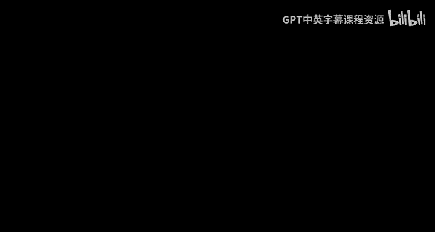
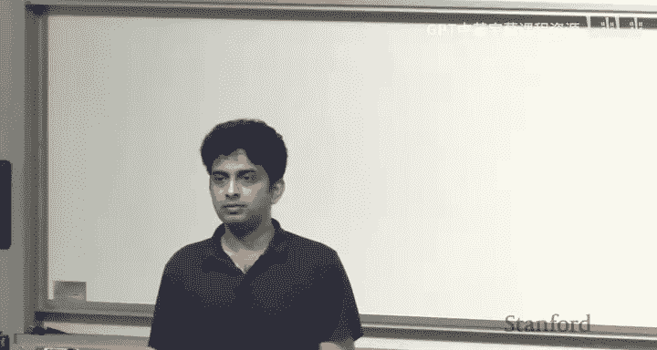
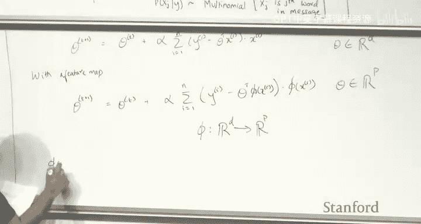
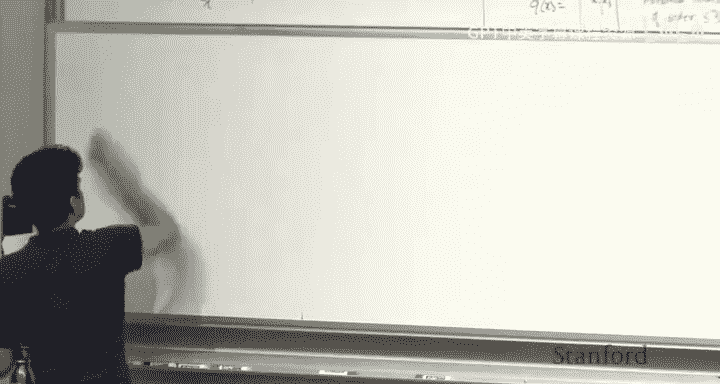
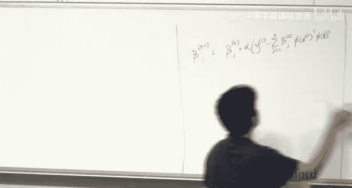
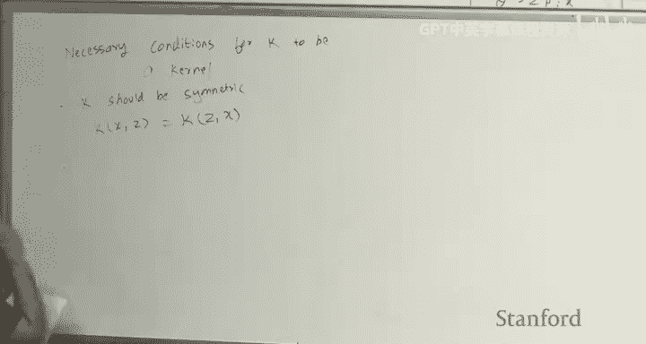
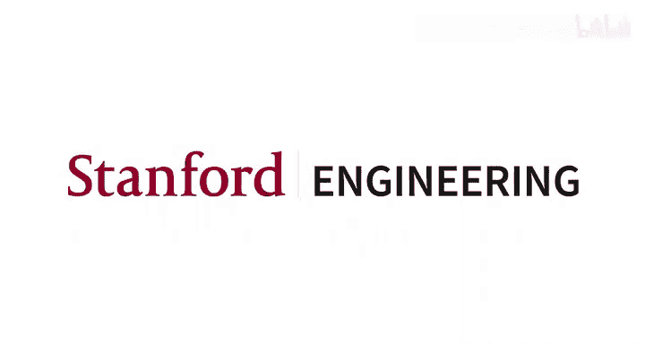

# 斯坦福大学《机器学习｜Stanford CS229 Machine Learning Course  Summer 2019 (Anand Avati)》 - P8：-08-.Lecture 8 - Kernel Methods & Support Vector Machine.zh_en - GPT中英字幕课程资源 - BV1NDopY4ECg

Okay， let's get started。 Welcome back everyone。Trey will continue into lecture 8。That right， yes。

 lecture 8。So the topics for today will be kernel methods and support vector machines。

And before we jump into today's topics， let's do a quick recap of what we covered in the previous lecture。

We covered generative algorithms。Ingenrative algorithms。😊。

For training we maximize the joint probability of P of or the joint likelihood p of x comma y where x is your input and y is the output and we train the parameters using MLE。

And this is generally decomposed into two parts， the class prior and p of x given y。

And at prediction time， we use base rule to construct the posterior distribution of p of y given x。

And the posterior will be different for different models。

Depending on what assumptions we make of whether P of x given y is Gaussian or Bernoulli or whatever you find we find a P of y given x economy right And we saw two examples of two different types of。

Geneerative models， the Gaussian discriment analysis and naive base。

So in Gaussian discriminment analysis。X is continuous。

 the inputs are continuous and we make the assumption that P of x given y follows a normal distribution with a mean that is specific to y。

😊，And some shared covariance sigma。And。The the corresponding posterior for prediction time follows a logistic regression functional form。

And。You have more details of this in your first homework and hopefully that's clear。

Next we saw9 base here x was discrete like words in a text message and we made this crucial conditional independence assumption so to remind you conditional independence means p of xj given y and xk is equal to p of xj given y。

And conditional independence is very different from general independence right if two variables are conditionally independent it says nothing about whether they are independent or not and similarly if two variables are independent it says nothing about whether they are conditionally independent or not。

嗯。And then with with using this conditional independence assumption we constructed two different event models in one of the first event model that we saw was called the Bernoulli event model where P of xj given y follows a Bernoulli distribution and here xj refers to the J word in our vocabulary or our dictionary。

And we saw another model called the multinomial event model where p of Xgune phi follows a multinomial distribution。

 but crucially xj over here refers to the j word in the message here X refer to the J word in the vocabulary and the general intuition behind these two is that in the Berulli event model。

Suppose we applied for says spam classification。The spininess of a word is determined by。

How many messages the word appears in and how many message how in what fraction of the spam messages the word occurs in and what fraction of the non spam messages the word occurs in。

 whereas in the multinoial model， the spaminess of a word is determined by。

What fraction of all the words in the spy messages is this word and what fraction of all the words in the nonpiy messages is this word by not caring about the message boundaries right we consider just the set of the collection of all words across all messages and just construct a multinomial distribution of all the words。

And then we also covered Laplace smoothing where the idea of Laplace smoothing is we don't want to be severely swayed by rare words。

 so words that probably never occurred in our training training training data set we still want to do something meaningful at prediction time and the idea there is we perform something called laplace smoothing where we assume we've seen say every word。

Or we assume that you know we see one example of each class once in our training set and then we start looking at the training data and do our counting of messages or counting words or so on。

RightThats， that's a quick recap of what we did。Any questions on this before we move to the rest topic。

 yes。So the question is， are there any conditions on the prior that that will make the posterior take a logistic form。

 So that's a good question。 So in general， if， if。If we are having。A binary class where y is 0 or1。

Right， and。X given y takes a form， any form in the exponential family。

The posterior will always be a logistic form。Similarly， if your why。Is a categorical。

 So one among many。And X given y belongs to any distribution in the exponential family。

 Then your Y given x will take the soft max form。That's that's， that's a common。

 That's a property that holds for all exponential family distributions with either。

But newly prior or categorical prior。 Good question。Yeah， for for the logistic， X。

 Q and Y needs to be the exponential family。Good question。

Any other questions before we move on to kernel methods？Okay， so let's move on to kernel methods。

So I'm going to start off yes， question。

More。

So the question is， you know， why do we want to use the a generative model in place of say。

 logistic regression for。If if you know the at prediction time。

 if it takes a logistic regression form why not just take you know do logistic regression itself And I think we touched upon this in in the last class。

 So in situations where you don't have a lot of data and you know that your X is distributed according to GD then。

Using GA。You are going to have is is going to be more efficient by efficient I mean sample efficient you can you can achieve higher accuracy or you know your model works better with fewer amount of data if the modeling assumptions hold true if your X Q and y actually follows caution right whereas if logistic regression in general is more robust even if。

These assumptions are violated logistic regression tends to just work well。

 but in those cases where the assumptions hold true。

 then GDA is more sample efficient with fewer number of examples you get a better model。😊，Right。

 so kernel methods。So。So far in the class， all the models that we've seen have been linear models。

 They are they are linear in x and。The for example。

 linear regression gives you a linear hypothesis in x and logistic regression gives you a linear classifying boundary in your data space。

However， as you've probably seen in your homework1 question5 I think you can actually start constructing nonlinear hypothesis using linear regression and similarly we can also construct nonlinear classifiers using logistic regression。

😊，By including higher order features， for example， if you if。Your x， if you map it to some phi of x。

Phi of x is。1 x， x squared No， x to the。4。And now if you perform linear regression on this feature vector rather than performing linear regression directly on x。

😊，The linear regression will give you a non nonlinear hypothesis right。This is x。

Your the linear regression will give you a hypothesis that might。Look like this。

And this is this is because weve included higher order polynomial terms。😊，Now， to。

Extend this into the classification setting， similarly。Right， suppose this is。Next one。X D。

 in this case， it was x and y。Supposing you may have two classes。Now， if you fit a linear regression。

 for example， you might get。ASeparating hyperplane like this。But what if in in in case of。

Logistic regression， our data was something like this。

In such cases we could have just as in the case of linear regression we could have included a few say quadratic features and we would have gotten a separating boundary that looks like this。

 you know it was we were performing logistic regression because we have mapped our data into a higher dimensional feature space。

😊，Now， this seemed a little arbitrary。For example， how many features do we map it to in this case we mapped a one dimensional feature to five dimensions。

Why not map it to 10 dimensions， right？ What's the right answer。

 Why not map it to 1 thousand00 dimensions or even why not map it to an infinite number of dimensions。

It is hard to think of infinite dimensional feature vectors。

 you cannot even represent it explicitly on a computer but we will see that with kernel methods we can actually do such things of taking an example and mapping it to an potentially infinite dimensional feature vector and perform our learning algorithm in that infinite dimensional space。

😊，So， the。In terms of terminology。The given X。We will call it attributes。And phi of x。

 which is the set of features we will call this features。😊。

And in cases when there are no feature maps， it is common to call excess features itself， you know。

 just just think your feature map is an identity function。😊，And。Let's start with。

A motivating example of linear regression。No。How we solve linear regression using gradient descent。

RightIn linear regression for gradient design， we。The update rule we had was theta。T plus one。equal。

Theta D。Yes。Alpha some learning great times。I equals 12 n。Y， I minus。H theta Xi in linear regression。

 this was theta transpose。X。Times。Xi。this was the update rule for linear regression using gradient descent and we run this over and over until the model converges which means our theta vector stops stops changing a lot。

😊，Now， if we were to use a feature map like this。Sou。With a feature map。Be get the rules data。

Tep plus one。Equals。😔，Kkati。less。Alpha times。I equals 1，2， L。Yhy， I minus。Data transpose。Phi of x。喂。

Thankss。Fee of。Xアイ？So we just replaced x with phi of x。

And we are performing gradient descent on this， on this feature map。

 the difference between these two equations is over here。😊，Theta is in。R D。And over here。

 theta is in。Are。K， assuming our fee。Takes you from R D to。R。P。

 the idea here is B is the dimension of your original data and P is some high dimensional space。

 potentially infinite。Right， so。So this is the update rule that we get。😊，And no。

Imagine our feed to be。嗯。A feature map like this， like phi of x。

Equals this just one example。1 x 1。Next2。😔，And all the then。X1 squared。X 1， x 2。X 1， x 3，1。

It x1 cube。X。1 square x2， and so on。So basically a set of all monoomial terms。offff。

Order less than equal to 3。Right。Now， what we see is the number of。

The dimension of the feature vector in this case will be P will be approximately already d cubed。

It' is going to be cubic times for all the three order terms and some two order terms。

 one order term， but overall it is going to be you know the cubic term is going to dominate and it' is going to be approximately d cube number of features。

Which means to perform each。Graient descent update。We now， move from。Calculating dot products in。

D dimension， for example， if D was 1000。He was thousand。This dot product would take about order D。

Order D。whereasas this dot product is going to take about order dq。

 which means if if you had d equals to 1 thousand00 this would take about say a thousand time steps whereas。

This would take about thousand0 Q would be like a billion time steps。

So potentially each performing each update rule can be a million times slower。And。

That expense is mostly because we chose， we just happen to choose a higher dimensional feature space。

Right。那。Let's make a few observations。So the claim here is that。😊，If we。In linear regression。

 if we were to start with theta not equal to the0 vector。

 if we start with the0 vector as our initial starting point if gradient descent is started from there。

 then the claim is that any theta vector。T to T can be represented as。1，2 n。Meta。I。F of。픽さ。Right。

 so the claim is。I think。The theta T that we encounter during any state。

 any stage of our gradient descent。Can always be represented as a linear combination of the features。

 And this should be obvious。Because。Assume theta 0 is is just0。 Then theta 1 will be。

Each of this is a scalar， a scalar times。Phi of X。 and it's， it's the sum over them。 And you can。

 you can absorb the Al Al inside and alpha times Y I minus theta T of phi of X I will be。

And theta at at 0 will be just 0。 So the。Theta of one will be。I equals1 to n。Alpha times。Wai。Times。😔。

Fee of。Exite。Right， so the very first theta vector that we get after the first step is going to be a linear combination of。

The feature vectors。And the。And this will hold on， this will hold at every state every stage of gradient designscent。

The next， for example。Now we can show by induction。That。Let me start on a freshbo。Tた。T plus one。

Equals。The doubtless。D plus。嗯。And。Y5 minus。😔，The transpose。I。times。X， I。And we can just expand。This。

 so。Theta T。By induction， we can。Write it as a linear combination of。Beta， I。第一。Times。😔，V of。X I。

 so this。Is this。plus。right here， alpha times。I equals1 to n。Y I minus again， we're gonna。

Expand this with this。M equal 1，2。And。😔，Vita I of T。Times。Fee of。X， I。So。This is theta transpose。

Fee of。X I。Times。Fee of。Exci。喂。Maybe I can use a few different colors to。I like this。So。

What we did is。This is。Ptate t。And。This is。The other the。of something。Yeah， and this thing over here。

Is now， essentially our。Right right， before we do。And this， I'm going to rewrite this as。

I equals 1 to n。Beta eye。Of P。Plus， so basically I'm taking the a common sum across across both the terms。

 beta I。Plus。Alpha times。Waiaii。Minus。Eals 1， J equals 1 to n。いたち？Fi。😔，Xg。😔，And suppose。X。A。Be of。

X J transpose。We can use a different。H。Times phi of。Exite。

So what we see is that now theta of t plus1 can be represented as。Again， a linear combination of Es。

 where each of these is beta T plus 1。Of系。Right， what what what what happened just here just now。

 So we started with the。With the usual gradient descent update rule of theta t plus one is theta t plus。

Plus， the gradient。And then。To show by induction that theta t plus 1 can be represented as a linear combination of our feature vectors。

We use the the inductive assumption that theta t can now be written as a linear combination of our feature vectors。

😊，So we plug， plugged in。So we plugged in that expansion here and similarly we plugged in that expansion here and basically just reorganize the sums。

And we get that theta t plus 1 can now also be written as a linear combination of our feature vectors where the new coefficients for performing the linear combination are these terms。

Next question。に。Ex next next。Yep。This wasn my criminal。こしだ。So。

 so the question is in the higher dimensional feature space， the features are not independent。

but that's fine because we made no independence assumptions about about the features being independent for gradient descent。

Yeah， the update is the same exactly。 so we don't care about what the features are。 We just perform。

Well， so the feature， so for linear regression to work。😊。

The features should ideally not be linearly dependent in this case they are not linearly dependent right they are they are somewhat dependent。

 but it is not that one of them is a linear combination of the other。So， this is。

So with this observation， we get the update rule。😊，In terms of betas。

Let me go this one more time just because this is this is probably the most crucial part for to understanding kernel methods right so we started with the theta vectors right we are performing gradient descent over theta vectors on the parameter space。

And this is the update rule that we have and we saw that theta 1 over here。😊。

Theta 1 is trivially a linear combination of your features。

based on this rule where theta 0 is 0 so this term cancels out and you get theta 1 equals 0 plus alpha you know sum over i from1 to n alpha times yi times feature ofxi。

 so theta 1 is trivially a linear combination of our features。All good。

 So that kind of bootstraps our inductive argument。And for the inductive step， we assume theta t is。

Is already a linear combination of our features。And the the the beta I are the coefficients which make up the linear combination for the for theta T。

 and now theta t plus1 is。Into into this expression， you know。

 expand out theta T in terms of the linear weights of P of X I。 right So in this place。

 we plug in the expanded。lineinear combination of p of Xxi and in this place we plug in the linear combination of feature of Xi and then just do some algebra move things around and we are going to get it in the form where theta t plus 1 is still a linear combination of features of Xi where the next set of coefficients are calculated this way。

😊，Right， so that completes our inductive proof that。In case of linear regression。

 you are the theta vectors at any stage during gradient descent。

Can always be represented as a linear combination of our features。Right，And any questions in this。

Yes。Yeah， this is you're right。 So this should be J。Yeah， thank you。Yes question。Go here。無おら。

So this one was， was。I took this summation and this summation。

 this summation and this summation common outside。 So it just appears just once here。

RightSo so this summation is is is common for this term and this term。 So I've taken that out。

Does make sense。Or did I misunderstand your question。そ多。无论何绿都黄。So。Right。For each。

 so there is one summation over here and beta I appears once per summation and over here it appears once per summation。

RightAnd over here， there are， you know， two nested summations。 So here's the outer summation。

 and here's the inner summation for this be。Yeah， that's the submission。Right。So， now we。

We can write this as。You know。We can write the same， same thing like this。Beta。T plus 1。

I is equal to。没得。😔，T of y。Plus。Alpha times。Yi。Minus。J1 through。And。Beta。J。第一。Times v of。Xger。

Granss fee of。X I。So， basically， just。

Part this here where now the next the the the beta coefficient。

 the I beta coefficient at time T plus one is equal to。😊，啊， this首我。And this， we do it for。I equals 1。

Through n。And we repeat this over and over until we converge in our beta values。So。

 this is basically gradient descent written in terms of the space。

And this is the same gradient descent written as coefficients of the feature vector。😊，So。

A few things we can notice right away， is that。At first。

 it might appear for each iteration for each of the example， we are summing over。

We are are doing a dot product between two high dimensional。Feature vectors。At each iteration。

 for each example。Right， however，The dot product between all the high level features can be pre computeutd because the examples are not changing iteration to iteration right so we can precompute the dot product between every pair of examples in their high dimensional feature space and just use the pre computeuted values in each iteration。

😊，So this is not changing example to example。 The only thing that's changing is a the beta。 and。

So the betas are changing iteration to iteration。The feature maps。Are constant。

 So we can pre compute them and use them。 So this thing evaluates to some。Salar。

 right so you can pre computeute a big matrix of scalrs。 Yes question。So this is X J。

 and this is X I。Right。However， now the question is now， what if this is infinite dimensional？😊。

We we got a way in which we can now represent our parameters。

Using by replacing our parameters with coefficients。

 because theta in a high dimensional feature space， theta would also have been high dimensional。😊。

So we got away around representing a very high dimensional parameter vector with a set of coefficients where the coefficients。

😊，Have are are you have as many coefficients as the number of examples， which is always finite。😊。

However， we still have a dot product between potentially two infinite dimensional。😊，Feature vectors。

 And that's where the concept of a kernel comes into picture。Right， so kernel is defined as。

So a kernel is some function k。That maps。Alright。2。So script X represents the space where。

The space where x is reside。 in this case， it is， you know， in our case， x is in。RD。

Which means script X equals。Ady。So it takes two examples。And maps it to。A real number。

So this is the definition of a kernel and。It does it in such a way such that it satisfies k of x comma z is equal to。

The inner product between。Phi of x， come on。V of。Z， where phi is some feature vector。So。

The kernel corresponding to a feature vector fee。Is defined as。A function。

Where the value of the function。Is equal to the inner product between。

The feature map of x that product with the feature map of C。 So this is the same as。

Phi of x principles。F of c。Right， yes question。Can you， can you please repeat the question。This link。

The line above it。RD， so so this is this is defining the space。 So x is in script X。

So in this case the script text happens to be RD but in general you know this need not be an RD it could even be like strings。

 the set of all strings or set of all graphs right it is an abstract space。

And a kernel is a function which takes two elements of that space and returns a real valued real valued scalar。

And。It also satisfies the property that。The evaluated value can be expressed as the inner product between two feature maps。

Or between。Between the the feature map of input1 dot product with the feature map of input2。Right。

 and。For the example that we saw here。😊，So for the example， we are phi of x。

Is equal to the set of all monoomials up to order 3 x， x。X2， et cetera。 X1 cube。Right， where。So this。

feature feature vector。Has a corresponding kernel。 So K of。Xか吗。Z。😊，Is equal to one plus。

In a product of x comma Z。は。Plus。a product of x comma。Z。Square。ま。Xく。き。Okay， is。

This is exactly the same as V of。And suppose。fe of c。

So this is one example of a kernel where for this particular feature map。😊，Which had， you know， if。

 if X was in。R D， then P。Is approximately order Dq。And in order to perform。

An inner product or the dot product in this high dimensional feature space would require order the cube number of operations。

Where over here。In the kernel form。😊，We see that this takes order d。

 this takes order d and this takes order d。Right， and you sum over。3 such ordery operations。

 and you still in alreadyy。So this is a computational trick。😊，Where。A high dimensional feature map。

Can be or the the the dot product between two high dimensional feature maps can be compactly represented by。

A simple， more straightforward function like this。 Yes question。Why does this hold？This one， Yeah。

 so there is， there is details of that in the notes。 Its， you know， it's， you know， algebra。

 you just work through it， and you can see that these two are actually exactly the same right。

 So the I could give you some， some intuitions， for example。Right， so1， x 1。X2 till X D。

 And similarly， here， you have， say， z 1。Z1。😔，Z two the。Zdi。You have X1 square。Z 1 square。And so on。

 So if you take the。The dot product between these two， you get one。1 plus X，1， z，1 plus。

X 2 z2 plus one X， D， Z D。Plus。X1 square， z1 square and so on。

 and then you can group the terms and each of those will correspond to one of them。Yeah， so the， the。

 the， the kernel function is， is。Is defined such that the。

A functional form of the kernel can always be rewritten as in a dot product between some feature map of x and some feature map of z where you apply the same feature map for both the inputs and then take a dot product in that higher dimensional feature space。

😊，And this way， an order。B cube。Operation。Was reduced to an order D operation。Yes question。ニス？うんど。い。

Yeah， so this script X is。So， first it is important to note that the script X is the input to the kernel or the input to the feature map。

😊，So that is not the high dimensional space。😊，Scrip text is not the high dimensional space where we want to do the dot product。

Scrip text is the space over which we want our over which we are trying to learn。

 So the our examples reside in script text right and the feature map takes。😊，Something in script。

So the feature map maps script X to。R P， where P is potentially an infinite dimensional space。Right。

 and。The the the claim here is that。Instead of performing。Inno products in high dimensional spaces。

There would for a feature。A feature fee can have a corresponding kernel K。

Where the kernel function has a more compact representation。Which is equivalent to performing。

A dot product in the high dimensional space。すのの。So the question is does how does the kernel reduce the number of operations the the way it reduces the operation is so mathematically we can see that this representation and this representation are the same。

But computationally in this representation， we require order D cube。😊，Operations， whereas to do this。

 this requires order D operations order D operations or D operations you get a scalar and then you know square cube and sum them up which are negligible。

So computationally this requires order D， whereas this requires order D cube。Next question。

Feature map， yes， so the kernel that that we wrote here is specific to this feature map， exactly。

And we are going to discuss about you know kernels in general next so this is just a motivating example where instead of performing operations in you know if these a00 instead of doing a dot product with you know2 billion dimensional vectors。

 instead we can do something with just you thousand dimensional vectors。😊。

It is like a million times faster。喂。So now， if we replace。The the inner product between these two。

Feature vectors with a kernelel， we end up with。An algorithm for linear regression like this。So。

 this is。Linyer。Regression。Coinnalized。The first thing is。Prety compute。A matrix K。Where K， I。

 J is equal to。K of。X， I。Xj。And it is common in literature to abuse notation and use the same letter k for both the matrix for the kernel function and also what is called as the kernel matrix which is a square symmetric matrix of all the the kernels evaluated between every pair of your examples。

😊，Right， and this is equal to。Fee of。X I。Com on。Vhi of x。Zhi。 so pre compute that。And then。Do a loop。

 for all。I in。1，2。And。Beta I of p plus 1 equals。Beta I of T。Plus， alpha times。Why I？Minus。

or J equals1。Japan。😔，Pta。😔，知。P。其。系。Be of K I J。は。So。We compute all the。All the。

All the n square possible inner products。And construct what is called as a kernel matrix。And。

Once we pre compute it。Even though fees are are in order to pre computeute it。

 even though fees might live in like a billion dimensional vectors by using the kernel form。

 the corresponding kernel form for that feature vector。😊，We will。

We can compute compute each element effectively in just order D instead of order D cube for this kind of a feature map。

😊，And then， we。Iterate over this step where we are updating the corresponding coefficients where beta called coefficients from step to step in in the following way and this is taken directly from here where we replace this in a product with KIj of the kernel matrix。

And。You can also compactly write this as。Beta T plus 1。Equals。Beetta。第一。Yes。

Alpha times the vector y minus。K。We对。So this is the story equivalent where instead of doing it for all I。

 you can perform it in in one iteration in a vectorized format， this question。

So I'm going to come to that so the question is what if we don't have a few terms in the feature map then this is not then this will not be the kernel corresponding to the feature map that is true and we'll go into feature maps in a moment right after we wrap up this example。

So this is for learning。And for prediction time。😊，嗯。A prediction。

So the we have h theta of x is equal to theta transpose。Data transpose。Fhi of x。And again。

 we expand our theta as。I equals1 to n。Pta。系。Times fee of。X。I transpose。V of x。This is。I equals 1，2。

 n。未打开。K off。X， I comm X where。X is the test example。So， the。

In in case of the linear regression without feature maps or without kernels。

 we would have ended up with some theta vector， some high dimensional theta vector。

And this could be potentially infinite dimensional that is why we use our our coefficient format to rewrite theta。

😊，So， this is theta。Theta is。We rewr theta as a linear combination of our feature vectors where the corresponding coefficients were learned。

😊，In through this algorithm。And at prediction time。

We evaluate the kernel between our test example and every example in our training set。😊，Right。

Mipplied by the corresponding。beta coefficients。 And this is going to be our prediction。So。With this。

 let's make a few observations。Any questions on this？So let's make a few observations。

So in our observations。First， we see that。In our training rule， right。The training rule was。

Beta equals beta plus alpha times。Y minus。Ki。😔，That's the kernel matrix of。Of beta。And at test time。

Where。😔，Wihat。It。And。K of。sコマ x。In both of these。Phi of x。Does。Not to appear。

So that's the most important thing， right。We have rewritten our algorithms in such a way that the high dimensional feature of p of does not appear either during training or during testing and thats the most important thing because if we have p effects explicitly occurring in any of our update rules then we would have to compute that and that could be infinite dimensional right so we got rid of p of。

😊，Completely。That's the most important observation。The second observation。Is that for test time。

Yes question。同过。So， the question is。If phi was infinite dimensional。

Then will the kernel also have an infinite sum。 And the answer is。

Not always there are many kernels that we are going to see next where even though you have an infinite dimensionally long feature vector。

 your kernel can always be evaluated at for sometimes even constant time。😊，Right。

And we're going to see a few examples。 The whole idea is that。

The explicit form representation of the feature map can be computationally very expensive。

And there will sometimes be this more compact kernelized form where this exploit form can be computed in a more efficient way。

Yes question。Of of this equation update rule yeah so in the update rule so this is just so K Ij represents the the IJ element of the matrix and that should be a scalar and the kernel always computes into a scalar the kernel always computes into a scalar。

And for beta。😊，So beta is a vector， so beta。Of tea。Is an RN？

So beta t plus1 or the j beta at step t plus 1 is equal to the old beta plus alpha against scalar so scalar scalar times something y is a scalar。

And K I J are scalrs， and you are summing over。Some scalar times， some scalar。

 So this whole thing is a scalar。哎，是。I'm sorry。Soution。So J is just the index you're summing over。

Yeah， so beta beta J is a scalar， so beta t is an Rn， so beta T sub J is a scalar。Right， so。

This whole thing is a scalar， scalar minus scalar times a scalar plus a scalar equals a scalar。

And similarly over here， this is a vector。😊，In R N， R N。Y is an R N。 K is n by n。Bta T is Rn。

 so n by n times Rn will give you n So there is an n vector n vector difference an n vector times a scalar is an n vector plus an n vector equals n vector。

So， back to our observations， So the first thing we observed is that we have eliminated phi effects completely that that is the most important most important step。

The second observation that we make is。To make a prediction。

We need to remember all our test examples。Right， so。For prediction。We need。Tining examples。都比。Stored。

In memory。喂。And this is probably the most distinctive feature from linear regression that we have seen a linear regression。

 we started with a training training set。😊，With xs and y's。

We learned the theta vector by performing say the normal equations or gradient descent and once we obtained the theta vector we could discard our entire training set and only carry forward theta the theta vector from that point on and to perform a prediction on a new example all you needed was the theta vector you didn't need the training sets anymore but with kernel methods that is not true anymore。

By giving up the fee of x representation explicit fee of x representation。

 weve also given up the possibility of having a theta vector that we could that alone we could carry forward in place of that we need to remember all our training examples。

😊，I missed a beta I here。We。We need to remember all our training examples and when we get a new test example。

 we evaluate the kernel。😊，With every training example and take a linear combination of。

Those kernel outputs weighted by the beta vector that we learned。

So training examples must be carried forward as is。Into test time with kernel methods。

Any questions on this？And。2。To kind of better understand what was happening。

 so let us assume that in linear regression we were given a matrix。So this was the design matrix x。

Where each row is an example。Let's call this x。X1 till。X， n。And we had why。And in linear regression。

 we wanted to learn a theta vector。So， if。X was in R D， Theta was also in R D。

And when we start gradient descent， we start with some theta 0 and then perform a gradient update and get a theta 1。

And then perform an update and get。Theta 2 and so on until the theta vectors converged。喂。

But with kernel methods。We observed the fact that the thetas were always a linear combination of our x vectors。

That that is the observation that we made that theta that theta at any any step in gradient des set could always be represented as some linear combination of our vectors。

😊，And we， instead。Stord。Beta 0， where we had one beta， for example。 and each theta， So say this was。

Beta 0 and using our our algorithm over here。We would get beta 1。Then， we get。Meter2。And so on。

 where each of the betas。我人。R n， whereas theta was in Rd。Right， thes had one。Component per feature。

Betas have one component， for example。Right and every beta vector has a corresponding theta vector where theta vector is so。

P的。Of T is equal to。S over I equals 1，2 n。Beta of T I。X ofphy。Right， and。This holds true， even if。V。

So we use this fact to。The kind of。Extend our X。Into a high dimension。 So supposing you know。

 we map this into phi of x。Which is in R P right And now what used to be a D dimensional vector is now a p dimensional。

Victor。Right，And this we could we could， we could have mapped x in we mapped x into some phi of x。

 and this phi of x could have been infinitely infinite dimensionally wide。😊。

And no matter how big our feature vectors are， the beta vectors are going to be fixed length。

 one for example。😊，And this is what allows us to scale in terms of features。😊。

And we just remember the corresponding beta vectors by which we weight our examples。

Any any questions on this。Yes question。そうそう。Yeah， so the question is。

 is is it really practical to remember all， all our training examples into test time and。

The answer is。In general yes， you need to do that and that makes kernel methods not very scalable as you get lots and lots of data which is why you know in practice you see when you have lots and lots of data you see methods like neural networks and deep learning takeover because they don't have this limitation that you need to remember all your examples all your training examples but at the same time there are algorithms that we are going to see in fact later today called the support vector machine where the support vector machine will result in beta vectors that are very sparse which means most of them are zeros。

So you just need to remember a few of your examples。

And those are called like support vectors we we go into support vectoronics but in general your beta vectors can be dense which means you need to remember all your training examples all the way into test time and in fact that is a big obstacle for you know scaling your algorithms to big data sets and that does come into come into play。

😊，If you want to use kernel maths， that's right。 Yeah， good question。Any other questions？

So let's look at some properties of kernels。 So what we saw so far was away was was an example of an algorithm。

 which was linear regression。😊，That we colonized， right and linear regression is just。

One algorithm that you can kernelize。 You can kernelize a lot of algorithms。And， and。In fact。

 you can follow the same steps and you can even kernelize generalized linear models， which means。

 you know， logistic regression， for sound regression， they can also be kernelized where you。

You replace this with some G function。And you know by having a G function， for example。

 you know the sigmoid function of the logistic function and following the same recipe。

 we can kernelize any generalized linear model algorithm as well。😊。

And there are lots of other algorithms that can also be kernelized。

And in fact you know the question of are kernel methods for classification or regression you know wrong question you know you can you can kernelize lots of different kinds of algorithms our kernel methods for discriminative or generative models the answer is they can work for both you can kernelize generative models you can kernelize discriminative models our kernel methods for supervised learning or unsupervised learning they can work for both you know you can kernelize supervised learning algorithms you can kernelize unsupervised learning algorithms so kernel this kernelization or whats called us the kernel trick is a very general technique that can be applied in lots of different places。

And lets look at a few properties of kernels。Clonnal examples， so。For example。Example。Key of。Ex。

Suppose。squarequad。系。And this。Ha the corresponding。Fi。X equals。X1， X2。Next one， next one。Next one。😔。

X 2。😔，X。B。X and D。If。X is in。2立。So this is one example。 In fact。

 we saw a more general example of previously， Similarlyly， you can have。Example B。

 Im I'm just writing out a few examples that are in your notes。Comd of x comma Z。Equals。

X transpose z plus C。Square， or take the dot product， add a constant， and then square it。

That can also be。 That's also a kernel， which corresponds to a feature vector that looks like this phi of x。

Because。😔，Excellent square。X 1， x2。And then you have a square root of。To sea times。

X1 square root of 2 c times x2 and so on。嗯。And。It might not be obvious at first you know that looking at this form。

It's not directly obvious whether you can represent this as。

A dot product between two feature vectors， but if you work through it you can come up with a feature representation。

And similarly when you when you are given a feature representation it is not always obvious whether you can actually you know save some computation by coming up with a more compact representation and in fact for many years this was like an active area of research where you know researchers would come up with new kernels which are you know which had nice properties and so forth。

And also， one would imagine that。The the order in which we presented kernelels was that first we first we came up with。

A feature vector。And and then we saw that the feature vector could have been represented as a more compact kernel。

😊，But in practice。😊，The way things go go about in research in reality is that people come up with a function k equals you know some form。

 you know k of x comma z equals something that involves x and Z and whatnot and then try to you know convince themselves that you can come up with some feature vector for it in reality people come up with functions and try to prove that it is a kernel rather than starting with a feature map and see if you know there is a kernel corresponding to it。

And。Clonnels can also be seen as similarity metrics。 Was there a question， Yes question。承认书字。

So this is X 1， x 1， x 1， x2， x 1， x 3， and so， and then x 2， x 1， x 2， x2， x to x 3。

So this is a feature map， a feature map can work only on one input。

So it is important to note that when we write k of x comma z。😊，Equals。Phi of x transpose。Phi of Z。

 the Phi。The feature map。Must only involve terms from one input。哦。So。So that would be， you know， x1。

 Z1 plus x 2。Z2 and so on， whole square。Right， and this would be。X 1。Square。Z1， square plus。

X2 square， Z 2 square plus classrooms。Right， and this is X 1， X 1。

And with P of Z there going be a Z1 Z1。 And when you do the dot product。

 you're going to get this term。So kernels can be seen as similarity metrics， which means。

If you can so so kernels are generally constructed such that similar examples evaluate to a higher value in the kernel and dissimilar examples evaluate to a small value in the kernel right and this idea of using kernels as similarity metrics。

will actually show up in one of the future topics that we are going to cover called Gaussian processes right Gaussian processes is a kernel method algorithm and over there a kernel acting as a similarity metric is kind of highlighted。

😊，はい。I'm sorry。This one。So this is x transpose z。Plus C。Some consancy。

Hd square and that C shows up over here。sorryrry。Right so。

Colonnels can be seen as similarity metrics and。We want K of x comma。Z to be high。4。😔，Similar X Z。

And we want it to be low。For。Not similar。Xcom。And。And this should be kind of。

ThisThis might be obvious。The reason why we， we， we， we say this is because。Kay of。

X comma z is equal to phi of。X transpose phi of z。And you have seen that for similarly oriented vectors p x and pz the dot the dot product will be high if they are oriented somewhat similarly。

 which means they are you know similar examples and similar you know the dot product between。No。

 opposite vectors pointing opposite is going to be negative， which means if they are not similar。

 kernel will will evaluate them to be a smaller value。And in fact， there is also this kernel。

 which is very popular。Or K of。X comma Z。Equal to。Exponent。Of minus。X minus z。Square over。

Two sigma squared。So， this kernel。It is also called the Gausian kernel because it looks like you know the Gaussian P subject to you know if you ignore the normalizing constant this is also called the squared exponential kernel because you square it and you exponiate it and the idea here is that if x and z or very close or similar x minus 0 will be 0 and exponent of0 is just1。

But if x and z are far apart then x minus z will be a big value and squared of that will be also be a big value and exponent of a negative big value is is close to 0 so for similar examples the Gausian kernel will evaluate to closer to 1 and for dissimilar examples will it will evaluate close to 0。

And this kernel in particular。😊，Has if you expand it。

 which is I would say beyond the scope of our course。

 if you were to expand this kernel into a feature vector。

Then you will see that there are the Gaussian kernel has an infinite dimensional feature vector。😊。

But that's， that's beyond the scope of this course。Yes question。

Yeah the question is there is there any relation between this and locally weighted regression？ Yes。

 there are connections but we did not cover locally weighted regression so I will not go into it in the lecture but yes there are there are some connections yes。

So now the question is given a kernel function K。How do we know or given a function K。

What makes it a kernel， how do we know that a function K is a kernel？Right， so。Necessary conditions。

4 k。To be。😔，cur。Right。So， first of all。K should be symmetric。Which means。

K of x comma Z should be equal to k of z comma x。And then。

For a given。Collection of examples。Say， x 1 through。X。Da。Called M。Now。

 some collection of examples that this need not be your training that it could be any collection of M examples。

The kernel matrix k。Hizhi。😔，Eals k of。X， I comma。X J。Where the collection of， of。

Examples could be anything on a completely unrelated to your training set even this kernel matrix K。

Is symmetric。And positive semi different。And the reason why it it should be positive semi deffinite is。

 is pretty easy to see。 So consider some other vector Z。And Z transpose。K Z。Can be written as。

Some over high。Some over J。Z， I， K， I， J， Z， J。And this， you know， if you do some steps。

 you will see that this is equal to sum over k， where K is the is the。

Is the number of features in this feature vector。So show that z transpo Kz is greater1 equal to 0 for any z。

Right。So， if。A colonel。So， the definition of a kernel as a reminder。

Definition of a kernel corresponding to some feature vector fee is。Phi of x。I suppose。😔。

V of z this is the mathematical definition but in general this could be any function k that evaluates to the same value as the explicit dot product。

And that is the definition of a kernel that it has a feature representation like this and order for a kernel in order for any function here to be a kernel。

 these are the necessary conditions for it。😊，And。The second necessary condition。

Of so this is the symmetric。And this is on， you know。The PSD condition on a set of examples。

There is a theorem called Mucer's theorem。Which says。

This necessary condition is also a sufficient condition for K2 be a kernel。So the Mer' theorem says。

啊。Let。K。In this case， were going to just limit ourselves to RD。To R。Be given。

So this is some function， some function， then。For。K to。Be a kernel。It is。Necessary。And sufficient。

Far。X 1。True。X M。Corresponding。Colonnal matrix。K， I， J equals。K of。Hi。😔，Xg。Is positive symmetry。

In just。So Mer' theorems tells us that。A function K。For it to be a kernel， than for any。

Collection of input examples。The corresponding kernel matrix。

Will be symmetric and positive semi definite。And。And if this property holds for any set of examples。

 if the corresponding kernel matrix is positive and semi defite， then K must be a kernel。

 so it goes both ways。😊，And the proof of this theorem is beyond the scope of our course。

We can still have get some intuitions on this， right， so。As a reminder， a few lectures ago。

 we saw this kind of relation between linear algebra and functional analysis right in that。😊。

Vectctorors。Are like functions。And matrices。Matrix is like operators。Or。

Ourre functions with two inputs， also。Functions with say X and y。So。The kernel will function K。

for which we solve you know many compact compact representations。

 imagine this kernel to be an infinite dimensional matrix。Right。It extends to infinity in。

 in all directions。And key of。S let's x comma Z。Is。 evaluatevalates to some value。

Where on one one axis， consider the x row and on the other axis， consider the zith column。Extro。

Zit color。Im this to be a two input function。And in this case。

I'm drawing the horizontal and vertical ax as as linear， but you know。

 think of this as some abstract axis so each。😊，Each column corresponds to z。

 which could actually be a vector itself right here it appears as though Z axis is is real valued。

 but you know z is is is think of each of the axes as。Some abstract a。

 right So K of x comma Z is going to give you evaluate to some value。And if you have a collection。

 X1 through。X。M， then evaluating， say k of x1 x2 would be here k of x1。X3 would be here。 K of x 1。

 X 3 would be here， so。And similarly， K of x2， x1。And so on。

And you are going to extract these evaluations into a kernel matrix。Where each row belongs to x1。

Next2， and so on。X， M， and similarly。xuun。😔，XM。Right， and。

We also know that K can be represented as the the feature as as the。

As the inner product between two features， which means K is in some way， a positive。

 definite kernel or a positive definite function。And what it means is that if you take some bunch of examples。

 which means you choose a few axes and extract the values into a matrix。

This matrix is always positive， semi definite。And its a if and only， which means。

If any such matrix for any such you know collection of examples， if you extract their evaluations。

 you get a positive semi different matrix。And if that holds true for any positive7 definite matrix。

 then k is a valid kernel， which means it's a positive definite function。

And thats basically a way of saying any sub matrix of a positive semi def matrix is also a positive semi def。

So Mer kernel Master's theorem is basically a way of saying。

The sub matrix of any positive definite matrix is also positive definite。

That's just some intuition for what Marus K is telling us。

So that is about it in terms of properties of kernels。To as I said。

 in order to prove that a function is a kernel， you have two options。😊，To pro k is kernel。

Just to summarize this one you know。かスプラップ。Fee。Such that k is equal to phi。Transpose fee。Or。Do。

For use Mer's theorem。Marcers。Theorem， which means for any collection， x1 through。X。M。K I J。Eals。

K off。X， I。X J。Is positive somewhere different。 in fact。There is also。A three。

 which generally is it's very hard to to prove that the double integral of。For any F。All F。

 the double integral of F of x。Koff。X， x prime。F of x。Prime Dx。The X prime。

Is greater than equal to 0。 So this is basically saying this infinite dimensional matrix is positive as semi defite。

And。This is saying。You know， a sub matrix is positive semi defite and Mers theorem basically tells us that。

This will hold true for any sub matrix。 It's it's basically a statement saying any sub matrix of positive difference is also positive。

 yes。Yeah， this is just the quadratic form written in functional analysis in in functional notation。

 yeah。All right。That's it about kernels。 So we saw kernels for linear regression。

 And now we are going to spend。😊，A little bit of time to see how they get used in support vector machines。

So。Support vector machines。 We are not going cover support vector machines in detail in this class。

 mostly because。啊。Once upon a time， support vector machines like you know。

10 years ago was a super hot topic and。There is。Srinking amount of interest in support vector machines。

 but it is still interesting to， to see how support vector machines are formulated and。

How kernels play a role there。Right， so support vector machines。So support vector machines is。

A discriminative。Classification。I you go of them。And the idea of support vector machines is。

If you have some examples， x1。Yeah。X D， let's say you have a few。Examples share。Fu。Examples here。Now。

 how do we come up with a separating hyperclaim， right。By just looking at this。

 there are so many possible hyperplanes that we can come up with。 For example。

 this could be a separating hyperplane。This could be a separating hyperplane。

There are so many and infinitely many possible separating hyperplanes that that we could come up with。

 And the question is， you know， what should be the ideal separating hyperplane that。

That we that we can come up with given a data set like this， that's separable。And for that。

 the answer uses this concept called a margin。Right。So， the margin is。It basically tells us。

So the margin， you can think of the margin as Y I。before before we get into there some notational changes from before。

😊，Why I？For this lecture alone。Think of it as being in plus1 or -1 instead of1 and 0。

 just because it's going to make the notation a little simpler。 know。

 But this is just a superficial change that is， you know， nothing fundamentally。

Changes we are just using different numbers to indicate different classes and the parameters。

Will be W and。B where W。Is in R D and B。Is in。R and our examples， x are also in Rd。

And we make predictions with w transpose x plus B。What this basically means is we assume we are not loading the interceptum x not equal to1 into our examples and we are going to have an explicit separately written out parameter called B in place of having an interceptor。

So the margin is defined as Y I times w transpose。X， I plus B。 now the， the。The idea is。Again。

 very similar to logistic regression where our predicted value w trans plus x plus b。😊。

We want it to be greater than 0。For y equals plus 1。 And we want it to be less than 0。

For y equals -1。 So let's suppose this is y equals plus one class， and this is y equals -1 class。

Right。We want Y， I time。WW transpo x plus b to be greater than 0 for y equals 1。Now。

 we want w transpose x to be greater than0 for y equals 1 and w transpose x to be less than 0 for y equals 1。

 which means y i times w transpose x plus b should always be greater than0 for both y equals 1 and y equals -1。

Right， so。What we desire。Is。Margin。Li。😔，Large。Right and the definition of the margin is taking into account that for some of the examples w transpo x plus we will be greater than0 and for some it is less than 0 and for the cases when it is supposed to be less than0 we multiply by -1 so the margin know after multiple like my -1 has to be large no matter what the example is。

Right。And the idea of support vector machine is to。Calculate the margin。Far。

From the given given hyperplane， calculate the margin with respect to all the examples and maximize the smallest margin。

That the that is the idea of the support vector machine， which means in general， now， for example。

 for this。Separating hyperplane， the smallest margin is here。Right， and for。This hyperplane。

 the smallest margin is here。Right， and for。This hyperplane， the smallest margin is probably here。

And we want to choose the hyperplane that gives us the largest。Small margin。

 right So calculate the smallest margin and choose the hyperplane for which the smallest margin is the largest。

And that's the intuition behind a support vector machine。Now。

 the one thing that you can that you can observe is that if we are able to find。Some hyperplane。

For which we are able to correctly classify all the examples。

If you are able to find one such W and B that correctly classifies all the examples。

Then with this definition of a margin。😊，We can。Kind of fool the system。By choosing。

Scaled versions of W and B。😡，So， for example， in place of。W， if we have2 w and in place of B。

 we have 2 b， then the margin by this definition effectively doubles。

So if we are seeking a separating hyperplane。😊，Where this geometric notion of margin is largest in some sense where the smallest geometric margin is is the largest。

Then this definition of margin。My is is vulnerable for being gamed。

 you can always scale up here Ws and B's and increase your margin even more。😊。

Though it does not change your separating hyperclaimin in any way。And that is why。😊。

So this is also called as functional margin。So， the support vector machine。😊。

I an algorithm that tries to maximize the geometric margin。

 which means the actual geometric distance between the these separating hyperplane and the examples this is not the geometric distance between x and the hyperplane。

Because this you can you can use 2 W and 2 B。And。So， if w transpose x plus b equals 0。

 this corresponds to the separating hyperplane， you can scale your ws and b's with any scalar and still have the same separating hyperplane。

But this definition of margin。Would result in larger value。

 you would get a larger functional margin for the same separating hyperplane。

And the support vector machine addresses this。😊，This specific problem， and。only going to look at the。

 the。Problem formulation and not actually solve it。For the scores。To the support vector machine。

So in support vector machine， we seek a value of W and B such that W and B gives us the ideal margin。

 and this is the wrong。Wrong objective to maximize because this objective is vulnerable to being scale and being fooled。

So the objective instead that support vector machines uses is this。Minimize。Thespecttive W and B。

H equals。And。Max。Zeroma。1 minus。喂系。W。Exciite must me。1 over see。要不么就 square。So what's。

 what's happening here。So we have a one minus。Y I times w transpose x plus B。

And we have a max between this and0。This term over here。Is commonly called as the hiingngeos。

Youll see why it's called that way or it' is also called sometimes the SVM loss。

You'll see the term in。Any places。 So what this means is。You know， if。We want to think of this。

As your。Margin， you know， this is is still the function margin。Let's call this equal to Gamma of I。

And。😔，If this is gamma。Then。1。Be。The hingela looks like this。

So this whole term is called the hiingngeus。It's called the hingeise。And it looks like this。Why。

 why does it look like this so if。For all values where the margin。Is。Margin does not include the。

1 minus。 So this is the margin。So whenever the margin is bigger than one。

Then the the right hand term after the comma is going to be less than 0。So。

 for all values when the margin is bigger than1， the right time right hand the second term will be less than 0 and the max between 0 and the negative number will be 0 and so the hinge loss for any value of gamma or margin bigger than one the hinge loss is always 0。

And for all values where the hinge loss is evaluate to something。Less than one。So， for example。

 if the hinge loss evaluates to lets say， 0。1。Then this is going to be between max of 0 and 1 minus0。

1 thats max of 0 and 09。 so when gamma is 0。1。The loss is going to be 0。9。

And as you keep decreasing gamma further， the hinge loss is going to be more and more。😊，Right。

 so what this。What this is basically telling us is。Learn W and B， such that。W transpose x plus B。

Is at least plus one。 We want it to be。Just greater than 0 for y equals plus  one。

 but the losses instead telling actually。😊，We are not satisfied if it is just group bigger than 0。

 but actually make it bigger than one。 go further and。Because we know that。Because we know that。

This functional margin， this functional margin。Is。Vulnerable to this kind of scaling where you know the algorithm can you know once once the algorithm finds finds a w and B such that w transpose x plus b is 01。

It could just scale up W and B further to just increase the margin to go greater than1。

And in order to safeguard against that kind of a scaling。We also penalize the norm of w。

 which means you can't just increase the value of w by by scaling it larger and thereby increasing the functional margin。

 you actually need to you know， find a well suited。Well， suited W and V such that you know。

 there is there is。Such that they are actually far away from the examples。

And this formulation can be rewritten。As。So this optimization problem can be rewritten as。Min。Si。😔。

WB。Ha。W square。Plus， three times。Some over icon equals 1，2。And。😔，see， I。That。Why i。😔。

I W trans suppose。Next sorry。Plus， B。It's greater than equal 1 minus。The see I。For all， I。Ontl N。And。

C C I is greater than equal to 0。I equal one。And。Now， this formulation。It looks different from this。

 but it。But the two are actually equivalent in the sense the optimal solution you get for W and B from this problem is the same as the W and B you would get from this problem。

😊，And。The reason why we don't want。This form to be solved directly is because this match operator is not differentiable。

Whereas this is what is also called as a convex problem where the loss is convex the thing that you want to minimize and the constraints are convex right and once you have a problem written out in this form where the objective and the constraints are all convex then there are lots of solvers that can just solve this for you。

And。The way the。Another another topic in convex optimization is that for every such convex problem。

 there is an equivalent dual problem right so this is also called。Think of this as the。

Trial convex problem。Correspondingly， there there is a dual。Convex problem。

And the dual convex problem looks something like this。Max over alpha。So to be clear。

 you don't need to know convet optimization for this course and you dont need to know how to derive this。

You just need to have the inions of how the SVM is trying to optimize the geometric margin and whereas this is just the functional margin。

 the functional margin can be fooled by just scaling ws and B。 So instead。S we am。

Includes this penalty term to to save itself from getting fooled and that is equivalent to this convex problem and that is equivalent to this dual convex problem Yes question。

覚。Good question why don't we penalize B there are good reasons why you don't want to penalize B because if you penalize B you are constraining your separating hyperplane to be close to the origin right but that there is no value in doing that you want you want to give your algorithm freedom to place it however far from the origin as necessary depending on the data。

So， so。I would say I would encourage you to go through the notes and you can see why you know penalizing B is are wrong idea if know if you are still interested but the intuition to have there is that by penalizing B you are restricting the algorithm to have a hyperplane that is close to  zero and that you know that seems pretty arbitrary。

So the thing is w and B are kind of work differently so B tells you how far apart you can be from the origin and you don't want any kind of constraint over there。

So there is an equivalent dual problem， minus half。Y i。This is a double sum over I J， Y I， Y。Je。

Alpha I， Al J。And in a product between X I。Xj。Such that。

0 less than equal to alpha I less than equal to C。And。😔，Some over high equals 1 to1。我发系。Y I equals 0。

Anyways， so。If you are if you know convicx analysis or if you know convex optimization。

 this problem be can be rewritten in this form。But you don't need to know how how how you go from here to here for this course。

 but once you write it in this this form you see that。We end up with。

We end up with a term where we are doing taking a dot product between pairs of examples。

 and we are doing that across all pairs。Over here we we were explicitly trying to learn w and B and to kind of draw the similarity between linear regression this is like trying to find the theta vector but in the dual form。

😊，We are trying to find alpha a collection of coefficients alphas where each alpha is the weight you apply to each example and that was very similar to the per example betas that we saw in linear regression。

😊，So， in the dual problem we are trying to find the coefficients with which we weigh weight examples and we can represent the algorithm completely in terms of a dot product between examples and here you can replace this dot product with a feature map and you can replace that dot product between features with a kernel and that is how kernels come into picture in support vector machines using the dual formulation。

😊，And the one unique property or I wouldt say unique property or one nice property of support vector machines is that once you solve this problem the set of alphas you that you obtain as as as a result of this optimization problem will be sparse which means only a small number of alpha i' will be nonzero。

 but most of the alpha I's will be0。And that means that。

Those set of examples for which the alpha iss were non zeros are called the support vectors and intuitively those will be the those examples that are nearest to the separating hyperplane。

All right I think we are over time and that's pretty much all we wanted to cover about support vector machines the main idea that you need to remember about support vector machines for this course is this idea of functional margin versus geometric margin and that it is possible to write the SVM in this dual convex problem as this dual convex problem and that is going to result in coefficients that are sparse that is the extent to which you need to know about SVMs for this course。

