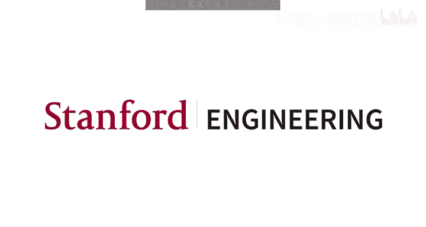
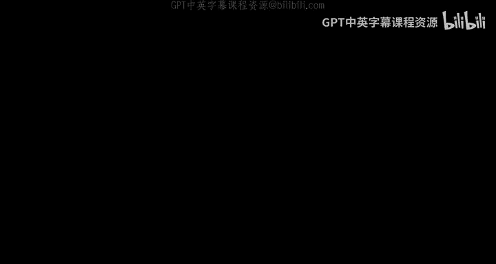
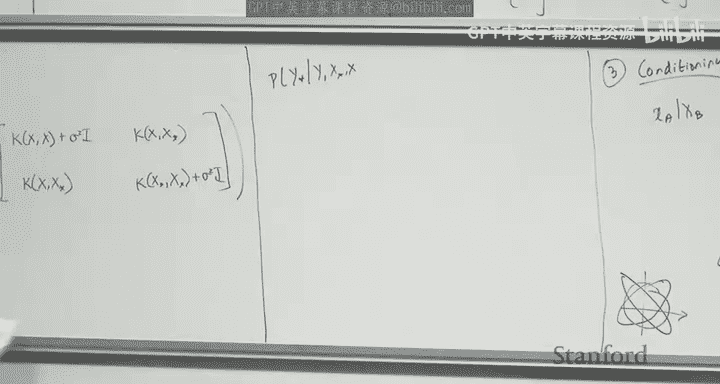
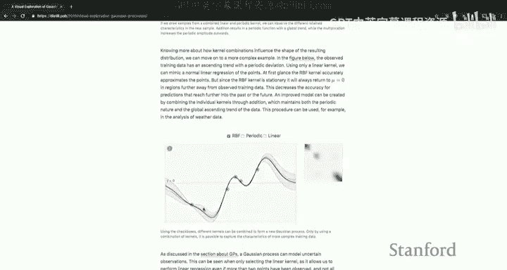
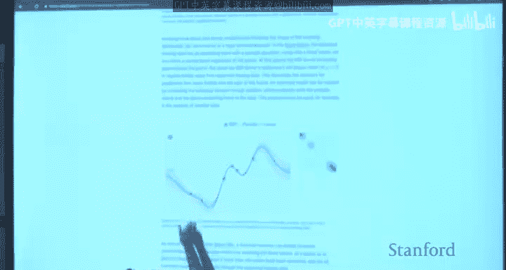
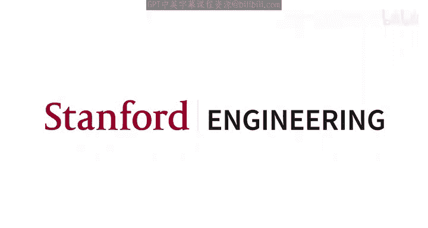

# 斯坦福大学《机器学习｜Stanford CS229 Machine Learning Course  Summer 2019 (Anand Avati)》 - P9：-09-.Lecture 9 - Bayesian Methods - Parametric &  Non.zh_en - GPT中英字幕课程资源 - BV1NDopY4ECg

Welcome back， everyone。 So this is lecture 9。 And today we're going to talk about Beijing methods。

 That's the plan for today。 So today we're going。

Covered two different approaches in invasion methods。

 a parametric approach and a non parametric approach。And as an example of parametric approach。

 we are going to look at Bayesian linear regression and as an example of a Bayesian non parametric approach。

 you are going to look at Gaussian processes。And before we jump into today's topics。

 a quick recap of what we covered in lecture 8， so lecture 8 was all about kernels。RightAnd we。

We saw that a kernel a function k of two parameters x and z。

 and these are typically two examples in your training set or in your test set， etc cea。

 these are examples。😊，A function of two of our examples。 K is called a kernel。

If k of x z can be represented as phi of x transpose phi of z for some phi that maps your examples to a p dimensional real space。

 Now， P here can be infinite。So， P could be。Infinity。

And some of the properties of the kernels we saw that first it needs to be symmetric in its arguments。

 so x and Z the arguments can be spot and it needs to evaluate to the same value and for all for any finite collection of examples and these examples could be any examples not necessarily a training set for any finite collection of examples。

The kernel matrix that you construct such that K I J equals you know the value of the i Jth cell in the matrix evaluated as the kernel function evaluated from the i and J example is positive semi deffinite。

And basically the Mercer' theorem tells us that this property2 is a necessary and sufficient condition for k to be a kernel。

 so if if you have a function k that satisfies this then it necessarily must be a kernel which means it can be represented in this way。

So， this was the definition of a kernel and these are properties and Mercer's theorem says you know we can go back and this set of properties is equivalent to the definition of a kernel and in an informal way of thinking about Mercer's theorem is a matrix which is possibly infinite by infinite dimensional。

Is PD if and only if every sub matrix is PD right and why is and and the way to think of why a kernel K represented like this。

 you know， is PD is。嗯。This statement is basically telling that K which you know this is possibly infrared dimensional。

If k can be represented as phi transpose phi of two examples。

 then you have this kind of an eigen decomposition or some kind of a symmetric decomposition that you can take the matrix k the infinite dimension matrix k and split it into some phi where phi is a collection of columns where each column is the function。

Phi I of x， for example， if you have you know， p of x equals。X square x Q log x。

 some set of features then。We would call P。P1 of x to be x squared。P2 of x to be X Q and so on。

 So each of these P I corresponds to one such function。Right， that's。

 that's the general idea you want to have in terms of thinking about kernel matrices that， you know。

 these feature， the corresponding。Features of the feature map that is implicit to the kernel are like the。

Eigen basiss of that， of that PD matrix。Now， today， we're gonna。

And and the other thing we covered Yes in the last class was S VMs is a kind of。

Is a kind of classification algorithm。Which tends to work well with kernel based methods。

 the reason I say it tends to work well with kernel based methods is because we saw that kernel kernel based methods can be applied to linear regression。

 It can be applied to logistic regression where the number of parameters。

That that we save with the kernel method is generally equal to the number of examples that we have。

 whereas with a more classical。lineinear regression or logistic regression the number of parameters we save is equal to the number of features right so we move from saving parameters which used to be an order of the number of features that we have with classical linear logistic regression to kernel methods where we save you coefficients one per example which means in general you would expect kernel methods to not work very well when your data grows a lot。

啊。SVM was a special case where the coefficients of the the coefficients of the examples tend to be sparse。

 meaning most of the coefficients will be 0。And that that makes SVM very attractive as a kernel method because not only do you get scalability to infinite number of features using the feature maps。

😊，But you also get scalability with number of examples， because your coefficients will be sparse。

Any questions about that before we move on to today's topics？Okay， cool， so let's jump in ba methods。

So so far， the methods that we've seen。Can be。Usually called frequentous methods。

And that's because we assumed that an unknown。A known parameter theta。

Which we assume to be some unknown constant。 We assume that theta is some unknown constant。

Vectctor valued， but unknown constant。And the way we go about estimating theta。😊，Was's do。

Define a likelihood on on on theta， so we would define a likelihood。E of theta to be log。P of。Sier。

Data。But I'm at raised by theta。And we would consider the negative of L of theta to be our loss function。

And then we would estimate theta equals。A。哦。As of theta。 And this is the same as。Arrc Max。I love it。

So this is the maximum likelihood estimate of our， our parameters。😊，And in order to do this， we。

We implicitly assume that theta is some unknown constant。Now。Today， we are going to look at。

A different approach。To attack this problem。Where theta。Is a random variable。

 We think of it as a random variable。That is unobserved。So。

 this this this small little change which may seem innocent is basically the fundamental difference between Bayesian methods and frequentous methods in frequentous methods there is some unknown constant theta whereas in Bayesian methods there is a random variable theta。

😊，Which is unobserved。Now， the moment we think of theta as a random variable。😊。

There needs to be some kind of a probability distribution associated with them。

Just calling something random variable is。Necessarily incomplete because we want to say what is the associated distribution with it。

And when。The first thing we do in Bayian methods is to assign。Some prior probability distribution。

언태다。So we believe that theta comes from some prior distribution。And then we observe our x， you know。

Data。We we believe that the data comes from the distribution from P of x。Given pay。This。

Is generally has the same mathematical form as the likelihood function。

 but it is different philosophically in the sense that we we are implicitly believing theta as having some kind of a prior distribution。

 but the functional form of P of x given theta and the functional form of。😊，P of x， you know。

 semicolon theta parameterized by theta are exactly the same， right。

 But we the interpretation is is different。And now the the main difference between the two is。

With the classical methods， we perform maximum likelihood on theta the on the log likelihood。😊。

To get an estimate of theta。But in the Bayesian method， what we do is we apply the basees rule。

So in Bayesian methods， we come up with P of x given theta。And this is。B of x。

P of theta given x is P of x given theta times。Be of theta。Over。P of x。And P of x。

We don't know what p of x is， but p of x is。对く。P of。Exキテ。Times。😔，Data。

So basically it is the numerator， take the numerator and integrate out theta and that gives you P of x。

I this obvious why this equals this。RightIf， if it's not obvious。You know， just the numerator is。Pu。

Xカまてた。いて。P of x comma theta is P of x human theta times P theta。 That's P of x comma theta。

 And then you marginalize out marginalize out theta from。Right，So this is Bay method。

 This is the Bayesian approach。 So in the Bayesian approach。There is no loss function。

We don't take maximum likelihood estimates。 We don't calculate gradients。

 We don't do gradient ascent or descent There are no you know close form ML estimates。

 All we do is apply base rule and get update our beliefs about theta given x。Given the data。

All all that we do in patient methods is。😊，Apply Bay rule， which is why know， the Bayesian method。

And with this this is， is essentially the counterpart of。

Of performing maximum likelihood estimate here， we calculate the posterior distribution。

 So this is called the posterior distribution。And in case of machine learning。

 the way we go about using ba methods。😊，I is is as follows。 So in machine learning。

 especially in supervised learning。😊，We are。We are trying to learn a mapping between x and ys。

 So the data in in a machine learning setting will also have y is over here。

 So x and y is our is our data。And。The， the。Llihood， so so maybe let me let me。So。😔，In。

Supervised machine learning。We start with theta， having some。Prior distribution。Right。

 and then we observe。X and y。And over here。W it comes from。Be of。Why give an X。咁啊睇得。

Right here we make no assumptions about the distribution of x。

 you know X's are just given to us somehow。 We only assume y given x follows theta whose prior is is you know you make some assumption。

 So x is always given right we we don't say anything about x's。And from this。

 we calculate the posterior distribution P of theta given。X， Y。And this will be。P of。

Y given x comma theta times。P of theta divided by。P of。いくスかマワイかマてす。Of theta given x。And there is。

 we also make the assumption that theta is independent of x， and this becomes just。P of。Oh。

 I'm sorry。P of Y given x。And something P of。So P of theta given x comm Y is P of y given x times p of x over this should。

 Yeah， this this is correct， so。Yeah， this is right。 P of Y given x now。So we。

 we calculate the posterior。The posterior is on theta， and from the posterior distribution。

 we construct what is called the posterior predictive distribution。

And the posterior predictive distribution is basically P of。W star where。X， Y。X star。So。

 x star is a test example for which we only observe the x。

 the input and x and y are part of your training set for which we have observed both the inputs and the outputs。

Right，And this is called a posterior predictive distribution。 And this is basically。TheIn of P of。

Why given。Xma theta。Hs。Be off。Tた given。X comm嘛 y。Date的。

So this is the general recipe of using Bayesian methods in machine learning。

 So this is the Bayesian methods if you， if you， if you。

If you are only interested in theta and you are not interested in making predictions。

This is more classical Bayesian statistics where you come up with a posterior distribution on your theta and you are all done right whereas in machine learning we want to use it to make predictions on unseen examples we are given x and y and we want to make prediction on x star of what y star is。

Yes question。こで。B fear on the island。Doた。Yeah， so this the the question is。

 should this be P P of theta given x， Yes， P of theta given， it should be P of theta given x。

 but because we make theta and x as being independent， this will just be that just P of theta。 Yeah。

 good question。You make the assumption that x is。YouOn which we are conditioning to observe。

 those x's are independent of theta。It's a pretty common assumption because yeah。Good question。

And the way you think about， you think about about this。This equation， which。

 which looks pretty complex。 It's an integral over the product of， of two。Of， of。

 of two probabilities。 And then you're integrating our theta。 But this actually has a very， very。

This is y star and x star， and this is x and y， the training。

 and so these are the tests and these are are the training。But this has a very nice interpretation。

So the interpretation is， is something like this。With the posterior distribution。We are。

Coming up with a probability estimate of how likely。A given theta is the correct data。

So P of x theta is a probability distribution over theta。Right，And theta is essentially our model。

Now。What's happening here。If you just look at this expression， think of theta to be some fixed。

You know， some， some fixed vector。P of y given x theta is like making a prediction for y for some given value of theta。

Right and what we are essentially doing is。😊，Considering the set of all models。 So let's say this is。

Mder 1。Mo豆。Model 3 and model 1 corresponds to some theta theta 1。Theta 2 theta 3。

 but theta 1 theta 2 theta 3 is is is a full vector。 So if so maybe let's call it。Theta 1。

 superscript 1 to indicate that it's a full vector， theta 2。데려 트리。

So what we are essentially doing is we are taking the prediction。😊。

Of y given x for every possible value of theta， So each of these will make a prediction of y。

And then we are calculating a weighted average of all these predictions where the weights are decided by the posterior distribution。

😊，So the posterior distribution is giving you some kind of distribution over your models。

Theta is the model。Once you know theta you can make you can make a prediction， for example。

 in case of logistic regression， if you know theta we do x transpose data get a scalar run it through the sigmoid function and that our know that is our p of y that gives you the probability of whether y is 0 or1。

What's happening here is。We we are the interpretation here is we are considering every possible value of theta right There are infinitely many possible values your theta vector can take。

😊，And your posterior distribution is giving you a probability distribution over all these values of theta。

😊，What's the probability that each that a given value of theta is is the right value。 That's。

 that's what the posterior distribution is telling。And， for prediction。

We are we are essentially taking the prediction from every possible。

 infinitely many possible values of theta and aggregating them by a weighted average where the weights are decided by the posterior distribution。

Yes question。Through underlying distribution。For this day。

Let's say one of these three models is the closest。actualで。One of these models。

 So why are we going to take contributions from the other model。そが。だける。So the question is。

 if one of them is closest to the true true model， then why are we taking like， you know。

 the the prediction from all the models And the answer there is that。We are not sure。

 right The the posterior distribution tells us that it is。Likely coming from this model。

It may also be coming from this model but but you know my belief that it is coming from this model is you know 21% when my belief that comes from this model is you know020。

1% it' is giving you a posterior distribution of of or the parameters。

 which basically is like our belief of what the true value of theta is。最そで。

Aceptible to our choice of。Exactly， so the so the choice of our prior is going to determine what our posterior distribution is going to be。

And in a way， Bayesian methods are subjective because you know it takes this subjective element of the person who is modeling if the person who is modeling believes that theta comes from a prior distribution where it is Gaussian then you get some posterior distribution and therefore you make some kind of prediction whereas you know if all is being the same you just believe that your theta comes from say plus distribution then your prediction would be something different right and this is probably the biggest criticism against Bayesian methods that you know there's a lot of subjectivism in play here and the subjectivism comes into picture based on what prior you are choosing for theta。

In the prime， you cannot choose any value of theta to be0， right Any probability。Yeah。

 so the question is in can your prior assign zero probability to any models。

 So if your prior distribution or theta assigns zero probability to to some value of theta。

 then necessarily in the posterior， also it will be 0。 So in general。

 it's a bad idea to choose a prior， which will assign zero probability to some。Right。So you。

 you wantan to think of this as。So this the the predictive distribution as the expected value。

Of P of。Why star， given。X。X star comma theta。Where theta is sampled from P of theta given。X。Why。So。

 this is the training set from the training set you construct a posterior distribution and then you take the prediction of p of y given x where theta here is a random variable that is distributed according to the posterior distribution and this expectation is equal to this。

😊，Yes question。W is this morning？ャネル。おめのお。啊，我。えクセス。成果を？Yeah， so in I guess the question is。

 how is this different from generative models that we saw before。

 Why is this any more subjective than something。Yeah。

 it is the question is why is this more subjective。

 It is more subjective because we are making yet another assumption of the way theta is distributed。

 for example， in GDA when we when we studied GD， the mu and Sigma。

 we did not have a prior on them They were just some unknown constant that we estimated using maximum likelihood whereas if you took a Bayesian approach there the muse and sigmas of your G would also have prior distributions on them and you would calculate a posterior without doing maximum likelihood。

😊，Yeah， so。Yeah so this is one way to think of the posterior predictive distribution that you are essentially taking the prediction from every possible model configuration that you can come up with and then taking an average of those predictions as a weighted average where the weights come from the posterior distribution。

😊，And this approach。Is essentially what one might call parametric。

We call it parametric because p of y given x comma theta。

Is you know has has some functional form for which theta is a parameter right so y given x theta is generally you know。

 for example， it could be logistic 1 over1 plus e to the minus theta transpose x and because of this functional form。

The degree of freedom that we have is to just change theta。And that， in a way， limits。

The set of all possible models。That we can consider the set of all possible predictive functions that we have is limited by。

This functional form。And different values of theta gives us different。Specific predictive functions。

But the set of all these predictive functions is still somewhat limited。😊。

And one way to kind of see that limitation is， supposing we have。嗯。喂。

Let's say we have a regression problem。Right， now， what's the correct。Hypothesis form for this。

 Maybe it's linear。Or maybe it is quadratic。Or maybe it is cubic。Or maybe as you observe more data。

If you observe more data。Maybe it is a much higher order of polynomial because there probably is。

Some， you know， well predictable varying varying variants in it。Right， and by。

 by limiting ourselves to certain kinds of。Certain family of parametric functions。

We are essentially saying no matter how much data is given to us。😊。

We just cannot be flexible to fit all this variances。

 even though that probably is not noise and is true signal the that's the fundamental limitation of parametric models is that the functional form of the the hypothesis function limits us from being flexible even in the presence of a lot of data which suggests。

That there is some other pattern。Which is why。There is interest in。Nonparmetric methods。

TheNo parametric methods， on the other hand， are。The way to think of non parametric methods is that。

We consider the set of all possible functions。Right， and， and duck seems。

Pretty expansive right considering the set of all possible functions。 and it's。

 it's hard to even imagine and write it down on on a piece of paper。

 you know what that class even looks like， the set of all possible functions。And。And then， we let。

Data kind of decide。Which function from that set we actually want？So in non parametric methods。

 we generally， you know， think of some function F and assume no。Functional form whatsoever。 right。

 We just work with a function F， which could be any kind of function。So。

Before we get into do the details， lets lets have a look at Bayesian linear regression to get a better feel for。

😊，How theian the Bayesian method works in case of regression。

 and then well move on to non parametric methods that is Gaussian processes。

So patient linear your question。I there a linear regression。

So again in linear the regression we are we start with a training set X。😊，Y i。I equals one to n。

 This is a full training set。 It comes from some unknown distribution。

 and we make the assumption that Y I。Equals theta transpose。X 사이。Plus， some unknown。Now。

 it's epsilon， where。Epsilon， I。Comes from。Some normal distribution。Sigma square。And。Take up。

Comes from some normal distribution。T square。So， this looks very similar to the standard linear regression setting that we had。

 except we also apply prior on theta。this is the only extra line from standard linear regression。

And no。Good question So what is tau square I so in this case each epsilon I was a scalar。

 so sigma square was a scalar。Over here， theta is in。RB。And x is also an RD。

So theta this this was a standard you know， this just a normal distribution。

 but this is the multivariate Gaussian distribution where0 over here is a 0 vector。

And tau square I is a covariance matrix， which is， in this case。

 a diagonal covariance matrix where the diagonal values are tau square。Right， thanks for Rock。So。

 we are given this。And in case of the standard。Or be the。Frequentest approach to linear regression。

 We constructed a likelihood function for。So in the， in the。Frequentist approach。L theta equals。

Lg of P of y given x。Theta， right， and。And this turned out to be。If you remember。

 log went over square root2 by。Sigma squared。Exponent of。Y minus。Square， minus half。

Or similar square。Right， and。And， and essentially， in this it。It boils down to just。

The square term everything else just just cancels out or becomes a constant factor and we end up getting the square loss function and we perform so performing maximum likelihood was like minimizing least squares so that was the frequency setting。

But what about the Bay setting in the Bay setting。We get P of。We don't do maximum likelihood。

 so know。In Beijing linear regression。We just。Construct P of theta given。S。

So let's call this S S is the full training set。We construct P of theta given S。

Using using base route。And in case of linear regression， you can work it out。

This will be theta given S will be。嗯。Distributed， according to a normal distribution。mean one over。

Sigma square。inverse。X transpose y。干嘛。Inverse。Where。Yi。Is given by。1 over sigma square。Ex transpose。

X。Plus one over。To square。系。So you can work it out the the theta given x is distributed according to。

So correct way to write。 This would be theta given S。

Is distributed according to a normal distribution， a multivariate Gaussian with this being a mean vector。

And this being the covariance vector。Where a， a has this form。This question。Just a question about。

ち公し。애 라야어 이。Yeah， even in the post。Iピオ。い言わないく。そう。的。So there is， is， is the question S P of the given。

X comma y。Equal to P of。Theta given y。In in general， no。

 because independence may or may not change once once you condition on more extra variables。Yeah。

 in general， this is not true。Sos that question， yes。

So this is an arrow over y which says its it's a vector。Yes， this is from the from the training set。

 This is this why。And this looks a little cryptic。 Maybe we can simplify this a little further so。

If I bring in a over here。So， this is going to be。X transpose x。Plus。Gok has。An inverse， x transpose。

X plus。A is1 over super squared。Thatこ说。Square or。what do we have here？So， here we have。

A normal distribution where the mean over here。Has this form and some variance。

And you might recognize that。 this looks。Looks， you know。Very similar to the normal equations。

RightIn the normal equations， we had x transpose x。Inverse x transpose y。

This looks very similar to the normal equation， except there is a small， an extra。

Dagonal matrix that is being added to x transposes。And if you。

I think somebody asked the question when we were deriving the normal equation。

 you know how did we invert x transpose x， what if it is not invertible？😊。

And one answer is over here。In Bay methods。Assuming prior on our theta to have some tau square and some。

Noise are epsilon squid we。We get this extra diagonal matrix that is added to x transpose x。

And you might remember if you take a positive definite matrix or any matrix in general and if you add a diagonal matrix。

😊，Then you are essentially increasing the eigenvalues of that matrix by the corresponding diagonal terms。

Which means now even if there were some eigenvalues that were 0 by adding this diagonal matrix。

 you are essentially making all of them nonze and that makes it invertible。😊。

So this is also called regularization we are probably going to see this in the context of regularization as well。

😊，Adding this term is effectively equivalent to regularizing our model。Right， and。Well。

 maybe this is a giveaway but this you know this observation is probably going to solve a big chunk of one of your homework problems in your next framework but that's fine So the the theta given S in the patient setting is now a distribution that is centered around this value which is very close to the maximum likelihood estimate。

😊，And has some， some， some variances over here。嗯。And。So this was the posterior。

And next we construct the posterior predictive distribution。

The the kind of mental mark you need to have is calculating the posterior is like fitting a model。

 even though we are not doing gradient ascent， you know， calculating the posterior is like。

Somewhat similar to estimating your maximum likelihood estimates and calculating your。

Poeror predictive distribution is。I is is like calculating the function which will make predictions on your new data and in case of the frequentous method there wasn't a distinction between the two。

 but in in Bayes methods there is there is a distinction yes。A justification for this。

 So this has quite a lot of algebra that I don't want to go into。 you know， you can just you know。

 just believe me that if you work out the algebra， you are going to get this one。😊，So what。

The apply base rule to calculate the posteror。Yes question。So if， if。

So the question is in the posterior predictive distribution。Yeah。So， this is Y star。就是。Right。

 so in the in the for in the posterior predictive distribution， the setting is that。

You are given the training set， X and Y。And on new examples， you only know X。

 You need to make a prediction on them。 You don't know what is， right， And for that， we we。

 we estimated by this probability distribution with the。Yeah。

 so this will give us a probability distribution over y star and if you want a point estimate it is quite common to take the expectation of this distribution as as if you want to make a point prediction for y。

A lot of times。We want just point estimates to make a prediction。 And in those cases， it's， you know。

 it's， it's it's normal to。Take this distribution and then take yet another。Expectation on it。

As our y hat as a point estimate of the predictive y distribution。And in many other cases。

 you actually want to。😊，Hold on to the full predictive distribution to know what is the uncertainty you have in making that prediction right if if you have the full predictive distribution for y star and if that prediction has low variance if it is kind of concentrated then。

It generally means your model is pretty confident of what the value is， whereas if it's， you know。

 if it has a high variance， then it means your model is less confident。Which， which。

 which brings to a good point。 So one of the， the fundamental。

Points about Bayesian approaches is that Bayesian approaches are used for estimating uncertainties in maximum likelihood estimation we got a point estimate for theta hat you know the parameters。

 but there was no uncertainty estimation that came along with it。

Right generally if you have a lot of data， you should expect your estimate the hat to be you know to have more confidence in that estimate。

 Similarlyly if your data was small， you should expect。You know。

 less confidence in your estimate of theta and frequentest methods don't give you that。You know。

 confidence estimation， whereas with Bayesian approaches。We are estimating theta given S。

And what you will see is that if you have a lot of data。😊。

The posterior distribution will be more peaked on certain values of theta。And if you。

 if you have less data， then your posterior distribution will be more spread out and similarly from while making predictions on y star on x star。

If you have。If your posterior distribution is is pretty confident is is pretty peak。

 and if X star is in the region where your training set more or less。Was where you got him from。

 Then your predictions will also be pretty confident。

The P of Y given X will also be pretty concentrated。 whereas if you。

 if your point is far away from where your training set was， then naturally with you know。

 the postt prediction distribution will also have a high variance。 That's。

 that's one of the benefits of Bayesian approaches because you get uncertainty estimates for free because you'reestimating the full distribution of parameters and predictions。

Question。So， the likelihood function appears in theian Bayesian method， so P of theta given s。😊。

Tta given。As is。P of S given theta times P of theta or。Be of。Yes。

 so this is your likelihood function。But they跟。Your frequentest approach。

 you can still look at the confidence interval reverse。Like you can look at like。

Let speak Dickinson that you're sure about。Yeah， so in infrequentist approaches sure so you can get confidence intervals on on theta。

 but the the theory is much more well developed for Bayesian approaches， especially you know it its。

Yeah， the theory is more well level up for vision approaches for getting uncertainty as。

And the way you interpret a confidence interval is also pretty different from the variance over here so the confidence interval。

 what you get from a frequentest approach tells you if you were to repeat this experiment supposing you have a 95% confidence interval that confidence interval tells you if you repeat this experiment you know an infinite number of times。

 then 95% of those experiment will give you a theta hat in this interval it is not telling you that your estimate of theta hat lies in that interval with 95% probability whereas with this you're getting that it tells you what probability the true theta what is the probability if the true theta lying in some interval given by this right so that's the difference between confidence intervals and this yes question。

飞完 to。原さ的。Is that you need to。ペ中だったの。What's the question again。We have that distribution over here。

Distribution over theta versus the variance of theta given。Yeah。Right saying that we need to。法院证没。So。

 so so the question is should we differentiate and optimize this a to get low low variance。

 So here there is no optimization going on There is no loss function， there is no gradient descent。

 There is no optimization going on everywhere All we are doing is conditioning we condition on this and use the the base rule to construct。

A distribution。 And what we get is what we get。It it is very different from the frequentist approach frequentist approach we are minimizing some kind of a loss or maximizing some kind of a likelihood to get estimates of your the over here。

 we just apply base rule and we get what we get。😊，Isn't what what we wish that。

We wish that variance is low and the the way the variance will will be low is if you have a good amount of data right if you if you have a lot of data then you know this will naturally be low。

😊，All right， so moving on， so the posterior predictive distribution。

Wills is essentially Y star given。X star comma S。Flow a normal distribution of1 over sigma squared。

transpose。诶。A worse。Exllence plus y。Com on？Extort transpose。Yingors。X star plus。square。Again。

 this looks a little cryptic， but you know it it you know we can we can still kind of break it down and make sense of it。

What's happening here is。We had a distribution for theta， which was some normal distribution。Now。

 if you have。If you have a distribution theta。hich is normal。With some mean mu and covariian sigma。

 where mu here。This and sigma is this？Then。X transpose theta。This just a property of Gausians。

 is also normal。With mean new transposes。And variance。X transpose。Sigma。X， and this is just。

A property of Gaussians。And now we have our theta to have know some normal distribution。

And to make a prediction。😊，Here x star。You， take X star and we and we dot product we take a dot product with with theta because that is what linear regression does。

 and that gives us。This expression， where this expression is just。

Like x transpose mu where mu is this dot this with x star and you get this。And。The covariance。Is。

 is this。Basically， take nverse。And。Take averse and， and， and， and calculate the。

And calculate the quadratic form at X star。Just like this。And then we add this extra sigma squared。

Because this is the posterior predictive distribution of y star because y star the the the the y value that you might observe has the same。

Will have the same noise embedded in it in the test example as well。

 So thats to account for what the possible y star you might observe for the test example。

 you want to account for the extra extra variance and you are adding that variance because of and you add the variance because of the IID assumption。

So yeah， so this， this might look pretty complex， but it is it follows pretty directly from。

Theta transpose x theta theta given theta given S。 and again。

 even this which looks cryptic is actually very similar to the estimate that we get from the normal equation with some regularization term that comes in yes question。

😊，Yeah， so。Theta is what we have。 So right and S is x Yeah， So this is we have the extra extra S。So。

 if theta has this distribution， then。Why star， why star？Equal to this。

 theta transpo x will have this distribution。So， P of。

So y star given X star in s is basically the posterior。Transformed in this way。Good question。

It is disappear。Yeah so this is this is just an example of how you would apply a Bayesian method for linear regression and this is called Bayesian linear regression it has a few more terms and identities compared to the standard normal equations from the frequentous method。

😊，But you get， you know， uncertainty estimates by doing this extra extra calculation。

Any questions before we move on to Gaussian processes？Yes question。My started。Sure， yeah。

 So this would be。The the mean and y star equals y hat plus epsilon star。RightYeah， good point。Yeah。

 so this extra epsilon accounts for this。Extra plus sigma squared。 Thank you。So in general。

 Bayes methods。Tend to be。Heavy urs of probability theory， because all what you' are doing is。

Taking probability distributions。And conditioning them to apply base rule。 And that's about it。

 That's all what we， what you do in Bay methods。 You assign everything a prior probability。😊。

And then you observe some。😊，And depending on what you observe。

 you condition those probabilities on based on what you observe and you update the beliefs of the unknown。

 and here the unknown could be your model parameters。

 It could be the unknown labels of new test examples。But you follow the same recipe。

You assign a prior probability to everything。You observe something and based on the observation you update your prior probabilities to a posterior probability by conditioning and you are using the base root to do that。

Yes。だ。Yeah。もちもの。On square in was。that would be one。Yeah， but here x is itself is transpose。

 So mu transpose x is x transpose y here x is transpose。Extus trans other。So the question is。

 how is this x transpo X star transpose of this。哎， so。So啊。

Add an x theta start transpose and leave it as it is。

 And this is scalar just move it out and you get that。哦 new。全然せ務剤か。Yeah， the drug product is always。

All right。Gauussian processes。Before we jump into Gaussian processes。

It' is probably a good time to again remind ourselves of you know some of the basics of functional analysis that we saw earlier on right in functional analysis we saw this relation between vectors。

😊，And functions。Right。Now， mentally， it is。The same relation between vectors and functions。

That exists between。Multivariate Gaussians。And Gasian processes。三。

Multtivariate Gaussians are defined on vectors。And Gaussian processes are defined on functions。

And it is the same it is， in fact， exactly the same。

 same relations of how vectors and functions are related that multi Gaussians are related to Gaussian processes。

😊，Right and。To start off Gaussian process， let's review some。Properties of。

The multivariate Gaussian distribution。So。Properties of。Mighttivari。Oussians。And also。

For you to kind of expect what's to come。The functions over which we are going to define Gaussian processes。

Is going to be our hypothesis function。Right。So the， so the the idea to have in mind is that。

The way we the way we went from vectors to functions。

We can make the same leap from multi Gausians to Gaussian processes。

As probability distributions our functions and the functions over which we want to define Gaussian pro are our hypothesis functions with which we want to make predictions。

So。First， property of。Gauusians is normalization。It is。Inteegral。Tspect to x。いオ。Youu。😔。

Sigma is equal to 1。Where。We are integrating over the full vector space。

 So if you integrate out everything you get。You get one。And this is just。Fact of probability。And。

Supposing we have a vector。X。Eals。X， A。X， B。Which has a mean。

Let's say this is according on normal distribution。Victor。M a。Mubi。And covariance。Sigma。え。Sigma Aビ。

Sigma B a。Sigma， B。Where you call this mu this sigma。With this， we have the second property of。

Marginalization。SoFor marginalization， given。Given a probability distribution that way。 So P of。X， a。

Equal to integrate out。X， B。From。😔，P of x。Ming。😔，食吗？Li。😔，So you take the full probability。

Distribution。And you integrate out only a few components。Integrate out just Xb， and you get。

P of X A and P of X A will be normal with mean。Muei。Coveience。食吗嘢。More generally。If you have。

A vector x。これと。X 1， x 2。X， D。And if this distributed according to a normal distribution。With。Ywaan。😔。

你 do。Newdy。And covariance。Sigma 1，1 until。Sigma，1 D。Sigma， D1。Sigma， D D。Right。

And if you want to estimate the marginal by integrating out， say x2。

Let's say we want to marginalize out only x2。The nice property about Gaussians is that。

Performing this over x 2。The normal distribution that you end up getting。

 the distribution that you end up getting will also be normal。With。Just the。Corresponding。

Entry is related to new takenout。That is a very nice property of Gausts。 So if you if you not。

 if you marginalize out x2， then you get a mean。the the marginalized distribution will have a mean vector with just that component removed and the covariance will have that corresponding grow and column removed right that's a very nice property about multi captions marginalizing is super easy right just take off the things that you want to marginalize and you get you get。

The right answer。Third thing is conditioning。So in the same setting， if you have X A and x as an arm。

Having two parts， X， A and X， P。In this example， A and B are not necessarily scalealrs。

 They are just you know sub vectors， vectors with you know。They can have multiple components。So。

 P of。Are X A given X me。Given X B。Is a normal distribution。With mean。M a。less。识吗？Abe。识吗？B B。

 inverse。Times。X， B。mininus。Ybi。This is a scary looking expression。 But， you know， let's。

 let's let's。Let's analyze it。So minus。识吗？😔，A。Be inverse。M be。Wow， this looks， this looks pretty。

 pretty scary， but。It's actually not not as complex as as you might it might appear at first。 Now。

 to， to kind of understand this a little more， let's look at a case where you know。

 X A and X B are scaleals right So if you have suppose we have。Let's say a normal vector， A， B。

As normally。Muei。Mbi。And covariance。Sigma a squared。Row sigma a。Sigma B。Zhou。😔，Row sigma a。Sigma b。

And。😔，Sigma B squared。Any covariance matrix can be represented as this， so take the diagonals。

 take the square roots and you can write the covariance terms as the correlation coefficient times the standard deviations of the two right so that is just this is the definition of covariance right so。

Let us see what conditioning looks like in case of this right。A given B。Is now。

 according to this formula。Normal distribution with。Min。Mu a。Plus， sigma A B， Sigma A B is just。

R sigma， A， sigma B。Times sigma B B inverse。 So that is divided by sigma B square。Times X， B， X。

 B is。B。Minus mu B is just。Mbi。喂，干 on。Sigma A A， that's just sigma a squared。Minus sigma A B。

 That's row A， rh sigma a。Row sigma， A Sigma， B。Times of sigma B B inverse。

 that's divided by sigma B squared。Time sigma B， A again。Z。Oh。R sigma， A， sigma B。

We can simplify this further， So this is the same as normal。み a。Plus。We can cancel one sigma B here。

 if you get row。好了。Sigma。A times row of。B minus mu B over sigma。干嘛？Sigma a square times。 So1 sigma B。

 second Sigma B。Right， and this is minus。R square， Sigma， a square。And this。

 I'm gonna just write it as。Sigma squared times 1 minus- row。so now it it is much simpler。

 So what this is basically saying is if we have a Gaussian distribution over two variables。😊，And。

We observe one of them be to have some specific value。Then。What， what's happening here。

 If you take B divided by me by its mean and subtract its mean and divide by its standard deviation。

 this is like the z value of。Of B。Right， so this， this is the Z value of B。Take the Z value of B。

And multiplied by the correlation coefficient。And then re transform it back into a multiied by sigma a and add mu a。

 take B。Get it down to this the the z value， transform it using the correlation coefficient and then rescale it back into a's range。

And what's happening here？Take a by observing B。The variance of a reduces by a factor of 1 minus row square where rh is how much。

A and B are correlated。Yes question。You。So rose the is the correlation coefficient。

So the correlation coefficient is。So， basically。So basicallys。Covariance equals。Row times。啊。

Row times the， the the standard deviation。Of a。Timeams。Standard deviation of。

 of B is also called the Pearson correlation coefficient。 It the same thing。

The correlation coefficient， How well are they correlated。 So if you have。A Gaussian variable。

Looks like this。 Then you have a positive correlation because the higher the value of one variable。

 the more likely the second one is also higher。 if it is like this。

 then it has a negative correlation。 If it's a perfect sphere。

 then there is zero correlation right It's telling you how much information of a。

Lies in B by observing B。 How much can you learn about a。Right so。Yeah。

 this is basically what conditioning is does is doing。 And this is the。

 you can think of this as the multivariate version of， of this。 right， So this is just。

Calculating like the z value of of the b vector and then rescal it back into the a's scale And over here from the variance of a you are subtracting away some some variance basically you are gaining information by observing B right and this is the same as。

As this， But this is a multivariate version of this。And if you're， if you're。

If you have done some advanced linear algebra， this term what you see here is also called the s complement。

😊，But if you don't know what that is， it notesds。Not necessary。 but if you know， know。

 this is basically the sure complement of of of here。Right， and then we have one more property。

 which is。The sum of two independent Gaussian variables。 So if you have。X distributed as。Muman。

Sigma 1。Why。As mut。Sigma 2， then x plus y is distributed as a normal。New one plus。2 and sigma 1 plus。

Sigma。And this is how。Fourth property summation。Now， with these properties， believe it or not。

 we are more than halfway into Gaussian processes。You're just going to apply them。And drive。

Goussian processes。Of these properties is the one that looks the scariest is probably the conditioning。

Property and。You can make it， I guess。You can approach it or make it less scary by seeing the analogy to the two variable to the two variable case and just believe that。

That monstrous expression is is just multivariate generalization。い、こし。Property 3。

 how do you go about proving that I would say that is beyond the scope of this course you know just take it for granted and and you can so there is there is a book called if you are interested it is called Gausian Pro for machine learning。

And I would I would point you to that there is also some notes that I have linked to in in in the syllabus page and it has an appendix where theres a proof for that so。

All right， so Gaussian process。So， in Gasian process。What we want to do is。

So let me try to draw an analogy with， with。まいて。Multivariate Gaussian。And。Gousian process。Right。

 in case of the multivariate Gaustion， we had。Sa why1。Why do。Yd。According to some。Normal。With mean。

New one， you too。Mu。😔，B。And some。Some covariates。Now， in Gaussian processes。

 what we instead have is a function F。Distributed according to what you call is a G。

What a mean function M。And。😔，ACoel care。Okay， so this is， you know， a direct analogy between。

Multiate Gaussians and Gaussian processes。In multivariate Gaussian。

 we had a vector which had a corresponding mean vector and a covariance matrix。N Gasian process。

We have functions distributed， according to a mean function。Add some kernel。

so there is a direct one to one mapping between。Positive definite matrices and kernel functions。

Right， the。And here you are now going to use。The property is you know one，2，3。

4 to drive Gaussian process for machine learning or Gaussian process regression。

In a pretty straightforward way。Right， now。As you might remember。😊，In vectors。We index them。

With some index。And the corresponding thing to do with functions is to evaluate a function at some input。

So you can think of。This as a vector。You know。Which is， basically。Set of all eval。 So F of。X1。F of x。

To basically every possible input。For that function we have a position you know that is the mental picture to have that is not the right definition but it is a very good mental picture to have and the value evaluated by the function is the value of this infinitely long vector at that position。

😊，So where you had indices， you have inputs。Right， and now。We are going to use。

Conditioning property and the marginalization property。😊，Of， of， of， of Gaussian。Gusian vectors。And。

Limit ourselves。To just。Those elements that exist in our training set。And to。

The test example that we want to make a prediction on。Right， so this means。If we。Marginalize。Out。All。

Irrelevant examples。So， basically。Examples。Not in training。And。Not in test。Right。Then。

 we basically get。Something that looks like this。F off。X 1。F of x。And。

And then let's call F of x star1。Until。F off。X star。And star。

The second of all examples in our training set。And the set of all examples in our test set。

And we are going to assume that the Gaussian process has a mean 0。So most of the times。

 we assume the mean function to be just。A0 function。Times。The kernel function evaluated。

The kernel function evaluated on the set of these examples。 So this gives us the kernel matrix。

 just like how we saw in the case of， of。The Mers theorem at the you take。

 you take a kernel function。And evaluate it on a set of points to construct a kernel matrix。

 Then that kernel matrix is positive definite Similarlyly， here we evaluate k of in this case， x。Wn。

X 1。And so on。Key off。X star。1 or n star。Let me write this more clearly。K off。は。

And Mercer's theorem tells us that。This will be。Positive semi definite。

And so this is a valid multivariate。Cusian distribution。This question。Doesま。あその？Element of。No。

 it need not。So， so is is should each of these be non zero no they need not be non0。

 They can be positive。No， they can be negative。 Some elements can be negative if you have。Yes。

 every sub matrix has to be positive definite So what is the meaning of sub matrix。

 that' is a good question。 So if you have a matrix。Let's say it has n rows and n columns。Now。

 choose a few index values， let's say。2 and7， right， and。

Extract ours rows2 and 7 inter intersected with column2 and 7。 These four make a sub matrix。

So in order to reduce it to so a sub matrix of size1， that can only be the diagonal values。

RightSo row 2 and column 7 will not give you a sub matrix。

 So row 2 and column 2 that element is a sub matrix。哦。But then everything along the background。Yeah。

 yeah。 So K of if So if you evaluate k on the same element in two places。

 that will always be non negative。a subway trace doesn't mean any arbitrary block。Yeah， yeah。

 So sub matrixtri means means。A matrix that you get by choosing the same set of indices for rows and columns。

Good question， thank you。Alright。Now。We will represent this in a more compact way， where。Will write。

F。To be the examples of the training set。And。F star。As the function evaluation at the test set。

Equal to normal of 0， and。I will call this block。To be。Kay off。X。X。This block to be。K of x。X star。

 I guess we've been writing star as a prefix as a subscript。 Then again， K of。X star。And X。And K of。

Xix star。Xtar。Again， so this is the same thing that's written about。

Where we are looking at just those， those examples that are of our immediate concern。

 So examples in the training set and examples in the test set。 And this is like。

You are marginalizing out all the other infinitely many examples that are not of immediate concern。

 Yes question。のセミナー。So kernel so the question is do kernels act as some kind of a similarity metric in general or is it only in the case of Gausian processes The answer is kernels always act as some kind of a similarity metric and you can use any kernel。

And come up with a covariance matrix for a Gaussian process。

 Theres no limitation of which kernels you can or cannot use as long as it's a valid kernel that can serve as a covariance function for go for a covariance matrix for a Gaussian process。

Exactly， the reason is because a kernel can be interpreted as a dot product in some higher dimensional feature space and dot products are a good you know similarity method sort space。

 was that another question？Right。We started with an infinite dimensional functional space and then marginalized out every example that is not of immediate concern to reduce ourselves to a Gausian。

Causian distribution， a multivariate cautionian distribution over the set of training and test examples right。

And with that， we are almost there。Once we are in。Vectctor land from process land。

 you know all our properties that we just reviewed。Can now be directly applied。

 So these properties that we covered conditioning， marginal conditioning， especially this is。

You know， you need to be able to invert a matrix。 right。

 So this this is where we are dealing with finite dimensions here。 so we got the F vector to be this。

And in general， our y vector。R。Why we saw was F of x。Plus。Nice。

Where it so happened conveniently that the noise was also Gausian Gausian followed a Gausian distribution。

😊，And we are going to use the summation property to add these two。So we get y， y star。Equals。F。

F star。Plus。Epsilon， Epsilon stars。And this is now。Distributed as。Normal distribution。

Where the means of fs were 0， the means of our errors were 0。So， we are still。At0 here。

The covariance matrix is now。K of X， X plus sigma squared I。K of x。X star。K of。X。X star。K of。X star。

X star plus sigma squared I。Any questions in this？So， F。Follow this distribution。

By marginalizing out all the examples that were not of immediate concern。And by our。

Nice hypotheses that we have Gaussian noise in our observation。We get a distribution over the Y。

To be f plus the noise and over here we are just using the summation property and adding up the covariances。

Eppsilon， the entire epsilon vector。Follows normal0 and sigma squared I。So you just add it here。

 it only adds along the bagagonal。And this is the this is the matrix that we are going now work work with。

And given this matrix， we are just one step away from。From。Finishing upuction processes。そ。

So the probability of。喂。Star， given why。And。X star and x x and x star is kind of implicit in in the indices that we have chosen。

Is no。Or another way to put it is。W star。Given why。X。

X star is distributed according to a normal distribution with some mean mu。

Call it mu star and some covariance。Sigma star。Where the this mu and sigma star are calculated according to this conditioning rule。

 We apply the conditioning rule to。This mean and risk covariance。And we get new star。Equals。Kof。

Extraarchma。X。Times。Kev。😔，X， x。Sigma squared。系。Inverse。Wei。And。Sigma star。Okay。x。Star。Star。Plus。

 sigma squared I。Minus k。X star。X。S times。X， x。Plus sigma square。Inverse。Okay of。X。

This is a complex looking expression， but this is exactly the same as this。Where we plug in K， K， X。

 X in place of Sigma， A， A， K， X star X star in place of Sigma， B， B and K of。

K or rather k of x x plus sigma square in place of sigma AA and so on。

 right we are just applying the conditioning rule and we got our posterior predictive distribution。

This is the postor predictive distribution of Gaussian proth。Yes question。we card on。Yeah。

 so over here。This is just a short shorthand notation for the kernel matrix you get for evaluating on that set of examples。

So K， K is。 So there is a  one to1 relation between kernels and covariances。

 right Covariance functions and kernel functions。 There's a one to1 relation any kernel function。😊。

It can be used as a covariance function。Thats probably that's probably the most important takeaway from this class you know for you know in general that kernel functions and covariance functions are essentially the same。

😊，So this is the posteror predictive distribution for Gaussian pro and the expression looks pretty complex。

 but everything here is straightforward linear algebra right there is。😊，We have a set of x's。

 We have the set of x starss and and you know just compute this and you get your posterior predictive distribution for。

The test examples nowhere here do we have y star that is important because we are you know making predictions about y star。

 we only have y's x's and x stars。And。Given this， in order to kind of construct a good GP model。

The most important。Decision step or rather the only decision step。

Is to come up with the right kernel function or to come up with the right covariance matrix。

 once you come up with the right covariance matrix， there is。

Everything else is pretty much set in stone， right， Everything else just flows along once you decide。

 once you choose what your kernel matrix is， there is no loss function。 There is no gradient descent。

 There is no， you know， fitting of models。All that we do is given the set of x's and y's in our training set。

 we just remember them， choose a kernel kernel function。😊，And then wait for test examples。

 Once we get a first test example， we plug it into this expression。

And obtain a predictive distribution。And because we covered this in SVMs as well。

 and because this is a kernel based method。😊，A consequence of that is that we need to remember our training set all the way into test time right and that that is basically showing up here because you need to have the x's and ys from your training set in order to make the push you know the prediction。

Yes question。So the the result， what we get here is similar to a generative model。

 Can you expand on that a little bit。Yeah。ThatSo I started giving。嗯。Its also Ga。Like。

 based on the assumption。Yeah， the the fact that the posterior ended up being a Gausian。

Is actually a property of Gausians。We saw that when when you start with a distribution that is Gaussian and you condition on a few variables。

 what you end up with is also Gaussian。 So that's a property that is kind of unique to Gaussians where you start with a multivariate Gausian。

 you marginalize out a few of them。 you still end up with a Gaussian with a smaller dimension in a smaller dimensional space。

 you start with a Gaussian vector， you condition on a few of them you still get a Gaussian with what's remaining。

Right， and and that's why the posterior also is now， is now Gaussian。

Because we condition on the the wise that we that we observed in the training set。

And why is this called non。The reason why this is called non parametric is because。

We did not come up with any kind of a functional form for our。Prediction function。Isn't that。So。

 muse star and sigma star are。Well， you can you can think of them as a functional form。

 but what you will what you will realize is that。😊，That is， that is。

There was no fundamental limit on what these values could have been。

 So next I'm going to show some visualization that will probably give you a better better better hint of what why this is called non parametric。

 maybe maybe that might answer the question。 Lets let's move on to some visualization。

Any other questions on this？ Yes question。Well I。Can we do the same thing for other expansion families。

 Great Great question so。So Gaussian process is whats also is a type of a stochastic process and if you are if you are familiar with stochastic process。

 stochastic process， you can think of them as a collection of random variables with with some kind of an index set。

And this is。A Gaussian process is， essentially。A collection of random variables where the index set is the domain of your function。

And the。In theory， you could do the same， you know。

 go through the same exercise for any other distribution。Other than other than Gausians。

 but the other distributions。May not have first of all they may not have multivariate versions so for example a Poisan distribution you know there is no multivari Poisan I mean you can have a collection of Poisan but there is no multivariate version of it you can still have for example。

 you still do have a Poisan process。But they don't have this。

The nice property is that if you condition on something， what remains also is a Poisson process。

 right， but that's true only for Gaussian processes。 that if you condition on something。

 what remains a still Gausian， if you marginalize out something， what remains a still Gausian。

とたらんでいた。You made through some process extra。Then this would be a nice idea to do too。So。

 so I guess the question is。Now， what if your data is distributed according to some exponential family right and over there the most common the common approach that you see is。

The F over here。Instead of f being y directly， So we assumed y is equal to F plus epsilon。Right。

The most common thing to do is what there's going to be some kind of。

You can call it an activation function or the G function。That that we used in GLMs。

 and you can have natural parameter。We distributed according to cautiontion。 You。

 You can do something like this。And your observations。

 why will now go through this non nonlinear transformation。嗯。To， to to make the actual observations。

 But once you do this， you lose the conditioning ability。Right。In Gaussian processes。

Because the noise was edited and the noise was also Gaussian。We got the Y in a Gaussian form again。

 but if this is nonlinear， if it is not a simple summation of two Gaussians your y will no longer be normallyally distributed and you cannot do the conditioning and so on。

So you can do it in principle but you don't get these simple expressions。Next question。Going。

Insteadたら。でも全体。So the question is do these properties do they hold for other exponential families？

Yeah， so these properties are very unique to Gaussian， which is what makes Gausian process kind of。

Nice to work with。and you may have actually also come across， you know。

 especially if you have some kind of a background in finance。

 you may have come across like brownian motion and wener processes and basically the way to connect that with with what we saw today is a wener process。

Or brownian motion。Is a GP is a Gaussian process with K of say S commar T。えっと？

Min min of S command for this particular choice of kernel， you get the wener process。

 If you don't know what a wener process， you don't have to worry。 But if you're， you know。

 if you have some background in finance and， you know， you know what's brown in motion wener process。

 it relates to what we saw today by this particular choice of kernel kernel function。Right。

 let's do some visualization。Where's my browser。There you go。 So this is。I see another cursory。

 I don't know。Alright so this is a web page that I kind of preloaded it is from a website called Dist dotpub I would highly encourage you to visit this website there are great articles explaining things about machine learning and Im a big fan of it and you probably two should be one anyway so this is they have some really cool visualization of Gaussian processes and I want to scroll all the way down to the very last visualization。

😊，It is pretty cool。Os。Yeah over here so this is some kind of a functional space an abstract functional space So the x axis over here is is our space of inputs it need not necessarily be you know just scalealar real value think of it as some abstract space。

And no。The moment we choose a kernel， so there are three choice of kernels here an RBF kernel which is also called the Gaussian kernel。

 a periodic kernel and linear kernel， so once we choose an RBF kernel you know this defines a prior on our functional space。

And these these curves that we see here are samples of functions drawn from this。

From this Gaussian process prior。Right。And once we have this。

 we can now observe our training data and start conditioning on them。

 So so if if you click over here it。😊，This means we have our condition on this particular input in our training of having this particular y value。

😊，And similarly， as you keep conditioning on things that you observe。😊，哎。

The posterior distribution of our GP of our Gausian process。You know， takes this form。

What this essentially means is for any test example that might have an x value over here。😊，The G。

 if we marginalize out everything。

Everything。Everything else， except that single slice。

That' is going to be our posterior predictive distribution for the new X star。

And this basically tells for examples for test examples in this region our posterior predictive distribution has a very small variance means we are very confident of what those values should be。

😊，Whereas over here in regions where we haven't seen much of training data the prediction value will be pretty you know pretty broad in the sense we have very high variance we are less confident about making predictions in this region where there weren't much training examples nearby。

As opposed to here， where the prediction， the posterior distributions have very small variants。

 which means you are making very tight or confident predictions。His question。

You know vertical slicer。So so back to the question does this look like overfitting right so so this is like a fundamental tradeoff between parametric and non parametric models right nonparmetric models are extremely flexible in the sense if your data follows some pattern your function。

 your posterior distribution in GPS will follow that pattern。😊。

And there is a common criticism that non parametric models can overfi pretty easily。😊。

But in cases where you have a reasonable amount of data。

 you know non parametric models tend to work pretty well。😊，This might。

Look like overfitting and I guess thats you know， as they say lies in the lie it lies in the eye of the beholder you might call this overfitting。

 but overfitting is is a loose concept in general。 It's hard to kind of give a formal definition of what overfitting means and you。

You could。 you could call it overfitting， but you know。For example， if you use a different。Colonnel。

It would look like this。Now， you uncondition， you get。Now。

 this is the prior and these are samples from the gray lines are samples from that GP prior and as we start observing training data we are basically just conditioning。

And these are the， the。The pink band is basically represents some， I guess。

 95% range of the posterior distribution。 And without conditioning。

 it's like the 95% range of the prior distribution。

Or you could use a combination of the two compose the two kernels。And get something like this。Yeah。

 so you can construct kernels by taking existing kernels and kind of composing them。

 youll see some of that in your homework homework too you probably do some kernel composition as long you know any function that that that obeys the properties of you know a kernel is is a kernels and you can take existing kernels and compose them with certain rules and still get palt kernels。

So this this is I think of a pretty pretty intuitive and a nice visualization of of Gaussian Pro where you start with a prior the choice of the kernel。

😊，Gives you different priors。Just the choice of the kernel without observing any data right you choose different kernels you get different priors the choice of the kernel gives you a different GP prior and depending on the choice of the kernel that youve chosen observing data gives you different kinds of posterior GP posteriors。

This is a GP post areaor if you use a different card。And at test time。To repeat， you know。

 your test example will lie on the， on the horizontal axis at some point。

 and your predictive distribution is going to be the。

The vertical slice or you know marginalize out everything else and that's going to be like the Gaussian distribution。

😊，Whose mean follows the red thick line and the the border lines kind of define the the。

95% range of that Caian distribution。 Yes question。How did you choose when to go the caution person。

 because this looks like。I would think。ちラ。Yeah， so the question I guess is when do you use a Gaussian process right and the answer is going to be pretty boring as for almost all answers in machine learning see what works well on a cross validation set it sounds and that is probably the most pragmatic answer and that should be the answer you should always go with always see any change that you do how well does the performance you know what kind of performance you get on a cross validation set。

Yes， there was another question。Yeah， so the heat map on the right is showing this like the kernel matrix。

The kernel matrix that you get by conditioning on on or the covariance matrix that you get。

 So in the posterior predictive distribution， we ended up with a mean and a covariance。

 So this is like， I think this is the posterior covariance。This question。Also be what works。V。Yeah。

 so the question is should the choice of kernel also be something that works well on cross validation and the answer is yes and there are also techniques with which you can learn a kernel we didn't cover it today but the book that I refer to the Gaussian process for machine learning it gives you a good overview of how you can even learn kernels from data not just the handcraft them。

Yes question。とか。か局ですかも。Do。So can composition of kernels be interpreted as composition of two functions？

With two inputs in general， no， I， I wouldn't think of it that way。

 It's just that you get a different kernel。All right， that's about it for today。

