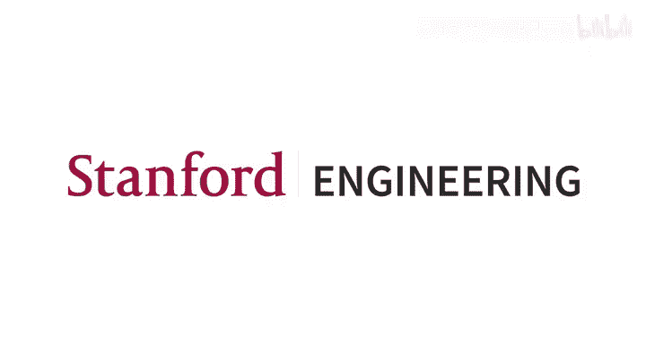
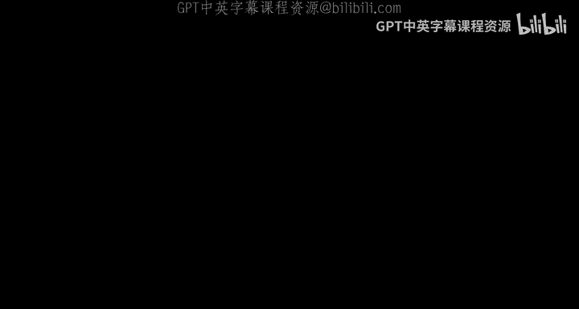

# 斯坦福大学《深度多任务与元学习｜Stanford CS330 Deep Multi-Task and Meta Learning 2022》中英（豆包翻译 - P10：-10-.Advanced Meta-Learning 2_ Large-Scale Meta-Optimization l 2022 I Lecture 10 - GPT中英字幕课程资源 - BV1dWpPepEsj

Hi， everyone。 My name is Uno Lee。 I'm， I'm a T A for this course， and it's。

 it's my first time giving a lecture。 So hopefully everything goes well。😊。

さあ。Yeah， we're going to be talking about the second edition of advancedd metal learning topics。

 I think on Monday Chelsea talked about。Memorization and task construction in mental learning。

Today we're going to talk about large scale meta optimization。As a quick reminder， homework 3。

 the one on language models is out。This Monday and it's due in a week。

So we're going to start with kind of。A big picture question about。

Metal learning and why we should even do it。So。We can think about。Learning methods as。

Being on the spectrum between hand designed priors and data driven priors。

 and there's kind of a continual shift downwards towards more data driven stuff。So， for example。

 a long time ago， people used to do。Directly modeling image formation and as。

A slightly more data driven way。呃。Constructed hand coded features and extracted those out of actual data points。

And then people started doing end to end learning of the features themselves and by， for example。

 fine tuning from pretrained imagegenic features。We are。The pretrained networks contain。

A very good prior about what natural images are like。And it's more of a data driven prior。

 And the reason we keep going downwards is that。More data driven approaches are more scalable。

 So in a sense， if you keep throwing more real data at them。

 they get better and better at encoding real priors and。Being effective in downstream tasks。

So really the one of the pitches for why we should be doing metal learning is that it's even more data driven than end to end tuning of。

Network。And because the thing is we directly learn the learning algorithm themselves。

And a question that we should kind of stop and ask is。

We go downwards because we want to scale better， we want to have something that may start out not so good。

 but as it sees more data， it gets better and better。

 and we should ask do meta learning methods actually work at scale？

So for the metal learning algorithms that you've seen in the class like Mammal or protypical networks。

Can you actually。Give them more data and have them work better。And really， the answer is kind of no。

So， if you。If if you were lured into this course from the promise of like。

Being very data driven and being able to learn from all the data you have then。

It doesn't really scale， so in today's lecture， we're going to talk about why that's the case and what we can do about it while still staying in a metallurgic setting。

So the plan for today is we're first going to motivate large scale meta optimization what it is and why we should do it。

 we're going to look at some applications of this， and then we're going to look at two approaches in particular that can handle large scale settings。

And by the end of the lecture， we won't have time to go into deep detail into。Most of this stuff。

 but at least the goal is to know scenarios where。Large scale stuff makes existing metal learning approaches fail and broadly understand some techniques for。

Handling those types of scenarios。Yeah so。I think we can roughly summarize a lot of the me learning approaches as doing direct back propagation。

So this is the black box model that you learned in homework1， I believe。

It's just the network that can take all of your sources。

 support data and your query data and outputs predictions。And in the same way。

 mammal also mammal and all the optimization based approaches。Here to you。

 just it's one big computation graph that takes in your source inquiry query data and then in the end you back propagate and Pytorrch kind of automatically does the metal aim for you。

And the same story is with non parametric methods。So the commonality here is that all these methods are。

First， constructing a task learning computation graph and then back propagating through the whole thing。

And this is kind of a general recipe that you can apply to any sort of learning computation graph that you come up with。

And it's simple in the sense that Autograd does all the work for you。

So it's good that it's done automatically， but the core issue with this is that your memory cost scales with the size of your computation graph。

And there are learning settings where you would like to have a bigger computation graph。

 which is what we're going to talk about today。So to give you a rough sense of how big computation graphs are in general。

 this is from metal learning paper。The details don't really matter。

The standardly used four layer CNN has about 10 to the five parameters。

Some works use bigger networks like wide resons， those have a bit more。

Resnet 12 has about's 10 million parameters， which might seem like a lot。

 but the computation graph only involves。At most， one feet forward， one back prop。

 and then another feet forward， which。You don't have to multiply this by a lot to get the whole computation graph。

And this is。A very toy example from the official Pytorch tutorial， this is for learning， I think。

 CPAR。And the network size is a bit less than 10 to the seven。And we trained this for five epos。

 five epochs with CFR is about， it's 4，000 steps。So if you try to calculate the size of that entire computation graph。

 it's very big， I think it's about 100 gigabytes， I'm maybe wrong。

 but yeah it's definitely bigger than whatever GPU you have。So in these sorts of scenarios。

 if we want to consider learning algorithms at this scale。

 what can we do because we can't directly apply direct back propagation？So， again。The。

Three big metal learning approaches that we've covered in the course so far。

They can all be summarized with this， a big not so big FLN。

 which is the inner loop computation graph with some sort of meta parameters data。

And we construct this and back propagate through the whole thing。So a question for you is。

 when might this FL be kind of too big to apply direct bat propagation？よ力し長。

How would you like us to answer this？嗯。What can comes those number plans。Sure。But what are you。

Im just。In any sense， what is kind of an inter loop learning algorithm that you would like to use。

 but we can't directly back propagate their little whole thing， it's pretty common。

No don very much you。What a mother doesn't fail that you can。Yeah， certainly。

 yeah if you have a model that's bigger than your GPU， it's yeah。啊。Yeah。

 this occurs like maybe too commonly for you to give。Like any answer kind of really works。So， yeah。

Ethlen is too large when we have。A big network and or many gradient steps。

 So even if your model is small， if you take too many gradient steps。

 the whole computation graph is the size times the number of gradient steps， so it's too big。

Another possibility is that if your inner optimization includes second order optimization。

 so if you have to back propagate through second order optimization。

 then that is another scenario where it can be too big。

 so for example if your inner optimization is meta learning itself and you want to meta meta how to meta learnn better。

不ち。I don't recommend you this， but if you wanted to do that。

 this would be too big and you couldn't use direct back propag。and。When we consider bigger eLn then。

We get to consider a lot more interesting meta parameters data。

So I'm going to show you a bunch of examples of meta parameterss。嗯。So first of all。

 we have things like mammal where。啊。To summarize again， we learned the initial parameters。

So this whole thing is the outer loop objective and in the inner loop we。

Do a gradient step with respect to the loss， the trading loss。And as you've seen in homework2。

 you can also learn the learning rate。Which is， it was a component of the computation graph before。

 but we can include it as the meta parameterss and directly learn that so that your final performance is better。

Now， the point I want to make。Is that really any any component of your computation graph can be a metra。

 so for example。啊。Like building on the learning rate example。

 your optimizer can also be something that you better learn。And yeah， really what is an optimizer。

 it's something that takes in your gradients， takes in your current parameters。

 and gives you something else， and this doesn't necessarily have to be hand designed。啊。

To get even more。Strange we can actually meta learn the loss function。

 so by loss function I'm referring to things like the cross entropy loss。

And the way you would do this is。What a loss function is is it takes in your predictions and your。

True labels and gives you a scalar。 And that's you back propagate from that。So for example。

 a way you can learn a loss function is。Have a。Have an Llf。Fhy is that？A network that ticks in。Yeah。

 you just it has two inputs， it has you input your predictions and the ground truth labels and it predicts something。

 and then you treat this as you would a regular loss function and you back propagate through it and do everything else。

And。That's possible， you can also directly learn the data set。

 so the thing that you feed forward through your network doesn't have to be your original data。

The way this can work is。You can。So for the case of images。嗯。Yeah。

 you can just have four dimensional tensor that acts as your data set and you can directly apply your augmentations or anything else as just treat this like your data。

And you can also optimize this so that learning is better。In the downstream。

And there's even ways to permit op capture。An example of when you would want to learn a loss function。

 because it seems like you would have to。A real loss function that you actually are trying to minimize。

You're trying to learn this。function to。Yeah， so。We always need a loss function in the outer loop。

But in order to minimize the。吓。そです。So every loss function that we use anyway is a proxy。

 so if you think about classification。What we really want usually is accuracy。

 and that's not a loss function that we can use because it's not that propagtable。

And so we use cross entropy loss as a proxy for that。

But it may not be the case that cross entropy is。The best thing to optimize to get high accuracy。

 So this kind of searches in that space。And you wouldn't still have to。Do from。

Accuracy in order to find the loss， but maximizes the accuracy。

So we can't back propagate through the accuracy， but we would minimize this objective。Which。

Incorporates the accuracy。Does that make sense。No。Yeah。We。Yeah。

 we learn an L so that running gradient descent on L。Results in bigger accuracy。Don't you have to。

Creedient of the with respect。Oh， okay， that's the good， so。

The point I'm getting at is we don't necessarily have to back propagate through this。

 and there are ways of optimizing for things that you can't differentiate through。

And that's the stuff I'm going to talk about later。Oh yeah， there should be an L here， yeah。

 that's a typo。So if we are learning the loss function， could we also like learn like how to arise。

 but like if we learn the loss function then we can learn like。And possibly regular rise。

 so that is the out。It works well， but it doesn't make over efficient。Yeah。

 absolutely learning or regularizer is。Kind of a variant of learning a loss function where your total loss function is like an original loss plus something else。

Or will you be repeating questions again？How would you be it find。My search space for。

Is it just we it Europe like doing red circle calls different？因为他们。まあ、そしな。いの。か。Yeah。

 the question is how do we define the search space for loss function， and that's really up to you。

 in a sense， you can do a search over。A finite set of candidates， you can just。

Make your search space the set of networks that have the same input output structure。

And optimize for the data does that mean that you're trying？They by or provision the be or time。嗯。

Or is it the completely is a best。Actually sorry when would I optimize for the data survey or does it actually be the how we can make optimize the data set？

the question is how what does it mean to optimize a data set， and yeah。

 I agree that this is kind of a foreign concept。So what you can do- this is like the simplest way to do it。

 and you can just directly parameterize four dimensional tensor with the interpretation that each dimension in the batch dimension corresponds to an RGB image。

And you feed this forward through your network as if it were an actual image and you back propagate。

 I。You do gradient steps with respect to the loss， and then you get final parameters。

And we optimize for downstream validation loss or performance。

So it kind of like we were trying to find an example in which you hold the best for our cling。

We're looking for the examples。So that if we try to minimize the loss for those examples。

 we would get better performance later on。It's like a blessing stream and on。只为合力。

ition instead of just creating the。Oh yeah， absolutely。 You can have the question is。

 can you learn instead augmentations？Start with actual images and learn mild documentations to the images so that you get better performance。

 I think a couple of teams are working on that as a final project。Yeah。

 I'm going to move on in the interest of time。So we're going to move on to。

In this large scale meta optimization setting。What are some applications that people have previous papers have looked at？

啊。So one application is hyperparameter optimization， people don't usually call this metal learning。

 but you can view it as in the same rough frame。So by optimizing hyperparameters。Yeah， first of all。

 when we're optimizing hyperparameters， the inner loop is basically a big learning SGD chain。

 and of course we can't directly propagate through that。And。By optimizing hyperparas。

 existing works have shown benefits over random search。啊。You know， better LSTM hyperparameters and。

In the same framework， you can also optimize the hyper parametersameter of a data augmentation network。

 which starts to look a lot more like parameters than hyperparameters and things that you can optimize in this way are things like dropout fraction。

 learning rate。Yeah， things like that，'re the weight that you give to regularization terms。

So hyperparameter optimization is one application， another is data distillation。

 which is closer to optimizing data sets as。We' talked about before。And here。

The method in this specific paper， it matches the gradients。

OfThe gradients with respect to your synthetic data。To the gradients with respect to real data。

We're making synthetic data points so that it results in similar gradients as the real data set。

And in this way， you can actually compress existing data sets。

Like10 way classification problems with。A lot more。Images per class into single images per class。

 and get。Pretty good performance。 It's not definitely not as good as the original data sets。

 but you can get like 99% accuracy on MNIST after training on those 10 images and so on。

Everything makes sense， right？Yeah， you can also learn optimizers。

This kind of builds on the learning rate。Pramattrizing the optimizer as a neural network。So one way。

 one very simple way to。Pramed rise and optimizer is as a network that takes in。For each parameter。

 the current gradient and the momentum， which is like a moving average of your previous gradients。

And。Outputting an update。This paper uses a more complex architecture。

Which takes in gradient momentum， the second moment。

 and also takes in the current training and validation loss in tensor shape and gradient norm。

 So by looking at this in。A meta learning setup。Youre optimize can be。

 it can take in a lot more information than。Traditional optimizers do。

 which usually just use like the current first and second order moments of the gradients。

And their learned optimizer works at the scale of big reNes for many training steps。

Here they're optimizing a ResNe for 10，000 training steps。

 which is obviously too big to apply direct batch application through。And。

They even use it to train itself。So what this means is on a set of tasks。

Train an optimizer so that it gets quick at learning these tasks and then they totally re initialitialize and then use that optimizer to optimize the outer loop plus。

Which is pretty meta。Yeah， another thing you can do is neural architecture search。Yeah， this。

Here we'll see way to parameterize a neural network。This is one way to do it。

 Other works to use other ways here。 what they do is they have an RN that outputs the。

Parameterters of your neural network。 I mean， yeah， the parameters of its size。

So it outputs things like number of filters， filter heights with stride or a CNN。And。

When they apply this to an R&N， it produces this。Very big thing which no person would kind of come up with from first principles。

 but this seems to work better than things like LSTMs or GIUs。And this was in 2017。

 so this is a long time ago， but。At the time they achieved state of the art results in terms of。

Aerate on I think this is imagenet。 matter。So yeah， do with these applications。We。

We don't really have time to go into depth on any of those。

 but hopefully you're kind of convinced that large scale meta optimization is possible。

Now we're going to look at some approaches to doing that。I'm going to talk about two approaches。

 some of the works I've talked about before use one of these two， and some use other approaches。

 which I'll briefly touch on， but。Yeah， that's。What we're going to talk about。

Are there any questions？I question about the learning to optimize it。Of people were。

So is it that like the opt is being learned simultaneously the main training is happening。

 or is it that we need some offline data go optimize？

Yeah that's a another question the question is is the optimizer learned alongside training。

 and I think in this paper the answer is yes。And。You train a little bit， update the optimizer。

 and then train a bit more， and so on。有一般。就。So time you see a music of it so every time the optimize is kind to re。

So you think是 on贵度。どかしてた。Trying to predict the gradient update in a new position every time。

 so how is it able to do protections on unseen things？Every day， they full optimism course。

I training is。Don't you doesn't look out things。Co parents。Yeah， the question is。

 how does it basically generalize to？Places in the landscape where it hasn't seen。And the answer is。

So first of all， let's say our network learned the identity function of the gradient。

 so it just passes forward the gradient， that works well by itself and it generalizes。

So there is a pretty simple solution。For the meta optimization that generalizes。And because we're。

Explicitly optimizing for the outer loop loss for。After you take gradient steps， do you generalize？

That's what kind of the secret sauce that makes it。Learn generalizable updates。If that makes sense。

I really have to control it for creating you like the cosine data right。

 so how does it figure out the book pass through the cosine data？So。

During vision on the prime experience of being the in the。你뿔도。When they trying to。

Ging someone Harvard。so that。是一个。Everything is unseen。Oh， my previous answer may have been confusing。

 so it does reset， so。After you train on a couple of runs， we go back。

 we completely reset the inner loop parameters， and then learn again from there。So yeah。

 whatever time step it arrives that it's probably seen that before。음 야 건。Yeah。

 so we're going to talk about a couple of approaches to large scale meta optimization。And。Yeah。

 before。Laying out the。Direct approaches to how to do this。

 We're going to kind of visualize what happens with unrolled computation graphs。

So that means when you optimize some set of parameters continuously。

 we can unroll that computation graph into kind of a sequence of parameters。So here we。

 let's say we start from the parameters phi 1 and we do a gradient in step and get phi2 and we keep doing that。

 so these blue blocks are your parameters， your inner loop， learner parameters。

And then we finally get the validation loss at the final time step。

So our goal is to modify something about this inter loop learning。System， so that's the red node。

Becomes low。And from this viewpoints， we can。View a lot of the things that we talked about as。

Possible meta parameters as。Follows so the initial parameters。

 it's there and your red dot the final validation loss is there。

 so yeah that's what makes the back propagation hard to yeah through the whole training loop。

And for learned losses， I think you mentioned regularizers。Or optimizers。

The meta parameterss that you're optimizing are they appear in。

The mapping from a parameter to the next parameter like this。

And for data distillation and learning augmentations。啊。

The meta parameterss appear as the input to your network。And for the architecture。

 it's kind of embedded inside your parameters。 It kind of interacts in a way that can't represent with arrows。

So kind of the points that I'm getting at is。You can view all of these as。

Suffering from the same core issue， which is that you have to back propagate through this very long chain。

To get from the red to the green， so we can't apply direct back propagation。So yeah。

 we're going to talk about truncated back propagation。And yeah， from the visualizations from before。

Really why we consider large scale meta optimization and these specialized approaches is that we just can't fit all of these parameters into a GPU。

So truncated back propagation is quite a simple algorithm。It's。Uses a time length。

 so let's say three。And as you feed things forward as you。Optimize。

 you just detach everything before three steps ago。

And that makes it so that you can apply direct back propagation to the。

The green notes that are nearby， but you have to just ignore everything from before。And。Yeah。嗯。

So when we're considering time linkss like this， what could happen if we use？Two shorts of a tea。

what would be the trade offs？Yeah， the answer， yeah， you said。We about propags faster。

 but we just don't learn things from earlier， and yeah， that's exactly correct。啊。We basically。

Can't learn any long term dependencies if we have a time step of three， then。

We only optimize things that are like。Beeneficial in the short term with。W啊。

Ignoring everything every way in which the green nodes can help the red node down the future。

Implementing this is quite simple， this is for an R&N。

 and it's slightly different from that visualization but the main trick is that as you feed things forward。

 you just detach things when they become too old and your GPU is happy with that。

So for truncated background application。It's very simple。 So here also。

 as in direct back propagation， Autograd handles everything as long as you detach things。W。

 when you have to。The problem is that first it's a biased estimator。

 so you're not getting the true gradient of green with respect to red。

So that bias can harm performance。And。More specifically。

 we cannot take long range dependencies into account， which。

When we're meta learning with big computation graphs。

 really what we want is to learn something that kind of keeps on being useful as you keep taking steps and this is kind of undesirable。

One point that can be good and can be bad is that by using different T。

 you can have a trade off between correctness and memory cost。In the limits of the maximal T you get。

Totally unbiased， totally not ignoring long range dependencies。But you。

Need a lot of memory and with shorter T U。Ignore all of the long range dependencies。

But it's easier to compute。So does this similar approach also try to say the inner loop of members。

So this is specifically put I know maybe it was a similar。ロこレやな。Oh yeah， the question is。

 is this specific to RNNs？No， I should have been more clear about that this works in any。

Inter optimization， inner sequential optimization loop， and the blue things can be parameters。

Where moving to the right would be a step of gradient descent。I couldnn't say I made。

You keep computing gradient every three times step。 So do you just forget。Very good。Yeah。

 you would detach。Everything from before。So let's say you take 100 gradient steps at the 100th gradient step before you backrup。

 you would detach from like the 97th gradient step。so you would still use the parameter values。

 but the gradients just wouldn't flow past that。不 뭐 here거。どうしと。Okay care what that permit。かはきっといベスあ。

たま。The question is， how would you detach。The previous parameters。Yeah。

 just calling detached should suffice and。You could。こ。If people be go what you it was。でトレストさんと。我一出来。

Oh it， yeah， so the Western time you keep track of these variables， yeah。

 you would need to keep something like a Tu or a list too。

Could you explain again what you mean by long range dependency like in the？Okay sure。

 the question is。What do I mean by long range dependencies？So let's say you。This。

 instead of five steps is like 100 steps。There's going to be a way that the input at the first step。

Influences the output at the last step， but by truncating somewhere in between。

 the gradient doesn't flow from shearer all the way to the beginning。

 so we kind of ignore all those long range dependencies in terms of time steps。Yeah， let's。Prove on。

And yeah， we're now going to talk about gradient free optimization。

And this just directly avoids the issue of。Not being able to back propagate through the graph。

 because。We can do optimization without using the gradients。

So the algorithm that we're going to talk about is evolution strategies。

 though there are other gradient free optimization methods that aren't this。

It's roughly inspired by biological evolution。Where， you know， the。

Whatever has the highest survival rate just keeps expanding。And。Yeah， nature doesn't that propagate。

So yeah， we're just going to directly use that trick。你说。呃。Yeah， the question is。

 is this like genetic algorithms？I think it's exactly the same thing that might be false。But yeah。

 they're， they're very  relatedated to me， at least。

So how evolution strategies works is roughly like this and we'll walk through this step by step。

So first of all， we initialize the parameters。 So in this visualization。

 imagine that your parameter space is two dimensional。And one。

Any parameter combination is a single point in this。

 and the loss surface is so that the lighter regions are better losses。

So what we do is we initialize the。The distribution of parameters， mu and sigma。

 And then we just sample。A bunch of parameters like this。啊。Yeah， so。Let's see。Yeah， let's say。

That is the vision that we want to arrive at and our initial parameters are something like this。

So we've sampled seven points。And we。After sampling a bunch of particles。

 we evaluate and get the top end where a small n is smaller than big N。So in this case， let's say。

We had。S particles。 and we want to。Pick the top war。That would be something like this。So， we。

Evaluate this and get the top four， and then we just plug in the average and variance of the top population。

So now we would。Sample from this distribution in the next generation。And we keep。Yeah。

 we just keep doing this， we sample again from here。Maybe you get something like this。

Take the top four。And the population just keeps converging to this without ever having to back propagate or need the gradients of this law service。

我不是。We gets stuck in local easily like。As opposed to it's British。Yeah， the question is。

 wont this get stuck in local minima。It definitely can， I would say。

That's something that you can also say of stochastic gradient descent though。

 so any kind of local search method can get stuck in local minima for this。

 what people usually do is they add an exploration term。So， you kind of。

Increase your variance whenever you're too sure。 So that can kind of mitigate that。 But yeah。

 it definitely can be possible， so it。This region was like a lot better。

It's definitely possible that you're just stuck here forever。Yeah。

So we're going to walk through a very simple example of this where。

We optimize the learning rate instead of this 2D surface。So for optimizing the learning rate。

 how this would work is you initialize your average learning rates and noise probably to。

A reasonable value for a learning rate。 So something like。001 is properly reasonable。

And we just sample a bunch of learning rates。From that distribution。

And then the inner loop is where you get to do basically anything you want。 And here we do。

Using each learning rate， we initialize a network and then run SGD。

 and then we evaluate all of those runs and then pick the top end with the best accuracy。And then。

With those top candidates， we。Take the average and variation variance of。The learning rates。

 and then we keep repeating again。As we do this， we converge towards better learning rates for。

Whatever data or architecture that you are considering。You mean。S number steps is it？是对。I'm talking。

 the question is， is SGD a small number of steps？It can be anything you want。

 I'm considering like actual training， very long， many epochs。 And the reason we can do that is that。

We choose the best members without having to hold the entire computation graph in memory。

Here's a conceptual question， what would happen if we try to， instead of learning metal learning。

 the learning rate， use this exact algorithm to optimize the initial parameters as in mammal。

It will be very inefficient because the number of parameterss。Yeah。

 the answer was that it'd be very inefficient because the number of parameters is large， yeah。Yeah。

 I definitely agree with that， I would phrase that as because your parameter space is really high dimensional。

We would basically never observe a good outer loop loss because。

Just by applying high dimensional noise， we would never arrive at。Any sort of good parameters。

 so this would never learn。It would learn in the limit of infinite time， but yeah， it would be very。

Simple inefficient。So the advantage of evolution strategies is that， oh， yeah got another question。

saidIt's high dimensional and that's why you can't do it， so I wanted to ask the question。

 is there any way to divide？Space and work on optimization for subdial spaces and then maybe somehow merge it for the final optimal。

Is there any approach that can done？Yeah， the question is， can we。

Because we have a high dimensional space， can we divide the dimensions and optimize separately？嗯。

For it to get the financial。So I think that can work。

The loss surface is factorized in the sense that if you optimize this。Set of parameters。

 it has no effect on this。But。A going for interdependency as well。In the merg stuff。

Is there any this something， is there any research on this video？Not that I know of。Yeah。

 you would have to be relying on some sort of independence conditions。So yeah。

 I'm not sure how that would work or aware of the late works。

So do we usually use these hybridism strategies to their inner loop outer？Oh。

 this is all happening in the outer loop。At the moment。So in the example here。Yeah。

 the inner loop was just SGD， and we were using evolution strategies in the outer loop。But。Of course。

 you could use evolution strategies in the inter loop。

looks and how can we like factory launch our loop because we don't have access really session。So。

 the question is。If we use evolution strategies in the inner loop。

And we want to do direct bat propagation， the outer loop。嗯。to my knowledge。

 there's no way to back propagate through evolution strategies。

 so you would have to use some outer loop optimization method that doesn't require gradients。

 so you could do inner loop evolution strategies and outer loop evolution strategies that would work。

For each and what's the difference between recognition of course？般是な个。两个。

Because it would be that what are we comparing， What's the difference So for each itration of。

What's the difference behind the conversation？一共就是。

So the question is about comparing the computational graph of evolution strategies and direct back propagation。

ok啊。So in terms of computation graph。Yeah。Length。Evolution strategies just requires your。

A copy of your parameters that can be updated。Your network times one。

Whereas for direct back propagation， it's your network times the number of steps because you have to keep everything in memory so that you can back propagate。

So in that sense， this is constant and。Direct back propag is linear。Good summer， let's take feel。

We have stored ingredients and somewhere for each parametermeter。You are just。

 You are just iterating over the。You got this reading right， you have stored it just once。

You're just essentially creating a copy of your architecture and working expert。

Youre actually for experience。So why did we？Very good。没确。s if I can opinion for the last year。

Tool it。 then second last second， I just need to betray trade over it， right。

So it's just a reading cost。So not actually writing cost back to the bank。So is the question that。

ベスくですか。とってる。For direct back propag， yeah。Yeah， I think yourre。Talking about gradient checkpointing。

 which is。Yeah， that that would。Save memory cost at the expense of time cost。

 And if you start using that， then。Backproating through a long chain would be feasible。

But the time cost would make it。Pretty quickly unfeasible。

Because you would have to store parameters then。You't have to basically go back and repeat everything you've done。

In， you've got a skipboard。Right。And you very good video in。

All the parameters could be updated independently。Right it can be completely in parallel and to store anything。

Thanks。I a preparation between。Number of candidate was simple and the dimension of the。Pmeters will。

Using the。Of losing sir。So you're talking about large N and D， which is two here right？Number open。

本当。Dimension of alpha。Okay， yeah， the question is about the proper ratio between big n and the alpha's dimension。

 I don't think there are very strong guidelines。But。It definitely can't be the case that。

Your loss surface is very high dimensional and very curved。

 and you use n that's much smaller than that。 So if you have a million dimensional parameter space。

 you can't use n equals 10。To explore that space。Does that answer any much。一号。

How do pollution strategies？It can工。learningning way but having a dodging process。し持ちと。よし。

口 are I don。This you touch store is the all the。Thank history。Whereas this one。

 I guess doesn't used to be。The。And do you want to compare with respect to like。

Time and space or performance。I guess like when you choose one or the other。

 like because I know for like gas process， you could depending on this happens right。optimal。Oh。

But also it becomes much， much more expensive to dimensions。嗯牛知。9是有。This's I to use Sal for？Yes。

 it's a good question。The question is， when would you decide evolution strategies or Gaussian processes for these sorts of settings？

Yeah， honestly， I don't really have that good of a sense of when what would be。Better。

So for Gastion processes， you're。Prior in likelihood， have to be。

Very well suited to whatever problem you're using。And we generally don't have something like that for high dimensional data。

If our task in the inner loop is。Image classification， large scale image classification。

 I don't really know how we would do that with caption processes。

But if you have a really good prior in likelihood model for gas processes， then that can be better。

And storage wise。I think。Something like this would scale a lot better。

Because we don't have to store or keep track of all the data points that we have。Yeah， so the。

The main advantage of evolution strategies is that the memory cost is constant with respect to。

The number of gradient steps that you use， basically the。Whatever you do in step two， it's。

Its size doesn't matter to。What you need to approximately differentiate with respect to that。

And another advantage is that you can very easily parallelize this。

 so as soon as you sample your different particles。

 you can run everything completely separately and all you need is the finalnyl output so if you have a lot of parallel computers then。

This can be well suited。And you can even consider。Things in the second step that are non differentensable。

Because we don't rely on gradients at the moment， so any sort of sampling or discrete operations in the inner loop。

Is very compatible with evolution strategies。The main disadvantage of evolution strategies is that it struggles with。

When。The parameters， the mu or theta， whatever you want to call it is very high dimensional or when its lost surface is very complex。

 as in the example of optimizing the initial parameters with evolution strategies。

There are a couple of other approaches to large scale meta optimization。

Though these are a bit less commonly used， but the math is pretty interesting。

So I'll very briefly touch on them。There are papers on the bottom that you can read if you're interested。

There's implicit differentiation。What this does is。It leverages the assumption that you converge to。

An actual optimum and differentiates through that optimality condition。To。

You get the full meta gradient without storing anything。But yeah， but。

The assumptions that go in may not be satisfied in all cases。So it's not perfect， but it。

It seems to work sometimes。And。Another approach is forward mode differentiation。So， this is。

Backprorop is basically the chain rule where you。You leverage the fact that the output is one dimensional。

Given all the terms in the chain wall， if you start multiplying from the back。

 you always have a term that's dimension times 1， so it's always sort of linear。

But if you multiply from the forward。You get these terms that are quadratic in the output sizes。

Or parameter sizes。Which。Costs a lot more compute， but。

This has the advantage of not having to store everything。

So because everything that you want to want to multiply is there at each step， you can。Just。Yeah。

 you can forward propp as you go forward。Without having to store everything。This is。

It's advantageous when you don't want to store everything， but。Yeah。

 there are cases where this too is to。Too costly。Get us roughly。That's what we have today。

 so we've talked about large scale metal optimization。

 we motivated the problem and why existing metal learning approaches kind of fail in large scale settings。

 and we talked about some applications and two approaches。

 truncated back propagation and gradient free optimization。And yeah， the goals were that。

We know scenarios now where existing approaches can fail because of scale。

 and we understand in a broad sense some techniques for this problem setting。

 I hope that's been accomplished。Yeah， we have some time for questions if you have any。Okay。

YouDoes anyone try something that I read the algorithm but we first optimize。Like for。比如说。不异议。Sts。

Find a result。Over fix。First， we' going to step optimize the forward。

Not allwing three in those steps。So that we when we optimize for that。Soing for inner stuff。

Me true report of the good。The first readiness in understand stuff because we already fixed。

So you're talking about like a two stage method where you do three steps first and then completely disregard what happened and then do three steps again。

So I we dont issue that propagates through。Comp work。Yeah。

 I think what you're talking about can be viewed as truncated back propagation。In a sense。啊。Yeah。

 you're choosing to ignore the future influence of your first three steps， right？

But that influence is something that can still exist。So in the ideal case。

 we would want to track this influence。But yeah， you're making the simplifying choice to ignore that。

 I think that's just exactly shncated about propagation。Like truncating bit preation earth。

 assume that。The result from though。Your stuff's also a important too。The first you said。

Like if we stuff on the first。And then。Optimize for the following steps next step。You always。

Make sure that we won't get a degenerate solution because we can always make the following step。

 do not。Could you repeat the generate solution part？あ like。

WeWere doing truncated propgregation we for example in。In the slice。Wepl the result from that。

Like less three steps to the。Step start is to touch from me。Intertable optimization。If we suffer。

And then。Moies for the full steps you always can make those。Those boys that do nothing so。

Exact with the same result。Those。We only do the first few steps that we does optimize。

So is the setting that after the three steps， do you remember the parameters？Of the last third step。

 or do you reinitialize with something here？Because if you remember it。

 there is some sort of long term influence， and if you re initialitialize。

 you're just doing two tasks sequentially。In the latter case， we can。

Just consider this two task set up。Yeah， we can take this offline later。Yeah， if there are no。よしく。

A cool question which is if youre。Maybe I should optimize my initial parameters。

 maybe I should optimize。But then you're also changing the model。That's your多。

Can you use these strategies？OfOr isn。under what circumstances do you want？Yeah。

 the question is when you're doing model development。

Does it make sense to keep your pre optimized learning rate after you change a model I think。

Very much depends on how much you change the model。 If you don't change it by that much。

 I'd assume that the optimal hyperfs are quite similar。

 So using the previous solution as like maybe the initial。

Thing for your hyperparmeter optimization can be a reasonable thing to do。

 If you make really big changes， maybe starting from scratch。Would be better。Yeah， I think it。

Very much depends on how you set things up。

