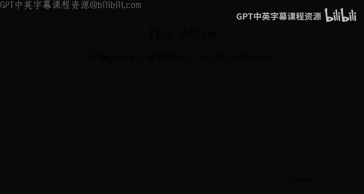
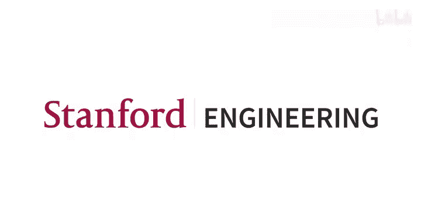

# 斯坦福大学《深度多任务与元学习｜Stanford CS330 Deep Multi-Task and Meta Learning 2022》中英（豆包翻译 - P11：-11-.Variational Inference and Generative Models l 2022 I Lecture 11.zh_en - GPT中英字幕课程资源 - BV1dWpPepEsj

So for this week we're going to be talking about a Bayesian perspective on me learning and today's lecture is going to be a little bit different than a lot of the lectures we've had so far because we're really not going to be talking that much about me learning in this lecture we're going to be talking about。

😊。

Doing approximate Bayesian inference via variational inference and the reason why we're going to talk about that today is that it will be a lot of really useful background knowledge for understanding Bayesian metal learning algorithms and it's also pretty useful outside of meta learning algorithms as well and so we'll see a little bit of motivation for why these things matter in the context of metal learning and we'll talk a lot about Bayesian metal learning on Wednesday but today we're going to go over some of the。

😊，Some kind of really fundamentals on how to do Bayian inference with more complex distribution classes。

Awesome， so the plan for today is to talk about a class of probabilistic models called latent variable models。

Then we're going to talk about how to actually train these latent variable models with variational inferences。

Then we'll talk about something called amortized variational inference。

 which will address a key shortcoming of trying to do non amortized variational inference。

 and then we'll cover a couple example latent variable models。

So the goals of today will be to understand how these latent variable models work。

 including in deep learning settings， and also understand how to use a variational inference in order to train these models。

Also some of the stuff will be useful for doing the optional homework for it will be kind of really themed about one of the questions will be themed on Bayesian Me learning。

 but one of the derivations in that homework will'll draw upon some of the ideas that we talk about today。

Cool， so let's get started by talking about probabilistic models。😊。

In probabilistic modeling we want to model some distribution。

 so for example we may have some distribution P of X where we have samples from that distribution。

 we have some example data points， and we want to formulate a probabilistic model that can generate those data points or evaluate the likelihood of those data points。

 so for example we might try to fit a Gaussian model to these data points and that would allow us to generate other ex points like that or generally model the distribution over those data points。

Similarly， we might have a conditional probability distribution that we want to model where this won't be over the examples。

 we'll actually be conditioning on one variable in order to try to formulate a probabilistic model of another random variable。

And we've already seen examples of conditional probabilistic models in this course， for example。

 trying to predict a distribution over the labels given the input。😊，And most commonly。

'll view you'll be looking at things like probability values over a discrete categorical distribution or outputting the median variance of a Gaussian distribution。

And so instead of actually literally outputting the label Y we often actually output the values of a probability distribution。

 and so that's what the logicits are。But of course it doesn't have to necessarily be a categorical distribution or a Gaussian distribution。

 those are extremely common in the literature， but there are all sorts of other distributions that we might want to formulate and there's things that are much more expressive than categorical or Gaussian distributions。

😊，Now， when we want to go about training a probabilistic model， we will。

Fulate our model so it could be P theta of x， it could be P theta of y given x。 we have data for。

Data kind that were assuming to be from that distribution that we want to be able to model。

And typically， we will formulate a maximum likelihood objective where our goal is to find the model for which it maximizes the likelihood of the data。

And this will be kind of arguably the best fit for the data that we have observed。

So this sort of objective is very easy to evaluate and differentiate for categorical distributions and Gaussian distributions。

 which is one of the reasons why we often use categor and Gaussian distributions。😊。

And this maximum likelihood objective corresponds to the cross entropy loss and the mean squared error loss that we all use and like。

So really the goal of this lecture is to try to go beyond categorical or Gaussian distributions and try to model and train more complex distributions。

Cool， so why might we want to train something more complex。

 So maybe we want to instead of training a normal distribution。

 we want to train a paranormal distribution， or instead of generating like a label。

 maybe we want to generate an image or we want to generate text or video or something like that。

Or maybe or and here's an example of a video generative model。

 so we might want to generate video of an HD video。

An H video of riding a horse in the park at Sunrise， and we don't just want it to give us one video。

 we want it to give us kind of a range of videos that capture that description。

Another example of a more complex scenario we might want a more complex distribution is we want to represent uncertainty over labels。

 maybe there's some ambiguity arising from limited data or some partial observability。

 and it may be that the true distribution over the labels may not be a unimotal distribution。

 it may be a multimodal distribution that's difficult to capture with a Gaussian distribution or a categorical distribution。

U。And second， we may also want to represent uncertainty over functions rather than just uncertainty over examples or over labels。

Now， what do we mean by that？In meta learning we have been representing essentially point estimates of distributions over functions。

 so we've often been trying to estimate what are our task specific parameters given a small training data set and our meta parameters。

 and typically we just output a single set of task specific parameters p I。

But there are cases where we might actually want to fully represent the distribution over task specific parameters。

So for example， you might have a few shot learning problem where there's some ambiguity。U。

So say for example， this is your like a small training data set or a small support set for a classifier。

 we have some positive examples on the left， some negative examples on the right。

And then say I gave you this example right here。If you look at the attributes of the positive examples and the negative examples。

 you might notice that everyone in the positive examples is smiling and everyone in the positive examples is also wearing a hat and this person is not smiling and they're wearing a hat。

And so it's inherently ambiguous what the correct label should be。

 is the classifier supposed to pay attention to the facial expression is supposed to pay attention to whether they're wearing a hat。

嗯。And there might be another example like this one where it's also somewhat ambiguous with respect to like age。

 maybe the classifier is supposed to also be looking at the age of the person。So。

The sorts of ambiguity can come up and we may want to not just output a single classifier。

 but actually output multiple classifiers that might kind of generate hypotheses underlying the data that we see。

So yeah， can we learn to generate hypotheses about the underlying function so that we can sample from this distribution over task specific parameters？

And this ability to reason about ambiguity might be important in a few different settings。

 it might be important in really safety critical settings。

 so if you want to do something like medical imaging。

 then itd be useful to know if you're pretty confident about the function that you have or not。

It can also be important for active learning settings。

 so if you want to figure out if you want to generate like should you generate more examples or more data points。

 can basically can the algorithm tell you yes， I need more labels or no。

 I'm actually are pretty confident about this example。

 and there's actually a number of works that have looked at active learning with me learning algorithms。

And it can also be useful in meta reinforcement learning as well。

 if you want to figure out how to explore a new environment with a small amount of data reason about the uncertainty that you have can help you figure out what parts of the environment to explore and what parts of the environment are already kind of you're already sufficiently competent。

Okay。Those past two slides are a couple of motivation for why we might want to train more complex distributions。

 and then the rest of this lecture will really be on actually trying to do that。Cool。

Let's start by looking at a couple examples of latent variable models。

And some of them might start with examples that you've seen before。

So say you have examples of some data points that look like this。

 and do you want to fit a model to these data points？If you just fit a Gaussian into this。

 you probably wouldn't get a very good fit to this data。

And so what you might use instead is something called a mixture model。Where you try to fit。

 you have a few different components and you have each component is one component of your mixture。

And this would be an example of something like a Gaussian mixture model。😊。

Where the underlying data points， you don't know the underlying structure in which data points have correspond to which mixture component。

 but through the modeling process you want to model both the mixture components and the parameters of each mixture component。

And so mathematically， the way that you would write this down is something like this where your mixture component is Z and your。

kind of the parameters of each mixture corresponds to P of x given Z。

And in this particular case of a Gaussian mixture model， P of z would be a categorical distribution。

 and then P of x given Z would be a conditional Gaussian distribution。Cool。

 so you may also have a conditional distribution that you want to model also with something like a mixture。

And to do that， you can basically just take the same gaussian mixture model and condition everything on the variable that you're conditioning。

So this would now be instead of P of Z， you would condition your mixture element on x。

 so you'd have P of Z given X， and instead of having your conditional Gaussian distribution only be conditioned on Z。

 you would also condition it on the variable that you're conditioning on， which in this case is x。

And this is referred to something- it's really a， I mean。

 basically just a conditional Gaussian mixture model。

 but it has this fancy name of a mixture density network。

And so as an example of what this might look like is if you want to classify or if you want to regress to the length of a paper given the title。

😊，Then instead of just outputting the mean length that you think or the mean invari of the length of the paper。

 you'd actually output multiple mean invaris and the weight of corresponding the corresponding Gaussian。

And so typically for a standard regression problem。

 we may even only output the mean just a single value corresponding to the length of the paper。

 and this sort of model will actually represent。It's kind of a much more rich notion of what you think the label might be。

 and instead of outputting just one number you would output n times three numbers where n is the number of mixture components in your mixture model。

 so these are a couple examples of latent variable models。Now we can look at the more general case。

So in general， our goal with latent variable models is to model a fairly complicated distribution。

 such as the distribution here。And the way that we do that is first we formulate a latent variable Z。

 and it's called latent because we don't observe Z， we only observe X， we don't observe Z。

And then we sample from that latent variable， this is going to be a relatively simple distribution such as a Gaussian。

And then we'll pass a sample from that variable into a neural network that will also be a pretty simple distribution as well。

 so this will also be a Gaussian distribution， but the parameters of this conditional Gaussian distribution will be fairly complex。

And by essentially kind of taking this easy distribution and this easy distribution。

 we can kind of compose them to formulate a more complicated distribution。Basically。

 we're going to be kind of transforming samples from a Gaussian distribution with a neural network to then give us samples from this more complicated distribution。

And so the kind of general form of this is this pretty simple equation right here where we have our distribution over our latent variable and our conditional distribution of our example given our latent variable。

😊，And so in both of these cases， P of Z is going to be an easy or simple distribution。

 and P of X given Z is also going to be a simple distribution class。

And so really the key idea is that we can represent this more complex distribution by composing。

Two much more simple distributions。Now， it's worth mentioning that。The P of x given Z。

 I'm calling this a simple distribution， but the function itself can be very complex。

The function itself can be represented by a neural network， which is a pretty complex function， the。

The distribution class is really going to be limited by the output distribution。

 which is a Gaussian distribution and your neural network is going to be outputting the mean and variance of that Gaussian distribution。

有。Your X givenancy is always gone。Just that's always a caution distribution。

So in order to get that complicated distribution behind you just。Kind of the difference so that。こうすか。

Yeah， so you can basically think of like。The neural network will take kind of one slice of this and then kind of map it onto a particular slice of the top distribution。

 and it may give you it's still going to。It's not just going to give you a single value。

 it' willll still give you a distribution over that。

 but it it's going to be a fairly simple distribution and so you can imagine like mapping to like a small gausian right here。

 for example， and so yeah you can think of it as taking samples from this and mapping it to samples into that function。

Yeah， this， would you be able to get any arbitrary distribution or events。So the question is。

 with this setup， can you get any arbitrary distribution over P of x？In general， yes。

 I don't know of I can't think of any distribution where you wouldn't be able to represent it。

 it does mean that there are some distributions that will be harder to represent than others if you have an extremely discontinuous representation。

 it's hard for it's hard to also just like optimize for those distributions in the first place but。

This does give you really considerable expressive power over distributions。

The other thing that I'll note here is that note that there's only one neural network in this picture。

 which is the P of x given Z， typically P of z is going to be a Gaussian distribution and you don't even actually have to learn the parameters of the Gaussian distribution。

 you can just set it to be like a standard normal distribution with zero mean and unit variance。

 and that you don't lose any generality by doing that because the neural network you can very easily take that and transform it into whatever it wants。

 and so if you can think of the first layer as like picking a different mean and variance for that。

 and so that means that you don't actually have to learn any aspect of P of Z。

 you only have to learn P of x given Z。Okay， so now I have two questions for you and in honor of Halloween and I have a little bit of candy for people who answer questions。

U。So the first question is， once you train this neural network？How do you generate a sample from PX？

点。Those from Sam from B of Z。Soword through the network and that sure is the neurons broken here。

よく存な。Yeah， so basically you can sample from P of Z， then pass that through your neural network。

 and then your neural network will give you a mean invariance。

 and then you just sample from the Gaussian with that mean invariance。

 and that will then give you a sample from your estimated P of X。So I'm not very good at throwing。

So only one seatd off， cool。And then the second question。

 which is a little bit harder than the first question is。😊，Now we have this model that we've trained。

How do we evaluate the likelihood of a given sample？

So we just talked about how do we sample something now， instead of trying to sample something。

 we're actually just given an X。And how do we evaluate？P of x for that given x。分で。说。

Prope we need to get some attention for us。て不。如过我有个し午不叫自。Yeah， if you want to。

So you're saying that we could， if x is our example， we can then integrate。From appeal created。しす。

So you can draw a sample from Z and then integrate or？

Right now we just in the integral function from the P toC you just enforce a bunch of the and just carry a coin。

Yeah， so what you could do is we have our expression over here until we could sample a bunch of Z's and use that to estimate this integral on the left。

 and that would give us an estimate for what P of x is。Co， I will。Okay， you're good。

I don't want to disincentivize incorrect answers。Yeah。Cool。You can estimate P of x。

 and one thing that's important that's worth noting here is that actually evaluating P of X。

Like analytically is extremely difficult because of this integral right here。

And that's going to make training these models also pretty difficult。That question。

We know that Minsker。The equivalent like right。So， can we sample that。

So any sample that the regular sampling from getting off。And doing。boss。So you're asking。

 we know that mean square error is equivalent to log likelihood。

 it's equivalent to log likelihood for I think unit variance。

 if you don't basically learn the variance and you're saying if we sample something from our model and then measure mean square error。

 would that give us likelihood， you're saying？That would not。So if you in general。

 if you only sample one thing， you're not going to get a very good estimate of it。

 and so you might need to sample much more than that。And yeah， so generally， if you're not learning。

诶。ButWell， so generally if you're not learning the variances。

 you might be able to do something like that。Really。

 the correct thing to do is to kind of try to evaluate or estimate that integral right there。

 and you might get a form that if you don't learn the variance of certain things。

 you might get a form that looks like means squareter。Yeah。아 액。Yeah。

 so once you actually so log likelihood corresponds to mean squared error if you have unit variant and if you learn the variance that it ends up being a weighted mean squared error and so there is。

There is basically that sort of equivalence and it'll once you actually start to write out that equation for Gaussian distributions。

 you will get something that looks like a weighted means order。Cool。

This gets into how we can train latent variable models。We know that we have this likelihood function。

 and so we that sorry， we know that P of x is the integral of P of x given and Z times P of Z。

And so if we wanted to go about training these models， we could basically。Plug in。

Plug in this P of x into our equation right there， and so our objective would be kind of summing over our data points or averaging over our data points of log of the integral of P of x given Z times P of Z。

Disy。And so we could try to go about optimizing。Optimizing for this equation right here。

But unfortunately， generally， you need to sample a lot of these in order to actually accurately estimate this integral。

And so in general， this integral isn't going to be particularly tractable。

And if we needed to optimize if you needed to like every single time we take a gradient step。

 we needed to sample a ton of different Z's， then。We wouldn't be able to optimize this particularly easily。

And so that's where all these kind of different techniques for training latent variable models come in。

 they want to basically try to estimate the gradient of this objective without having to evaluate the integral。

So there's a number of different flavors of latent variable models and in the deep learning literature。

 and they basically all just come down to different ways to train these kinds of latent variable models。

And so you may have heard of things like generative adversarial networks， variational autoencors。

 normalizing flow models， and diffusion models。😊，And all of these models are just different examples of different latent variable models。

 they all have some sort of latent variable that's typically， I guess actually in all these cases。

 I think it's a typicalulate Gaussian latent variable that's then transformed with the neural network into into the original into the space of the examples。

There's one class of generative models that does not use latent variables and this is autoregressive models。

 you saw these in the generative pre tradinging lecture。

But basically everything else that I know of uses a form of latent variable。

And really the way that these different latent variable models differ is how they are trained and they have different different pros and cons in terms of。

The ability to optimize them and the ability to evaluate likelihoods of samples and so forth。

In this lecture and also on Wednesday we're really going to focus on methods that use variational inferences to train them。

 primarily because that's it has a number of benefits and it also is what's been used most for latent variable models over parameters in meta learning。

 however there's also。Like lots of hybrids of these models as well。

 where variational inference becomes quite useful， like there are papers that combine VAs and GNs。

 there are variational diffusion models， and there's also connections between variational inference and normalizing flow models as well。

😊，Yeah。遅いと思いますこ。What we。What is a good example of latent variables， that's a great question。啲。

In general， oftentimes when you train the latent variable model。

 the latent variables don't necessarily have any particular interpretable meaning to them。

In the case of the mixture models that we saw the latent variable corresponded to the different mixture components and in some cases that might have a natural kind of interpretable meaning。

 if your data naturally has those different clusters and basically the latent variable will correspond to the identity of that cluster and in the slub example。

 the kind of the face attribute example that we saw different latent variables。

 if you' were to try to generate。Images like that， different latent variables might correspond to different attributes。

 and if you're trying to train a classifier and basically generate these different classifiers。

 then different latent variables would correspond to different combinations of attributes that that classifier is paying attention to。

So ideally that's that's the kind of thing that we want these latent variables to correspond to。

 there's a question of whether the model will actually learn those things in practice and it can use the。

The latent variables to really correspond to whatever it wants。

 The other thing that I'll mention on this topic is that especially in the context of conditional latent variable models。

 for example， if you're training something to predict why，Y give an x。

 whereas Z is your latent variable， then the latent variable is basically the only source of randomness or the only source of information other than your input X。

 and so Z or the latent variable needs to capture，Things in Y that can't be found in X。Cool。

 so now let's try to talk about how we can actually train these models。

 like how do we train these models to generate pretty pictures or parameters or whatever。

And so an outline of what we're going to talk about is first we're going to formulate a bound on the log likelihood objective that will allow us to get away from。

Computing that annoying integral。Then we're going to check how tight the bound is。

And then we're going to。Move towards amortized variational inference。

 which is a kind of an important practical step that's important in deep latent variable models。

 and lastly， we'll talk about how to actually optimize the bound that we have。Cool。

 so we want to go about optimizing this objective and we're going to formulate a slightly different objective called the expected log likelihood。

And on this slide， I'm not going to justify this objective。

 this is mostly for just trying to build some intuition for what we're going to be doing on the next slide。

And in particular， what this kind of expected log likelihood， it looks a lot like this。

 but we've now replaced the integral with an expectation。Over the latent variable given the input X。

🤢，And the intuition here is that。Essentially， we don't。

But we have this integral we're kind of considering all possible values of Z。And。Really。

 the ones that are relevant for optimizing this function are the Z's that are most likely for a given XI。

We don't want to have to consider all possible Z's。

 we want to consider the ones that are actually going to be most likely corresponding to an XI。

Of course， there isn't just a single。Sing Z4 given XI。

 there may actually be multiple possible values of your latent variable。

 and so we're going to be using this distribution of Z given X。

 which is often referred to as the posterior distribution。😊。

And once we can kind of consider these possible values of Z and then maximize for this kind of joint likelihood for that Z and our sample X。

This objective becomes a lot easier to optimize because we can estimate that expectation using samples。

And so。Once we have this objective， it's pretty nice。

 although there's still this question of how do we actually estimate Z given Xi？

That's not something that we're really given a priority。嗯。And so。

If you think about first what Z given Xi looks like， maybe for this particular value of x。

 the corresponding Z might have this distribution right here。

What we're going to try to do is we're going to try to estimate this distribution of Z given Xi with something fairly simple。

So we'll estimate it with what I'll call QI。And basically， for every single data point。

 we're going to try to estimate what we think。The latent variable is。

 and that will be represented by this Q variable here。

 so instead of actually having the true Z of Xi， we're going to estimate it with something that looks like a Gaussian distribution。

Now this estimate isn't going to be perfect， and so as you saw on the slide。

 these two distributions weren't exactly the same， but once we have this estimate。

 it will help us with optimizing the objective。So。嗯。

The thing that's nice about actually trying to approximate Z given XI with something like QI is that once we have this estimate of the latent variable for a particular data point。

It means that we can formulate a bound on our objective。And the bound is。Is not to。

Difficult to formula it。So the。We want to formulate。诶。A bound on P of XI or log P of XI。

 so this is the log likelihood for a single data point。

 in reality we would actually be summing over all of our data points。

 but I'm just going to remove the sums for simplicity of notation。And like we've talked about before。

 this is equal to the integral over。Sorry， this equals to the log of the integral of。

P of X I given Z times P of Z DZ。And。Now， there's a question of where this kind of QI will come into play。

And one thing that you could do whenever you want to。

Introduce new distributions is or new variables into your equation is basically take your expression and multiply it by。

Sorry， Q I of Z。Divided by Q I of Z。And this is okay to do because this is always going to be equal to one。

 and so we're just multiplying。The inside by one。And once we have this。

 we can then formulate this is an expectation， so this is equal to the log of the expectation of。

QI of Z sample from QI of everything on the inside， so we get P of X I given Z times P of Z。

Divided by Q of Z。And this is a much nicer form than what we had before。

Because we know how to sample from， QI is a Gaussian distribution that we're estimating right there。

And so。We now can- yeah we now basically have something that we can sample from instead of trying to evaluate the integral。

So all I've done here is this is just kind of。Algebra， up until this point。

 we actually haven't made any approximations yet。And it's worth noting that we can actually。

 this kind of holds true basically for any QI， we aren't making any assumptions on how good QI is。

And then from here， what we can do is。It's annoying to have an expectation inside of a log because we want the expectation to be on the outside so that we can and estimate sample mini batches rather than sampling a ton of difference。

AndThis is where Jensen's inequality can come in， which we saw previously， and in this case。

 Jensen's inequality will actually work in our favor rather than hurting us。Densen's inequality。

Says that。Log of expectation of some variable y is greater than or equal to the expectation of。

The log of Wi。I should also mention actually that Jenens inequality is actually。

It's actually a lot more general than this， it actually holds for any concave function。

 so log is an example of one concave function， but you can plug in any other concave function other than log and。

And also kind of showed the same sort of bound， also if you have a convex function。

 it's also the same， you just need to flip the sign of the inequality。And so with。

Jensen's inequality， we can now。Formulate a lower bound。On our objective。

 I basically just like swapping the order of the expectation and the log。

And because these are products， we can then start to actually write these out as a sum of logs rather than a log of the product。

 so log of P of XI， given and Z。Plus。Log of P of Z。Minus log。Of Q I of Z。嗯。

And this is basically now objective。This is something that we can now optimize。

 so we'll sample a Z from the distribution QI for that data point and maximize the likelihood of the data point。

Of XI conditioned on that value of z。U。Well also。Optimize for log of Pbei under。For this value。

 and then lastly， we'll also get this last term and this actually this last term with the expectation corresponds to the entropy of。

Q of Z。Now， this whole objective is。Is called the evidence Lower Bo。Or the elbow。

And let's try to talk a little bit through some of the intuition behind this objective。So。

This is basically just writing out what I wrote out on the board。And。

And also kind of writing it out in terms of with Dudson's inequality。

 So this is the the kind of final bound。And once you maximize this objective。

 that means that you're also maximizing our original objective， which is the log likelihood。so。

To talk a little bit about the intuition， I think it's helpful to first talk about some quantities like entropy and kale divergence。

Entropy is something that we've kind of talked about before， but we haven't formally gone over。

 and it's defined as the negative。Log probability under basically the negative expected log probability。

 which is equal to the negative integral of P of x log P of x。

And there's a couple different intuitions behind what entropy corresponds to。

The first is basically how random a variable is。And so for example， if you think about a coin flip。

 like a Bernoulli variable。If the weight of that coin is 0。5。

 that means it's more random and the entropy measures that。

 whereas if its the kind of probability of the heads is one。

 then it has zero entropy because it doesn't have any randomness。

So you can essentially think of entropy as measuring how much randomness does this variable have？

And the other way to look at it is thinking about how large is the log probability of the variable in expectation under itself。

And so if you have two different distributions。In expectation， this one has high log probabilities。

 and this one has a lot of low。Log probabilities and if you have a small log sorry。

 this one has high probabil， this one has low probabilities and something with low probabilities will have the log of that will be a large negative number。

 whereas the log of something with a higher probability will be a small negative number and so the thing that has large negative numbers will have a large entropy。

And the one that has。These high probabilities which correspond to the small log probabilities will have a low entropy。

And so if we think about the objective that we just talked about right here。

Which is the evidence lower bound， it has really two main terms in it。And the first term。

 so if we try to plot as a function of z P of X comma Z， then we draw sample from Q。

You can think of the first part or basically the first two terms here。I was saying， okay。

 for a given Z。My probability of x comma Z should be high。 And so that's going to basically。

Pick something like that， it tries to pick a Z that it has high P of x comma Z。

And then what the second term is going to try to do is it's going to try to maximize the entropy of Q of Z。

 and so it's going to try to basically make the distribution as wide as possible。

And so overall what this objective is going to do is it has really these two parts。

 one that's maximizing probability and one that's trying to make that distribution as wide as possible。

 such that you're matching the underlying distribution。😊，Any questions on entropy or this intuition？

Cool，thing that we can look at is what's called the kale divergence。

And this is also something that I think we've seen briefly。

 and the kale divergence between the two distributions is defined as the expectation under one of those distributions of the log of the ratio of the first distribution divided by the second distribution。

And you can kind of equivalently write this out。As the negative probability of one distribution under the other minus the entropy of that other distribution。

And again， there's two different ways to intuitively look at the kL divergence。

 The first is thinking about how different are these two distributions， how different is Q from P。

And you can see that， for example， when  Q equals p。

 the kale divergence will be zero because when q equals p。

 that ratio on the left will be 1 and then the log of 1 is0， and so this will be。

Zero and as they become more and more different， the kale divergence will grow。

And then the second way that we can look at it， especially looking at this equation right here is。

Basically， how small is the expected log probability of one distribution under the other distribution minus the entropy？

And so。This ends up giving us a similar picture to before。

 where if we think about the probability of one distribution under the other， that will。Basically。

 give us the kind of。Like。Maximizing that will maximize or minimizing that will maximize this first part and then。

The entry people will also try to maximize it， and so if you want to try to minimize the kale divergence。

 this is going to try to make the distributions as similar as possible。Okay， so up until this point。

 we've kind of derived an objective for。诶。For optimizing these latent variable models。

And the way that we do that， the way that we did that is we。

We still have our kind of our P of Z term， which is just can be like a Gaussian distribution。

 like a standard normal distribution。And we have our neural network that's kind of mapping from a Z to an XI。

And then we additionally introduced this。This third thing， which is this kind of。

Distribution that's trying to approximate。The posterior is trying to approximate P of Z given XI。嗯。

And so then the next question is。We bounded this objective， is this bound actually tight。

 and in which cases is this bound actually tight？And part of this relates to the question of。

The choice of QI。And what makes a QI and really the intuition is that we want QI to be as close as possible the P of Z given XI。

 we want to basically be able to tell us the distribution over the latent variable for a given example。

Yeah。一住。And it's like where the equality would come？You're asking。

 can I tell you when would QI not be equal to this？好。Was it done边。And you go from the the quality。

いそいですか。It doesnt any quality too。就是说。Why would it be？Yeah， so you're a little bit ahead of me。

 so basically if QI is equal to P of Z given X， it turns out the bound will be tight。and。

In particular， if if their kale divergence is minimized， if the kale divergence is0。

 then the bound will be tight。 and there is， I guess。There's a question。

 do I want to go on this on the whiteboard or on the slides？

I feel like it'd be just a little bit faster to go over on the slides。

 and it might be nice to do that。To answer your question。

 we can basically look at the kale divergence between QI and P of Z given XI and derive what this actually corresponds to。

And we can do this by just first writing out the equation for K divergence。

 which is the expectation of Q of log Q over P。And。With Bayes rule。

 or if we multiply the top and bottom by P of Xi， we get an expression that looks like this。嗯。

And then if we kind of expand out the log of the product into the sum of logs， we get。

The negative log of。The bottom， which is p of X I given z and p of z plus the log of the top。

 which is the log of Q of Z and the log of p of x。And this starts to look pretty familiar so the first three。

U。Basically， this is equal to the entropy and everything before this last part is exactly equal to the evidence lower bound。

And so。What this means is that。If you set the kale divergence equal to zero。

If we set Q I of Z equal to P of Z given an X， then。LI is equal to the log probability。

And so that means that basically the bound is tight the loss function or the evidence lower bound is exactly equal to the log likelihood when the kL divergence between Q of Z and P of Z given X is 0。

诶。Cool， and also， because the k divergence is always non negative。

 this also kind of is another way to derive the bound on P of X I。And so this bound essentially。

 instead of using Jensen's inequality， it' just relying on the fact of the kale diverg is。

Is not negative。诶。Cool， so if the k divever is zero。

 then that means our evidence lower bound is tight and that means that we are。

 if we kind of basically exactly represent P of Z given an XI。

 then we're going to be exactly maximizing the likelihood。

The second thing to note here is that so so far we've talked about kind of how we're going to be optimizing this neural network。

 the other question is how do we optimize for QI。And if we optimize for QI with respect to the same lower bound。

Then。What that's going to do is that's going to be minimizing the kale divergence because。

I guess I can write this out right here， so we saw that the。The k divergence between。

Q I of Z and P of Z given X is equal to our loss function。Plus， log。P of X i。Actually， sorry。

 negative。嗯。And so basically if we。If we decide to maximize LI with respect to QI。诶。

This doesn't depend on QI at all。😡，And so。That means that if we maximize L。

 this corresponds to minimizing this lefthand side。

 which means that we're minimizing the kale divergence。

 and that's a really good thing because if we're minimizing the kale divergence with respect to Q。

 that means that we're making the bound tighter。And so this really justifies using optimizing this evidence lower bound both with respect to theta as well as with respect to Q。

 because it means that we're going to be optimizing a bound and we're going to be making that bound tighter as well。

Cool， and so what our optimization objective will look like is basically we have this single objective LI。

 and we're going to maximize it both with respect to our model parameters the and with respect to what's called the variational distribution QI。

😊，Okay， so then there's a question of actually kind of walking through what the algorithm looks like。

So once we have this objective， the first step will be to sample。An example， Xi。

 or a mini batch of examples。Then we want to compute the gradient。With respect to theta。Of LI。

And the way that we'll do， actually。Yeah， does anyone want to actually。

Say how do we compute the gradient of this with respect to theta？Or what the first step is。

So you can see theta appears。Just right here， and that's the only place where theta appears。Yeah。

Inside because the functional of well behavior。So it we just take it。度べじい。

So you are saying that we could take the gradient inside。 So we sampled an X I。

 But to evaluate the gradient of this， we need both an X I and a Z。So where do we get the Z from？

I guess we can make I open like a soft problem in least policy based on the values back for。

To more spot。TheMost8。自 give。Because there's some really excellent image of disease most like here。

 like make a so protectiveor or program。Yeah， so so what we'll do is I'm not fully sure if this is what you're suggesting。

 but what we can do is we can。We have QI。And so we can sample a Z or multiple Z's from QI。

And then once we have those Z's， then we can use that to kind of pass that into here and compute the gradient of log P theta using those using those Z's and so yeah。

 we'll basically first sample，啊。For example， Z。from。QI。诶。And then once we have the Z， we can then。

Basically kind of compute the gradient of log。P theta of。

X I given that Z in practice typically- well， I'm only writing a single sample here。Typically。

If you want to get an extremely accurate gradient， then you would sample multiple Z's from here。

 but in practice， actually just sampling one often works just fine。Cool。And I feel like I should。

It's also pretty far， so I'm not sure how well it could throw using this one z as theyre sort of implicit assume。

Does it implicitly assume that our data is white， sorry？发。这不是个东西。So the question is。

 by only sampling 1 Z， does that implicitly assume that our data is well behaved？

I'm not sure what well behaved means。Do you mean that the expectation would eventually better？我不。

Right， so I think that。I think that one of the reasons why it works well is we're modeling QI as a Gaussian distribution and Gaussian distributions are。

fairly simple and unimmodal and so I think that for that reason。

 because Gaussian distributions are well behaved， perhaps the using just one sample is okay。But yeah。

 I'm not sure if I have a better answer than that。是这个。Theirair distribution is title for those in。

Stboard。If we had a beta distribution rather than the Gaussian。Well， we haven't yet， I guess。

We haven't yet gotten to the training， the QI part， but。

It would be hard to train a beta distribution。Meeasure the entropy of a Gaussian distribution inclosed form with respect to the mean andvari of that。

 so that becomes a lot easier， specifically with respect to this step。

 I'm not sure I've never tried it in part because of the complexity there。

 but I could see it being possibly needing more samples in that case。Yeah。Do we have one QI per site？

So so far， we have one QI for every XI。Yeah。Q I C U and X。We will do that soon。It's a great idea。

Was there a question？the South we just wants it works while we trend briefly。律诉讼。Right。

 so the question is for prediction， do we still sample multiple Z's。

 so it depends on how you're using it。TheIf you're just generating from the model。

 you're actually not going to be sampling from Q at all。

 you'll be sampling from P P of Z and then passing that through your neural network if you do want to get a really good like。

If you do want to get a better estimate， one thing you can do is sample and then take the。

Basically sample and then take the max or something like that and sample multiple times。

 so there are things that you can do to sample。More than once at， at inference time。

 it kind of depends on how you're using it， though， In the case of variation auto encoders。

 you actually very rarely use Q at test time。 You often just throw it away at test time and only just use it to generate samples。

 But there are other cases where you may actually be using Q at test time。Cool， so oh。

We got through step two。Which is how to compute the gradient。

 And then the last thing that we'll want to do is to update。呃。QI。With respect to。The loss function。

And。The way that we'll do this is if QI is a Gaussian distribution， then。

We can set basically QI to be a Gaussian distribution with a mean of mu I and a variance of Sigma I。

And then basically compute the gradient of。Your loss function with respect to mute I and also the gradient with respect to Sigma I。

And。Then use that to update MuI and SigMI。And so this is basically just what's written out on the slide。

We estimate the gradient， it's an estimate if you only take one sample。

And although even if you take a few samples， it's still an estimate unless you take an infinite number of samples。

 and then we'll update QI， and the way that we do that is we'll evaluate the gradient of the mean and the gradient of the variance。

Cool， so this already sort of came up， but there's a little bit of a problem here。嗯。

Which is that in typically in deep learning， we have a large number of samples。

And that means that it may be somewhat impractical to fit a QI for every single。Example。And so。

One question is， when we have this kind of model， what is the total number of parameters？Yeah。

So first youll have all。Fs。And then you also have instead of reopen。Begin many sets of。

ItMes a very specific UI and Sigma。Yeah， exactly。 so we'll have all of our theta and we'll have one of those。

 and then for the number of examples that we have we'll have。😊。

Two times the dimensionality of or well， n times the dimensionality of mu and n times the dimensionality of sigma。

And so this is a pretty large number of parameters。So to solve this problem， what we can do。

 which was actually already suggested， which is that instead of having a single QI for every single data point。

 we can train a neural network to predict Z given XI。And。

So instead of only having a neural network that predicts x given Z。

 we're going to have a second network， which is often called an inference network。就。

Give you a distribution over Z give an x。诶。And this neural network it'll take as input X and it'll output a mean and a variance。

 and so Q will again be a Gaussian distribution， but it' will be a conditional Gaussian distribution。

 and this neural network is outputting the mean in the variance and then the normal distribution is parameterized by that mean in that variance。

Cool， and so this is where we get to amortize variational inference。

 and the reason why it's called amortize variational inference is we're essentially amortizing the inference process across using this neural network rather than just having like doing inference for every single data point individually。

😊，Cool。The way this works is we again， will formulate the same exact objective。

 except instead of being QI of Z， we'll just replace that with Q phi of Z given Xi。嗯。

And this works out with the bound because。We mentioned that this works really for any value of Q。

 and so it can be。Q can be conditioned on XI， it could really be conditioned on whatever you want it to be conditioned on。

And so it's natural for it to be conditioned on Xi because we want it to be very similar to P of Z given Xi。

诶。Cool， and then the algorithm ends up looking。The same as before， except now。

 instead of sampling from QI over Z， we're now going to be sampling over this conditional distribution that's conditioned on XI。

😊，And then instead of updating each of the individual QIs。

 we're going to be updating the parameters of our inference network， which I'm using Phi to denote。

Cool， and so that's all written right here， and we can take a gradient descent step on Phi。

Now there's one more problem。That we have to fix。Which is actually how do we end up calculating this gradient right here？

And the reason why this is a problem is that if we look at our objective。诶。

There's a few different places where Phi will come up。So Phi will come up right here。

And Phi will also come up right here。And this part isn't too hard to calculate， you can look up。

 there's a closed form equation of the entropy of a Gausian that you can look up。😊。

But this one ends up being a little bit more difficult because here you actually have to differentiate through the sampling process into Phi。

So this part is easy， the second part is a little bit harder。And。In terms of going into this。

 we'll refer to this inside part， it doesn't really matter what this inside part is。

 we'll refer to it as R of X I given and Z， and then our goal is to be able to compute。

The gradient with respect to phi of this expectation of Q phi of R。Of X， i。ComSo this is our goal。

 this is what we want to be able to compute。And， and。

Q is going to be outputttting and Gaussian distribution。No。

This is where what's called the reparameterization trick comes in。And so in particular。

Q of phi of z given x， this is defined to be a Gaussian distribution of some neural network that takes as input x。

And the variance that takes sense and put X and。嗯。Here we're going to be sampling in this expectation。

 a Z。from。This。From this。A Q distribution？And we want to be able to differentiate through this sampling process。

And the really cool thing about what's called the reparamatization trick is we can rewrite this。😊。

This equation， this sampling process as。The equation， view of x。Plus， epsilon times sigma of x。

 where epsilon is a。Gauusian epsil is a variable epsilon is a value that is sampled from a standard normal distribution。

And so this equation should be fairly straightforward。

 so we're just saying that a sample from a Gaussian distribution equals the mean plus some noise times the variance。

And the really cool thing about this equation is that。Epsilon is completely independent。Of Phi。

Whereas the mu and sigma are parameterized by phi。 and that means that we can。

Basically generate a sample this way where we generate a sample from epsilon and then plug it into this equation。

And then。That gives us a sample and we can differentiate through this equation into Phi in order to update Phi through the sampling process。

And so more concretely。诶。This is the equation that I wrote up on the board Z equals mu plus epsilon time sigma。

We can first sampleigma or we can first sample epsilon in a way that's completely independent of the inference that parameters。

Multiply that by Sigma。And add in the mean。And then in order to compute the gradient of this expression。

Now we no longer actually have to sample from Q。We can instead sample from the standard normal distribution。

And this equation is much easier to differentiate through。In comparison to the first equation。

And so basically to estimate the gradient of。Phi， we first sample a bunch of samples from the standard normal distribution。

 a single sample actually also can work well in this case and then。

The gradient will be approximately equal to the gradient of phi of。Of R。

 where we plug in this equation for。Our sample for Z。Cool， any questions on how that works？

I should mention this， it's really important that this is independent of Phi。第二。Sest achieved。

One or is identity by commissioners as a。Right， so if this is vector valued。

 then this will be identity。入。你是不是你。For a week。Youそ got somebody。

Something which gives like a political。就个物唔。Yeah， so the question is。

 are we losing anything by doing amortized？By doing amortization。It's a good question。

I think the only thing that we may be really losing in this case is that the。Your。

You essentially have something that may be slightly。In practice。

 I don't think this is really the case， but when you actually separately represent each QI。

 you can really represent like just a Gaussian for all of them and。

You have a lot of expressive power， whereas when you have a single neural network that has to output。

A different Z for every x for a given x， it has to be able to look at x and then tell you what Z is。

And it may， it may be somewhat difficult to do that with a single function。 It may also be that X。

 There are two X's that look very different， but actually have very different latent variables。

 And in cases like that， it may be。It may be especially difficult for the inference Network to do that。

所以啊。But really just being able to represent Q of Z given X。

 like you have to be able to represent that， I think that's really the only thing that you're losing。

I guess I could also mention that there are some works that kind of amortize and then run some additional gradient steps on Z。

And there are kind of like more hybrid methods as well that you can consider。

Cool so for the repabertization trick， it's really super easy to implement。

And it also gives you a pretty low variance estimate of your gradient。

It only works for continuous latent variables， one specifically in this case。

 Gaussian random variables。If you are really excited about having discrete latent variables。

 then there are techniques for optimizing for those。

 so there's something called the straight through estimator and vector quantization that has been used in conjunction with variational autoenderrs。

 we won't go into it here， but it's something that's been pretty successful discrete latent variables and you could also use something called the reinforce trick which is also policy gradients which are often。

Often used in reinforcement learning， but also can be used to estimate gradients here。

But for continuous latent variables， the re amrovtization trick is far better than these options。

Cool。In the last five minutes， I'd like to also kind of go over another interpretation of the objective。

So we've talked about the objective as。As basically kind of an entropy term and like a likelihood term。

And。Alternatively， there's a different way to look at it。And the other way that you can look at it。

Is。Is if you combine this term in this term？You end up getting K log。

ExExitation of Q log P and minus expectationation of Q log Q。

 and these two terms combined actually correspond to the k divergence。

And specifically the kale divergence between。诶。Q of Z given x and P of z。

And then you're just left with you also still have this first term， which is the expectation of Z。

Sampled from Q of log。P theta。诶。X I Gi and Z。And。This is basically a separate way to look at the equation。

😊，And。Actually， sorry， this should be a minus sign。and。Put it this way。 you can。

You can sort of think of this from the standpoint of an autoenr。

Where your Q network is encoding your example into this latent space and your model P of x given z is decoding from your latent variable back into your space。

 so if you think of the autoenderrs that we saw before。

 then you can think of the encodeder as Q of z given x， and the decoder as p of x given Z。

And then from this standpoint。This term right here。

You first encode and then you evaluate the likelihood of under your decoder。

 and this basically corresponds to reconstruction error。

 like how good are you at reconstructing the example after you've encoded it and decod it？

And the second term is telling you that once you encode。Your example into your Z space。

 this should look like a Gaussian distribution。So yeah。

 your Z's basically should be Gausian distributed and this is going to。

Then basically add noise into this variable right here。

 and that will kind of force the model to not be able to represent the identity function。

Through your encoder and decoder。So the Kale divvers also has a convenient analytical form for Gaussian distributions。

😊，诶。And the。Yeah， so you can basically think of this as taking an up。

 outputting a mean invari over Z。Then adding noise or sampling from Q in order to generate a Z sample。

And then decoding that Z sample with your P of theta to generate an x。Cool。

 and this basically corresponds to the variational autoender。

 and you can basically kind of sample a Z from a Gaussian space。

 like a low dimensional Gaussian space， and then have your decoder or your model P of x given Z then generate some cool looking faces for you yeah。

😊，有。Yeah， exactly， so you can think of the KL term as acting as a regularizer on the autoencor so that you're not only optimizing for reconstruction。

 you're also encouraging it to kind of regularize the information content in Z。嗯。Co야。

Just how of you was doing， what is 30？Yeah， what does variational mean？I don't know if it has any。

Meaning in English。 but the。The distribution Q of Z。

 this is often referred to as the variational distribution。

 maybe in the sense that it is kind of it's not the true distribution。

 it's not kind of the distribution given by your model， it's not like the true distribution。

 for example。Maybe。Yeah I come from超别人。Yes， that's possible。Cool。

And then when you want to sample from a variation autoen codeder。

 you can first sample Z and then sample x given Z。And。Yeah。Lastly。

 if you want to do conditional models， you can also condition on something and we primarily didn't we talked about unconditional models to start。

 but you could also basically condition your inference network and condition your model on something like a class variable to generate images of that class or text and so forth。

 and so really everything is the same we're just conditioning on some input value。Cool， so that's it。

 to summarize we talked about latent variable models。

 how to train them with variational inference and amortize variational inference。

 and we learned about various things like the Reap parametertization trick to optimize these kinds of models。

😊，Yeah， and as a reminder， homework three is due on Friday and I'll see folks on Wednesday。

