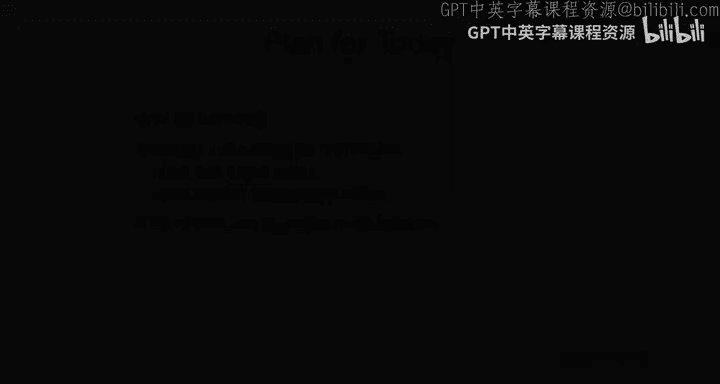
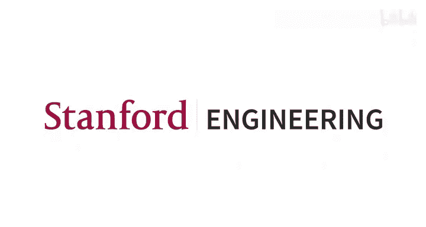

# 斯坦福大学《深度多任务与元学习｜Stanford CS330 Deep Multi-Task and Meta Learning 2022》中英（豆包翻译 - P12：-12-.Bayesian Meta-Learning l 2022 I Lecture 12.zh_en - GPT中英字幕课程资源 - BV1dWpPepEsj

On Monday， we talked a lot about variational inferences and how to optimize for。

Complex distributions of data， and today we're going to actually put some of that into practice in the context of meta learning algorithms。

And so specifically we'll again try to motivate why we might want Bayesian metal learning algorithms in the first place。

 then we'll talk about different classes of Bayesian metal learning algorithms。

 including black box metal learning algorithms and optimization based algorithms。And then lastly。

 we'll talk about how to actually evaluate Bayesian meta learning algorithms and how that differs from the typical kind of fu shot learning evaluation that we've seen previously in class。

And so the goals by the end of the lecture are to try to be able to understand the interpretation as me learningning as Bayesian inference and also understand techniques for representing uncertainty over parameters versus over predictions。

So I guess also one quick disclaimer， like a lot of the class content。

 this is an active area of research and so there are also， yeah willll be。

 in some cases potentially more questions and answers in terms of the algorithms that we're looking at。

 but that's also true for a lot of the content we've seen in the course as well。Cool。

 so let's start by talking a little bit about a recap of some of the things that we've seen so far。

 both in terms of metal learning algorithms and also in terms of casting that in the context of Bayesian graphical models。

And so when we covered。of the last lecture on Me learning algorithms。

 we talked about the properties that we might want from a meta learning algorithm。U。And specifically。

 we're talking about the properties of the inner loop of that algorithm。

 like the learning procedure that it gives you。And there were two different properties that we really focused on when talking about this。

 the first was thinking about the expressive power of the inner loop of that algorithm。Specifically。

 can the inner loop of that algorithm represent a wide range of learning procedures？

And the second was looking at the consistency of that inner loop。

 which was consistency in the notion of statistical consistency。

 which is that if you give the inner loop enough data。

 can you expect it to solve the task and reach a consistent estimator or give you a consistent estimator of the task specific parameters？

Um but。These properties are important， but one property that we haven't talked that much about is the ability to reason about uncertainty and this is really the focus of Bayesian meta learning algorithms and by that I mean the ability to try to reason about ambiguity that might come up in the learning process。

And this is important in active learning settings， in settings where you want calibrated uncertainty estimates。

 as well as in reinforcement learning settings， and it also gives us。😊。

One might argue kind of approaches that are quite principled from the Bayesian standpoint。

 insofar as they're going to be maximizing the likelihood under some graphical model。Cool。

Now this will also be a little bit of recap， which is that。Actually。

 even before we started talking about metal learning algorithms。

 we talked about how training and testing tasks should share some degree of structure。

And we talked about how this。Can be thought of as a statistical dependence on some latent information theta。

And we brought up this graphical model right here where we have our task specific parameters PhiI and some shared latent information theta。

 and we also have the data that we can observe， which includes a support set denoted as xtrain and Y train here and a query seted as X test and Y test here。

And we also talked about if we kind of condition on the shared information。

That means that the task parameters become independent。

And are not otherwise independent from one another。And as a result。

 if you condition on that shared information on theta。That gives you information about Phii。

 And so the kind of。The distribution over PhiI is going to have a lower entropy。

 it's going to have less randomness because we have some knowledge about this shared structure across the different tasks。

诶。And then I guess it's been a while since we talked about this a little bit。

 so I guess we can maybe walk through these thought exercises again。

 so the first thought exercise was that if you can identify the metaparameters theta。

 such as with a meta learning algorithm，When you expect。

 when should learning Phi I be faster than if you were to learn from scratch？

Does anyone have any thoughts？When yourtsky is formed the same distribution is。Yeah。

 so one example is if your task， the task that you're trying to learn is from the same distribution as the task that you saw during meta training。

 then the shared structure should be useful for helping you infer what PII should correspond to。

Any other thoughts？So one of other the thing that I think we covered last time is that if the tasks do share some structure。

 then this data is going to help you is basically going to kind of reduce your uncertainty over Phi。

 whereas if the tasks are completely independent from one another and don't have any shared structure。

 then you won't actually be reducing entropy when you condition on the theta variable。嗯。

And then lastly， we also talked about this other case where。Where if you condition on theta。

What happens if the entropy is zero？And this is the case where data tells you everything there is to know about the task specific parameters and in that case you don't actually need any support set or any data to infer what the task specific parameters are and in this case you could actually think of this a lot as memorization you don't actually need the support set in order to infer the task specific parameters and so in this case your meta learning algorithm may just memorize all of the tasks and not actually use the support set。

Cool， and then。Kind of jumping into Bayesian meta learning algorithms。

 all the algorithms that we've seen so far use some give us our task specific parameters in a fully deterministic way。

 so well they'll give us a degenerate distribution over PhiI because they'll just give us one parameter vector。

 they won't give us a distribution that has any amount of support to it。

And there are cases where we do actually want to generate multiple hypotheses。

 and so this is an example that we saw on Monday where future shot learning problems might be ambiguous。

 so you might have a support set where it's inherently unclear which attributes you should be paying attention to。

😊，And if we can learn to generate hypotheses about the underlying function。

 the this can tell us if we need more labels or if we should abstain from making a prediction on a new example because it's uncertain。

And so this is important in safety critical settings where you want to。

Decide if you should make a decision， active learning settings and also exploration settings in this specific example in this lecture we will be talking about algorithms that could actually handle the specific setting and generate hypotheses and basically multiple classifiers。

 one that pays attention to the smiling attribute， one that pays attention to the wearing hat attribute and one that pays attention to the young versus old attribute。

😊，Cool， so let's get into algorithms for doing this。Now the first like v zero algorithm。

That we could think about doing is。We've seen all of these algorithms that give us kind of a label Y test。

 given a support set and an input X test。And so what we could do is。

Have F output the parameters of a distribution over Y test？

And in the classification settings that we've done， you've already been doing that。

 so we're not actually like literally outputting one single label。

 we output the probabilities for each class。And so。What you've been doing so far。

 like in the homework， for example， is to output probability values over a discrete categorical distribution。

 but you could also output some other distribution over Y test。

 so in regression problems you could output the mean and variance and you could use a mixture density network like what we talked about on Monday where you output the means variances and weights for a mixture of Gaussians over Y test。

Or if you have something more multidimensional， you could have an have kind of this output over Y test be a sequence of distribution such as an auto aggressivegressive model。

嗯。And then once you choose your distribution class over Y test， then you can just optimize。

With maximum likelihood， and that would like maximum likelihood would correspond to the outer loss of your me learning algorithm。

So this is pretty simple， in fact we've already been doing it， and so this is nice。

 you can combine it with a variety of different metal learning algorithms。😊。

But the downside is that you can't actually， this will allow you to reason about uncertainty over the label。

 but it won't allow you to reason over about the uncertainty of the underlying function。And。

Be able to reason about uncertainty of the function is important if you want to understand how to reduce uncertainty across a set of data points。

Because it could be that you're very uncertain about one data point and if you had a label for that data point that would help reduce your uncertainty for a whole host of other data points as well。

 and so if you had some notion about your uncertainty of the underlying function。

 then you'll understand basically how your uncertainty across different data points relates to one another。

And then another downside of this is that you can really only capture a limited class of distributions over Y test and this is actually a question that came up after lecture on Monday。

 which is，Like you can output like I've talked about how you can output like a immune variance of a Gausian over Y test and a categorical distribution。

 why can't we just output some kind of crazy distribution over Y test that looks like something like this？

And the challenge that comes up here is if you want this to be kind of your distribution over your labels。

Given some input， maybe also given your support set。

Then you need to be able to parameterize this distribution in some way。

And parameterizing distributions like this。Ends up being very difficult We know how to parameterize Gaussians as a mean invari and we have a nice equation for that。

 given those two variables， but once you have more complex distributions。

 it's very difficult to parameterize that in a way that is differentiable and is like a wellform function。

😊，Cool， yeah， and then the last thing that'll also mention is that generally if you train a neural network with maximum likelihood。

 neural networks tend to give you very poorly calibrated uncertainty estimates。And by that。

 I mean that if you have a binary classification problem and it gives you， say， like a 0。

9 for one class and a 0。1 for another class。Oftentimes。

 that doesn't mean that it will be correct on this data point with a likelihood of 0。9。 Oftentimes。

 neural networks tend to be。Oftentimes they will generally tend to be a little bit more overconfident。

 but even then even if you scale down these probability values to try to make them less confident。

 you're often not able to get an estimate that's actually consistent with the probability that it will be correct on the givenN data。

Cool， any questions up until here？Thats， what is the talent。Estimate of calibration， right。

 because it's very subjective that I feel it should be more than certain or less than certain。

So the question is how do we measure whether or not a neural network is well calibrated？

There's a few different ways to do it。I I'll skip ahead actually， a little bit to。诶。

One visualization here。Well， so。Yeah， there's a couple different metrics。

 one metric is called the expected calibration error。

 but something that I think is even more detailed is what's called the reliability diagram。

What this is plotting is the X axis is the confidence that the neural network outputted。

 and so over here it would say that the confidence is a 0。9。

 and the X axis is showing the accuracy for all the data points that have a confidence of that particular value。

And ideally， you would want this to be a diagonal line where if you have zero confidence。

 you have zero accuracy， if you have 50% confidence， you have 50% accuracy and so forth。

 and so basically this is going to be looking at，How often do your confidence measures actually match the likelihood of getting it correct in practice？

And so the closer this is to a diagonal line， the better your calibration estimates are。这。

Sources of uncertainty。Maybe there's some true allleoric uncertainty， like it's impossible to know。

And that's inside。这し there。P setting。是原 sir。And it's just your。服。It's not an eliio work thing。

AndAnd then that is predicting。It constantly in or。Seemeds sort of like our speech is broke。い。

Yeah so there's I guess first to kind of make sure everyone's on the same page there's actually two kinds of uncertainty one is uncertainty arising from noise in the data itself。

 like can hear it， like there's just some noise underlying the like kind of the data generating P of y given it x。

 and that's often referred to as allotatoric uncertainty or I often like to use maybe something like data uncertainty。

 which I think is a little bit more clear。And then there's a second kind of form of uncertainty。

 that's just。Whether or not your model is making the correct prediction。

 and that's often referred to as epistemic uncertainty。Or model uncertainty。

 And this has to do with basically， does your model know what it doesn't know and。

Generally getting good estimates of kind of the uncertainty in the data is easier because。

you can basically just like look at the data and look at the frequency at which the label corresponds to a particular value。

 whereas it's much harder to get a sense for what your model doesn't know because that would if you could do that。

 then you could also often get a better model by if you're very confident that you're wrong and then you should just predict something else rather than just confidently。

Saying I know I'm wrong and here's the zero confidence estimate。And so generally。

 this kind of uncertainty is much more difficult to get。 but there and especially with。

 with things like maximum likelihood， there are some ways for。Getting this kind of uncertainty。

 and one thing that we'll talk about a little bit is using ensembles。in general。

 this is probably one of the most effective ways to get notions of epistemic uncertainty。

 but that is。They're still not very good。And it is a little bit of a paradox because if you could get really good uncertain estimatesaments。

 then you would also just be able to improve your model。Cool。so。Oh， I had a thought exercise。Yeah。

 so we've talked about how。We can just have our metal learner output a distribution over y and then train things with maximum likelihood。

Now my question for you is。Instead of having an output a distribution over y。

 can we have it output a distribution over phi？Given art training。

Data and then just train that with maximum likelihood。Does anyone have any thoughts yeah？Yeah。Yeah。

 so in order to do maximum likelihood on this distribution。

 you need the ground truth for Phi and we have access to ground truth labels。

 but we don't have access to ground truth phis， and so for that reason we can't just do maximum likelihood on this distribution in order to get an estimate of the distribution。

 and so that's why we need algorithms that are more interesting than maximum likelihood algorithm。

Cool。And so to be able to create these kinds of algorithms。

 we can rely on the probabilistic kind of deep learning toolbox， and we went into depth on。

On one form of tool in the toolbox， which is latent variable models and variational inference on Monday。

And this will kind of primarily focus on using this tool for creating Bayesian meta learning algorithms。

 but there are also other tools that we could consider using。

 and one tool that we will briefly cover is using what's called Bayesian ensembles and the way that ensembles work is instead of trying to explicitly represent some distribution like output amine in the variant。

 what it tries to do is it basically tries to represent multiple particles that are samples from that distribution。

And the way that you do this is very， very simple。 Oftentimes you just train。

Multiple separate models on your data。And by trading multiple models on your data with maximum likelihood。

 that will give you kind of multiple copies of your given model。And it turns out that this。

Oftentimes the model that you get will be slightly different from one another and that will give you basically samples from your distribution。

There's also ways to make this work even better， and we'll also talk about that a little bit。嗯。

Beyond these first two things， there's also something called Bayesian neural networks and the way that these work is basically just directly forming a distribution over neural network parameters and in particular usually a Gaussian distribution。

And so instead of having a single neural network with weight theta。You will have a neural network。

 with a。A mean。For your weights and a variance for your weight。

 And that allows you to form a Gaussian distribution over。'The weights of your neural network。

And of course， if you represented a full covariance matrix over the weights of your neural network then that would be quadratic in the number of parameters that you have and so that would not be a particularly appealing choice and so oftentimes we just pick a single。

A single scalar variance value for each of the weights。 And so you're just going to you'll have。

One vector that's the same dimension as your weights。

 which is mu and another vector that's also the same dimension as your weights， which is sigma。

 and that allows you to get a fairly simple Gaussian distribution over weight space。

And in this lecture， we'll be starting to see things that look kind of like Bayessian neural networks where we are going to be forming kind of Gaussian distributions over neural network weights。

Cool and then I mentioned this a little bit on Monday but there's also a couple other distribution classes such as normalizing flows。

 energy based models and GNs， we're not going to really talk about these today and for the most part people haven't used these algorithms for in the context of Bayian metal learning but it means that these other two。

Ways of representing distributions could also be useful for developing new Bayesian meta learning algorithms。

Cool。So now before we like， I guess sort of one more recap slide before we actually start getting into Bayesian metal learning algorithms is to try to recap what we covered on Monday。

And on Monday we were talking about trying to represent models。

 represent distributions using latent variables， and really the key idea is we're going to have a simple distribution of our latent variable Z。

 we're going to then transform that into our example SpaceX。

And so our observed variables x are latent variable of Z。

 and we formulated a lower bound on the log likelihood and there were a couple of different ways to represent this lower bound。

 the first was to find was basically expectation under Q of log P so basically trying to find a latent variable value that has maximum probability under P。

 but then also have an entropy term so that you're covering the distribution accurately in representing that distribution well。

😊，And then the second interpretation that we looked at was trying to have one term that's basically trying to be able to reconstruct examples from encoded latents along with a kale divergence between the inferred latent and the prior。

And these two are equivalent and optimizing or maximizing for this objective on the right hand side is also going to maximize the log likelihood in turn。

😊，诶。P corresponds to the model and P of x given Z is represented with a neural network。

 P of Z is represented with a standard normal distribution。

 although in practice you can also learn the prior as well。And then。

Q is the inference network or the variational distribution。

 which is kind of our approximation of the posterior of Z given x。

And if we want to sample from this model at test time。

 we often throw away our inference network and only use the Model P。

 and in that sense it's often primarily used a tool for doing inference and for training the model。

And we often use data to the model parameters and find in out the variation parameters。

And then the last thing that we talked about was to actually optimize for this objective。

 we need to be able to optimize with respect to the kind of sampling distribution right here。

And the way that we do that is with the reparameterization trick。

 which basically allows us to reparameterize samples from a Gaussian distribution as the sum of the mean plus the variance times epsilon where epsilon is an independent random variable and this allows us to actually optimize for the parameters of that distribution without。

By kind of decomposing it into these two terms。Cool。

 and so big question is if we can use kind of ideas from here for me learning。And so。

As we've sort of hinted up， we can。And so。In particular。In the context of metal learning。We。

Are going to have。Our observed variable。In this case。

 the observed variable will now correspond to the data for a particular task。

And so just like kind of when you go from learning to me learning。

 you're kind of treating these data sets as data points and so kind of the analogy continues there and then the latent variable。

We'll correspond to the CA specific parameters PhiI。And once we've defined these two things。

 then we can basically just reuse everything from very variation inference that we learned about before。

 where we can formulate kind of a lower bound on the likelihood as，An expectation under Q of phi。Of。

Log P。Of D I， given Phi I。Minus the k divence between。Q of5。And our prior over five。

And so this is just basically rewriting everything on the kind of in our evidence lower bound。

 but kind of replacing our observed variable with DI and our latent variable with biI。😊，走。Yeah。

The question was why are we not writing Q as phi given D。

 so I wanted to write it first as this because Q can really be conditioned on anything。

As we talked about on Monday， it just needs to give you some estimate over5。

 and so we have a choice in terms of what we might want to condition Q on。

And so we can condition it on DI。诶。But we may also want to condition it on something else。And so。

Does anyone have thoughts on what we might condition Q on？Yeah。就是 you are是 you are的。

So the response is maybe we want to consider conditioning Q on the task or the task representation。

So what is the task presentation？ああ。做一个。愛表は。Make sense to condition it on the。い実が。

So what you to do is condition it on the training dataset set。And。This。

And this would basically kind of， it's always mimic what we saw before and except that now we're actually specifically thinking about DI train here。

 and the cool thing about this particular choice is that you can think of this as a neural network that takes as input the training data set。

And outputs a distribution over Phii。And。This starts to look a lot like what we saw in black box metal learning。

 where we're training a neural network to take as input a training data set and output a set of parameters that solves that training data。

And so in many ways， you can think about this kind of posterior inference process as kind of the inner loop of the metal learning algorithm。

Now， one of the things that I'll mention here is that we want to output a distribution over PhiI。

 and so what we'll actually do is we can model this as a Gaussian distribution。

 and so this neural network will actually output a mu and a sigma。For fight eyee。

And this will be kind of a lot like a Bayesian neural network where。

We're going to be having a this will represent a Gaussian distribution over the weights for task I。

This is going to be kind of twice as large as the typical kind of output if we were just outputting a single parameter vector because basically the kind of size of mu of phi is going to be equal to kind of the size of our original space。

 and similarly our size over sigma of phi will also be the same as the size of the parameter vector。

Cool， and then you can。I guess just to catch up a little bit on the slide。

 so this is what we wrote down before we thought about what Q should condition on and we can have Q condition on our training data。

And then。We can view Q as the inter loop process and then here when we actually are optimizing for the likelihood under our data。

 for task I。What we can do is we can specifically pick held out data。For this。

 such that this is equal to log P of。Y test I， given Phi I and XI test。

And this will exactly correspond to what we do in the outer loop of the metal learning algorithm。

 where we evaluate how good our neural network is PhiI on making predictions for new。New data points。

 and so these will be sampled from the query set。And so this is written right here where basically the training data is used for the inference process and the query dataset is used to evaluate the likelihood of the data under those parameters。

😊，Cool， and then the last question is。Where do the meta parametersas come into play here？

And the natural place for them to come into play， at least insofar as this corresponds to black box metal learninging。

 is right here。We're basically the meta parametersas。

You can kind of view them as parameterizing this network。嗯。Q。So。

This neural network has parameters data。You can also use them in other ways as well。 So you can。

 for example， instead of having。This。Be just like a standard Gaussian distribution over parameters you could actually learn a prior。

Over your parameters， and so this would correspond then to PFhi given theta。

And this could be a good choice because。Regularizing neural network parameters towards a zero mean unit Gaussian distribution that may not correspond to something that's like a very useful set of weights for the network。

And so。If we introduce the kind of meta parametersameters in the inference network and the prior。

 then the corresponding equation looks like something like this。

 I should also mention that you could also incorporate the meta parametersas into。

The function that's making predictions as well。In many cases， we haven't done this。

 but if for example， you're using an RNN and there's kind of some weight sharing between the meta parametersa and the ta specific parameters。

 then that would kind of come into play here as well。And so for completeness。

 kind of the final objective looks something like this where we are。We now have kind of a。

You have some kind of some over your task eye， you're maximizing this with respect to your meta parameterss。

And your。Basically optimizing for how will your task parameters solve the task？

And also optimizing for your。Your inferred parameters or your inferred distribution over the task specific parameters。

 matching some prior distribution。Yeah。questionion about the model choice so can I choose the prior over file as this P of theta because in something like mammal we initialize the para with theta and then when we see examples like theta find source like a prior and then you are updating a prior version like the belief or let's say the train is it and then is it like a good video？

Think about like Twitter as being a prior for five。So the question was， can we think of。

 can we just have PF？Phi just B theta。Yeah， so there's a few different ways that you could parameterize this。

You could basically just learn a basically have like learn a。

A mu theta and a sigma theta that you're basically trying to regularize towards。诶。

I wasn't quite sure how this relates to Mammal in this case we're purely looking at you can think of this as a pure black box metal learning approach and we'll talk about optimization based metal learning approaches in a few slides。

Yeah。In traditional user ways， it's like you have a bad belief of your modern and then you see data upon so I was thinking。

Initializing the parameter of the data inside of your initial view of file。

 then initial the data then data points。With the labels。 And then you kind of tune。

Re make sense to think he doest cry over fight。Yeah， so in something like mammal。

 it kind of definitely intuitively makes sense to actually think of theta as a prior。

 like basically the initial parameters of a prior， and we'll cover that in a couple of slides。

There's actually a way to formalize the intuition too， which is pretty cool。Cool。

Once we formulate this objective， we can then kind of optimize it just like you would optimize a variational autoencoder。

 but instead of having your inference network be over some representation space it's actually overweights。

诶。And。This allows you to represent non Gausian distributions over Y test because you now have a you're kind of ultimately getting a distribution over PhiI and then sampling from that distribution。

Yeah， it has a number of benefits。 This is one benefit。

 and it gives you a distribution over functions rather than。

Rather than only a distribution over your labels。Because kind of at the end of this， you。

You get some kind of estimates for YT， but you also are able to use your inference network to get a distribution over top specific parameters。

Now， on this note， one thing that I should mention is that。

Unlike in variational autoenderrs where you might throw away Q in this case wont you'll actually be using Q at test time if you want to basically infer like a distribution over your task specific parameters。

 that's exactly what Q is doing in this case and so the inter loopop process is。

Unlike in variation autors at test time， you'll first use Q to get phi。

 and then you'll use P to get a distribution over your labels。诶。Now。

 one of the downsides of this approach is that you can only represent Gaussian distributions over Phi。

And the reason for this is that。The things like the reparameterization trick and kale divergence are primarily applicable to Gaussian distributions。

 and if you want something that is more expressive than a Gaussian distribution overweights。

 then it is difficult to apply this sort of framework to that setting。That said。

 if you have a large enough neural network， especially a deep enough neural network。

 then the neural network can can kind of transform Gausian samples of Gausian weights into something that ends up looking fairly complex。

Cool， so that was kind of version one of a Bayesjaian meta learning algorithm。

 and it was a black box algorithm。Now let's talk a little bit about optimization based approaches。

And there's。In this case， there's really kind of one clear way to apply variational inference to black box methods。

 but for optimization based approaches， we're actually going to study。

Three different approaches to patient meta learning algorithms。

And before we actually talk about those approaches。

 let's talk a little bit about simply just interpreting。

Optimization based metal learning as kind of under a variational model。And in particular。

 one intuition that came up before is that。If you're running gradient descent。

Starting from some initial set of parameter vectors some initial set of parameters。

Doing something like。This。You can kind of intuitively think of。The initial parameters。

As a form of prior。About the function that you're trying to solve。And if you randomly initialize。

 that means you have no prior knowledge， whereas if you kind of initialize as something that you think is pretty close to where you might want to go and you only run a few steps of gradientding descent。

 then that's going to strongly affect the set of parameters that you end up with。

And it turns out that you can actually formalize that a little bit。

Here's a graphical model that's basically the same as the one that we saw before。

It doesn't split up the train set in the test set and it doesn't kind of separately represent X and Y。

 but otherwise it corresponds to the same thing that we saw before。

And if we're interested in maximizing the log probability of the data。Given our meta parametersas。

 you can expand this out following the graphical model to incorporate the latent variable Phi。

 where the log likelihood is equal to the log product of the integral of。

P of D given phi and P of Phi given theta。And then the last step。

Is one way that you can try to estimate that integral So if you have this pretty nasty integral over phi。

 that means you're integrating over all possible values of your task specific parameters so we have P of DI given phi I and P of phi I given theta。

D5 I。嗯。One way that you could try to approximate this integral。

Is basically try to find the Phi I that has maximum probability。

That's the thing that's going to have the most weight。

Or basically have the largest term in this integral。

And you can very crudely estimate the integral as just taking that map estimate。

 the thing that has the highest probability and saying that this is kind of roughly equal to。啲。诶。

The value under the particular。Maximum a posteri estimate。Not5。And the reason why this is kind of。

Interesting to think about is that。There's a paper that shows in a very simplified setting that gradient descent with early stopping。

Corresponds to doing map inference。Under a Gaussian prior。

With a mean at the initial parameters and a variance that depends on a number of different factors。

 including like the number of gradient steps that you run。

And so what this means is that insofar as kind of that last line。

 the map estimate is approximating this integral， you can think of an algorithm that runs gradient descent to get the map estimate。

Add something that's approximating the log likelihood。And so if， for example。

 you run an algorithm like mammal run an algorithm like gradient descent to get the map estimate and then optimize for the likelihood of the data under that map estimate。

 which is what Mammal does， that corresponds to the last equation here。

And so the thing that's kind of cool about this is it provides。

Kind of a Bayesian interpretation of what the mammal algorithm is doing。

Although the thing that's somewhat unsatisfying about this is it doesn't allow us。

To actually sample from the distribution over tos parameters。嗯。

It kind of allows us to interpret mammal as kind a sort of a Bayesian approach。

It kind of almost gets rid of a lot of the Bayesian part of Bayesian approaches。

 because it doesn't allow us to actually think about this distribution over top specific parameters。

And so the next three algorithms that we'll talk about are algorithms that will allow us to actually sample from this distribution rather than using a map estimate。

括。嗯。So the first algorithm that we can think about。It will start from。

The algorithm that we derive in the black box case。And。

The only thing that will differ is our choice of inference at work。

And so before inferencefer network was just a neural network that took us input the training data set and output some parameters over mean invari over a cost specific parameters。

And remember that the inference network Q， this variational distribution。

 it can really be whatever you want it to be。And so one thing that you could do is instead of having it be an inference network。

Like this？You could actually kind of embed gradient descent inside of Q。

And so what it could look like is you could take。Start with some set of。Some mean variance。

 I'll call this mean invari， mu theta and。Sigma theta。And then what Q could correspond to is。

Kind of running gradient descent with respect to mu theta and gradient descent。

With respect to sigma theta in order to get。Mu Phi I and Sigma。拜e。And you could have this。

This kind of gradient descent process correspond to your inference network Q。And in particular。

 these gradients will be with respect to mu and Sigma kind of。

With respect to the loss for the training data， Dtrain I。So Q can be an arbitrary function。

 and instead of having Q be a neural network， it could include a gradient operator inside of it。

And so what you can do is have Q corresponded。SGD on the mean variance of sub neural network weights with respect to Dtrain I。

And so in this case， the。This will give you a kind of immune and sigma over Phii。

Kind of once you define this inference network like this， you can。Kind of。Again。

 weuse all of the same kind of training procedure that we saw before。Yeah。而处于。一緒に。

What was that a distribution because previously the tool was a network now it's just a process。Yeah。

 so instead of being a neural network that outputs a distribution。

 it will be a process that still yields a distribution。啲。

This process does still have some parameters， specifically it has kind of the initial mu in Sigma。

 and I called these kind of mu theta and sigma theta。

In that they sort of signify the initial set of parameters that we saw in an algorithm like mammal。

Any other question。Cool， so。The only thing that changed we're using kind of the same objective as before。

 we're just redefining the inference network to have a different form。

 and this form is analogous to the kind of thing that we saw in optimization- based metal learning algorithms。

 where we're basically just stuffing gradient descent inside of our inference network and actually having gradient descent correspond to。

What happens inside， the only thing that's different about optimization。

 like kind of a standard mammal algorithm is that our meta parametersas now are going to correspond to both mu and sigma here。

 and so we we won't just have a kind of a single theta vector we'll have two of these theta vectors one that corresponds to the mean and one that corresponds to the variance。

😊，嗯。Now， the cool thing about this is that at test time， once we want to do inference。

To infer our task specific parameters， we're just going to be running gradient descent at test time。

 so instead of doing inference by passing it through a neural network to get our task specific parameters or our distribution over the task specific parameters。

 we're going to be running gradient descent， this means that we should kind of a little bit more robust to tasks that are a little bit out of distribution at test time。

The downside of this is that we are similar to before going to end up with a Gaussian distribution over our task specific parameters。

And this means that if we wanted to represent a more complex distribution over our task specific parameters。

 we would be out of luck in that case。And it's again。

 kind of important for it to be Gaussian for two reasons。

 one that allows us to evaluate the kale divergence in closed for and second。

It allows us to use the reparameterization trick to backpro into this。

 so when we when we sample from Q when we sample a Phi from Q we're going to be sampling a phi from a Gaussian distribution parameterized by mu Phi and。

And Sigma 5。And we can again， use the same kind of reparmeterization trick and have this be equal to muhi plus epsilon times sigma P where epsilon is sampled from。

诶呃。A Gaussian with。mean zero in unit variance， and by making this e Gausian distribution that allows us to use this reraorinization trick and backprop into into muhi and Sigma I。

 but also backprop all the way back into mu theta and sigma theta。Yeah。In Jordan。

 the mepars can be more than。Yeah so the question was in general。

 in optimization based meta learning， the meta parametersas can correspond to not just the initialization but other things like the learning rate and so forth and yeah that also fits well into this framework so here I'm writing kind of mu theta and sigma theta as the main meta parametersa but you could also optimize other things and so for example。

 you could optimize the learning rate here and have that be a part of the meta parameters as well。

Cool。So then there's a question of whether we can model a non Gaussian posterior。

 and we'll look at two different approaches for doing this。The first goal be to use ensembles。

And in particular。What we can do is if we want to get kind of a distribution over PhiI。

We can basically just train an ensemble of mammals。And specifically just train。

M independent mammo models。Train them independently with different mini batches of tasksss and so forth to get an ensemble of mammals。

And it's also worth noting that you can use ensembles with kind of black box or non parametric methods as well。

 and this will also give you。With some sense of distribution over。Metta parameterss。

 and so this will give you a distribution over meta parameterss。

 and then when you run gradient descent starting from those initializations。

 you'll also get a distribution over PhiI。嗯。One challenge with ensembles is that if you just train independently。

 oftentimes training will result in a set of parameters or meta parametersa that are very similar to one another。

And。One approach for dealing with this is to try to more actively diversify the weights that you get。

And try to kind of optimize for it a more diverse ensemble of mammal。

And so the way that this could work is there's actually a kind of。

Rather than just kind of crudely trying to say， oh， the parameter vector should be independent。

 there's something called Ste variational gradient descent that actually。

Actively pushes particles away from each other with a particular choice of kernel。

And so the way that this method is going to work is when we run gradient descent in the inner loop。

We are not just going to run gradient descent on our support set。So。Typically。

 we'll do something like theta minus alpha grad theta L of。Data with respect to Dtrain。

 and then this will be kind of this will correspond to PhiI。

And what we're going to do that's a little bit different is we're going to say that we want。

We want Phi I to be kind of different from。The other members of our ensemble。

And so we're going to optimize for multiple kind of。Multiple particles。

 and so I'll use M to denote kind of the particle number。

And we're going to additionally have a term that。That says that we want。

We want to kind of push away the value of our parameters and make it different from other values and so we can measure kind of this or the distance between our current parameters that we're optimizing and the。

The values。They kind of the other particles that are。

Different for M prime do equal to M for that particular task。

And so this is what the inner loop is going to look like and then the outer loop will be basically just the same as before。

 the equations here are just copied from the paper and so they use slightly different notation。

 but the outer loop is just going to correspond to。Optimizing for the likelihood of。Fi I on the。诶。

On the test set for task I and you're going to be doing this for all of the different parameters。

 and so you're going to sum over both the task I as well as the ensemble members。Cool。

 and so the only thing really here that's changing is first that we're going to have kind of multiple particles that we're optimizing for in the inner loop。

 and we're going to push them apart by adding this additional term in our inner loop objective yeah。

Yeah， the question is what kind of kernels are most useful here。

 I can't actually remember exactly what they use in the paper here。

 I think that typically something just like a。Looking at the like Eucliidean。

Distance is reasonable here。 I do think that distances in parameter space are not always a good function of。

Kind of。functionunctional similarity because you can。

 if there are some parts of the weight vector that are just not used by the network。

 then you can push those parts away a lot and just kind of ignore the other parts and that will lead to two functions that are very different in weight space but are identically functionally and so you want your kernel to try to pay attention to all of the parameters in the parameter vector to try to prevent that case。

And。If you can measure some notion of functionality， for example。

 looking at something like the Fisher information matrix or something like that。

 then that may lead to better performance， but those measures often end up being computationally expensive orccru estimates of something that's computationally expensive。

有。This procedure will be different from the end because it won't be doing like we don't have a player coming in the circle。

不知道的。So you're saying that what happens at meta test time might be different？Re。

So at meta test time you actually also run this same inner loop as well and so you basically what you want to happen is you'll have this kind of a single set of initial parameters and you'll want to try to like have this lead to multiple。

Task specific parameters for that task， and this will basically represent samples from P theta given or P of PhiI given theta and Dtrain I。

And so just like before， we were。On the whiteboard that's behind it。

 we are getting this sort of distribution with our inference network。

 in this case we're representing this distribution with these different kind of samples or these different ensemble members。

Cool， so the benefit of this sort of approach is it's pretty simple to implement。

 it tends to work pretty well， ensembles， especially are one of the most effective methods for model uncertainty or epistemic uncertainty。

And it also can give you non Gaussian distributions。The thighhi eye that you end up with。

These could be samples from a distribution that's much more complex than a Gaussian distribution。U。

The downside is that you do need to maintain M different model instances。

 and this can get pretty expensive at times。But one way to try to mitigate this is based to do gradient descent only on the last layer。

 and then you only have to maintain different copies of the last layer rather than M different copies of the entire network。

阔。诶。Now from there， we'll cover one more Bayesian meta learning algorithm。

 which tries to give us kind of a non Gausian distribution over all of the parameters in a way that's a bit cheaper than maintaining M different copies。

U。And some of the intuition behind this last approach is to try to sample parameter vectors with a procedure that looks a little bit like Hamiltonian and Monte Carlo。

And the way that Hamilton and Mar Montecolor works is you typically kind of first add noise to your parameters and then run gradient descent on your parameters in order to typically actually iterate that process in order to ultimately draw samples from some distribution。

And。Kind of some of the intuition behind this is we're going to try to learn it prior。Where。

If we kind of randomly kind of kick the parameters or randomly add noise to the parameters。

 that will put us in different modes of the distribution。

And so if we think about the kind of example that we talked about before。

 where different attributes would correspond to different classifiers。For example。

 if we want to learn a class fire for smiling or wearing a hat versus a classifier for smiling and young。

 we'd like to learn a prior theta where if we add noise in one direction it puts us in kind of one basin and if we add noise in the other。

 it kind of puts us in a different mode。And so ideally。

 we'd like to be able to learn a theta such that if we add noise and then run gradient descent。

 we'll get different。Different samples from this distribution that end up being classifiers that correspond to like these different。

Bs of the distribution。So that's the kind of high level intuition in terms of how we might actually do this。

First， we're actually going to have a distribution over our meta parametersas。

 this is going to be different from the things that we saw before。

Before we just had a single vector of meta parameterss that were basically parameterizing our prior and our inference network。

And here we're going to actually also have a kind of a distribution over these metaparameters。

And then we're going to also have a distribution of PhiI given theta。

 and their goal will be to sample from the posterior of PhiI given the support set and the test example。

We'd like to also be able to。Sample from this distribution without the test example。

 so in practice we can observe the test example and that distribution up there corresponds to kind of inferringI from everything that we can observe。

 although in practice it'd be nice if we had kind of a single parameter vector that worked well for any test example。

 not just the test example that is observed at any given point in time。

And then from there we can write down our distribution over Phi I as again。

 kind of the product of P of theta， P of Phi I given theta， and then P of y train。

 given x train and PhiI， and then of course。In this case， integrating out。Data。

So this is just the product of the distributions that underlie this graphical model。But of course。

 this integral， like many of the other integrals that we've seen in the class。

 is completely intractable because it has to integrate out over kind of all the parameters in this Gaussian distribution。

And so the last way that we're going to try to deal with an intractable integral in this case is。

Is trying to crudely estimate this distribution right here of PhiI given theta and xtrain and Ytrain。

 and if we did know this distribution， then sampling would be much kind of inferring PhiI given xtrain and Ytrain would be much easier because what we could do is we could first sample theta and then sample from this distribution right here。

We can just and that's what's called ancestral sampling where you sample one and then sample from the next distribution。

 and it basically transform our graphical model into this one where you first sample from theta。

 and then we sample from the distribution that feeds into PhiI。

And that would give us a sample from the kind of distribution of P PhiI give an x train and Y train。

Now， of course， we don't actually know this distribution of PFII given theta and x Y train。

But what we could do is we could try to estimate this as a map estimate。

 just like we saw in the kind of Bayesian interpretation of mammal when we first started talking about optimization based Bayesian metal learning algorithms。

And the map estimate is a crude estimate of this distribution。

 it's only giving you the mode of this distribution rather than a sample from the distribution。

But it's also a very convenient approximation to this distribution。

 because once we have this approximation， then we can just。Then it's very easy to sample from PFII。

And in particular。Once we approximate this with map inference and specifically with a few steps of gradient descent。

Then at test time， what happens is。we。Will。Basically first sample from theta。And then to sample。

Then next we want a sample from。P of P given theta and DI train。And to do this。

 we'll then kind of take the sample that we took。And then kind of very crudely approximate this as running gradient descent starting from the sample。

 maybe we'll denote this as theta prime just to differentiate from P of theta。

 and then we're going to run gradient descent。啊。On DI train and this kind of corresponds exactly to the procedure that we saw on the previous slide where we first sample and then run gradient descent。

And then。Sampling is easy， what about training you can also actually just train this with amortized variational inference。

 I'm going to skip the exact training procedure for the sake of time。

 but if you're interested in learning more we can talk about in office hours or you could take a look at the paper。

And so kind of again， kind of sampling from P of theta and then running great descent looks like what we talked about before。

 in particular， sampling from P of theta corresponds to basically taking mu theta。

 and then adding noise， corresponding and multiplying that noise by the variance。😊。

And so that will correspond to basically adding noise to mu theta。

And then step two corresponds to running gradient descent which tool。

Kind of hopefully get us into these two modes of the distribution。Ideally。

 more than just two modes of the distribution， if we have more ambiguity than that。

Do you have a question。You guys就。So what do you mean by keeping us into a change？えしさせ。となさい。不好意思。

the question is， does this mean that we're keeping two copies or are we doing the process twice？Yeah。

 so if our goal is really to sample from PFI， kind of sample from be able to sample multiple different top specific parameters。

 and the way that we'll do that is we will just repeat this process multiple times depending on the number of samples that we want。

If we want to see。If we think that there might be， well， yeah。

 it basically just corresponds to the number of samples that you want。

 you might start by collecting like five samples， for example。

 by adding noise and then running gradientd descent and repeating that five times to get five different classifiers。

And if you see that you have a lot of variants among your five different classifiers。

 then you could continue to sample other classifiers from there。

The upside of this is that it will give you a non Gaussian posteror， it's fairly simple at test time。

 you just add noise and run gradient descent， you also only need to train。One model instance。

The downside is that it leads to a more complex training or meraing procedure。じ。

Should we sample multiple title， because then only then we will multiple reasons。

It's the strand of language based in entry， so you said only one that was a armor。散不作地的。

's almost different。Yeah， so to multiple generate multiple samples from Phi。

 you'll sample multiple thetas and run gradient descent from each of those datas。にも。Oh， sorry。

 you only need one meta training model instance， whereas when you train an ensemble of mammals。

 you'll need kind of multiple copies of the metaparameters。Cool。

 so to summarize all the methods that we've talked about。

V0 is just to output a distribution over Y test， which is simple。

But it can't reason about uncertainty over function space。

 and then all the methods that we talked about after v0 were actually giving us distributions over classifiers or distribution over predictors。

We talked about a black box approach that used kind of a latent variable model over Phi with amortized variational inference。

 and this allowed us to represent non Gausian distributions over y。

 but was restricted to Gaussian distributions over Phi。嗯。

And then we also talked about three different optimization based melurgity algorithms。

 the first was just to kind of stuff gradientd descent into our inference network。

 and this was pretty simple， it was a very simple modification of the black box approach。

 but it meant that PFI given theta had to be modeled as a Gaussian。

We also talked about an ensemble which is pretty simple， and can model non Gaussian distributions。

 but requires multiple model instances and then。The kind of the more hybrid approach that we talked about that was combining this map estimate and variational inference can give you a non Gaussian posterior。

 but involves a more complex training procedure。In the last five minutes。

 I'd like to talk a little bit about evaluation of these approaches。诶。

One thing that you could consider doing is to try to use standard benchmarks like mini IageNet or Omnilot。

 and these are standardized and have real images and they're a good check that your Bayesian me learning approach didn't break the me learning algorithm that you had before。

啊。But they aren't really the best metric of how good your Bayesian metal learning algorithm is First metrics like accuracy won't evaluate whether your uncertainty estimates are calibrated。

Second， the tasks may not actually exhibit that much ambiguity。

 and so it may not stress test your ability to actually model distributions over task parameters。

And then lastly， it may also be that uncertainty just isn't useful on those data sets。

 and it's good to actually evaluate algorithms and settings where they might be practically useful。

So what about better problems and metrics。 So it really depends on what you might care about。

 So one thing that you could look at that is。That I think is kind of nice because you can actually just visualize the functions that it's learning is to look at some ambiguous problems in like one or two dimensions and actually visualize the functions that it gives you。

So this is a few shot regression problem where the purple triangles correspond to the support examples。

And。The tasks correspond to either sinusoids or linear functions and some of the tasks there's very little ambiguity and other tasks there's actually a lot more ambiguity。

 so the middle function， for example， is something where it could actually correspond to either a linear function or a sinusoid and you see that the process that samples these functions will actually give you sometimes give you linear functions and sometimes give you sinusoidal functions。

You can also formulate an ambiguous classification task。

 this is a setting where all the tasks corresponded to these circular decision boundaries and the algorithm is actually only given one example in the support set。

 just one positive example that's indicated by the green plus sign。😊。

And that green plus sign may be anywhere within the decision boundary。

And you see that these dash liness are showing the decision boundaries corresponding to the functions Phi I that you're sampling。

 and you can see kind of visually that it's giving you a fairly diverse sample of these functions。

So this is one kind of toy visualization that gives you a lot of gives you the ability to kind of interpret what's going on。

 but it's also very toy。Another thing that you could look at is trying to look at ambiguous generation tasks。

 so this is something where the goal is to learn a generative model over different viewpoints of an object。

And it's given only one viewpoint in the support set， which is showed on the left。

And the goal is to generate lots of other viewpoints， which is shown in the middle of the slide。

And here you can actually just look at the samples in comparison to a CVAE。

 this Bayesian mearian algorithm called VersA， which is a lot like the black box approach that we talked about。

 is much better able to kind of generate samples from the distribution。

And it also gives you kind of a lower mean square error and a lower SSIM。

 which is another measure of reconstruction error。Or sorry， actually a higher SSIM。

 which is you want to be higher on SSIM metricss。A third thing that you could look at is looking at both accuracy as well as mode coverage and likelihood。

And so you can take the slide bank task that we saw earlier where they're kind of purposely ambiguous。

 some tasks， basically kind of the support set is not enough information to figure out what the positive examples and negative examples should be。

And。There's a number of metrics that you can look at in combination。

 one is just accuracy on classifying new examples， but you can also look at you can also measure like there's three possible classifiers for it to consider that are kind of in this case visualized in B and you can try to see is it learning all three of those classifiers and we see in this example。

The kind of。啲。Everything with the pink box is showing things that were classified as positive by the classifier。

 and you can see that it does actually give you three classifiers that more or less in this case cover the three kind of ground truth classifiers underlying that data。

And then you could also look at kind of average negative log likelihood。有。Yeah。There's maybe。

Dimensing of uncertainty， like there are lots of ways that you could be uncertain about whether your image is right and are there are interesting trade offs there？

DoThese models have different。Are they uncertain in different ways basically？

So the question was the like there's multiple possible dimensions of ambiguity in tasks like this。

 and are there different tradeoffs that models can make？系。I guess。

I do think that different algorithms will have different properties。

I certainly think that things like VersA are kind of strictly better than CVAE in this case。

I don't know of any kind of examples off the top of my head of kind of interesting trade offs between algorithms。

 but I can think about it and yeah。You know you collect all that。Yeah。

 absolutely and one of the things I actually want to provide in these slides is that sometimes the numbers。

 they don't actually tell you that much about what's actually going on and so actually making these kinds of visualizations I think is really helpful for understanding kind of what's beyond the number。

 basically。And。I guess it's also， I think useful to be kind of creative about the numbers that you measure because。

When you do look at the data and kind of notice different things you can try to actually come up with metrics like coverage like what are the kind of number of classifiers that you're representing that do actually capture the kinds of things that you might want to see and I guess in。

In this example， it is actually possible to get kind of classifiers that have very low coverage。

 but pretty high accuracy， and likewise things that have really good coverage but slightly lower accuracy。

 and that is one example of a tradeoff that you can make depending on kind of the hyperparameters of the algorithm。

Cool， and then the last second the last one is reliability diagrams。

 which you actually already talked about。 and then the last thing you can look at is active learning settings。

 which is。😊，If you allowed to actively query a few additional data points。

 how much does the accuracy drop much does the error drop and how much does the accuracy increase。

 and you can see that kind of Bayesian meta learning algorithms like some of the ones that we saw today。

 are able to kind of drop the error rate and increase the accuracy faster than an algorithm that kind of chooses data points at random or an algorithm that doesn't have good estimates of uncertainty。

Cool， so yeah， that's it for today， we talked about Bayesian metal learning algorithms and kind of techniques for representing uncertainty over parameters。

Next week we're going to talk about domain adaptation and domain generalization which is a pretty cool special case of kind of the multitask and meta learning problem setting。

 the following week we'll kind of have our last kind of I don't know。

 main technical lecture I guess on lifelong learning and then we'll start to have two guest lectures and kind of a final lecture on kind of open problems in future directions。

嗯。Before that last week we're going to have Thanksgiving so we can eat some turkey and yeah。

 as a reminder， homework three is due on Friday。

