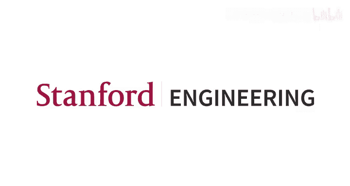
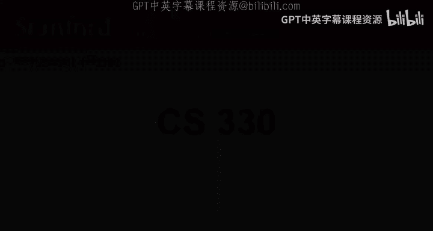
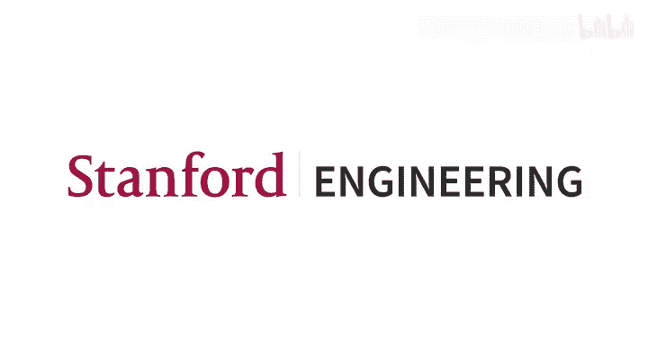

# 斯坦福大学《深度多任务与元学习｜Stanford CS330 Deep Multi-Task and Meta Learning 2022》中英（豆包翻译 - P14：-14-.Domain Generalization l 2022 I Lecture 14.zh_en - GPT中英字幕课程资源 - BV1dWpPepEsj

Okay hello everyone， welcome to this lecture， som this is Hua Xu。

 I'm a postdoc in Charles lab Today I will give the lecture about domain generation。😊，嗯。

So before we start， I will first go through some logistics things。

So the project milestonedown is on Wednesday and the homework4。

 which is an optional homework is due on Monday。Here is a plan for today today I will introduce a new concept called domain generation。

 I will first do some problem statement and problem formulation and then introduce two kinds ofpresent algorithms as the first one is to adding explicit algorithm to solve this domain generation problem and second one is we can leverage some data augmentation to handle this problem。

And the goal for this lecture is that I will first let you know how to understand the intuition behind the domain generation and the problem formulation。

 and I will also see that you can be familiar with the mainstream domain generation approaches。

 so the regular based approaches or organization based approaches。

So let's first do some thecap about domain adaptation that we learned from our last lecture。

 so in the domain adaptation we aim to use some training data from the source domains and make it perform well on the target domain。

 This is a kind of a form of transfer in， but we can also access to the target domain data during the training process so it is transductive learning so we basically we have the training domain data and the unlabeled target domain data and we want to perform well on the target domain。

So there are two common assumptions for the domain adaptation and the first one is the source domain and target domain only differ in domain of the function。

 so means the conditional distribution Y P y x is the same between the source and target domain。

And there are also exists a single hypothesis process with a low error on both source and target domains。

We also do some revisiting to see that a domain is a special case of task。

 So our task is composed of three components。 The first one is P X is for the marginal distribution of feature distribution。

 and the one is for the distribution of if the domain of the function。

 the P Y given X and also the loss function。 So in for one task that we learned from the main task learning or meta learning。

 all these three components can be changed from different tasks。 But in the domain。

 only the P X can changed over different domains。😊，So before we start。

 So then we will mention that can we always access unlabeled data from the target domain。However。

 in some realwood applications， because of the following two reasons that we cannot always access this target domain。

The first one is sometimes we want to do real time deployment and we do not have time to collect enough target domain data and to do the adaptation。

 including domain adaptation or collect label data to do some metlin or fuel shot learning adaptation。

😊，And in the case that obtaining the target data may be restricted by the privacy policy。

And I will provide some examples for each of these reason。

 the first one is for the real time deployment and in this case， for example。

 if we want to train an autonomous driving system and we want to let these models train on three types of rows。

And then we want to deploy this model to our new load， for example。

 we want to deploy this on the night， and in this case we want to do some real time deployment and we do not have sufficient time to collect enough data。

And another case is about the other example is about the privacy concerns。

 so there are a lot of policies about the privacy concerns， so for example。

 the most most famous one is about general data protection regulation which is from Europe and in this case we cannot share the data between different institutions or hospitals or any other staff and for example。

 if we want to build a disease predictive model， so this disease predictive model we trained it on the three hospitals。

 for example， hospital  one，2，3， and then we did want to deploy this model to a new hospital。

And in this case， to deploying this model to a new hospital。

 we cannot access the training data due to some privacy concerns。Based on these two things。

 I will first to mention why we need domain generation and first give some formal problem formulations for this。

In domainization， so assume we have a bunch of source domains。 for example， there are three domains。

 clip part， painting and sketch。 we want to recognize different objects for each domain。

And we will train a model and to get such a neural network This is regarded as a trained model。

 And then we will deploy this model to some onc target domains。 Here is a domain for the real images。

And we want to generalize some common knowledge from these source domains and to make it models perform well on this target domain。

Mathematicically， the domain generation problem could be formulated as we given up bunch of source domains P1 X 1 to P N X1。

 We aim to solve on target domain P T X Y without accessing the data from it。So there similarly。

 there are also two common assumptions。😊，The first one is all domains only differ in domain of the function。

 It means that the conditional distribution P y X is the same across different domains in our previous definition definition of domain adaptation。

 we will make the conditional distributions to be the same between source and target domain and but here it will be exactly same across all domains。

 so only Px can change。So the another assumption is that there exists a single hypothesis with low error in all domains。

So that which guarantee that we can learn a model that can perform well across different domains。

Okay， so this is also aing for the domain a special case of a task。

 So its also hole in the domain generation problem。Based on this definition。

 I will try to do some comparison between the meta learning that we learned in a lot of lectures before and under the domain generation。

And in meta learning， we， it is kind of like transfer learning。

 and we want to transfer some knowledge with many source tasks。 So given the data from task1 to N。

 we want to show a new task T more quickly proficiently and st。And in dimension。

 this is a special case of the matter learning that we learned before。

 So given the data from domain D1 to D N， we aim to perform well on the new domain D T。😊。

So but there are two kinds of difference between the domain and meta。

 The first one is only P I X changed across different tasks。

 But in the meta we can change a lot of things。 So the above three components。

And in domain journalism， it we want to directly generalize to the new domain instead of doing any kinds of adaptation。

Yeah， this is basically the comparison between metallin and dimension。

The second comparison is between the domain adaptation that we learned from our last lecture and domain generation。

In the domain adaptation， we can access some label。 We can access label data from all source domains。

 and we can also use unlabeled data from the target domain。

So we aim to make the model perform well on the target domain。And in this case， the target data。

 we can access the target data during the training process。

 So we can access the unlabeled data and which also dist some information of the target domain。

And in domain adaptation， there are only one source domains， typically。

 so but people can also use more source domains， but we can only rely on one source domain to achieve success。

 domain adaptation。And the model trained for the domain adaptation is only specialized for the target domain。

So it means we only care about the performance at the specific target domains that we can access instead of consider this problem on a more general case on a bunch of domains。

So domain adaptation is one kind of like a transform learning setting。In domainization。

 things would be a little bit different。 So inizationization。

 So given label data from a set of source domains， P1 X1 to P1 X Y to P n X Y。

 and we aim to make the model perform well on the target domain a bunch of target domain， actually。

So we cannot access the test data during the training process。 So this is the first difference。

And the second one is domain generation usually needs more than one source domain。

 So if you only when you have a bunch of source domain。

 you can capture the common knowledge between behind these source domain and then to generalize this common knowledge to benefit the performance of the target domain。

And the the third difference is that these models can be applied to all domains。

 including the source domains and target domains and even some domains that we didn't captured。

So this is why we need to lend some well journalistized knowledge and can be generalizedable to a bunch of domains。

Yeah， this is a key difference between the domain adaptation and the domain generation。

In this lecture， we want to mention， and domainization is an inductive setting。Okay。So。

 so based on this definition and based on some comparison。

 I would like to show you some real world applications of domain generation。

The first application is about sustainability and to we want to do some wildlife recognition。

 we would like to recognize different animals on different locations。

 so here we will use for them here we have 245 locations and we want to train a model from these locations and to generalize these models to new locations。

Another examples you may familiar with because in the last lecture。

 we also see the adaptation version of this tissue classification example。

 so we aim to classify one tissue image whether it's normal or it's tumor。😊。

So basically we learn a model from a bunch of hospitals and then we train this model to some new hospitals here is hospital 4 and hospital5。

And in the domain adaptation instead， we probably only have two hospitals and we want to learn some common knowledge from these two hospitals。

The third application is molecule property prediction。

 the molecule prediction is quite important in the drug discovery field。

 so they want to predict some toxic of given a small molecule we want to predict toxic。

And we train our model on different splits of these molecules on different scale force。

And then we aim to generalize some common knowledge and to make it work on some un skill force。

And the last one is about code completion。 This is also very important applications， for example。

 like in the field of programming language， so we have a bunch of reports and then we train a model to do to predict the next tokens in the context of source code and then we aim to generalize this model to some test distribution。

Okay， so this is the basic introduction of the what is domain generation and do some comparison and give some applications。

 Next， I will introduce some specific algorithms about for domain generation。

 The first one is I we aim to add some explicit regularizers to handle this problem。😊。

So before we dive into the specific algorithm， so let's resthink one problem。

 how to learn such generalable representations。And to answer this question。

In natural ways we want to think another problem is about why do machine learning models fail to generalize？

Here is one very simple example。 So our goal is to classify dog versus cat。So there are two domains。

 the Do one is water， and the Do2 is grass。And we have actually have four groups。

 so the first one is dog in the water and dog and cat in the water and dog in grass and cutting grass。

 So for dog in the water and cutting grass are two majority classes。😊，Two majority groups。

And otherwise， cat in the water and dog in grass are minority groups。Based on this。

 we train a model on these two source domains and twin model and then deploy this trend model to a new domain。

 for example， the dog in the forest。And our question is， is this a talk？

Our human can easily to recognize this as dog。But for computer， it is very hard。

 so in usually in computation it' is very easy to recognize。

 but in this case it's hard to recognize its a dog。😊，And the computer will make the wrong prediction。

 So why this happened。So there are some similarities in the training data。 We can see the dog。

 in the training data dog usually in the water and the cat， usually in grass。😊。

And then it sees some similar environments compared with grass。

 and then the grass would be spous information。It means that these models willly associate the。

C information and grass information。And that when if the computer sees some similar environments。

 it will make wrong prediction。So our goal is to cancel out such various information here。

And to do these。We aim to train a new network to learn some domain environments。

So this is another concept I want to mention here， so the domain invari is that we want to learn thats a bunch of features via the neural network that don't change across different domains。

In case that we can learn such domain environment information， for example。

 we can associate the animals with the labels。And the computer can make the right prediction。Okay。

 yes， this is something about domain environment。And。Based on this definition。

 I will send details the regulation based method。The key idea of regular based methods is that we want to use a regularizer to align representations across different domains。

And the two kinds the domain environmenty representation。let's do back to this example。

 so we have two domains and two classes and to classify the cat and dog。And in this case。

 we can get the representations， for example， for domain one， and for domain one。

 we can get the representations which is composed of two information。

 the first one is animal and second one is water。So we only cover some major informations in these images。

 and similarly， we can get the representation for Do2。 So it's also animal and grass。

And hope we can align these two presentations to enforce them to be very similar。

The simplest way to get a small loss is set。Finally。

 this new network can only learn the animal information because the animal information is shared across different domains。

Okay， so based on this example， I will then mathematically define some generic loss function for that。

So this is a typical loss function for the regulation based method。

In the first time is for label classification loss， for example， in this。

 we do the weclassify dog versus cat hair。And then we will average the loss over all training examples。

And then we will define an explicit regular to learn the domain element presentation。

 This is a key part for these regulation based methods。 So how to define the。Okay。

 so before we dive into this to give some specific algorithms。

 I will first recap the domain adversarial training in domain adaptation that we learned from the last lecture。

The key idea is that a prediction must be made based on the features that cannot be discriminated between the domains。

For example， given one image， this an input X， we will feed this image to our feature extractor and get the features。

And then we have two branches and the first branch is to do the label predictor。😊，诶。

And we aim to make accurate label prediction。So in this case， because in documentation。

 we only have the labels for the source domain。 So only source domain only data from the source domain are fitting into this branch。

A second branch is out of domain classifier， the domain classifier。

 we aim to make this image we cannot predict the domain for this image based on these features。

 So in this case the features we can learn some domain environmentvari features。

So both data from source and target domain can feed into this branch because we want to do some domain classification here to classify whether whether this features is from the source domain or from the target domain。

Okay， I now have one question。 So this is a very simple version for the adver training in domain domain adaptation。

 So does anyone have ideas on how to use the domain ady training in the domain generation setting So any volunteers。

We want our adversary to predict twitch。Are mean a real or。For each image。Yeah， you want to。

Predicts its corresponding domains， you mean。IfYou want to predict this is the water or not。

 for example。OhYeah， yeah， yeah。Yeah。你 so。Yeah，'s something that we will mention here is we have the label predictor and the domain classifier。

And instead of we only feed the data from the source domain into the label predictor in the domain generation settings。

 we will feed data from all source domains into this label predictor。

 So to predict its corresponding labels。And similarly。

 all the data from all source domains will be fit into the domain classifier。

 And instead of to classify whether it's from source domain or target domain。

 because there are no such a definition in the domain generation settings。

 we will to predict those domain labels for every image。Okay， based on this definition。

 So I will first mathematically give some definitions for this label predictor and domain classifier this corresponding losses。

And in the label prediction， we aim to do such a label prediction give the input X。

 and we will extract some features from F theta x。And then we will do the label predictor to get its predictive value with the function G。

And we will submit it for every examples， finally， to optimize the the function the parameters of label predictor and feature extract。

And here the smaller is better because we want to make accurate prediction in the source domain。

For domain prediction instead， we want to predict these domains。

 but we actually want to maximize the loss。So the larger loss is better because the larger loss means it is harder to distinguish domains for average input examples。

In case when we cannot distinguish domains， we can learn some domain environment features。

And then to make it genetable。Okay， so。And then we will bridge from the generic formulation and the new formulation for the domain avers training in domain generation。

This is that。😊，Loss for DNA loss in domain generation。

 So the first time would be label classification loss。And the second term would be。

 will you design one regularizer to learn such domain environment representation。

And the four algorithms has four steps。The first one is that we will randomly initialize the encoder。

 the label classifier and the domain classifier。Then we will try to use the domain classifier loss the L D to optimize the domain classifier。

And we will， based on these results， we will update the label classifier and the encoder by considering both label classification laws and the domain classification laws。

We will finally repeat step 2 and step 3， until convergence。Hello。

It about the second step in the forever。Are we trying to optimize the do class fire to be performed very well or perform very poor？

Because I'm singing about you。And if there chain right。

 you should have a very good like do costifier， so then it will force the representation to be domain。

Yes。😊，like make very so thatYou mean good is like in case you can for the classifier。 Oh yeah， yeah。

 yeah， this is good， yeah。So in case you can manage the loss so you can learn a good domain classifier and the image can force the domain classifier。

should negative sign function want to maximize this， so this has to minimize。Any other questions？嗯。

Do you think this would be more expensive and less expensive than here？Learning features forward me。

like might beだ。え。对 on那。F feature extraction for the label。So your question is。

 you want to learn a separate。Direions or。うん。So you learn some features for HTML domain male。

And then you condition on those features for the labor classification work there。比如。

That equally expensive。嗯。Okay， I see。 So you， you mean you will use separate encoders and every domains have one encoder。

Yes， sort of like extracting features for the domain。Poibly in some cases。

 it more expressive in case when you have a lot of data from every domains。

 so you can learn a better encoder， you without sharing encode with other domains， but in some cases。

 you cannot collect so many data for every domain。 So in case you would like to share some representations and to have a shared encoder。

And what happens if you don't。Noow the don't have information about the domains。

 Like we have a data set and it's not labeled over domains。Yeah， this is a very good question。

 So this is something that we also try to learn so without considering the domain information there are a few solutions。

 The first one is you can try to predict domain information based on the data and in some cases if you train EIM empirical recommendation you can also dis some domain information and to see whether you can predict it will other case you can find that some misclassified examples this may be from the。

Mority domains。 and you can upgrade these examples and to make it work。VeryO。好啊。

So my question was Ive seen papers who try to learn shared late into presentation between the tasks by domain。

 and so you learn tasks specific， like domainin specific and the domain common like to shared share。

Shared feature space。 So how does it relate to the。でトコンベル。かりと。

To repeat repeat question you mean we separate domain different domains。

 each domain has its own encoder domain specific。And don't shared。Across the moment。

By maximizing information between the different domain present， between the samples that you have。这。

Common representation。have twoYeah， two branches to learn two some have some specific layers。 Yeah。

 I think this is possibly more expressive。 It's the same question and。

We're going give you more expressive power in the testing time。

 but let's say if you just want to output a particular feature of particular domain。

But in the test time， you will definitely get one new domain。

 so you do not have its corresponding branch。我们。Yes， yes， yes。

In case you mean you want to abandon the domain specific branches。hel。

The common ones and how to do it for the domain specific ones， I just want to clarify your question。

So probably I can use some whiteboard。 So you mean the error one shared representation。

 This is shared。And then you have two branches for two domains。And how to do it for the test。

So in the test， you definitely needed to go one of and branches。Yeah。

 but you do not have the information for the test time， which branch you want to go。But can't reach。

 I was on thinking about that， I was talking about learning common la representation for the sample themselves for this one Yeah。

 so assuming that that's a latent space Yeah we could learn a common lant space and the shared la。

And then we could use a con lant space to then generate the。Even for any domains。Yeah。

 I think this is what we learned right now to use a shared encoder for every domain。

So let's go back to this one。 So we have a shared feature encoder。And to go to every door。

🎼We do not add any conditions， but possibly add some conditions to enforce。This would be helpful。

Myり ask何か。For the meta cleaning， the key point is that meta cleaning only solves when the training domain exactly the same from the test domains。

Right， but we want to show some un domains。So any other questions。Sorry。

 what if you don't have a bunch of domain label？I mean， maybe with the cat dog example or earlier。

Don't know that crops and water are really two different domains。Your problem。I don't have future。

Yeah， I think this problem is that I mentioned。 So probably you can see try to distinguish the domain information and to do the domain prediction。

 And in other case， you can see how to， for example。

 how to like see that some mis youH chain feed model into E ones and to identify the misclass ones。

 these ones may be from the majority So from the minority domains。All front minority groups here。O。

Okay， so。그게 그래서컨 안。So domain adversarial training， so leverage adversarial optimization to learn the domain environment features。

 So you may ask， are there any other ways to do that。

Then I will introduce one alternative approach called coral in the corals so the key idea is that it can directly align the representations between the different domains with some similar metrics。

And in Coral， so it which is called correlation alignment for Do。

 although the name is from documentation and this method is originally from the domain。

 but it is usually also used in domain generation in recent years。

So here I will only show the domain generation version of this。algorithmgom， so in this one。

 I assume we have two domains for here， we want to recognize different objects。

We have some shared layers and this could be regarded as feature extractor。

 and then we will use features to feed into some classifier to get the classification loss for every domain。

😊，So for the Do one， we have one classification loss and Do  two has another classification loss。

Then we will have the coral loss in the coralos， we want to directly make alanza these both representations。

Before we dive into the chos， I will first give some notations。

 so the notation the x1 is a feature metric and for the representation and this is with dimension n1 times k for the domain 1 and x2 is similarly for the domain 2 is n2 times k。

😊，And K is a number of features here， and we get the mean value with this formulation and with dimension one times K and similar to the mean value of the。

Another domain。Over all examples。Then we will try to calculate some corevariance metrics in corals。

 The goal for coral is to make this corvariance metrics exactly similar to control the similarity between different corevari metrics。

So in the covariance metrics， this is something that we learned from the math courses so to get these covariance metrics。

And finally， define one cors to make this covariance over features would be very exactly the same。

And this is also the loss for the choal algorithm。And we will combine the classification laws for the first time。

 over all different。AnExles。 And we will also design one coral loss to explicit rigorous to learn the domain environment presentation。

 So the key idea for the coral behind the coral is to。

Make the covariance metrics similar for every domain。

Is this extendable to more than it's extendable so you can directly add more domains， for example。

 domains 34，5 with one classification loss and use pairwise color loss to do that。

So do we have individual encoders for different domains， typically people will share the encoders？

Yeah。Any other questions？よ问？It was in how much does。Moial architecture。

And our mathematical formulation of the problem them。

So you mean for the in generic version of regularization？

There's been a problems I approaching how is choosing them one？Okay and。

Mathematicical formulation of the problem helps。So it depends so you know。

 like we can increase the model architecture from Renet or even for visual transformer。

 you will have more parameters and these models will be have strong express power and to represent more information and designing some regularizers it is also very sensitive in these specific dimensionization problems in case you have very large models in case you have the same models。

 same backbone and we can compare different kinds of regularizers and with same regularizers we can compare different backbones。

Maybe I want to understand the limits of each of this。

 So how much the model architecture selection affects your performance and how much can。

M formulation of loss to。Wed affect to performance engine political comment。喂。BecauseSo for each O M。

 for model architectures， for the comparison between model architecture and the loss function。呃。

For different data set， I think increasing the model the express power of model architecture is not a bad choice。

 So you can definitely increase improve the results， but。嗯。But typically。

 we try to add one regularizer and this regular chosen regularizer can affect the problem。

 the performance more。 You know， if we found a bad one， So it even hurt the performance。Yeah。

 because if you increase the model express power， so the performance of ERM will also increase。Yeah。

よろしく書くほど。とわ。呃。In case if we can align different kinds of different order of the information。

 it would be helpful so simply one you can directly align the representations and in these papers they consider the second order versions of covariance so if you can do more but if you can do more you will have like more cost computational costs to do more。

OkaySo we can continue。And for the results， I just show some results from the office home。

 Do and IW cam， and in the office home we have four domains and we will hold one domains as a test and use another three training another three domains as training and then to generalize one model to the test once and we will repeat the progress for fourth so for every domains to do some evaluation and also we will do the similar things for the domain and for the IWCm as I mentioned before years basically we want to generalize the model to new locations to do the wildlife recognition。

And we can see thecc performance well compared with EIN and then sometimes hurt the performance compared with EIN。

I think this solve the question that designing a suitable regularizer is very important。

Finally for these kinds of method， I will mention some pointss and cones。嗯。

The good things is that the first one is these methods can generalize well to all kinds of data and networks。

So for example， if we want to change it to graph data or text data。

 we only need to change the shared layers， the backgroundbone from B and to graphraph neural network or any other layers。

And there are also some theoretical guarantees here in these kinds of methods。

 I will not dive into this one， but if anyone are interested in any theoretical results。

 please email me and I will can send you some papers to discuss this。

But the bad thing is that these regulators sometimes being too harsh or too constraining on the representations。

 as we can see that DN cannot work very well in the some data sets。

And let's also go back to see why regularoid are being too harsh， for example， in this one。

 we can go back to this dog versus cat classification。

And this is the loss function and if we directly add explicitly local that it will encourage the internal representations to only contain no info about the background。

 but sometimes it's in the mixture， so we also need some informations to do this classification or to if we do not have any backgrounds。

 it even hurt us to learn a better domain environment representations or even hurt the express power of the new network。

Any questions。Okay。So based on this， we can see that in some real world applications like IYCm。

 the color improves the performance， but in some other data sets like R one this is a medical image classification task。

 so the call even hurted the performance so D also heard the performance as I mentioned before。

You ask， are there any approaches to relax the dependency of the recor。

Then let's move to the on sixth part of the algorithm design， so to do the data augment。

Before we detailing the data augment， let's first recap the sp correlation in the sparrow correlation our goal is to classify the dog and cat。

 and the background is sometimes spaously correlated with the animal and the models cannot make right prediction。

However， is one question。In case we can collect more data， so we have the grass data。

 the water data and data， the car domain and the keyboard domain from both dog and cat。So we want to。

 still recognize this dog。The question would be， will the network still associate dog with water background in some storestorm mess？

Any you guys want to answer this question？So how how do people think is cannot associate。これもとけ。

Can you tell what like mainly stills have？😔，The water。still。呀 we we do not consider these scenarios。

Yeah。Consider whether it's uniform across different backgrounds in case we consider all backgrounds and use。

S a weighade all。对 me。Yeah， yeah， that's no。 So because there are many more backgrounds so we cannot recognize dogs only with the grass background。

And in this case， the models can produce the right prediction。However， that is one challenge。

In case that we can always collect model data from the different domains。So what we want to do。

 we aim， we can aim to generate more datas and to change this model。

And here we want to introduce some methods for data orientation。For example。

 there are some simple operators that can help us to generate more data。And in the computation。

 for example， we given one image， this is original image。

 we can use different operators to generate data like flipping， rotating， cropping。

 or like a PCA or edge enhancement， or any other methods that we can generate some image data based on one image。

And in the NP domain， we can do some back translation in the back translation。

 we have one sentence originally from English and then we want to translate it to French and then translate back。

 so the augmented example would be slightly different from the original one。

And these data organizations can typically help us to do the Doization can benefit the performance。

However， these simple operators requires the knowledge of the problem domain。 for example。

 we need to see or this is image data or from or text data or to adopt different strategies to do the data augment。

Our question would be any general approaches。嗯。SoI will introduce one general approach for data limitation in this lecture。

 it's called mix up。In the mix up， the key idea is to interpret training examples。

Assumly we have a learned model with a training data。

 So the training data has n examples with the input and the label pairer。

 the X IY and from I to equal to n to x equal to one to n。

 and we will train classifier based on this training data。

And then mixup aim to replace this original training data from a mixed version。So in this case。

 we will have two examples， X， I， Y， I and XJ， Y J。And then we will do some linear interpretation。

 So also like a convex combination between the X I， Y and between X。

 I and the X J and the Y and the y J。So and in this case。

 we can generate some virtual examples called X I tuta and Y tuta。😊。

For both features and labels for both input and labels。

And then mixup will use these label generated examples to replace original examples and use the new training data to build a classifier。

😊，So here is one example for the mix up。We can generate some virtual examples between two classes。

 So the first。The image in the left hand side is for the cat and the。Then next one is for dog。

 and we can combine them to generate some images in the between of from cat and dog。

 So this image has around 70% probability to be classified as a cat and 30% to be classified as dog。

So this is a very common and useful ways to do data augment。

Any questions about the process for the mix up。Okay。收。In domain generation。

 mixup can itself can improve the performance of domain generationization。So let's see。

 we here we want to do the tissue classification from chameleon and also to。

Do some land type prediction in the land type prediction example we call this data set is called FMOW。

 and we want to given one satellite image。 want to classify its land types。

 and we want to generalize from some year and region combination to other year region combinations。

And compared with EIN and mixup can improve the performance。However， it is not always good。😊。

For example， we will still use these R one example， this is a quite challenging data set。

 so mixup even hurts the performance compared with EIM。

The key job pack for the original mixup is that this method only focuses on the data augmentation instead of trying to learn some domain environment。

So the question is how to improve the original mixup。To introduce the next algorithm。

 I will first give us simple examples with sp correlation。

 So this example can help you to understand what happens in the next algorithm。

And the example is quite similar to the examples from the real world images。 So these are toy case。

 In this toy case， we have a lot of green tools and red filess。

And our goal is the label one is to see this digit is smaller than5。

 and the label2 is this digit is largely equal to 5。😊。

And we have a target domain with similar colors with a green 5。

 but the green5 is from a different ways as the background is green。And feed into a neural network。

 as this neural network cannot produce the correct prediction because in the changing part of the models spaly associated with the color with the labels。

And so this example is very similar to the examples I gave before for the dog and cat classification。

Okay， so based on this example， I would like to introduce Lisa to improve the original mixup。

The key idea behind these size。Yeah， sallia want to selectively interpret examples and to emphasize some environment information。

 not only on， only on the data augment， like mix up did。

So this is like the examples we call it colored ammunist。

 so we have some two majority groups and two minority groups。And based on build upon the mix up。

 there is one variant called intralabel Lisa。 In the intrala Lisa。

 we aim to interpret examples with the same label， but from different domains。

We just add one simple constraint on the original mix up。 So to make it。

 the domain is quite different。 So from D I not equal to DJ。

 but we will make sure the labels are same。 So Y I equal to Yj。

And we can see in these five images the first one and the last one。

 I mean the left one and the right one is from the original data set。

 so lambda equal to 0 or lambda equal to 1。😊，And then we can generate some images with different backgrounds。

 We can see these three images in between。And all images are associated with the same label。

 so with digit large equal to5。😊，And we can see that even when we generate a lot of different backgrounds。

 all of them associated with the same label。😊，And in this case， the models will finally ignore this。

Color information and only focus on the digital information。And to capture this environmentvari。

Any questions for this。I think I have a mix up question in general。

Is it possible have people been trying to apply mix up to the tax， I will mention it later。

Any other questions？す。あ you meanめます。Yeah， if we do not have domain labels。

 it's a little bit hard to apply this algorithm。 So but one simple solution is that we can try to see whether we can only mix the examples with the same label without considering the domain information。

 In this case， you can also generate some similar things for this variant。如的。the model is。

 that's a con on some target samples。You mean we want to train our model and target samples。

we do entrance on the cha samples。But the predictions， if those have good certainty。

 like if the model is much more confident on the samples。Of some samples开始倒。

Could we use them as a ground question is like we can use。Labels from。

 you can some examples with some studio labels in the target domain。Yeah。

 this is another question would be close to some domain adaptation or semi surprise learning settings。

 Yeah， we will not consider these settings here。Is there data on how this performs on it？How。

 how to these domain。if you then show a blue five。Is it worked better on those than？Don any。

Your question is that if we have any like blue ones or any auto distribution， something like that。

 yeah， it definitely works。 So for example， we can put this example here as we change the background from green to blue so it can still work very well so because in case you learn some digital information and ignore its domain information。

Okay， so another variant of Lisa is it called intratro domain Lisa In domain Lisa maybe we add some contraint on the domain level。

 So we want to interpret examples with different label， but same domain。So D is equal to DJ。

 but Yi is not equal to Yj。And in this case， the left and right ones are also from the original data set。

 All these are red2 and red 5， and we can generate a lot of images in the between。

 but with different labels。So in this case we can see even the domain information is the same。

 but all of them is associated with different labels。😊。

So the domain information is not the reason for the label changes。

So we can also make these models exactly ignore this domain information and only focus on the environment。

 focus on the digital information。Any questions for this variant。Okay， let's move。诶。In practice。

Lisa aim to combine these both of them because each of them has its its own like applicable scopes。

The first one for the entry label， it works better when they run more domains。😊。

Especially if you have more domain， you have can have more combination to to in to to to apply the intrala li。

And anuning is like the spirit correlations are not very strong in our practice that intralabel Lisa works better。

And instead， the in domain Lisa works better once the domain information is highly spaly correlated with the label。

So in case， for example， this data distribution is quite inbal。

 and there are much more even 99% of green5s and red red toolss。

 so in this case this intratro domain Lisa works better。And in practice。

 Lisa use one hyper parametermeter P select to determine when to use intralabel Lisa or when to use intra domain Lisa at each iteration。

Say you cannot apply either of the so supposing you only have read twos and main files。Okay， yeah。

 this is a very interesting question。 We already investigated in our analysis。

 this is like in this case， you can see that we call it like underspecation things because these models can infer the labels based on the background information only all inform the labels based on the digital information we typically want to build models with two heads and each head represent one kinds of things。

 the first head maybe represent the domain information。 I mean。

 the color here and also another head would be the label information by sharing some layers and we will use some unlabeled data to make two heads produce quite different output。

😊，And in this case， we can when we have new domains and the models aim to classify the labels。

 we can try to collect a few examples to pick which head that we want to use。😊，Yeah。Yeah。

 you the paper， Please email me and I can send one paper to you。书。From like the previous lecture。

 we saw cycle there。And my dad was。被告。嗯。cycley game could possibly use here。

 It is as powerful data augment methods。You can even use some to disentangle the representations and to shift something between different domains and can even improve the performance。

Yeah， but applying cycle can would be a little bit complex。 So。

 and need more efforts to twin all the hyper parameters。😊，行。

choose either internal labor or internal to member of those in the same it。诶。

We choose either ones because each one have its own pros and cons。 So in in we actually in practice。

 we choose intra labelbel Lisa more。 but in some cases， in domain Lisa can also works very well。

Any other questions。这是就是。Thist murder。Which leave both buried。Yes。Yes。So how do we decide？

To choose which labels you will random pick some examples。

 I will show the full algorithm here so maybe you can take a look what is process。

So in the for of Lisa is that first stage we randomly initialize the model parameter theta。

 and then we will sample one strategy from a bo distribution and with the high parameter P select。😊。

And we will sample a batch of examples B。Here this says we will in this stage we will choose either intralabel li or intra domain li。

 So if S is equal to0 and we will use intralabel li and for every examples within this batch。

 we will sample another example that satisfies y equal to yj and D I not equal to DJ。And similarly。

 in in domain Lisa， for every example in the batch will sample one example that satisfyes it。

 the label is different， but the domain is same。Then we will use some interpreted。

 we will interpreted these examples and interpret use the interpreted examples too update this model。

Finally， we will repeat the step 3 and4 several times until converge。 So for every entry。

 we will choose either intralaable li or intra domainoma Lisa。Dont say two two classes or。Yeah yeah。

 yeah。 Yeah。 we can use in a bunch of domains or classes。For one labor。

 you take all domains and have to do that You mean for the intrala one？

We will use if we have more than two domains and we will for each examples。

 we will only pick examples with the same domain， but without concerning the labels。

I only because the labels are different， yeah。Any other questions for the process of the。

For algorithm。Okay， let's move on。And here we show some results to compare EIM empirical riskization and the coral we mentioned as a regularization based approach and also Lisa as we mentioned here。

 the augment based approach， so the comemeon is a two class classification is a binary class classification and with three changing domains and FMW is around 32 classes and a bunch of domains are one is around 33 classes。

 if I remember correctly and Amazon has is also a binaryary classification。

 Amazon is a text data and in these four data sets that Lisa works better than both coral and EIM。

And in the IYK ca， the color works better than other methods。

 also in the OGB to do the molecule property predictions that EM even works best compared with other methods。

So in this case， we can see different algorithms have its own advantage and disadvantages。

 and you may choose which one you want to use based on the experimental results in your practice。

So you may also see that Lisa do works well on the image data， but also works well on the text data。

 So how to apply mixup in the text data because it's a little bit weird if you apply the mix up on the input level。

 so on the original text data。So here I will briefly mention the manyfold the mixup。

In the original mixup， we apply the mix up of the input and then get the mix image and feed into the feature extractor to get the featured presentations。

😊，And then feed this featured presentation to the classifier to do the more classification。😊。

And in the menu for the mix up， we instead doing apply the mix up on the input。

 we do the mix up on the feature level。 For example， in the text domains。

 we typically do it on the top of bird， the output of bird so we will change the feature structure as bird and apply the mixup on the features on the output of bird and but in image domain I use example here。

 we have the dog features and the cat features and we will apply mix up here and get the mixed features。

And then feed these mixed features to the classifier。Any questions for this one。Okay， so。

The final results I would like to show is some invari analysis。So how to measure the environment。

So the direct way to measure the environmentvari is that when we get the the environmentvari representations。

 we can try to use these representation to build a model and like a logistic regression or any other models to predict the domains and we will use the accuracy of the domain prediction to measure whether we can。

Find a better environment or not。metric that we want to show is that we will measure the divergence of the predictions among the domains。

 so we will leverage the representations or the predictors。

 the predictor means the logic to see that whether for every class。

 we can see the divergence between every domains， we will have one distribution about the output the representation distribution。

And we will try to do some pairwise comparison between different， among different domains。

And then we will sum the results for every classes。So。We compare Lisa with EIM。

 also with vanillaina mix up。 The IM IB IM RE X is other methods。

 other kinds of methods for regularization based methods。

And we do have see that Lisa can lead to great domain environment than parameterss with some explicit regularizer。

So both metrics， smaller value represents。Great domain environment。Any questions for this。ok。

And finally， I would like to also do some comparison between regulation based versus augmentation based methods。

In the regular based methods， I will recap the points and cons。

 the first advantage is that it can generalize to all kinds of data networks and has some theoretical guarantees and it but it rely on the design of regulators also sometimes the regulators are too harsh。

And in the orientation based method， it is easier to understand and simple to implement。😊。

And we do not need to worry about how to design very well generalizable regulars。

AndBut sometimes it's largely limited to the classification problems。

 also some problem types if we want to apply some simple augmentation operators for text or the image data。

아니 question 아 question 수 있어。Yeah this is a plan for today。

 so we introduce the domain generation problem and give a different definition for this and we introduce two kinds of algorithms。

 the first one to adding explicit regularizers in the loss function to align the representations and the second one we do some data organization to generate more data and to learn domain environment。

So hope we can reach the goal and to understand what domain generation is and also to be familiar with major domain generation approaches。

y。Any other questions for the entire lecture or。What about domain generalization for generative？呃。

For generation problems， there are not too much domain generation problems。

 but in cases you have multiple domains， you want to generate， for example， some。

Some images in one domains and some image in other domains。

 you can also apply some domain generation problems directly to change the backbone of the generating models。

 Brazil do not have too many advanced technologies to apply this。Any other questions。

So Im sure I missed this， but how do the inter techniques generalize to text data？o。

 yeah we can go back to this here。 So just say for the image data。For the text data。

 if you want to apply the mix up， we will change it to text。

 the input to text and the feature extractor would be sometimes built and you will get the feature representation。

 you can choose this feature representation under kinds of input。Yeah， and that in here。

Any other questions。Okay， if we do not have any other questions。 So there are also some reminders。

 So the project are mess on on Wednesday。And the next time is lifelong learning。

 lifelong learning is something to combine the techniques that we learned before。

 so hope you can enjoy it for the next time。

