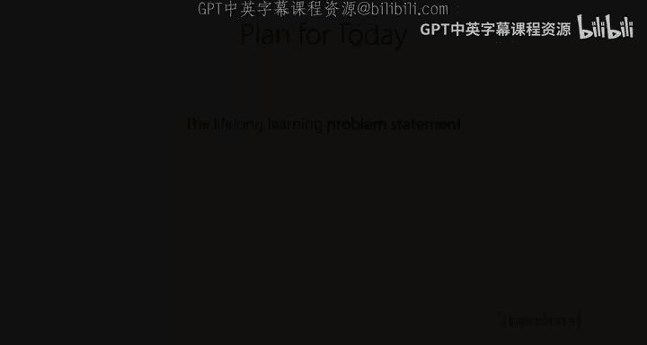

# 斯坦福大学《深度多任务与元学习｜Stanford CS330 Deep Multi-Task and Meta Learning 2022》中英（豆包翻译 - P15：-15-.Lifelong Learning I 2022 I Lecture 15.zh_en - GPT中英字幕课程资源 - BV1dWpPepEsj

So today we're going to be talking about lifelong learning and lifelong learning is an area that。

Actually， I feel like the term lifelong learning means a lot of different things and so we're going to talk a little bit about how the problem statement isn't super well defined in some ways。

 we'll also talk about some basic approaches to lifelong learning。

 whether we can do better than those basic approaches。

 and revisit the problem statement from the perspective of meta learning and how we might leverage some ideas from me learning in the context of lifelong learning。

Cool。In the course we've talked about number of different problem statements。

 but two that I'll focus on here is multitask learning and meta learning。

 where in multitask learning， our goal is to solve a set of tasks and the train tasks and the tasks are the same set of tasks ultimately。

U。Whereas in Me learning， our goal is to quickly learn a new task after having experience on a set of training tasks。

And。One thing that is。Maybe。I think that we've seen lots of examples in multitask learning and meta learning where。

A lot of scenarios in the real world that are defined by these problem statements。

 but there's also a number of scenarios in the real world where the tasks aren't given in a batch。

 and instead we see the tasks one by one。U。And in this case it's a little bit different of a problem setting in the sense that you aren't just given a large batch of tasks or a large batch of data from different tasks all right off the bat。

 and instead you may want to be able to leverage previous experience in a more sequential fashion。

So some examples of this， you might have kind of students that are learning concepts in school。

 they'll learn those concepts sequentially over time rather than being given all of them from a batch。

 also in that sort of scenario there might be a form of a curricula and some of the tasks might get harder and harder。

 they might build upon some of the previous tasks。😊。

An image classification system that's learning from a stream of images from different users could also fall into this setting where different users will join the platform and we'll start uploading images at different times。

You could possibly think of kind of receiving data from a sequence of users rather than receiving data from a set of users all up front。

Another example is maybe you have a robot that's trying to learn an increasingly large set of skills in different environments。

 it might kind of continuously kind of run into new things that it needs to learn or new environments that it needs to be able to learn in and we don't want to be kind of restricted to the setting where we only have a batch of settings you can also have a virtual assistant that's trying to learn how to help different users with different tasks at different point in time and so at each point in time you're going be kind of a new user will arrive。

 they'll have a new task that you might need to perform。😊。

And you need to be able to handle that regardless of the experience that you've had before。

 and then lastly， you could have。Maybe kind of a doctor's assistant that's aiding in medical decision making and again。

 you see kind of cases in a sequential manner rather than necessarily all upfront。Now。

 to talk a little bit about some terminology。I'll refer to what we just discussed as a form of sequential learning。

And there's really a lot like。A lot of terms in the literature to describe。

Different forms of this kind of problem， including online learning， lifelong learning。

 continual learning， incremental learning， and this sort of streaming data setting。And unfortunately。

 there isn't really kind of crisp definitions for each one of these。

 and oftentimes many of these terms are used somewhat interchangeably as well。And so。

It means that the basically the kind of the。The waters are a little bit murky， I think。

 in terms of there isn't really a lot of consensus behind what necessarily each of these terms mean。

嗯。啲。Other thing that I'll mention is that this is。This sort of setting is distinct from having sequential data or sequential decision making in particular this means sequential learning means that we're going to be kind of learning as the data comes in。

 the data will come in sequence and willll be learning from that data in sequence。

 whereas sequential data is scenarios where your data points has a sequential structure rather than it's coming in over time。

 and sequential decision making means that your system is making decisions kind of multiple decisions in sequence。

 whereas sequential learning again is one where you're learning as data comes in over time。😊，Cool。

 so。Because the problem statement of lifelong learning and like the definition of lifelong learning is somewhat isn't somewhat agreed upon。

 I'd actually like to do something a little bit different in this lecture and give you a little bit of an exercise。

And in particular。I want you to pick an example setting， it could be a setting that you came up with。

 or it could be one of the examples that we saw on the previous slide。

And discuss kind of the problem statement in a small group for that example setting。

And in particular， there's three things that I'd like you to discuss。

 the first is how would you set up an experiment to develop a test algorithm for that setting？

The second is what are the desired or required properties of an algorithm for that particular problem？

And the third is， how would you actually go about evaluating such a system？So if it's helpful。

 I'll give you the example settings for reference here。

 and then I'd encourage you to split up into small groups。

 maybe small groups of no more than five people。And then I'll give you maybe about five minutes to discuss this in a group。

And then afterwards， we will have one person from each group kind of describe what they came up with in terms of A B and C and the problem setting that they were discussing and yeah。

 we'll start to kind of discuss the problem statement， does that sound good， any questions？Cool。

 I can also help you split up into groups if that's helpful。Co， okay。Go ahead。

And it's going to be one problem setting per group。Yeah。

Cool arere folks good or do you need more time raise your hand if you need more time？Okay。

 I think you've been out buttoned。で。Cool okay， let's come back and we yeah for each group。

 I think we had about seven different groups， if one person could kind of briefly run through what problem setting you were discussing and the desirable properties and the evaluation。

 so do you guys want to start？Yeah， go ahead。うと？そののまるまる。嗯对。え？そじで。こする。大とび。清嘱呃，同意清楚。不印て。嗯。あ个。我。そす。

The bottle should不。嗯，是。First remember。不周婚。こも。And thanks for。Motoically decreasing。都比。嗯是是是是。

Right right， to clarify anything think good performance as the number of images grows。

 is this as the number of users grows or is the number of images grows？That' what we're。

Images for that user grows Go it， and then what was the second thing？It's a big loss。

这个 expectation这个。うん、ここする。嗯，说理什的。哎 right。Is that also？As you see more and more users。对。So I mean。

 is that very similar to good performance， I guess。

Lo is down is low and doesn't that mean you have good performance？Those are to。一つ四十。いこい。I see。

 so awesome， you want to be kind of Monly increasing and then ask them to be kind of perfect， got it。

Cool， and then evaluation。YouLet search this。すだ見てて。不属是。Because告 all。Ply。嗯。こつ。是啊。在嗯。听。

So this is kind of like basically kind of like learning efficiency。

 basically like how many images do you need for a user in order to get a good accuracy for that user？

ここ。こ。Maybe we could move on to the next group。Yeah， go ahead。So。A you the doctor's assistant。

 leading and medical decision making？Should为。You could do only B and C or if you want to kind of briefly mention A。

 you could do that。We were just you。You know， we would have patient tasks for。こリ子野て入のかかしる。And。

That would be the experiment。か。The desirable。The increasing improving growth。ちばいし。

Iroving the performance as the number of。you need cop growth have a number of examples for each。

Yes老师。So， so that would be。Deir probably required proper U。As for evaluating the system。

 we would evaluate it。We is the same of recruit test that。tight points。

Each high point of the system would have encountered more examples from more patients that has seen and hopefully。

不我。Before and you know。Perhaps。Because I test that work。The tough stuff will hire both。你00007天。Tson。

 how soon。Cool， and so then I guess one thing that's a little bit different here from the other evaluation is you also want to be able to do well on past tasks as well。

What were new examples of podcasts？こうやるよ。ロ哎。Thanks3。All we chose are the Ex seconds。

So one of the things we talked about was actually the problem of forgett stuff so could could constantly transfer the robot into new environments。

Aly。Golings learned in the past。So that's one of the very desirable and acquired。F。

And also we talked a bit about。People like there is some kind of expressiveness in the model。

We moved。Learn like the overall number of tasks in general， so you learns more and more tasks。

 it could kind of like that where't the performance for a single task over taught you。

So it's like B and for C， we will kind of like keep a database of the tasks。Ourll past。

Basically see more tasks you learn than you have。Cool， so yeah， this is pretty well covered。

 the back left group。So we get the what motion do。僕回すない。Against the counter of default。

 it would be like。The fact trying this will possiblyly affect or algorithm get can represent the controllers a cheaper numbers performing best。

And that the desirable companies that we want from this fossil space when we teach that it's re matter kind of be like it's increasingly progressive。

Getting a difficult level of horses out a smooth dis today。

So the things that we wanted the children to focus on would be like increasing their knowledge。

 breadth and debt。So。Make more like the test doesn all increasing and the threat of their dollars where other events are more difficult something that may ends up happy from this like it's not basically't not going on to progress any more。

And I guess the piece algorithm would be， yeah， how the algorithm or the method is performing？

That all separate and related， but kind of derive from the system。

 so like how evaluation folkss in exams for example。

 like testing a concept that's kind of covered in the course。

 but like the agent needs to develop Google。These a holes or something like get eat or。

concept to prove the。とさて。Got it， so your evaluation would be like through tests or through。

We have orderness evaluation which is testing like。So they don't also as similar to what for taught。

Mi de。Yeah， that makes sense。The one thing that's I interesting to note is that the。

When you do kind of go towards more and more complex tasks， it may be that the。

As you kind of have more and more tasks， your performance may not actually continue to go up it may actually kind of stay constant or even go down because the tasks are also just getting harder and harder over time and so that actually may be kind of a little bit different in comparison if you have kind of tasks that are sequences of tasks that are more kind of IID or similar in difficulty。

Cool， the group in the front。Including for the mark increasing the chart。7。这些我们司约。对个方做 sorry。美味しい？

把法这的。I' not really making some mistakes。Abs our evaluation。

 I think we have such slightly different work when comparing the evaluation terms of。so。就是在ロど的。是。

Or that's a performance。So you hear more about the kind of is it getting better versus just the absolute performance？

Cool， okay。The group there？And I think what's interesting about that one is different users might have different ideas。

A con of successful health。あ提長。Query pumped， so。System should be able to learn。是没 to doubt of。被告问题。

Maybe you has to。That's not so obvious。We talked about how you might generate the。Evaluating it。

How successfully it's able to help many different users out that？

kind of like performance on basically all of the tasks come together。F对。Cool。

And then I think we have one more group which is in， the back right。Okay。

So weve got treated the robot query by breathing that of skin。

And the setting was that through the final goal that we want this was definitely that we wanted to co made。

喂喂。If you need it I getting it。There's some simple tasks that moving things。

Meing a more more complex。 So a desirable property is that it should be able to use the previous tasks。

呃 do。In learning the new task， and so if we give it a more number of simple tasks before we give it the final task。

 then it should be able to learn the final task faster and better。

So the evaluation strategy was that we will compare against just giving one simple task or giving three different simple tasks and how well it is able to learn with those key tasks。

いブどとされた。And increasing number simple。And yeah， the other thing was the say that， I mean。

 we would have covered that it should not forget the past。Cool that makes sense。

 so that was actually a little bit different than the other ones and that you won't maybe only care about the performance on the last task。

 like the perhaps the curriculum is only kind of a means to an end。

 it's not the you don't care about the performance on the intermediate tasks itself。本きどこる。

We got them with my house。The the。That sort be。He saw a lot of festival。

You can learn a new class faster。The real。We're learning in Utah so ability to learn in Utah quickly。

Interesting。Cool。In general actually there's more consensus I think across the different examples that I've seen in the past。

 generally like looking for good performance on kind of past tasks and new tasks。

 although in some cases we didn't really care about the performance on past tasks。

 we only cared about the performance on future tasks and later tasks。

 in some cases you might be learning a single model that can kind of do everything whereas in other cases you might care more about adaptability and for example。

 people that kind of the virtual assistant example came up where maybe different people do have different objective。

 someone wants a virtual assistant that has a certain I know is very efficient where someone else cares a lot more about being very thorough for example。

 and so adaptability it might actually be pretty different than if you were to just trying to learn a single model that can do all the tasks that it receives in sequence。

There's a couple of other。😊，Other things that I thought of that I think actually can also sometimes vary between problem statements。

 I guess one thing that we did see a little bit is the tasks might be IID versus something that's kind of predictable over time versus a curriculum of tasks you could also we didn't see this in any of the examples but you could also have an adversarial sequence of tasks where if for example you're trying to detect spam over time spammers may try to create things that will get through the filter that you're trying to create。

😊，And then in that case， kind of the tasks that you see over time or the data points that you see over time may kind of be more adversarial in nature。

嗯。Another variation that can come up is having。Discrete task boundaries where you clearly have a new user versus more continuous shifts over time。

I guess I don't think we really saw too many examples of continuous shifts over time。

 but there's lots of examples in practice where， for example。

 people sentiment on certain topics might change over time or that seasons might change over time and so forth。

There also may be scenarios where there are very clear delineations between tasks and shifts versus not knowing exactly what those delineations are。

 and that can affect different algorithms。And then there's also some different considerations。

 so everyone talked about model performance， we may also care a lot about data efficiency。

 about the ability to learn tasks more efficiently over time。嗯。

Another thing that actually didn't come up at all is computational resources。

 You might want to be able to learn a task with fewer computational resources than before。

 It may also be that the。As you kind of see data over time。

 at some point you may not be able to store all of the data that you've seen over the course of your lifetime。

 and you need to think about the resources that you have in terms of memory as well。

And in those instances， you don't want to necessarily have algorithms that will require。

Memory that is linear in the number of tasks that you've seen over time because that will grow unbounded。

 and so sometimes oftentimes another evaluation metric might be the number of computational resources that it's using or the amount of memory that it's using as well。

I guess another point about memory as well is in the patient example， which I think someone did。

 you may also not be allowed to store data over the course。

 like user data can be sensitive and they're for ethical reasons or legal reasons you may not be able to store data for more than some period of time and that can also affect these algorithms pretty dramatically as well and this relates to like not trying not to be able to forget。

Past tasks or past users。So that relates to privacy。

 there may also be other metrics that you care about in terms of interpretability， fairness。

 and test time computation， and so forth。So I guess kind of part of the point of this exercise。

Was to I think shed light on the fact that depending on the problem setting that you're in。

 you may have different considerations for what is most important for that problem setting in some cases you might care a lot about the performance of certain performance metrics much more than others and you may also have different constraints or different resources in terms of these algorithms and as a result because there is so much variation in the different problems people might care about it means that。

Some algorithms may be much better suited for some problem settings than others。Yeah。Cool。

 any questions up until this point？Y。有个问题。So。どルとスと。So the question is， theoretically。

 can't you just kind of retrieve the user data？Even if you didn't store it on disk。

 is that what you're asking？So。This relates to this depends on the model that you're using you may have a machine learning model that does have some sort of explicit memory mechanism that is kind of storing information or you have a model that has a lot of capacity it's possible to back out the data from that model and then there's other scenarios where you might train a model and it's actually not possible to back out the data from the model itself in general if privacy is a concern then you want to use a method in which you can't back out the data from the model and so there's a lot of literature and what's called differential privacy that gets into how to train models such that you can't back out the data from the model and there's also a lot of。

A lot of work that has shown that if you train a model on a sequence of data， it will actually。

 especially if that sequence of data is kind of changing over time。

 it will forget and start to do poorly on data from the past。Does that answer your question。Go。

 any other question。Cool， great， so there's a lot of variety in kind of this lifelong learning problem statement。

Now I'd like to talk a little bit about algorithms for solving it。

I guess maybe to get a little bit more into the problem statement。

 there is a fairly simple way to formalize the kind of general online or lifelong learning problem。

It's pretty simple。First， you have。Kind of time and you're progressing through time。

 and at each point in time you observe an input。This could be an image。 It could be a。

It could be like a patient record。And your goal is to predict the label at that given point in time。

And then。After you predict the label， you get to observe the true label。And this process repeats。

This is a fairly typical kind of formalization of the problem。

 this doesn't cover all possible formulations， for example in some problem statements you may not be able to observe the label right away。

 there might be some sort of time delay like maybe it takes。

 I don't know a year to label your data or maybe a month or an hour and so you may have some delay between when you make a prediction for a data point and when you observe the label。

 it may also be that you don't label all of your data and so in that case you may not be able to observe the labels for all of them。

But this is kind of a fairly general statement that is。That's also pretty simple。

 and it makes it such that you can kind of tract believe， you can think about this in theory。

 and there's been a lot of kind of theoretical work that's looking at this problem statement。じ。

Was this approach like。It takes you a long time to build up a version of data set to get good accuracy。

 let's see。in the intermediate stuff， you only have a few examples that you've seen till that today。

Yeah， so the question is wouldn't it take a long time to accumulate a data that has enough data points。

 especially in like deep learning regimes where we want like millions of data points。

 yeah absolutely and so you wouldn't expect in this problem setting to be able to do very well right off the bat。

 especially if you're looking at image classification examples and so oftentimes in practice you'll warm start this process with an existing data set that has that can help you kind of initialize your predictor rather than starting completely from scratch。

有。그そ 좀니까。More or。包。悪く全ストする。嗯。Yeah， so I do think it's possible to formulate this as a Markout chain especially if it does。

Converge。啊。Yeah， so the。There's a couple different variants on this problem setting as well。

 so the inputs， you could have kind of an IID setting where X and Y are coming from this stationary distribution where the distributions aren't a function of time。

But you could also have a setting where that these distributions are changing over time as well。

Theres also what's typically referred to as a streaming setting where you're not allowed to actually store your data points and you only you kind of you receive a stream and the reason why this is a setting is that you might be receiving so much data that it's just impossible to store it over。

🤢，Just sort it on over time， so for example， if you're like streaming video， for example。

 and you're like a very large video platform， you may not have time to actually store all of the frames that you're receiving。

So lack of memory is one reason， you could also have lack of computational resources or privacy considerations。

 you may not be allowed to store the data or you want to kind of create a service in which you are promising to the user that you don't store their data。

U。One other reason that the streaming setting possibly could be interesting is if you're interested in kind of studying analogs to the brain。

 we don't really have like we don't have hard drives。

 we can't just like access a hard drive like a computer does and so there's some work that tries to understand and study how memory might work in the brain and so in that sort of setting oftentimes you want the model to not have any sort of external storage instead needs to somehow store it in its weights。

Cool， this study is true in some cases and you may also have like maybe you don't have zero memory but you have limited memory and you can only store a tiny bit of data。

 there are also a lot of cases where it is actually quite practical to store a ton of data。

 hard drives are getting pretty big these days and oftentimes we can't actually store data as part of the process。

Cool， so the last thing that I'll mention is we talked a little bit about task boundaries the。

If you are kind of seeing these data points from a sequence of tasks。

 then instead of just observing XT， you could also observe the task identifier that corresponds to that task。

Cool， so what do you actually want from an algorithm that operates in this setting。

 one quantity that often comes up in the online and lifelong learning literature is this notion of what's called regret and the way that regret is defined is you're looking at the cumulative loss of the algorithm of the algorithm's learning over time。

Minus the cumulative loss of the best learner in hindsight。

And so specifically this can be written with this equation where the regret at a given point in of time corresponding to capital T will basically just say。

 okay， what was the loss on that your kind of algorithm achieved at each point in time summed over time？

So that's pretty simple， that's just the loss that your algorithm is getting over time。

And then the second term is looking at if in hindsight。

 if we were able to predict pick a single set of parameters。For all of those time periods。

What's the best parameter vector that you could have done given all of that data？And evaluating。

The sum of the losses for that。Particular parameter vector。嗯。Yeah讲。

Could the second point that ground that that。Across board。

 is it just the last the latest set of parameters？You know， at your latest cost。

 at's your current house。Is that the best one because it's seen the most data or could it be？lot one。

Yeah so the question is is does data just correspond to the last parameters or could it be another one。

 so one important thing to note is that in general you can't evaluate regret and practice because we don't necessarily have access to that best possible parameters but it is pretty useful for analysis that said if you did want to kind of approximate this at the end of training。

 you could basically take all of the data that you've seen so far train a model on all of that data and that would give you that would give you a reasonable proxy for that second term。

Yeah。Right， so typically this value is looked at in the IID setting。

 but in the where basically there exists a single model that can do well on all of the data。

 but if you were in a non-IID setting， you could actually certainly do better。

 you could have a negative regret because you might be able to adapt to each point in time and get a model that's better than just a single model evaluated on all of the data。

嗯。Cool， now one thing that's worth also mentioning about this is that。

This is a quantity that is a function of capital T。 And so oftentimes we think about how。

How is the regret growing over time？And。Now。One note about this is that if the regret is growing linearly with time。

It's actually like fairly trivial。To construct a algorithm that has linear regret。

 Does anyone have any idea for why that's the case。

Yeah if you just have zeros to then like the minimum of the。The second term will just st。最育政の？Sorry。

 can you repeat that？I didn't quite get it。那そ。No， well， I think you were mostly right。

 but I didn't fully understand it。2124万。This is servant。C空 here。Comster then you still。政長そたも。二月是よ。

Yeah， so basically， if you have just like a constant set of parameters that your algorithm is producing for theta T。

 then the。You can actually get  Ly or regret just with that and maybe we can kind of walk through an example to see why that might be the case。

 so we can look at a very simple example， which is maybe。

Maybe you're really into basketball and you're interested in being able to predict the number of points that a player will score over time and at the first point in time you don't know much about the player。

 they're kind of joining for the they're like kind of playing their first game and so maybe you guess that they're going to have 10 points。

 score 10 points in a game。But then it turns out that they score 30 points in that game。

And then at the next point in time， in the next game。

 you also guess 10 because you just have your constant model and then they actually score 28 points and likewise maybe the third time you see them play。

 you also guess 10 because you're using just a constant model and they actually score 32 points。

In this case， the kind of in hindsight the best model， if we kind of， well。

 I guess we could first compute the first term， so the first term would be maybe you're using kind of an absolute loss。

 so your loss would be。20 for the first time step plus。

18 for the second time step plus 22 for the third time step。Whereas in hindsight。

 the kind of the best model in hindsight for the first data point doesn't have anything。

 so maybe maybe it would also have a loss of 20 but the。But after that point。

 it would probably guess。It should guess， the optimal thing should guess 30。The optimal thing in。

In hindsight， well so this is something where the regret is growing by basically kind of an average of 20 at each time step or sorry the first term is growing by 20 at each time step the second term is。

I the best in hindsight。 And so that would get a loss that is。Fairly small。

 so at the first time step。It would would guess 30， the second time step。

 it would guess 29 and the third time step it would。It would output。30， because that's the average。

 And so the。Basically， the second term is fairly close to zero。

 whereas this first term is growing by 20 at each time step。In contrast。

 you can do much better if instead of guessing 10 at every time step if you guess kind of the average of the scores that it' had seen previously。

 so at the second time step you could guess 30 and then the third time step。

 the average of 30 and 28 is 29 and so you could guess 29 and in that case your regret is going to grow sublinely because then instead of being 201822。

 your loss will be。20 at the first time step and then two at the second time step and then three at the third time step and so if you were to plot this and looked at how this grows over time。

 the first one would be，If this is like grades of 20 and this is。Each time step your。

Regret would be linear， whereas for the second one， you would first go up to here。

But then it would grow much more slowly at future time stepss。Cool。

 so I guess the takeaway here is that。In terms of defining regret in these online learning settings。

 you basically want to try to have subline regret and you want to grow as slowly as possible over time。

 because that means that you're actually getting better and better at making predictions on your online learning problem。

Cool， one of the really important concepts in lifelong learning is this notion of positive and negative transfer。

U。And also kind of forward transfer and backward transfer so we talked a lot about trying to be able to do better on future tasks and also better on past tasks。

 and so positive forward transfer is this notion of being able to do better on future tasks as a result of seeing the previous tasks。

And this can be measured in comparison to learning the future tasks from scratch。

Positive backward transfer is basically the ability to do well on past tasks。

 and so if you have a positive backward transfer that means that the current tasks are actually causing you to do better on the previous tasks than if you had only seen the previous tasks learn from scratch。

For positive backward transfer happens， yeah， so one example is maybe for each task you don't have that much data。

 maybe you only have， I don't know， 100 data points per task。

 and maybe once you basically accumulate enough data from all the tasks you've seen so far。

 you may actually do better on the first task then if you hadn't seen all of that data。Yeah。

 I think that that's probably one of the most common cases where you might see this。

And then you could also likewise define negative forward transfer， and negative backward transfer。

 that's where basically you're actually getting worse at future tasks or worse at previous tasks as a result of seeing。

Seeing the other tasks。And negative backward transfer is actually quite common。

 especially if you have a small amount of memory and you can't。

And you can't basically start forgetting those past tasks。

Positive forward transfer is also fairly common because you're essentially kind of pretraining on the previous tasks rather than starting completely from scratch。

When negative？Backward transfer。Do you think it's mainly because of the limited？

Or like it's impossible for there to be a model that could do。

Or is it just because of something about the training order。

 like if you process the same data differently， you could get model？Right。

 so the question is when you see negative backward transfer。

 is it caused by memory or caused by how the ordering in which the tasks were seen typically？

People see it the most't when they have very， very little memory and they just kind of train on all the data。

 basically train on the data as it comes and don't actually continue to train on the old data。

 that's really the most common instance of negative backward transfer。

 that said you cant also have negative both negative forward and negative backward transfer。

 if your model just doesn't have enough capacity and so if you're trying to。

If you're trying to train on a lot of tasks with a really small capacity model that can lead to worse performance than if you were to trade only on that task from scratch。

 and in that case you could actually see negative transfer both in the forward direction and in the backward direction。

走。To。こ二0。五工。そたこ。もかる。So your first question is the taxonomy that clean。

 I do think that these are pretty cleanly defined， I think that you can kind of write down equations for each of these your second question was can you repeat your second part of the question？

Causing to a faster。Right， I see。This is often measured in terms of like like final performance on the task。

 but you're right in that there may be like there there's more than one criteria that you care about。

 you may care about learning efficiency， you may care about final performance and you may actually get better efficiency but worse final performance and so。

It's important。Like you could basically measure both of these in terms of performance and in terms of efficiency。

 it kind of depends on what your performance metric is。

 and so if your metric is like the number of images that it takes to get a certain level of performance。

 then you can measure these in terms of that metric。

 you could also measure each of these in terms of the final performance as well。

And so you basically just need to define the metric you care about， and then these terms make sense。

In the context of a certain metric， and actually， if we have time at the end of the lecture。

 we'll show kind of some experiments where we're measuring both learning efficiency and final performance because oftentimes you do care about both。

Cool so let's get into some kind of basic approaches and really there's two very simple approaches。

 which are probably the things that all of you could come up with if you were to try to approach one of these problems the first approach is to store all the data you've seen so far and train on it。

And so in particular。The kind of up until time T you have。嗯。At time T。

 you have all of the data that's basically。啲。The union of the kind of of all the data points that you've seen。

嗯。Whoops。Maybe you'll use capital T for this， so at type T the union from kind of。T equals 1 to T。

And you just kind of train a model that。This is the data up until that time step。

 and then you just train a model that tries to。Minimize your loss function on that data。

And you train this model at every single time step， of course。

 if you were to train a model from scratch on the data set at every time step。

 that would be very expensive， and so typically you'll warm startt this model with a model trained at the previous time step and you won't necessarily train this all the way to convergence。

U。This is referred to often as the follow of the leader algorithm。

 and it generally achieves very strong performance。It can be computationally intensive。

 but if you warm start that can help with the amount of compute that you need。

 so if you basically just continuously fine tuning on the data you've seen so far。

 that can help it can also be memory intensive because you need to store all the data that you've seen so far。

And for some applications， this is a deal breaker for some applications， this is completely fine。

Cool， and then the second approach is simply at every time step to take a gradient step on the data point that you observe。

And so what this means is instead of actually storing all of this data， basically。At time tea。

You will just update your model by evaluating it on the data that you received at that particular point in time。

 and so this would correspond to。Just looking at the。The data at that period of time。

And taking a gradient step on that， you can also take a couple gradient steps if you think your model needs it。

This is basically just stochastic gradient8 decent。It's computationally very cheap。

It also doesn't require any memory beyond。The memory of one data point and your parameters。

It is subject to negative backward transfer because it might forget some of the data points that it saw before。

 oftentimes when we run SGD， we need multiple epochs， multiple passes over the data。

 and this is not really being given multiple passes over the data。

This is often referred to as forgetting， sometimes referred to as catastrophic forgetting。

 although I think that's a little bit dramatic in some cases。

It could also be somewhat slow to learn as well because you' especially if you only take one gradient step。

 and if you take multiple gradient steps， then you might kind of overfit to the current data point that you are seeing。

Any questions about these two approaches？ス刑態。あの文大臣。Yeah， so if you're in the IID setting。

 this is not too bad。 if you're in the setting where you're not getting data points in an IID setting。

 then this can。Be more challenging because you'll have kind of correlations between neighboring data points and that cause that especially will can cause things like forgetting where it'll just kind of memorize the kind of correlations that it's seem right now for example。

 if you see if you pass in like data that has correlated labels it might just kind of memorize that label and kind of like not even consider outputting labels that is all in the past。

Cool， so these are the really simple things they're actually not that terrible for。

For things and that's why things like SGD are very common。

 there's also a question of whether we can do better before we talk about whether we can do better。

 we can look at just applying one of these very simple algorithms in a robotic scenario。😊。

And we talked a little bit about warm starting， and so in this case。

 we're going to warm start it on a pretty large data set of robot grasping corresponded to 580。

000 grasp attempts collected across seven robots。This model was able to achieve an 86% grasp success rate on objects that look like this。

But then if you gave it objects that were a little bit different， like these glass bottles。

 the performance dropped significantly。And so the way this will work is it'll be very similar to kind of the first algorithm that we saw where we want to continuously fine tune on the data。

And it's going to use a cuulating algorithm to do this it's not too important the specifics of the RL approach。

 but basically it takes the initial data， it kind of trains an initial model on that data。

 and then use that to initialize a Q function or initialize the neural network model。

 and it adapts on a mix of the original data and the data in the new scenario like with the glass bottles。

And even just fine tuning does quite well in this scenario。

 so if you just do pretraining and then fine tuning to one scenario。

 you could increase the success rate from 32 to 63% in this harsh lighting condition from 49% to 66% with transparent bottles and kind of so on and so forth for these different scenarios。

But this is just fine tuning， what about kind of a lifelong learning setting？

So we can basically take this same sort of approach and apply it in the sequential learning scenario where for each new condition that the robot encounters。

 it will basically initialize the neural network with the parameters from the kind of previous time step or the previous task。

And then it will be fine tuned on a mix of the data from the current scenario and the original pre training data set。

And if you do this， you can get performance that also looks quite good and so it's able to kind of continuously fine tune on each new scenario that it experiences and is able to get much better performance。

 than if you just took the ball trained on the first data。

One thing that you might notice is that these numbers are actually monotonically increasing。

 I think that that kind of happened by chance there is no reason to necessarily expect it to get better and better as you continuously fine tune。

 it may be that for example the last task is maybe a little bit easier or it could be that it it just benefited from having more gradient steps for some reason or something like that Now this is a scenario where we' kind of keeping around data from the like the first kind of the initial data and so as a result。

 I would expect the models here to be able to still kind of transfer well to the original environment。

That said， if you kind of didn't assume that you had all that memory。

 then it probably would still forget in that scenario。

And so what I'd like to talk about in kind of this next section is whether we can design an algorithm that uses only a very small amount of memory in order to kind of avoid that sort of negative backward transfer。

So the case study here will be kind this idea of kind of having an episodic memory。

And we're going to assume that we can store a very small amount of data per task in memory。

And then when making updates for new tasks， we're going to try to ensure that those updates don't unlearn the previous tasks。

 so the first step is easy， the second step is a little bit more difficult。

 that's kind of the meat of the algorithm。🤢，And so we're going to assume that we're learning some predictor that takes us input the example and the task ID and predicts the label。

And then we'll assume that we have some memory for each task。

 this memory might have as few as like five examples for example。And then at each time step。

 we're going to minimize the loss of our predictor on the data from that time step for that task。

But the key part is that we're going to add this constraint。Which is that we don't want the。

Predicctor at kind of the new predictor that we're optimizing over。

On taskque to be worse than the predictor from the previous time step。

And we're going to try to apply this constraint for all of our previous tasks。

 not just our current task。And so kind of the idea here is that we're we want to kind of minimize or find a new predictor that does well on current the new task or the new data point。

 such that the loss on the previous tasks doesn't get worse。

And this constraint will use the memory that we had stored for the previous tasks。

And so this isn't necessarily this is going to kind of going to make the assumption that that memory is at least somewhat representative and we could imagine possibly overfitting to that memory and kind of just memorizing those functions。

 although in practice，They kind of。If you're making a small update to the model。

 you would expect that。If it doesn't make the predictions on some of the data points worse。

 it probably shouldn't also make other things a lot worse as well。No。

There's a question of how do we actually like implement this constraint in practice？

And what we're going to do is we don't want to make these worse and so we can。

We can add this kind of local linearity assumption。And。Basically。

 instead of placing a constraint on the loss function， we can place a constraint on the gradients。

And so what this looks like is we'll basically try to make it such that we ensure that the gradient of。

Of the function of basically the gradient that we're trying to apply to our predictor。Has。

Kd of points in the same direction or is orthogonal to the gradient。For the previous task。

And if their gradients are pointing in the same direction or orthogonal。

 then kind of at least assuming local linearity， that means that the loss function for the previous task won't decrease。

And so if it's orthogonal， we would expect the loss function to stay the same。

 if they're actually pointing in the same direction， or at least someone in the same direction。

 then you may actually get positive backward transfer where actually you might actually improve on the previous tasks。

Cool， so we're basically going to try to。kindin of improve on the current time stepss while also ensuring that the gradients are kind of pointing in the same direction as the gradients for the previous tasks。

 it's worth noting that it's possible that this constraint leads to an infeasible constraint optimization because if you have like if your gradients for your current task and your previous task or pointing in opposite direction like it may be that it's not possible to improve on the current task while also going in the same direction as all these other past tasks and this may become increasingly infeasible as you increase the number of past tasks because you that's going to basically increase the number of constraints on your optimization。

Yeah。It do number point small numbers。可以。最后分说之后。とこです。

If the number of data points is greater than the number of parameters in your model。

 would it become in feasible， it really depends on what the data points are， certainly。In general。

Yes， although in this case we're actually looking at this kind of averaged across the data points within a task。

 and so it's really if the number of tasks is above the number of parameters。and就。And in practice。

 we usually have a very large number of parameters and a not necessarily a small number of tasks。

 but a number of tasks is far less than the number of parameters。Yeah， it's a minority assumption。

 but you doesn't necessarily have the correct director of the constraints for women day。

Like the main question that we are isn't going to do that。You're asking if we don't have local inity。

 then this doesn't imply this。Yeah， in practice， this doesn't exactly guarantee go of like a screen rate。

Very good。So if if you are locally linear， then this I believe should imply this this right here Basically。

 the linearity is important because the basically if your gradient points in a certain direction。

 you want to ensure that the。What's a good example of this？Say your loss function looks like this。

 which is like pretty heavily non nonlinear then if you're。

If your gradient right here is kind of saying that it's okay to basically go right because then you'll have a smaller loss function and you take too big of a step。

Then you'll actually end like if you if you go right and you take too big of a step。

 you might actually end up here， and so that's a problem。

 but if it is actually locally linear and so your step size is smaller than that then that means that you will actually ensure that it goes down or at least that it stays the same if it kind of if the equality holds for the inequality。

Cool， and you can formulate this as a quadratic program and solve it once you evaluate the gradient。

Cool so they evaluated this approach on a few different experiments。

 they looked at three different lifelong learning problems。

 the one is a sequence of MIS classification tasks。

 so digit classification where each task has a different permutation of the pixels in the image。

The second task is different rotations of MNIS digits。

 and the third task is a C400 image classification task where each task is introducing five new image classes。

😊，BWT is short for backward transfer， FWT is short for forward transfer。

 and their total memory size that they assume that they had available was 5012 examples。

CoolSo the in the left plot we can see that the method that we just discussed is called gem or gradient episodic memory。

 we see that the average accuracy is。Its similar to or higher than kind of training a single model。

 training independent neural networks for each tasks from scratch and some of these other prior methods。

 we can also see that some of these prior methods have negative backward transfer。

 meaning that they forget the previous tasks， whereas this approach is actually able to get a small amount of positive transfer。

And then we also see that there's very little forward transfer。

And then the right plot is actually evaluating the accuracy on task one after you train on each additional task。

 and so we see that kind of this approach is able to kind of maintain a pretty high performance on task one。

 whereas these other methods， the performance starts to drop as you see more and more tasks。

We can similarly look at plots for the second problem which is these different MIS rotation tasks and again we see as kind of a somewhat similar trend one thing that's different here is we actually see some like a lot more forward transfer。

 and that's probably expected because it's probably pretty difficult to kind of there's a lot shared between different permutations of the pixels whereas if you're rotating at these images。

 there's a lot more that might be shared across the different tasks。😊，And then for C400。

 it's also somewhat of a similar story， it's a little bit kind of noisier in terms of the performance。

 but it's also able to get less back less。Less negative。

Backward transfer and a higher accuracy than some of these other methods。

The last thing that I'll point out here is kind of if we take a step back and think about these problems。

 like kind of these MIS problems and so forth。第。In practice。

 we can store all of MDNIS on a hard drive or even in RAM in most cases。

 and so these tasks are certainly kind of somewhat synthetic。

 and so one general thing to keep in mind when working on lifelong learning is trying to make sure that kind of the experimental domains that you're looking at are ones that are reflective of real world problems that you ultimately care about。

Cool， and then one other things that I'll mention that I think is kind of cool。

 we don't have time to talk about it in this lecture。

 but you can actually use meta learning to kind of acquire a learning procedure。

 an online learning procedure that can avoid forgetting and so there's a couple of works that have into looked into this topic and fairly successfully kind of developed kind of update rules that don't have backward transfer and so if you're interested in learning more about that。

 you can take a look at these references。😊，Great， and then in the last six minutes。

I'd like to talk about a slightly different variation on the online learning formulation。So。So far。

 we kind of looked at a formulation where we're basically evaluated on a sequence of data points as we receive it。

And this problem setting can make a lot of sense in certain scenarios。

 especially they feel like a stream of data。But if you do actually have different tasks。

It doesn't necessarily- this formulation may not necessarily make full sense from the standpoint of the evaluation because you're。

When you see a new task， you're actually going to be also evaluating the zero shot performance。

 and it may actually be very difficult to perform well zero shot on a completely new task。

And in some cases， kind of more realistically you might be given a small amount of data for each new task that you're looking at。

 and so the picture might look something more like this where you are actually kind of learning each task and then being evaluated on that task rather than being evaluated on that task right from the start。

And the kind of what we might hope for in a setting like this where would be something where the first task we're learning pretty slowly and as we see more and more tasks。

 we're able to learn more and more quickly over time。

Basically kind of the thing that differs in terms of the evaluation is instead of measuring performance on every single data point that you see。

 you could evaluate the performance only after seeing a small amount of data for each new task。

And this is really primarily a difference in the evaluation rather than this stream of data。

And so in particular， kind of what this looks like is。For each task that you see over time。

 you observe a small data set for that task， you use some update procedure like gradient descent or something else to produce parameters for that task。

And then you observe a data point， you're asked to make a predictionction on that data point。

 and then you observe the label。And so these last three steps are identical to the standard online learning setting。

 the thing that's different is you're kind of given like this kind of initial period to try to actually learn the task with a small amount of data。

And in this setting， you could actually kind of create the analog of regret from the online learning setting in this kind of online meta learning scenario where。

It's exactly the same as before， except instead of looking at the loss of the predictor。

 the predictor first gets to apply this update procedure， which could be one step of gradient set。

 which could be something else applied to the training data set before it's actually evaluated on each task。

And again， the goal here would be to try to get kind of subline regret rather than linear regret。

Cool， and you could think of this as kind of the loss of the best update rule in courserus minus the loss of the best kind of update rule in hindsight。

Cool， we can apply meta learning algorithms to this kind of setting and you can basically take the same follow the leader algorithm and instead of follow the leader you can have something like follow the Me leaderer where you store all the data you've seen so far。

 you me on that data that you've seen so far， and then you apply the update procedure that you've metaLned on the current task。

And kind of repeat that process and you can basically also similar to follow the leader。

 you can kind of warm start your metal parameters with the meta parameters from the previous time step。

嗯。If the tasks you're seeing in sequence are nonstationary。

 then it can be useful to use optimization based metal learners for this because you would still expect the update procedure to do well on tasks that are possibly out of distribution。

嗯。So that's also something to keep in mind in this setting。We're running out of time。

 so I don't I think I'll probably more or less skip this。

 but kind of the takeaway here is that if you kind of measure the learning efficiency and the learning proficiency。

 like so how fast it's learning and how，And the error or the performance it has as you increase the task index。

 you see that in general these algorithms are all able to kind of decrease the number of examples they need and decrease the error as they see more and more tasks。

 but if you use a meta learning algorithm versus some of these other algorithms it's actually able to actually kind of better learn more more efficiently over time and also do better and better over time。

 and this kind of suggests that some of the kind of metal learning things that we've learned in this course are actually kind of quite well suited for this sort of online learning setting。

Cool so the takeaways from the lecture is first， there's lots of different flavors of lifelong learning。

 unfortunately a lot of the work out there puts them under the same name。

And so that means that if you look up a paper on lifelong learning。

 it might end up being a very different problem setting than a different paper that studies lifelong learning。

Defining the problem statement is often one of the hardest parts of this。

 and so hopefully the exercise at the beginning got you thinking a little bit about how you might。

Define problem statements for different problems。And lastly。

 you can sort of view me learningning as one slice of the lifelong learning problem where previous you have some previous experience and your goal is to very quickly learn something new at the current time step。

 and it's also a pretty open area of research。

