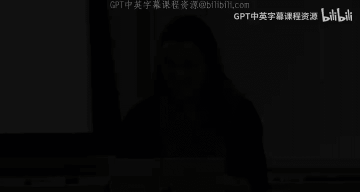
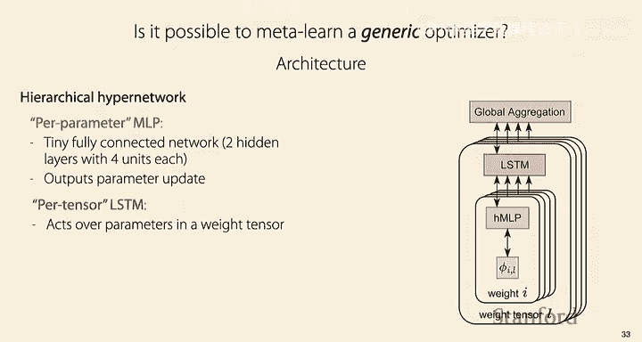
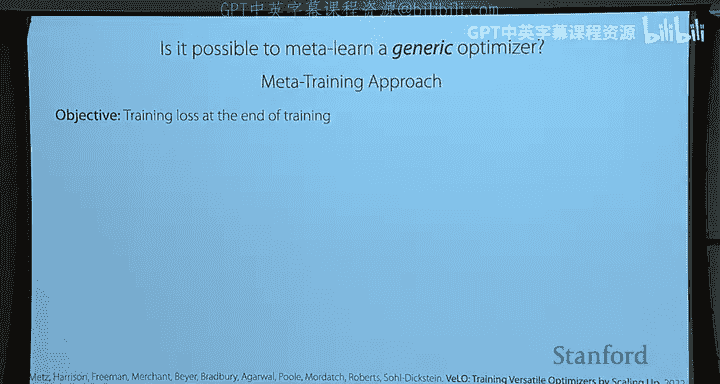
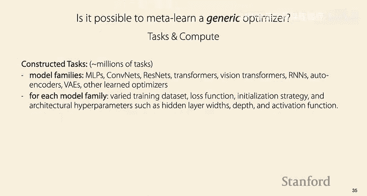
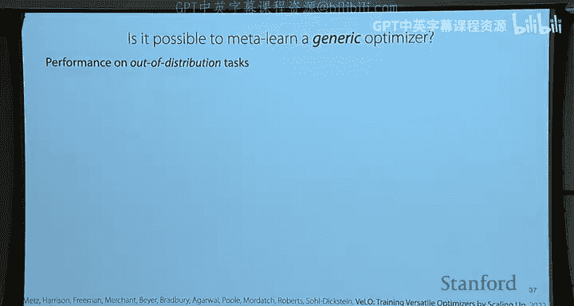
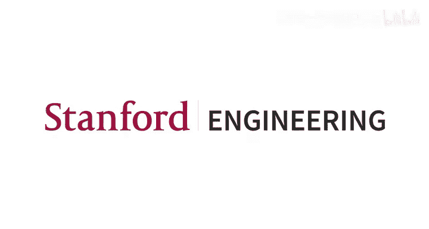

# 斯坦福大学《深度多任务与元学习｜Stanford CS330 Deep Multi-Task and Meta Learning 2022》中英（豆包翻译 - P16：-16-.Frontiers and Open Challenges I 2022 I Lecture 16.zh_en - GPT中英字幕课程资源 - BV1dWpPepEsj

A couple logistics， first the project poster session is on Wednesday next week。

 we'll be posting details on Ed very soon， it'll actually be broken up because we have so many students in the class itll actually be broken up into two different sessions and you'll be assigned to one of the two sessions and so it'll be a bunch of details on that coming soon on Ed。

The final project report is due in two weeks on Monday。U。

And then a couple other logistical items from the high resolution feedback， first。

 the high resolution feedback from before Thanksgiving break was about kind of the timing of homework three and homework 4。

 and so will we reit that timing for the next offering。

And then another thing that has come up a couple different times was asking for solutions to the homeworks and theres we've had a lot of discussion around it and it's something that I think is always。

A little bit tricky to do in particular， the thing that's tricky is that。We reuse the assignments。

Over time， over different quarters and we do that so that we can have a very high standard and a high quality of the assignments。

 but it also means that if we post the solutions this quarter then it could be that those solutions stay floating around and other students use those solutions for future quarters and we have seen in the past cases where students have actually posted their own solutions online and students have copied those solutions and so we don't want to incentivize that sort of cheating。

 and so as a result we don't post solutions which is somewhat unfortunate。

 but if you have questions about mistakes on the homework， either about your grade or anything。

 really feel free to make a post on ed or come to office hours and we're really happy to walk through walk through the solutions to the homework and hopefully that's just as good as having access to the solution。

So my plan for today is really to talk about the kind of most recent trends in research that I find really exciting。

 and so this is I think a pretty fun lecture because yeah。

 I basically will talk about some of the things that I think are really cool that are on the edge of research。

 this will be including meta learningning for adapting to distribution shift。

 including adapting with unlabeled examples and adapting with kind of local descriptions of an edit that you want to make to a model。

😊，And then I'll also be talking about how we can meddle learn things that are more general than some of the things that we've seen in the past。

 and this includes trying to meddle learn a generic optimizer that can be used for any different problem。

 as well as trying to meddle learn symmetries in neural network architectures。And at the very end。

 I'll talk a bit about what I think are some outstanding open problems and challenges in the field。

 and yeah， how we might start to move towards addressing those challenges。

So let's first talk a little bit about adapting to distribution shift。

first is why this actually matters at all， I think distribution shift is a really fascinating problem and I think that it's really an important problem because of kind of the nature of reality。

 so the current paradigm in machine learning research is to take a data。

Then train a model on that data。And then evaluate that model on some held out data or something like that。

But in reality， things are constantly changing in the world and so we see stocks or supply and demand or you kind of deploy your system in a different part of the world。

 and as a result the data that the system is often deployed on is actually different from the data that it saw during training。

And I think we need algorithms that can handle the fact that the world is changing rather than just being deployed as a static system。

And I also think that me learning is actually possibly a very useful tool for trying to address this challenge because me learning can train systems that can adapt very quickly。

 and so we'll see that a little bit in some of the upcoming slides。no。

If this is kind of a current reality that's thus faced， you might ask， well what does industry do。

 so when actually people use machine learning and practice。

 how do they cope with the fact that the world is constantly changing？And you could ask Chip Puin。

 who works on machine learning systems， and she says that machine learning systems degrade quickly over time because of concept drift。

😊，When they're in production and for online machine learning systems。

 typically you just want to update them as fast as humanly possible in order to kind of address the fact that they degrade quickly because of concept drift。

And so I think this is actually。An interesting thing to know about because it means that the way that we typically develop machine learning systems is under this kind of trained test paradigm and actually that the way they're being used in practice is this sort of continual training setting which is a bit different from the way that they are originally intended and so maybe that means if we want to build better machine learning systems and。

And to of actually do research that's relevant to the real world。

 maybe we should take into account the fact that they need to be updated constantly over time。Cool。

Fine tuning is a really reliable and performant approach for trying to update models quickly over time。

But it also has some limitations， so first it requires you to collect label data from the new part of the data distribution。

 and this can be expensive， it can take time， it may not be available。

It can also be computationally expensive， and especially as you're trying to train larger and larger models。

 the amount of compute you'll need to fine tune that model will at some point become somewhat impractical。

And in general， it's a fairly blunt tool， and if you only want to make a very small change to your model because you notice an error or notice like one small thing that changed。

 fine tuning isn't necessarily the best tool to make a very precise and small change to your model。

And so， yeah， what I'll talk about next is how we can might be able to leverage better learning to actually address some of these weaknesses of fine tuning。

😊，So first we'll focus on domain shift and this is something a kind of distribution shift that we saw in the domain adaptation in domain generalization lectures。

 and then after we talk about domain shift we'll talk about a more general kind of distribution shift that's called concept shift。

And so to recap in domain shift， you have some sort of categorical domain variable。

 and this could correspond to different users to different locations， different times of day。

And oftentimes， this sort of domain information can be derived from metadata that already exists in your training dataset。

And then。What Do shift looks like is you assume that your training data is from this distribution right here and your test data is from the same distribution。

 but where the only thing that has changed is the distribution of this underlying domain variable。

And this kind of distribution shift is fairly general。

 and this is kind of the shift that we'll look at in this first part。

 but there are also some things that it cannot capture。😊，Now， one approach， I guess。

 so we saw some approaches for handling domain shift in my lecture on domain patient in Hashu's lecture on domain generalization。

 one approach that we didn't really talk too much about is called distributionally robust optimization。

And the way that this approach works is you try to form some adversarial distribution over your domain variable。

And then optimize for the worst case distribution。So in particular。

 you can formulate kind of a adversarial optimization where you are trying to find a model that does well under the worst case distribution over domains。

And。If you have a categorical domain variable， this is actually fairly simple to evaluate。

 you simply pick the domain that the model is doing the worst on in your training data set and then optimize for the performance on that domain。

😊，And then iterate that process。And this sort of adversarial optimization can enable robustness to different domains。

 it can also be less pessimistic than adversarial robustness。

 which is another kind of robustness that you might have heard about。

But it can often sacrifice the average performance or the empirical performance because it's actually quite pessimistic about the data that it will be seeing or the domain that it will be seeing at test time。

And so what we're going to try to do is actually kind of formulate。

An alternative paradigm that is a little bit less pessimistic。

 but still allows us to be kind of fairly robust。 And the way that we're going to be doing that is instead of optim for the worst case domain。

 we're going to try to actually optimize for。Domain performance after having adapt a small amount to each given domain。

And so specifically what I mean by that is。We're going to assume that we have unlabeled data from the test domain。

This could be unlabeled data from a new user from a new time of day or a new place。

And so if you want to， for example， recognize handwriting。

This is from the fedated extended MminNIS data set， this is all from one user。

 you might have this batch of unlabeled data from that one user。😊。

And then your goal is to take this unlabeled data， adapt your model to that user。

 and then infer the labels for all the examples in that batch。

And so this is going to be different from other approaches in a few different ways， first。

 unlike fine tuning， this only needs unlabeled data in order to adapt the model rather than label data。

Second， unlike things like domain generalization and domain adaptation。

 we're not going to be assuming access to this unlabeled data during training time。

 we're actually just going to adapt the model on the fly at test time。

The really the main assumption that this is I guess the main two assumptions it's going to be making is that first you have domain labels in your training data set。

 and second， at test time you have a batch of test inputs from the same group or from the same domain available at once rather than just having a single example。

This is a little bit different from the standard machine learning setting where you just assume that you have just one input at a time at test time。

So this is a problem setting。Um。And we kind of refer to this problem setting as adaptive risk minimization in the sense that you are。

Instead of just evaluating risk directly on the examples that you're given。

 you actually have an opportunity to adapt with a small amount of examples。

And then there's a question of actually how to optimize for this and how to actually develop a method that can allow you to adapt with just unlabeled data from a new part of the distribution。

And so to do this， we can actually train a model for Fushot adaptation to the different domains in the training dataset。

 and this will just use like basically the same metal learning algorithms that you saw in the earlier parts of the course。

The key thing that's different though， is。Instead of doing few shot labeled adaptation。

We're only given unlabeled data， and so we want to be able to adapt with these unlabeled examples rather than a few labeled examples。

And so there's a few different ways that you can do this， one is you could use the mammal algorithm。

 but because you can't compute the like a standard cross entropy loss function。

You can meddle learn a loss function and use meal learn loss function such that when you adapt with that loss function on the unlabeled data。

 you do well on each of the domains in the training set。

And so what this looks like is you are going to be me learning both the initial parameters。

 as well as the parameters of some loss function also represented by a neural network。

In the inner loop， use that loss function to update the network from the initial parameters to get a new network and then optimize this whole thing。

And to end such that you get good performance on each of the training domains。

So that's one way to adapt with unlabeled data， alternative you could also use a black box approach and simply basically pass in all of the unlabeled examples into a neural network that produces some context and use that context to make predictions for your examples and this sort of black box approach is actually quite straightforward because the only thing you need to do the only thing you need to do to modify a black box approach to work without labels is to just remove the labels when you pass the data as input。

There's a few different architectures that you could use for this sort of kind of black box approach。

 one is the architecture that's shown here。Where you just kind of predict this context and pass that into the network。

Alternatively， this context could actually be computed in a different way。

 one really simple way to compute this context would is have the context correspond to about storm statistics。

And this would mean that you are。You're basically passing all of your examples in as a batch。

 and instead of using the batchstorm statistics from the training data set。

 you're going to be computing them on the fly at test time using all of your examples。Cool。

 any questions on how this works， yeah？Tnal loss function should and the parameters at the same time。

 because is there like a loss for the loss？Yeah， so the question is how do we train the initialization and the loss function at the same time one really critical thing is that we're only going to be training the inner loss function and the outer loss function is going to stay the same and so if your inter loop update is something like theta minus alpha gra L。

 the parameters of L this neural network is parameterized by phi that takes as input the unlabeled examples。

嗯。I guess in this case， there's only three unlabeled examples。😊，This is the inter loop update。

 and then we're going to be evaluating this in terms of how well these updated parameters do on。

On the labeled examples， which will be x1 to 3 and the corresponding labels。

 and this outer loss function will correspond to just a standard cross entropy loss function and we could optimize this entire thing。

Over both the initial parameters and the loss function parameters。Cool， any other questions？

So there's a lot of different experiments in the paper， but I'll mention just a couple of them。

 the first is the Feated extended MNIS example that I showed on the previous slide。

 and in this case the experiments are all trying to adapt to new users that have different handwriting only with unlabeled data available at test time from those users。

The experiments compare to a number of different methods， one of them is just kind of standard ERM。

 we could also compare to the group robustness approach that I mentioned before。

 we can compare it to domain adversarial training which was covered in。

Hhu's lecture and also compared to a really simple uping approach that will just up the data from each of the users to be a uniform distribution so that you're sampling data from them equally。

😊，Cool， and then we can look at performance both in terms of the average test performance on these new users as well as the performance on the worst user。

 and this sort of worst case performance is useful because it will give you a notion of fairness。

 are you doing really terribly on some users and much better on other users。

 and it'll also give you a notion of robustness such that if your distribution changes more towards those worst case users。

 what were your performance look like。And if we look at the numbers first in terms of average accuracy。

 we see that domain adversarial neural networks actually gives you somewhat better performance than empirical or minimization。

 but that we can get around a 5% improvement by actually adapting in this case with a context variable in comparison to just trying to train a single neural network。

😊，Then in terms of worst cap socy， we also see a around a 5% improvement as well over the best existing method in this case。

 which corresponded to either kind of uping or the domain adversarial training。

Now we can actually kind of qualitatively look at what it's doing here。

 and so here's one example where this is an image that the system is given and if you ask the neural network trained with ERM。

 it will tell you that this is a two。And similarly， if you ask kind of the adaptive riskization。

 the metal learned model that used a context variable。

 if we give it these two examples and ask it what the label is， it will also say it's a two。

But if you actually give it a little bit like even more context。

 if you give it all of these unlabeled examples。It can correctly figure out that this actually corresponds to a lowercase A。

And the reason why I can do that is it could look at other examples， for example， this example。

 and realize that this particular user often writes there to without a loop。😊，And therefore。

 this must be a lowercase A rather than a two。And so essentially what the system is doing is it's adopting。

To this particular user， adapting the model to the user such that it can more accurately make predictions for that user。

Cool， one other experiments that I'll mention was looking at adapting to different image corruptions。

 and so this is using the CFRC and tiny imagenetC data sets。

 it was trained using 56 different corruptions and then using testing its ability to adapt to images that were corrupted with 22 other corruptions that weren't seen during training。

And again， here we see。We see that the domain adversarial neural network approach is one of the best performing prior approaches。

 although it actually really is performing somewhat similarly to just standard empirical orismanization。

 and in contrast by actually adapting and training for fast adaptation with unlabeled data。

 we're able to get around a 2 to3 percent improvement in average accuracy and a 7 to9% improvement in worse group accuracy。

有。Its because the of 15 plus full corruption 19 corruptions in CF4 ten。 So how are these。

When you say like these corruptions， are there still kinds of corruptions。

 make say if I im relationss or res will be different from corruption。

 is that be very different distribution shift， is it able to handle a very different kind of distribution shift？

Yeah that's a great question so first in terms of the corruptions we construct more corruptions by also considering the severity of the corruption as well。

 and so I think that's how we get to 78 corruptions here and then in terms of being able to handle very different corruptions。

 I think that it may still help somewhat。But。But I do think that the improvements will be less than the improvements that you get from corruptions that are a little bit more like the one seen during training。

 and that's because we still we're training for adaptation performance on a set of corruptions and if you give it something it has to adapt to something that's very different from that。

 it won't necessarily generalize。第。Does this move back when on higher severity？What's favorite？

I explain。We didn't specifically have any experiment that was looking at like how performance does as。

As the severity changes， my guess would be that it does help more when the severity increases because ERM does much better than these when there's no corruption。

And I don't think these methods would help when there's no corruption， of course。

 so my guess is that it would be better with more severe corruptions。

 but it's also possible that you might see like a bit of a fall off if it's just too corrupted to be able to get any signal。

Cool， so the takeaway here is that we can use metal learning to adapt a distribution shift and specifically to adapt to different kinds of domains。

 only using unlabeled data。Now， what about other forms of distribution shift？

Specifically next we'll look at a kind of distribution shift that's called concept drift or concept shift。

 and this is when。Basically kind of the entire P of y given x distribution can change and actually。

 I guess in a lot of the examples that we'll be looking at， p of x is not going to be changing。

 only p of y given x is going to be changing。And I should note that when P of y given x is changing。

You're going to need some sort of supervision in order to adapt to the distribution shift。

Because P of Y given X could change in a lot of different kinds of ways。

And specifically in this case， we'll look at。handling this kind of distribution shift in the context of language models？

Although a lot of the methods that we'll be looking at are applicable beyond language models as well。

😊，And as a motivating example， if you take a version of DPT3 that was accessed earlier this year。😊。

And you ask it， what is the largest English speaking EU nation？

It will tell you the answer is the United Kingdom。But of course， the UK is no longer in the EU。

 and so this answer isn't correct and the answer should be Ireland。

If you ask it who is Algerer's current president， it will also give you an answer that is out of date。

And likewise， if you ask at the club team that Leo Messi plays for。

 it will give you something that's out of date as well。And so。There's a question of how。

 what should we do in this scenario， what should we do to try to actually update something like GPT3 in order to allow it to make correct predictions。

On things about the world that are changing。Unfortunately it would be really expensive to have to retrain GPT3 or even fine tune GPT3。

 it would probably be fairly expensive。And so what we'd like to be able to do is try to figure out how to keep these large models up to date without having to。

F tuned or without having to completely like retrain the entire model。

And so this is where kind of the framework of editing can come in。

What would be really nice is if we could take our base model。

 if you ask it who is the prime Minister of the UK， it'll tell you the answer is Teresa May。

 which was of course correct before， but that's also like three prime ministers ago now。And。

What would be really nice is if we could take this example and tell it that the answer should be Riishhi Sak and pass that to a model editor。

And。Then get an edited model that can give us the correct answer。

I a correct answer to rephrasings of the questions or other things that are in scope。

 like is Rihi Sununak the prime minister of the UK？Furthermore。

 we don't just want it to give us the correct answer for inputs that are in scope。

We also want to be able to ask at things that are out of scope and unrelated。

 like who does messy play for and still have it give us the correct answer。

 so we don't want to have it affect things that are unrelated to the edit。

And so specifically to try to scope out this problem a little bit more。

 maybe your edit example is who is the prime minister of the UK。

 our scope is kind of the space of inputs that are related related to that input。

 and that would include rephrasings of the question。

And there are also examples that are out of scope， like why is the sky blue？

It's also worth mentioning that there are some examples that are in scope and out of scope that are going to be much harder。

 like where is Riishhiu not the PMm， this is going to be in scope。

 but it's going to be a little bit further and more difficult than just a rephrasing of the question。

And likewise， there are things that seemingly are somewhat related。

 but shouldn't be changed when we make an edit to the model。

And these are actually really the most challenging cases， and it's important to。

When we actually get to some of the experiments， we're actually going to be trying to focus on evaluating on these examples rather than the easy examples like why is this sky blue？

第二。Yeah。So， where do you store data problems？Yeah， so what about prompts that aren't in the form of the question？

I guess， so in principle， yes， you could have some of those things be in scopepe or out ofcope and you don't just have to have this for a question answering model。

 you could have it be for just general language models and if you have a model that can do both question answering and kind of continuations。

 then you could have those kinds of things be kind of part of this picture as well。讲。Tめる。Yeah。

 so that would also be in scope as well， and you could also imagine。

 I mean getting along the lines of like other kinds of inputs。

 you could also have something like a picture of Teresa May and say is this person the prime minister and in principle that would also be in scope as well if you're considering models that can take that sort of input。

Cool， so this is what we'd like to be able to do。And。

We can formulate this as a meta learning problem， and so there was this really cool paper by Cizein atal in 2020 that kind of framed this problem as a meta learning problem of trying to actually train a neural network that could be edited in very specific ways。

Unfortunately， and we'll talk about the kind of the formulation from that paper。

 unfortunately this kind of specific method in the ICear 2020 paper wasn't particularly scalable to large language bottles。

 and so in terms of the methods that we'll be covering。

 we'll be covering some more recent work that is much more scalable。

 but this was kind of the work that introduced the paradigm of doing this in the meta learning setting。

😊，And so to frame this as a me learninging problem。

 we are going to assume that we have the ability to collect a data set that shows us examples of how editing should be done。

And in particular， this data will contain first， a descriptor of the edit。

This could be an input output pair like who is the UK PM， and the answer is Rihi Sak。

It will also include an example of something that's out of scope。

And this is going to try to enforce the fact that the model shouldn't change on these out of scope examples。

And it'll also include examples of in scopepe input output pairs， and so in particular。

 if it's given an example like the Prime Minister， the UK is currently who。

 it'll be told what the new answer to that question should be。

So this edit dataset will essentially be something that we'll use to teach a model editor how to edit a model。

 Collecting this edit data is going to be a non-trivial effort， although in general。

 if we collect a general enough edit data that has examples of lots of different kinds of things that we might want to do to edit models。

 then we only need to train a single we only need to use it once and collect it once。

In order to train a single model editor for making all sorts of edits to a large model。

CoI then once we have that edit data set， there are a few different ways that we could train one of these model editors。

The first approach is going to。Try to actually change the gradients and actually update the weights of the model。

And so what it will do is it willll take as input the gradient that corresponds to the gradient of trying to fine tune the model on that one edit example。

And we'll try to transform that fine tune ingredient into a better update for the model。

And so this is kind of captured by this picture where if you have your pre trade model and you want to make an edit to it。

 then you。Compe what the gradient would be if you were to fine tune on that edit。

And then pass that gradient into this model editor that will then give you an updated gradient that you'll actually use to edit the model。

once you apply updated this kind of revised version of the gradient to the model。

 the goal will be that for it to give you the correct answer for these edits and also of course。

Not affect the model output on other examples。And so really the main component of this is just training this single model editor right here in the middle。

I that's going to take as input a gradient and update a output and modified version of that gradient？

And the way that this is trained is using the edit data set。

Be trained to output the correct prediction on the Incope generalization example。

 and it will be told that it should kind of maintain the same distribution of outputs given the out of scope example as the original model。

So there's two terms in the loss function。有。本有ち。So the question was。

 isn't this more expensive than fine tuning because you're still computing the gradients？So yeah。

 you do need to still compute the gradient。 The one big thing is that we're only going to be applying one update to the model。

So we're going to be outputting a modified gradient such that just one step of that gradient。

 one update gives you a good model。And so it will require fewer update steps than fine tuning。

And second is' also just going to work better than fine tuning and so the by actually training it to do this。

 it will give you something that kind of more effectively。

Makes targeted edits without affecting out of scope examples。it something else。

So the question is is there any sort of analysis on what is' doing to the gradient。

 unfortunately it's a little bit difficult to analyze。

 I would guess that it is probably kind of increasing the scale to some degree。

 but it's certainly doing more than that。And generally it's hard to interpret weights of neural networks and it's also hard to interpret gradients。

 so we weren't yeah， we weren't really sure how to analyze it in particular One thing that I will mention that。

That we did in this work is that the gradient of a single example is actually a rank one matrix。

 so if you have a weight matrix and you compute the gradient of that，😊。

So say you have kind of one weight matrix right here。This is like layer A and layer B。

 the gradient of this weight matrix corresponds to the outer product of。Of the forward activations。呃。

Well， this isn't a great notation， but the forward activations and the kind of gradient coming backward from B。

 so it's basically。😊，Something like DLDB so this is a vector this is a vector and it's the outer product of those two things and so it's actually a rank1 matrix and one thing that's cool that this model editor called MenD does is it actually decomposes instead of kind of passing in the weight matrices it passes in the two rank1 components into the network and outputs a rank one or a low rank update to the model and as a result this ends up being。

The dimensionality of the inputs and outputs of this model editor are much smaller。

And so in particular， if this is like H an HB or kind of the size of these two activations。

 then this weight matrix is H times HB。😊，Whereas the dimensionality of the two rank1 terms is H plus HB。

And this means that the。The kind of dimensionality of the input is。Is going to be much。

 much smaller than if you were to output input and output the kind of。The entire weight matrix。Cool。

 so this is the first approach to model editing that's actually to try to update the weights or change the weights of the model directly。

嗯。Before I go over some of the results， I'm also going to show a second approach to model editing that tries not to update the weights of the model。

 and the motivation for the second one is that this approach ends up being。

It' somewhat difficult to scale to large numbers of edits because it's actually fairly fairly difficult to figure out how to kind of change the weights in a way that will make these sorts of targeted edits。

And so the second approach is going to try to take a more semi parametric approach。

And so we'll have our base language model， and instead of updating the weights of this language model。

 it's actually going to be fully frozen。And instead。

 we're going to try to form a wrapper around that language model。

 such that the wrapped language model gives you the behavior that you want after you've applied the edits。

And so this approach will have a few different components。The first will be a memory of edits。

That stores all the edits that you want to apply to the model。

The second will be a scope classifier that will classify whether or not an edit and input are within scope。

 this is actually going to be somewhat similar to something like matching networks or prototypical networks。

 we're actually going to be comparing the edits that you want to make and the inputs and seeing if they're similar or not。

And then additionally， you can train a counterfactual model that will make predictions if the edit is being applied to the model。

And so the way this works at test time is first you can populate the edit memory with the edits that you want to make to your model。

诶。This is the one slide that I didn't update with the correct PM。

Because the PM is changing really quickly。Then we get a new test input。

What we're going to do is we're going to first compare that test input to the edits in our memory bank。

The Scope classifier will tell us that this edit is in scope。

And then because there is an edit in scope， we'll then pass the。

The edit as well as the input to the counterfactual model。

 which will give us the revised prediction for the input。Alternatively。

 if we get an example that's out of scope。Then we'll just pass that directly out of scope for all the edits according to the scopeco classifier。

 then we'll just pass that directly to the base model。

And so really there's just two components that we're training here。

 first is a scope classifier that will tell us whether or not an example and an edit are whether an example is in scope for a given edit。

And then the second is the counterfactual model， which we'll train to make predictions after applying the edit for a given example。

叫。The prompt and then the what is we learn from the prompt that you answer。Yeah。

 so one thing that you could do instead of having a counterfactual model is essentially prepend the edit to the prompt of the base model。

 and one potential advantage that this might have is that it will leverage kind of the power of this really large base model。

In practice， we found that that didn't seem to work that well。

But perhaps you could fine tune the base model in order to be good at that sort of prompted behavior。

 and the counterfactual model seemed to do reasonably well。

 but it's something that I do think that kind of trying to leverage the base model。More， I think。

 would be kind of an interesting direction for future work。有。Go in you memory。more。Sa about Edward。

R the more surprised。Yeah so the question is is this scalable especially as you want to apply a large number of edits and do you need the counterfactual model to be large so first yeah。

 so this will as the number of edits increases you will still need to store all of those edits in memory Fortunatelyly you can apply the scope classifier in parallel to all of those edits and also in practice for the edits we actually only need to store the embeddings of the edits we can just kind of cache that computation so there is things that you can do to make it computationally fairly。

Fairly cheap the other thing that you could do is if you do start to accumulate a very large number of edits at that point it may but just make sense to fine tune your model because at that point you do need to actually change the model fairly significantly and hopefully that you don't accumulate edits that fast over time。

And then in terms of the counterfactual model， in practice。

 we do kind of pretrain it with like a B style model and so it won't be necessarily as large as the base model。

 but it could still be somewhat large and with that sort of with it like a bird style pretraining we found that it could work well even with。

EEdit data sets that are like far less in size than the。

Then the data trained that the base model was trained on。这。So with this type of。

Like if we see some guarantee。しこ？We kind of just completely ignore。B based model right。

 is it possible to create something that's kind of like configuration？

In which like instead of taking in。Is there just sending a tool to separate？

Model like the contractual model just edits the output of the beast model like。Yeah。

 so one suggestion that came up before is we could possibly prepend the edit to the base models prompt alternatively you could kind of make a prediction from the base model and then pass that into the counterfactual model and that might still be leveraging like all the power of this base model and that it would only be editing the output。

Of this base model， and so I think that for things like question answering。

 that isn't necessarily that important， but I think that if you're in a setting where the task is to write longform text。

 then something like that may actually make a lot more sense because generating longform text is much harder than answering a question and also it may be that you only need to edit a small part of that longform text。

 and so yeah I think that generally different directions for leveraging the base model are interesting and one way to do that possibly maybe to kind of take the output of the base model and pass it into the counterfactual model。

One of the small things that I'll mention that's kind of a benefit of having the two be decoupled is that by having them be decoupled。

 this does mean that you can actually plug in any base model into this architecture。

 and we found experimentally that even if you kind of train this whole system with one base model you can kind of apply it to lots of different base models and that means that even if you then kind of retrain a base model at some point you could kind of still reuse the editor across multiple different base models。

Cool， so in terms of the experiments， I'll highlight just two experiments。

 The first was on question answering， just like all the examples we've been looking at so far。And。

There were two metrics that we looked at in order to evaluate how good the editor was performing。

The first was editit success， which corresponds to accuracy on in scopepe examples。

And then the second was drawdown， which corresponds to how much is the accuracy dropping？

On examples that are out of scope from the edit。In order to combine these two things into one metric。

 we can just measure edit success minus drawdown。And so the best that you could do is an edit success of one and a drawdown of zero。

 and so then the subtracting the two would give you one， and then as this score goes down。

 that means that either your edit success is dropping or your drawdown is increasing。Cool。

 and then we're going to evaluate this as we increase the number of edits that we're going to be applying at test time。

And we'll be in this case， editing a T5 large model on the type of question answering things that we've been seeing so far。

Cool， and so if we compare the three different editing approaches。

 I guess I didn't include fine tuning on here， although fine tuning generallyt kind of does worse than all three of these methods。

嗯。First we see that with a single edit， both Mend and SARA are able to do both kind of the approach that I was editing the weights and the semiparametric approach are able to do fairly well。

 but as you increase the number of edits，Really， these approaches that try to edit the weights of the model are much less successful at doing so。

 and really only SAAC is able to achieve a high edit success and a low drawdown as you increase the number of edits。

Cool， and then one other experiment that I'll mention is。

You don't necessarily have to just edit factual knowledge and so forth。

 And so one experiment that we did was editing the sentiment of a。of a model。

 and so we trained it to edit the sentiment on a variety of different topics， and then at test time。

 if we ask one of Facebook's prior public models， what do you think about vaccines？

It gives you a model that is very negative about vaccines。

 so everything highlighted in red is things that are negative。

And then if you actually try to edit this model with the La SAak approach。😊。

You can get something that is， in this case we're telling it to be more positive and so as a result you see that it's much more positive about vaccines and it's not just positive in a superficial way。

 it also it says things like I think they're a good way to prevent infectious diseases。

 I think it's good for people to be informed about the risk of their health and so forth。

And so this sort of editing approach， I think is actually fairly general。

 and as long as you have a data set that can tell it how you want it to make edits。

 then you could apply it in a variety of different ways to these very large models。Cool。

 so the takeaways of this first part is we can use metal learning to enable adaptation and fine tuning of these large models。

 either with only unlabeled target data or with a high level description or single example of a change that you want to make。

 and these are two things that are I think very difficult to do just with vanilla fine tuning。Cool。

 now I also want to talk a little bit about me learningning across more general task distributions。

 we're a little bit low on time， so it's possible I might just cover the first thing and skip the second thing。

This work is really about trying to kind of push the boundaries of me learning and trying to see if we can get something that's much more general than the priors that we've been looking at previously。

And this is a paper that came out on trying to train generic optimizers。

And it's a really cool paper and really the goal of their work was to try to get an optimizer that worked well for any problem and any architecture without having to tune the kind of hyperparameters of that optimizer。

 and so without having to tune learning rates or without having to tune momentum or anything else of the optimizer。

And。We'll get to the experiments at the end， but the short version is they really they largely achieve this goal。

 which I think is really exciting。So it has four central components。

 the first is a neural network architecture that predicts weight updates。

The second is a algorithm for training that neural network。

The third is a very large and broad set of optimization tasks。

And this is really important in order to get the generic part of this。

And then the last is a lot of compute。Cool， so let's kind of step through each of those different components。

 So the first is the architecture。The architecture is actually somewhat complicated。

 but once you break it down， it's fairly simple。First for every single weight。

 for every single parameter in the network that you're optimizing。

 there is a really small neural network， it's really a tiny fully connected network with two hidden layers that each have four units。

And there's one of these fully connected networks for every single parameter in your network。

And this is the network that's going to be outputting the parameter update for that weight。

Now where do the weights of this network come from。

 so there's a separate neural network that's an LSTM that is acting over the parameters in the weight tensor。

AndThis is going to be generating the weights of all of the MLPs for each of the parameters。

This LSTM， so every weight I guess for every tensor， so like for every weight matrix， for example。

 you're going to have an LSTM that acts over those weights。

And that's going to be that LCM is going to be outputting kind of the weight matrices of these really tiny MLPs for all of the parameters in that tensor。

The input features to this LSTM correspond to a bunch of different things。

 it includes the mean and variance of each of the parameter values in that tensor。

 a moving average of the gradient and the squared gradient， that's information that Adam uses。

 also things that indicate the fraction of training that's been completed as well。

So the input is all of those different features， the output is the weight matrices of this small MLP for each of the parameters。

The last thing is this global aggregation， the LST is also going to output a global context。

 this global context vector is going to be pooled across the weight tensors。

And then re inputput it to each LSTM。And so this will just help the LSDMs basically stay on the same page。

Cool， so that's the architecture。How do we actually train this architecture？

 So the meta objective is the。The training loss at the end of the optimization for each task。

And so basically you'll have some initial parameters for the task。

 you'll then use this architecture to update the weights many times up until， I think around 200。

000 steps。And then you'll get this final parameter。

And the metal loss will be how good is this final parameter？At the task that it is trying to do。

 and the objective will be this final loss， but of course。

 average over all of the different optimization tasks that iss being me traineded on。诶。

Now the meta optimizeizer is going to be using evolution strategies。

 this is the approach that Yuho copyright in his lecture。Using full rollouts。

 they're not going to be doing any sort of truncation。

And so this is going to be a pretty expensive optimization。

 so they'll take this final loss and then update the weights of the LSTM。

That are used to make all of these different updates。

Then they also found a curriculum to be extremely helpful and what they did is they first started with optimization problems with a smaller number of training steps and with a smaller problem size。

 and then gradually move towards longer training times and larger problems。

How do you measure problem size， they estimate the problem size。

 obviously just the time required to do one forward pass in the network and so this is an indication of how big is the network or how complicated is the network。

Cool。And then lastly， tasks and compute， so they constructed on the order of millions of tasks with lots of different architectures including MLPs。

 comms， transformers， RNNs， autoenrs， and also other learned optimizers。For each model family。

 they vary the train data loss function， initialization strategy。

 and various hyperparameters like the hidden layer size， the depth， the activation functions。

 and so forth。😊。

And they also did various forms of task augmentations where they did things like reparamatizing the weight tensors。

 for example， like dividing the weight tensor by a certain value。

 passing that into having that be the weight tensor。

 and then having a constant B multiplied after that， delaying the gradients。

 changing the floating point precision， and other forms of task augmentation。

And then computationally， as we mentioned on the previous slide。

 we're doing full rollouts and we are optimizing this with evolutionary strategies and so they estimated that it took around 4。

000 TPU months to me the optimizer。😊，Which is rather expensive。So let's get to some of the results。

Their first evaluation was on a set of 83 canonical tasks。

 and this is measured in terms of the number of update steps relative to required to get the same performance as a version of at to where they tune the learning rate of atom。

And so the red line shows this versatile alert adoptvisor Bellello。And first。

 we can see that on 50% of the tasks， Flow is more than four times faster than the learning rate tuned atom。

And on basically all of the tasks， it is actually the same speed or faster than at in terms of the number of update steps。

And they also compare not just to Adam， but also these other optimizers。

 including optimizes for which they tune the hyperparameter like opels and shampoo and also。

Kind of a prior。Prior methods that are hyperparameter free for which there didn't need to be any tuning。

So this result， in my mind is really impressive and pretty exciting that you could actually on such a large number of tasks outperform Adam。

What I think is even more interesting and cool is actually looking at how well it's able to optimize things that were out of distribution。

So he looked at a lot of different out distribution tasks here they compared to a few different methods。

 although I generally tend to focus on the comparison to Adam because I think that's what。

People use the most， at least in terms of research。

And they evaluated on Nerf training Nerf is a very different kind of。

It mean it's not necessarily different kind of architecture but it's a very different kind of optimization problem than what it saw during training and we can see that it is。

 despite the fact that this is an out of distribution task。

 or at least seemingly out of distribution the optimizer is able to optimize faster than atom so you can compare the red curve and the blue curve the blue curve is actually a tuned version of at where they' tried this is kind of the best out of 14 different hyperparameter settings of atom。

😊，They also looked at an MLP mixer architecture， which is just a different architecture than anything that's seen during training。

 and we also see。Improvements over atoms are red is faster than blue。嗯。

They also looked at object detection， so this is this kind of RCNN architecture。

 as well as a decision transformer， and we see that it's better than STGD on object detection and kind of similar to a decision transformer or similar to Adam on decision transformer。

Cool any questions about the results？乗って。And strategic。For the direction。I'm not fully sure。

 I would guess that they chose to use SGD because that's like the default architecture that's used for this or the default optimizer that's used for this。

 but I'm not fully sure。Cool， so they also had a really long list of they also included a number of experiments that it didn't work in。

 although in general I felt like the results were really kind of impressive。嗯。

The first caveat here is that is kind of compute， even though it's faster in terms of the number of updates。

 there is a 10X computational overhead over atom。And so it's more expensive to run the LCCM compared to running atom。

That said， compute is often dominated more by gradient computation than the optimizer computation。

 and so this may not be that big of a deal you may still get wall clock speed ups。And second。

 they had some experiments that were looking at the performance with varying batchpt sizes and you can see that it actually does generally does well with very large batches。

 and this means that if you're worried about wall clock time you can get。

You can still get actually a much better wall clock time than at them by just using a larger batch size。

Because this means that when you have a larger batch size。

 your compute will be even more dominated by the gradient computation。They also found that the model。

 the optimizer doesn't do well at optimizing very large models。

 specifically models that had more than 500 million parameters。

 and so if you're in the business of training large language models。

 this may not be the optimizer for you。They also found that it had worse performance if you required more than 200。

000 update steps because they only trained for up to 200，000 update steps。And lastly。

 they found that in reinforcement learning settings。

 specifically policy gradient and evolutionary strategy optimizations， it was much worse than Adam。

 this isn't too surprising because it wasn't trained on these kinds of tasks and the gradients that you get from policy gradient and ES on reinforcement learning problems is going to be very different than the gradients you typically get from gradient descent。

I guess maybe the other consideration here is whether it's worth spending。400 a few months。

 I think what was on trading this sort of optimizer。In principle。

 if it kind of speeds up a lot of future experiments by being a single generic optimizer。

 then I think that there is probably a case for it being worth it。

 but it's always kind I think worth considering weighing computational costs and so forth。Cool。

 so the takeaway here is that metal alerting can produce generic optimizers。

 which is really in my mind the kind of the first。We've seen some results that have moved towards more optimizes that generalize well。

 but we certainly haven't seen something that's kind of truly giving something generic。

At this level before。Cool。We're a little bit low on time。

 I think I'll just briefly mention some of this work。

So that we still have time to go through some of the open challenges。

The second kind of thing that I think you can meddle learn over in addition to the optimizer is the architecture。

And。And the kind of symmetries that are built into an architecture。

One example of the symmetries built into an architecture is convolutions。

 which gives you 2D equivaris。And things like convolutions are great when we know the structure and we know how to build it in。

But there are also scenarios where we don't know what the structure should be or we don't know how to build it in。

And so there's this question of whether we might be able to use meta learning to recover the equivariant or invariant structure underlying a data set。

For example， could you recover convolutions if you're given translationally equivarian data？诶。啲。

You might ask if Mammal can already do this and Mammal can learn some equivariant initial features。

 but that equivariants may not be preserved through the gradient update。And so really。

 the goal here is to try to decompose the weights into equivariant structure and the corresponding parameters such that。

In the inner loop， you can update only the parameters and try to retain the equivari and keep that fixed。

And so we can walk through an example of convolutions where if you look at a 1D convolution。诶。

You get something like this and you can actually represent a 1D convolution as a fully connected layer。

And if you do that， it looks like this where the weights are copied multiple times。

And from this perspective， you can think about trying to reparametize this weight matrix into first the underlying filter parameters。

 A， B and C。And second， a matrix that indicates how the weights should be shared or how the weights should be tied。

And kind of the product of this sharing matrix on the underlying filter parameters will give you a weight vector that you could reshape into the corresponding fully connected weight matrix。

And you can kind of intuitively think of the sharing matrixes capturing the symmetries。

 and the vector V is capturing the underlying shared parameters。Now。

 this was an example for convolutions， but it turns out that this sort of decomposition can directly represent。

This decoupled equivariant sharing pattern and filter parameters for a wide range of symmetries。

 specifically for all kind of G convolutions for finite group G。

 there are some symmetries that this can't represent， but we won't have time to get into that here。

Cool， and so once you have this decomposition of the weight matrix。

 you can basically in the outer loop learn the equivaris and possibly the initial parameters。

 and in the inner loop only update the parameters while keeping that sharing matrix fixed。And so。

If if you do this， you can try to actually see if you can recover things like convolutions from translationally equivariant data。

 and so specifically here we're going to try to recover 1D convolutions。

By giving it examples of random functions that have this 1D translation equivariance。

And if you do this， course this is kind of showing the mean squared error on these random tasks。

 on random heldout tasks。And this is if you do mammal with a fully connected network。

 with a locally connected network， or with convolutions。And of course。

 convolutions does the best because that reflects the underlying symmetry of the tasks。

 and if you use this approach with a fully connected network。

 it's actually able to do just as well as convolutions because it's able to recover the structure。

And so specifically， if you look at the recovered weight matrix from this sort of approach where it's metal learning the sharing matrix。

You see that it actually gives you exactly the structure of a 1D convolution。Cool。

 and then there's a question of well maybe you could also do better than convolutions in scenarios where the structure isn't exactly a translational equivariance。

You can give it problems that have partial translation symmetry。

 so here K is going to correspond to the rank of a locally connected layer。

 and so k equals 1 corresponds exactly to convolutions where K equals 2 and k equals 3 has less symmetry。

 and here we see that this sort of approach is able to recover a solution that's much better than convolutions by actually recovering something closer to the true structure in the data。

And likewise you can try to actually give it more symmetries than just translation like rotation and reflection here we actually started with a convolutional network and tried to learn symmetry on top of that and you can get again something that's better than convolutions by recovering that sort of structure。

These are all unfairly simple problems， but I think that it's still kind of conceptually pretty cool to think about how you might try to meddle learnn these kinds of。

These kinds of architectures from data。The were able to maybe if you did scale up these kinds of approaches with more compute。

 then we might be able to actually do this at a much larger scale rather than these kind of simple 1D convolution problems。

So the takeaways is that we saw how metal learning can produce a generic optimizer。

 and we saw some preliminary evidence of metal learning being able to capture equivaris in neural network architectures。

Cool， and then I'd like to finish by talking about some open challenges。so。

I'll group these into a few different categories， so the first category I think of open challenges is trying to address some of the problem assumptions that we often make in meta learning problems and multitask learning problems。

And the first is generalization， so this actually kind of came up earlier when we were talking about trying to generalize the corruptions that are very different from the corruptions that we saw during training。

And one specific instantiation of this is like a long tail problem where you want to try to be able to generalize to the tail of the distribution。

In this case， the。In few shot learning， in principle。

 we should be able to kind of medrane on this part of the distribution and then do few shot learning on the tail of the distribution。

But these few shot tasks in the tail of the distribution may be from a different distribution than the tasks that we saw during me training。

And so there are some examples of generalization to the tales of distributions。

in like dermatological diseases and also kind of the adaptive risk minimization example we saw before。

 but it' still I think it open challenge to really kind of truly tackle these kinds of long-tailed situations and I think that there may be perhaps some hints that kind of come from some of the robustness literature and perhaps trying to combine。

Those sorts of ideas with things like metal learning。Another thing that's。

Another challenge that comes up is so far we've really been looking at me training over tasks that are from a single modality。

And in contrast， when people leverage previous experience， we have not just one modality of data。

 but we have lots of modalities like tactile feedback and language and social cues。

 and we're able to merge all of that prior experience into the knowledge that we have and leverage。

 for example， cues from language that we've read about when making visual decisions and so forth。

And so I think it'd be really interesting to try to learn priors across multiple different data modalities rather than trying to learn a prior that works well for a single modality。

 and there's some challenges and opportunities here。

 different modalities often have different dimensionalities or different units。

But they can also carry kind of complementary forms of information。

 and that might be quite useful when trying to actually leverage that prior information。There's some。

 kind of I think， initial works in this direction， including the Famingo paper that Eric covered in his lecture。

 also the Gato paper that tried to train a single agent on lots of different modalities。😊。

But I think that there's still a really a long way to go in terms of trying to capture all of this rich prior information when learning new tasks。

And then lastly， beyond generalization and multimodality。

 one question that I think has come up quite a bit in this course is actually trying to understand when multitask learning might help versus when you might just be better off trying to learn a specialized model。

 and so there's all sorts of questions around algorithm selection and model selection that I think are still fairly wide open to explore in future work。

Beyond building better algorithms， I think that also a big part of research and a big part of research that feels progress in machine learning AI is better benchmarks。

And I think that we need benchmarks that challenge current algorithms to find common structure and arguably。

The kind of learned to optimizer work that we just talked about was fueled by a lot of compute。

 of course， but also a benchmark that had a much broader set of optimization tasks than was previously considered。

And we also want benchmarks that reflect real world problems that will have an impact on the world。

And so we've seen kind of some steps towards some good benchmarks over the past few years in various domains。

 although I think that there's still really a lot of progress that can be done here。

 and I especially think that a lot of benchmarks primarily look at computer vision or NLP domains and there's all sorts of domains outside of images and text that are extremely useful and impactful。

 including things like satellite imagery or molecules and I think we often don't see benchmarks that do a good job of covering those kinds of problems as well。

Cool， and then lastly， beyond the kind of addressing problem assumptions and benchmarks is also just trying to improve the core algorithms。

We saw in the learned optimizer work that by level optimization can be very expensive。

Perhaps there are ways to actually make that cheaper and approaches both in terms of reducing computation。

 reducing memory that。Make it possible to do things like that with much less compute。And also。

 I think that there's always a lot of room to develop a better theoretical understanding of these different kinds of approaches。

 which may also eventually then kind of fuel advances in the algorithms themselves as well。

And then beyond these also， I'm sure that you found challenges in your own homeworks and final project。

 and so this list certainly isn't complete， it's just some of the things that I think are particularly interesting directions for future investigation。

And then lastly， I'd like to end on a slightly kind of bigger picture view。Which is that。

 I think that the。I think that still if you think about some of the biggest。Milestones。

 or at least what a lot of people think of as the biggest milestones in AI research。

 you think of things like IBM Watson or like the Algo system that was able to kind beat kind of a champion in Algo and go。

嗯。And all these systems are really specialized for one particular application or game or problem。

 and even things like GPG3 are really， I think pushing the boundaries in terms of generality。

 but they're still specialized to this domain of text。AndIn contrast。

 we know that humans are much more general， they don't limit themselves a language。

 they don't limit themselves to playing the game of Go from day one。I think that yeah， we still have。

 I think a long way to go in terms of the field of artificial intelligence of moving towards things that are more general and have broader notions of intelligence。

 and in this course we've covered， I think a few different things that are I think steps towards building more general systems。

 like learning multiple tasks in a single model， leveraging previous experience when learning new things。

 leveraging unlabeled prior data， or data from different domains。

As well as trying to learn continuously over time rather than just trying to learn one thing。And so。

There's， of course， I think bits and pieces that are still missing towards。

Tos getting artificial intelligence that can operate at the same level that humans can。

But I think that hopefully through this course， you're much better equipped at trying to understand what might be missing for building these kinds of systems。

Cool that's it， I'd like to thank all of you for a really awesome quarter。

 but thank you everyone for being so engaged in the lectures and yeah for a great quarter。😊。

