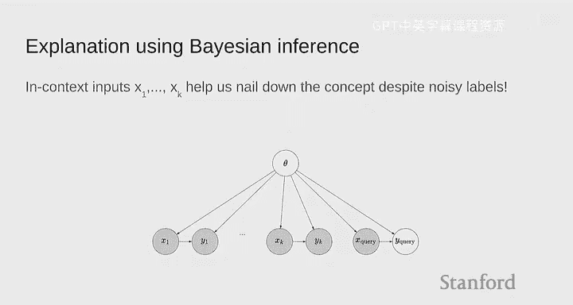
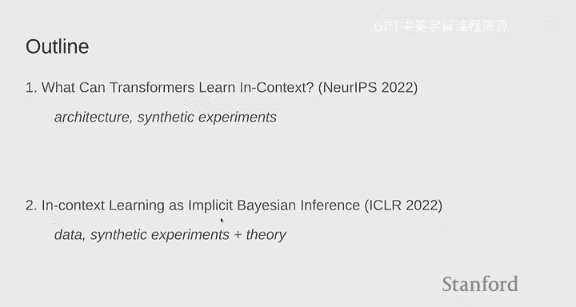
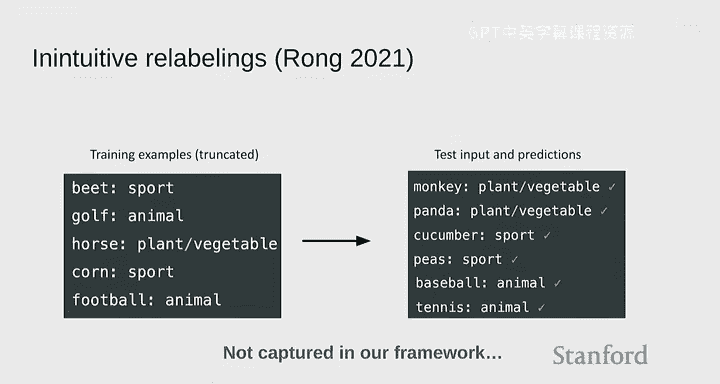
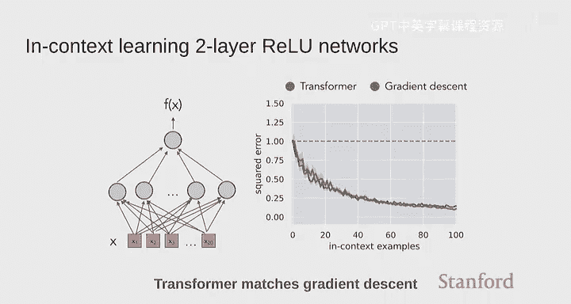

# 斯坦福大学《深度多任务与元学习｜Stanford CS330 Deep Multi-Task and Meta Learning 2022》中英（豆包翻译 - P17：-17-.Percy Liang Guest Lecture I 2022 I Lecture 17.zh_en - GPT中英字幕课程资源 - BV1dWpPepEsj

hi everyone， it's my pleasure to introduce Percy who's giving a guest lecture for those of you who are in the course just a reminder that the poster session is on Wednesday next week and your final project is due the following two weeks from two days ago or on Monday but really excited to introduce Percy Percy as an associate professor here at Stanford he's done some really cool work in machine Learning and Natural Language Pro both on the theoretical side as well as the empirical side and also has most recently started the Stanford Center for Research on Foundation models。

 which has also been kind of a really cool effort going on is also pretty related to some of the topics in the course as well so yeah looking forward to talk。

All right， thanks Chelsea for the introduction and thanks everyone for coming。

 I think you guys have seen in context learning a little bit， I saw it in one of the slides。

 so hopefully we'll do a little bit more of a deep dive here。So the story starts in 2020。

 so a bunch of people at Open AI decided to gather a ton of data， text data on the internet。

 and construct a big transformer and ask the model to do one simple thing which is predict the next word over and over again over every single token on this data set and they ran it on。

 I think something like 10，000 GPUs for several months。

 and I think all of you know have probably seen or played with GPT3。

But the result I want to focus on is this ability to do in context learning。

 so what is in context learning just as a review？It's the idea that you can prompt a language model with a string。

 which is concatenation of a bunch of examples that's something that looks like this with a new test example and ask the model to produce the answer。

So if you think about this is sort of crazy， why would this you expect that to work because language model isn't supposed to generate language。

 it's not really supposed to solve any sort of tasks， let alone alone do some kind of meta learning。

And okay you might think well， this is because there's lots of examples that look like this on the internet。

 so I just probably just copied something so really tried hard to see if we could break out so here's a task we prompted with input here's a date and output。

 you know we want to come up with something that was definitely not on the internet of 2021 and it could reformat dates in this way as well。

Okay so for those nonbelievers who think like， well okay GPT3， they' train on the internet。

 they're just memorizing， well this is a clear demonstration that's not just memorizing。

 it's actually learning some abstraction that's helping it solve these tasks。ok。

And the scale matters here。So this is from the original GPT3 paper。

 if you were playing around with small 1 billion parameter models。

 you could see that nothing was really working at all。

 and it's only when you get up to 175 billion in that case。You could get in context learning。

So this is simply mind blowing。And ever since I've been obsessed with the problem of figuring out why this works。

 this is not the way the machine learning is supposed to work。

 so hopefully we can try to understand a little bit of this in our talk here。

And why in context learning is？Matters， and it's not just random curiosity。

There's two reasons scientific and practical on a scientific front。

 this is an example of emergent phenomenon。 So GT3 was not built to do in context learning。

 The developers did not say oh， we want in context learning。

 so therefore we're going to train it in this way。 it just sort of emerged from somehow from the data。

Second， there's a sort of conventional wisdom in machine learning that you train and then you test and if you train distribution is like your test distribution。

 then you win otherwise all bets are off， and this is going to be farther from that setting where the training distribution is predicting next word and the test is this wide range of downstream tasks。

 some of which have never been seen at training time and yet something is still working。

And the interesting thing about emergence is that， you know here we have in context learning。

 which is going to occupy the whole of this talk， but what else is there。

 people have looked at other emergent behavior like chain of thought and so on。

 and so there's a very vast。A set of capabilities that we're barely scratching the surface of。

And then there's a practical concern。Aspect， which is that。In context。

 learning really presents a paradigm shift in the way I think we build ML or AI systems。

Now you can prototype new tasks in the afternoon rather than setting up some elaborate data collection process。

 so it kind of changes the way that you even approach things。You know。

 I think it's also important to realize that in the real world， things don't come prepackaged with。

 oh， here's a data set I can just download from Huging faceace and just run it。

 but if you're actually trying to solve a real problem。

 there's usually a kind of a vague idea of what you want to do。

 maybe some messy data and this idea of fast quick prototyping using these language models。

 I think allows you to get a lot farther than if your first step was to collect a bunch of data and label it。

Okay， so diving a little bit into details， so there's a contrast here。

 two types of learning the first is what I call standard learning， it's gradient base。

 which is everyone's familiar with that， you take gradients in context learning。

 the key operation is not a gradient descent but conditioning。So in the language model。

 remember it's a distribution over sequence of tokens。

 so what you're really doing is conditioning on a sequence of tokens and then asking the model to predict the next thing。

Okay， so we'll come back to the issue of conditioning in the second part of the talk。

And since this is a meta learning class， I thought I'd try to clarify the relationship between meta learning and context learning which often it gets blurred。

 so there's a form of meta learning which you guys talked about which is black box meta learning and I think of meta learning is talking about the framework of。

You have training data that has maybe a collection of tasks and you want to do some sort of training procedure so that the model in this case a black box model can do learning on new tasks。

 so I think about this is the connection between the training and inference time。

And inter contexttext learning really refers to the ability that a model has and independent of where it came from。

So we can talk about the in contextex learning ability of a transformer that was know handd or learned from supervised examples or from language modeling objectives。

Feel free to interrupt if you have any questions。Okay， so in order to understand in context learning。

 I want to break things down into two pieces， one is just the question of how a fixed model。

 never mind where it came from， how can a fixed model even perform in context learning。

 because this is just a giant transformer it's getting fed in a bunch of sequence of examples and it has to do something。

Association between x and and Y's。To be able to predict。So how is that possible？

And the second question is， how do you get one of these models from training， let's say。

 on next word prediction？So I'm not going to answer these two questions fully。

 but we're going to try to make some progress。And how can we make some progress Well。

 there's many things going on with G3， so let me try to break it down。 So there's a question of data。

 you know， the G3 was trained on the large web crawl。What is necessary there。

 can we demonstrate in a constant learning with synthetic data？

There's a question of model architecture， so we've seen in complex learning working for transformers。

 what about RNNs or a mixture of experts？And then there's a training objective。

Does it have to be odd aggressive， can it be sort of like a contrastive or math language model objective。

 and then there's a question of how do you study in each of these components？

You can understand things theoretically where we develop a toy model and then you can prove analytically why in context learningia works。

 or you can run synthetic experiments where you develop a simple model and you can run things so you can get clean conclusions。

And then there's real world experiments where you're running things out real language and so and there's trade offs right ultimately we want to be in the real world。

 but this is really messy and it's also very expensive because remember in context learning only show up at scale so you can't really hope to do that many。

Real world experiments。So what we're going to focus on is the bolded pieces here。

 we're going to look at synthetic experiments and do a little bit of theory to understanding context learning both the architecture and the data。

So we're going to talk about two works。 The first is。Trying to get at the architecture question。

 and the second is trying to get at the data question。Okay。

 so the first paper is with Shiva Demetrius and Greg Valiant appearing on Ns。嗯。Okay。

 so in context learning is you can solve all these different tasks。

There's a nagging question that I think I alluded to earlier。

 which are these models actually doing any learning at all or is it just pattern matching。

 you should be really suspicious of these language models。

So what we want to do is formalize the problem a bit because I think in context learning like what's the definition。

 so here is a definition which captures I think an at least one aspect of it。

So you can think about in context learning of a function class。

 so this is hailing back to kind of what people do in statistical learning theory where what does it mean to learn？

Its you define a function class and you create examples from that class and then you see if your learning algorithm can figure out which function it is okay。

 so we're going to play the same game here， so for example linear functions。

 a set of all linear functions and let's say 20 dimensions you sample a function。

And then you're going to sample random inputs， so these are going to be vectors that are d dimensional。

And I'm going to say， okay， here's an x1， I'm going to apply the function to X1， here's x2。

 apply the function to x2， and these are going to be inputs into a model。

 and I want the model to be able to output the corresponding function value of the last input here。

Okay。And the model architecture we're going to look at for this talk。

 this first part of the talk is a transformer， it's worth noting that the x is a real value。

 so this is not going to be a language transformer here x is just going to be I mean it's basically the word embedding treated as a wordbebedding layer for the transformer。

And instead of outputting softm over tokens， we're going to have this transformer just directly attach a linear layer and actually ask it to do regression using the squared loss。

Okay， so slightly deviation from actually a pure language model。

 so this is why we're just talking about transformers as opposed to language models。

 there's no language or text here。At all。Okay， so then what are we going to do。

 we're going to build this transformer by。Sampling functions over and over again。

 and for each function， we're going to sample data for that function and then ask the transformer to reconstruct the labels in the data。

This is going to be from scratch just to make it very clear what's going on rather than pre training and fine tuning。

Okay， so what can this train transformer do？So let's start with linear functions in 20 dimension。

 this plot shows as you increase in number of in context examples。

 know what is the error rate on the fresh draw and here we're looking at。Lease squares。

 and this is what you would expect， there's no noise in the problem， so the dimensionality is 20。

 which means that if you get 20 points， then you basically know the function and least squares as optimal。

 you can't do better than the left。And here the transformer is actually able to match the implementation of least squares。

And just to check， we do some naive things like averaging and nearest neighbors and they just don't work right so the transformer seems to be mimicking the behavior of the optimal algorithm here at least squares。

So okay， so this was pretty cool。But you might still be suspicious， well。

 maybe you just saw enough examples and it just kind of memorized all the possible linear functions。

If you do the math， there are a lot of linear functions， even if they're epsilon close。

 like it cursive dimensionality exponential 120 is pretty big。

 so it's definitely not seen all the linear functions。But you know。

 you should still be suspicious and so let's probe it a little bit， okay， so how yeah。

measure if it's doing these squares or you like measuring if it's outputing the sort of inverse or something like that So the question is how do you know if it's doing least squares so we're only looking at the prediction error？

So it's most certainly not implementing the least squares algorithm， and I'll show you。For a fact。

 but it's at least on this distribution， it's behaving like if you had run a squares。Yeah。

 question I does he order the input examples matter in this case。

 or if you like reordered the inputs like the x1 x2 xK you were showing。

 would they in some particular order or could you shuffle them and kind of get the same result？Yeah。

 so the question is does the order of the examples matter。

 in this case it doesn't really matter because each of these x's are actually generally drawn ID？

So there's no information in the ordering。Okay， so let's try to probe it and the way to really check whether of。

this model is able to incon learning is let's try to give it inputs that it hasn't seen at training time。

 not just hasn't seen， but it's a different distribution。

And the distributions here are a little bit complicated。 So let me try to talk through it。

 So there's the distribution over x's at。Test time。

 so when I say test and train I really mean meta test and metatrain just and when I say query。

 that's like the I guess maybe what you would call the test point。So there's a distribution of x's。

 there's a distribution over the y is given by the function， and then there's this query point。

So I'm going to change these and for there's basically these distributions for metat。

 and then there's also these distributions for metatrain。

 so there's really like six different distributions that we can vary。诶。😊，So here's one。

Starting point。 So remember， at training time， Me training time， we draw。

Examples just from a standard Gaussian。And at test time。

 what we're going to do is we're going to give these x's， which are the in context examples。

 they're going to come from a different quadrant or orpha than the query。Okay so。

Let's see what happens In this case， it degrades a little bit。

 but it's basically matching the behavior of least squares。

 maybe this transition isn't as sharp and needs a few more examples to figure out what's going on。

 but not too bad。What happens if we remember in training time。

 we had an identity covariance and at test time， all the x's and the Qs are going to be drawn from a different covariance distribution where the covariance is skewed。

And here you definitely get some degradation， so it doesn't hit zero as it should。

 least squares would hit zero because， well there's no training in least squares or no meta training in least squares is a fixed algorithm。

And so but it's not bad， okay， so this is why it's not exactly these squares。

 but it's sort of approximately of these squares。So here's something really interesting so what happens if you add label noise at inference time。

 so in training there's no noise， so we're using the same transformer here and at test time you do add some label noise。

So here， least squares is actually。Going to not work， because if you're。

AtL squares actually blows up here， and this is a phenomenon called double descent which has been pretty well studied in learning theory。

 and the transformer interestingly has a similar spike。Okay， so this is sort of interesting， I mean。

 this is， I guess I don't know if this is good or bad。

 but at least qualitatively it has some similarities to least squares。

 at least as measured by this kind of reaction against noise。

Even though it's not exactly these squares。Okay， so the conclusion there is that yeah。

 sort of works like least squares， so what about going beyond linear function classes？

So let's look at sparse functions。 So in the sparse function， the F's have zeros in a lot of places。

On the wave vector except for maybe three entries。So here the optimal thing is not least squares。

 least squares is going to take 20 examples to figure out what the solution is。

 it's the Laso algorithm， which does L1 regularization。

And here we showed that the transformer actually learns to behave like the laso。

 So this is pretty cool because now the transformer is。😊，Able to learn。Kind of non trivial I mean。

 the Laso is not a trivial algorithm， and exploding sparsity is not trivial。 so it's able to do that。

 which is pretty cool。Note that we did have to train the transformer to do this， so it's not magic。

Otherwise， it wouldn't know about Sprse at all。 What about two layer rail networks？

So here the baseline that we looked at is gradient descent and it basically matches gradient descent。

 so that's nice。Yeah。Did you try the original transformer that you trained on non sparse things and see if it matches these squares？

So the question is I took the original transformer and applied it to the sparse question。

 so this should match the least squares objective。诶。Because。

sparse linear functions is just a special case of linear functions。

 and we already know that the previous transformer acted like least squares on a fairly wide range of distributions。

Yeah，What kind of bottleed noise was it always？Yeah。

 so the label noise is just adding calcium noise how would it work would you if you it outwi？

So the question is how well it work if you gave it one y which is way out there。

That would probably break least squares because least unless you so least squares has no regularization right it's not rich regression。

 so it's going to just be thrown off by that label and the transformer。

 we didn't do that exact experiment， but I imagine that it would be also。朋友。Distract it。Yeah。

 Chelsea。Given that like these scores is kind of the optimal solution when you don't have noise。

 do you think that these sorts of findings are surprising guess？I think yeah。

 I guess do you think it's surprising or did any of these results kind of differ from what you were expecting？

So the question is， basically is this result surprising？嗯。

It was not obvious to me that this transformer would have this type of behavior。And in fact。

 I'm not going to talk about this， but we also ran experiments with LSTMs and LSTMs look like transformers on the indisribution。

 but on this case LSTMs did not have a double descent， so it's pretty non- obviousvious。

 I think that there's some dependence on the architecture depending on like different architecture have a different inductive bias which will lead to different Qko algorithms that it's learning。

Because the transformer is spinning the data better。

 like is a better universal function app recently？So the question is that because Transformer is just fitting the train that I don't think so I think it is inductive advisory because we did。

跟。There's still more work to be done， but we tried to make the LSTM large so it wasn't like a capacity issue。

 it could be a training， LLTMs are hard。To train so not quite sure。Yeah。

We see tuition for like white adults。The intuition behind why double dissent happens。

 this is maybe a longer question so maybe we should take that offline， but basically I guess one。

A quick answer is that in the over parameterempized regime。

 so statistically what you would expect is like okay you fit and then you start overfitting when there's noise。

 if there's no noise then there's no overfitting because you just nail that and what people have observed if it's at over parameterterization。

 when the number of dimension is larger than the number of examples。

 you could kind of get this sort of optimal error， but happy to chat more later。

 we let me go on we have a lot to cover， but good questions。U。

Okay so finally we look at decision trees， so for decision trees。

 we looked at the greedy algorithm XG boost， which is the state of our decision tree learning algorithm and here the transformer actually outperforms the XG at least on this sort of synthetic data distribution。

 so this is not claiming that you should ditch XG boost and use this transformer but this was sort of curious I think。

That the transformer is able to learn some sort of algorithm， at least on this distribution。

 it's outperforming sort of hand coded algorithms， so to speak。Model size。Clearly matters。

 but what's interesting is that model size is especially important when you look at kind of robustness and extrapolation to out of distribution you know for standard it seems like okay。

 there's a steady improvement as you。Increase the model size。

 but it sort of really matters if you're extrapolating。嗯。Okay， so let me summarize。

So one conceptual important thing to take away is that we're defining in context learning of a function class。

 so this is sort of maybe an important concept not to think about in context learning as like some fuzzy thing。

 but we're talking about rigorously in context learning of a function class。

 and this is a property of a model。嗯。But in order to sort of prove the existence of these models。

 we could train transformers to do in contexttex learning on these linear functions。

 we saw we could do sparse linear functions， neural networks decision trees。

 we also evaluate the robustness， how to prompts， which I think is really crucial if you want to understand because many of the differences between model size and else teams versus transformers。

 you don't really see unless you go out of distribution。

 because that's where the inductive biases really kick in。

And I think it's sort of interesting to think about what algorithms these transformers are representing。

There's still a lot of open questions here。This modeled when you condition on these in context examples。

Is a function。It's not a linear function， certainly。

 but it is a function that sort of local I think within a ball behaves sort of linearly。

 and it would be interesting to understand what function that actually is。I alluded to RNNs and LMs。

 how much of this is specific to transformers as opposed to other architectures。

 how can we look underneath a hood to see what transformers are actually doing mechanistically。

 there's this follow up paper， I think which is really interesting where they actually are about to construct a transformer by setting its weights somehow and show that that can do linear regression。

They also do some more like probming experiments to look inside the transformer。

 whereas we are only looking at behaviors。What question is， you know can we get algorithmic insights。

 this is something I'm kind of excited about because you know this will maybe teach us something about algorithm you design。

 and the idea that the decision trees case， the transformerers actually able to do so much better。

 such maybe there are other sort of algorithms or principles here that we can pull out。

And finally this is all on synthetic tasks， it'll be great to tie this back into real task with knowledge and the exclusion of knowledge here is deliberate here because we wanted to understand in context learning。

 really the learning part and this is sort of you can think about this as a pure learning。

Like all we know is this is a linear function， there's no knowledge。

 is' just like figure out what the linear function is， this is just learning。

A lot of the in context examples that you see。In literature。

 bringing in prior knowledge about translation， there's no way obviously you can learn how to translate sentences from five examples as it has to be knowledge and how does that work in conjunction with this learning ability。

 that's I think a really interesting question。Question back there。こいう本。

It seems like there is some threshold rate based on model。So been with brands。Cons learning Hopkins。

In this work。Alysis on that like， for instance。When。Learn to do this loss so tight regression。

Was there a way to estimate how many parameters you be for your model given to some level of task difficulty Yeah thats a great question so the question is。

Basically， how big of a model do you need for certain types of behaviors？

We have this experiment which is show that I mean size definitely does matter。

 I think it will be really interesting to do a more careful scaling laws type of analysis where you train a sequence of models from small to large and maybe you increase the depth or the number of tension heads and look at these of dimensions of scaling and then track the different types of behaviors like did it learn the lastso。

 did it match does it have double descent and so on。Yeah， that would be。Interesting follow up work。

じ样。そ。what was。こ sorryれ。かとは信ませ。So我。おょ。ストリ。どはそし。Bough you。

So the question is transformers can be seen as a special case of graph neural networks。

 are there any works at exploring context learning with graph neural networks？I think that。I mean。

 there's independently， I think， interest in thinking about how you do in context learning with graph structured data。

 which is I think interesting to explore I think here。You know， I guess。There's。

You know the graph I guess with best sense what you're trying to get out of the graph neural network here there's you know you have a sequence of X Y pairs and there is in some sense a symmetry there's sort of all k。

square different kind of connections that make sense so I don't know if there would be a natural graph structure。

 I guess that the asymmetry between the x and Y tokens maybe matter so you could try to sparsify the graph or play with attention heads you know somehow maybe a broader question is you know the transformer has。

We have positional embeddings here， which seems rather unnatural from the point of view of it's not order invariant and someone askeds about the depends order of examples。

 maybe you can build that invariance directly into the model。Any other questions？

We disments about the position。这个提到。So the question is did we do an experience without the positional credited。

 it wouldn't work because then you don't know which Y goes with which X。

Because if it's just a bag of XY pairs， you don't。Ex or separated Yeah， they're separate tokens。Yeah。

Okay。So to the outline， so we talked about what transformers can learn in context， looking at。

 I think about it really as an architectural question。

 can the transformer do certain things and doing a bunch of synthetic experiments on well definedfined function classes to explore the limits of transformers？

Now I' love to try to understand the role of data， although the way we'll kind of get at the data maybe is not what you think it would be。

So this is an eye paper with Michael Shier Additi， Raunaththan and Taya。And remember。

 there's two types of learning， standard learning， you think about gradients。

And in context learning is this maybe weird thing where you condition to do learning。

But maybe it's not actually that weird if you think about it with through a Bayesian lens。

And if you think about Bayian inference。Whi might be a different paradigm for I guess the norm in ML these days。

 so let's walk through what Asian inference is。Imagine you have a latent random variable theta。

 which corresponds to a task if you can think about it as a function， a linear function if you want。

 which is unknown， that's why it's not shaded。And you think about the building a generative model over what okay that's generative model is overloaded these days。

 let's build a probabilistic framework for thinking about how theta is related to variables so here's a simple example。

 suppose that we have x1 and y1， so you can generate x1 where you can just condition on it。

 it doesn't matter， but the point is that y is。Generate a given x and theta。

And independently for each of the key examples， we have why。Given X theta。

And then you have a query point， which is just another ID example。

 and you ask what is the probabilitybative Y query given x query then theta？And now of course。

 you don't know what theta is。So being a good Bayesian。

 you would just try to marginalize it out and that's what this equation does。

 so this is very classic out of Bayesian analysis where you have this posterior distribution where you condition on everything that you observe which is this。

 and then you look at the posterior distribution over a theta。

So you're trying to guess what theta is。And then you basically kind of wait。Your prediction。

 so this is the prediction if you had theta， how would I predict on y query give an x query？

And you're basically averaging over possible values of theto。

 which where the averaging is given by the posterior。

So this object in Bayesian analysis is called a posterior predictive distribution。

 it doesn't have a theta in it because it's been marginalized out， so it just looks like x1， y1。

 all the way to xK， Yk， x query， and probability distribution y query。

And this is exactly the same form that we've been playing around with when we talk about doing in context learning。

Okay。So through this lens， what we can think about。

Incons learning or these transformers doing is that they're trying to fit this posterior predictive distribution directly。

But there could be this underlying structure here that is latent。But the transformer， you know。

 doesn't care。 It's just going to fit this distribution， and maybe it has。

Some notion of implicitly theta， maybe a dozen， who knows？

So what will be useful to think about is this posterior predictive distribution and we're going to start kind of abstracting away from the architecture and we're just going to talk about the distribution okay。

 so remember our questions。How can a fixed model a transformer perform in context learning？

And the first part of the talk shows some empirical evidence that the transformer can do in context learning in a fairly wide number of nontrivial settings。

嗯。And if you are shown examples。Of the task， essentially。

 now there's some extrapolation to Elto domain， but largely you're showing the transformer。

 here's how what linear regression looks like。And so you can think about through this lenses， well。

 I just， this is the model， I mean， accurate depiction of。

The linear regression set up for appropriate choices of distributions and so you can think about it what we're doing is we're just fitting the distribution and if you believe that the transformer is universal function proximator。

 if youre given have enough data， it should just work。I think still it's not trivial。

That it can do it in a reasonable amount of time because you know， the universe， I mean。

 you can invoke universal function proximator to， know， this is a pretty。

 could be a pretty complex function so that that the transformer can learn it and you can actually run S G to do it。

 It's not obvious。 That's what the first part of the talk show that it's。It sort of works。

But now we're going to move on to the second question is how does this model arise from training？And。

And the key thing is that， remember in GBT3 is just free our next word prediction。

So it a very it's not explicitly training for these tasks。

 which is the whole point of the emergent behavior。

 and this is really I think the harder question or conceptually harder question task。Okay。

 so the main challenge here is this distribution shift right we're training on basically internet crawl and we're prompting it with examples that don't show up at training or we even out of distribution。

 so the pretraining distribution is not the same as the prompting distribution and can be actually pretty wildly different。

So in what settings can this actually work？So。We're going to try to make some progress by defining a simple model where the pretraining distribution and prompting distribution differ in a well controlled way。

 and then we're going to see if we can make some progress okay。So。

We're going to consider pretraining distribution as a mixture of HMs。

 and the idea is that you have this concept theta that encodes， for example， the topic， like， oh。

 this is a Wikipedia biography， let's say， and then given that which encodes。

 let's say the transitions of HMM。Then we're going to generate text from that HMM。

Okay so to generate a document， you first sample transitions from this HMM。

 and then you're going to sample the hidden states from HMM and then the sample the emissions given the hidden states。

 and then you get your text and you remember you hide theta because you don't see it。

But that's the data generating process for the pre training data。Okay。

So now let's think about what language Marline would try to do if it's asked to just predict this text。

I would argue that it implicitly has to infer the target concept somehow。

I know this is a little bit hand wavy but bear with me。

 so if you have this article about Albert Einstein， it kind of needs to figure out， okay， well。

 this is probably like Wikipedia biography and invoke， you know。

 I'm going to generate things that look like Wikipedia biographies。

So the LM will probably try to implicitly infer theta approximately somehow。

 and then try to sample from the HMM。So of course， the transformer is not literally doing this。

 but this is just a kind of a cartoon of what it might be thinking。Okay。

 so now what about the prompting distribution， we're going to define the prompting distribution as we're going to choose。

A target concept， theta star， so we're going to fix it， and then we're going to generate from the HM。

 but we're going to break it up into independent pieces。

And here we can have Albert Esstein was German， delimiter， Gandhi was an Indian， delimiter。

 and so on。So this part is generated from the HMM， and then once you hit a delimiter。

 you reset and go back to sort of initial state and you generate from HM again and you reset and you generate from HM again。

Okay， so this distribution is different。From the training distribution。

 because it has basically these restarts as opposed to one long continuous HMM。

 and this corresponds to the fact that in general in documents， you have topic coherence。

 Albert Einstein， you have a Wikipedia page about Albert Einstein and then in these in context examples。

 you're sort of quickly changing the topic， but you're sort of it's still an HMM but you're kind of resetting the topic in a sense。

Okay， so。So now the question is。Okay what will the language model do on this prompting distribution？

And。What you would like， what you hope is that the language model could still infer this target concept。

And then it can generate from this HMM， and then if a knows status are。

 then you would be done and you would just because this is Mary Currry was Polish is just journey from HMM。

But the difficulty is。The distribution mismatch， you're now going to condition this language model on samples。

From the prompt distribution。And remember， the prompting distribution is different from the training distribution。

Okay。So that's kind of the technical hurdle here， otherwise it's sort of just standard。

It should be clear that it works from standard visionian theory。そのバろ。

See that like it likeulations and there's like an hidden speed or something。

So you get a sequence of those and there's like。But like here， it seems like they。

Information are also what。I can read words from like there's also a ahead。Yes。

 so the question is like where are the hidden states in the HMM， I haven't shown them here。

 but you can think about， let's see what's the best。

Theta is defining the transition probabilities of HMM and then the way you sample this text is you sample a hidden state and you transition according to the probabilitybabilities specified by theta and then you emit given those hidden say。

 so I haven't shown them because they're sort of。I might not be interpretable。

You can think about this basically， let's say one through。You know，50 hidden states or something。

Okay， so the key challenge here is that the prompt distribution is different from the pre training distribution。

And here's a visualization， so in context learning examples， you have transitions according to HMM。

 and then which are in distribution， so that's great。

And then you have these low probability transitions where you're like here's a de limititer and then I'm going to start going from Einstein to Ghi all of a sudden。

So those are low probability under the language model because you just don't see this kind of text too often at training time。

So then the the okay， so then what can you do， So here's maybe the most technical slide。

 this is just still a sketch。 So we proved a result， which is。Makes assumption。

 and the assumption intuitively is the signal that you get about theta。

 so the difference between the true concept and any other concept。嗯。

as measured by kind of the observation distribution has to be larger than this error that you get from these low probability transitions。

So these transitions are the source of distribution shift and if you can bound the distribution shift in terms of some separation。

 then we show that。As in context learning works， in the sense that as the number of examples K goes to infinity。

Then。In context like this language model will ultimately predict the right thing。

Okay so it's an asymptotic result， but this is sort of the type so notice that if you didn't have this distribution mismatch this would just follow through kind of standard Bayesian asymptotics and that would be fine so the key thing is that now you have this error that you have to account for and under some conditions this is still。

Works。Okay， so maybe some practical takeaways you know from the theory are and you don't need the theory to make these practical takeaways。

 but it's maybe good to understand these takeaways and the concept of the theory is that making the prompting distribution as close to the training distribution helps and you see the large literature on prompting basically tries to fele things so that's the case。

 for example， if you prompt if you want to know capitals and you try to say Berlin is the capital。

Germany and so on I'm using natural language， so it looks more in distribution。

 so this is a kind of a prompting trick。So you generally want to use the limiters that are like new lines or。

Pounds that sort of don't increase the probability of inferring the wrong concept。

 so through this kind of latent concept view what you're basically doing is that every time you think about inferring an HMM every time you're transitioning this is sort of confusing the model and if you have instead of a new line you say something like birth date that's going to really confuse the model so don't do that using something neutral is helpful。

Okay。So then I'm going to switch into some empirical studies here。I mean。

 the first is we built a data generative in context learning data。

 and the goal is to have something small so we can run experiments and study things without。

 waiting weeks to train large models。And so there's a pretrain distribution of 1000 documents。

 each document is just one long sequence sampled from a HMM。And。It basically looks like this。

 so it's sort of gibberish。And the prompting distribution is concateid independent examples。

 so it's basically the same distribution of gibberish with punctuated by these deelomerers。Okay。

 so we trained transformers and LSTMs on the pretraining distribution。

 which is just these documents and then conditioned on this prompting distribution and see if it could predict the right answer and as the number of in context examples increases。

 we see that the transformer。Iproves， so k here is the length of an example， so here the K is3。

 for example。And。And we see that as the length of example increases， then things get better。

 this should be natural because the more lengthier the in context examples here are then the more in distributionistri。

This prompting distribution looks。And here LSTMs are actually doing a little bit than transformers。

 which might be also natural because this data set is basically like an HMM。

 I mean it's a mixture of HMM， so it's not exactly an HMM。

 but it has this sort of temporal sequence and maybe that matches the inductive bias of LTMs better than transformers which have to work harder。

Effective modeling scale， so I think the scale is obviously a。Tople line question， yeah question。收费。

公诉人。不し。不会。So the question is as k increases， it seems like this is catching up with k equals 10。

I think it's just a diminishing gains that you get because eight and 10 aren't that different。

 but if going from three to five is almost like doubleub in the size。And if k equals1。

 then you don't really don't have much information。嗯。对确。Yeah， there's some noise here，Okay。

 so what happens when you increase the model scale？So。You know， things。

 the common refrain is that when models get better， things get better。

 but one thing that's interesting is that。The in context accuracy will get better as you improve them increase the model size。

 let's say from 12 to 16。 but the validation loss or the the pre traininging loss is。The same。

So this is sort of interesting because you're not fitting the data better。By using a larger model。

We don't know we understand why this is the case， but maybe just hypot hypothesizing。

 maybe there's inductive bias for in context learning that improves it with model size。

 not really sure。Then we look at some。We're trying to sort of see whether this data set kind of captures a lot of the phenomena that you see in the literature。

 So there's this peculiar thing of the G3 paper that zero shot is sometimes better than one shot for some。

Data sets and you see the same thing kind of happen in。You， jin as well。Which is sort of interesting。

U。There's a paper。That did a really interesting experiment。

So this is for the skeptics of in context learning like， okay。

 are you actually doing in context learning or not， Yeah， question。こういうでと。first on formal multiple。

練習す。But。Yeah， so the question is， is zero shot better than one shot just simply because the model is copying the last answer。

 and that's generally I think what happens because you have only one example then sort of the model can't really tell the difference between okay。

 the constant function where I always want to output this answer versus actually doing some in contextX learning。

So。So this is an interesting experiment， so they took the sentiment。You know。

 a data set and what they did was just randomize the labels。

 so I'm just going to randomly replace positive neutral negative with some other labels。

And then you see if in context learning still works。So if you were doing normal learning。

 this would be crazy， right， you would just completely get destroyed because there's no signal。

But what they found across a bunch of different models and tasks and data sets is that the amount of drop that you get from gold labels versus random labels is actually not that much and sometimes I don't know why this increases。

 but PP3 it dip very little compared to not having demonstrations at all。

So this is sort of interesting， so clearly in context learning。

 sort of different from normal supervised learning。

One way you can kind of see this through the Bayesian lens is that。嗯。Is that the in contextt inputs。

Help us nail down what the target concept is， despite the noisy labels。

 so you're still conditioning on X， so that's giving you valid information about theta。

And the only problem is that these ys are now just junk。

But this is where it's a little bit speculative， maybe because there's noise。

 there's no information in them。So certainly if you were missing the Y's then that's strictly better because you're able to infer the task better and then you can predict。

 and if they're random maybe that's sort of like marginalizing， I mean not mathematically。

 but that's sort of the intuition that your condition on x's and sort of the Y's are just random so they're kind of ignored。

So this is maybe one example where the patient inference perspective gives you a little bit of insight into this empirical phenomena。

Here's another example that we don't explain， so this is very similar。

 so here let's suppose in context examples are the task is to predict whether something's a sport。

 animal or plant or vegetable。And the labels have shove and shuffled， so they're not random。

 but they're sort of deterministically shuffled。And in this case。

 GPT3 is actually able to respect that shuffling。So this is something that's not captured by our framework because this is sort of a more of abstract kind of reasoning capability that GPT3 has where it's able to associate。

So of basicallyically I do variable binding， it's like basically sport is just a variable that has a particular meaning in this context and I'm going to use it consistently to mean that thing。

Which is sort of really cool if you think about it， despite the strong prior that sport is sport。Now。

 in this context， it's， I guess， vegetable。

So。Mysters。O。Let me try to summarize this section。So I want to argue that Bayesian inference is a useful way to think about in context learning because really Bayesian inference is all about conditioning and in context learning。

 all you're doing is conditioning on your in context samples。And。In Bayian inference。

 the key object is this posterior predictive distribution。

 which is exactly the thing that you're trying to approximate when you're training a model to do in context learning。

The main challenge is to analyze the case where the pre-training and the prompting distribution are just different。

 we showed some kind of mild theoretical progress why if you bound the errors of the transitions and of the low probability transitions。

 then you can prove something reasonable， one important note is that all these results here in the second part of the talk are independent of the architecture。

And I think this is interesting because now understanding in context learning is through this lens is's all about understanding the differences between。

You know， the pre training distribution and the prompting distribution。

which you have analytical so there's no like sample complexity。

 it's just like these two distributions and what happens if you condition on a draw from an OD distribution and ask the model to predict on your kind of ID distribution。

And。This might be useful for understanding the role of data。

Because if you think about the role of data， you want to solve these tasks， you have the web cor。

Maybe there's a way to use this framework to understand data distributions and their relationships。

And we also have this small synthetic data set， which is based on a mixture of HMMs。

 which hopefully can allow you to run the experiments really quickly and assess and answer some questions。

Okay， so。To wrap it up， we looked at three over two different。Projects。

 one is to understand whether transformers can do in context learning of a function class。

 and a second， thinking about in contextex learning as a Asian inference。

嗯。So final slide here。So in of learning is I think one of these great mysteries， I think。

 that we have in modern AI。And it's sort of becoming a foundation for many AI applications。

 so people are using them to just build new application and increasingly applications that didn't exist before because you can kind of spin them up so quickly。

And I think understanding is certainly lacking， and I think it's sort of key to both making scientific progress。

 but also engineering better systems because these in contextex learning systems are not reliable。

We don't understand how they work and sometimes they work， sometimes they don't。

And this talk takes a particular view that synthetic setups can help us more rigorously explore。

 so I think it's also valuable to run real experiments on real data and we're doing a bunch of that but there's only so much kind of handle you can get on what's going on and I think we've gotten a few insights into the role of model architectures and the role of data solutions by focusing on this much more controlled setting。

And now the big open question is。What of this can you kind of link up with the real world settings？

Which bring in knowledge and prior knowledge， and there's clearly a bunch of things phenomena that are not captured here。

And there's more beyond in context learning， so there's other emergent phenomenon such as chain of thought。

 ability to do arithmetic。A lot of other things that are hidden inside these large language models which are waiting to be kind of discovered。

 so it's like really kind of exciting because it's doing scientific discovery rather than purely engineering。

And maybe one final thought is that we're kind of scrapping the idea of a task which has been so central to machine learning because what these language models。

Allow you to do is sort of define， not just define tasks on the fly。

 but sort of fluidly go between tasks like when you have instructions。

 which we haven't really analyzed or talked about， paired with you know maybe a few examples that feels like。

That's maybe one task， but then。The idea that it's just a language model。 There's no。

 it doesn't have a notion of a task specifically， which means that maybe。

Having a task based framing could be too limited to understand kind of truly what's happening in the language model。

So I'll end there and happy to take questions。Yeah， you think。そ of the news from。开始。

More into the fight。So the question is， can you use knowledge distillation to move things more into the fine tuning regime？

So maybe。Well， one answer is that。I think there's a great deal of interest in taking language models and doing additional fine tuning to improve their in contextex learning behaviors。

 so this is typically what happens when people do what is called instruction tuning where you have things that look like more like tasks and this definitely helps。

And it helps quite a bit more than just scaling up， of course you scale up and you do this。

 it's the best of both worlds。I think it takes a little bit away the magic in my opinion。

 and for practical purposes， if you just want a good model。

 you absolutely do this because it's going to give you a smaller model that's more performant。

 but I think from a scientific perspective， the reason I'm so excited about GT3 is that。

Initially is that you didn't have to do this and which means that。If you didn't try to do something。

 but you incidentally。You know did well on it， that means it probably can do a lot of other things beyond our kind of imagination so this is a sort of a principle of generalization and machine learning that well if you don't look at I of course you can fit the test set and then do really well on the test set but if you don't do that and you happen to do well on test set then you know that you can probably do well on new examples and this is sort of taking it to the meta level if you didn't。

You know， two not any。I guess in meta learning classically， you can say， okay， well。

 I'm not going to train on a task。Now I'm going to。And if've happened to do well on some tasks。

 I'll probably do one another tasks。But this is sort of going another level， which is like， okay。

 there's no notion of task。 And you see some of the things that G3 can do， like right。

A poem in the south of Shakespeare about in context learning or something and or do derive explanations。

 And so these are things that。knowLike explaining something isn't a task in at least in traditional sense。

 it's sort of a capability that's coupled with other things and these things actually do compose in a way。

 so I think getting out of the sort of X to Y mindset could help you maybe unravel some of these other deeper structures。

Of course， this talk is complete about XY pairs， just to be clear。

 but I think there's much more to do beyond this。Yeah。What both the example you had with the？只高。

It shuffled of map score。sport。Of course and things like that was able to watch out of that really well。

almost those were this example。So it's pretty impressive that it had the gorgeous priors but then follow the most recent prompt。

 but then I imagine if there's any label noise， I'm going to confusedfuse what we doing here you have。

Cucumber and hot vegetable。お。确。Yes， 50 who would commit one。Yeah。

 so the question is what happens if you have noise in your labels， I don't know what would happen？

I think， I mean，I mean， what's kind of the optimal thing to do。

 it's probably to balance the two somehow if you have just like。A little bit of noise then。

Maybe you would just kind of ignore it the random label result shows that it's sort of robust to noise and labels。

嗯。And so maybe if there's a kind of deter that structure where it's not random noise。

 but if you're like flipping， then it latches onto that structure， but if there's no patterns there。

 then you just ignore it， that would be what I would hope that happens and I wouldn't be surprised if it happens but I think you would need to run a more careful experiment and no for sure。

And what about in context learning with like visual concepts。

 because a lot of the talk was about language and a lot of male learning？I'm just curious。

About the vision because it's also like different mod those and concert funding happen you。

Is there something about something special about complaints in the civil？

Yeah this is a really good question so the question is what about vision and does in context learning happen in vision so that area is much less developed than in language because we don't have like a public GP3 that everyone can play with you know flamingo from Deep Mind I guess is a big model that can do something in context learning for visual inputs。

But it's no one has access to it publicly， I do think that。

Something about language definitely makes in context learning more natural and easier。

In the sense that。You think about languages，Inputs typically， like here's a movie where classify it。

 but language is also sort of operating at a metal level。

 right That's a power of languages that you can describe tasks。And a lot of。You know。

 the internet probably has things that do look like tasks， I mean， it has to otherwise。

 it's not so limits to magic I guess。So， there's。So there's probably a lot of structured things about language that make in context learning work。

Now， envision。You know， there's no， I don't think， fundamental reason why you might not。

YouI guess the thing is that you know what are you doing in vision。

 like if you're doing like classification， you're fundamentally going from like a kind of a continuous visual space to some sort of label space。

 which is sort of language in a sense。And whereas in language inputs。

 you're already kind of in the language space and that fluidity might help。

 but I don't know if there's any fundamental reason you can't do in context learning。

Invision or whatever it look like？嗯。I mean， I guess you could certainly train models to doing incon learning vision that。

A very high faith in the transformer to learn complicated things。

 whether it emerges naturally from crawling the web with a bunch of images。I don't know。

 really depends on your data distribution。Chelsea。You mentioned that。

That in contextex learning has a lot of desirable properties over fine tuning。

 but it's also a lot less reliable， do you think that there are ways to increase that reliability or is that just something more fundamental as a result of being self supervised？

And like are there ways to make it more reliable without？Geting rid of the nice parts about it。

 that's like fully。SoThe question is， can you make context learning more reliable？

So one answer is that if you do instruction tuning。

 you'll definitely make it more reliable and this is what everyone who is actually trying to make these work and practice do。

But you still might be concerned because ultimately you're。

You're hoping that this transformer does something for you。And that part。I think。

YouAt least these toy experiments on linear regression shows that it's。

Its under these pretty clean conditions， it can learn purely complicated functions。I think that。

You know， now if you have like。You know 100，000 examples。

 you probably don't want to just like prompt a language model with those examples so but then yeah if you have a lot of examples you should probably be fine tu your name or doing some sort of retrieval on those anyway so I think this is。

I guess maybe what I'll say is that。Fus shell learning shouldn't be reliable in the sense that it's massively underspecified。

I mean， you shouldn't expect to do that well unless you have strong priors。

 even if you're a fine tuning， I would say， and in context learning is sort of in that regime。

You know， empirically， I guess。Especially if you're instruction tuny， it's not worse。

And if you're going to a lot more examples， then you're sort of。In a different regime。

 and you should be doing greatian updates。I've lost track here， let's sweep the room。

 I'll go with you and then sweep it this way yeah。Thank you from。最こル。Blakepher。talkedal about。

Do you think it， right？いスです。Prive the label and。そこ目。Trying to figure out like what？

OrBecause otherwise， it doesn't。We're just trying to figure out why has such a thing。Yeah。

 so the question is why is the random labels kind of working at all。

 I mean I think that it's really simple。It's by looking at the inputs。

 you can kind of guess what the task should be， I guess is the answer。

 like if you look at these sentences， it's like， what might someone want to do with these example inputs？

And well， maybe classify sentiment。嗯。And I mean， it's not obvious like's completely obvious。

 but that has to be kind of the thing that。You wasster？こず。Control to life。

Malize words I think it should work。Yeah， I think you。But， but I'm。Well， actually， okay。

 so you have to be a little bit careful because。嗯。Because if you put like a fruit vegetable。

 then the model would probably want to generate fruit and vegetable。Right。

 and then you're left wondering like， okay， what do these labels mean？So。嗯。

So in a functional space example， we actually had a fair idea that we need 20 examples through actually non under computer dimension im algorithm。

做影影上去。How do we think about the how many and number of examples do you need in your for the task to figureiguring out what the task is。

 and does how does that lead to the scale of the transform？

How many examples should we be in the who actually cost？And this was getting my purpose。Yeah。

 so the question is here you have 20 examples and we know that you need 20 examples to learn this。

 what about in general， certainly for real tasks， I think this is not really a。

 I mean it's a hard and ill defined。Question because like how many examples do you need to know？

Need for translation， I think it depends on the strength of your task prior。

Like if you already like one view is that okay GB3 already knows how to do tasks all you're doing in context learning is prompting like if you're asking when someone born right zero shot you don't know how you want to format the date but if you see a few examples you know what the date format should be and that's all that's happening so in that view the number of examples is basically the number of examples to figure out the format of the task but not this true semantics。

嗯。And I think that's。Not an inaccurate view of what in contextex learning does。

 because there's so few examples。 I mean， some of these tasks are like crazy and you can't really figure it out unless you。

So so you can think about the examples are there partly to help you figure out what the task is。

 and for that inputs alone probably do and outputs I guess in the task description I' contribute。嗯。

And then。The kind of the real value of the examples is to really figure out。Like what the format is。

And so maybe you could try to formulate a framework around thinking about it in terms of。

What is a space of tasks that and how many do you need to nail it down？Which is， you know。

 maybe in very little because there's just like a lot of common things that。

You knowPeople talk about and once you see a。Like。In input， you kind of know like， okay。

 it's if I see text， if I see code， it's probably going to be a code question， if I see like numbers。

 it's probably going to be a math question， that's not。嗯。

That gives me a lot of information about the task， and then you need to figure out the format。

So yeah， hopefully that helps。We're over time， so we get to maybe take one more or end there。

I was going return earlier to wait through。Work for other facilities。

But I want an interview view on white workoutss like cheating， so I can make it quote。

I creates 4 billion each internal re。Represents this word。

And like if you were to go back to your example or if you are doing these analogies between words。

 probably would like the sports special thing。喂い。Does that still count？

In context learning email for a different modality。And I'm wondering wait。Compositionalityと open。

Dfining what a context learning is。So the question is like。

If you took clip and you turned all the images into text and then you prompted GPT3。

 would that be considered cheating to declare that you have a？In context learning system for。Vision。

Yeah。It's just that you're going to cheat the process。我民。I mean。

 I think it's a very practical thing to do and I think there's a lot of work showing that you should be leveraging these building blocks as components I don't think you need to train like the mega multimodal that does everything I think we have language models and people have gone a lot of mileage by prompt compositionposition or chaining things like Socratic models from Google has this thing where the models talk to each other。

And so I think from a systemss perspective， yeah， that's great。

I think it's certainly not answering the question of like the emergent behavior。

Because it's not introducing anything new there's nothing new to say about emergent behavior if you chain things。

Together。Whereas compared to this hypothetical experiment where you train on web pages with the text and the images and now can you。

Do in context learning with text and images and in maybe both directions。

 generating text and engineering images。That's a much more scientifically interesting question。嗯。

And you could probably， if you did that， you again probably it would lead you to some new emergingnt behaviors that you wouldn't get if you just had GPT3N clip。

All right， let's think first you guys。

