# 斯坦福大学《深度多任务与元学习｜Stanford CS330 Deep Multi-Task and Meta Learning 2022》中英（豆包翻译 - P1：-01-.What is multi-task learning_ I 2022 I Lecture 1.zh_en - GPT中英字幕课程资源 - BV1dWpPepEsj

So today we will jump into the goals of the course and the logistics of the course and also talk a little bit about what multitask and middle learning is and why we might want to study it。

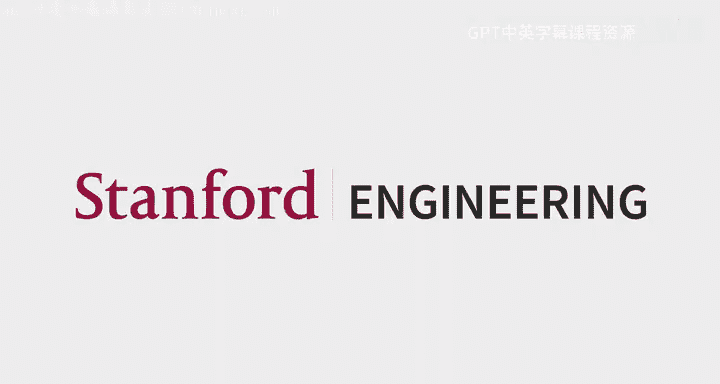

Before we get started I want to make some introductions， so my name is Chelsea。

 I'm the main instructor for the course， and we also have seven really awesome TAs。Great。

 so I'd love to welcome you to the course and I guess as a first question to get us as。😊。

Where everyone's that。 How are you doing if you want to answer。Briefly。

 you you want to raise your hand and share how things are going？Yeah。But in my first class。

 I went to the wrong class。It that was interesting how like five minutes the class I saw the I public policy when I was supposed to be AI Great great Why have you made it for the right class this time？

😊，Anyone else。Yeah' didnt really cluster like 30 minutes away，' like I'm a dorm。For Cla。Cool， cool。

 Good to figure everything out。Anyone else？Okay well I guess one thing I wanted to share or say is that it feels great to be closer to something that's a little bit more normal and that's yeah that's really awesome I'm really excited about that at the same time it's not like every's like there's lots of other stuff going on in the world right now it's not great and so we acknowledge that and we。

We try to set course policies that may give you a little bit of flexibility in the course and yeah recognize that this course isn't the only thing going on in your lives。

 and so hopefully those policies will help with that。Great。

 so we have a lot of information and resources about the course。

 your first place to go is the course website， we put a lot of information here so please read through it and if you have any questions。

 make sure that you read through it first， but then feel free to post any questions that you have on Ed Ed is connected to Canvas and you can also reach out to the staff mailing list as well。

 we encourage you to post any questions that you have to  Ed because that makes it so that other students can see your questions because other people probably have the same question as you but you are allowed to make a private post on  Ed or email the staff mailing list in cases where you don't want it to be shared with others in the class。

 for example， if you have an OAE letter you can send us either to the staff mailing list or in a private Ed post。

We also have office hours that are all posted on the course website and the zoom links are on Canva and office hours will start on Wednesday。

Cool， so what will you learn in this course？There's really three main things that。

We're going to hope you'll be able to learn in this course。

 The first is the foundations of modern deep learning methods for multitask learning and。

Generally learning across tasks。The second is not just learning about those methods。

 but actually getting experience， implementing them and working with them in code in Pytororch。

Trying to understand how these systems actually work in practice beyond just how they are supposed to work from lectures。

And lastly， I also want to try to give you a glimpse of the process behind actually building these kinds of methods I think that a lot of courses will present you knowledge and present you ideas as they are and not actually talk a little bit about the scientific process and the engineering process of arriving upon those ideas。

 and I'm hoping that maybe by giving a little bit of a glimpse into the process of building these algorithms and understanding these algorithms that will encourage you to not take them as them is to challenge them and also to help you learn about the process of developing these kinds of algorithms in the first place。

CoSo along those lines， we'll cover a wide range of topics in the course。

 we'll start with kind of the basics of multitask learning and transfer learning。

 we'll move into three broad classes of meta learning algorithms including black box approaches。

 optimization based approaches and metric learning。

We'll also cover more advanced me learning topics such as overfitting in metal learning。

 unsupervised metal learning， and Bayesian metal learning methods before moving into other approaches for few shot learning and adaptation。

 including unsupervised pretraining and domain adaptation and domain generalization。诶。

All throughout this will be an emphasis on deep learning techniques and we'll also study a number of different case studies in real applications。

 this includes things like multitaask learning in recommender systems like the recommendation system behind YouTube。

Also， meta learning for land cover classification and education。

 as well as Pew shot learning in large language models。😊，Now。

 one thing that's a little bit different from the last time we offered this course is these topics right here are all new to the course。

And one thing that's different is we're not going to have any lectures or homeworks that cover reinforcement learning topics。

 and so essentially we're removing the reinforcement learning topics from the previous quarters and adding in this new content。

 including fewshot learning with unsupervised pre-training， how this relates to foundation models。

 as well as domain not and domain generalization。😊，Now。

 you might ask why are we removing the reinforcement learning content。

 what if I want to work on reinforcement learning？For that。

 we're introducing a new course in the spring quarter on deep reinforcement learning that I think will do a nice job of complementing some of the other reinforcement learning offerings on campus。

Removing reinforcement learning will also make the course more accessible to people who don't have a lot of background in reinforcement learning。

 we found that in the previous quarters， just one kind of refresher on reinforcement learning often wasn't enough to get to the more advanced topics。

That said， if you're really excited about applying some of the ideas in the course to reinforcement learning topics。

 you can still explore that in the final project and get support from the course staff。

 many of whom also are very familiar and experts in reinforcement learning problems。Awesome。

 so for lectures， all the lectures are in person， they're also live streamed and recorded and you'll have access to the recordings on canvas。

We're also going to have two guest lectures as well around the end of the quarter and those are not fully sorted out yet。

 but we'll announce those shortly。I really encourage you to ask questions during the lecture this serves a lot of different purposes。

 you can ask questions by raising your hand， you can also ask them by entering questions in the Zoom chat and we have a TA who will monitor the chat and make sure those questions get answered during the lecture。

😊，I find it really helpful when people ask questions because it helps me understand engage if you're understanding what I'm saying and if you don't understand something or some concept or want to learn more or I'm not covering something important。

 that's my fault that's not your fault and chances are other people have the same sort of misunderstanding and so if you ask that question that will help everyone in the course and help me help you basically。

My goal is to help you learn the topics in the course rather than standing up and listening to myself speak。

Office hours will have a mix of in person in remote， mostly in person。

 but there will be two remote options， especially for SCPD students who are in the course。Great。

 and then all prerequisites， the main prerequisite is to have sufficient background in machine learning。

 so something like CS229 or equivalent because we'll be building a lot on the basic concepts of machine learning and we're not going to kind of cover topics like cross validation。

 training sets and test sets and so forth or the basics of neural networks。😊。

All the assignments are going to require training neural networks in PyTtorrch。

If you really hate PyTtorch for whatever reason， you could implement the assignments in some other framework。

But all the starter code is in Pytorrch， and you'll be able to get more support if you do everything in Pytorrch。

 So we'd encourage you to do it in Pytorrch a few quarters ago。

The course used TensorFlow instead and people seem to really like to switch to Pytorrch。

 but hopefully yeah， we provide some flexibility there。

We're also going to have a Pitorrch review session on Thursday at 4 30 pm in this room and so if you want refresher or some。

Get some of the kind of concepts in Pytorrch that will be useful for the assignments。

 you can come to that review session， it will also be live streamed and recorded on Zoom as well。😊。

Cool， so digging it in a little bit more into the content well have。

A number of different assignments the first assignment is just going over。

 it's basically just a warm up to make sure you're familiar with Pytorrch and going over some of the basics in multitask learning。

Then we'll start to go into our core assignments， the first one will be on blackbox Me learning and how do you set up the data to make few shot learning with these black box models more effective。

The second we'll go into gradient based by learning and metric learning。

Both these assignments will include kind of few shot character recognition kinds of problems。

And then the third homework will go into fine tuning pre trade models with an emphasis on natural language processing and language models rather than image recognition。

And then the last homework is going to be optional and it's going to cover some more conceptual aspects of the course。

 so the first four homeworks are all going to be implementation based。

 whereas his last homework will be just kind of，😊，十。paperper。

The grading for the course is 50% homework， 50% project。

 the first homework is just a warm up so it's only 5% of the grade。

 whereas remaining the next three homeworks are each 15% of the grade， so this adds up to 50%。

I mentioned that we wanted to provide some flexibility to students in the course and so if you complete this fourth homework。

 it can be used to replace one of the previous homeworks or it can be used to replace part of the project grade。

 and if you do it will' always do whatever is best for your grade and so if you don't do well in that homework but you still try to complete it then it won't hurt your grade it will only help。

And then the second aspect of giving some flexibilities will give six late days across homeworks and project related assignments。

 you can use up to two late days per assignment， no questions asked anyone can use these up to the six of course if you have other extenuating circumstances that make it difficult to submit courses on time then feel free to send us a note。

 send us an email and we may be able to make accommodations beyond these six late days。Great。

 and then lastly， for the collaboration policy， please read the course website and the honor code for the homeworks you're allowed to talk to other people about the homeworks。

 but you should document your collaborators and please write up the homework solutions on your own without referring to other students solutions and without referring to solutions on the internet。

😊，Cool， for the final project。Basically the main parts of the course are in terms of your work or the assignments in the project。

 the project is a research level project of your choice that you can do in groups of one to three。

If applicable， if you're doing research on campus， we really encourage you to use your research for this project and as long as it's applicable to the topics that are covered in the course。

And you could also share the project with other courses。

 although we'll have slightly higher expectations in that case。

And then same late day policy as the homeworks， but there's no late days for the poster session because the poster session will be a live event and you can't there won't be a late poster session or anything like that。

In the poster presentation， the poster session is on December 7th。

 which is basically the last day of classes， which willll have instead of a lecture。Cool。

 so any questions on course logistics？Yeah， what type of topics can we work on on a project？Yeah。

 so I mean， basically the question is what kind of topics can you work on for the final project？

Basically， whatever you want， as long as it pertains to the course content， it's very open ended。

 I guess one other thing that I can mention there is that we're going to have。

We are soliciting ideas from the broader Stanford AI community and so we'll post a list of ideas for the project on Monday next week。

 and so if you're not sure what kind of project you want to do。

 you can look at that list for some some nice ideas。

 but if you have something in mind already or if you。

If you want to be creative and think of something else。

 it just needs to pertain to the topics of the course。We also have details。

 guidelines on the project and what we expect posted on the course website。

 and so you can refer to that document for a lot more details。Yeah。

Examples of what people have done in the past for the Yeah that's a great question so we haven't posted examples yet but we want to post some examples of some previous projects one thing that you can see already is that if you look at a previous offering of the course I think it was two years ago we posted titles of all the course projects and then some of them have links from students who are willing to make them public and so you could already take a look at that although we're planning to provide some more explicit examples in the coming week。

Cool so in terms of initial steps， homework zero has already been posted。

 this should be pretty lightweight， it's due in a week。

 all the assignments are due at 1159 Pacific time and I'd encourage you to start trying to form groups if you want to work in a group and post making posts on Ed and so forth can be helpful for that。

And we're also happy to try to help you connect with other students in the course as well if that would be helpful。

W you recommend working in a group or。アブリズはいない。Yeah。

 I think that there can be pros and cons to working in a group I think that the benefit is that there's a little bit more that you can do in a group and you might also have compliment expertise it helps be fun to work with other people the downsides is that you are kind of relying on other people a little bit and you want to kind of make sure that the people you're working with are you're kind of compatible and can rely on them to some degree。

Generally we recommend it， but it's certainly not required。And you're welcome to work alone。Cool。

 so let's dive into why we might want to study multitask learning and meta learning。

So the first thing I'll cover here is a little bit of my perspective and why I find multitask learning and meta learning really cool and exciting。

And in particular， a lot of the research that I do in my lab is trying to think about this question of how we can allow agents to learn a breadth of different skills in the real world。

And what I mean by agents is actually working with real robots and allowing them to learn skills like this。

 so here I'm holding the block in front of the robot and it's learning to place the red block into the shape sorting cube。

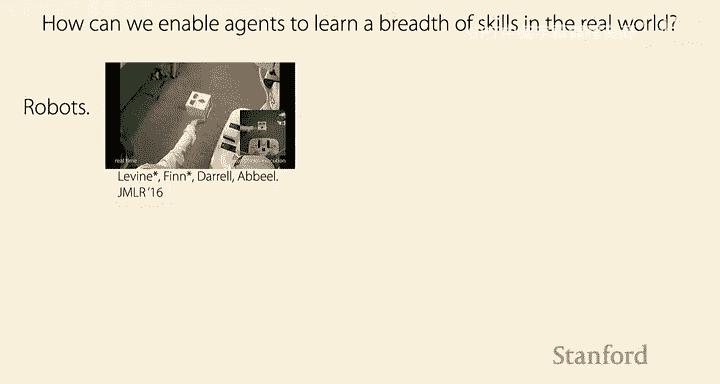

But not just something like that， being able to do something like watching a video of a human place an object into a bowl and having the robot figure out how to do the task as well。

 or by figuring out how to use tools to complete a task。

 even if it's not explicitly told that it should use that tool to complete the task。

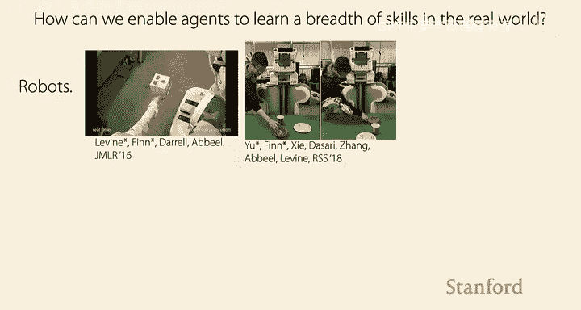

And I think that robots are really cool and interesting because I I think that they can teach us things about intelligence。

 They are faced with the real world。 They aren't just。😊。

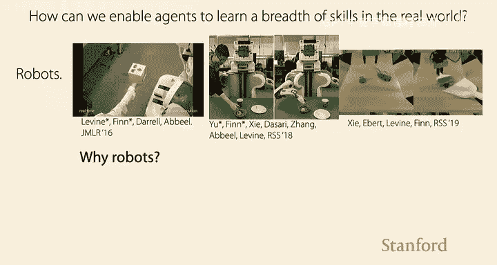

They aren't just kind of looking at images in aesthetic static。

We actually to have to contend with the complexity of the real world in order to be useful in the real world。

 they have to generalize across lots of different tasks， objects and environments。

And I think they also need some sort of common sense understanding。

 they need to understand what will happen if they try to pick up objects or try to move their arm in a certain way。

And then the last thing is， not。It's not clear exactly what the supervision should be here as well。

And I guess beyond these two things beyond。Beyond trying to teach us things about intelligence there's also this aspect that if we can actually build robots that are very useful。

 then they can help out in a wide range of aspects of society where people are doing jobs that are dangerous or people are doing jobs that are tedious or jobs that they would rather not be in。

and so。I guess from that standpoint， I would like to tell a little bit of a story。

 which is that at the beginning of my PhD。I was a PhD student on the other side of the bay。

 and I was working with this robot right here。And this is a project that was happening。

 the robot was learning through trial and error， was trying to figure out how to insert the wheels of this toy airplane into the corresponding hole。

And what you can see is that at the very beginning， it didn't really know anything about the task。

 and over time it gets better and better at trying to figure out how to kind of assemble this part into the plane。

This seems pretty cool。Yeah， I found it really， really cool to see this whole process。

 but one caveat here is that the robot effectively had its eyes closed。

So the robot couldn't actually see anything。 It wasn't using the camera in any way。

 It was just using the position of the joints。And so the next step that I really wanted to explore in a follow up project was to think about。

 can we allow the robot to complete these kinds of tasks。

 but with its eyes open and actually use vision in order to solve these tasks？

And this was the resulting project， and here we are trying to learn a neural network policy that maps from images taken from the robot's camera directly to torque applied at the robot's joints。

And you can see that over time it。诶。It's getting better at the task at the beginning。

 it was just moving its arm around pretty randomly。

And it gets closer and closer to inserting the block into the red hole。

AndNot only can it insert the block in the red hole for one position of the cube。

 but it can do it for multiple different positions of the cube。

 and this is why it needs vision in order to succeed。So this is pretty cool， this was， I mean。

 these days this maybe isn't that impressive， but six years ago no one had really ever applied neural networks for this kind of task before。

And here's actually kind of the result of the final policy。

 so you can actually see the robot's perspective right here and we can see that like if I held it in different positions。

 the robot was able to insert the block into the correct place。This is pretty cool。

I think what was exciting about this wasn't that the robot had figured out how to do this one particular task。

 but rather that we had a reinforcement learning algorithm that could allow robots to do lots of different tasks。

 And so if you took the same exact algorithm and gave it a different reward function。

Then it could figure out how to do other tasks， so it could figure out how to place the claw of the toy hammer underneath the nail。

Or if you gave it a task right here， it could figure out how to screw a cap onto a bottle。

And as an example of one more task， this is in a follow up work。

 we got the robot to use a spatula to lift an object into a bowl。

 this last task is actually surprisingly challenging because the robot has to fairly aggressively maneuver the spatula underneath the object in order to lift it up。

So this was really exciting， this was like first or second year of my PhD that we got the robot to do these kinds of tasks。

 all with learning neural network policies。And other people used the same kind of algorithm and built on it。

 extended it to other tasks and to other robots to learn things like hitting a puck into a goal。

 like opening a door and throwing an object to hit a target。And around the same time。

 people were also using deep reinforcement learning algorithms to play Atari games and to play the game of go and to learn how to walk in simulation。

So in general， around kind of 2016， 2017 was a very exciting time for reinforcement learning and for deep learning。

The catch， though， is that。We have a bit of a problem here in general。

 so it was all very exciting progress but。There was this problem that。In each of these cases。

When we trained the robot to do a task， like when we trained it to lift the object into the bowl。

We didn't train it to use spatulas generally in how to lift objects into bowls。

 but we trained it to lift that particular object with that particular spatula into that bowl。

And so if you gave the robot a different spatula， put it in a different environment。

The robot wouldn't successfully complete the task。And this is a huge problem because it means that if we actually want to put the robot into real world situations。

 it hasn't learned something that will actually work in general。嗯。And you might say that， okay。

 maybe we can just give the robot a lot more spatulas and train it with more data。

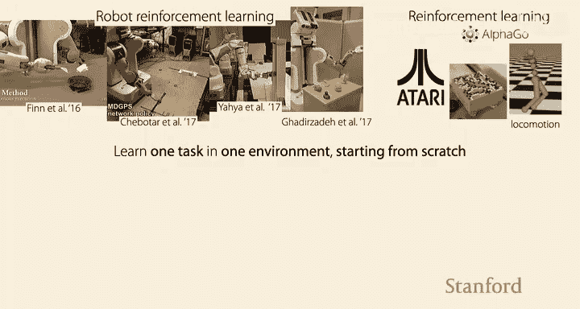

But the tricky part is that when you train these systems behind these scenes。

 if you actually look at the learning process， often it looks something like this。

Where the robot attempts to task。And then needs to attempt the task again。

 and so for it to attempt the task again， you need to actually kind of put the environment back to where it was so that they can attempt the task again from that state。

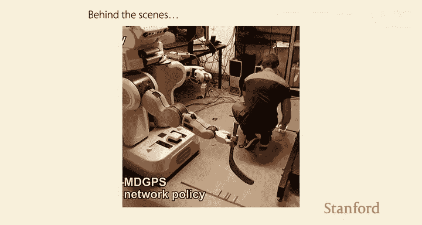

In this video， this is my friend Ygen。One of the things youve probably noticed here is that Yvkin is doing more work than the robot is doing。

And this doesn't seem like maybe the right way to be going about things。

 and importantly doesn't seem very scalable。It's not practical to collect a ton of data in this fashion。

And so。This is。

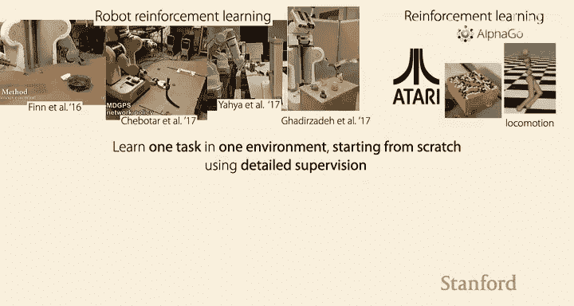

Starting to get into why multitask learning and meta learning matters， which is that。

We're treating these systems to do one very narrow thing。

This very narrow thing requires detailed supervision。

 a lot of extensive human effort in order to get the system to do that one particular thing。

 and then if we want to do something else， we also need another again。

 a lot of human effort to train from scratch on that new thing。

And this isn't just a problem with reinforcement learning and robotics。

 and so if you look at problems in kind of speech recognition or object detection。

 these systems are trained on more diverse data。But they're still learning one task starting from scratch with a lot of supervision and engineering for that one task。

And so I'd refer to all these systems as kind of specialists。

 we're training a machine learning system to do one thing。

And what in many cases would be more useful is systems that are not trained on a single task。

 but on many different tasks。And so for example， if we look at what people can do。

 people aren't trained from day one to lift up spaulas or sorry use spaulas to lift up objects。

 but they're trained to learn much more broadly about things in the world。

 and in that sense I would refer to humans as generalists and interested in this question of how we can build machine learning systems that are more general。

And I guess as maybe one more note on this， if you take a system like Alphago。

 which became kind of champion at the game of Go。This is another example of kind of a specialist system。

 and it's maybe somewhat analogous to training a baby on day one to try to figure out how to play go without teaching them lots of other things about the world。

😊，And in fact， it turns out that even like training a robot to pick up go pieces and place them into the configuration is actually still beyond the capabilities of。

of AI systems， and so when you watched maybe if you've ever watched any of the alphago matches。

 you'll notice that the Algo player is a human who's just watching this computer screen and lifting the pieces for the system。

Cool， so that's my perspective in terms of。When I'm excited about these algorithms。

 I guess any questions on all that before I move on to things beyond robots and general purpose machine learning？

Yeah， so you might go into this question in like the next section。

 but the question has to do with all of the work that's happening on these large pretraining models now。

 especially in NLP or maybe the models are kind of implicitly learning a lot of tasks internally。

 so would you say that it's still important to kind of explicitly teach a model how to like encode a bunch of these different tasks or it can be implicit learning kind of get us to where you need to。

Yeah， so the question is about a lot of these large pre trade models are trained on very broad data sets and they aren't explicitly trained to do multiple tasks。

 but they're implicitly trained to learn very broad things。In some ways I would。

 I guess we'll talk about this a little bit later in the course。

 but there are ways to connect that to multitask learning。

 and I kind of view that as an example of something that's more of a generalist rather than something that's learning one very narrow task。

And so we'll definitely connect to that and I think that also gets to some of the motivation behind using generalists trying to train generalist systems as well。

 which is that if we can train a pre-train model on very broad data and have it learn something more general about the world。

 then if we want it to do something narrow after that we can use that as initialization we don't have to start from scrap we can start from this more general understanding of the world and use that as initialization to learn much more quickly for a new task。

 and so some of the two of the lecturexs that we're adding this year。

 we'll be precisely on training these pre-train models in a more general way with unsupervised pre-training and then fine tuning them with a small amount of data to a new task。

the review of the pre tasks that put in the mainstream。When you're thinking about robotics。

 how do you think of the task that would be the fundamental the basic reading books。

 the general general and how do you design tasks as a journalististic major？Yeah。

 so the question was a lot of kind of general NLP pretraining tasks or things like Phil in the blank。

 is there an analog in something like robotics？And in general， I mean， there。

 there are some things that are somewhat analog。 so you can take video data from the robot's experience and have it interpolate frames like say。

 predict this frame where you can mask out part of an image and say， predict where。

Basically fill in this part of the image and so you can make very direct analogs like that and the approaches like that have shown some success in robotics。

 although。There are also other aspects of robotics that make it very challenging。 for example。

 in NLP， we have all of Wikipedia。And we don't have Wikipedia for robotics。

 we don't have data of robots tying their shoes or robots learning how to pour water。

 just lying on the internet in massive quantities， and that brings up another challenge that is more readily solved in NLP。

じ嗯。A major difference between like this multit learning or。What I call this body house。

single task and I do was this single task。Yeah， I'll get to that at the very end of the lecture。Cool。

 so why should we care about multitask learning and better learning beyond robotics and general purpose machine learning systems。

 and specifically why should we care about deep learning in this context？😊，就诶。

I don't think deep learning needs too much motivation these days if you've taken a machine learning class。

 but in terms of a couple slides， historically the approach to things like computer vision was。

To design some features， to try to design mid level features and then try to kind of train a classifier on top of those midlib level features。

And there are many aspects of this kind of pipeline that were designed by hand。

And then the more modern approach to computer vision isn't to try to hand design low level features and mid- levelvel features and so forth。

 but rather to try to just train a single neural network end to end。

 train the parameters end to end to do the entire task。

And there are some benefits to the former approach， you get some notion of interpretability。

 for example。But in general， the second approach here works a lot better。

 which we'll see on the next slide， and it allows us to handle unstructured inputs。

 things like pixels， things like language， sensor readings。

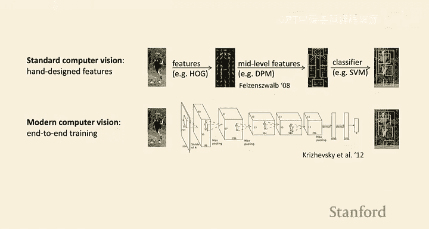

Really any input that you could imagine without having to understand without having to engineer really good features for that particular domain。

So it allows us to perform tasks without a lot of domain knowledge and as we saw over the years on the ImageNet benchmark。

 this is showing performance or error rate on the Inet benchmark between the years 2011 and 2016。

Overall， we see a downward trend， but what's notable here is that this dot right here is Alex that。

 which was the first end to end approach for。The imagenet competition。

And everything after that is also deep learning based approaches。

And so we saw this really striking paradigm shift and also a very striking shift in the performance that you can get on these kinds of computer vision tasks。

In a completely different domain in natural language processing。

 if we take this is a paper from I think 2016 or 2017。

 they're trying to use deep learning for machine translation before this paper Google Translate was using something that wasn't doing end to end deep learning。

 it was called a phrase based system and。😊，So that's called PBMT。

 whereas GMNMT was standing for Google's neural machine translation。

 which is an end- to end approach， and we again see really large improvements like 60 to 87% improvement on these different translation tasks and now systems like Google Translate use exactly these kinds of models when making predictions and they work。

Well， there's still obviously lots of room for improvement in the translations。

 but they work far better than the previous systems。Cool。

 so that was some brief motivation for why we might focus on deep learning systems， now。

 why might we focus on deep multitask and mental learning systems？So。😊，In deep learning。

 we've seen that if we have a large and diverse data set and a large model that leads to good generalization on the tasks that I showed on the previous slide。

We saw this with ImageNet with things like transformers， machine translation。😊。

But there's a lot of scenarios where you don't have a large and diverse data set at the outset。

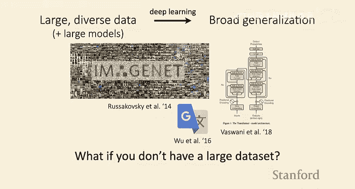

There's scenarios like medical imaging where you there are privacy concerns with sharing lots of data or robotics where we don't have Wikipedia for robotics or things like personalized education or translation for rare languages。

Where we don't have a large data set already sitting on the internet。

 and it would be very expensive and costly to try to collect a large data set。

And so these are the scenarios where。Where this kind of recipe will start to break down。

And it's impractical to learn from scratch for each of these different circumstances like for each rare disease or for each robot or for each person or each language。

Now beyond that， there's also scenarios where maybe you have a large data set。

 but that data set is very skewed， so you have a long tail distribution。

Where this is showing kind of a histogram of the number of data points for different aspects or different parts of your distribution。

 different slices of your distribution， and these different slices could correspond to objects that the system has encountered。

Or interactions with different people。Or the words that it has heard or driving scenarios and so on and so forth。

And these kinds of data sets don't arise in a lot of machine learning benchmark problems。

 but they actually come up all the time in real worldl applications there's a lot of words for example that you hear all the time and a very。

 very long tail of words that come up much less frequently and this long tale of edge cases actually present a major problem for modern machine learning systems and I would argue that's why we don't have self-driving cars on the road today because there's so many edge cases that come up in self-driving situations。

And。Multask learning and metal learning won't solve this problem in and of itself。

 but there is some signs of life that kind of indicate that if you could leverage some priors from the big data and try to translate that to the tail of situations。

 then you might be able to better handle these kinds of distributions。嗯。Cool， beyond that。What if。

What if you want your system to quickly learn something new。

 this is again a scenario where you don't have a lot of data because you want to learn very quickly。

 you want to learn something very quickly about a new person。

 like a new user or about a new environment， like a new environment that you've placed your system into。

😊，And for this， I'd like to actually give you guys a little test where I want you guys to learn something new。

In particular， for this test， I'm going to give you a training data set。

The training data set is the six images on the left。

And the far left images are all paintings painted by Brock。

 and the next three columns are paintings painted by Czanne。

And so your goal is to learn a binary classifier between paintings by Brock and paintings by Can。

So I'll let you。Train a little bit， your classifier。

now that you've hopefully learned a decent classifier， your goal is to classify this test data point。

And so raise your hand if you think this is by Brock。Okay。

 and raise your hand if you think this device is on。ok。😊，Cool， so most people got it right。

 so this is indeed by Broque。And I tried to give you a little bit of time to train your classifier。

 but maybe some of you didn't converge。お。嗯。And you can see to this by Bro because you can look at some of the styles of the edges here。

 for example， I picked this example not to be one that's a little bit harder。

 maybe closer to the decision boundary。And yeah， so this is an example of fu shot learning。

And so you took a really tiny training data set with six data points and were able to generalize to a new data point。

So how are you able to do that？So。If you were to train a machine learning system from scratch。

 like a convolutional neural network on those data points from scratch。

 it probably wouldn't have gotten the right answer， like many of you did。

But the way that it was able to do that or the way that you guys were probably able to do that is。

Well， you may not have seen these paintings before， or maybe even paintings by these painters。

You've learned how to see you've learned。How to recognize patterns and images。

 how to recognize paintings， and all of your previous experience allows you to learn new tasks with small amounts of data you weren't starting from scratch on this problem。

And so this is what's called Fu shot learning where your trading data set has a few data points。😊。

It's small。嗯。And Futop learning is something that you should be able to achieve if you leverage prior experience rather than starting from scratch。

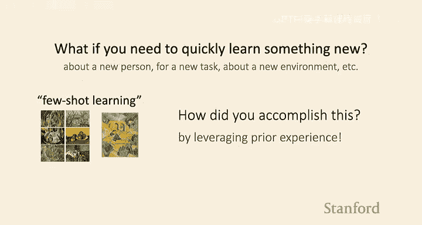

CoSo each of these four things that we win over if you have you want a more general purpose system。

 you don't have a large data set， you have a long tail or you want to learn something new。

 all of these are scenarios where ideas from multitask learning and meta learning might be useful。

And where these elements can come into play。

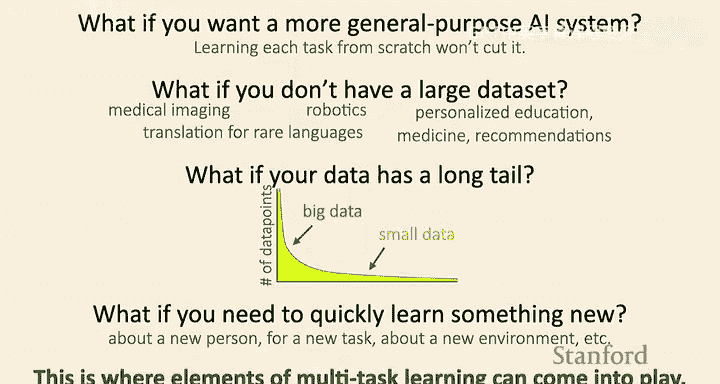

Cool， so now beyond why we should study it。There's a question of why we should study it now。

And in particular， if you take some papers from the 90s， me。

I think probably everyone was born by '97。But if you take some papers by the late '90s， maybe not。

 is anyone born before '97 or sorry after '97？Oh wow。I'm getting a little old here。Cool， well。

 if you take a paper before， most of you were born。

It says things like we can try to train tasks in parallel using a shared representation or。

We can try to do multitask conductive transfer， adding extra tasks to a back propagation network。

 So they're already doing。De multitask learning in this paper。

 you can take a paper from 98 talking about few shot learning so the ability to generalize correctly from a single training example。

 when faced with the new things to learn， humans can usually exploit an enormous amount of training data and experiences that stem from other related learning tasks。

😊。

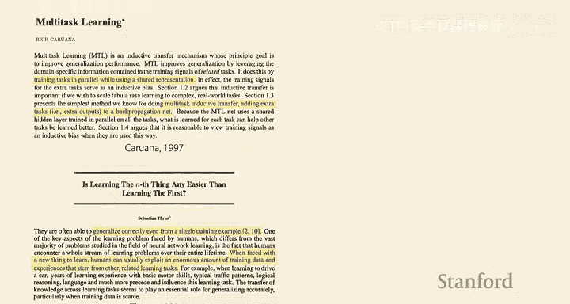

Or。Even earlier from 1992， some folks like Sammy Benjiio and Yashua Benio who you may have heard of were talking about the possibility of a learning rule to learn to solve new tasks。

 so ideas from metal learning。So a lot of these ideas aren't that new。

 they've existed for a pretty long time at this point。嗯。And yet。

 even though they've existed for a long time， they're continuing to play a major role in AI systems。

Does meta learning also help model generalization you a large data set？Yeah， so the question， yeah。

 I guess it's in Zoom， I guess， for the people who are remote。

So does me learningy help generalization even when you have a large data set？In general。

 these methods will give you the most bang for your buck if you have a small data because that's where leveraging previous experience will be the most useful。

 if you have a really massive data set， then will probably do pretty well just training from scratch on that data。

 it's possible that some prior knowledge might come in handy if you have some distribution shift。

 basically if you have a large data， but your test set is actually from a slightly different distribution then you might be able to learn in variances from your previous data in a way that allow you to do better。

 even when you have a large data， but in general， if you have a standard IID problem and you have a large data then things like prior experience will be much less useful。

Cool， so now what are some examples of actually looking at these kinds of systems in。

Falks that deep mind。They were training a system to do lots of different kinds of vision and language tasks。

 and they found that they could actually train a single model that could do something like object recognition where in this example they describe a chinchilla。

 then they describe ahiva， and then they give it an image of a new animal is able to recognize that that new animal is an image of a flamingo and also describe where the flamingo is found。

So you can do object recognition and the same exact model can also do things like reading so you can give it。

A few examples of images of numbers like arithmetic problems， 。2 plus1， 5 plus6 and so forth。

 and then if you give it a new image of， in this case， three times six。

 it's able to both read the numbers and also complete the arithmetic problem。And again。

 the same model can also do yet another task in this case is trying to count animals。

 and so here it's given an image of a few pandas and it's told that this corresponds to three pandas。

At the end， it's given an image of several four drafts。

 and it's able to count the number of drafts and identify that they're drafts。So。

What really cool about this system is that it's not just specialized for one thing。

 it can do lots of different things and it can do lots of different things in a few short way。

 so you're giving it a few examples of how you want to perform the task and is able to leverage that in order to figure out what you want it to do and ultimately do that task。

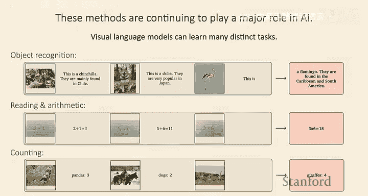

So this is one modern example that was pretty exciting。

 one other modern example is a paper that I co- authorthored in 2021 that I personally was very excited about where we were using meta learning in an education application。

We're looking at trying to provide feedback to students on work that they did。

 open ended student work in a intro CS course。And so in particular。

 the Code and Place course was a really massive online course that was offered by a few folks at Stanford。

And。At the end of the course。There were 16，000 solutions that students wrote up to the course。

Gding16000， giving feedback and grading 16，000 solutions is a massive undertaking。

And we were able to get volunteers to give feedback on around 100 of the student programs。

But if you train on those 1，000 programs。From scratch。

 you're not able to get a very good system because 1000 programs from scratch。

 these are Python programs that we're trying to get feedback on that doesn't work very well。

But with better learning， we were able to train on previous data。

 previous student data of taking exams and giving feedback on those exams。

And use that metal learning system， adapt to this new course with these new problems and ultimately give feedback on the remaining。

And so in particular， what it looked like is we were able to give a student program like the program right here。

 and there's a syntax error in this program that would make unit tests not useful at all。

 and so actually there were a few thousand cases where unit tests were helpful but most of the solutions they were not very useful。

😊，And then we werere able to actually generate feedback， so in this case。

 the feedback is that there is kind of a minor error on getting the input from the user。

 which could be something like forgetting to convert the user input to af floatat。

And the system actually worked really well and it was actually worked well enough to actually deploy in this course to give feedback to real students。

 which wouldn't have been possible without some of the ideas that we'll cover in this course。

So those are two examples， the flam lingo model and the education model， yeah。

I almostmost for people who have a real feedback。The question is you couldn compare the learning outcomes for the two groups so we did actually do a blind AB test with the system and so 100 of them got human feedback。

 15，000 got the feedback from the AI system and the students agreed with AI with the me learning system feedback slightly more as like 1% more I think they agreed with it around 97% of the time and they agreed with the human feedback around 96% of the time of course they might just be agreeing with it because they liked the feedback or whatever。

 and so we actually asked them also how useful it was and they rated it as useful a scale of one to five I think they rated it around an average of 4。

6 out of five so they found it useful。We weren't able to measure learning outcomes between the human feedback and the feedback from the system because this was towards the end of the course。

 it was kind of a diagnostic at the end of the course。

 we also didn't feel like it would make sense to withhold feedback from students to compare no feedback in the me learning system。

But the， I think the real， the real win is trying to。

Its basically yeah trying to give feedback in scenarios where it was otherwise would be very difficult to provide that feedback。

叫。I the objective from of using multiita learning because they make may called provider or they using dual con。

Pment audit。Is that possible easy？Yeah， so multi objective learning is we'll cover it in the lecture on Wednesday。

 but it's basically you can think of it as a subset of multitask learning， like a special case。就。

Applications for real time or streaming data？Applications for real time or streaming data。嗯。

I guess there's nothing。I could certainly imagine there being actually a lot of applications making sense because if you have streaming data。

 you may want to adapt very quickly to the current circumstance that you're in with a small amount of compute and a small amount of data。

 so from that standpoint， things like View shot learning may be very applicable。😊，But I don't have。

 I haven't encountered。There's nothing that comes to mind immediately in terms of a specific application I've seen in the literaturen。

第二。So are really like trying to have some examples that adapt the moral example or in the we should make from them？

It's basically the same the hook that is been doneizing quality elsewhere because we're learning something just the。

Thereに do。So is it the sameYeah， so the question is what's the difference between few shot prompting and few shot learning and there' I think there's a very gray line like I think I don't think it is black and white。

We'll talk about this a little bit in some of the future lectures。Yeah。

 we'll talk about it more in future lectures I think it's not。It's unclear it's fuzzy。Yeah。

 does matter learning always require a model that has previously been trained on some data because it feels like now learning is adapting this model to a new set of smaller data？

Or。Yeah， so you're asking does metal learning always require some previous data？

Or like is metal learning just essentially adapting and modeled towards like you were？あにが一旦 mixさ。

Yeah， so kind of transfer learning and meta learning are in many cases trying to adapt to new circumstances。

 maybe I'll move on actually a little bit because we'll all give kind of some definitions of what multitask learning and meta learning and transfer learning are。

 or at least what the problem statements are， and that might answer your question。朝さ。

As a few more example applications of very recent use cases of multitask learning and meta learning。

😊，One from 2019 is looking at machine translation， it turns out if you。

 instead of translating between just one pair of languages。

 if you translate between lots of different languages in this case， 102 languages。

You're able to surpass very strong baselines that are just trying to train on a pair of languages。

So there's a lot of shared structure and a lot of shared information that you can leverage from those other data sets or from data sets of other languages。

And。People have also been using multitask learning systems actually for multi objectiveive optimization where you have multiple competing objectives in a YouTube recommendation system and thinking about how do we optimize these objectives and we'll actually consider a case study of this paper in the next lecture。

So these are a little bit more on the applied side， a little bit more on the research side。

 there's also， I mean there's lots of papers on these topics these days。

 and so I'm just highlighting a few， but one example is a paper called a generalist agent that was training on。

Like really a really， really wide range of tasks， so ranging from dialogue systems to playing Atari games to controlling a quadruped robot in simulation。

 to controlling a real robot arm。And so they were able to find that you could actually stuff the data of all these different tasks and do a single model to have it do all of those different tasks。

And lastly， I guess I told this example on one of the earlier slides but you can also apply this in examples in real robotics where you want a robot to take experience from previous tasks or sorry from previous objects and ultimately perform a task with a new object so in this case。

 the robot hadn't seen this red bull before or this peach before or the distractor objects for that matter and is able to figure out that it should place the object into the red bull in this case。

😊。

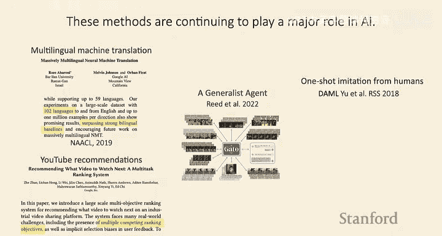

Cool so。Those are kind of a few modern examples that are quite interesting， yeah。

Is there any study looking into trying to understand those generalist kind of models。

 like the different？Maybe justentangle them。Jnals like。对こ toあ。Understanding。Yeah， so the question is。

 is there work that tries to understand what these multitask learning systems are learning and if they're disentangling the task in some way in general？

I guess there's no particular paper that comes to mind and I think that it's also a very challenging question because we don't have good tools for interpreting neural networks and what they're learning。

 I think the biggest tool is actually just to observe its behavior on new inputs and so for example。

 if it's able to generalize to new tasks effectively。

 then that's an indication that it's not learning the task completely separately that it' actually learning the shared structure whereas if it's completely unable to generalize to that new task it's maybe an indication that it's not。

I's not learning kind of a unified representation of those tasks or that the new task is just too far out of distribution compared to the previous tasks。

Yeah。sort of one agitation basically。Why is it considered impressive from the research？

So in this case， this paper is from a few years ago， but the it's certainly in this case。

 overfitting to the task of placing， I guess， I mean， overfitting is。Is a term that means many。

 many things oftentimes， But you can think of it as that。

 I think what's interesting about it is it is。At least this paper was one of the first examples of just looking at a raw video and actually interpreting that raw video to figure out how to do the task。

 and I think that we've also seen certainly since then seen more kind of more interesting and more impressive things being done with huge shock。

这样。Yeah， I was just wondering about this one shot imppatient learning paper because。本一。In general。

 how we noticed the human intended to point？With个。To this the cup， even with the rotation。

Versus is like always putting it in the。how should be consider these Yeah so the question is。

 it seems like this task is a little undefined， it's unclear from a single example whether the goal was to put the peach exactly right here or if it was to put it into the red bowl or maybe there's other ways to interpret the video as well。

The reason is able to do， at least in this case， what at least to me aligns with human judgment is looking by having prior data。

 and so if you only gave it this one example and learned from scratch。

The problem of inferring the intent is actually mathematically underdefined in many different ways。

 you could like there's also especially from images it's especially underdefined because it could be that you wanted to change the pixels here to be orange。

 for example， and maybe that doesn't involve moving the peach there。做。

It's underdefined if you learn from scratch， but when you have previous data and previous experience with other objects。

 you're able to。Leverage that previous experience to figure out what exactly was intended here。

 so in this case the previous example involved placing into containers and in each case it was trained to generalize a place into the container rather than place the object in the same position and instead if you gave it previous experience that said if I see a demo like this。

 then place it in that exact same position it would instead learn that from the previous experience。

But yeah， cool question。Okay， and then one of I thing that I think is important in the context of why we might study these methods now is I think that it's important for making methods and deep learning accessible to many different people I mentioned that。

Deep learning works really well when we have a large data set。

 and if we take some of the most common data sets that are out there。

 like ImageNet or these machine translation datas and so forth，They have a lot of data in them。

 imageage that has 1。2 million images， this data set of English to French translation has 40 million paired sentences。

 and the switchboard data set has 300 hours of label data。😊，And so this is a lot of data。

 and so if these are exactly the problems you care about or the data distributions you care about。

 you're in great shape。😊，But a lot of problems that we look at don't have this amount of data。

 and so for example， if you look at Kaggle's diabetic retinopathy detection data set。

 this only has 35，000 labeled data sets sorry， 35，000 labeled images。

And this is something where deep learning isn't going to work as well if you train from scratch on this。

And likewise， there's a data set on trying to adaptively treat epilepsy and this has less than an hour of data and one of the papers that I showed before from the beginning of my PhD where we are learning the spatula task。

This had less than 15 minutes of data， and so this is much， much less data。

 and in many applications we don't have tons of data from or maybe we're looking at a population that has a lot less data of it。

诶。E。One reason why I think that things like multitask learning and metal learning is important is if we can extract prior information about from other data sets that are larger。

 then we might be able to actually start to better solve tasks that have much less data。

Which will in turn， make this kind of technology accessible to。

To people who don't have the money to collect a huge data set or don't already have a data set collected for their problem。

Yeah。standard way to quantify how useful data from one task would be to learning and new tasks。Yeah。

 so the question is， is there a way to quantify how useful data for one task might be useful。

 how useful it is for another task？And I guess the short answer is that's an open problem。

 it's a really useful and interesting problem， the short answer is it's unsolved。

 but there is some work on it on trying to relate the similarity between two tasks and it's actually not really a similarity function it's more of a directional similarity。

 like how useful is one thing for another thing， there's also some work just purely on data valuation in general。

 like how valuable is a data point in the context of a larger data and so like James Zu。

 for example on campus has some work on that as well。じ家多而家多。

Transfering with I going from a large deficit set and then apply it to the smaller deficit set。

 primary examples into a literature where you take a large number of tasks。我程序。ど。Yeah。

 absolutely so the question is a lot of the examples we've talked about you have a large data set and a small data set。

 what if you have lots of small data sets and absolutely we've seen examples where these kinds of techniques can be super useful in that scenario actually in your homework willll be working with the omniggalat data set which has about 20 examples of each character。

But lots of characters， so around 1200 characters are actually more than that。

 and so that's an example where these kinds of systems can work quite well。

 and there are other examples of well where we can sort of like amortize the cost of learning。这。

How cool is it to use machine learning models to generate data sets and then use those generated like synthetic data and try to use that data set。

 for example， with robot robotts， I thought about maybe open purpose。

Where you can actually get the joints of the person and maybe that's how I put for robotics。

So maybe that we reregenenate， I don't update that because I'm sure we have a lot of information for humans。

SoYeah， so the question is can we generate data sets and is that useful and applicable in common there's a little bit of work on that so like Phil Iola。

 for example， has been doing research， a little bit of research on that topic in general there's possibly kind of a no free lunch thing where。

Basically， if you're learning to generate data from a data。

 then you're not really creating additional information when you train that generative model。

 and so that might not be more useful than the original data that the generative model was trained on。

So from that standpoint。It's a little bit tricky， I think to get value out of that sort of thing。

 but if you have domain knowledge that you can put into the generative model， that might help。

So yeah， I think it's an interesting problem and there actually there have been a few works that have done kind of interesting stuff along those lines that I could talk about in office hours。

 like data set distillation， for example， but in general it's tricky。Cool。

 so I've talked about a few different successes and a few different exciting applications of these kinds of systems。

But I'd also like to emphasize that there's also lots of open questions and challenges。

 And we've seen some of these in some of the questions。

 like how do we determine the usefulness of one data set for another。 And I think that also makes it。

Equally exciting to study because it means that there's open problems that we can solve and that all of you can solve。

In the last 15 minutes or so， I'd like to dive into。

What actually a task is and what multitask learning is。

 and we'll do this fairly informally in this lecture but more formally define things in the next lecture。

So informally， we can think of a task or rather a machine learning task as something that takes as input。

 a data set and a loss function and tries to produce a model。

I think this is a useful way to think or a fairly intuitive way to think about a machine learning task because。

When you want a machine learning system to solve a task。

 you typically give it a data set and a loss function and optimize that to get a model。

And different tasks can vary in a number of different ways。At a high level or kind of intuitively。

 you could have different objects， different people， different objective functions。

 which was mentioned， different lighting conditions， different words， different languages。😊。

So the different tasks that you might throw into a multitask learning system might be fairly varied and they could vary along lots of different axes。

嗯。And so。The reason why I bring this up is that multitask learning doesn't just cover what you might think of as different tasks in terms of the English definition of the word task。

 it could also mean that。Like typicallyically you don't think of different objects as different tasks from the English definition of the word task。

 but if you want a system that can handle lots of different objects and you might want to train it across lots of different objects。

 that might still pertain to this more technical definition of a machine learning task。嗯不。

As I kind of mentioned this， there's one really critical assumption that comes up with these kinds of systems。

 and the bad news about this assumption is that the tasks that you train on。

They need to have some shared structure。If they're completely independent from one another。

Then you won't get any benefit from training together。

 or you won't get any benefit from trying to exploit the shared structure。

And if you don't have any shared structure， if they're completely independent from one another。

 you're better off just using single task learning。

The good news though is that there are many tasks that have shared structure， and so as one example。

 if you consider the task of unsping a jar， a bottle cap or even like using a pepper grinder。

 for example，😊。

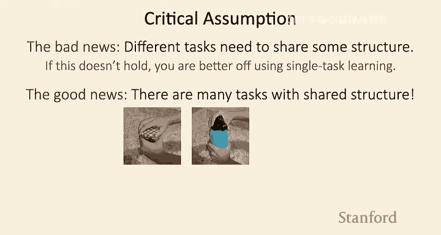

Using a pepper grinder and opening a water might seem very different tasks。

 but they all involve a very similar motion。And even if the tasks are seemingly unrelated。

 the laws of physics underlie real data， and so there is already a lot of common structure there。

Unless maybe you're on a different planet or something， and I mean。

 the laws of physics won't change there， but gravity might change， for example。

People are all organisms with intentions， the rules of English all underlie all English language data。

 languages are all developed for similar purposes， so even across languages。

 there's a lot of shared structure and so on。😊，So I think that there are actually very few cases where some tasks that you come up with are independent in a statistical sense。

 and so with that the model can or these kinds of methods can pick up on the shared structure and leverage that in order to do better。

Quote。Now。Yeah， question。Stre by deep， it was able to have own， let's say， language。

So what is the chain structure？Yeah， so the question is in a model like Goto。

It was doing both tasks involve language and images。 And what is the shared structure there。

 I actually think that in that particular case， the。

The Goic paper didn't show significant signs of being able to。

Like significant indications that it was actually learning shared structure between those two things in terms of generalization and so it's not actually clear to me that it was learning shared structure across images and text and I could also imagine that it may be easier for them model to learn shared structure if for example you gave it images of text rather than tokens of text because。

😊，Those modalities are very different from one another。 it's kind of like if instead of。冇。

For us humans， we see everything the same exact embodiment through our eyes and so forth and we're never like getting oneho vectors of tokens just passed into our brain。

 and that's kind of what neural networks get， they don't see things in a unified way and so yeah the short answer though is it is unclear if it was actually learning shared structure between the two。

 although there is some work that has actually found that you are able to learn a shared space。

 at least a shared embedding space with images and text， that is more unified。

Lots of questions in back。我。ちっと。Yeah， the question is how do you quantify the amount of sharedness？

It's difficult to quantify given a pair of data sets。

 but one way that's nice to think about that we'll talk about in the Beijingesian M Learn lecture is。

From the notion of kind of Bayesian graphical models， if you have two random variables。

 if they're independent from one another， then they don't have any shared structure。

 whereas if there is some dependency between them， if there is an edge between them or either direct edge or an indirect edge。

 then they do have some shared structure， quantifying how much shared structure they have is hard。

 although conceptually， I think that thinking about it from that Bayesian standpoint can be useful。叫。

おそ。plan share some。我知要自。that you don who separately。More。I what you trans to answer to the。Yeah。

 so if there isn't any charge structure， the model might just basically learn。

use half the model for one task， half the model for another task。

I guess there actually isn't that many downsides to that。

 but there also aren't any upsides to that as well。Yeah。

shared structures are necessary but the tasks that we're turning on have shared structure。

 or would it also be fine with the tasks that we're turning to general？

It is related to both of the tasks independently， but the tasks that we're actually training on。

 they don't have any like overlap。Can you repeat that？

To is task C and that relates to both A and being in some way。As maybe you're not。

But we're actually planninging on Nb。I see so if you have two tasks that are unrelated and then you want to learn a new tasks that's related to both of them。

 so for example， if you want to like task A is to pick up a fork。

 task B is use the fork to like skew something and then task C is to like to pick up the fork and skewer something。

Yeah， there are certainly instances where things like that come up and so I would say that， well。

 so yeah， yes， that's a scenario where these kinds of techniques make sense。Although。

Some techniques will be more useful than others。Since we' were talking about morality。

 do you suggest that when we。Use a 발달 model。They belong to the same modity like text or image。

 or can we have a combination of both them。Yeah， so the question is can you kind of have a combination of multiple modalities and in some sense the flamingo model that I showed before is actually already example of a multimodal model that takes us input both images and text。

 and so yeah you could definitely have gotto is another example where different tasks do have different data modalities if you are representing those modalities differently than the shared structure。

 it maybe be harder for the model to find the shared structure。

But certainly something that's possible with these models。Cool。

 I'm going to try to move on a little bit， I think I only have a few more slides。

 and then we can take a little bit more questions at the end。嗯。Cool。

 so what are some of the problem definitions that we'll cover in this course？Informally。

 we can think of the multitask learning problem as learning a set of tasks。

And generally trying to learn that set of tasks more quickly or more proficiently than learning them independently。

And。Kd of。Here the set of tasks is we see the same set of tasks during training and during testing。

 so we're not trying to handle a new task。In contrast。

 the transfer learning problem is we're given data on previous tasks and our goal is to learn a new task more quickly or more proficiently。

 and this is also the problem that meta learning algorithms also aim to solve。

And so basically in this course， we'll be looking at any kind of method that tries to solve one or both of these problem statements。

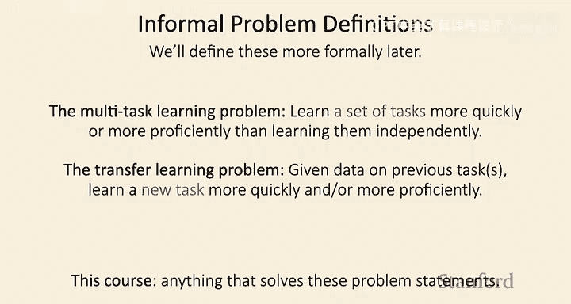

Now， one question that came up earlier is that doesn't multitask learning reduce to single test learning？

 So one thing that you could do is you could。Say you have a data set for each task D I。

 and you have a loss function for each task。 L I， can you basically。Sum up your loss functions。

 combine your data sets to create a data set and a loss function。

 and then you have a single task learning problem where you have one data and one loss function。😊。

So are we done？So in some sense， it can reduce to a single task learning and aggregating the data across tasks and learning a single model is one very viable approach to multitask learning。

嗯。The transfer learning problem where you want to learn new tasks is what we'll focus on more in this course than multitask learning because it is a little bit more challenging in this solution。

It doesn't just reduce a single task learning， but we will have one lecture on multitask learning on Wednesday where we'll cover other things like how do we tell the model what task we want to do or what if aggregating the data and training on all of it doesn't work。

嗯。So yeah， we'll focus more on the second problem statement。

 but there is also still some challenges that come up in the multitask problem statement beyond just training a single model with a single loss function。

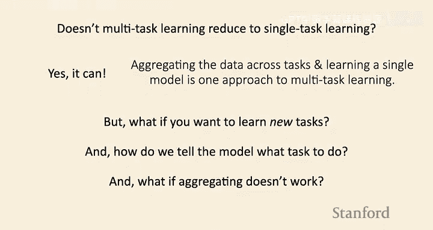

Cool， so that's it I let's see， we could take a few more questions as a group， but I also。😊。

Maybe we can also just take questions up in front if people have additional questions and we'll end there as a couple of reminders。

 homework zero is out and it's due on Monday next week and if you want to work in a group for your final project。

 we'd encourage you to start forming project groups。

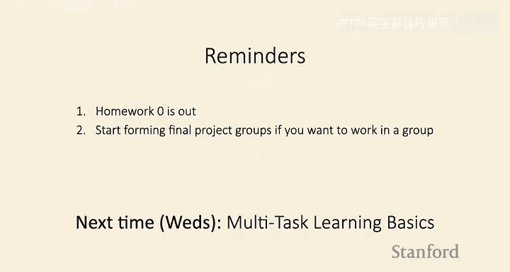

