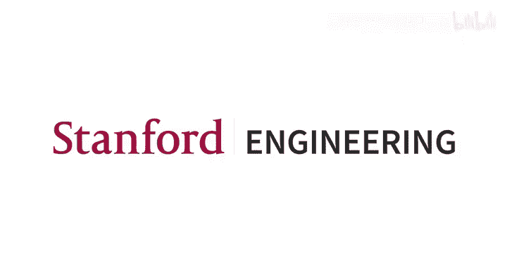
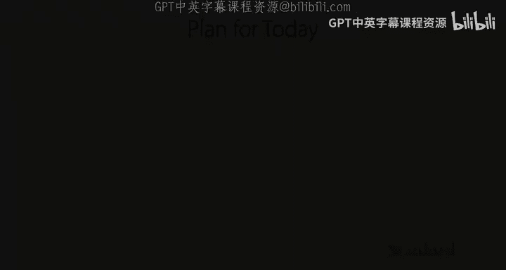

# 斯坦福大学《深度多任务与元学习｜Stanford CS330 Deep Multi-Task and Meta Learning 2022》中英（豆包翻译 - P2：-02-.Multi-Task Learning Basics I 2022 I Lecture 2.zh_en - GPT中英字幕课程资源 - BV1dWpPepEsj

So the plan for today， as I mentioned in the previous lecture。

 we're going to try to start with the basics， and so this means that today we'll be talking about methods that were starting to be developed in the ancient times of the 1990s。

And then starting， I think next week we'll get into more。Newer stuff that said。

 even today we'll start to talk about a case study of a real world problem that's quite relevant today and is from a very modern research paper。

And by the end of the lecture， the goals is to really try to convey what multitask learning is and what the key design choices are when trying to build these multitaask systems in practice。

Awesome， so we'll start off with some notation， so we'll start up with something like a neural network。

 it could be a convolutional network like the one shown here or some other neural network。😊。

And we'll denote the input as x and the label or output as y。For example。

 our input might be an image， like an image of a tiger here。

And the label might be a classification of that tiger。

 might be an image classification problem or maybe something more interesting。

 like trying to classify what to do if you see something like this。😊。

And alternative instead of being an image it could be something like the title of a paper。

 in this case you probably wouldn't use a convolutional network。

 you would probably use something like a transformer， if you're trendy or if you're a bit older。

 maybe an LSTM。And the label could be something like the length of the paper， and so in this case。

 if it was the length of the paper， this might be more of a regression problem rather than a discrete classification problem。

Now we'll refer to the parameters of the neural network typically with theta。

And so this will correspond to all of the parameters of that neural network。

 you can think of it as a vector that basically flattens each of these weight matrices andends them into a single very large vector this may have millions of。

Of values in this vector。And we can then refer to the function represented by this neural network as F。

 which will give us a distribution over y given the input x parameterized by theta。

So this should follow fairly standard notation that you may have seen before。Now in single task。

 supervised learning。We will be given some form of data which has input output pairs。

 so a number of examples of images like the tiger and labels like the options on the right。

And then we will define a loss function that tells us how good is that model at performing that task？

And our goal will be to find the parameters that minimize that loss function。

So try to find the parameter setting of one of these neural networks such that we do well on the classification problem。

 for example。And so a typical form of this loss function might be something like negative log likelihood。

This would look something like this where we're measuring the likelihood that F assigns to a given label。

 given X。And then negating that because typically loss functions are things that we minimize and then trying to minimize the negative probability of the label given the input。

And this kind of log likelihood loss， this is equivalent to something like a cross entropy loss or a mean squared error loss that you may have seen in other machine learning courses。

QuoteSo that should mostly be review for folks now。

 how do we go from single task learning to multitask learning？For that。

 we need to figure out actually what is a task， what does it mean to be a task？

We defined what a task is in the previous lecture， but we're going to cover a task more formally this time。

And in particular， in the context of this course， we'll think about a task as a set of three things。

 a distribution over x， a distribution over y given x， and a loss function。

And so you can think of these as the distribution that generates the data。

And the reason why that we want to define it something like this is that。

We want to be able to say whether or not the network is doing well at a task。

And doing well at a task is a little bit different than doing well on a data set。And in particular。

 you could have something that does really， really well in a training data set。

 but doesn't actually generalize to other examples for that task。And therefore。

 by defining a task as the data generating distributions and the corresponding loss function for that task。

We can then。Capture notions of how well it's actually doing on that task in general。

 so we can have corresponding data sets that are sampled from these underlying distributions like the training set and the test set。

And note that here I'm using I to like index into the task。

 so for task I it has these two distributions in this loss function and it has data sets that are sampled from these distributions。

In practice， you won't have any sort of access to these ground trees data generating distributions。

You'll generally only have access to the corresponding data sets。And then also in the future slides。

 I'll generally use DI as shorthand for DI train just because typically we will refer to the training data set a lot and it can be convenient to drop off the TR。

Okay， so。That is how we'll define a task。And now let's look at some examples of different multitask learning problems。

So generally a multitask learning problem is one where we're。Our goal isn't just to solve one task。

 but to solve a set of tasks。And the tasks could vary in different ways。

 So in something like multitask classification。The loss function will probably be the same across all the tasks。

 it will probably just be the cross entropy loss。And for example。

 this could be something where we want to be able to recognize handwriting in different languages。

 so each language will correspond to a different task。

And you could have a data set that looks like this， this is actually the Omniggala data set。

 and you have different alphabets。😊，Or different languages。In this case。

 you're going to have a different P of x distribution， a different P of y given x distribution。

 because the characters themselves will look different and also the label given those characters will be different for different languages。

But the underlying loss function will be the same because it's all still a classification problem。

As another example of this kind of multitask classification problem。

 you could also have a personalized spam filter where different tasks correspond to different people and different people will receive different kinds of spam and they will also have different preferences for what is spam and what's not spam。

 and so we will also in this case have a different distribution over x and a different distribution over Y given x。

Yet again， the same loss function。So that's multitask classification。

 we could also consider a scenario where both P of X and the loss function are the same across these tasks。

 and the only thing that differs is y given x。In a case like this。

 you could think of face attribute recognition as an example of this where one task is maybe to detect if someone has black hair or brown hair or blonde hair or white hair。

 and a different task is to predict their eye color。In this case， all of the images are the same。

 you just have different distributions over labels。有。嗯。什么。So the question was。

 can INe be considered multilabel learning？I guess the thing that really differentiates multilabel learning here in something like imagenet classification is。

At least the way the imageNet classification is framed。There's only one label that is correct。

And the thing that's different here is that you actually have a different set of labels。

 and so for example， someone can have both brown hair and brown eyes where they could have。

Bon hair and brown eyes， for example， and so you actually have different sets of labels itself and that's like the key differentiating factor and so in general something like imageageNet classification would be considered a single task problem that said you can also frame things like ImNe as multilabel problems because oftentimes there are actually more than one thing in an image and you may actually want to classify all the things in the image rather than just one thing。

😊，Another example of multilabel learning is something like scene understanding where an image。

 you have images of lots of different 3D scenes， and one task is to predict the depth。

 one task is to predict key points in the image， and another task is to predict the surface normals in that scene。

And so this is again， an example where actually all the images in the data set are the same。

 The only thing that's different is the different labels。

So these are a couple kind of instantiations of multitask learning problems。

There's also some areas where the loss function might vary as well， so in both of these examples。

 these are settings where the loss function isn't changing。But you could also have scenarios where。

 for example， some of your labels are continuous and some of your labels are discrete， and you use a。

 I mean squared error loss function for the continuous and a cross entropy loss function for the discrete labels。

😊，Or you might have multiple metrics that you care about and you want to optimize those objectives simultaneously。

Cool，So I'll pause here， is there any questions on kind of the setup before we get into actually solving these multitask problems。

 yeah？So from last time he sent。The task should share。

So does structure mean like they should share out。But you快。Like if there are different methodss。Yeah。

 that was a great question。Last lecture we were talking about how the task should share some structure。

 does that mean that they should share the loss function or one of these three things？

What I meant by a structure in that first lecture is something a little bit more abstract。

 so these are three very concrete things and you can actually have tasks that differ in all three of these things but still have a lot of common structure。

And so I guess structure is something that's a little bit more abstract。

 we can think of we'll come back also a little bit more to what structure is when we get to some of the Bayesian perspective on it。

 but I guess as one example you could imagine something like the per language handwriting recognition these tasks have a lot of shared structure intuitively in the sense that recognizing characters is implicitly about recognizing the shape of the handwriting。

 but you could also have a version of this that has different loss functions because maybe in one case one of your loss functions is more continuous because maybe some of the digits are some of the characters are actually like numerical values rather than characters and something like that you may actually have different loss functions while still having a lot of shared structure。

Cool， so now let's get into actually。Learning networks that solve multitask learning problems。

The first thing that we generally need to do in multitask learning problems is to tell the neural network what the task is。

And we'll do this with what I'll call a task descriptor， which we'll denote as ZI。

And we'll pass this into the network in some way or another。

 and so the function will no longer be modeling Y given x， but actually modeling Y given x comma ZI。

And so。Let's kind of actually。Better understand what this task descriptor might be。

 so say that you're a very diligent grad student and you were assigned a bunch of papers to review。

And you want to understand how long it's going to take you to review these papers。

 so you may one of your tasks might be to take the title of the paper and predict the length of the paper。

The second task is maybe you want to get an initial summary of the paper before reviewing it。

 and so the second task is to predict the summary of the paper。

And maybe the third task is you're getting maybe a little bit too lazy and you just want to write the paper review for you。

So we have three tasks here， and the task descriptor in this case could be a few different things。

The first thing is it could just be a one hot encoding of the task index。And in this case。

 what this means is that we just have a one hot vector。

 one hot vector is just something that looks like this where we're encoding an integer in vector form where。

 for example， the integer1 will be denoted with a1 in the first position and0 and the other two。

 the integer two will be as with a one in the second position， and for the third task。

 the task descriptor would be something like this。So this would be an example。

 the simplest possible way that we could tell the network what the task is。

 so this would be telling it that the task is the first one， the second one and the third one。

But we can also do something a little bit more creative so we could， for example。

 give it a language description of what we wanted to do so we could tell it， give me a summary。

 tell me the length of the paper， give me a review。

And so Z could actually be a natural language string of what the task is as well。

So as some other examples， it really could just be whatever metadata you have about the tasks。

 so it could be。Not really in this example， but if you have an example where different tasks are different people。

 they can correspond to different attributes of those users。

If you have an example where like this one， where you have some sort of natural description of what the tus is。

 and you could condition on that。You may also have some domains where you have a more formal specification of what the task is。

 and you could also try to pass that into the network to tell it what the task is。Cool。

 so now that we've。Now that we've told the network what the task is。

 we can also formulate the objective。So the basic way to formulate the objective is actually what we covered in the previous lecture is we just sum up the loss functions for each of the tasks。

 so EliI here is computing the loss function of the network on the training data for that task then we'll sum up over all of the T tasks that we have and try to minimize the loss function。

 minimize the parameters of our neural network。😊，Over the sum of loss functions。

that you're mentioning is that very much the same but same as like pumping the？Yeah。

 so you can think of the task descriptor as a form of prompt。

 you typically wouldn't think of something like this as a prompt。

 but yeah it basically can be a prompt or it could be something a little bit more basic。这样不会。

Its not all。デアのせこで you sayデアアせ courseオハ。So GI is a set of XY pairs。

 and so what exactly were you asking？第二个。on the same cross order。

So you'll have different data sets for different tasks in general。As we talked about before。

 each task will be defined by its own data generating distribution and then the training data is drawn from that data generating distribution。

 you may have cases where kind of P of x is the same across tasks and so in that case all of the x's in your data may be identical。

 but then even in those cases the Y's will be different for different tasks。

 and in general these training data sets will be different across tasks。

Does that answer your question？S are just of you measure in a mock。えか。ぬべだせあせクロクロオー。かす。

You're asking if the data is the same across all the tasks in a multit learning setting。

In some previous remarkss， you'll mention all these。So I mentioned here that， for example， X。

 the images might all be the same across tasks。So in this example， in scene understanding。

 the images will all be potentially identical across tasks， but the labels will be different。

 so the labels for the depth task correspond to the depth annotations。

 the labels for the normals tasks correspond to something like this， and so forth。Yeah。

 you mentioned a task description。There are often data sets where you don't get the task description。

 what happens then。Yeah， so you might have a data set where you don't have the task descriptor in that case you can just go with the basic kind of one hot encoding。

 assuming that you at least have some sort of differentiation between the tasks。

 it's also possible that in some cases you might be able to tell what the task is just from the input。

If if P of x is different across tasks， you might just be able to tell without a form of task descriptor。

 but in general in multitask learning， we're going to assume that we at least have some separate data sets for each task。

有。have switch for proof。好。With the original experts， the also。Yeah， so we'll talk about that next。Co。

 so I think that we can just transition into the next part。This is kind of the basic setup。

 but there's still a lot of design choices to make here。We needed to assign the model。

 the objective and the optimization process， like what was just asked。

 we need to figure out how do we actually pass ZI into the network。

We also need to figure out if we should use this vanilla objective or if we can use something a little bit more sophisticated。

And also， how do we go about optimizing this objective？

So we'll talk about each of these design choices one by one， and we'll start with the model。

 so we'll start by trying to think about how can the model be conditioned on ZI and what parameters of the model should be shared across tasks versus separate。

Cool， so now let's assume that ZI is a one hot index， like what we talked about before。

I have a question for all of you， which is。How should we choose to condition the network on this one hot vector in a way that we'll try to share as little as possible？

And what I mean by this is we want to have as few of the parameters。For different tasks be shared。

 we want to basically get as close as possible just training completely separate neural networks on each task。

Does anyone have any thoughts， yeah。ある。So， find good loss function。Can you explain a little bit more。

Yeah， the question is if we assume that ZI is just a one hot vector for each of the tasks。

How should we condition the network on ZI such that the network is sharing as little as possible。

 such that we are as close as possible to just training completely different neural networks？Yeah。

I you could just have like a sort statement for each of the different conditions， so if it is。1。给上。

To will breathe。Yeah， exactly。 So in particular， what we can do and what was suggested is you can basically just have。

Different neural networks， T， different neural networks， and basically have a switch statement。

 have Z basically modulate which of those networks you use to make a prediction。And so formally。

 what this would look like if Z is a one hot vector is you would pass。

 say y1 is the output of the first network， y2 is the output of the second network and so forth。

 and all of these have separate parameters。Then we can compute the output as basically just switching between these different outputs。

 and so if the task is the first task， then you would output y1， if the task is the second task。

 then you would output y2 and so forth。And what you get as a result of this is that you basically this is still a single neural network。

But you get completely independently trained。Neurural networks within the single neural network。

Was there a question？And so essentially this corresponds to having no shared parameters across the tasks。

第二。For to。Like Madas I need to have best performance across all us with as many shared parameters as possible so that the competition complexity goes done。

Yeah exactly， so in general， this is not a great way to go about doing multit learning。

 it's kind of one extreme and on kind of the other extreme of the problem we could share a lot more。

 we could share basically everything。And so what we could do instead is have a single neural network and basically just。

 for example， concatennate Z with one of the layers。And in this case。

If you just concate to one of the layers and then have everything else be normal。Then。

Then in this case， basically all of the parameters are shared across the tasks。

With the small exception of kind of the parameters following ZI technically will not be shared across tests。

 but all the other parameters of the network will be shared。So you have these two different extremes。

Becomes this choice of。What？What should you actually do in practice？And so。

An alternative way of viewing this form of conditioning on ZI is。

Basically splitting the parameters into shared parameters and task specific parameters。

So if you split the objective into shared parameters and task specific parameters。

 we saw one example where everything was basically task specific。

 we saw another example where everything was shared， you could basically formulate。

 rewrite the objective as something like this， which is exactly equivalent to the previous objective。

The only thing that we're doing is we're now just saying that we have。

We've basically split up our parameter vector into these two parts。

And the thing that's useful about writing it this way is that it really shows us that the task specific parameters for task I are only optimized with respect to loss function I。

And so。Those parts of the network will only see data from one of the tasks rather than all of the tasks。

第二。うん、それでも。Learning all the tasks at the same time， like for example and like。ああ。The MLLT space。

 if you just train a large one。このかう。So我他责。他にそで然。有。Yeah， that's an awesome question the question was。

Is there a constraint that in multitask learning that we're going to be learning all the tasks all at the same time？

And。In general， for the purpose of this lecture， we're only going to be considering things that we're learning at the same time in the next lecture on Monday。

 we'll start talking about transfer learning where we learn one task and then learn another task。

 and then the last lecture in the course we're going to also talk about lifelong learning where we are learning。

A set of tasks in sequence， one task and another task and another task and so forth。In general。

 a lot of the underlying ideas， underlying multitask learning are also applicable to the setting where you're not learning everything at once。

And one thing that is somewhat nice about looking at things like this is that you could imagine training on a few tasks and that gives you maybe some good shared parameters and then additionally training some task specific parameters separately after the fact。

 and so things like that are often very reasonable to do。这。

His what I do in multi learning is understand the underlying structure and then I create on double the one of the big methods here is I to speak your parameterss and do something which。

Sing a something with。Is it like or do we have an optimal method to like do this like capture the shade structure and then basically units it like possibly start with a shade structure。

 then do the foundation or like just break it。results Yeah， so the question is。

 it seems annoying to have to manually break this up and figure out what should be shared or what shouldn't be shared。

 can we just have like have an algorithm figure it out for us？

And so there are some approaches that do something like that in general。

It's somewhat of a chicken and egg problem because if you have something else choose what to share and what not to share。

 then that thing that's choosing will probably use data from all the tasks and so that's going to be shared across all the tasks。

 so in general there there are going to be some manual choices regardless。

 but some techniques that do something like that。Yeah。我是预保。Yeah， so the question is。

 do we know anything about kind of the comparative rates of different task learning。

 I'll briefly talk about that when we start to talk about the optimization process。

So the next thing that I want to talk about in specifically thinking about breaking things into shared parameters and task specific parameters is that。

In the previous two slides， we saw one extreme of sharing nothing。

 and we saw one extreme of sharing everything just based on how we condition on ZI。

And one of the things I think is interesting here is it suggests that basically choosing how to condition the network on ZI is equivalent to choosing how and where to share parameters。

And so。In general， choosing how to condition on ZI is actually a very delicate choice because you need to be careful about how much you should be sharing versus how much you shouldn't be sharing。

So we looked at two extremes of conditioning， I want to go over two other common choices in conditioning。

 well actually sort of three other common choices。So we talked about just concatenating the ZI with the activations at one of the layers。

 and so this looks something like this where you take the input or the activations at one layer。

 you take your ZI， you concatenate them together and then pass that into the network。

Another thing that you could do instead of concatenating is adding together a representation of both of them。

 so you could pass a ZI through a linear layer and pass the input through a linear layer and then add them rather than conditioning them。

😊，And then get the resulting output。Now， one thing that you might notice here is。

These are two options that seem somewhat different。

But it actually turns out that the concatenation based conditioning here and the additive conditioning here are exactly equivalent to one another。

And so。I'm curious。 maybe it's one thing I want to try something new。

 So typically I ask people what why they're the same thing。 rather than just asking you。

 I want you to take maybe。One ish minute to think about it and then one ish minute to talk to your neighbor about it。

And then after two minutes， I'll ask you。I'll ask you to share why you think they're the same thing。

So you can think about it for a minute， I'll tell you in a minute to。Talk to someone and yeah。Okay。

 cool， let's come back， Does anyone want to share what they came up with？行ゃ。How should do support。

The linear awares that。う。Effectively the down。そしたら。分不ら。That seems it is always operating。Yeah。

 awesome so in particular， if we have some。Some input X。And some task descriptor Z。

If we cancatenate them， we'll do something like this and have a weight matrix right here。

And you can instead think of this weight matrix as having two parts。W1 and W2。诶。

So this is just the left half of that matrix， this is the right half of that matrix。

 and this is equivalent to W1。Times x plus W2 times z。And so one thing that I。

One thing that's kind of important in the second figure is that actually the X and the Z are first going through a linear layer before you add them together。

诶。And this is exactly kind of the additive conditioning version。

And you can kind of visually see this like right here where the red matrix corresponds to W1。

 the blue matrix corresponds to W2。Yeah。じ。Go would。When your aware in the additive conditioning。

 would you have would be network could have a more expressive power？

Also the auditive conditioning be better than。Partly please。嗯。So your say。

 if you had a nonlinearity basically here。So if you had something like a nonlinear here， basically。

Yeah， so it's something once you start adding on nonlinearities， it does get more expressive。

And yeah， so if you did， you have some nonlinearities on these separately。

 it would be a little bit more expressive。 You could also imagine。Yeah。

 so in that case it would be a little bit first person。じ。そろ。

Is there any computational trade off between the two in general， I think that。

I would guess that on well， so I would guess that on modern computers。

This is better because we have very good matrix vector multiplication modules。

But I haven't tested it myself on hardware。And I guess I would guess it's probably not that significant compared to other layers in neural networks like convolution layers。

这。shouldn't that recognitionognition be better because it would then。こういう結果をさたふ。嗯。I guess。

to it's very it's easy。我们故里。Yeah， I guess in both of these cases in practice。

 you probably won't just be like having this literally be the output of your network。

 you'll probably also continue to pass that through fully connected layers and so forth。

 and so in general when we talked about adding non nonlinearities I'm guessing that wouldn't have a huge effect in on the expressive power because this is a part of a larger network。

Cool， so that was concatetnation and additive conditioning。Two other choices that are quite common。

 One is to use a multi head architecture where you have some shared bottom layers that are。

all the tasks we pass on the input through the same exact layers， and then for different tasks。

 you have different heads or different sets of task specific layers。

And a generalization of this that you can consider is。

Multipicative conditioning so before we saw additive conditioning。

 you can also multiply the task descriptor or a representation of the task descriptor with the activations。

And so what this will look like is basically just replace the additive。

 the addition operation in the previous equation with the dot product。😊，Or with a sorry。

 with an element wise multiplication。And something like this is。

Is going to be more expressive than at least per layer than adding。And it could actually。

It could actually represent things like the multi head architecture。

And the reason that we can see that is if you remember the kind of very first example that we looked at where we are essentially multiplying the ZI with the outputs。

 this sort of multiplication can sort of gate the network and create。😊。

Basically modulate which layers are used for which tasks。过ol。And so yeah， in general。

 multiplicative conditioning is going to generalize having independent networks and independent heads。

Per this code reduce say。Should is sort of flavor dust。诶。Tension is sort of like a task。

So insofar as attention is basically like dot products， then yes。

 something like attention can be viewed of as task specification， any other questions？Yeah。不这个。

い直播天索大る。Everything is rest。Yeah， where you multiply will matter。That said， you could also imagine。

 like even if you do this sort of gating at the very beginning of the network， you could imagine。

Well， I guess， yeah， even with fully connected layer。Yeah。

 the architecture will generally still matter。And so。It can represent certain kinds of gating。

But yeah， the architecture still matters。Yeah。嗯。嗯。我。So figured out how much of the structured。ど十？

So the question is if you do this sort of multiplicative conditioning on every single layer。

 does that let the network sort of figure out what to share and what not to share to some extent yes。

 I guess I should also mention that even if the network is sharing all the parameters and it's getting gradients from all the tasks for all the parameters。

 you could also imagine it sort of zeroing out certain parts of the weights so that it represents something more like independent networks and so the。

The network can arrive in a setting and where some things are't being used for only one task。

Even without。Even without like a multiplicative conditioning like thing。Cool。

 so we covered really the basics I mean， the basics are really either concatenation slash additive conditioning or multiplicative conditioning and。

😊，You can have more complex choices， there's a lot of papers that consider more complex choices。

 although even just the basic approach typically works pretty well。Now， unfortunately。

Figuring out how you structure the architecture and how you condition on the network is a lot like just general neural network architecture tuning。

 which is that，It often is fairly problem dependent and it's a little bit more of an art than a science and it's oftentimes guided more by intuition or knowledge of the problem as opposed to having a really rigorous set of guidelines for exactly what you should do。

That said， we'll talk a little bit in some of the coming slides about some things that can help guide that process。

掉。This motion increase depending on the type of。if you're using like a natural language。こて。一しの張って。

And also do you have any insights on like what sort of descriptors might be better。

 I like is the one hot better if becauses more explicit or could not your language be better。

 it's more like nuanced？Yeah， so there are two questions there。

 one is what short descriptors should you use and the second is。

 is the way that you condition the network on that descriptor？

Ded based off of the kind of descriptor that you have so in general for the first question the more information you give to the network typically the better if you give it just a one hott vector。

 these one hot vectors are orthogonal to each other and so you're not you're not giving it any information about how these tasks might relate to one another and if you instead give it a language description of the task where one of the tasks write me a story another tasks write me a poem another task is translate between these two tasks or between these two languages。

 then that will give it a little bit of information about the similarity between tasks because write me a story and write me a poem those are similar sentences and so naturally the tasks should be a little bit more similar as well。

😊，So generally the more information you give it， the better if you have access to that information。

And then in terms of conditioning， I think that my general advice would be that multiplicative conditioning is generally like the way to go because it gives you more expressive power。

 and in practice we've seen things like attention and multiplicative conditioning through featurewise modulation to be the at least one of the approaches that you see the most in what people do。

还有就是。Has there been any work done on my past？we have boil embeddings， if you do have。

t it's not just like one。Yeah， so the question is like can we is there any work on getting a task embedding。

 and I should note that if if you have a weight matrix that's going after a，After a task descriptor。

 then this is going to convert that one hot vector into a dense vector and so in that sense the first weight matrix that comes after that one hot task descriptor is going to give you an embedding of the task and it's essentially if you learn multitask learning from scratch。

 then it's going to learn these task embeddings from scratch。

It would be interesting if we could develop things like the notion of word vectors， but for tasks。

 and one thing you could do is if you have a natural language description。

 encode that into a sentence encoding and use that representation as your task descriptor。

Yeah the question is， how do you implement the multiplicative gate so if you have four tasks。

 you just add a softm gate layer？Dimemention four probably for the last layer。Yeah。

 so the way that you can implement the multi kit of gate is going to look a lot like this。

 So if the say the。Say the dimensionality of one of your activations is。Is like D dimensional。

 then what you'll want to do is take your one hot vector。

 also multiply that by a weight matrix so you get another D dimensionsal vector。

So once you have 2D dimensional vectors， then you'll just do element wise multiplication。

 and so you'll replace this plus sign with a element wise multiplication operation。过。

So we've talked a lot about the architecture of the model， now let's talk about the actual objective。

So earlier on， we formulated multiask， this vanilla multitask learning objective。But in many cases。

 we may want to weight the tasks differently， so we may want to formulate an objective that looks like this where we are going to assign a higher weight to some tasks compared to others。

Does anyone have any thoughts on how we might choose the weights？ perhaps how many times。

That each us。So stop that you see。Your bedrooms。Yeah， so you could have something where you weigh。

You change the weight based off of the amount of data that you have。

 maybe if you have a lot more data， it could actually make sense to downweight。

 if you have less data， it may make sense to upweight one thing I'll mention here is by formulating this objective as a sum over tasks。

 this is already going to somewhat normalize over the amount of data per task because rather than if we instead summed over the data points that we had than that would assign higher weight to tasks with more data。

有。You can wait it by the magnitude of the law。終われというこで。going want to。Yeah， absolutely。

 so if you have some loss functions that are much higher in magnitude。

 then you may want to down weight those and upweight loss functions that have a lower magnitude。Yeah。

 trend just using the vanilla MTL and you see that the network is really struggling on a specific task。

Yeah， so if you find that the model is doing poorly on one task。

 then you could try to up that task and we'll actually cover a method that will do that automatically later on this slide。

Any other ideas？One task is like the most court。假最有调。じゃあ。

So if there's some tasks that you care about more than others， like in some cases。

 maybe there's actually only one task you care about and you just have these other auxiliary tasks that you are hoping might help out。

 then you could up the tasks that you care about the most。

What make some of a vision certainly without break you on that。で。Yeah。

 so you could in some ways treat the WI's as hyperparameters as well。

 although when you choose those hyperparameters you need some overall objective to tune them with respect to。

 and so you also and for example you could that overall objective could be the vanilla objective。

 but you may also have cases where the vanilla objective is not suitable like when the magnitude of the losses are different or when some tasks matter more than others。

One more。Maybe you can use the w function to。System one when it has， it's an instant start。因。

ReMar moment。You have a less weighted objective。かのかチラを。

It using it to like solve some of the training。Yeah。

 so you may if you run into some optimization challenges。

 it could be that actually changing the weighting aids and the optimization challenges， for example。

 maybe if you have a task that seems to be stuck， maybe if you start placing all of your weight on that task。

 it will help。push it out of that kind of that local optimum or something or maybe you could if it's stuck on that task maybe you should actually stop optimizing and revisit it later so there are a number of different approaches that you could take The first thing that I have listed here is actually just based on some importance or priority which would be some sort of manual selection。

But there are also various heuristics that you could use to choose these weights as well。

 and the other thing that I'll mention is you don't have to have these weights be fixed throughout training。

 you could actually have them vary at different points of training， for example。

 if you have optimization challenges or if some tasks are doing worse than others in the optimization。

嗯。And so in addition to some of the things that you have all suggested another heuristic that some prior work has looked at is encouraging gradients to have similar magnitudes。

 that said there's a pretty large body of work on different heuristics that have looked at different ways of approaching this。

 in general， the vanilla objective or manually chosen weights is generally one of the strongest approaches that you can take but it's worth acknowledging that a lot of work that on certain problems you can see improvements。

Now， the other thing， the other approach that I want to mention here。

 which actually came up before is you could optimize for the task that is doing the worst。

And in particular， you can formulate this as a mini Maxax optimization where at each point in training。

 you pick the task that has the highest loss and you update the parameters on that task。

And this is exactly going to。Basically try to normalize or equalize the task to some extent。

 and this is relevant when you think that all of the tasks matter equally。And so。嗯。In particular。

 kind of what this will look like is if you have。If you have task one。

 task two and task three and you plot their loss value， and for example， for task one。

 your loss value is down here for task two， your loss value is up here for task3。

 your loss value is right here， what this will do is you're going to estimate these loss value at your current iteration of training。

 you'll notice that this one is doing the worst and then you'll start only optimizing on task two。

And then after you start optimizing on task2， you'll reevaluate this。

 chances are hopefully this has gone down a little bit。

 maybe one of the other ones has gone up a little bit because you weren't optimizing on that one。

 and then you'll start optimizing for this one。At the end of this process in general。

 you should end up with loss values that are more similar across the three tasks compared to if you would only optimize the sum of them。

 because if you optimize the sum it might just prioritize it might minimize the tasks that are easiest rather than trying to maintain equal value。

And this can be especially useful in fairness settings where maybe different tasks correspond to different users or different demographics or different subpopulations or different geographic regions。

 and in those settings you want to have similar loss values for those different subpopulations because you don't want to have some customers that are getting a really great experience and some customers that are having a really terrible experience。

 or likewise some people that have a great experience versus a terrible experience。第二。

It be harder to optimize since it becomes non converts。Yeah。

 so this in general becomes a harder optimization problem。Yeah。

 so there are a range of challenges with this kind of approach。

 another thing that's somewhat challenging is you need to compute what is the worst loss。嗯。

And the way that you would。To optimizeimize this exactly as every single iteration。

 you would compute what is the worst one and evaluating the loss function on your entire data set may be expensive。

😊，But there are ways to approximate which one is the worst one by keeping like a running average or something like that。

 and in practice it's not something that is too hard to optimize。

 especially if you have a relatively small number of tasks， if you have a lot of tasks。

 it gets a little bit trickier。Yeah practice do normally the most supposed before hitting the max。

Yeah， so in practice， it is good practice to normalize your labels like。诶。Yeah。

 normalize your labels and make sure your loss functions are all on the same scale。

 if you don't do something like that， or if it's difficult to do that。

 what this is going to do is prioritize the loss functions that are the most difficult or that are the highest in magnitude。

Yeah， so my question is a bit opposite on that if you want to if her object do is on a primary。

you want to help your。I mean， many times we use multi credit。Soグ the singleタ。So another question is。

 how do we find our？Youほみか。这就方存。To decide on what auxary does。prayer。

So if you really only care about like one of the tasks， for example， then。In that case。

 actually treating WI as a hyperparameter makes a lot of sense because your outer objective is I want to do as best as possible on taskask1 and I want those other tasks to help me。

 and so you can manually figure out what WI leads to the lowest loss function on the validation set for a task one or you could apply automatic hyperparameter optimization techniques as well to do it for you。

有。I was wondering so that。This type買。What idea you trying to minimize the maximum loss？哦自。

We like other one versus02 versus Ofinity norms。It's possiblessible to order have people tried。

They change the x1 for the loss like instead of just doing wait times loss to do loss squared and it's kind of like the al two norm。

down and out with Kennedyned hi somewhere to the。Yeah， actually that's a great question。

 I haven't come across other like things that aren't。

L2 or L infinity or L1 like something that does some other exponent basically。

 but that something like that could be interesting to think about。

 and one of the challenges with this kind of objective is sometimes it can be a little bit too。

Pssimistic and can place a little bit too much focus on the worst case and something that is somewhere in between L2 and L infinity may actually mitigate that challenge so that could be interesting to explore。

One last thing that I'll mention， if you're interested in digging more into this。

 this looks a lot like what's called distributionally robust optimization or。DRO。

And so if you want a keyword to learn more about it， you could take a look at that。

And the math gets quite deep， you can actually like there's a lot of nice guarantees that you can get about this kind of optimization。

Great， and then lastly， we'll briefly talk about the optimization process itself before going into a case study。

And I'm just going to go over the standard optimization process that we might do for this objective because in general。

诶。In general， it works pretty well。And so the basic version of this is。

 we'll sample a mini batch of tasks。So， I mean， if we only have three tasks。

 we can just sample all three， but if you have a very large number of tasks。

 you might just sample a subset of those tasks。Then we will sample data points for each of the tasks that we sampled。

 so this is going to be another mini batch。And then we can compute the loss on that mini batch。

 so we have each of the tasks in our batch of tasks， and then we have the data set。

 the mini batch data set for that task that we computed。

 and this will correspond to kind of a mini batch loss function in the multitask setting。

And so once we've computed our mini batch loss function。

 then we can compute the gradient of that loss function and back propagate that into the neural network。

And apply the gradient with your favorite optimizer so you could use vanilla stochastic gradient decent。

 perhaps with momentum， or you could use something like atom， which is often used in practice。

So this basically just corresponds to stochastic gradient descent on the multitask objective。

 the thing that's probably the most different from that is we are going to be sampling a mini batch of tasks and so this ensures that the tasks are sampled uniformly regardless of the quantities of data and so if you have a lot more data for one task than another task。

 this is going to make sure that those two tasks are still sampled at the same rate。

 of course if you care a lot more about the task that has more data then you may actually want to do something a little bit different than this first step。

The other thing that came up is that you may actually have loss functions that are at different scales and if you have a regression problem。

 even if your loss function is the same， if it's mean squared error。

 if your task labels for different tasks are at different scales like one varies from negative five to5 another varies from negative 100 to 100。

 then your loss function is going to be scaled correspondingly。

 and so it's good to try to normalize your labels so that your loss functions are at the same scale。

Cool， so actually before we go into the case study。

 there's a few different challenges that I want to bring up。

 and this is going to affect some of the design choices as well。

So one challenge that comes up is negative transfer between tasks。

 And what negative transfer means is that。Sometimes if you try to train with multitask learning。

 the resulting model actually does worse than if you were to train completely independent neural networks。

And as one example of this， you can formulate a multiTask version of the CFR 100 data set。

And you can compare the performance of a multi head architecture， of a cross stitch architecture。

 which was an architecture proposed by some prior work。

 and also just independently training the models。And what we see here is actually the independently trained model is getting 67% accuracy。

 which is more than 10% higher than the multitask learning approaches。😊。

So why might this be the case？This could be the case because of optimization challenges。

 so there might be some interference between the tasks。

 they might be trying to use their representation in different ways。

Or the tasks might be learning at different rates， and if them one of the tasks has more or less converged and one of the tasks is still learning that may make it difficult to keep on updating the network。

It could also be not an optimization challenge but just a challenge of limited representational capacity。

 oftentimes multitask networks are doing more and so they need to be larger than if you were to just train on a single task。

so嗯。If you have negative transfer， the natural thing to do is just try to share less across tasks and so you can see if you're having negative transfer by just trying to train independently if you're seeing that independent training is doing better。

 then you can just try to make it more like independent training。

And so we saw a few different ways to try to do that before by， for example。

 having a multi head architecture that explicitly has different parts of the network that are not shared at all between the tasks。

Yeah。His methods to determine how the transfer major is going to be reported？Yeah。

 so the question is， are there any unsupervised methods for telling if there's going to be positive or negative transfer between the tasks？

In general。I guess I'll show that in a little bit in a minute， but in general。

You certainly without the labels of the task you certainly can't it's certainly very difficult to tell if there's going to be positive or negative transfer ideally。

 it'd be awesome if you could just have a description of the task at of each of the tasks and then something that tells you like are these going to work well together or not unfortunately I think that something like that is。

neearly impossible because it's not just going to depend on what the task is。

 but also the nature of the data， the nature of the model that you're training。

 potentially also the nature of the optimizer as well。

 so in general these sorts of things are very hard to tell a priority。Yeah。

 if you are getting a negative transfer and you see the27 mark。better using for。あさ。

Would you continue to start？Are you still hoping to get even better？参でさた方。Yeah。

 it's a great question so if you're seeing that independent training is doing better than your current multitask model。

 why not just go with the independent networks， it's very reasonable to kind of stop there and go with the independent networks。

 although there are definitely scenarios where you could still you could get better performance with a different architecture。

 for example， if you started by trying to share everything。

 there are certainly scenarios where training a multi head architecture will do a lot better than both sharing everything and training independently。

Is there we to tell whether the tasks were inherently incompatible or it wasn't my mistake that I did not work which over morning。

見たもはでちゃほぐえてんだろ。So the question is， is there a way to tells like if the toss are just incompatible versus did I mess up。

 I guess？In general， I think it's a trial in error process。

 it's kind of very similar to like trying to tell a priority if there's going to be negative transfer or not。

Yeah。So in this state of sharing this， could it be possible like to patron。どし人です。け？Yeah。

 so another way that you could possibly share less is to basically pre trade on one task and then fine tune on maybe the tasks that you care more about or something like that and actually this ties in a little bit to what I had on the rest of this slide which is that you don't actually have to either share parameters or not share parameters。

 it can be a little bit more flexible of a decision。

 it could be something like pre-training and fine tuning。

 or you could have something which is referred to as soft parameters sharing where you actually have separate parameters for the tasks like a pretrain versus fine tuneune network。

 but perhaps you just have some soft constraint that encourages those parameters to be similar to one another and the way that you could implement that is take the same exact objective that you had before。

 where you have some set of task- specific parameters。

 perhaps even the entire network has task specific parameters but then try to tie them together with a loss that encourages the tasks that the parameters of different tasks to be similar to one another。

And so there is actually much more of a continuum than just sharing versus not sharing。嗯。

Some of the benefits of this is this can allow for kind of more fluid degrees of parameter sharing and things like fine tuning are also an example of that。

 it's also worth acknowledging though this has some limitations because this introduces yet another set of design decisions and hyperparameters you need to figure out how to weight that loss function that ties them together and this is also going to be more memory intensive because you have to store separate parameters。

😊，Cool， the second challenge that you might encounter is based almost the opposite of negative transfer。

 which is that。You might not actually be sharing enough。

 so if you see that you are training your multitask learning problem。

 but you're actually overfitting a lot on your problem。

 multiTtask learning is a form of regularization because you're giving it these auxiliary loss functions that should help learn representations。

😊，And if you're seeing that you're overfitting on your tasks。

 then it could actually be beneficial to try to share more than what you're currently sharing。

And now the last challenge that I'll come to， which is kind of related to some questions that came up before。

 is that generally if you have a number of tasks and you want to determine if you're going to see positive transfer or negative transfer。

 like and trying to understand should you train all of them together。

 can you figure out which ones are going to be complementary in general。

 I think this is somewhat of an open problem？And the bad news is that， as I mentioned。

 there's no thing that willll just tell you。Will it work or not at the outset？

There's no close form measure of how similar two tasks are， how complementary they are in practice。

And the reason for this is that。It depends not just on what the tasks are。

 but on the data on the optimizer on the architecture and so forth。

 and it could even depend on where you are in the optimization process so for example one task might be to pick up a fork and skewer and another task might be to pick up a fork in that case if you're early on in the optimization then picking up the fork is the first step that you need to learn and so they might be very compliment early on in the optimization but then later on they may actually be not very compliment because one of them actually needs to do something once you' pick up the fork whereas the other thing doesn't need to do anything。

The somewhat better news is that there are some ways to try to approximate task similarity from a single training run rather than trying to brute force and see what happens when you train different sets of tasks together。

 and so here's one example that's something that tries to basically do a single training run of a single multitask network analyze how those tasks are similar to each other by looking at the gradients。

 looking at the optimization process， and then ultimately figuring out which tasks to be grouped together and which tasks should be trained separately。

Okay， so to recap most of the lecture， we talked about what a task is as these data generating distributions。

 we talked about how each of these tasks have data sets。

 how for the model architecture we could have multiplicative conditioning versus additive conditioning。

 and that multiplicative is a bit more general， or a bit more expressive。😊。

And then you could also try to share more or less of your network depending on the transfer that you observe。

We also talked a little bit about the objective and the optimization about choosing task weights and as well as stratifying your mini batchuches so that you have a similar amount of data per task in your mini batch。

Question。Is there like a data size relation to the success of these approaches so if you have less data。

 would it make more sense to train like separate models from each task as opposed to a more complex multitask？

Yeah， so。In general， if you have less data per task then multitask learning has more potential to be beneficial because it's a form of bringing in data from bringing in additional data。

 basically， the data from other tasks is being brought into the optimization process。

 whereas if you have a ton of data for all of the tasks。

 then probably chs are you'll probably do well if you just train from scratch on those tasks。そ類ズの方法。

How much。Structure to cash sharing like say similar visual information。How are you doing。

You either read either quantify how long the break one or another， is there something analogous？Yeah。

 so the question is， is there a way to quantify the similarity between tasks with something like mutual information？

Yeah， so maybe I'll try to。I usually cover this a little bit later。

 but I'll see if I can try to cover this in the next lecture， basically there's a way to formulate。

To basically think in the language of graphical models and think about what are the statistical dependencies between the data sets and the strength of those statistical dependencies will translate into the similarity between the tasks。

Awesome， so in the remaining 10 minutes， I' like to get into a case study of where。

Where people actually use multitask learning in a real world problem。And in particular。

 this is a paper from some folks that work at Google。

And their goal was to make recommendations for YouTube。

 and so they are basically trying to figure out。What should you put in this right column right here？

A very real real real problem， probably even something that you may have encountered yourself。

And it's pretty cool because the paper actually goes into a lot of detail in how they actually try to solve this problem。

So before we get into how this is a multitask learning problem， let's get into the setup。So。As input。

 they have information about what the user is currently watching。

 and they also have some features about that user， so they have features about the video and features about the user。

And once they have that input， they're going to generate a few hundred candidate videos。

And then try to rank those candidate videos。And then ultimately， once you have a ranking。

 then you'll serve the top ranking videos in that right side panel。

The candidate videos are going to be pooled from multiple candidate generation algorithms。

 these candidate generation algorithms are going to use things like matching the topic of the query video。

 looking at videos that were most frequently watched with the query video and also other approaches the focus of this paper isn't on candidate generation it's really on the second step of once we have a few hundred candidates。

 how do we rank the ones that we think are going be the best options。Cool。

 so in this ranking problem。The input is， again， information about the query video。

 information about the candidate video。And also information about the user and other context。

And so in particular， those input features are shown in the bottom yellow boxes。

 so features of the query Can video and features of the user in the context that's going to be passed into the neural network as input。

😊，And then there's the output， so the output of this model is going to try to output measures of engagement and satisfaction with the Candid video。

And so intuitively， if we want to be able to， in this case。

 their goal is to try to figure out things that have higher rank and so things that have。

 if you're able to predict the engagement and satisfaction， you'll be able to rank the videos。

And so more concretely， what engagement means is they're going to be predicting binary classification tasks like whether or not they click on the video。

And also regression tasks that relate to the time spent watching the candidate video。

And satisfaction is going to correspond to things like clicking the like button on the candidate video and also the rating that they give to that video。

 which I believe is from surveys。One thing that's interesting is once they have the model output。

 they're training a model to output these things from the input features。

 that's what the machine learning problem is， to get their ranking score。

 they actually manually they manually weight a combination of these different predictions and tune the weights on these different things in a manual process based on what they think seems to do the best。

Cool， so I guess a question for you before we move on to the approach。

 so the objective is to predict kind of engagement and satisfaction， I'm curious。

 do these objectives seem reasonable and what are some issues that might come up with this objective？

Yeah。Subject to your response。What so people。中究。The spirit。Yeah。

 so you might have kind of missing data that comes up because people might not respond to a survey or they might like maybe people like a video。

 but they don't click like， for example。Yeah。Re experience。あ、ビデオメディー大商定論文で。完毕。

Good like both inspiration。Yeah， so things like time spent if you have a longer video。

 maybe people will spend more time watching that than short videos。

 and so you may want to kind of control for that。呀。Daer im， I mean。

 it's possible that there's a lot of engagement， but satisfaction leaders。Yeah。

 so you're going to have data in balance， you like the surveys， for example。

 you're going to have a lot less survey data， maybe a lot less data about whether or not users click like or not。

 but more dense data about engagement。Yeah， a video that a user engages with a lot they might not necessarily like so whatever vehicle listent in some emotional reaction。

Ill leave a review what they actually dislike them Yeah。

 so people might watch something but not actually like what they're watching。Yeah。

It some like self reinforcing and groupss I think that if a user's clicking on a video and the you show them more of the same type。

 then they just keep clicking on the same thing。you're just restricting's so feedback loops。

 so once you start deploying the system and actually have it collect data then that might affect what people are clicking on and might you might have like that might lead to a data distribution that is a little bit skewed and difficult to make generations on is editorialization but from like a social perspective。

えつ？いうそのも。Yeah， awesome。 so the point was that maybe optimizing for a time spent on YouTube is not good for society and I really like this response because last time I asked people last year I asked people this question and everyone was pointing out technical challenges and not pointing out actual like ethical or societal challenges with this so actually thinking about。

😊，This objective， not just from the standpoint of a technical standpoint。

 but also like what should YouTube be optimizing for， I think is really important。

 one thing that the platform also careed about is that they want to make sure that。

So along with this is also an prediction happening。 So like some media might not be that popular。

 but like for a longer with the platform this more diversity and like all these kind of problems they might want not read that。

Yeah， so I mean in general， these metrics are very short term metrics and actually factoring in what's going to happen in the long term and whether or not videos that like and yeah。

 exactly it's like sort of like what that feedback process will look like is really important for。

For their business model and also in general for。We're actually serving stuff that people want to see。

Cool， for the sake of time， let's kind of go into actually how they do this。So the basic option。

 this is really the baseline is a multi head architecture where they pass input。

 the input features into a shared bottom layer and then have these task specific heads that are predicting different engagement and satisfaction measures。

😊，诶。They found that this can harm learning when the correlation between tasks is low。

 and they're actually going to try to improve upon this architecture right here by actually allowing the model to share a little bit less between the tasks。

And so what they choose to do is they use an architecture which they refer to as the multigate mixture of experts model。

And what essentially this is going to look like is there's still going to be one shared bottom layer。

 but there's going to be a number of different experts。

 and it's going to try to actually have the model choose how it uses those experts。

 each of those kind of parts of the model based on what it finds works well。And essentially。

 what this will try to do is to allow different parts of the network to specialize for different tasks while also having it figure out whether it's useful to reuse some components。

So specifically what this looks like is after the shared bottom layer。

 you have a set of expert neural networks， so these are different modules denoted by I。And。

For a given set of features for input X and task K， we're going to。

Try to basically predict which expert we want to use for that input and for that task。

And so the way that we're going to do this is we're going to pass this through a softm function。

 you can think of a softm function as something that's trying to predict a one hot vector but in a soft way so that we can differentiate through it。

 so in particular this is going to give us a probability distribution over the experts that we want to use。

And then once we have this probability distribution。

 we're going to weight the predictions of the experts by these probabilities。

And then once we have the output of this weighted expert outputs。

 we'll then compute the output from there。And in their experiments。

 they implemented this intensorflow with TUs， they trained on videos in temporal order because they have a ton of video data。

 and so they're going to be running training continuously to consume the newly arriving data。

And then they did online AB testing in comparison to a production system。

And then here are also model computational efficiency matters as well。And in the results。

 they found that this mixture of expertt models with eight experts is able to do 3% better on satisfaction metrics and 0。

45% better on engagement metrics， which is actually pretty substantial given the scale of this kind of system。

And this is in comparison to a shared bottom network and you can also look at how it's utilizing the different experts for different tasks。

 and we see that there is some specialization， for example。

 Exp 7 is used a lot for satisfaction task for， but there's also a considerable amount of sharing。

 for example， expert5 is used for a lot of the tasks。嗯。Cool so we're basically out of time。

 so to recap the lecture， we talked about multitask learning and how it learns a neural that we conditioned on ZI。

 we talked about how the choice of the task waitinging is going to affect the prioritization of the tasks。

 and we also talked about how conditioning on ZI will affect how the parameters are shared。

And if you observe negative transfer， it's helpful to share less。

 and if you observe positive transfer， it's helpful to， but potentially try sharing more。

 or if you observe overfitting。So really these are the key design choices when it comes to multitask learning systems。

 and next time we'll start to cover transfer learning and get to some cool meta learning topics as well。

😊。

