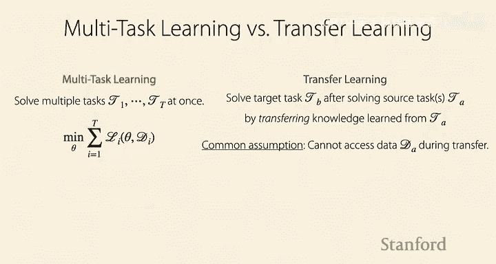
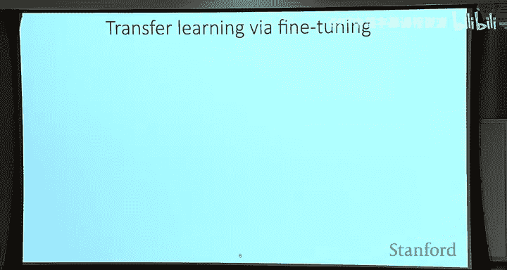
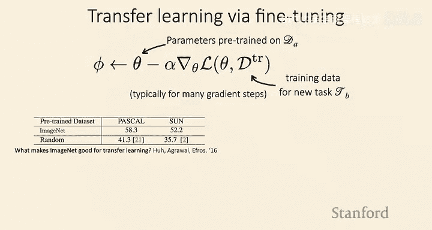
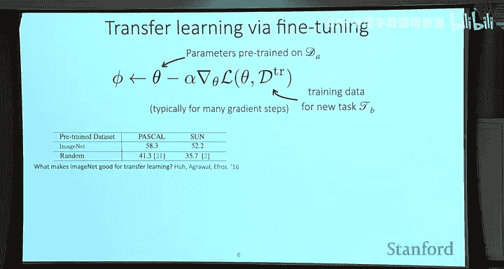
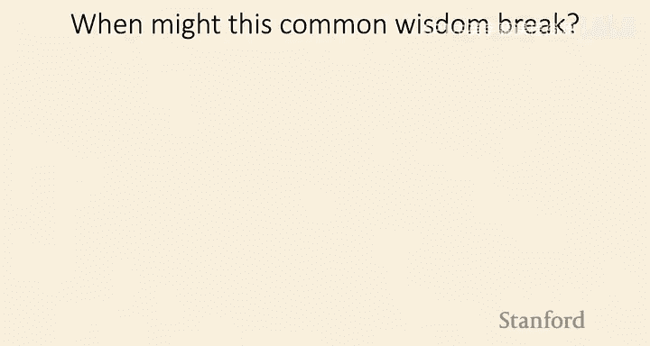
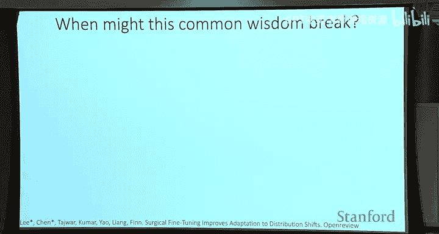
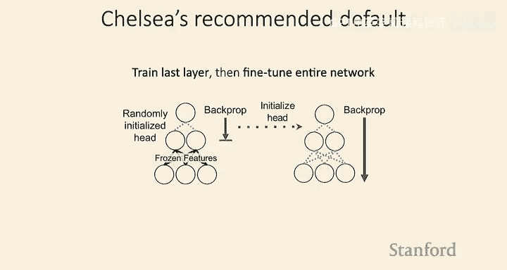
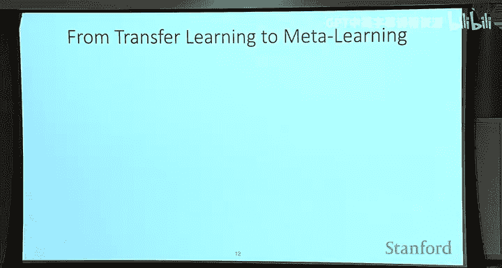
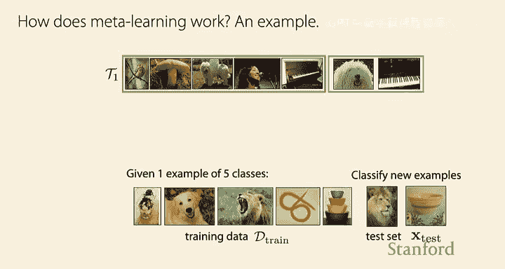
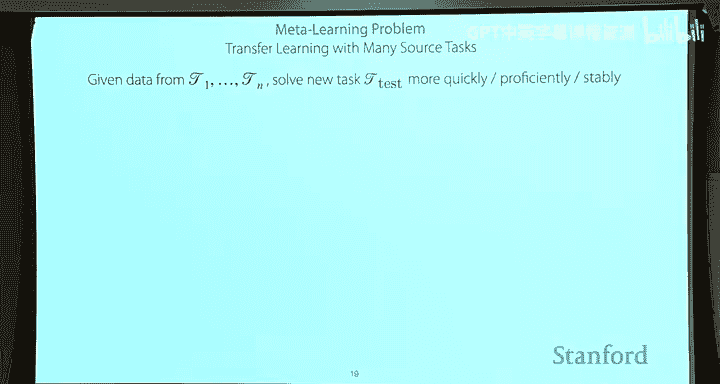

# 斯坦福大学《深度多任务与元学习｜Stanford CS330 Deep Multi-Task and Meta Learning 2022》中英（豆包翻译 - P3：-03-.Transfer Learning, Meta Learning l 2022 I Lecture 3.zh_en - GPT中英字幕课程资源 - BV1dWpPepEsj

Before we get started a couple logistical things， homework zero is due tonight at 1159。

 homework 1 has also been posted now and it will be due on Wednesday next week。

We are also going to be posting a number of resources for your project today first we're going to be posting a number of project ideas so if you're not sure what to work on and you want some ideas that should be pretty helpful。

 we're also going to post some example projects from last year that could give you a little bit of a flavor of the kinds of things that people have done for the class in the past。

And then lastly， some people mentioned that they'd love some help connecting with others in the class that have similar interests and so we're also going to be posting a form that allows you to kind of put down your interests and whether or not you're looking for project collaborators and we'll also post the responses to that form。

Today as well。 And so it will just help you connect with people who have similar interests。

 This is an optional form。 It's more just to help you find people if you're looking for people to work with。

One other important note as well on logistics is that these days there are some pretty fancy AI based code completion tools like GitHub actually sorry that's a type of coppiloott。

 there's also a more recent one that's even open source there aren't。

These are pretty new and so there aren't a lot of kind of standard course policies around using these tools。

 we'd like to say that it's okay for you to use these kind of things for the project。

 but we'd say that it's not okay for using it for the assignments because the assignments you should really be able to understand the code that you're writing rather than trying to ask NAI to do your homework for you。

Cool， and then the last logistical item also as well is that your feedback is really important to helping us help you to make sure the class is a great experience for you。

 and so one thing that we're going to be doing is called high resolution feedback starting this week and every week a random subset of the class will be getting a form。

 a feedback form where you can tell us how things are going and so forth and we'll use this to improve the class。

 so not all of you will get this this week， it will be a different subset every week so that we're not putting a ton of burden on you to fill out surveys every single week。

 but we can also still get feedback throughout the course。Great。

 and then lastly we've also finalized the guest lectures for the end of the course。

 I'm really excited that we'll have Ho and Percy give guest lectures。

 He is at Google she does a lot of really cool work on transfer learning and understanding deep learning and Percy is here at Stanford and he does a lot of work on foundation models。

 natural language processing and understanding emergent fu shot learning。😊。

So I'm excited to see those lectures at the end of the course。Great， so those are all the logistics。

 any questions on all that， a lot， all of this is on， well。

 these things are on the course website and the project resources will be posted on Ed so yeah。

 that thing is only here。Awesome。Last lecture on Wednesday last week。

 we talked about multitask learning and we defined what a task is as a set of data generating distributions。

From which a training set and a test set is sampled， the task also has a corresponding loss function。

And we didn't explicitly cover this， but you can think of learning a task as essentially taking as input a data set and predicting a set of parameters。

And those parameters would be the parameters of your model。

 we also talked about multitask learning where we're going to be training a neural network that's conditioned on a description of the task Z。

 and is going to be making predictions for inputs given that descriptor of the task。

We talked about how。Basically， the choice of conditioning on Z in different ways affects how the parameters are shared。

And different design choices with respect to that choice。 So if you observe negative transfer。

 you might consider sharing less information and designing architectures and designing ways to condition on Z that affect that。

And likewise， if you observe overfitting， you may want to try sharing more and have more sharing parameters。

Lastly， we also talked about this objective function for multitask learning and how if you normalize your labels。

 then just adding up the losses and optimizing like that is a great choice。

 but you may also want to choose the task weightings in a way that affects the prioritization of the tasks。

Great， so that's a brief recap of Wednesday's lecture。

Now the plan for today is we're going to talk about transfer learning and the problem formulation of that。

 and then we're going to actually start talking about metal learning and the problem formulation and the way that we can think about what metal learning actually is。

This will actually get into the start of homework one and the lecture on Wednesday will kind of cover the rest of the content that's needed for completing homework one。

Cool， and then from there， the cool things that we'll cover today in terms of learning goals are thinking about how you can transfer things from one task to another task。

What does it mean for multiple tasks to have some sort of shared structure。

 which is this somewhat nebulous notion that we've been talking about for the last week？And also。

 what is me learning？Awesome， so let's get started by talking about transfer learning。

So in lecture before we talked about trying to solve multiple tasks at once。

 and in transfer learning， things are a little bit different。So in transfer learning。

 our goal is typically to solve。A particular target task。

After having previously solved a source task or a set of source tasks。

And the goal here is when we try to solve this target task。

 we want to transfer some of what was learned on task A when trying to solve task B。

And a common assumption here is that typically you can't access the data from task A when you're trying to solve task B。

And so you basically want to condense all your information or knowledge about task A into some parameters and then use that condensed knowledge into when trying to address task B。

Now it's worth mentioning here that transfer learning。

 you can think of it as a valid solution to multitask learning because if you want to learn two tasks。

 then you could learn task one and then transfer that to more effectively learn task two that will give you a solution to task one and task2。

However， because of this pretty common assumption， multitask learning is not usually thought of as a valid solution to transfer learning because you can't access the data for one of the tasks during the transfer process you don't access the dataset sets of the two tasks at the same time。

CoolSo from there I have a question for you， so now that I've introduced these two problem statements。

 I'm curious if you have some ideas for what kinds of problems。

You might run into where transfer learning might make a lot of sense and might make more sense than。

Running multitask learning。入。Your source。すごにまてた。Yeah。

 so if your sourcehouse has a ton of data that you don't want to have to keep this around and like retrain on it when you're solving task B。

 you want to condense that knowledge down and try to transfer it。

 so that's one setting where you might want to use transfer learning。Other scenarios？有。

Through second。そなたこわる。就是这么。それは。都好了。Yeah， so if you don't have a lot of data for your target task。

 then something like transfer learning might make sense there。

 I also think that something like multitask learning could probably also be applicable to that sort of setting as well。

 but it is a setting where transfer learning is often used。哎呀。And helps we have some stronger。好的。

For example， what will you want to。So。Maybe further， you need to recognize or identify。

So then the can be task A， then location be task B Yeah。

 so if the tasks have a lot of shared structure， that may also be a good scenario to use transfer learning and also a scenario where multit learning might apply。

Yeah。We and happy be available， so you don't have to。Yeah。

 exactly so if you've already learned task A and the weights you can just download from the internet。

 maybe you haven't trained it yourself， maybe someone else did and they put their weights on the internet。

 then you don't even actually have to solve task A， you can just take their weights。

 take their solution and use that for task B， and so that's another scenario where it's very commonly used。

What more。Maybe you're deploying this into an environment。議論例えば。我。

But only then will you understand what has。Yeah， exactly。

 so you might be in a scenario where you don't know what all the tasks are up front。

 you're in a scenario where maybe you want to very quickly adapt to a new task。

 maybe you're trying to adapt like on a cell phone for example， to a particular user。

 and that sort of scenario is something like Transling it makes a lot of sense。

Cool so those are like yeah lots of really really great examples I had a couple examples that I put on the slide the first was mentioned if you have a really large source data。

 you don't want to have to retain this and retrain on it with multitask learning。😊。

And then the second case that I mentioned is you may actually have a scenario where you don't actually care about solving both of the tasks simultaneously。

For example， if ultimately your goal is to kind of deploy a model on different people's phones。

 you don't need to have a model that works for every one at the same time。

 you just need to be able to adapt the model to a user at any particular point in time。这。嗯。呃 do it。

这个全部在。You reception we can usually same。They said。have I weights off the Model A Yeah。

 typically what you will have about Tsque is something like the weights or something that you learned。

 it could be more than the weights， maybe you have some information about the optimizer， for example。

 that maybe you have stored， but typically it's the weights that you have trained on TsK。Cool。

 so now that we've talked about the problem setup。

We'll talk about fine tuning， which is basically the go to approach for transfer learning。

And the way that fine tuning works is we'll take the weights that were' trained on taskade。

I all denote this with theta。And we will initialize a neural network with those weights。

And then run gradient descent on the target task， initialized at those weights。

And so if detrain is the training data for your new task， then you'll evaluate the gradient。

 apply that gradient at the that initialize that the。

 this is showing just one step of gradient descent。

 but in practice you would typically do this for a number of gradient steps。

And then the result of this process is you'll get a set of parameters phi that are hopefully actually much better at taskask B than if you were to randomly initialize theta。

And in fact， if you actually compare using randomly initialized parameters versus parameters pre-initialized with a data set that is effective is useful for the target task。

 we can see that we get much better performance， so in particular here's an example where a neural network is pre-trained on INet or it is initialized randomly。

And the target data set is these two data sets， Pascal and Sun。

 which are both image recognition datas， and we see that we're able to do remarkably better if we pre trade on ImNe compared to pre tradingding from scratch。

On the order of like 16% to 17%。

So this is really cool， essentially what this is doing is that it's taking all the rich information that exists in the INe data set。

 leveraging that in the context of transferring to these new tasks。😊，Yeah。

Tran doesn't make sense between 200。I have。LikeHow do I look at the both if just at any time。一。Yeah。

 so the question is， is there some criterion that could tell us if transfer learning will work if it will be helpful and in general kind of similar to the multitasks learning scenario where it's difficult to tell if trading on two tasks together will be helpful it's also very difficult to just develop some criterion and so in general there are some kind of。

General common wisdom for getting these things to work well， and in general， for example。

 if intuitively the tasks seem related， then it can be a good choice。

 but in practice there isn't any hard rule that will tell us if it will work or not。And so I guess。

I should say that。What I just said is dissatisying to me。

 I think it'd be really awesome if we had something that could tell us basically whether this would work。

 and we'll talk a little bit about some recent research in some of the coming slides。

 but also investigating this sort of thing for like a course project。

 I think could be quite interesting。第。I still in this are year career be training。Yeah。

 so in this case， we're retraining the entire parameter vector。

 I guess I'll try to finish this slide and then we can get to more questions。

Kind of related to like when will this work when will this not work。

 there's a number of choices that you can select for pretrained parameters。

 things like imagenet classification or models trained on a very large language corra are common choices in computer vision and NLP and in general。

If you can pretrain on a diverse data that covers the kinds of data that you'll be seeing during fine tuning。

That's kind of generally a good choice it doesn't even need to necessarily cover the distribution of what you'll see at test time。

 so for example， in INet classification people have found that you actually get very general purpose visual features from those and you can take those visual features and actually apply it to try to transfer them to satellite images or try to transfer them to medical images and those visual features are actually still pretty useful。

 even though those images are out of distribution compared to what imageNe images look like。じゃあ。

Intu if you think that this is doing something like creating a dictionary of New variables。

 it's the of approximate dictionary and then find evening is basically updating the dictionary literature。

Yeah， so the question is， can we think of this as the pretrain process is learning a dictionary of latetnt variables and then the fine tuning process is essentially。

As updating the。I guess I'm not fully sure what fixing it towards a task exactly means。

I think that intuitively there's I guess I think there's a lot of intuitive explanations for what it may be doing one intuitive explanation is that it's giving you good features。

 so it's giving you a good representation of images， for example。

 it gets you a good way to look at images or a good way to read text so that's one explanation and once you have once you kind of roughly know how to see at a course level that makes it much easier to be able to recognize other images。

And then a completely separate explanation might be if you think about from the standpoint of optimization。

 if you have this really complex optimization landscape that is nonconvex。

 then you can possibly think of this as trying to put you in the right basin of that optimization landscape and once you're in the right basin。

 than if you run gradient descent from that basin， you'll get to a better solution。

 then if you started off kind of at a random spot in that optimization or in that landscape。

So can this be related to the idea where you have a simple model。

 learn that model and then initialize a more complex model with ways to learned from the simpler model。

 or does this fall outside that pair？So starting with a simple model and going towards a more complex model so in general something like that I would refer to as perhaps a form of curriculum learning where you move from kind of simpler tasks towards more and more difficult tasks and things like transfer learning can be applied to that but that doesn't always have to be the case you don't have to start with a simple task and move to a more complex task in fact oftentimes you actually move from a more complex task to a simpler one like imagenet classification is actually a really really hard task to learn from scratch and then you might move to something that's a little bit simpler like maybe you want to be able to classify between like cats and dogs or something like that。

有。So if you have a large amount something then it make sense to screen a model from scratch。

 or do you think that fine tuning would generally maybe still provide some context？Yeah。

 so if you have a large enough data does pretraining make sense or can you just train from scratch if you do have a large data set then it's from a performance standpoint。

 it may be that you can already do quite well training from scratch on that large data there are still some potential benefits。

 one very obvious potential benefit is that you may。

You may not need as much compute to get to the solution， so even if you have a large data。

 if you can initialize with a pre-trained model， then you may need many fewer gradient steps and many fewer compute cycles to get to a good solution on that task compared to if you were to train without any prior knowledge。

嗯。Cool， so kind of the common wisdom with these pretrain models is generally trying to pre trade on diverse data sets。

 there's also some unsupervised learning techniques that you can use for pretraining and we'll cover those in some of the upcoming lectures。

第二。We considered that the task， the new task is related to the old task。

 or the new data set is related to the large dataset set that。Is it is。

 is the reason case for the type data or the。Yeah， so the question was like generally。

 well this may be part of the answer too， but generally we want the source tasks and target tasks to be similar to be related to one another and you're asking if they need to be related in terms of what task it is versus what the data is and in reality it' it's both what the data looks like and what you're trying to do with that data that will affect how successful transfer is。

I'm going to move on a little bit to at least get to the rest of this slide。

 but all these are great questions。Now one of the things that was mentioned before is that。

One of the things that's really awesome about transfer learning is not just that you can do better by leveraging this prior knowledge。

 but that oftentimes someone has already distilled that prior knowledge into a model and put that model on the internet so that you don't even have to train on INe or train on some language corra。

And this actually significantly improves I think， the accessibility of things like deep learning because it means that anyone can download a model and use it on their problem on their data as long as it's at least somewhat sufficiently similar to these common pretrain models。

Cool， now。In this example， this is kind of the， I think the one of the most common versions of fine tuning where you fine tune the entire network。

But in practice， there's actually a lot of different design choices that come up when thinking about fine tuning。

And。A lot of these design choices kind of revolve around。

Thinking about how to not destroy the prior knowledge and prior information in your model and balance that prior knowledge with the knowledge from your new data set。

And in particular， if you have a neural network that。That has some layers。Say， for example。

 maybe you're trying to pretrain on INet and now you're trying to fine tune on a task like classifying between cats and dogs。

 or maybe I think cats and dogs are probably in the INet data set so we can maybe pick something more obscure。

 like， I don't know， classifying between whiteboard markers and whiteboard erasers or something like that。

In that case， you have a network pre traineded on IageNe。And the output image has 1，000 classes。

 and so the output layer is going to be 1000 dimensional。

 and your target task has two possible labels， one for whiteboard markers and one for whiteboard erasers。

And so what you need to do in that case is to。Essentially。

 you kind of re initialitialize the last layer because you can't or at least use some part of this。

You can't just directly use this last thing， you could either use two of the classes and then throw away the last half or just reinitialize a new network on top of these features right here。

Now， one thing that comes up is let's say you reinitialize to instead have。A last layer of two。

A much smaller last layer。And these are now randomly initialized weights。

 whereas everything before this is weights pre traineded on ImNet。Now in that case。

 if you back propagate your gradients through the network。

 if this is a randomly initialized weight matrix， then you're essentially going to be multiplying your gradients by some random numbers right here and then applying those gradients to the rest of the network。

 and so then you're going to be hitting these weight matrices with numbers that have a lot more randomness in them。

 and that might actually destroy a lot of the really great information in these layers。

And so one common practice， or there's a few different common practices for people that people do。

 one is defined tune with a smaller learning rate， especially for the earlier layers of the network。

 because you don't want these features to be destroyed by the gradients coming in from the network。

S learning rate for earlier layers， sometimes also you might freeze these earlier layers and only train the latter parts of the network。

Or start by only training the last parts of the network and gradually unfreeze from the back of the network。

Read initialitialized Los layer， which we talked about。

 so I guess these four things are fairly common design choices when fine tuning。😊。

In terms of how to pick between those design choices。

 you can kind of search over those design choices and hyperparameters by running cross validation on your target task。

And I guess the last thing worth mentioning here is that the architecture that you choose to fine tune will also affect the transfer performance。

 and so in particular residual networks which have residual connections between layers。

These networks are often more effective for defined tuning because you get kind of a bit of a highway throughout the network。

 and so you it's easier to get gradients to all of the layers rather than having to。

Use the chain rather than having to kind of go one by one by layer。Okay。

 so now that we've gone over the basics of fine tuning there。Any more questions。有。你 just算。

Complexity of that second。ちともる。Let's say just your passwords of dogs。

All you would need to do is a simpler change to that last layer， right。

 but it it's a really complicated。Seconds good。や？Yeah。

 absolutely so the question was like if the target task is simple versus complex。

 does that affect the how you choose to fine tune the network and yeah if you have a really simple task。

 then you may just only need to train this last layer。

 you may not even need to change the features at all。

 especially if that task is very related to the source task。

 whereas if it's very complex or very different， you may want to actually kind of reinitialize more than one layer on top of the features or kind of fine- tune the entire network or something like that。

第二。How do you prevent overfitting？情。Yeah， so if we have a small amount of data。

 how do we prevent overfitting the most common thing to do is early stopping。

 which is also done in standard machine learning， which is instead of finetning this for a very long time。

 fine tune it for fewer gradient steps， watch your validation loss on your target task and stop finetning once you reach a good solution you can also fine tune fewer layers as well so if you fine- tune only the last layer then you'll probably overfit less than if you fine-t the whole network。

Yeah。If you took like a pre tradeate model， like InNe， for example。

 and worked fine tune it on more exotic sort of more like more specific instants of certain updates or categories。

Still sort of show。Work understanding of works record。I同意。やぱ。

You knowMaybe be two specific instantiations of CA。立候させていただ。うんだ。さと。Yeah。

 so the question is if you fine tune on a more finegra classification task like maybe classifying between different species of birds or something like that。

 then would the features still like would you get a good feature space for that task such that like similar species of birds are grouped together。

 is that what you're asking Yeah so if you fine tune only the last layer of the network that won't affect the features in any way so you'll just get the original imagenet features but if you do fine tune the entire network。

 then that should also give you better features for that target task。

 of course if you have a really small target task， then？The future is。You may not benefit， well。

 you may overfit to that and so you may not get good features of that or it may just be beneficial not to fine tuned for very long because you have a small data set。

 so it will depend a bit on your data size， but if you fine tuned the whole thing it will adjust the features and it should learn a good space for that a good set of features。

Yeah。喜力。不出。What's the location of the。arrow loss so the arrow on the left it is kind of an assignment operation。

 so we're saying that we're defining phi to be the right hand side of that you can sort of think of it as an equal sign。

 although it's more directional。いすれ。the parameter from the first mode of the first cast to the mode of second half。

 the using the new loss function on the new。じゃあど knowごいゃです。The far is。

The trade peri of the second half。Yeah， yeah okay。In any case。

 it means that it seems the two models should have the same architecture so when you fine tune you're going to be if you fine tune the whole network。

 well in general you should be using the same architecture。

 you can reinitialize the last layer or re initialitialize parts of the network and change that part of the architecture。

 but in general， especially the first layer will need to have the same architecture。もうでよですだよ。

How we can initialize parametersmeter the same cost data run the nial Yeah so if you have more layers then you'll need to randomly initialize so。

 there isn't a great way to initialize them。Yeah。Can we also use transfer learning for multitasks？

But just by separating the last few layers。Yeah， so you could also transfer to multiple different downstream tasks。

 so you could have like multiple heads， for example， or you could pass in a Z here。

One thing that's a little bit tricky is if you want to pass in a Z earlier in the network or pass in some other input earlier into the network that wasn't there during pre traininging。

 then you need to make sure that you kind of。Actually update this layer during fine tuning。

 but in general， something like that is definitely possible。Co。

 was there one more question in the back yeah？So if you have the lowest big over。

 but un which the mor。Have calling for the new。So if you have a chosen for the preprint model。

 are there？So like we could do mod learning for it。ぱに。To doment and照 home。What the cost would be。

So you're asking if we have the source data available。

 is that helpful during the fine tuning process？so。In general。

So you could just do multitask learning and train on both of the tasks and maybe up the target task if you care more about that。

That can be helpful if you don't want to forget the source task。

 it can be somewhat helpful to regularize when trying to solve the target task， although in practice。

 it depends a little bit on the scenario and in practice actually just oftentimes fine tuning is actually often better than keeping it around。

The other thing that you can do is you can regularize towards the initial parameters and that you can do actually without the source data。

 which is nice。 And there are some works that have found benefits for that in some scenarios。点二。

So if you're working in some sort of viewshot。s there been shown like any way to sort of do a whole fine hearing that isn't just like explicitly worse than video evaluation？

嗯嗯。So you're asking in the setting where you have a very small amount of target data。

 is it ever better to fine tune the entire network rather than just a small thing on top？

In two slides， I'll get to something that I think will somewhat。It won't fully address that。

 but it will show some scenarios that are better than just fine tuning the last layer。Yeah。Okay， so。

I' in general， all the things on this slide are。I wouldAll the things on the bottom。

 I would refer to as kind of common wisdom around fine tuning。and。

It's also worth mentioning that this common wisdom， I think。

 is changing and it's not fully set in stone。 And so in particular on these next two slides。

 I want to cover two。Two papers that maybe you might consider as old by machine learning standpoint。

 by machine learning terms， which is that they both came out last week。

And the first paper is a paper by some folks at CMU， I believe。And they found that actually。

That unsupervised or generally pretrain doesn't necessarily need a really diverse data set。

Specifically unsupervised pre trading methods。They found that if you randomly initialize the network。

 you get 72% success on the target task， if you pretrain on a book corpus that's much larger。

 you get 81%， so we do see a benefit from pretraining here。

But they also found that if you pre train with this unsupervised objective。On the fine tuning data。

You actually get 80。96% success or average accuracy， which is actually very close to the 81。3。

And this， I think breaks the common wisdom because the common wisdom is that typically we need a very diverse pre traininging data set。

And this suggests that when you have an unsupervised pretraining objective。

 you may not actually need a really diverse pretraining objective or pretraining data。

 you could possibly even just pretrain on the target data itself。

So this is kind of breaking the common knowledge or the common wisdom here。

 if you have a supervised pre tradinging task， then this won't work out because you like running supervised learning on your fine tuning data and then running fine tuning on your fine tuning data。

 those are going to be the same exact thing。So this is。

 I would expect to only hold in the unsupervised pretraining case。

 but it's something that breaks the common wisdom and suggests that we don't have everything figured out even when it comes to fine。

有。Have objective are。This is only in stages versus can you opt with this。

 you're asking if this would also hold in the multitask？まこれ受けて。ことて withinです。最。

I think that they only ran experiments in the pretraining and fine tuning phase。

But you could read the paper for to check。 and because it came out last week。

 I don't think anyone has built on it yet。 I should mention this is averaged over a number of different。

 They ran this this on a number of different。Target tasks， this was all in the NLP domain。

 but there's actually another paper that came out actually a little bit before this that actually showed a similar result in computer vision tasks as well。

Now the second paper is actually a paper that was co authored by Yuunho and others。

 Yuho is a TA in the class， he looks like this。

And。I want to give a little bit of kind of the thought process behind the research。

 because I said I would try to mention that a little bit in the course。

And the thought process was that there's a lot of scenarios where fine tuning。

 only the last layer works really well。So that's great。

But is there anything actually like that special about the last layer？

You can maybe me think that it's somewhat special and that it's kind of closest to the labels in some sense。

 but in many ways it's also just like any other layer in the neural network。

And so his thought process was， well。Maybe for kind of if we're trying to fine tune to a pretty low level shift。

 maybe there are scenarios where the last layer wouldn't work better。

 but actually maybe other layers in the network like the first layer might actually work better。

And he actually already had some experiments set up to run fine tuning on image corruptions。

 and so he pretrained on the CFR 10 data set， which is an image classification data。

 fine tuneund it on CFR 10C， which is a corrupted version of that data set where there are a small low level image corruptions applied to the data。

And he found that if you fine tune the whole network， you get around 79。9% accuracy。

 and if you fine tune only the first layer of the network。

 you get a higher accuracy on the target task。And then from there， the thought process was， well。

 okay， if there are some scenarios where the first layer works。

 maybe there are scenarios where some like only fine the middle layer works。And indeed。

 there are some scenarios where actually fine tuning a middle layer is actually better than fine tuning the whole network。

And so this is another example of kind of breaking the common wisdom because the common wisdom is typically defined fine tune from the back of the network。

 but there are actually scenarios where that's not the best option。Of course。

 these differences are still， they're kind of2 to4%。

 so full fine tuning still does work pretty well in practice。

 but it suggests that we don't have a full understanding of fine tuning。州。ers。

Did sort of analysis program。你被不有点自。The question is that different layers have different numbers of parameters。

 and so it may be that like。Maybe that is accounting for some of the differences here。

 maybe that has like a regularizing effect or something like that in general。

 I can't remember off the top of my head the numbers of parameters for each of these blocks。不啲。

They did run experiments fairly extensively on this。

 they weren't explicitly controlling for the number of parameters。

 but the results I do think suggested that it had more to do with where in the network you were fine tuning compared to the number of parameters and I guess should also mention that for full fine tuning。

 the learning rate and。The early stopping were both determined with cross validation。

 and so this is like a pretty well tuned baseline。有。

Or for some tax tasks like the I F data set where we start off with。

like a color image as the input and we now want to task where we just have black and white。

 it would make sense to just retrain the first layer because it's like I change in like the inputs but we still't want to。

Pmently similar processing。Is there any good intuition for when we would choose like a middle layerir and which middle layer too？

Yeah， so the question is， yeah， what's some of the intuition here especially with regard to the middle layers。

 and so in some of Yuno'stuition for trying this also was that，You could sort of think of。

So there's sort of a kind of a causal process underlying kind of the process of going from a label to generate an image。

 and you could sort of think of neural networks as trying to reverse that causal process where like when you are。

 for example， trying to generate， I think like this one you're trying to predict vegetables。

 for example， you may first go from，whether it's a vegetable or not to something that's like what type of vegetable is it to like what is the position of those vegetables and the appearance of that vegetable and then down to like what do pixels look like for that kind of thing and when you change some part of that causal process。

 if you think of that as the entire chain， it could be that maybe if you change something in the middle of that chain。

 then finening the middle parts of the network might be the best choice。

 insofar as neural networks might be kind of reversing the causal process of image generation。

So that was some of。Our intuition there， but it's also something that isn't like still fully sorted out。

 and I think that one of the things that makes this result interesting is that it is different for different kinds of shifts between source and target。

点儿。mean finding one layer somewhere works than it also compared that it works better than just finding the last layer as well so in these cases it was also well in this case last layer was best but in the first two cases these were also better than fighting just the last layer。

There。Is it referring to never production in this partency？

Is it better for all the 15 different types of corruptions or research even with degrees for solving the specific corruption？

第二个是别的手份。Yeah， the question is， helpful is the first layer good for all different kinds of corruptions？

系。I believe it was better for。Almost all of the corruptions that we tried。

 I don think I'm not sure if we tried all 30 of them， I think there's a lot of them。

 but I think that for at least for most the ones that we tried， it was the best。Cool， okay。

 so now that we know that the common wisdom is， well， the common wisdom is okay。

 but it's still something that's kind of being developed。

I do want to give you somewhat of a default because if you do want to actually use fine tuning in practice。

 you don't want to have to navigate this entire space of design choices。And so。

Despite some of the results that we've seen， I do think that if you want something that is pretty reliable。

 I think something like first training the last layer of the network and then training the whole thing is generally a really good place to start and generally works well in practice。

And the reason for that is exactly what we talked about before where you want to avoid destroying your early features and so you want to train this last layer。

 the last set of layers first， and then fine tuning the whole thing usually is helpful in practice。

Yeah， how do you know when to stop training the last and then going。Yeah。

 so in terms of when to stop training the last layer， typically when you train the last layer。

 you typically don't overfit。Because it's a pretty small number of parameters and so you can mostly just look at until you converge and then once you roughly converge。

 once you see the loss function not going down anymore， you can start fine changing the whole layer。

 you can also look at when the validation loss starts to even starts to level out as well。Cool， yeah。

よして。Thank you分すは内だね。Would this be applicable to online learning？Yeah， I mean。

 you could certainly kind of do this repeatedly， like reinitialize the last layer and fine tune that before fine tu the whole thing and then kind of do that repeatedly。

Yeah， although if you are seeing kind of a gradual shift in an online learning setting。

 you may just want to keep on fine tuning the whole network。

Cool， and then the last thing that we'll talk about with fine tuning is that is looking at what fine tuning performance looks like when you have varying amounts of target task data。

And this is just one example， and so in particular。

 what this is looking at is that X axisax is the number of training examples in your target dataset。

😊，And the Y axis is error the validation error rate on that target task。And so as we see。

 as we have more target task data， the better we do as we would expect。

The blue line is training from scratch， the green and orange line are different pretrain models。

And one thing we note is that if we have only 100 target task data points。

The performance isn't nearly as good as if we had a bit more than that。And in general。

 this is still doing pretty good， like in this example。

 we only have like if we we only have 1000 examples， we still do really， really well。

 but it does start to get much worse if we have only 100 examples。

And this is where things like metal learning can be useful。So now with that in mind。

 let's transition to talking about better learning。

 so how do we get from transfer learning to better learning？

In transfer learning， we talked about how we'll initialize the model and hope that initializing from there。

Helps on the target task。The kind of key intuition behind me learning is instead of hoping that it will help。

What if we explicitly optimize？For transferability。And what I mean by that is if we have。

Not just one source task， but a set of source tasks。

Can we optimize for the ability to quickly learn these tasks？

Such that we can learn new tasks quickly as well。So if we learn how to。

Quickly learn a set of tasks already， that means that we should be able to also learn new tasks quickly。

And so you could also think of this as if we think about learning as going from a data set to a set of parameters。

And we want to be able to。Learn quickly。That we could think about essentially trying to optimize for this function。

So that we can learn well， even with small data sets or even when we have a small compute budget。

So that's the intuition behind meta learning。There's two different ways to view meta learning algorithms。

The first is more of a mechanistic view and the second is more of a probabilistic view related to the idea of kind of optimizing that learning process。

 you can the mechanistic view is that，You can think about a deep neural network that takes this input a data and makes predictions for new data points。

 and you just want to optimize this deep neural network using this kind of form of metadata set。

And optimize it over those tasks so that if you give it a data set for a new task。

 it can give you parameters for that new task。So that's the more mechanistic view。

 that's how you might kind of implement one of these algorithms。

The more probabilistic view is if we have a set of source tasks。

We could try to extract the shared knowledge， the shared structure from those tasks in a way that allows us to efficiently learn new tasks。

And so then we have a new task， we'll try to use that prior knowledge to infer the parameters for the target task。

So with these two views in mind， I want to try to。First。

 kind of talk a little bit about this probabilistic view。

 which will help us think about what it means for task to share structure。

 and then we'll go back to the mechanistic view。Cool， so let's start with the probabilistic view。

 think about what Bayes would think of metal alerting。And for this。

 it'd be helpful to go through the graphical model。To start off。

 how many of you are familiar with Bayesian networks or equivalently directed graphical models。

 raise your head？Okay， how many of you are not familiar with Bayesian networks or directed Gal models？

Okay， it's about 50， 50。So。Basenetts or graphical models they're covered in CS109。

And so for people who did undergrad at Stanford， you probably have learned about them。

 although you may be a little bit rusty， so we'll kind of walk through it a little bit。So。In the。

I don't know if I think I'll call them graphical models in general。

 they're often called phaseNes as well， so in graphical models。

 random variables are denoted with circles。So if we have a random variable x， we put x in a circle。

We may also have a separate random variable Y。So these are just two different random variables。

And dependencies between random variables are represented with arrows。And so for example。

 if you have a distribution P of y given x， this arrow kind of represents this dependency。And if。

For example， this is equal to P of y。That means that there is actually no real dependency on X and so you wouldn't draw an arrow here。

So actually I'll leave that up。The other thing about Bayes Nes is that it tells you a little bit you can read off kind of whether or not two variables are independent。

And so if you have。Maybe you have a Bayesian network。That looks something like this。you can。

Look at this and figure out if two variables are independent。

A and Y are not independent from each other because they have a line that connects them。

And A and B are actually also not independent because they have a path that kind of goes from A to B。

AndSo any set of variables that have a path between them are not independent。

 They have some dependency， whereas if there's no path between them。

 then those two random variables are independent。 So， for example。

 A and D are independent from one another。So that's kind of a very。

 basically all you need to know about graphical models， at least for now。

So now I want to draw what I'll call as the graphical model for single test learning。

So in particular。ISay we have。Some parameters。Some labels。And some。Some inputs。

 then we could think of having a graphical model of basically to predict y。

 it's going to be a function of x and our parameters because we have this kind of relationship of F of y given。

Given x and5。So you can think of this as a graphical model for。For single task learning。

 I should also note that。If you are thinking about causality。

 sometimes people might this arrow or the kind of relationship between X and Y。

You could possibly flip these arrows to be in different directions。

 but for the standpoint of this lecture， it'll be helpful to consider this direction and we won't really be considering things from the kind of causality standpoint。

嗯。Cool， and you can think of Phi as essentially the parameters of Y given x。

 and these are the parameters that we're going to be trying to infer in machine learning or in single test learning。

Now I， there's one more thing that's helpful to know about graphical models。

 and this actually may not have been covered。In 109， which is what's referred to as plate notation。

And in particular， if you have multiple data points， so say this is just one input and one output。

Then it'd be nice to have something that could。kindd of denote the entire data set。

 not just one input in one output， and so that's called plate notation。

 which is that instead of drawing all the different data points， which would take me a long time。

 will instead kind of draw a plate。Around。Here we'll have an eye here that will denote that this plate is over eye。

 and this means that basically this makes copies of everything inside the plate。Inded by I。Cool。

 any questions on this？Graphical model。 Does this make sense。括。

So now if we get into multitask learning and think about the graphical model there。诶。First。

 that means that we're going to have multiple tasks。 and so we're going to have。Well。

 it can index the tasks by J？And then we will have another plate around here。

Which will just mean that we have multiple tasks that go that are indexed by J。

 so Phi J is the parameters for task one， task two， task three， and so forth。And。

These parameters have some shared structure， and in particular。

There's some dependency on these parameters。诶。5hi theta。Yeah。Why does y only depend on phi。

 so y depends on both phi and x， so there's an arrow from phi to y and x to y。こののはこれちょっ。

Why is exist we don't fly this？Is my own prediction or how？Why is our our。

This work gets a little bit messy， I guess so why is the label and phi is the true parameters？讲。Yeah。

 what is the， is there correlation relation between I and。こます。俺ずてなさい。Yeah。

 so you can think of I is over data points， J is over tasks。

 and so this means that for every task there is a set of data points。Yeah。No。To because。The sameYeah。

 so you may actually have something where like X is outside of this plate。

 it's more like actually no， so yeah， it may not be true and。

This is the more general case where they're different， but in practice。

 and I'm actually not sure how I would draw it if I were to- it's a little bit tricky to draw yeah。じ。

Is data in this case just like the kind of like a unified？成本基準もあるですなか。So they。

Theta is kind of an interesting thing。 So theta is。

You can think of theta as this shared information between the tasks。

 and it's only the stuff that's shared between the tasks。

And I use the word latent here because latent means unobserved， so in particular the data points。诶。

X and y are observed， and so in graphical models， if you shade something in。

 which is a little hard to do on whiteboards， that means that they're observed。

 whereas we don't observe the true parameters and we don't observe what the shared structure is。

And so it's worth mentioning that if there is no dependency here。

 then that means the tasks don't share any structure。

Whereas if there is some dependency on the shared structure。

 then they do actually have some shared information between them。Yeah二。没多で。It's like on externally。

 we're doing all like samples that are being sampled from random。そ場。

I'm just using this to denote the kind of individual data points in our training data set。

Based in the internet， it says on different charges of。あ。It's a good question。Yeah。

 so you could alternatively think of X and Y as the。

As the random variable like the random variable x and the random variable Y。

 and in that case you wouldn't need the plate here， you would still need display plate。

 but you wouldn't need this plate。Yeah。So is this like the equivalent of a disc model since you're taking X like the x of Y isn like a given in like a more general case。

 is there also something else there some noise effect be asked？Yeah。

 so there could be cases where there's other things that affect x and other things that affect Y。

 I'm leaving those out for simplicity， but。For example。

 y may not be perfectly like there could be some noise that affects y， if you have label noise。

 for example， there could be other things that affect X， but yeah。

 for simple to I'm leaving those out。Cool。Here I just kind of drew this for the training data points。

 it's helpful in some cases to actually write it out。

In a way that separately represents the test data points。I mentioned that because。

The test data points are not fully observed， the labels are not fully observed if you have a set of training tasks and you can observe the labels for the training tasks。

 but we'll go into that more in a future lecture。But now let's get into a little bit about theta。

 so if you condition on the shared information on theta。Then it's worth noting that。

The task parameters well， so first， the task parameters are not independent right now because there's kind of a path between them。

But if you condition on data。The task parameters become independent。And so what that means is that。

If you condition on theta， you'll actually have a lower entropy distribution over your task specific parameters by I。

comparedar to just your kind of prior over Phii。And so what that means is that， well， actually no。

 maybe I'll ask you this。So if you can identify if you know the shared structure。

 if you can identify the shared structure， theta。Then。

When should learning PhiI be faster than if you didn't know that charge structure？

People have thoughts。I could also walk through this slide a little bit again。

 So I guess the first step is that if we condition on on this。Variable then。These become independent。

 and if you have information about theta， that that lowers your entropy estimate of phi because the。

Essentially you can kind of narrow down what the value of phi is once you have information about theta。

And so from there。If we can identify information about theta， then。With this dependency。

 learning phi should be faster because we have fewer bits to uncover from our trading data points。

Yeah， as long as you really understand the release。这个保。Yeah。

 so if you have information about data and this dependency exists and you understand that dependency。

 then learning Phi should be faster than if you didn't have that information。Exactly， basically。

 you need fewer less information about the data points to infer P once you have information about data。

One other thought exercise。That builds on this a little bit more。Is。

So we talked about how if you have information about data， that tells us。That lowers our entropy。

 that gives us more information about Phi。Now， what if？The entropy of phi given theta is0。

Yeah so if basically if your entropy goes to zero， then you actually fully know Phi。

 you have full information about Phi， and at that point you can actually just fully solve the tasks。

嗯。Yeah， and that means that you don't even need any additional data to solve the task。Cool。

In general， I think that this sort of Bayesian perspective。

I think it's a useful framework for thinking about what it means for some task to share a structure and specifically in kind of the form of this variable here and you can think about these kind of different mathematical relations。

As when we might expect， basically how much shared structure is versus how much data you need to learn a given task。

Cool， two other exercises or well， one exercise with two examples。诶。

Say that we have a set of sinusoid tasks， so task one is。A sinusoid with。

An amplitude of like five and a kind of a phase of pi。

 and then maybe task two is an amplitude of one and a phase of pi over two or something like that。

And all of your tasks have different amplitudes in different phases。Then in that scenario。

 what information does theta contain？Yeah。嗯。Not quite so the amplitude phase this is for task one。

 this is for task2， the question is kind of what is theta， what is the shared structure between them？

Yeah。Ex fact if they're alloidal Yeah exactly so everything but the amplitude and phase so kind of is。

Corsponds to the family of sinusoid functions that once we have that shared structure。

 we just need to infer these two values using our data。One more example。

 so say that our tasks are machine translation。And our goal is to translate between two languages and one task is to translate from French to English。

 another task is to translate from Japanese to Spanish or something like that。In this case。

 what does theta correspond to？Yeah。こした通し。い？Any privilege。

To say it's possible translation between any pair of languages？ち。Any family of two languages。

 so basically basically would allow you like you're saying that the trans structure is kind of a universal translator。

Yeah， that's close， although not quite。Yeah， were so angry rules。

Universal languages yeah so you're saying things like adverbs and verbs and stuff like that so this is I guess both of these are like mostly right it's basically going to be everything and I guess I mean sort of the first one too it's basically tell us information about the family of all language pairs although it shouldn't contain all of the information needed to translate between one pair of languages because well ideally be they're only the things that are shared and not the things that are needed to actually solve the task。

要。そだ。Vial parameters since languages are so diverse。Yeah， so this will be。This will be like。

Relatively small， it won't include things like vocabulary of a given model。

 but it will contain things like adverbs and like like the kind of。

Gramatical structure that you often see in languages。There都作。ros languages。嗯。

Right so the specifics of what order put do you put the adjective before the noun or after the noun。

 those sorts of specifics won't be contained in theta。

 but the general notion of those things is somewhat shared。

 this is also sort of a hard question because it's something that's rather vague and hard to put into words yeah。

I was like this sort of。Like a network ter would this would idea like the early parts that are all。

Doesn't I you as a wait for。Or yeah， where does that from？Yeah。

 so the question was in practice what like does data correspond to like earlier layers or like what is this theta thing。

 so here we're really like just thinking conceptually。In practice。

can correspond to a number of different things，ation theta and I chose the notation theta in part because one thing it can represent is the initialization of fine tuning。

 you can think of it as of the initialization as kind of prior knowledge or kind of source shared structure。

 but we'll see this much more concretely when we get to the lecture on Bayesian middle learning。Yeah。

So privacy still are referring to task。かるとか。全然？Oh， is a meary task and a task equivalent？Oh。Yeah。

 so this graphical model will be the same for both multitask learning and me learninging。

Anytime it is basically the graphical model for a set of tasks。

 it doesn't really cover- and both multitask learning and meta learning consider a set of tasks。ビゼ三。

真好。Yeah， so this lost part。So what does entropy of zero mean， So entropy of zero means that you。

Your distribution over phi is basically just deterministic， it just has a single value。

 whereas if we had a nonzero entropy， that would mean that we have some uncertainty around Phi。

 our distribution would be a wider distribution。And so when the entropy is0。

 that means that we know exactly- there's only one value that the distribution covers。

 there's only one value that the random variable can take on。And so。In this case。

 when the entropy of phi given theta is0， that means that phi can only take on one value。

Once we have the information and theta， and that means that we kind of have already。

That means that once we have this information， we can fully recover the parameters for all of our tasks。

Yeah。How can we formulate the goal for in this。W to maximize price4。

Would that translatel into something？Palate through relationships between the。Yeah。

 so you can think of metal learning as basically trying to infer theta。

So trying to maximize for the ability to learn a new task and when we have well ideally if we like it'd be nice if we could just get Phi directly。

 but if we're trying to optimize for the ability to learn a new task， given a set of tasks。

 the best that we can do is recover theta and once we have theta then that will allow us to learn new tasks from that distribution more quickly。

じ。So。Yeah， so basically， yeah， you can think of meta learning as trying tofer infer theta。有。

the choices all coming to like the shared data as well are they all the sort of differently？Yeah。

 so you can think of metal learning as trying to learn inductive biases or trying to learn like structure。

 and there's separately choices of structure that we build in ourselves as humans and those can be represented。

I guess the。The way that I might represent that is by having some。Some other variable here。

 which is like the human built in inductive bias， and that maybe also has some prior over like maybe we have some guess at what Phi is。

And that's going to this will kind of denote that sort of guess and so yeah， something like that。就。

When you see that why is independent what conditions on the past。

 because I can have imagine a situation where we're training where there's like three main tasks。

Two the tasks are very similar went to each other but the third one is like completely different so there's like so there's no shared。

In被。That's universal across all taxes。What's still like。So in this case。

 would p one and p2 still be like。Dependent on each other。What like。圆饵。So you're saying in case。

 this isn't a problem with two tasks， you're saying in the case of three tasks。

There may be scenarios where。诶。The babys scenarios were。啲。

Like there's a lot of shared structure between two of the tasks。

 less shared structure between the third and kind of the least common denominator is pretty small in that case。

 and so then when you condition on that the first two tasks are not independent。Yeah。

 so I think that when you。Yeah， I think the cases like that end up getting more complicated。

 I think it's cleanest to think about in the case with two tasks and when you have more than two tasks。

Yeah， it's a little bit more complicated to think about。

 happy to discuss that more like in office art。Cool， we have about five more minutes。

Trying to think about。 So let's talk a little bit about the mechanistic view and。Yeah。

 we may not quite finish it， but start we're going to talk a lot more about M learning next lecture。

 so it's okay if we don't finish。We cover this probabilistic view。

 which is metal learning as basically trying to recover this shared structure or recover this data。

For the rest of the lecture， we're going to talk a little bit about the mechanistic view。

And Bayes will come back later in the Bayesian Metal Learning Lecture。ol so。

From the standpoint of the mechanistic view， say our goal is to classify images。

And we have in this case， a really tiny data set of five examples。

And our goal is to take this training data and classify new examples。

 So kind of going back to our conceptual view， these are going to be kind of examples for a new task for X and Y。

Now， if we want to solve this task from scratch， it won't work very well。 and so we want to have。

We want to leverage previous information。And specifically， if we have data from other tasks。

 then we should be able to use that to help us solve this few shot classification problem。

And in particular， what we can do is we can take data from other image classes and construct them into tasks。

 each with their own train set and test set。And so in particular。

 here might be one task where instead of classifying things like lions and dogs and bulls。

 our task is to classify like birds， pianos， mushrooms， and a different breed of dog。

Or in this case， we can construct a different task with its own train set and test set where our goal is to classify between landscapes。

 gymnasts and carousels， for example。And so on and so forth。

 and what we can do is we can construct all of these different tasks。

 ideally lots of different tasks。These will be using a set of training image classes。

And we want to construct them in a way that allows us to learn how to quickly learn each of these tasks。

 such that when we're given examples of new image classes。

 we can also learn a classifier for that task。So you can think of this top process as the meta training process where we are kind of learning how to learn these tasks and the bottom part as the meta testing part where we're trying to learn a new task。

This is an example with image classification where all the tasks are these image classification problems。

 but you can replace image classification with really any other kind of machine learning task。

 so it doesn't have to be an image task， it could be a regression task。

 it could be a language generation task， it could be trying to learn a skill。

 really any of the kind of tasks that we saw before and multitask learning could also be used to replace the tasks here。

😊，Now。Then of more formally， the goal of me learning is to try to give in data from a set of tasks。

 try to solve a new test task more quickly， more proficiently， or more stably。

Oftentimes in a lot of the use cases we'll see in this course are to try to learn more quickly with fewer examples。

 but in principle， all these ideas could also be trying to optimize for other aspects of the learning process。

 like performance and the stability of the learning process。Now， one really key assumption here。

Is that we have a set of training tasks。We're going to assume that our test task is drawn from the same distribution as our training tasks。

And so。诶。In particular， we'll have some broader distribution over tasks。

 it can be a little bit hard to think about what a task distribution is。

 but there is some broader distribution over those tasks。

 and we need to assume that the training tasks and the test task are both drawn from that distribution。

 such that when we're given enough samples of our training tasks。

 we can naturally expect to generalize and learn a new test task from that distribution。

So this is analogous to the standard assumption in machine learning。

 where we assume that our train set and our tests sets are drawn from the same data distribution。

And like before we probably want these tasks to share structure。

 if this task distribution is a completely random distribution。

 then we won't expect to be able to learn a new task because these tasks are drawn completely from random。

Cool， and then the task to a number can actually correspond to a number of different things。

This can basically correspond to the same kind of tasks that we saw in multitask learning and one example that we'll see in homework one is to recognize handwritten digits from different languages where we might want to be able to recognize new digits that we haven't seen before。

I'll skip through this for the sake of time， and I think I'll skip the terminology too。

 but I think that we can cover the terminology。In in Wednesday's lecture。Co，So to start to recap。

 in this lecture we talked about transfer learning and meta learning。

 we only got to the very beginning of meta learning， but in transfer learning。

 the goal was to solve a target task after having solved a source task。

And you can think of meta learning as a subset of the transfer learning problem where we have a set of source tasks and we want to transfer information from that to a new test task。

 and so really it's basically the same problem except we're going to assume that we have not just one source task but multiple source tasks。

Generally， in both of these cases it's fairly impractical to access data from the source tasks。

 and in all of these settings we want to have some sort of shared structure。

And then we'll skip some of。These two slides， Yeah。

 and then to kind of provide a recap beyond just the problem settings today we talked about。

Transferring via fine tuning by initializing and then optimizing on the target task and trying to be careful not to destroy the features that were initialized in the network by using a smaller alert rate or by training the last layer first。

We talked about this graphical model， which can give us some conceptual intuition for what it means for task to share a structure by having this statistical dependence on this shared latent information。

And then lastly， we talked about how me learninging is aiming to try to actually infer what this shared structure is and use it to learn tasks more quickly。

诶。Cool， so that covers the plan for today in terms of the next lectures。

 the next five lectures will be on really core methods for me learning and unsupervised pretraining。

 and these will also be covered in Homes1，2， and three。😊，And then yeah， lastly a couple reminders。

 homework zero is due tonight， so make sure you get that in。

