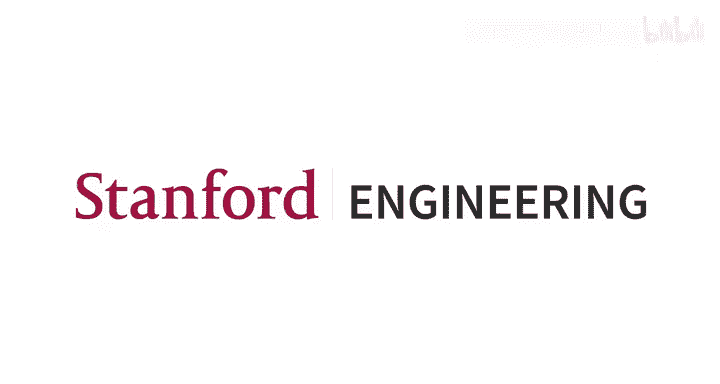
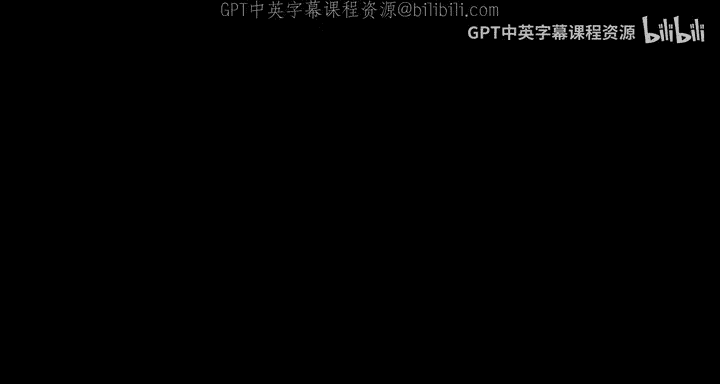
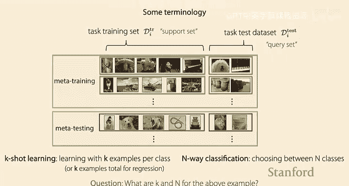
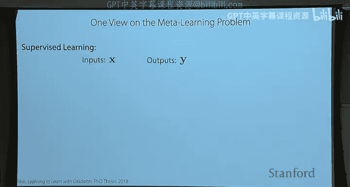

# 斯坦福大学《深度多任务与元学习｜Stanford CS330 Deep Multi-Task and Meta Learning 2022》中英（豆包翻译 - P4：-04-.Black Box Meta Learning l 2022 I Lecture 4.zh_en - GPT中英字幕课程资源 - BV1dWpPepEsj

So for the plan for today， we're to be talking about me learninging and first I'm going to recap a little bit of what we talked about on Monday with regard to the problem formulation and the general recipe of metal learning algorithms。

 and then we're going to actually get into approaches for solving a few shot learning problems。

And so this will cover what you'll be implementing in homework one。

 although actually I think I saw a couple people already turned in homework one。

 so maybe you've already implemented it。And by the end of the lecture。

 you'll be able to implement few shot learning algorithms and allow neural networks to do the kind of few shot learning problem that you did on the very first day of class。

Cool so let's get into a little bit of the recap， so on Monday we talked about the metal learning problem where our goal was that we were given some data from some set of tasks and our goal was to solve a new task with less data at a higher level of accuracy or more sting。

And the context of this course， we'll mostly be considering trying to learn tasks more quickly。

 that is with less data than if we were training from scratch。

One of the key assumptions that I mentioned is that the task should be drawn from the same task distribution。

 this is an assumption that's needed to show that these algorithms might generalize and be able to learn new tasks。

 although of course in practice it's a little bit difficult to sometimes actually realize this assumption in practice。

 this is something that's basically analogous to the standard IID assumption that you see in machine learning where you assume that your training data points and your test data points are drawn from the same distribution。

And so you might have some distribution over tasks。

 you're given some training tasks from that distribution and a test task from that distribution。

Like before we want the task to share some structure and the task could correspond to lots of different things。

 so in homework one， the task will correspond to recognizing handwritten digits from different languages。

Showed here。We'll also look at an example where different tasks corresponded giving feedback to students on different exam problems or different assignments。

We'll look at one example where the goal is different tasks correspond to different regions of the world。

 and you might want to classify species in those different regions of the world。

And the task could also correspond to something like robots performing different tasks。Now。

 a natural question to ask from here is okay。We need a set of tasks in order to learn a new task。

 how many tasks do you need in order to be able to quickly learn a new task？

There isn't really any cut and dry answer here， but in general the more the better in machine learning。

 the more data you have， the better off you'll be， in meta learning， the more tasks you have。

 the better off you'll be， so essentially in metal learning。

 we're treating data points we're essentially treating treating tasks as data points。Yeah。えだなか。

If the best sauce is also going to be compromise provide similar。と。

But like Hol said's actually a new thought like is it like a new area of the distribution that you haven't explored and data？

Because are different from the。너을 다섯섯 거。Yeah， so I guess we can draw an analogy to machine learning where maybe we have a lot of images taken from the internet。

 but then we ultimately will want to pass in new images into our machine learning model and so those images don't match any of the images that are in the training dataset。

Here， maybe， as one example， maybe different tasks correspond to different users。

 so you want to build a spam classifier for different users and then the test task will be a new person and it will be a person that wasn't in the training data and it will be trying to classify spaM versus real email for that particular new user。

Does that make sense。So it'll be something that is。

 it should be generally similar to the kinds of things that you've seen before because we want to that that's again we' let us to。

That was going to let us generalize to that new task with a small amount of data。

 but it is going to be， it can be something that's new。

 that's fundamentally not seen in the trading data。这。Can middle learning be applied。switch your。

Did we could like perpetuate exploring some sort of like vaccine shared structure？

He one house to help you do the other。Yeah， so the question was。

 can metal learning be used for two tasks that have kind of seemingly very little in common。

 but perhaps maybe there is something that they can discover that they have in common？First。

 if you only train on two tasks， then generalizing to a third tasks will be very difficult。

 but I'm not sure that's exactly what you're asking if some of the tasks in your distribution are very different from one another and you have more than two tasks。

 then metal learning will try to find the common structure between them in a way that allows it to very quickly solve those tasks。

 and so yeah， and if there is shared structure then it's explicitly going to optimize for trying to find the things that are in common between those tasks。

Yeah， so in that case if there actually isn't too much shared structure。

 would could it be detrimental to actually use melin？So if there isn't that much shared structure。

 would it be detrimental to use me learning？So I don't know if it necessarily be detrimental in the sense that it may have a hard time finding that shared structure。

In the worst， well， I guess we'll get into this when we get into the algorithms。

 but there are some algorithms where they will essentially revert to learning from scratch。

 And so you won't do it worse than learning from scratch。

 whereas there are some algorithms including the ones that we'll talked about today where they could do worse than learning from scratch。

Yeah。Are the data sets for each the pass in the train set about as large as you would need and like a normal mission learning you have？

いスポテーダ。Yeah， so one of the things that's really cool about this is actually you can get away with much less data per task than if you were to train completely from scratch and so we'll see this actually in one of the data sets。

 including actually the data set that you'll use in your homework。Cool。

 so one of the things that we talked about on Monday is that there's a couple different ways that you can view meta learning algorithms。

 one from a mechanistic standpoint and one from a more probabilistic standpoint。

 and from the mechanistic standpoint， you can think of meta learninging as basically trying to train a neural network to read a input data and give you predictions for new data points and so you can think of it as implementing a learning procedure。

Whereas the more probaist view is thinking about how we may try to learn a prior。

 extract prior knowledge from your set of training tasks and impose that prior at test time when trying to learn so that you can learn with less data。

U。In the next few lectures， we're going to really be focusing on the mechanistic view。

 which will make it easier to think about how to actually implement these algorithms in practice。

 but we'll come back to the probabilistic view in a few weeks。So and then lastly。

 the last thing that we talked about on Monday was looking at an example。

 a few shot classification example where ultimately we wanted to be able to be able to classify new examples shown on the right here given a very small training data。

 so the training data only has five data points， and we want to be able to use that training data and previous experience from other image classes in order to effectively solve and make predictions for a new test examples。

And so the way that we can do this is construct tasks that look a lot like this test task。

 so construct training sets and test sets from other image classes。

 from other experience or data that we might have。Run kind of meta training on these tasks。

 such that when we see a new task at metat time， we can learn from this tiny data and make predictions。

No。And this is kind of an image classification example。

 we can consider this for other machine learning problems as well。

Now what I'd like to talk about next is first getting a little bit into some of the terminology that's used in better learning in the context of this example。

 and then we'll dive a little bit more into the setup。

So we have the setup where we have a number of different training tasks for each of those tasks。

 we have a training data set and a test data。These are sometimes also called the support set in the query set。

 the support set you can think of as kind of providing support for the learning process and then the query data set will be used to query the predictions of the model after learning on the support set using these ladder terminology can be somewhat helpful to differentiate between meta training and meta testing。

诶。So we've talked about this notion of few shot learning。

 and so you can think of this as K shot learning where you have K examples per class。

Or if you're in a regression scenario， you have K examples total。

So this is K shot learning means you essentially have K examples to learn from。And then we'll。

Consider we'll use N typically to denote the number of classes that we're trying to classify between the number of classes that we're choosing between。

So with that in mind， I have a question for you。 So maybe I want to ask you what is K and N for this example and so。

First， in terms of K， maybe you can kind of raise your fingers and kind of。

Say what you think actually， let's actually start with N。

 so maybe raise your hand with fingers to denote what you think n is for this example。Cool。

 so I'm seeing a mix of fives and twos， but mostly fives。

Cool， so in this example， were doing Nway classification。 I guess。 so yeah。

 the mix of fives and twos is， I can see where you're coming from。😊。

I so this is a five way example because we have five different image classes shown in the left training data set。

 I'm only showing two test examples here just in terms of。Space on the slides。

 but there are kind of five classes underlying these training data sets。

And then can you put up a show of numbers for what K is？Cool， I'm seeing ones， which is good。

 So yeah， we're giving you basically one example of five different classes。

 So this is a one shot learning problem where you have one example per class。😊。

And we're trying to solve a five way classification problem。阔。So that's a bit of the terminology now。

In terms of the the kind of。General recipe。Or maybe another view on the me learning problem is if you think about supervised learning。

 our goal is to map from inputs to outputs。

And to learn a function thats the input， predicts the output， given the input。

And we do this with a set of input output pairs， X， Y pairs。Now in meta learning。

 we can also actually frame it as somewhat of a supervised learning problem。

Where our inputs are going to be a little bit different。

 So our inputs are actually going to include the training data set for a task。

As well as in that training data， we'll have K examples or K examples per class。

And in addition to a training data set for that task。

 we're also going to have a new test input that we want to be able to make predictions for。

So the training data set is essentially what was in the green box on the previous slide and the test or the test example is one of the things that was in the blue box on the right。

And then we want to be able to predict the label for this test example。

And so you can think of this green arrow here as the process of learning from that data set to make a prediction for a new example。

And from this standpoint， we could actually again view this as a supervised learning problem where you want to train a neural network to take as input a data。

 learn from that data and make a prediction on a new test example。Now。

 how do we go about learning this kind of function？Well。

 instead of having a data set of input output pairs。

 we're actually going to have a data set of data sets。

And each of these data sets has to have at least has some more than k examples so that you can sample k examples to be used for the training data set and at least one example to be used for the test set。

Yeah。With the not that they're using。 So for the wind presentation。In the testing side。

 we have one example of the classes that we are going。So。When say。Clas between cats and dogs。

 And Ill have one example of cat and one example of dog。 And that is what will be testing。

Well what you are using that seems later zero shortgu where you are not using like you have five classes in this。

Of five different classes and actually what you're actually classifying for。Two different clause。

Yeah， so going back to the the slide here or this visualization here， the。

So the number of examples in these in this red box here doesn't matter too much。

 This is well you need there to be at least one example and you need to be able to and in general。

 your test set is going to be larger than two， you'll probably have at least five examples。

And so that you're actually like evaluating its ability to make predictions for all five classes in your training dataset set。

Some losses。こい the testing point。Any monitor for prosecution。嗯。The liquid model itself took。

Lo like they cross。そリーたぞ。Where。Oh， so I guess what I'm visualizing here is a。

 a five way classification problem。And so you have one example for five different classes and so it's a one shot learning problem and then technically if all you cared about was to classify these two images。

 then it's actually a two- way classification problem。

 I would have shown all five examples if I had a little bit more space on the slides。

 but yeah I'm trying to frame this as a fiveway problem。

So you can sort of just think of this as having。Like you can imagine if there's like five examples here。

Cool， and here I'm actually only showing one test example。

In terms of what this function needs to produce， but then when you actually train this function。

 you'll actually sample more like different test examples to evaluate its ability to generalize given a training example。

We're giving a training set。Okay， and so we can learn this function with a data set of data sets。

 so a set of data sets where each data set is for a particular task， and again， this data。

 the data for a given task I should have more than K examples so that you can use K to be used in the training data set and some other examples be used in a test set to measure generalization。

😊，Yeah。There are two different。はい。There are two different subsequent here there is that I end。大ですそ。

Jerry is。Number of examples。Yeah， so here I is indexing the number of tasks and J is indexing the examples that we have within a task data。

Cool， and so one way， one thing that's nice about this kind of view is it means that。Now。

In order to implement a meta learning algorithm， all we have to do is。

Designed this function F that can read as input a data set and then optimize that function F。

And so essentially， in this lecture in the next two lectures。

 we're going to be talking about different ways that you can design and optimize this function F。

And so in particular， kind of the general recipe that you can think of for designing a metal learning algorithm is choosing a form of dysfunction in this lecture we'll see a form of this function where it's just represented by a neural network。

 but we'll actually see other forms of this function in the later lectures where F could correspond to run ingredient set or F could correspond to an algorithm like nearest neighbors。

😊，And then once we have that function， that we're going to optimize the free parameters of that function。

 which we'll refer to as the meta parametersas using the meta training data。叫。

Be tested of the test task or is。Excccess is the。Is the。呃 the。

Test data for the task that is specified by Dtrain， so Dtrain and X test are both from the same task。

And so that could be， if you're during me training time。

 that's going to be one of the me training tasks， if you're at meta test time。

 that's going to be one of the new tasks that you haven't seen before。是。あこああ、今フィブエスは法的な権。

So K is the number of examples， like in K shot learning。

 it's the number of examples that you're going to be learning from。一方この。

Very House supervisor that each information we sample。But people for。Yeah。

 actually so there's a question of how do you choose K typically。If you have a sense for how many。

 if you have a sense for like you want to be able to do one shot learning。

 then you'll just set K to be essentially to be one per class and then at test time you'll do one shot learning。

 you could also have K be variable so you can actually sample different K for different tasks and have some tasks be one shot learning tasks。

 some tasks be five shot learning tasks such that you're preparing your network to be able to do one shot learning and five shot learning at meta test time。

有。Its be M， instead of beautiful。Yeah， so the the question was。

 shouldn't the index here be n times k rather than K。 So if it is a classification problem。

 then it should be n times K。 if it's a regression problem。

 then the standard notation is to just use K。 And so I use K here， but。

It kind of depends if it's a regression or classification problem。

 And the reason the convention for that is one shot learning。

 you typically think is learning from one example and a regression。In regression problems。

 you can actually Well learning from one example in regression， probably you won't get very far。

 but it that one shot learning is learning from one example there。 whereasas in classification。

 if you have only one example， it's。It's fundamentally impossible to solve a five way problem with just one example。

The kind of convention is to use。To have it be per class there， and so if this was classification。

 the K would be n times K。有。If it's time from war。このしかと。It you have a work。Do these tasks would you。

So we'll get into the methods in a second， but it basically corresponds to how many like what is the size of the data set you're passing into your function？

正是得。Well， so basically you can train this function to path to take as input variable size data sets。

 and that's useful because at test time， if you're not sure what size your data set is going to be。

 then your function should be able to handle different sizes。Yeah，So in the last class。

 when we were talking about the probabilistic view of metal learning， the kind of。

I have parameters representing the shared structure and then also by which word I guess the task specific parameters。

 so in this case is F representing the quote。I will。Yeah。

 so the parameters of F here are theta and that is kind of representing the theta that we saw in the previous lecture here。

 you don't see phi appear here and that's because phi is we'll see in some algorithms p Phi will come out explicitly。

 whereas in other algorithms we won't be explicitly representing Phi and so it's useful to set up this notation in a way that can either have it or well that doesn't actually explicitly represent it because some of the algorithms we'll look at next week。

 don't actually explicitly represent what Phi is。If it's not explicitly represented。

 does it just mean that it's a part of the in some form or sort of basically next week we'll cover non like non parametric metal learning methods and so those don't actually have explicit parameters and。

Fhi won't ever appear。Its but we'll get into that on Wednesday next week。有。Just start quick。

be X here to that。これ法？嗯。So X test is a new example。A new input for that task。

 so it's given a task data set here， we're it'll basically just correspond to one of the X's in the task dataset。

Cool， so I think that we should start kind of running into like approaches because I think that will also clarify the setup as well。

And so we're going to start with a running example， which is going to use the Omnilot data set。

 and you'll be actually using this data set in your homework， it's actually a pretty cool data set。

It has a data set of 50 different alphabets， written alphabets。

 and it has a total of 1623 characters across all of those alphabets。

And they're all written by hand by。People。And here are some examples of some of the alphabets represented in that data。

And per character， there's actually only 20 examples。

So this is getting into one of the questions which was mentioned before。

 which is that typically in a machine learning data。

 you wouldn't have only 20 examples per class in your data。For example， in the MNIS data set。

 I think it has like on the order of thousands of examples， maybe tens of thousands of examples。

 maybe like 6000 examples per class， I think。So you can sort of think of this as the transpose of a data set like MNIS。

 where instead of having many examples and a small number of classes。

 you actually have a large number of classes and a very small number of examples per class。😊。

And I also think that the statistics of this kind of data that are a little bit more reflective of the real world。

 because in the real world， we don't see like，1 thousand forks and 1 thousand notebooks and 1 thousand00 pens for only a small number of things。

 we actually have a really massive number of objects。

 and we only kind of run into those objects a small number of times in general。Cool。

 so we're going to be using this data set and in this data set， to start off。

 we can think of different tasks as different alphabets。And。

And let's think about how to actually set up the kind of the meta learning thing here。

 So we're going be looking at a。A three way classification problem just because then I don't have to draw as many images。

 and we're going to be looking at a one shot learning problem。And。

It's worth mentioning that there are two different versions of blackbox meta learning algorithms。

 and so we'll cover both of them。嗯。And first， we'll talk about kind of the Mediterranean process so。

The first thing to do。During me training is to sample a task。

 and so this will correspond to sampling an alphabet。And specifically sampling three characters。

From that alphabet， and the reason why it's three is because we're just going to be considering a three way classification problem。

And then once we've sampled a task and sampled the characters that we're going to be classifying between。

 we're going to sample。诶。超。Images。Per character。And。

We're then going to break these examples into a train set and a test set。And so for example。

Maybe the alphabet that we sampled is。The alphabet that we use in English。And so。

And the three characters that we sampled were ABMC。And。

We're going to sample two different images per character so that we can use。诶。

One for a training data and one for a test data for that task。So these are maybe yeah two。

This is will be our kind of。D train for task I， maybe we sampled task I。 and this is going to be。

D test for task guy。Now， one thing that we're missing here is we're also missing labels。

 we need labels in our train set and test set。 And so what we're going to do is we're also going to assign labels to each one of these。

 so we can say label 0，12。 It's important to have consistent labels across our characters。Okay。

 and now we get to the fun part。What we're going to do is where you're going to pass our training data into a neural network that will implement the learning process。

And so。In terms of。Passing this into a neural network。

 these data sets may have a number of different examples。

 And so things like a recurrent neural network are typically a good choice or。

 or a transformer if you want to be a little more。Into the times and so。You'll pass this into。

Your training data points into a recurrent neural network。And at this point。

 we're going to get to kind of the two different versions。

 So one version of black box metal learning will take as input these training data points and output。

A set of parameters。And we'll then use those set of parameters to classify new examples from our test set。

And so in particular， we will。I'm gonna。You to work on my space management。

 So we'll take these set of parameters。 We'll then pass this input one of our test examples into a neural network with those parameters to get a。

Prediction。For that test example， so this will be X test I， this will be Y hat test I。

And then we'll compare this to the corresponding label。For。That example。

And then what we can do is we can， once we compare our prediction for this example to the label。

 for that example， we can back propagate through this entire neural network into the parameters to train this neural network so that it can。

Learn how to learn from。This data。Cool， and then once we then kind of back propagate into the neural network。

 update the parameters of this network here， which will be the parameters data。

 we'll then kind of this is step three， then we'll go back to step one。

 sample another task and iterate the process。So， this is the。The Mediterranean process。诶。

We can talk a little bit about the meta test process before we move on to。

Before we move on to the second version， but yeah。哦是说他是。Just the prosecutions。

Does it go through the neural network or does it go through the neural network and the classification？

So it was basically going to update all of the parameters of this network。And one actually。

 one really， really important thing to note is that it's not going to update Phi。So Phi。

 you can think of more as an activation of this neural network。

It is only going to update the meta parametersa of this network。

So we're going differentiate through Phi into the parameters of this thing right here。

 I really should have brought some more colors today。 but you can think of the parameters。

 The parameters of this will include like both the encoder， as well as kind of the the。

The kind of recurrent parameters as well。有。The on the hope。Yes。

 the question is why does it make sense to use a recurrent neural network You can use other networks as well and we'll talk about some other choices。

 you could use something like a deepet architecture or a transformer。

 One thing that is convenient about sequence models in general is that they can handle variable length sequences and so you can。

You can pass in like variable length data sets for example。

 and it should be able to handle that in general， architectures for handling sets and sequences are pretty good choices。

Yeah。I you know I'm not sure one the is the right my。The training with three classes。4 glasseses。

我 is the活。要我陈述吗？要。It's not flexible enough to do that。Yeah。

 the question is if you do me training with three classes and then evaluate this ability to learn with four classes。

 then how well does that work in general， probably not very well。

 it depends on the architecture choice that you choose。

 but I mean you're basically training a recurrent neural network and if you train a recurrent neural network on a sequence length of three and then test it on sequence length of four。

 you're basically testing it on something that it hasn't been trained to do。第。ていうに。This。はいか。Yeah。

 so the question is， do you need test data and can you do this in an unsupervised way？

There's lots of different variations that you could consider here。

 You could consider something where the training data set is maybe unlabeled and is trying to like but the test set is labeled。

 for example， and is trying to。Cluster and so forth。

 we'll get into some more advanced kind of variations of this in some of the coming lectures。

But in the。Well， yeah， in the basic setup it's good to have labels are helpful The only thing that I'll say is it is important for these to be held out examples and not just the same examples is what you pass in。

 because if you pass in exactly the same this example here， instead of learning to learn。

 it will learn to memorize and it will learn to just exactly only be able to make predictions for the examples that you passed in。

One other note that I should mention here is that here note that we're passing in both X and y。

 we're passing in both the input in the label into the recurrent neural network。

Here it's important not to pass in the label。Because if you pass in the label。

 then it will just not look at the image and predict the label。

 and this is something that you'll run and do in their homework。

 it's a kind of common mistake to accidentally pass the label into the network here。Yeah。

Shouldn't the prediction， for example， be independent and irrespective of the order。

 So why are we treating it as an differential problem Because if I will let CNN in for each image and let predict。

In sequenceSo one downside of using an RNN is that the ordering of these data points matters and in practice。

This is a set and so the order of examples doesn't matter， we'll get to this in a few slides。

 but the architectures that like deep sets that are permutation andvari actually can be a better choice than RNN for that reason because they'll encode the fact that the ordering of the data points doesn't matter。

Not exactly like are we creating the parameters， which is the fire to， like if so。

 how many parameters do we treated？Yeah， so is here it's predicting parameters that are being used to make predictions。

This is in general， a pretty high dimensional vector。 And so it may correspond to like， yeah。

 the parameters of a neural network。 I guess I'll get into version 2。 So that was like。

This was version1。Version two is something that is a little bit。A little bit less unwieldly。

 so predicting like millions of parameters with a neural network can be rather expensive。

And so what you can do instead。Is let me write up these out again。 You don't have the label for this。

 So what you can do instead is you can simply。Use something like a recurrent neural network and actually just continue running that recurrent neural network here。

And in this case。The Phi I is more implicit。And here again。

 be asking it to predict YI test for this example right here， which is XI test。

And this is something where you don't actually have to have your RNN output a huge parameter vector。

 you can just have it output， say this is like the hidden state of your RN after like three examples。

And you can sort of think of。Fhi eye as like the set of the kind of。

The set of like these hidden parameters as well as any parameters that are in this network right here。

 so we can maybe refer to this as like theta G in the sense that this is like a function G。

Those are the parameters of that function and so this is what like Phi I would be in that case and in this case this is a lot nicer because and this is going to be used more in practice than this version because then you don't have to output like millions of parameters of a network you can actually。

😊，Yeah， you can actually only represent a much smaller context here。Yeah。

The shared model beta are they the result of adopting beta by something。Yeah， so in this lecture。

 the task specific parameters are the output of this neural network model here or here。

 I guess we can call this H in the sense that this is kind of a。

A context vector in the lecture on Monday we'll see examples where the task specific parameters are the result of something else like running an optimization like gradient descent。

啊 yeah。Why is it not important？いぱあも。Why is it important， too。电到虽然来。ラくも本ぱいが。Pty of be development。

Yeah， so the question is why is it important to not update PhiI？啲诶。

I think that maybe so in this example， it may be a little bit more clear in the sense that。

When we run gradient descent on to kind of test generalization in this case。

 we're going to backp into all of the parameters of this R。

 but we're not going to update H because HI is an activation and when you have activations of a neural network。

 you don't update the activations， you only update the weights。And so analogously in this example。

 you can think of PhiI as the activations of your neural network。

 and so you're not going to be updating that， you're only going to be updating the weights of this neural network。

😊，第二。Just say one more time with the difference between one。Yeah。

 so the difference between version one and version two is。're like they are very similar。

 the main difference is that in this case， this neural network right here， the only parameters。

Making predictions from this example to Y test are going to be Phi I and those are going to be outputted by this。

 and so those are going to be the activations of this RN， whereas in this case。

 some of the parameters are actually going to be。Some of the parameters here are actually going to be optimized as part of the meta optimization。

And so for example， the encoder of this RNN may actually be shared across the time steps。

 and so you basically have more parameter sharing in this version。有。

We'll be through their best here when you're promising， you're still optimizing on the0，1。

2 on the train。I don't look by profits。Dscu。U so。You're asking optimistic guys for fire。

 this is being predicted from the island。これプよ役にてのて。断と。Yeah， so in this case。

 theta G also will be optimized with back propp as well， but H will not be。

Though training a sequence。It'll be with respect to the loss here。Can you using the best people to。

go basically was。You can basically think of all of this as the learning process and we're optimizing all of the parameters of this learning process with respect to how well it generalizes on a new test example。

 the one thing that you may be noticing here is that。

It could be that the neural network could just ignore all of this and just like learn a classifier for it。

 and that's actually a problem that can come up in bed alerting。

And so one thing that I'll mention here is that the。

Here we kind of we assigned label somewhat arbitrarily like 0，12 like in the order of the alphabet。

 but really that was somewhat arbitrary and when you're given a new alphabet。

 you don't know what is the first letter of the alphabet versus the second versus the third and so what we'll do in practice is when we assign these labels。

 we'll assign them randomly and so when we sample a task in this case I assign this labeling。

 but when you sample task the next time you might sample a different labeling where you have。

 for example，120，120。And as a result， when you actually randomize that。

 that prevents the neural network from just memorizing a mapping from the input to the label and ignoring the context。

So PI is like similar to H here， PhiI is an activation of the neural network rather than some of the weights。

can also be。番ブ someでベる。So it's the output of this， it is the parameters of a neural network。

 but it's the output of our recurrent neural network。

 and so we're setting it to be the output of this neural network， and so if you updated it one round。

 then the next round it would just be wiped。By a forward pass of the RN。Yeah。

Just answering this question。 Could it be because of。こす。

The regime of treating is very different from the normal training。每个资金。re my。

Two subset of for each semester， two subset of an example， some grade。

 which is like training at plastic。Soの。It is said said to be testing live testing data。

 it's not actually testing data。 we use it to train our model。Yeah， that's a great point。

 so to kind of reiterate， when I'm talking about this， this is like our task test set。嗯。

For for task I， and we are going to be training。The parameters of our R&N with these test examples。

 and that may sound like a really bad thing and it sort of should sound like a really bad thing because we're going to be training on these test sets。

But me learning actually the real test is new tasks。

 so this is the test set of the training task or one of the training tasks。

 and then we're going to be given new test tasks and those are going to be really the real test for these models。

Yeah， so is there this catastrophic fort and you sort of set up with simplyling tasks and then updating？

across。見ござ。それが。他诉。Yeah the question was is there a risk of catastrophic forgetting in this case of past tasks that you've seen。

 so in practice when we sample tasks we'll sample them from a set of tasks and as long as you keep on sampling from that task IID then you should be able to remember those tasks？

I should also mention here， I said that we're just going to sample one task in practice you can sample a mini batch of tasks。

 so multiple tasks and that will give you a lower variance gradient and so similar to like in machine learning if you're sampling IID from a training data you don't have to worry too much about forgetting。

 we also don't have to worry about that too much here。

 but if we did have like a non-stationary sequence of tasks。

 we might start forgetting some of the older tasks if they don't keep on reoccurring。Yeah， what the。

Rather than an entertain。ちこれ。被告。And there's not a direct issue。me something。そこい。With rich。

So you want to have some sort of network。 The question is。

 not why are we using an R N versus some other sort of network。

 You do want this network to be able to take as input a data set and。Data sets。

 do you want to be able to process some sort of set of examples and so things like RNNs are a good choice for modeling。

 well， they're actually not in practice they're not a great choice。

 but they're the simplest choice for modeling sequences and things like transformers and deepet architectures and like 1D convolutions could also be used as well。

You wouldn't want to use like a feed forward well so one thing you could do is you could use a feed forward fully connected network and basically concatenate the embedding concatenate all these images together and pass it through that way。

 and that might not be a great choice compared to something that explicitly models these as separate entities。

对。practice those version want to work with。So yeah practice version1 work with very high dimensional phi。

 so there are some papers that have actually gotten it to work pretty well in practice people typically use some form of sharing across layers so that you're not outputting the entire parameter vector all at once。

 you might be outputting like one layer at a time， maybe telling the network which layer that it might be outputting one paper or one thing that this is often referred to as a hypernet。

And a hyper network is basically any sort of neural network that's outputting the weights of another neural network。

It can be used for metal learning， but it can also be used for other things。

 and so there are some examples of it working well。

 but also in general for Fe shot learning problems， this is the more practical solution。Cool。

 I have a couple examples of other data sets on the slides。

 if you're interested in exploring that for your project。 but for now， I just want to， oh， actually。

 I want to recap some of this stuff on the whiteboard， but also， weve talked about meta training。

 We haven't explicitly gone through what meta test time looks like。

 So let's also quickly do that first。 So。😊，At metat time。You're actually just given a test task。

And you're also given。A training data set。For that test task。And so， for example。

 maybe your data set is of the Greek alphabet and。You have some examples like this。

And then you're probably also given。Some test examples， so maybe you're given。

An example that looks like this， and you want to be able to classify this example given your few training examples。

And so。Does anyone want to kind of say what we might do at meta test time？Yeah。Before the。

The results later out of the images that we have the information。They very on visit。ぶ。こ to beて。美し？

してたい。似对。老师傅。Yeah， so what we can do is we can pass our training data into our recurrent neural network。

 also pass input our test example and ask it what the corresponding label is。

 So we'll probably be given corresponding labels for this like 0，1 and 2。

 and we will pass these into。嗯。Our neural network doesn't have to be in RNN。And then， also。

Passes input put this example， and then hopefully the neural network will output zero insofar as that looks like a。

An alpha。そこでフリ。Just because we have make multiple thoughts just be like I did with the punch。

I'll probably believe is zero try to predict that okay， button and then try on the second。Oh， excuse。

So in Black box Me learning， what you'll do is you'll always pass in the whole training dataset as input and then pass in the test example。

 one version， another method that we'll see next week is something that actually makes explicit comparisons between the test example and the training examples。

Does that answer your question？is tuning happening because of the feelings set that we're posting。

Sorry， can you repeat that？Yeah so the question was is there any like parameter updates or any tuning that's happening when we do this and answer is no so we're just doing a forward pass through this RNN and so we're not actually you can think of this RNN as kind of implementing the learning process and if you give it a big enough neural network。

 these neural networks can learn in that way。😊，And so there isn't actually any sort of parameter updating other than perhaps you can sort of think of the hidden state as being updated as you pass it through the recurrent neural network。

有。バルミ。こまの。不取要准。So you're asking why not have an algorithm that does do some amount of factors you see that on Monday next week？

So here the island is predicting the pattern because actually knowing the。就坐会去。

Is there something to more that is easy to learn to？

That would depend on the kind of model that we have right。こ情報。Generally， for version one。

 the architecture of this function right here will be always the same， it will be fixed。

We would use it like some kinds of applications are to fire to learn fire。

 some kinds of applications are easier to learn liquid critics fire or。Yeah， you're asking。

 are there some architectures for which should be easier to predict P I than others？Generally。

 the smaller the architecture， the easier yeah and if you only have to predict some of the parameters of the architecture。

 which is similar to here， like for example， you could have it only output like H could correspond to the last layer of this network and then you only have to predict some part of it。

 for example。得。And this actually。就是把他这关。Yeah， so I'm calling this black box meta learning because the learning process itself is somewhat of a black box iss just this big neural network。

 I guess it's multiple boxes on the board。 But you can think of this as just one kind of monolithic neural network。

 and we don't have a lot of。😊，We don't see a lot of what happens inside this neural network to actually interpret how it's actually adapting or learning from these examples。

ごいません。Once the hyper network produced。それは。でパな。のぱ。对。This only functions over here or is it discount？

So it outputs at once and then we make predictions with that and so we can predict this example。

 but and also make predictions for the other test examples。

 and it will only be changed once we pass in a new training data。label up be image kind of。

Like back in this matter， has' been set up and we trying to predict these labels。

How is it if they kind of start talking and matchinging them do okay what team is dark keyboard。

 so is it kind of like you just marching just too much part？What is the neural network doing？そ我。

So I don't have because this is black box， I don't have a great sense for exactly how in practice the neural network is implementing it。

 is choosing to implement this， it does have to store information about how you map images to labels and what is it like。

What does label zero mean from an image？诶。Or it could be， I mean。

 there's a lot of things that it could be doing， it could be actually like if it's a really huge neural network。

 it could be mimicking something kind of like gradient descent， for example。

 so it's a little bit hard to understand in general。是。I think my question， John。

Ft comes from the multi planning。 So here， you know that。そ？2 300 network。Investors on。

Is there any way I need to？No which classes or。This be know。During training so that。大丈。Yeah。

 so the question is， is there a way to tell if certain character classes or certain tasks would be helpful for a particular test task？

三十のそれこら上ですけども。With we difference it's like a callman。Common sense。

 but like when there's a huge bunch of things。就这样。い服は。好。Yeah， so if you have tons of tasks。Then yeah。

 there's going to be kind of more heterogeneity in terms of when one task might be helpful for the test task。

But yeah， in general。We don't really know it's kind of similar to fine tuning and multiple and maybe you should figure it out for your project and then tell us all how to do it。

Cool。I went through a lot of that on the whiteboard because I felt like that would be easier and kind of more intuitive to walk through the slides have basically everything that we went through on the whiteboard。

 so version1， we're going to be training a neural network to output these parameters and then we're going to be predicting test data points using a neural network parametersized by those parameters by I and you can think of the first network as kind of the learner is learning from these training data points and the second network as as something that's actually making predictions using those parameters。

Here's the RNN that we drew on the board， this is representing F data。

 and then here's the kind of the second part of the network that we drew on the board as well。😊。

From the test examples， and then we can train the parameters of data with standard supervised learning。

In terms of what the loss function looks like， log negative log likelihood which is cross entrytropy loss or means squared error。

 is that the loss function that's typical to use for supervised learning and so that's，😊。

Basically the loss function that will be applied right here to back propagate through。嗯。And you can。

 if you think about this as the loss function for task I， then you can。

Basically view kind of this overall loss function as making a prediction for task guy and then evaluating that on the test data points for task I and then averaging that across the tasks。

I want to go through this somewhat quickly because this is basically stuff that we all went through on the board。

 we sample a task， we can also sample a mini batch of tasks rather than just one task。😊。

We can then sample disjoint data sets， so this would be like our training set and our test data set from all of the examples that we have for a particular task。

I should mention maybe here that it's worthwhile to kind of mix and match these。

 so you shouldn't always use this as your test examples and always use this as your training examples。

 you can get a little bit more data for me traininging by randomly sampling what you use as a training example and what you use as a test example。

And so kind of visually what this looks like is maybe these are all the examples you have for one of your tasks。

You want to allocate this into training examples and test examples。

 and so you'll kind of just randomly assign them to a train set and do a test set。Cool。

 and then once you have your train set and test set。

 you can compute the parameters and then compute the parameters with the forward pass and then update the meta parametersa with the backward pass。

And then， repeat。诶。Cool， we talked about how outputting all the neural network parameters isn't very scalable。

 And so instead of doing that， you can just only output the sufficient statistics and use another basically replace Phi I with H and。

😊，How this be a lower dimensional vector and how that can be combined with some other meta parametersameters in order to make a prediction。

One thing that's kind of intuitively nice about this low dimensional vector is you can think of it as representing contextual task information。

😊，And so if we remember back to multitask learning where we had this task descriptor ZI。

 you could sort of think of HI as a form of task descriptor that we're inferring from data。

And then we're just going to be passing that HI into a neural network in order to make predictions for that task。

Yeah。How many tasks within the test that you need。P on to make sure it's。呃，我。Quite different。

 So how do you know that your task test are set？他我我就我。Yeah。

 so the question is how many test tasks should we use when we're evaluating a meta learning algorithm and so yeah in general。

 you don't want to just have one target task when you're evaluating you want to have like at least a few and one thing that you can do to get a sense for how many you need is you can look at the variance of the accuracy across tasks and so if one task you're seeing has like 80% accuracy another task has 100% accuracy and another task is like0% accuracy then your variance is pretty large。

 whereas if they seem to be more or less consistent across tasks that maybe is a good indication that you may have enough tasks。

To get a good reading on it。learn the big syn for。Yeah。

 so the question was how do we learn the big theta G for PhiI so you can think of theta G as part of the meta parametersa and so that's actually why I'm using theta here。

 so we're going to optimize theta G alongside all of the rest of the parameters of theta。

And so that's how we make it possible to have HIV only a low dimensional vector。

 Likewise theta G may have some parameters that are shared with kind of the other part of the recurrent neural network。

 because for example， you may have like the encoder of the image be the same for these training examples and test examples。

じ。Bll work for how much less data that you need for each task with。如是写推。Yeah。

 so is there a ballpark for how much data you need？With me and as you'll see in the assignment。

 you can go down to as few as one example per class if you have a lot of tasks and so。

The per task you can go down is to something very， very small if you have a lot of tasks and if they have shared structure。

That said， if you only have one example for class， you're still going your total amount of data may still be somewhat similar to。

to kind of single task learning in that you may have a lot of tasks。

 and so you may have a small amount of examples per task but a lot of different tasks or your total data may be somewhat similar。

 and then of course the amount of data you need will depend a little bit on the complexity of the problem you're solving。

Cool。And then I said I would talk a little bit about architectures so we talked a little bit about RNNs before one of the first papers that introduced this at least more modern notion of metal learning with kind of black box neural networks is this paper right here and this is from 2016 this is actually sort of in response to a challenge basically the omnilot challenge be released and some cognitive scientists saying neural networks can't do fu shot learning and this paper showed that oh neural networks can actually do few shot learning and was able to do pretty well on the omnilot data set they used LSTMs and neural turing machines I wouldn't necessarily recommend using neural Tring machines or I think a little bit of a relic of the past but yeah it's worth mentioning this is one of the first papers and in your homework I believe we have you using LSTMs in the homework but if you want to you can also play around a little bit with transformers。

Another architecture， which is called a deepet architecture。

 is to instead of having a recurrent neural network。

 instead pass all of your examples through a feed forward neural network。

To get an embedding of each of your images and then average those embeddings to get a kind of a summary vector。

I sort of already answered this earlier， but I guess I can see if you were paying attention。

 which is why would something like feed forward and an average be better than our current neural network？

Yeah， so it's perm invari。 So yeah， so averaging。Is agnostic to the order of the things that you're averaging。

 And so this sort of architecture is permutation invariant。

 One thing that this is an architecture called deep sets。

 One thing that's actually pretty cool about deep sets is there's a result that shows that。😊。

For some conditions on the width and depth of the network。

 these kinds of architectures can represent any permutation andvari function。

 And so while it may seem actually somewhat limiting。

 these architectures are actually very expressive， as long as you only care about permutation andvari functions。

There's also other external memory mechanisms that have been proposed and then this。

There's also papers that have proposed things that use attention and convolution。

 this paper came out before before I think transformers or certainly before transformers were popular and so they probably would have called it a transformer or something。

 and then there's probably more recent papers that actually use things like transformers as well。

And then these methods can do pretty well so on the omnilot data set。

 if you use this architecture which uses attention and convolutions interleaved on omnilot on fiveway one shot omniglot。

 you can get 99% accuracy if you have five examples， you can get even higher 99。78% accuracy。😊。

If you make it a little bit harder and you're now doing a 20 way classification problem。

 then you can still get accuracies in the high 90s。So Omnilat is。Is not too difficult。

 And then if you look at something like Min IageNet。

 which is a smaller version of INe with smaller images。

You can start to get somewhat reasonable one shot and five shot accuracy。

 but these numbers are a lot lower than omniot numbers and。They're also。

Certainly below state of the art， yeah。But we'll see some things that are closer to stay the art in the next two lectures。

So。Proqui external memory systems are being used for whatever。Yeah。

I certainly don't think that they are necessarily things like neural tu machines and these other external memory mechanisms。

I guess I wouldn't necessarily recommend them。 I think that they're possibly interesting from like a neuroscience standpoint because。

I guess I'm not a neuroscientist， so maybe I shouldn't talk about this。

 but I think that there are aspects of the brain that kind of store memories and so if you want to think about kind of key value storage and kind of storing things in that way。

 these things may be interesting， they also perhaps have some benefits from the standpoint of。诶。

From the standpoint of。Like maybe kind of memory footprint because if you can very efficiently store that information。

 then maybe you don't need kind of this really big transformer。

 but we haven't seen that's somewhat speculative and we really haven't seen。

A lot of benefits empirically from using them。Cool， so in homework1。

 there's going to be some key things that the two key things that you'll do is implement the data processing。

 so implement how do you actually like split things up into tasks and examples per tasks and then also implement a pretty simple black box metal learner and train that on Omnilat and get some results。

Qu so。In terms of just to kind of also sum things up and talk about some of the pros and cons of this approach。

One thing that's really nice about these。This kind of approach to about learning is that。

These big neural networks are quite expressive， and they can represent lots of different learning procedures。

 R NNs can represent。If they're large enough， they can represent really any function。

They're also really easy to combine with a variety of problems。

Today we talked about supervised learning where you back propagate the loss with a supervised objective。

 but it's also very easy to plug this into reinforcement learning objectives as well because maybe it's outputting not the label but an action or a Q value。

 and you can train this just like you would train our recurrent neural network with kind of reinforcement learning objectives。

In terms of the downsides。These big networks are somewhat complex and they have to learn something pretty difficult。

 which is learning from data data points。 and this can lead to somewhat of a challenging optimization problem。

 and as we'll start to see in some of the next lectures。

Optimizing like trying to learn how to learn from scratch from kind of randomly initialized RNN weights can be pretty difficult in comparison to giving it some of the structure of learning algorithms that we already know。

And so as a result， because it's a hard optimization。

 these can be less data efficient than other meta learning approaches。Cool。

There are other ways that we can represent F theta。Next time on Monday。

 we'll talk about what if we treat F as an optimization problem and actually embed optimization into F rather than having this big R in。

Cool， so now I'd like to talk a little bit about large language models and things like GT3。

 Chchilla and the latest gopher palm， the biggest language models these days。

And we're going to focus on GPT3 just because it's a fairly canonical example。

And they also have lots of really cool qualitative examples in the paper that we can draw from。

And things like GT3 are a lot like kind of a black box neural network。

 but one thing that a little bit different。From here that we'll talk about is that they have。

That the fu learning kind of emerges in a way that wasn't explicitly。呃。We weren't。

I think that when you train a language model with a language model objective。

 you're not kind of setting out for few shot learning。

 you're not setting up the data to train it to do few shot learning。

 it's something that kind of emerges from the data in a somewhat more surprising way and so we'll talk a little bit about emergent versus the kind of fu shot learning we see here。

So GPPT3 is a language model。 you can sort of think of it as a black box metal learner or kind of a big RNN。

Well， transformer neural network that's trained on language generation tasks。

And you could sort of think of it as where detrain corresponds to a sequence of characters and detest corresponds to the following sequence of characters。

And so detrain is what the language model is being conditioned on。

 and detest is what it's being trained to generate。

The data set corresponds to crawl data from the Internet， English language， Wikipedia。

 and two book cors。And the architecture is a very large， well， I guess by these standards。

 but for these days， it might be considered somewhat small， but in my opinion。

 the somewhat large transport renewal network。And so it has 175 billion parameters， 96 layers。

 and a pretty large baptize。😊，What do the different tasks correspond to。

 So this is something that this is where kind of emergent fu shot learning comes into play。

 so you can。See it do tasks like spelling corrections， simple math problems。

 translating between languages， and these tasks are in some ways somewhat emergent。

 but also in some ways reflective of the kind of data that you see on the internet。嗯。

And the cool thing about things like language bottle is that these seem like like on the surface。

 these seem like very different tasks。Like math versus machine translation versus spelling。

And we could actually have all these tasks solved by a single architecture。

So the way that you can do that is to put them all in the form of text。

 put them all in kind of a common。Language for the network。

And that's a good idea because it's also very easy to get a lot of data of text on the internet。

And so what this looks like is you have an inner loop and an outer loop。

 so in here kind of a forward pass of our RNN was an inner loop and training that RNN to learn was our outer loop。

And so likewise， here in context learning， kind of running the R and N on text is your inner loop。

 And then across， when you see。Across tasks and optimizing the neural network。

 across to these different tasks is the outer loop。

 and that's kind of the learning process of optimizing the parameters of your big transformer model。

And so these are kind of the example tasks that we saw before， all in text form。诶。Cool。

 and so they trained this on on data from the Internet in Wikipedia and so forth。

 and you can get some pretty cool results。 so you can see something like one shot learning where you give it a dictionary definition saying to screege something is to swing a sword at it。

 an example of a sentence that uses the word screege is， and then it gives you a sentence。

 We scree at each other for several minutes。 and then we went outside and ate ice cream。😊。

So this is like one example of one shot learning。 you could also do few shot language editing where here you give it。

😊，Fivish examples of。Poor English versus good English and once you give it those examples and then give an example of poor English input I'd be more than happy to work with you in another project。

 the good English output that corresponds to that that it gives you is I'd be more than happy to work with you on another project。

And likewise， you see another example for the same prompt at the bottom。

And then it can also do things that aren't really considered future learning tasks。

 so you can ask it to write an article for you given a title and a subtitle。Cool。

 so some things about G3 is that the results are really impressive and also since G3 has come out。

 there's actually some models that do even better by a pretty significant margin。😊。

GPT3 and other more recent models are also far from perfect， they make mistakes， so GPT3 itself。

 even the largest model has an accuracy around 50 to 60% on few shot learning tasks。

 I think that things like Chchilla are maybe closer to like high 70s。

 but still have a lot of room for improvement。They also fail in somewhat unintuitive ways。

 so if you ask it how many eyes does a drop have， drop has two eyes， how many eyes does my foot have。

 it starts telling you things like your foot has two eyes and a spider has eight eyes and so forth。

Yeah， it doesn't fail in the same way that humans fail。

And then the last note here is that the choice of Dtrain， like basically how you prompt the model。

 how you give it these examples is also quite important， and we'll see an example of this。

 you'll get a play around with this a little bit in homework three。

And then the last thing I wanted to mention about these models is that there's some recent research on actually trying to understand when will few shot learning emerge from these kinds of models that are trained on text data。

And the research has shown that both aspects of the data and the model is important。

So it's has shown that。Having temporal correlation in the data is important， and for example。

 if de train and detest are completely independent from one another。

 they won't actually learn to use that context and it will just ignore that context。

And so they think of this as kind of having。Kind of bursty data in time versus non bursty data。

They also find that having a dynamic meaning of words is helpful if there's a word that kind of means different things in different contexts。

 like the word wicked might mean something like evil in one context and something like really cool in another context。

 and that can help with few shot learning because that encourages the model to to actually pay attention to the context when making future predictions。

And then also there's some work suggesting that different aspects of the model are important。

 the biggest number one thing is that the model has a high capacity。

People have found that transformers are much better at giving you capacity than things like LSTMs and RNNs。

 and so here's a plot of kind of few shot learning accuracy。For these different architectures。

 and then also larger transformers are better than smaller transformers in the GPT3 paper。

 they showed that like a 175 billion parameter model was much better if you shot learning than some of these smaller models。

Cool， so yeah， that was it for today。 We went over black meed learning and saw how we can train neural networks to do fu shot learning。

😊，As a couple reminders， your project group form is due on Monday and homework one is due on Wednesday next week。

