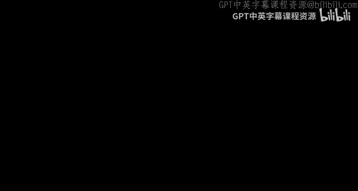
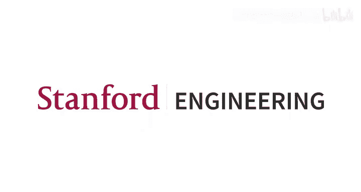

# 斯坦福大学《深度多任务与元学习｜Stanford CS330 Deep Multi-Task and Meta Learning 2022》中英（豆包翻译 - P5：-05-.Optimization-Based Meta-Learning l 2022 I Lecture 5.zh_en - GPT中英字幕课程资源 - BV1dWpPepEsj

For today， we're going to recap a little bit from what we talked about last week from the Meed learning problem setup and black box Meedal learninging。

 and then we're going to get into optimization based metaled learning where we're actually going to be embedding an optimization process inside another optimization process。

And this is part of what we'll be talking about today is part of homework too。

 and so it should also be useful for that。Great， and then yeah， by the end of the lecture。

 you should have a sense for kind of the basics of optimization based metal learning techniques and how to implement them in things like PyTtororch and also some of the tradeoffs between blackbox metal learning and optimization based me learning。

😊，Cool， so to start to recap from last lecture or some of the previous lectures。

 we've talked about multita learning and transfer learning。

 And we introduced this notion of the meta learning problem statement。

 which is kind of a form of transfer learning where our goal is。😊。

Having been given a set of training tasks， we want to more quickly or more proficiently solve a new task。

And we looked at this kind of running example metal learning problem where we have we're trying to do five way classification。

 we're given one example from each of the five different classes as this really tiny training data and our goal is to be able to predict the label for new examples as being among one of those five classes。

And the way that we did this is we set up a set of tasks that look a lot like the kind of tasks that we'll see at metatat time。

 and so these were our training tasks and we performed meta training on these tasks because we're trying to learn how to quickly learn each of these training tasks such that when we're given a new task at metat time。

 we can quickly learn that task。And this was an example， an image classification。

 but you can also replace this example with other machine learning problems。😊，Great。

 and then one of the big topics of lecture on Wednesday last week was how we can actually solve these few shot learning problems with a black box neural network where we basically just pass in the training data into something like a recurrent neural network。

 have that neural network possibly output a set of parameters for that task。

 and then we make predictions。😊，For new inputs for that task by passing that through the neural network with those parameters。

We also talked about a second version of this where it's not explicitly outputting the parameters of an entire neural network。

 it's simply just giving you， for example， another hidden state of that RNN。

 and then you can just again pass that through the last module or the last time step of the RNN。

So this kind of takes this has this more general form where we're going to be passing in a trained data set and a test input into some function。

 and we're going to be making a corresponding prediction。

This method was great and that it's very expressive。

 you can represent lots of different learning algorithms with these large black box neural networks。

😊，But they can also be somewhat challenging to optimize。

 and that's maybe something that you came across in homework One if you've gotten started on that。

So in this lecture， we're going to be thinking about other ways to try to represent this function that goes from a training data to a set of task parameters。

And in particular， we know something a little bit about machine learning。

 so you can think of this RNN as trying to mimic a learning process。

 and instead of trying to just throw a black box neural network at this。

 we could actually take a little bit about what we know about machine learning and actually apply that structure to this function and try to actually treat this function F as an optimization procedure。

😊，So that's what we'll really be focusing on today。So。In particular。

 what we could do is we're basically going to replace this RNN on the top left with some form of optimization process。

And in particular， we're going to focus on gradientding based optimization。

Instead of putting these examples into a RNN， we can instead pass it。

 we could actually run gradient descent on these examples in order to get a set of task specific parameters。

No。The key idea here is that we're going to be embedding this gradient descent optimization inside a broader optimization process。

 the me process。And。Then the key question is what actually are we going to be what are the meta parametersa。

 what are we going to be kind of meditrarating in this process？And。

There's a number of different free parameters of this process。

 but we'll focus on to start is a scenario where we are optimizing for the initial parameters of this neural network。

 such that running gradient descent on a few examples gives us a good set of task specific parameters for that task and for other tasks。

Now， why might this make sense？So if we go back to a couple lectures ago。

 we were talking about fine tuning。And we would take a set a pretrain parameters theta and run gradient descent initialized with those pretrained parameters。

And we found that fine tuning can actually work much better than learning from scratch。

 so we see that the green and orange lines are much lower。

 they have much lower error than the blue lines。U。But they also don't do great in the fu shot regime。

 and so essentially you can think of this as trying to optimize for a set of pretrained parameters such that we can actually do very well in the few shot regime。

 unlike if we were just going to pre-train with something like supervised learning。So in particular。

 let's start to formulate what this looks like as an objective。

 so fine tuning is what we want to be able to do at test time on our small。

 small training set for our new task。And so。What we can do is we can take one step of gradient decent。

 we can also imagine more than one step， but we'll start with a simplifying case of one step of gradient descent。

This will be used to get parameters for task I after fine tuning on the data set for task I。

And then once we have those parameters， we will evaluate how good those parameters are。

On new examples。Specifically， examples in the test data set for that task。

And then we'll essentially optimize for the set of。

Pre traineded parameters such that this one step of gradient descent is generalizing well to new examples。

And of course， we won't just do this over one task we'll do this over。

All of the tasks that we have available to us。And so this is essentially what our。

What our objective is going to look like for this optimization based meta learning process？

So the key idea here is to try to learn a parameter vector。

 an initial parameter vector theta that transfers very nicely with only a few examples。

I mentioned that this is an example for just one gradient step。

 but in practice you could also put multiple gradient steps in this inner loop here。And it will。

The equation will get a little bit longer， but this conceptual aspect of it is the same。ok so。

From here we can now that we have。Our objective， we can actually write out what this looks like as an algorithm。

So again， we can think of the same。Three way one shot classification problem that we considered in the last lecture。

Where basically different tasks will correspond to classifying。Digits from different alphabets。

 and in this case you could sort of think of a different alphabets as only having potentially three characters。

😊，And the first step， again will be to。Sample a task this will correspond to。

Three different characters。Then the next step will be to sample。A couple images per character。

And this will allow us to basically give us a training data set and a test set for that task。

And so in particular。We might have x equals a。而。Any。And y equals01，2。And then also this will be our。

Our training data set and then likewise。A b。是。And this will be our。The test set for this task。0，1。

 two。And so before what we did is we just passed the training data set through a neural network instead what we're going to do is。

I guess we'll be a step zero here， which is to。Randomly。Initialize our metapara data。

And then what the step 3 is going to do is。It's going to。

Take one gradient descent step on our trading data set。

So we will start with the current value of our meta parametersas then run gradient descent。On our。

Three trading examples。 And so I'll just write this as。Something like this。This will give us。

A set of parameters Phi I。And then once we have these parameters， we will then。

Take our test examples， run that through our neural network with parameters Phi I。

To get a corresponding prediction。And so， for example， we'll be looking at FI of。

Of this example here。That will give us a corresponding prediction。

And then we'll compare that prediction to the corresponding label to get how well this neural network is generalizing to new examples。

 and from there we'll then back propagate all the way back into the initial parameter vectors data in order to update our meta parameters。

And so。In particular。We'll have an update on theta， which will be based off of the。How well。

Fhi I is doing on your。Held out examples detest for task guy。

So this will be based off ultimately the gradient of this。Cool。

 now one other thing that I'll mention here is。I I should maybe。Well， actually sorry。

 after step four， then you'll go back to step one and repeat and continuously update theta。Based on。

This value right here。So this is the full Mediterranean algorithm。

One thing that I'll mention here is。Here we're going to be optimizing for some set of initial parameters。

 but you could also optimize for other parts of the inner loop learning process as well， for example。

 you could optimize for the learning rate here as well。

And you could optimize with respect to some weights applied to the data points or something like that。

嗯。Yeah， so this is the gist of that。 Any questions on the me process， yeah。I'm sorry。

How like thigh eye and。To each other so steps。You get PI from just modifying。But for step four。

 your update。結こけど。第二。That's good quite the Internet。Yeah， exactly。

 so you can think of step3 as the inner loop of this process because it's running the learning process to get running the learning process on a task task I。

 and then you can think of step four as this kind of outer loop objective where we're actually going to be。

Differentiating through the inter loop process in order to figure out what would have been a better initialization。

That would have allowed me to better generalize with this small data set。

The inner loop could also be more than one gradient step， but could also be a few gradient steps。

これをべ国に。So the question is， is it similar to things like bootsrap your own latent and offline and online processes？

I am a little bit Ruy on the details of BOL， we will next week talk about unsupervised pre tradinging methods and talk a little bit about how those relate to my learning methods。

Yeah。clarify again， how this is different than like the black box learning algorithms from last week。

 because for example， if data in this case were the parameters of an RNM。

 would we end up with something。Pretty similar to what we have us week。Yeah。

 so the key difference with the black box method， so black is the optimizationbased approach。

 the key difference for the black box approach is really step three。

 and so the difference with step3 is instead of actually obtaining PhiI through gradient descent。

 we obtained PhiI by running it through a neural network， and so there was a neural network。

 I can't remember by named it FG in the previous lecture but there's neural network that took his input the training data points for the task and outputted the parameters。

😊，And now instead of just passing this through a neural network。

 we're going to be running gradient descent initialized at the metaparameter data。じゃあ。

When the loss functions between different tasks are good。

Well this work if the loss functions between tasks are different Yeah so you could certainly have different loss functions for different tasks。

 what you would do in that case is LI， youd basically have a L would be kind of you'd have a different loss function for different tasks and so you would just need to use that loss function here and also here and everything would also still work out。

Yeah I want to make sure there is like some forgetting that's happening。

you can imagine if you like to look over。Mot is are guarantee here and it'll still be as fair as it was。

と時込み？Yeah so the question is how do you make sure that forgetting doesn't happen as you loop through these tasks。

 it may not be as good at kind of the first task once after you've kind of gone through the other tasks and really the key thing here is when you actually sample a task。

 you may also instead of sampling just one task， you may want to sample a mini batch of tasks and this will actually give you a gradient that isn't just or a meta gradient that isn't just for one task that's for multiple you may ultimately get a little bit of forgetting inof far as like SGD will kind of forget some data points for example。

 but having a mini batch， have a large enough batch size can certainly help with that。对。

So the difference here is last time we were taking loss over the query set。

 but this time we'll be taking loss of the support set and train it instead three。So。啲啲。

The fourth step is still with respect to thequeries set， the test。Yeah。

 so the third step is really where the difference is and so it is running a gradient step on the support set before we are also using the support set in the black box metal learning approach and we are passing that into F theta and so yeah。

 one key difference is here we're actually taking sort of taking a gradient step on both the support set and the query set。

啲诶。Yeah， but the key step of is the difference between three。

If you basically just put this into three， then you get exactly the black box approach that we had last week。

So one other thing that might help a little bit with some intuition here is that。

You can think of theta as this set of meta parameters that's being meta learned。

 And if you think about。Phi I star being the optimal parameter vector for T I。

Then you can think of me as this really thick black line。

Where when you're at this point in the me process， if you take a gradient step with respect task3。

 you're quite far from the optimum for task3， and likewise for other tasks。

 and as you kind of continue the meta training process。

 ultimately at the end of the Mediterranean process you want to be at a place in the landscape where if you take a gradient step with respect task3。

 you're very close to task3， if you take a gradient step with respect task two。

 you're very close to a good parameter vector for task2。

So this may give you a little bit of a kind of a visual depiction of the Mediterranean process。

Now one thing I will note about this diagram that can potentially be a little bit misleading is there isn't just a single optimum for any given task。

 and so it's actually going to be more of actually a large part of the parameter space for any one task and your goal is to try to find a part of the landscape where if you take a gradient step。

You can get to a region that's good for that task parameter rather than just a single space。嗯。Yeah。

 that's the gist of it in principle this may in this diagram it kind of looks like it's almost averaging the task parameters in practice you may get something like that in practice you may also be in scenarios where you're actually pretty far from the average but where kind of the gradient step will take you fairly far。

And on that note， I think it's worth mentioning that this learning rate here。

 alpha in practice will be much larger than a typical learning rate that you might use because you want to be able to actually go pretty far and actually be able to kind of traverse very far in the parameter space for different tasks。

Yeah。嗯。あこあのけ。People is something me you？比 have不会。It goess the training。He not。

So certainly this does kind of look a lot like a hyperparmeter optimization。

 except where you're optimizing full initial parameters rather than just low an run rate。

 your question was， can you also do hyperparameter optimization with this or？

Have to hope or something like that。 Like he been this photo like that。ま。たたけ。Yeah。

 so you could certainly consider using hyperparameter optimizationization techniques for learning the initialization。

 Unfortunately a lot of them are designed for optimizing a very lowdial set of hyperparameters like one hyperparameter or five hyperparameters and the initial parameters of a neural network may be millions of hyperparameters and so a lot of those methods won't scale well to such high dimensional things and that's why that's why in this case we're actually going to be differentiating through the learning process in using ingredients。

 but there's a lot of ideas that are transferable between the two literatures。

So here we are taking loss with respect to the EI train right in the third step so what is loss here really because we cancatenate the image label when we pass it and then will we are obviously trying to find the loss with respect to the king set labels again that's outputted by the network。

Yeah， great question。 So in black box metal learning， we were concatenating。

 we were passing in both the image and the label into the network here， when we run this inner loop。

 we're going to have a model。😊，We're going to have a model F theta that's kind of a neural network model。

And we're going to be only passing as input。Kind of the training examples into this。

 We're not going to be passing in the labels。 And then we're going to get a corresponding prediction。

And then。This loss function right here， L for theta D train。

 this is going to equal the sum over examples。X I， Y， I。In Dtrain I of。

 I guess if it's something like regression， you'll have something like Y hat， Tra I minus Y train I。

 if it's classification you'll have something more like a cross entropy loss。And so this is。

This is kind of the definition of this loss function。

 and this is how you're going to get the gradient。And so you're not going to actually going to be passing the labels into the network。

 but the labels will still come into play when you're comparing the predictions from the model to the ground truth predictions。

Yeah。P are to obvious approaches like performance wise。

 and why don' would you choose one or the other？Yeah。

 we'll talk about pros and cons of black box versus optimization based towards the end。Yeah。

So as thisism magism do。Where you can do it for your design learning use。

You have to load money here when we other the hosted。Are you referring to this learning rate， Yeah。

 because there will also be a learning rate here too。In general。Yeah， it's a great question。

 so do we need to carefully schedule it？It is a hyperparameter and you do need to pick it carefully if you pick it to be too large then it may be very difficult like the the updates may be just way too large if you pick something too small it may have trouble actually differentiating getting to different parameter vectors for different tasks and so it's important to pick something that has a middle ground the other thing that you can do is you can optimize it as part of as part of step4 as well and what。

What approaches have found is that it's actually helpful to optimize a different value of the learning rate for different layers or even for different parameters。

 rather than having a single learning rate for all the parameters。

 and this is because some parameters， especially biases like to have a very large learning rate and others like to have a very small learning rate and if you try to optimize for a single learning rate for all of them then they find a middle ground that isn't。

Isn't good for the weights？はい。Yeah， so if you do optimize a different alpha for the different layers。

 it does actually end up being quite stable。就。我么。A action across us in Step， can we have。

As there reported of the organization。Can we add term for regularization， So yeah。

 this loss function， this loss function could。Also include a regularization term one thing often actually one reason or one interesting thing here to note here is oftentimes you don't actually need a regularization on the inner loop and it may be a little bit surprising because the interloop data is often really tiny but because you're optimizing explicitly for generalization。

 it's going to be optimizing for at least a part of the optimization landscape that is nicely behaved and for which you don't get you don't overfit。

 that that it may be helpful to add regularization to this term here。

 if you're worried about kind of overfitting to the tasks that you have。第二。In this view， the。来。で集とした。

And the hasn said' use。可能事情 report。Yeah， so the question is is important to maintain this kind of distinction between train set and test set in step3 and step4。

 it is really important to have some held out data points in step four that are distinct from the data points that you're using for a train if you use the same exact data points。

 then you'll me train it to be able to memorize the things that you give as input and not actually learn the task that you care about。

That said， when you do sample a task and when you sample the images in step two。

 it's okay to kind of mix and match which images you use for train and test across these different iterations。

 the most important thing though is that within step3 and step4 that these are that you have some images in the test sets that are held up。

入。Heres the running besting rhythm？こあ。ク全三で。Do you mean after the Mediterranean process， Yeah exactly。

 yeah， let's go through that。It's a great transition so at metat time。We are going to be given。

A task。You can call it task J， and then we'll also be given a training data set for that task。

And after the meta testing process， what will be given is we'll kind of at the end， I。

The output is a。Set of metaparameters， theta。And so what we're going to do。

Is we're going to run gradientding descent， so we're basically just going to run fine tuning starting from meta parameters datata on the training data that we have for our new task。

So our estimate for the parameters for taskj are going to correspond to。

Theta minus alpha grabd theta of。The loss function for。The， the training data set。

It's a good idea to use。Roughly the same number of gradient steps in the inner loop in step three as you use at metat time。

 you want me time and metat time to match so that you are preparing the method for what will happen at metat time。

And of course， once you have these task specific parameters for your test task。

 then you can make predictions on new data points by giving an input。

 kind of pass it through your function F of Phi J to get a corresponding prediction。ow。

This algorithm， the algorithm where you kind of learn these set of initial parameters is referred to as model agnostic by learning。

 and the reason why it's called that is that。😊，Nowhere in here。

 do you see anything about kind of a neural network architecture or model？And。In that sense。

 the algorithm is somewhat agnostic to the particular architecture that you use。

 You can parameterize the model， the F model here， however you want。

As long as it's amenable to gradient descent， you could optimize for initialization of that model such that gradient descent gives you good generalization on the kinds of tasks that you me it on。

Cool， so we've already gone through the algorithm on the board。U。Again。

 kind of the only difference from the black box approach is that instead of running the training data set through a neural network。

 we're going to run gradient descent on starting from our initial meta parameters。

The other thing that I'll note here is or just try to emphasize here is like in the black box approach。

When we evaluate Phi I， we're not taking a gradient with respect to Phi I。

 we're taking a gradient with respect to the theta。And in this sense。

 we're sort of treating Phii more as activations than as weights。

 we're not ever running gradient descent on Phii itself。

 it's more of kind of a product of the inner loop。Yeah， something to keep in mind。有。の政に会に。玩儿就是。

Why does that help them not train it on Phi eye？So， if you。

So if Phi I is kind of the output of step 3， and there's nothing that。

If you then updated PI in some way， there's nothing that relies on that updated PI in the process。

And so it's sort of similar to how when P eye was activations。

 it's something that sort of gets kind of wiped out at the next time you look at the task。sorry。

 I might be ahead here， but do you have reasons to show I see that you're the first。Yeah。

 I can show some results。嗯。給です。Yeah， so I was going to go through some math。

 but maybe I could skip to the results a little bit first and then go through some of the math。

 so this is kind of skipping ahead a little bit but。There's one。

So there's one paper that kind of actually ran kind of architecture search in addition to this algorithm。

 And so they were actually additionally optimizing for。Fore an architecture that is。

For which this actually works well， the kind of basic architecture on five way。

5 shot mini I deck gets you 63。1%， which is。A lot better than what you've been doing in homework One。

 if you've gotten started with homework One， and if you also optimize for the architecture。

 you can do even better than that， you can get up to 74%。The state of the art these days。

 I think is in the low 80s at this point and。诶。we'll get into this a little bit later。

 but in general these kinds of approaches are competitive with state of the art。

 also the approaches that we'll talk about on Wednesday are also competitive on these image classification problems。

 but I actually also think that the image classification benchmarks themselves are not the most interesting benchmarks because even just learning good features can do very well on those benchmarks and there are a lot of other application domains where we're giving good features isn't quite enough and so we've seen applications in drug discovery as one example that can do quite well。

 I guess kind of the short TLDR though is that these kinds of approaches can do quite well on middle learning problems。

点。我们自询会。Yeah， I don't remember actually the specific approach that they used in this paper。

 but one thing that was interesting is that instead of they found a fairly non-standard architecture。

 one that is actually quite deep and narrow and typically deep and narrow things are not like typically you want enough width。

To be able to optimize， so it was kind of interesting that it found something a little bit different from that。

 but you can take a look at the if you search for Kim and Autoto， you'll be able to find the paper。

Cool， let's go back to some math， though。So。One thing that actually no one has brought up in the questions yet is that this is actually going to bring up some second order derivatives。

And the reason for that is that you have。The inner loop here。

 which has a gradient with respect theta， and you also have the outer loop。

 which also has a gradient with respect theta。And so。You might。Woned do we need a computer hessian。

 Hessians and deep learning are very scary because if you have an n dimensional parameter vector then thesian is going to be n squared。

 and so if you have a million parameters that's going to be a million squared values in this hessian。

 also if you want to run more integrated steps there's this question of do you get even higher order derivatives？

😊，So。We're going to do a bit of math。 I guess to preface some of the math。

 if some of you are scared of math。Pytorch will do all the math for you。And so I。

Don't worry too much， but I think going through the mouth is actually really helpful for understanding what happens under the hood and what is actually the complexity of these algorithms。

In practice。So。The first thing that you need to know before we get into the math of the metal learning algorithms is about Hes and vector products。

And。The cool thing about Hes and vector products is that。

You can actually compute them much more cheaply than trying to compute the hessian itself。

And in particular， if we can。If we can actually compute these kind of meta gradients without actually it' be really nice if we didn't have to basically construct the whole hess in order to compute these meta gradients。

And so。In particular。One intuition that you can think of for this is say we have some function F。

 the gradient of that function is G。Then。Say that we are evaluating G of the gradient of F at。

X plus delta x。Then we know that this is。Roughly equal to。G of x plus。H of x times deelta x。

So this is just a kind of typical tailor expansion。And。From here。If we replace。Delta x by。

R time some vector V。 So R is going to be some small value。G of x plus RV。

 so v is ultimately going to be the vector that we want to be able to compute。

 so our goal is going to be able to compute H of x times V。If you replace Delta x with RV。

 then you get this equals。G of x plus R H of x。Time Z。And from this form。

 you can see that we could actually kind of move things around and actually solve for H of x。Times V。

And what we get is。H of x。Times v is roughly equal to。G of x plus Rv minus G of x divided by R。

Did double shake my mouth， yeah。Yeah。U， and the cool thing about this is that it means that you could actually approximately compute this Hessian vector product with just two gradient evaluations。

And that's really awesome because that means that we don't have to compute this giant hessian。

 and this is going to be more expensive than one gradient evaluation， of course， but it's。

But it's a lot cheaper than computing the whole hessian。 Now， you might wonder， okay。

 we have this approximation sign here。Can we get the exact hession and there are actually algorithms that have the same complexity that will also give you the exact hesion。

 I'm not going to go into those， but Pearl Muutter's algorithm is one example of that。

 but this gives you a little bit of intuition for how we might go about computing these kinds of hesion vector blocks。

Cool。Yeah， so that's the good news is if we can basically compute the met gradient as a hesian and vector product。

 then we can compute it with only around two gradient evaluations。Now let's go back to me learning。

We。And actually， for notational purposes， we're going to have。

We're going to separately represent partial versus full derivatives。

 so I'm going to use DDX to refer to full derivatives and the gradient of x evaluated x equals x prime。

Or x prime equals x， this will be kind of a partial derivative。

That will help keep our notation straight a little bit。And。

Remember that phi I is going to be equal to theta minus。Let's use the full derivative here。DD theta。

Of L。Of theta comma DI train。Cool， so this is everything that we had before。

 and our goal now is going to be to compute the gradient or the meta gradient in step4。So the。

The mammal objective is to。Minimize with respect to theta of the loss of Phi I evaluated at。

The test dataset set for that task。So this is the same as what's written up there。And for this。

 we want to be able to compute the gradient of this with respect to theta。😊，And so to do that。😊。

Let's see， let's go over here。We have DD theta of this loss function。And now for this， we can。

Use the chain rule。So if you remember your calculus。

 first we're going to take the gradient of the outer objective。And then we will differentiate。

From the inner。 So we get the gradient of。I'm going to use Phi bar here of L。

Fhi bar of DI test evaluated at。5hi bar equals。Fight eye。And then once we。Do the chain rule。

On the inner loop， then we just get Dhi I D theta because this isn't a function of theta right here。

So， this is the。The kind of derivative of。Our loss function with respect the theta here。

This is a row vector。So we can refer to this as V。And this is。A matrix。

And then let's look a little bit more at this matrix right here。So this matrix， D Phi ID D theta。

 if we look at the definition of Phi。We see Dfi eye。D Theta， does anyone want to give it to me？

What do I write next？I is a matrix。お前さ。Alpha。Yeah， and then the Russianian。Awesome， cool。

 I'm glad some people are paying attention。And this will be with respect to Dtrain I。Cool。

 and so if we plug this expression in to here， what we're going to get is。This is equal to。V times I。

Minus alpha。The whoops。Times8 right here， so this is this the hessian right here。

And that's great because we then get a hess and vector product right here rather than anything that has to do with the full hessian。

😊，Can people see this， is this too low？It's okay， O。Cool。To answer the first question。

 we do get second order derivatives here， but we only get this hesian in vector product and so in practice to compute the met gradient for this algorithm。

 it just requires a few extra backward passes of your neural network。

 it doesn't require anything more than that。y。喂。いし？のお。Yeah， so then the question is。

 what happens if you do multiple gradient steps？So if you do multiple gradient steps， then。

Your thigh eye。Is going to be equal to theta minus alpha。D， D theta， L of theta， D I train。

 This is just the first step。 And then the second step， you're going to be。

R at a second gradient step on this parameter vector。

 so if we refer to this parameter vector as theta prime。Then this next step is D。D theta prime。

Of L theta prime。Do I train。And the key thing to note here is this second gradient step。

Is with respect to theta prime and not with respect to is with the theta prime first。

 And then second， this isn't like。When you take a second gradient step。

 it's not like a second order gradient step。 it's just a second gradient step in sequence。

When you actually go to compute the meta gradient， you get the same exact form as before。

 except now you have a different Dfi IDD theta。And so what we're going to get for the new D ID theta is going to be the same as before。

 but now we're going to have a third term， which will look like minus alpha times。This。

Differentd we need to differentiate this third term by theta。And what we get there is。Something like。

We do the chain rule again， so we're going to do。Theta bar prime L。Data bar prime DI train。

 this is going to be evaluated at theta bar prime equals theta prime times。D theta prime D theta。

And so。诶。Basically， you'll get kind of these products of Hessians。

 but you don't get anything that has a three on it。

 and that's good because the higher this number is the nastyier it gets。down。そう。

This tells me that the three and4 are a couple of gradient steps。 So you take one gradient step 3。

 and then you do 4， and then you go back and build 3 and go4 for an entire batch。 Let's sit。 right。

 So if you were to take multiple gradient steps， that just means that the equation on step 3 will have will be different instead of taking one gradient step you will have。

Two gradient steps like what's written here。 And so the only thing that if you take multiple intermediate gradient steps that's changing is just that the equation in  three will be a little bit different。

おいのピタ。At fourth step when I have already completed the multiple reading steps at the third one。

When you actually backpro through， you need to actually store all all the intermediate parameter vector values because basically。

 you can think of it as。You're gonna kind of。The forward process of this inner loop is run gradient descent。

 and then to back propagate back prop through that again， you need to kind of。

Back prop through those gradient steps and so。啲。While we don't get third order gradients。

 if you have a lot of inner loop steps， it will increase the amount of memory usage linearly and also increased compute as well。

Hes taking mark。Exper sport。Yeah， the question is is taking multiple gradient steps worth the overhead for fu shot learning problems。

 you actually don't need a very large number of gradient steps you could actually do quite well with a pretty small number of gradient steps between like one and five gradient steps and so in practice at least from what I've seen you don't actually need like more than five inter gradient steps and that ends up working pretty well on fu shot learning problems it is also not that expensive if you wanted to run 100 gradient steps things get a lot more expensive and in two weeks we're going to talk about more advanced metal learning techniques including ways to differentiate through like hundreds of gradient steps。

And doing something like this with hundreds of integrated steps is not a great approach。Yeah。

Thank you， Commission。The used by Dr To with。So these are the same as alpha in this case。

They are here。So you can think of this as a finite difference method。

 and R just needs to be small here， and so it's not quite the same as alpha。

The biggest thing is that V is the same， so V here is the same as V there。

And R will be separately chosen， so alpha is just going to be the multiplier based off of the inner learning rate。

 whereas to compute this， if you want to use finite differences to compute this。

 you would separately select a small R to use with finite differences。And in practice。

 things like PyTtorrch will not use finite differences。

 they'll actually give you an exact hes vector product。有。It's a play right。就スポ。

So D train does have labels， so it will have both the examples and the labels。

 you'll only be passing the examples into your neural network。

 but then to compute the gradient in your inner loop， you'll use the labels there。あこ。

Which class is the most similar to？This happened never。

So in blackB B learning we also actually did need the labels as well and so we were actually passing those in to the neural network as well and the reason why it needed that is it needed to know what to output for this letter and so it could tell you okay it's the same class as this but then it needs to give you a number for that class and so we passed in the labels for that reason for blacknot as well。

It's supervised down。有。Bbro metal。Reボ。s。我别人。回装是。実際まで。Yeah， it does simplify。

 so the question is the kind of here the label， we assign label zero to a in this task。

 but in another task you might assign a different label to A because the assignment of labels to images is somewhat arbitrary in classification problems and so it's also useful to kind of randomize that assignment across tasks。

😊，but should just give me。Yeah， so for things like regression problems。

 you'll typically keep the label intactctic。And we'll talk a little bit more about some of that stuff。

In two weeks in some of the advanced me learning topics。No。The He vector product。Thats。

That's whatYeah。So here's my slide on that。不。Any other questions？Oh， question。 Okay， cool， good。Okay。

 we also went through about of test time already， but it's on the slide in case you wanted a reference for that。

And the gist of it is just to run fine tuning。Cool， so yeah。

 that was really the kind of overall basics of optimization based me learning。

Now let's compare our optimization base versus black box metal learning and then also talk about some challenges and solutions。

 we have a little bit of time we'll also look at a case study at the end。So at a conceptual level。

There's a way that you can look at these two things in a way that's quite similar。

 so the general form of black box adaptation was to pass in the training data set and the test input into this big neural network and get a corresponding label or corresponding prediction。

For an algorithm like mammal， you can also view it in a very similar light。

As kind of a computation graph that takes this input， the training data set and a test input。

And the way that it looks like that is essentially you can view it as a computation graph that just has a gradient step inside the computation graph。

 so detrain and X test are still inputs to that overarching computation graph it's just that it has a gradient step inside of it where we're taking a gradient with respect to our training data points to get our parameters and。

😊，And make predictions based on those parameters。so。From this view， you can。

They end up looking more similar than perhaps they look like on the previous slides。

And also from this view， it means that you can somewhat mix and mount components of your computation graph。

 and there are methods that， for example， have learned an initialization but replaced the gradient update with a learned network and for example。

 this paper to something like that where it learns data and it also learns this network that kind of takes the gradient and warps it in some way to predict a different gradient than the actual gradient。

And this paper actually proceeds as a mammal paper。

And I guess I mentioned this as kind of a conceptual thing that's kind of interesting。

 in practice I wouldn't recommend using this algorithm。😊。

It's a little bit more complicated and tends to not work as well as actually just using the gradient。

 but it's something that I think is useful to know conceptual。Cool。

 and then we'll also look at this again on Wednesday when we look at a third class of app approachess。

Now let's actually look at how these algorithms perform in practice。In general。

 both of them can represent a variety of learning algorithms。

 but one thing that's nice about the optimization based meta learning algorithms is that at meta test time。

 you're literally just running fine tuning。And so even if you don't actually have a very good set of meta parametersameters。

 P2 should still give you something that improves on the parameter vector that you have。

 whereas if you just throw something into a recurrent neural network， you can't really。

You can't really expect it to necessarily give you something reasonable if the data set is out of distribution from the task that I saw before。

And so we can explicitly test this， and so we're going to compare an optimization based algorithm mammal with two black box algorithms called snail and meta networkss。

And specifically， we're going to look at omniga image classification。

 and we're going to look at performance as you vary the task。And in particular。

 the first thing we're going to look at is all the algorithms are just me traineded on the original omniglot data set。

But then we evaluated them on tasks that had digits that were warped。

And so they were all trained on kind of this center line so they're going to do the best at the center。

 but then as you warp the。As you warp the characters more and more。

 the performance will get worse because it's more out of distribution。

And so what we find here is that an algorithm like Mammal actually is able to generalize much better to these odd distribution tasks compared to something like the black box metal learnerss because it has this kind of structure of running gradient descent embedded within it。

 and it's just running fine tuning at test time。We can also look at this on a second task。

 this is we're kind of warping the size of the digits。

 and here we see a similar trend where the optimization based algorithm is better able to extrapolate。

诶。Yeah。As obviously think repeatedly bar that come from a blackboardmer and finding them on the training。

What' doing support the test dogs。すちと。B on， can you fine tune the black box medalary？Yeah， yeah。

 so if you have a black box metal RNAn that's actually outputting parameters。

 then you could also fine tune those parameters a little bit and you' would expect that to do a little bit better than if you didn't finet。

 both of these approaches， snail and metal networks are not actually outputting a single set of parameters but you could sort of like fine-t the last part of the RN。

And in principle that should improve it a little bit。

 I suspect that it may not improve it all the way up to the purple line。

 but I suspect it would improve it a little bit。这样嗯。Work for the。Deate form。Can as。かんど。そう待け。Yeah。

 so the question is why is it dropping more rapidly for the scale versus the shift？

I should say that the X axes on these two plots are not very comparable。

 one is in like scale and one of is in radians and so if for example。

 you zoomed out more on the radance plot to show a wider range。

 I would expect it to drop off more quickly。I also think that as you make a digit smaller and smaller。

 it's probably a little bit harder for the neural network to read than the larger one。

 and so that's I expect why we see more of a drop off on the left side than on the right side but that's somewhat speculative。

SoWhat is underlying model architecture so for Mammal it's a four layer convolutional network with I think like 32 filters。

 something like that per per layer。And it's kind of the standard architecture that's been used in multiple works。

 whereas for snail and meta networks， the architecture is a little bit more specific to the method because it's a kind of a non model agnostic method。

 it's kind of yeah and so snail was the one that used the interleaved。

The interleaved convolutions and attention layers。do for the scale and the shifting part。嗯。

You asking me if the convolution layers help with the understanding variance in the data distribution。

 which is the scale and the shift whereas as the snail， I guess just use RNAance。So S was using。

I can't remember if there was， I'm pretty sure there was a backbone that was convolutionbased and likewise for meta networkss。

 I can't remember the specifics of it unfortunately， but I'm pretty sure it is using that。

 and I should mention and emphasize here that all of these were only trained on this scale and so they didn't see any data at different scales in different shears of the digit。

Cool。The we see that we like the structure of gradient descent is helping us generalize to out of distribution tasks。

 Now， you might wonder if this structure comes at a cost because。啲。Maybe for example。

 by embedding gradient descent， we don't have as much expressive power in terms of the algorithms。

 the learning procedures that we can represent。And it turns out that you can actually theoretically show that if you have a deep neural network。

 the kind of mammal function of running gradient one step of gradient descent can actually approximate any function of the training data and the test input。

 so it can sort of approximate any learning algorithm。嗯。

Although it does make some nontrivial assumptions， well it assumes that the learning rate is nonze。

 that the data points are unique and that the loss function gradient does not lose information about the label。

But really the strongest assumption is that the network needs to be extremely deep for this sort of result to hold。

 and you can get more expressive power with the RNN like approaches with a smaller neural network。

にこ music for思いま。いろ議る。Yeah， so essentially。What that means just vary approximately is if you have one loss function that。

That looks like this versus a loss function that looks like this if you just look at the gradient of this function。

 you don't actually know where you are on the line at all and so that doesn't tell you。

 you know what your prediction is but it doesn't tell you what the label is relative to your prediction and so it doesn't hold for L1 loss functions but it does hold for things like L2 and cross entropy loss。

じゃ二。Why is it that the data points and the data set it be unique？Yeah。

 this is a little bit getting to details that aren't super important。

 but the gist is that if you have duplicates of data points and you want it to give you different。

Fi eyes for different numbers of duplicates in in the data set。 It's hard to。

 It's hard to understand how many duplicates there are in the gradient。 For example。

 if you think about the gradient of。Two data points versus the gradient of five data points that are identical。

 The gradient is the same because it's just averaging across them。

 And so it's not going to the learning algorithm isn't going to be able to differentiate between。

But it's going be able to count the number of data points you have， basically。就。

Each technique or is there any？Point to the inmusing red books。Yeah。

 let's go through some of the challenges and solutions and then well。

I' about I'll get getting to fold up for dot on Wednesday。

 but I'll also talk more about the pros and cons after we go through some of the challenges in solutions。

So one reason to not use these kinds of optimization based methods is that sometimes this sort of bilevel optimization can be somewhat unstable because you have an optimization inside another optimization and there are ways to try to stabilize the process one way to stabilize it is actually to。

To give it a little bit more expressive power， don't just learn the initialization。

 but also learn the learning rate and this has been shown to。

 at least in practice lead to an easier outer optimization。

There's also approaches that try to only optimize a subset of the parameters in the inner loop。

 for example you could choose to only optimize the last layer in the inner loop or choose to only optimize like the batch storm parameters in your inner loop or something like that。

嗯。And then there's also some work that showed that if you。

That if you have a different learning rate and a different balor statistics per gradient step in the inner loop。

 that can also help stabilize things because if they're coupled。

 then they whatever you have kind of basically the same value for something。

 it can cause those values to sort of fight during the optimization process and not find a good happy medium。

诶。And then。I don't want to go into too much depth in this。

 but there's also approaches that try to kind of introduce a sort of context variable that instead of only optimizing for the parameters of this neural network。

 you can essentially。Add a variable that's kind of part of theta here as part of the network you could sort of think of this as like kind of like the ZI that we saw in multitask learning that you're optimizing as well as the other parameters and this can also。

😊，Kin of increase the expressive power of the meta optimizer and in practice leads to better results as well。

I'm more giving this just as an overview if you want to dive a little bit deeper into。

Things that can help these algorithms work better in practice。So yeah。

 range of simple tricks that can help the optimization a lot。

And then the second main challenge I want to talk about is that。

If you have one or a few in gradient steps， it's very easy to differentiate through that。

 but if you have a lot of in gradient steps， it becomes very compute intensive and very memory intensive。

And there are also a few tricks for trying to address this。The first trick is a bit of a hack。

 and it's actually something that I discovered because of a bug in TensorFlow。And in particular。

 the first time that I implemented。The mammal algorithm。

 it turned out that Tensorflow didn't properly implement this term。

 and it just silently basically set this to be the identity。诶。

And it turns out that actually if you set it to be the identity， it actually works。

Some of the time so。For simple image classification tasks， you can actually that's not the identity。

 by the way， yeah， and so yeah， it turns out to actually work in some cases。

 there's another paper that explicitly proposed this sort of first order method as well。

And so if you do approximate as the identity， you actually you don't have any second order terms and it can work well on simple problems in other problems I found that it doesn't work well at all。

そ对。嗯。Not quite。 I mean， Tensor Po has sense fixed this issue。 This was very early days in 20。

Early 2017， yeah， but since then both and actually the early days of Pyhors。

 they also didn't have their second order derivatives properly implemented as well， so yeah。

Make that something do essentially assume that fires were。So， it's。

It's basically saying that the lost landscape around Phi is very similar to the lost landscape around theta。

I don't think we know why it works， although my guess would be something that it has to do with the optimization landscape being well conditioned。

 but yeah， we don't fully know why this works。Yeah。

 does that mean that the Hasian was not getting calculated correctly。 came 0， therefore I or。Yeah。

 so this was being set to zero。一。全の方時か。I don't remember the exact details of the bug。

 but it was something like， I think it was something like basically the Hessian wasn't implemented or something and it was silently returning zero rather than throwing an error。

Why does work？It's an observation， yeah。Another thing that you can do is if you don't want to back propagate through many integrating steps of the whole network。

 if you only optimize the last layer of weights， then this can actually be very cheap。And。

There are a number of papers that have done this that actually get quite strong results and in some of these cases you can actually compute the you can compute potentially the last layer in closed form and yeah that has a number of benefits。

 this works especially well in settings where in image settings where learning features are a big part of the problem。

😊，Cool， and then there's also something called the implicit value theorem that is actually pretty cool and allows you to differentiate the me gradient without actually differentiating through the optimization path。

 we might talk about this a little bit in some of the advanced me learning lectures。

 but I more mentioned it here as a reference in case you're interested in digging deeper into that。😊。

We'll be optimizing the last player in the inter loop first now。In the interlo， so in basically。

 yeah， in step three， you only optimize the interloop and then step four。

 you optimize the whole network such that basically optimize for features such that optimizing the interlo gives you a good performance。

There works the best laptop they for you。Yeah， so you can also think about。

Find tuing different parts of the network， you could also have something where you fine tune the last layer for some tasks and fine tune the first layer for other tasks。

 although then there's this you have to actually select which layer to adapt for different tasks。

There's also a paper that actually optimizes everything but the last layer。

 and they actually found pretty good results with that。I'm not exactly sure how they came up with it。

It's called Boy if you want to look it up。But yeah， you could imagine something like that。Cool。

 and then I already showed this slide， but there's also some works that have looked at architectures for this kind of by levell optimization and have found that actually sometimes deeper and narrow architectures can work pretty well。

And yeah。That's the gist of it。 So the takeaway here is that we're constructing this bilevel optimization problem in terms of the pros and cons。

One thing that's really nice about it is it has this sort of positive inductive bias at the start of me learning and what I mean by that is before you do any me learning。

 you're already running gradient descent on your training data in the inner loop。

And that means that you already have a pretty good starting point for learning from data。

In contrast to black box approaches， black box approaches are starting within a randomly initialized recurrent neural network。

When you pass in a data into that randomly initialized neural network。

 it doesn't have any sort of inductive bias at the beginning that will give you that will actually do anything remotely like learning at the start of initialization。

Because of this， it tends to extrapolate a little bit better because you're embedding gradient descent because you're running fine tuning。

And it's also quite expressive if you have a deep enough neural network。And it's model agnostic。

downside is that does typically require a second order optimization， which can be computationally。

 it's certainly a little bit more expensive than other approaches。

 especially the approaches we'll talk about on Wednesday。

And so this leads to more compute and memory usage。Cool， we have six minutes。

 so I think I will go through this case study， we'll also look at some more case studies on Wednesday this week。

So this was actually some work done by some folks at TUM and also some folks at Stanford。

 Sherry was actually a PhD student at Stanford， he graduated。

 I think last year and is now starting as a professor at MIT。

And this is some work that they did on trying to do land cover classification。

And the motivation is that if you have a satellite image。

 it's useful to be able to predict how the land is being used。This can be used for urban planning。

 for understanding how things are changing over time。

 but it's very expensive to label these satellite images， as you might imagine。

And so labeling data is really expensive and different regions look different and have different land use proportions and so this means that if you train a model on one part of the world and then try to apply that model to other parts of the world。

 it may not generalize well to。😊，All parts of the world。

And so what they were looking at is they had croplands from multiple different countries。

 and they framed this as a metal learning problem where different tasks correspond to different regions of the world。

And so what they wanted to be able to do is for a new region of the world that they didn't have labels for yet。

 they wanted to label a small amount of data for that region and then get a good segment or a classifier for that region of the world that can basically fill in the rest of the labels。

And so you can sort of think of this as this is a diagram from their paper where you try to find a good set of initial parameters that that when you fine tune on new region of the world。

 you're able to quickly get a model that can。Accurately segment satellite images from that part of the world。

So they looked at two different data sets。 One of the data sets had geographic metadata in it。

 and so they were able to separate out。Kind of explicitly separate out new regions of the world。

 And so dark blue is Mediterranean train。 light blue is meta validationidation tasks。

 and orange is metat tasks。嗯。And kind of as an example of a。

Of a two way two shot classification task， they're trying to classify if a square is forest or croplands。

And so they're given that， and then they have two examples per class of what those parts of the land look like。

And then they also had a second data set where they were looking at where they didn't have any kind of geographic metadata。

 so they use clustering to try to guess the region of the world and separate things out into meta training。

 meta validation and metat， and here they are doing a kind of a segmentation task where they were basically the support set corresponded to one small square。

 and then the query set corresponded to the other squares。Cool， and so they。

They were comparing random initializations， so they're trading from scratch on a small amount of data from that new region。

They also compared that to pretrain on all of the data they had had so far and then fine tuning on the target task。

 and lastly， they compared to the mammal algorithm that we talked about today。

And what we see is heres the results on the first data set。

 and this is the performance or the accuracy of land cover classification as you increase the number of data points on the target task。

😊，First we see that random initialization isn't able to do very well because it doesn't use any other data。

 using a pretrain network is able to do a lot better， especially with less data。

 and then MaML is able to do if you have one or more data points from the target region is able to do even better than a pretrained neural network。

One benefit to the pretrain neural network is it can actually already do decent classification just without any additional data from the new region。

 and that's why the dark blue is above the orange and the light green at zero。

And then likewise on the Deep Globe data set， they looked at both a random split and a harder clustered split here。

 the results are similar on the clustered split on the random split they actually found that the pretrain model was able to do quite well which makes sense because kind of the pretraining data and the target data。

 you're going to basically have more data points that look more similar across the kind of pretraining data and the target data。

😊，Cool， and then if you're interested in like looking at this more I'd encourage you to take a look at the paper。

 here's just kind of， yeah， just one example of a fairly real world problem of using this kind of approach。

嗯。Cool， so that's it for today。 we covered the basics of optimization based metal learning。

 we talked about how it compared with blackbox metal learning。

On Wednesday we're going to be talking about our last type of me learning method。

 nonparmetric few shot learning methods， then next week we'll talk about unsupervised pretraining and the following week we'll talk about more advanced me learning topics Yeah and as a reminder submit your project form and your homework on Wednesday。

