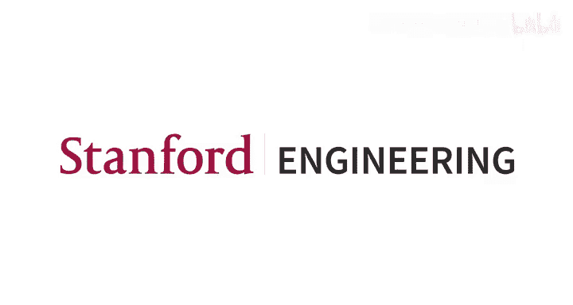
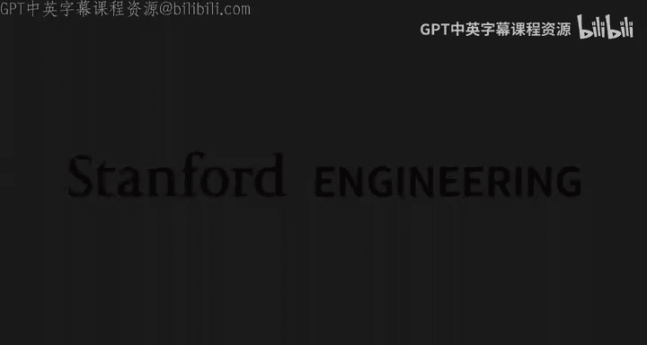
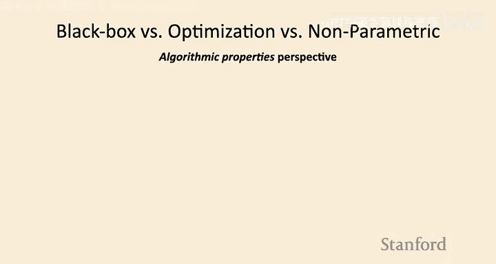
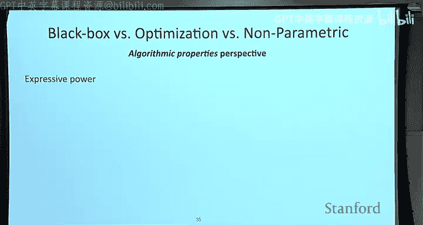
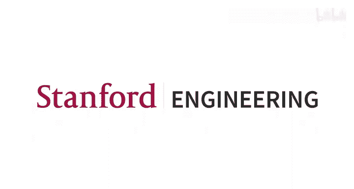

# 斯坦福大学《深度多任务与元学习｜Stanford CS330 Deep Multi-Task and Meta Learning 2022》中英（豆包翻译 - P6：-06-.Non-Parametric Few-Shot Learning l 2022 I Lecture 6.zh_en - GPT中英字幕课程资源 - BV1dWpPepEsj

So our plan for today is primarily we're going to focus on what I'll refer to as nonparmetric few shot learning methods。

 this is a pretty cool class of methods that actually seems to work really。

 really well for few shot classification problems。😊，And it will also be part of homework too。

 in addition to some of the topics that we had covered on Monday。

We'll also look at a case study in education where we actually deployed these systems for a real live application。

 which is pretty exciting。And then once we kind of talk about this class of methods。

 we'll also talk a little bit， start to kind of wrap up this kind of module on metal learning algorithms by talking about a comparison of the three different classes of approaches that we've talked about and also give a few different example applications。

So really the goals by the end of the lecture are to get an understanding for what this third class of metal learning methods is and understand how to implement these non-parmetric fu shot metal learning methods。

 and then also start to understand the tradeoffs between different metal learning algorithms and some of the applications of these algorithms。

😊，Cool， so to briefly recap the last two lectures we've talked about black box metal learning and optimization- based metal learning。

 and in black box metal learning， we parameterized the learning process with something like a big black box for current neural network by passing in a training data into that neural network。

 having an output a set of parameters and having a new example be passed into that and kind of training this whole system end to end with respect to the ability to generalize to new data points。

😊，This is what you've been implementing in homework One。

 It's a very expressive approach in that it can represent lots of different learning procedures。

 but it can also be somewhat challenging to optimize and somewhat sensitive to hyperpara。

Then on the lecture on Monday， we talked about optimization based metal learning algorithms that embed the structure of gradient descent into the inter loop learning process。

And。We saw that these algorithms are because they're embedding the structure of optimization inside this learning process。

 you get that nice structure， and so add initialization。

 you're already going to be getting something that can do at least a little bit of learning from the examples that you give it。

But it does require a second order optimization， and this can be computationally more heavy weight。

 especially in comparison to some of the approaches that we'll be talking about today。Cool。

 so really what we'd like to be able to do today is we'd like to be able to take a learning procedure and embed that inside the inter loop process of these me learning algorithms without requiring a second order optimization。

And the way that we're gonna to do that is instead of trying to embed gradient descent into。

These algorithms， we're going to look at algorithms like nearest neighbors。And in particular。

 you might think， okay， well， nearest neighbors is not a very powerful algorithm。

 so why might we actually do anything like nearest neighbors？But things like your' neighbors。

 these non parametric machine learning methods actually work pretty well if you are in a low data regime。

If you have a small amount of data， then these algorithms are computationally efficient because you don't have that many comparisons to be making。

 and they're also very simple。😊，And at meta test time。

 when we're trying to do something like few shot learning， we're actually in a low data regime。

And so things like nearest neighbors may actually make a lot of sense。However， during me time。

 we actually potentially have a large number of tasks and we want to be able to learn good representations from the data that we have。

 and so we still want to be parametric during me time。

And so really kind of the idea behind the class of methods that we'll talk about today is trying to use kind of parametric metal learners that produce effective non parametric learners。

So it might be a little bit mysterious what that exactly means， so let's get into it a little bit。

Say we want to do kind of the canonical fu shot image classification problem that we've been looking at before。

😊，If we want to do something like nearest neighbors with this example。

 what we would do is we would take our test data point and we would compare it to each of our training examples。

And once we figured out which of the training examples it was most similar to。

 then we can output the label of that training example。So this is pretty simple。😊。

We're just going to be comparing our test image with each of the images in the training data set for our given task。

Now， the key question is， whent we make these comparisons？

In what space do we compare or what distance metric are we going to be using to compare these images？

Now， one thing you could imagine doing is doing L2 distance in pixel space。

 so just doing kind of Euclidean distance in the original space of the images。

And so if you do something like that， say you are to compare this image on the right with the two images on the left。

Just with this LT distance。I'm curious what you think would be kind of the closer of the two images。

 how many people think that the left image would be closer in terms of L2 distance？

And how many people think the right image？Okay， so maybe people like， maybe people are trying to。

But in general， there wasn't any sort of consensus。

 but it turns out that this left image is actually in L2 space what's going to be closer to this image on the right。

 and at least perceptually in terms of what when we see these images。

 at least the image on the right is something that we would probably want to be closer in terms of our distance metric。

So things like LT distance are actually really terrible for comparing in the original space of things like images。

So we don't want to use L two distance。Does anyone have ideas for what distance metrics we might consider using instead of LT distance？

有。Hold the first five layers on BGG19 and you use there that's very specific so you can use。

You could use it settings from kind of a trained neural network。

 perhaps the fifth layer of the VGG network。点。😊，trying to do。Yeah。

 so maybe you can learn the metric with the training data。Any other parts。Okay， extra key points。嗯。

So you could try to extract some key points in the image and compare the key points across the images。

Yeah it's more to television。所都。ポと。2 the road really because。Fatureers。

So you could do something like cosine similarity in a certain feature space。Yeah。

This isn't the suggestion。I just feel like I'm missing something if we're talking about。

Exusing a distance metric。Like what some on？Yeah。The question was if we're choosing the distance metric isn't that a parameter of the method and so in what sense is this a nonparmetric method and so yeah that's exactly right。

 the kind of the choice of distance function is going to be parametric and in this case we're actually going to be learning a distance metric which is what was suggested。

 that's kind of the parametric part of it， but once you have that distance metric。😊。

The rest is non parametric， so you're going to be kind of comparing in that space。

 so once you embed into some embedding space， everything after that is non parametric。

And so it is going to be something that's a little bit more hybrid。

 the metal learning process will be parametric and have some parameters that you're optimizing and then once you optimize those parameters at test time there isn't going to be。

Any kind of notion of task parameters， and we'll see that a little bit when we get into some of the math。

Cool， so yeah， the key idea behind this class of methods is maybe we can learn how to compare examples using the Mediterranean data。

So there's three specific methods that we'll go into。 and we'll start with the simplest one。

Wwhichch is referred to as a Siamese network， so a Siamese network is a pretty simple neural network architecture where you have two inputs and you pass those two inputs into the same exact neural network。

😊，U。And it's called the Siese network because these kind of two neural networks have the same exact parameters。

 so the parameters are shared across the two。And what we'll do is we'll pass in two images into this sideamese network。

 and then once we have the output， we'll then compare the resulting representation。

And we'll train the Siamese neural network to output whether or not the two images we're passing in have the same class or not。

And so in this example， these two images have a different class， one is of a lion。

 one is of cups or bowls。😊，And so the label will be zero because these are a different class。

Likewise， we could pass it these two images which are both images of bowls。

 and we would train it to output one。And so on and so forth。

 so whenever we give it two images that are different classes， we train to output zero。

 whenever they're both the same class， we train to output one。

So the training process is a very simple binary classification problem。

 and you can do this with all of the kind of available mera data that you have。😊，Cool。

 and then once you have this Siamese neural network。

What you can do is use this as essentially your similarity metric or your distance metric。

So you can compare your test image to each of the examples in your training data and ask this network。

Which of the images is the closest？And so in particular。

 if we kind of go back to the example you have before。

 you would pass in all pairs of training example， comma test data point and ask it which has the highest probability of being the same class and then output the corresponding label。

Any questions on how that works？Cool， so training will be binary classification and test time。

 you're running these pairwise comparisons and so if you have n times k examples in your training data you're going to be actually doing n times K forward passes of this neural network and then finding the probability that's the highest outputting the corresponding label。

So Mediterranean is binary classification， and then meta test time will actually be a form of N classification。

Yeah。That wasn one short learning。So you're asking this can't work for one thought learning。

Why can't it work for one other。if you only have one example of each class。

 then they you barely to just die。出ストのこで。何のいか。So similar to what we saw in the previous two lectures。

 you need to have at least one example per class in your me data set。

And so in your Mediterranean data set， you need to make sure that you're not that， for example。

 you sample two images per character or two images per class。

 and that ensures that you're actually going to train it to generalize versus， for example。

 if you pass in the same exact image into the network。

 it would just learn to memorize and learn how to predict whether or not they're exactly the same image or whether they're slightly different images。

Cool， so。Now， one thing that's like not super appealing about this kind of approach is that we actually have this mismatch between what's happening at Mediterranean time and what's happening at me time。

And so in particular， if you're actually to kind of write out what happens at metat time。

 you're going to get something where basically you're taking we'll call this neural network F or F theta。

 you're going to be comparing the test example with with each of your training examples。

 so you'll be looking at this for each of the XK in your training data set。

And you can essentially view what's happening at metat time as。冇。

Asking this neural network whether or not。Kind of the probability that these match is greater than。

 say， 0。5。And if it is greater than 0。5， outputting the label corresponding to that training example。

So one way that you could sort of write what's going to be happening at meta test time would be something like this where。

呃。You're summing over all of the examples in your training data set。

Comparing the test input to each of those training examples。

 and for the one that has the highest probability， then outputting the corresponding label。

This isn't exactly correct because the network might actually output multiple greater than 0。

5 for more than one of the examples， but this is kind of approximately what it is doing and this will correspond to why hat。

Why hat K， your prediction for sorry， your prediction for。The test example， so why hat test。

So now from this standpoint。If you view this as。What's happening at metata test time？

What you could imagine doing instead of doing binary classification during train time is formulating an equation like this and simply just back propagating into theta。

And if we did something like that， then we could actually match what happens at meta training time and meta test time。

Now， we can't do exactly that because this operator right here that's basically kind of an indicator variable for whether or not the probability is above 0。

5， it's going to be hard to differentiate through something like that because it's a hard operation。

And so what you can do instead is do something softer where you。Simply。诶。

Kind of multiply this probability by Yk and some over。Your。Examples。

In your training data set for a given task。And if we do something like this， this this here。

 we can actually back propagate through this loss。 So this is going to be equal to。Why hat test？

And you can actually optimize the parameters of this network right here with respect to how accurate you are on test examples。

And so in particular。😊，The way this algorithm would look like is very similar to the existing Mediterranean algorithms that we have done before where first you。

Sample a task。So this might， if we're doing three way classification。

 this might correspond to say three characters， second we sample。Two images per character。And then。

We for the training data， this basically corresponds to- it gives us our training data set and our test set for that task。

We plug in our training data into this equation here。To then get a kind of an estimate for。

 as well as kind of our test example from the test set to get an estimate for the label。

And then when we actually go to update theta， we're going to be looking at kind of comparing the。

I guess I should。Write this more as cross entrytropy loss， so we'll be looking at。

What's the best way to something like white hat tests， log？Why tests？

Should have written this down before， but something。

 I think the cross entropy loss is actually the opposite of this。Is this correct for cross loss？

Something like this。 And so then you'll be。Minimizing。

The kind of parameters of our basically our comparator function with respect to how accurate your predictions are。

So more specifically， what this will look like is。This corresponds to something called matching networks。

And what we're going to do is we're going to encode our training examples into some embedding space。

And then for each of those embeddings， we will compute this function that's。

You can think of this as potentially taking the dot product between your embedding for X test and your bedding for XK。

And so in this diagram， you can think of each of these black dots as this function right here。

And then。Each of these colored squares corresponds to the label for that training example。

We take the dot product between the black dots and the red or the colored squares。

Some over each of the examples to ultimately get the。The prediction for。Our best example。じ。好好。

These methods work。cross。So how will these methods work on unseen examples at inference time。

 So in general， as long as you trade it on enough。Kind of the kinds of me scenarios that we've had before where you have enough kind of characters that you're training it on。

 it will actually generalize well to new image classes at test time。

If you only trade it on a few classes， then it will struggle to generalize。有。トとか。あ度五十か。

Mds be constrained to classification tasks only because you cannot learn anything else。Yeah。

 so that's a great observation， so these methods are restricted to classification tasks。

 things like nearest neighbors。😊，Are specific to classification。

And it's not trivial to try to extend these kinds of ideas to regression problems。要。

Why is the deepest not going through the same emitting spaces， okay？Yeah。

 it's a great question so one thing you might notice is that in this particular architecture they use a different encoder for the test example than for the training examples。

 that's mostly just a choice of their architecture you could choose to put it through the same exact embedding space and actually in the method that we'll look at next they do actually choose to put it in the same exact embedding space one other note that I'll make about this architecture is that they when they embed the training examples。

 they actually use this is somewhat old paper so they use a bidirectional LTM if they were designing this more recently they probably use a bidirectional transformer model。

And。That means that when it actually computes this。

 it can actually take into account not just one example。

 but it's also kind of implicitly taking into account the other examples in your task training set。

But basically at a high level， you can think of this method as embedding things。

 doing nearest neighbors in that embedding space， and then back propagating all the way into the parameters of your embedding function。

Of course we need to do that sort of nearest neighbor's function in the soft way so that we could differentiate through it。

 and that's why we get a function that looks like this where we are rather than taking kind of hard this hard max we're going to be taking more of something like a softm。

So the whole thing is trained end to end， and this was really the first。

 one thing that's nice about this paper is that actually really emphasizes how you should really try to match what's happening at me training time and meta test time。

 and they're able to get substantially better performance than something like Siameseese networks。

Cool， so if we walk through the algorithm。We also did this somewhat on the board。

 but kind of more formally， it's very similar to the algorithms that we've seen for like the black box approach and the optimization based approach。

And what's different is just these primarily just the third step， although also the fourth step。

 so in the third step， instead of actually explicitly computing parameters for the task。

 we're actually going to be kind of skipping that step and directly making predictions for the test examples。

AndYou can view this as kind of integrating out the parameters， the task parameters。

 and hence why we're referring to these as non parametric few shot learning methods。

And then of course， because we are。Because we're just computing test， the test predictions directly。

 instead of using a loss function in the form of step four。

 we're going to be updating the meta parametersas simply using a loss function that compares the predictions and the labels。

Hos this generally。所以你个关。而是提供。Yeah， that's a great question and that was actually the next question on my slide。

😊，In particular， the kind of question is what happens if you have more than one？

More than one example per class。So。I guess I was actually thinking about posing this to you guys。

 so maybe does anyone want to answer that question？Yeah， you can compare to the original。Yeah。

 so one thing you could do is you can compare to the average and betting。

 you're sort of foreshadowing what happened next。Yeah。😊， you could take a score for each class。

Oh me news have。5。なずはこ。Yeah so you could do some sort of voting scheme and in practice that's actually what matching networks tends to do so basically you're going to be this equation is still valid for scenarios where you have more than one example per class and essentially each of these is going to vote on what the label is and if you accumulate enough votes then you will kind of the thing with the highest kind of accumulation of those scores willll then kind of win the vote and get the label get to be able to make the prediction for the label。

No。There's a downside to this voting approach， which is that all the votes are kind of cast somewhat independently of one another。

And this means that you might have scenarios where。Where the kind of test example is maybe。

 maybe there's like one。One example with the incorrect label that actually has a very high vote。

 but everything else has a very low vote for that example。

 and you might get examples essentially where the。Where。

Where that overpowers the other kind of actual correct label and doesn't give you exactly what you want。

As kind of one。Maybe rough example for what this might look like。

 you could sort of think of this as mimicking something a lot like nearest neighbors and there's a failure mode for nearest neighbors where if for example。

 you have data that maybe looks something like this where you have just a two- way classification problem。

 you're trying to classify between kind of positive and negative examples。

If you end up getting an example thats say like right here， for example。😊。

Something like nearest neighbors will give you a negative prediction。

 even though there's a lot of positives in this general vicinity。

And if instead of doing nearest neighbors， you kind of aggregate information across the examples into kind of what we're refer to as a prototype for each class。

 then you can kind of start to mitigate that issue so if you form。

If if this is your embedding space and you average the embedding per class。

 you'll get kind of one prototype that is maybe kind of somewhere right here for the positive class and you'll get one prototype that' somewhere maybe around here for the negative class and then if you compare your example to these prototypes。

 you'll then see that the，The kind of distance to the positive prototype is less than the distance to the negative prototype。

 and then you'll get something that's closer to the right answer。

And so that's kind of the idea behind the last approach that we'll talk about。

 which is that instead of trying to perform these comparisons independently。

We'll try to aggregate class information to create a prototypical embedding for each class。

And then compare the test example to those prototypical examples。

 So we'll just do nearest neighbors to the prototypes instead of nearest neighbors to the individual training examples。

Cool， so what that looks like is basically exactly what's in this picture if you are actually to write it out。

In math， you'll get some。You'll compute your prototype will refer to this as CN to match the picture。

This will be。Basically， just an average over an embedding of the examples for that class。

 And so if we take example。I'll use XK here， we only want to average over the embeddings that correspond to class N。

 and so we're only going to do the summation over the examples where YK is equal to n。

 and this is a summation。Over all of the examples in your training data set。

So this is basically just going from these blue pluses to the purple plus and the blue negatives to the purple negative。

 so this is a very simple average。And then once we have these prototypes， we can compute the。

Distance between。The prototype and the test example。

 rather than looking at the distance between the individual examples。

And in practice what this algorithm will do is once you compute these distances。

 then you'll just negate the distances to get a similarity score and then take a off max to。

Ultimately， get the probability that Y hat for the test example is equal to class N。

So written out on the slides， we're averaging over- well embed all of our examples using the function F。

Average those embeddings， and so unlike the previous slide。

 we're actually just going to be using the same exact embedding function for our training examples and our test example。

And then this is grinding out the full softm equation where we take the distance。

 we compute the distance between the example and the prototype。

 and then kind of expedentiate and normalize in order to compute a probability。今いろ々で。

But so kind design interesting。Yeah， so in the original paper they use Euclidean distance or cosine distance as the distance function in practice you could actually also learn a distance function somewhat similar to what matching networks does here as well and so instead of using you could this could be basically a learned network if it is learned then it was going to have the its parameters will be kind of a part of you'll maybe have some additional parameters and when you run the meta training process you're going to optimize over kind of it would both be。

The parameters of F as well as the parameters of this distance function right here。Yeah。時間場。

There's like the minus key。personal。Why there's a minus D here and why oh that's the typo on the slide definitely yeah that's a great catch。

 so on the slide that should be a minus D in the denominator。第二。그しかを。Yeah。

 so there's a paper that I'll mention。A few slides from now called relation networks and they basically me learn the distance function as well。

 I think that on kind of the benchmark problems they weren't seeing significant benefits from using a distance function over just using something like cosine similarity or Euclidean distance and one reason to potentially expect to not see too many benefits is that F itself has a lot of expressive power to embed into whatever space you might want and that's going to impose different distance metrics and so you may not actually need something on top of actually just embedding into this other space but I could also it's possible that there are some applications where it's difficult to impose a certain metric space and where we're kind of learning something to output a probability is helpful。

Cool， actually so it's actually on the right next side， so this is the relation that we paper。

 they also do this sort of embedding and then you compare to them。

 but then they lastly do this sort of have this kind of relation score that corresponds to this learned distance function。

Now there are a couple of other things that you could do as well。

 so there might be some examples where some of your positive and negative examples are not easy to cluster nicely。

 so for example， if you're trying to classify between cats and dogs。

 you may have some breeds of cats that look a lot like dogs。And if you have something like that。

 then maybe you actually have kind of a cluster over here of negatives。

And if your algorithm is having a lot of trouble actually getting like finding a metric space where everything is clustered together nicely。

 you could also use something where you actually have a mixture of prototypes。

 and that's what this paper did here is instead of actually just having one prototype per class。

 they actually had multiple prototypes per class。😊，In a lot of examples。

 this isn't kind of critical for getting good performance。

 but it's something that's worth mentioning。And then the last thing that I'll mention is that instead of。

Doing something as simple as nearest neighbors， there are also approaches that do something more complicated where you kind of formulate this graph and do message passing on that graph in order to ultimately kind of figure out the relationship between different examples。

Cool， yeah， so that's kind of the gist of it for these nonparmetric methods， I guess to summarize。

 unlike the previous examples， unlike black box better learning and optimization based metal learning。

 we're not actually ever going to be getting an estimate for the task parameters instead we're going to be typically computing some embedding space and then doing nearest neighbors in that embedding space。

down。Does it converge between clean。稍。Yeah， so one of the things that's really nice about this class of methods is that this。

This process is entirely feed forward， so you kind of compute your embeddings in a feed forward manner。

 and then you compute your prototypes and then you do this kind of distance function。

So it ends up being like you don't have to do any sort of gradient descent process。

 it ends up being pretty lightweight and pretty fast to train。

 and so you'll see in homework in homework too that this class of methods can actually be quite nice for classification problems。

Yeah。Po。This is causing the lost idea。So the question is what is message passing？😊。

Going into that in depth is beyond the scope of what I'll cover in lecture， message passing is a。

But I guess very briefly。You can think of message passing as if you have a graph of kind of in this case。

 a graph of different examples and you have some kind of。

Some notion of like how these examples are relatedlayed to each other。

 like some of the examples maybe have a very strong relationship。

 some of the examples have a weaker relationship message passing algorithms basically try to pass messages along the edges of that graph and you itatively pass messages in order to ultimately try to converge to。

Kind of some notion about the。The kind of true relation between these examples。

 but I encourage you to kind of you can read this paper for more detail， there's also。

 if you take like Stefao's course on deep jarative models， he also。

 I'm pretty sure covers undirected graphical models and things like message passing there。Yeah。

WhatWas it that you said didn't require agreeing sent？

So none of these methods require a gradient descent at metat time。

All of them require a form of gradient descent in order to optimize your objective to optimize your embedding。

Cool。I'd like to kind of run through a case study of actually using this algorithm in practice。

 I put one example of a previous year's case study on the slides that was actually in a pretty cool healthcare setting where they're looking at image classification of trying to classify different skin conditions and skin disease。

But the case study that I want to cover this year is an example in education。

I'm pretty excited about， I'm a little bit biased because I was involved in the effort。

 but I think education is a really cool application area。

And I should also mention kind of at the start of this project。

 we really had no idea how hard the problem would like how hard or easy the problem would be。

 and so yeah， it was kind of rewarding to see how it went。So。The problem that we were looking at is。

The feedback problem， and as one instance of this problem。

There was a course offered by some folks at Stanford called Code in Place。

 similar to shelterlter in place， while you're sheltering in place， you could code in place。

And it was a free course， free intro to computer science course。

 and in the second iteration of the course， it had more than 12。

000 students from more than 150 different countries across the world。And in the course。

 they gave kind of a diagnostic exam to help students understand where they were at with the material。

They wanted to be able to give feedback on the diagnostic and what the diagnostic was students submitted openended Python code snippets that was trying to solve different problems。

 and they estimated that if you were to try to give feedback on all of the students code。

 it would take a very long time， in particular to take you more than eight months to try to do that。

And so for this reason， actually in the first iteration of the course。

 they didn't give any feedback to students on this diagnostic， they just took it。

 and then they got to see what the solutions were， we tried to see if we could give feedback to the students。

Now there's a way to formulate this as a classification problem。

 and in particular on in many of the courses that you've probably taken at Stanford。

 when you submit an assignment or an exam， you get feedback through a rubric。😊。

Which tells you what kinds of misconceptions you made on a given question。And。

We can formulate rubric grading as a classification problem where the input， the X example。

 is the open ended Python code。And the label is corresponds to basically filling out the rubric。

And so each rubric will be a multi labelbel classification problem where you need to be able to predict whether or not the student has that particular misconception。

Now you might think， okay， if there's a classification problem。

 it must be pretty easy to solve because classification is pretty straightforward with machine learning。

嗯。But the challenge with it is that first we don't have that much annotation data。

 we don't have tons of data on the internet that tells us like feedback on student programs。

There's also these long tail distributions where students will solve problems in many。

 many different ways。And then lastly， and perhaps most importantly。

 every time you give an assignment or an exam， usually it's somewhat different from the previous time that exam or assignment was given。

And so as a result and then also oftentimes the Ts are different。

 the instructors are different and so forth， and so you don't have kind of a static data set or a static problem。

 you actually have lots of different assignments， exams， rubrics， student solutions and so forth。😊。

Cool， so does anyone have any ideas for how you could frame this as a meta learning problem？

I guess to start off kind of the Mediterranean data set that we have available to us is four final exams and four midterms from CS 106A。

 this has a number of different questions and each student solution has feedback from a rubric。

I guess you will get question my question。 and then for each question。

Type of what you task with at the rubric could be what a task for。Yeah， exactly。

 so you could go question by question and essentially each item on the rubric can correspond to a different task where you can formulate for each rubric for each question will basically be a different task and your goal is to very quickly be able to give feedback on that rubric item with a small amount of label data。

And so each rubric has several items， and。Every question has possibly its own set of rubric items and options。

 and so for that reason you can basically have each rubric item as a different task。

So if you had a string insertion problem and your rubric looks something like this where maybe one option is for the solution to be perfect。

 another option is for the student to kind of incorrectly insert the wrong character and so on and so forth。

 then each item here can be just a different task for running me training。

Now once you have all these tasks， you can apply the better learning algorithms that we've looked at in the class。

And so what we're going to do is we're going to apply prototypical networks。

 which is what we talked about on the last slide， there's also a typo in this equation again。

And X corresponds to a sequence of discrete tokens， so it's going to be， in this case Python code。

Or pseudo Python code， depending on how good the student was。And the embedding function。

Because it's going to be text， we're going to use a Bt based model called the Roberta model that's going to take as input。

 the Python code and output and embedding of that Python program。And。Then unfortunately。

 when we use prototypical networks out of the box with a Roberta model， it doesn't do very well。

 and so attention isn't quite all you need。And there were some tricks that we needed to get it to work a lot better。

The first was that instead of only using the tasks from the rubrics in our data。

 we can augment those tasks with other tasks that can be constructed in a self supervised manner。

So we can construct a task， for example， by predicting the compilation error that Python returns if you try to run the program。

We can also。Construct tasks similar to mask language modeling where you are trying to predict the token that has been masked out。

And that can also be formulated as a classification problem where you want to classify whether or not that token is a four token or an in token and so forth。

So that's going to augment our data set。Significantly。

Another thing that we can do is instead of only giving it a few examples。

 we can also incorporate side information， so we have information about the name of the rubric option as well as the text of the question。

And we can basically pass this into the embedding function to inform the network what the task might be。

And so when we encode the program here， we're also going to prepend the site information。

 which will also be encoded with a Bt like model。Great。

 and then the last trick is instead of only using data from the exams and assignments that I mentioned before。

 we can also use a pretrained model so instead of randomly initializing the Roberta model。

 we'll pretrain it with a model called codeBt that was pretrained on a ton of unlabeled Python code from the internet。

So the gist of the method is still prototypical networks。

 It just is that there's kind of three small changes to it。

 one is that we are using these additional tasks。 The second is that we are incorporating the site information into the embedding。

 and the third is that we're going to pretrain the weights of the encoder。As a whole。

 the model looks like this where we have our site information that's encoded and prepened into the transformer layers。

 we embed the student code into embeddings and we'll then average those embeddings to form a prototype for each label for each rubric option。

 and then we'll train the whole network end to end initialized with the codeB model。Cool。

 so how old does this work， Our first results were actually just offline on held out exams and held out rubrics from Stanford data。

We found that first it outperforms supervised learning by 8 to 17%， which is fairly significant。

 8% in the heldout exam case and 17% in the heldout Ruric case。

In the case where you have a held at Rubiic is actually more accurate than a human TA。

 it turns out human Ts are actually not that good at that grading。

 it's actually like grading code actually just involves debugging the code itself and so yeah。

 it's actually pretty hard。😊，But there's also still a lot of room to grow in terms of the heldout exam。

 heldout exams are harder than heldout rubrics because they might involve tokens that were unseen during training。

Because of kind of the questions and things being entirely new。嗯。

The more exciting thing was actually trying to actually deploy this in code of place in particular。

A lot of this was in collaboration with Chris Peach and Chris Peach promised the couldn in place people that we would give them feedback on their diagnostic。

 on May 10th the students took the diagnostic and I think we had about one week to give feedback on all the assignments or on all the solutions。

Alan and Chris made a cool UI that looks like this where we paired the predicted rubric option with text that describes the feedback for that rubric option。

 and that was presented to the student in this purple box here。

The students then evaluated the feedback， whether or not they agreed with the feedback or disagreed with the feedback。

 and we also tried to ease attention to highlight where the algorithm thought the error might be arising from。

And it's lastly worth mentioning that things like syntax errors can prevent unit tests from being useful and giving feedback。

 and so there are some data。😊，Some solutions we were able to give feedback automatically to。

 but a lot the bulk of the solutions we were not able to give automatic feedback on。Yeah。

It you need to do in order to get the model。can place this words。把要搞下。

Specifically for the highlighting， Yeah， so the highlighting it worked。

I think it worked a pretty good amount of the time， but it didn't work 100% of the time。

 the way that we did that。I don't know if I would necessarily recommend this。

 but the way that we did it is we kind of randomly masked out part of the input and then tried to see if the prediction of the model changed。

 and if it did change and that's kind of an indication that the error may have occurred in that part of the program。

 but it wasn't the most reliable and in general， interpretability is a very kind of open area of research in deep learning。

Yeah was there an abortionbl study to see which one of the tricks helps the most？Yeah。

 so there's a pretty detailed ablation study， I don't have them in the slides here。

 but you can take a look at the paper to see it， the gist is that actually all of them helped a lot。

 and the three that I covered， I think that they were helping by upwards of 10% accuracy。So yeah。

 can this for kind of also understand the logic and edge cases than synax too。

 like when when the student meet an error with like in edge cases on the record？Yeah。

 so the question is， can this model also understand if students？kind of edge cases and so forth。

Is only going to understand the kind of the rubric options you give it。

 and so if there's something that's not on the rubric， it's not going to understand that。

And it also still needs a few examples of a test time for the rubric。Cool。

 but so let's get into some of the results from actually the live deployment。

 so we actually gave this to the students in the Code and Place course。

We got humans to actually volunteer to give a00 feedback or feedback on a00 different student solutions。

 and then we had the system give feedback on the remaining 15，000 solutions。And then around 2。

000 of the solutions could be autograded and then they weren't included in any of the analysis。嗯。

And then in terms of giving the feedback for the 15，000 that were graded by the system。

 that's the feedback that the students got for the 1000， they got the human feedback。

 the students didn't know if they were getting human feedback or AIA based feedback。

 although they didt know that we were running a study as part of the process。诶。

First we looked at how much the students agreed with the feedback from the kind of protypical network space system versus the human feedback and we were actually somewhat surprised to see that they actually agreed with the feedback from the system slightly more and also in general they agreed with the feedback a lot so in general it was like I think it was like 97 versus like 98% or maybe 96 versus 97%。

It seems to work actually quite well。Now they might agree with the feedback but not actually find it useful。

 for example， if you always said good job， they might kind of agree with that。

 but not find it very useful， and so we asked them how useful they found the feedback out of kind of a rating from one to five and they gave it a kind of a 4。

6 out of five in terms of usefulness， which suggests that they actually find it useful in pointing out their misconception。

😊，Yeah。all of this who instead of responded to theL， some of these words would not as responded。

So is it like it's a safe component of bias is it went to most residential and to something like or able。

AndFor the 1000 students， it would look under locate the school school。So you're asking。

 what about students who didn't give feedback on the feedback？

feedback it's a great question I mean so first the students didn't know if it was human feedback or not and so this comparison should very much hold water because they're not going to like abstain at different rates The other thing that we did is in the interface we gave the feedback one by one and to go to the next one to actually see the feedback for the next question they had to get feedback on the first question。

And so yeah， we required that they kind of stated whether or not they agreed with it or not。

 it's possible that not all students actually looked at the feedback。

 I don't know exactly what the rate of that was。Yeah。

 also apart from the humans here were actually kind of basically volunteer Ts for the course。

The AI feedback， did any experts also review the feedback？

So the feedback would be useful we did not have experts look at the feedback。

 so these were the only evaluations that we ran。There。でプ天ぶよですめ。いたけない。That's a good question。 I。

 I don't know off the top of my head， but I think the answer was no。

 And I should mention that the in some ways， this is like kind of a hybrid human AI system in some ways because。

This text was written by Chris actually and so it was doing the bulk of the work which was to figure out which rubric item it was and then for each of those rubric items Chris wrote that text and the text from Chris was put in the box they still saved like。

Almost all of the work needed to give feedback because Chris just needed to enter that text for each of the items in the rubric once。

 but I think that because it is very similar， I wouldn't expect there to be a significant difference in usefulness。

Cool， and then the last thing that we checked just as a sandy check。

 we weren't really expecting to see any bias， but we wanted to check that that the model wasn't picking up on something that we wouldn't be aware of and so we looked at the agreement by different the two most common gender。

Demographics and the or the three most common countries in the data and saw that there weren't any signs of bias。

 this was expected because we removed all the comments from the code and really there probably isn't that much information in the code that reveals this sort of thing。

 but it's always good to do these sorts of checks in these kinds of studies as well。Cool， yeah。

 so that was a case study of actually using prototypical networks in a real application。

 we're also trying to kind of continue to improve on it。

 we actually have a little bit more data now and so we're hoping to improve that bar a little bit more。

嗯。Now I'd like to talk a little bit about how the different approaches compare。

 so we've talked about B box metal learning， we've talked about optimization based metal learning。

 and today we talked about these more non-parmetric approaches and I think it's useful to take a high level of view to understand like when should you use one algorithm versus the other and how did they compare to each other。

First， we can compare them at a conceptual level。We we walked through this kind of computation graph perspective on Me learning in Monday's lecture。

 and we saw that both black box Me learningning and optimization based Me learning are both a computation graph that takes the input the training dataset set and the test example and makes a prediction for that test example。

嗯。Nonparmetric approaches can be viewed in the same exact way。

 so you can also view something like prototypical networks as having the same form of computation graph is's just what happens on the inside and the inner loop that differs between it and so in particular。

😊，啲啊。啲。Yeah it makes its predictions for test inputs using something like nearest neighbors or nearest neighbors to prototypes where the equation for their prototype is kind of the average embedding so as a whole you can sort of view all of these approaches as being kind of the same family of metal learning algorithms and they're all optimized end to end with respect to some metal learning objective the difference is just whether or not you don't give it any structure at all and you represent as a neural network versus embedding gradient de versus embedding something like nearest neighbors and this also suggests that it's possible that there might be a fourth cost of approach that comes up that embeds something that looks a little bit different from these other methods。

And like we mentioned before， you can also again kind of mix and match different aspects of this computation graph and get algorithms that aren't clearly in kind of one of these three buckets。

So for example， there are algorithms that both kind of condition the network on the data and run gradient descent。

So that would be a hybrid between a black box approach and an optimization based approach。

There are also an algorithm that does something like relation networks。

 which we had talked about here where you kind of learn this distance function。

And actually run gradient percentcent on that relation network andbedding。

 and so that would be a hybrid between optimization based and non parametric based。

And then there's also approaches that do something like mammal。

 but initialize the last layer as a prototypical network。So。I guess in general。

 I think it's useful and pedagogical to think about these three different categories。

 but there really is a spectrum in between these and there's lots of algorithms that don't fall into one of these three categories super cleanly。

诶。

Then， beyond kind of the。Beyond the conceptual similarities between these algorithms。

 we can also think about the properties that they have。

One property that we've talked about a little bit is expressive power。And by that。

 I mean the ability for the learner to represent a wide range of learning procedures。

And we want to have expressive power because it means that we might be able to scale to scenarios where we have lots of Mediterranean data and we want to learn a really good learning algorithm。

And it also means that it might be applicable to a wider range of domains where maybe we don't have good learning algorithms。

Beyond expressive power。There's a second property that I think is useful。

 which I'll refer to as consistency。Which is that。Regardless of what you do in the me process。

 it would be nice if your learning procedure monotonically improved as you gave it more training data。

And this is useful because you might get a test task that's pretty different from your Mediterranean tasks。

 and if you do get an out of distribution task，It'd be nice if your algorithm still does something somewhat reasonable on those tasks。

 and so this sort of property will reduce the reliance on having a large number of me tasks。

And it should give you， in principle， somewhat better OOD task performance。

And you can kind of remember the performance that we looked at when we kind of increased。

 we made the task more and more out of distribution and we saw that an algorithm like Mammal。

 which is actually consistent， does better than algorithms that are not consistent。Yeah， it was。おわす。

The question is is consistency the same concept as generalizability。

 I think that consistency implies that the algorithm should generalize better。But not vice versa。

 you could have something that does seem to generalize well。

 but isn't guaranteed to improve with more data and expectation。诶。Yeah， they're certainly related。

Cool， so I think these properties are pretty important for a lot of applications。

And we can think of each of these algorithms within the context of those properties and black box methods have complete expressive power but are not consistent if you give them more data。

 they won't necessarily get better。Optimization based methods are consistent in that they're reduced to gradient descent。

And they're expressive if you give them a very deep model。For supervised learning settings。

And then non parametric methods are expressive for most architectures。

that you give it and under certain conditions they can also be consistent。

 essentially you can expect them to be consistent if your betting function doesn't compress too much about the input。

If it compresses too much， then it may no longer be consistent because you may have two examples that are very similar to each other。

 but your embedding space doesn't actually put them as similar to each other because it kind of compressed away some of the details。

And then beyond these properties， I think there's always like there's other pros and cons of these algorithms as well。

 we talked a little bit about the pros and cons of black box and optimization based methods in the previous lectures。

And these were that black box is easy to combine with a variety of learning problems。

 but can be challenging to optimize and as a result， be data inefficient。

Optimization based metal learning algorithms have a positive inductive bias at the start of me learning。

 and they also are pretty good at handling varying amounts of K and large numbers of examples well because you're averaging across those examples when you compute the gradient。

But they involve a second order optimization that can be compute and memory intensive。

Now for non parametric approaches。They're kind of an entirely feed forward process。

 you never have this sort of gradient descent step， and so as a result。

 they end up being computationally very fast and usually pretty easy to optimize。诶。In practice。

 people have found that if you have varying K， it's somewhat harder to generalize to varying K。

 I don't honestly have great intuition for why this is the case。

 but it's kind of an empirical observation that people have made in the past。

And also that its can be difficult to scale to very large k the reason why it's difficult to scale to very large K is because you have to make you have to make comparisons to all the examples in your training set and in general nearest neighbors and nonparmetric methods don't scale to very large data sets because you have to。

Because the runtime of your algorithm is open。Or O of n times k in this case。

 And then last thing which was mentioned before is that these methods are entirely limited to classification。

Yeah。Cool， so， and then I guess the other thing that I'll mention here is that。

On many few shot learning benchmarks， if you tune these algorithms well。

 oftentimes you'll see that all three of these can perform quite well on those benchmark problems。

I think this says a little bit more about the benchmarks than the methods。

 I think the benchmarks may be a little bit too easy。

And I think that which method you use will depend on your use case。So in general。

 my recommendation is if you have a supervised classification problem。

 I think that nonparmetric methods would generally be my recommendation because they're very fast and easy to optimize and they tend to work well for classification but if you don't have a classification problem。

 then you need to use one of the other two approaches and usually in that case I might recommend an optimization- based metal learning approach and there are a few instances where I might recommend a blackbox approach。

 blackbox approaches I think are actually quite useful in scenarios in reinforcement learning scenarios。

In part because we don't actually have good inter loopop optimization methods for reinforcement learning。

And then lastly， if you have a ton and ton of data。

 things like black box approaches can make sense because they're so expressive and because you don't care as much about data efficiency。

 and that's why we've seen things like GPT3， I think be very effective with a black box model。的。嗯。

What do you exactly here mean by entirely straightforward forward we are doing the thing here。

RightSo by entirely feed forward， I mean that at meta test time， it's entirely feed forward。

 so like the inter loopop process is a feed forward computation graph。

And actually the same could be true for a black box model as well。

 although black box models often may have some amount of recurrence。But yeah， so I mean。

 in contrast to optimization， based methods where you're running gradient deant test time。

 these approaches are just a forward pass through a neural network。对。いや、しょょ候っていう。Out those。

 we still need to have a bunch of like a very large number。差不多。

Hoappfully a small number of tasks are generating a new task is still。ButSo we only have like。

Dozens passed instead of hundreds of thousands。ごちてに。他说。to？Yeah。

 so the question is all these methods require a fairly large number of tasks。

 and if you have a small number of tasks， would I recommend using multitask learning instead of meta learning？

Yeah， so first off I would say that in general， in settings where you have a small number of tasks。

 things that that's where consistency can be very important because if it is still running something like gradient descent on that new task then。

It is less reliant on having a large number of me tasks。啲。

And then there's I think two other things that you can do when you have a small number of tasks The first is that you can do task augment which we saw in the education example in some scenarios it's it' possible to come up with those kinds of tasks and other scenarios that might be more difficult and then whether or not to use multitask learning or meta learning I think is。

It depends a lot on the particulars of the problem the in general。

 if there's a small number of tasks， I do think that multitask learning can can be a better approach。

 especially if。Especially if you don't mind training on all the tasks at once。Where in meta learning。

 one thing that's nice about these meta learning algorithms is you can train on all your me tasks first。

Then kind of encapsulate that end model， throw away kind of your me task data and then apply that to the metatask task。

 So I think that generally the whether you use kind of meta learning or whether you use multitask learning will depend。

Depend a bit on the considerations like that。Yeah。こル得ゃ。

A wide view for a parametermetric of dimension this。I it just or is it that's not reason as well？这个我。

Yeah， so the question was for classification tasks is a reason to prefer non parametric methods over optimization based methods and generally my recommendation is just because of compute these will require generally will typically require less compute during the me process they'll also be a little bit lighter weight and so in the education example when we had。

😊，When we're processing Python code with these burnt based models。

 trying to do a bi-level optimization with a burnRT model gets computationally expensive fairly quickly。

 and if you have a feed forward process it's these computational benefits are quite nice。

 but again by kind of defaults or rough recommendation and there may be applications where an optimization based method may be preferable。

 especially for example， if you have like a larger K or a varianting K or something like that。じ。

We think there were intermediates when there was a spectrum。

What would be a combination between the non？Other one of other。Yeah。

 so I mentioned one combination on the。On the previous slide and particularly what it was doing is it was。

Oh， I didn't mention on this slide， which slide was it？So。

These second two methods are kind of examples of hybrids of nonparmetric and optimization based methods。

 for example， this second one， it actually kind of learns this embedding space and then does gradient descent on that embedding space and so that's a little bit of a hybrid。

 I also think that matching networks itself is somewhat of a hybrid between non-parmetric methods and B box methods because it uses this kind of bidirectional LSTM to encode the examples in the training set。

佢嗯。Great， and then in the last eight minutes or actually before we do that。

 first there's also a third property which we'll talk about in a couple weeks。

 which is uncertainty awareness。In general， if you're in a few shot learning regime。

 there may be some ambiguity with respect to what the task is。

 and it'd be nice if the network would tell you。Given the few examples that I have。

 I need more data in order to figure out a good classifier for this task and this can be useful in active learning settings and settings where you need calibrate uncertainty estimates。

 like in safety critical settings， also in reinforcement learning。

Or if you care about kind of driving things from first principles from a Bayesian standpoint。

 this can also be useful and we'll talk about kind of uncertainty where meta learning algorithms in。

Actually， it might be three weeks， it's either two weeks or three weeks in the Beijingian Middle Learn Lec。

Cool， so in the last kind of seven minutes， I'd like to just briefly run through a few applications just to give you even more of an idea of the kinds of problems that these methods can be applied to。

诶。And also， in some ways， some of these are actually somewhat creative and actually how they。

 how they use metal learning algorithms。So in the first lecture I showed you this video of doing one shot imitation learning and the different task corresponded to manipulating different objects and the kind of training example corresponded to a video of a human。

 and the test example corresponded to a teleopated demonstration of that task。

The model here was an optimization based me learning algorithm， so it was something like mammal。

And one thing that was cool about this is that when you have a video of a human。

You don't actually have labels。You just have input images。

 you don't know what actions the robot should take。

And so this approach actually used a learned inner loss function。

And so instead of only learning the initialization of the model。

 it also learned a loss function that was used to run gradient descent in the inner loop。

And so this is an example of something where yeah， instead of only like me learningning one component of the system。

 you can me learn other components of the system as well。And so kind of。

The way that this ended up working is that at test time you give it a video of a human doing the task。

 it runs gradient descent on this video with the learned inner loss function to get a policy for the task。

 and then the result of running that policy on the robot is something like this where it can successfully figure out that it should be going to the red bull。

A second example is looking at。😊，Predicting the properties of molecules。

 this is potentially useful in drug discovery problems where you only have a small amount of experimental data for a given molecule。

诶啲。The task is to predict the properties and activities of different molecules， for example。

 you might have some experiments that are cheaper or easier to run and you want to predict kind of activities that are more expensive to run。

😊，And here they used optimization based methods， they actually looked at Mammal， first order mammal。

 and a variant of mammal that only updates the last layer of the model in the inner loop。

And they were using kind of a graph neural network as the base model。

And they found that these metal learning algorithms were able to do better than。

Fine tuning orane nearest neighbors。And then the last application that I'll mention here is few shot motion prediction。

This could potentially be useful for human robot interaction where you want to predict the motion of people or in autonomous driving where you want to predict the motion of other cars。

And the tests corresponded different users and different underlying motions。

 basically different trajectories， and the training data correspond to the past K time steps of motion and the test set correspond to the future seconds of motion。

They use kind of a hybrid of an optimization in a black box approach here。

 so they had this kind of learned update rule in the inner loop。And they were able to， yeah。

 in this case predict kind of the motion of these human skeletons fairly accurately。

 and we were able to do so much more effectively than a multitask learning approach or a transfer learning approach。

Cool， so those were just three applications that I think are kind of。

Survey the spectrum of kind of problems that you might look at in middle learning examples。

There's lastly kind of one closing note that I'd like to mention。

 which kind of gets at one of the things that we saw in the first application。

which is that kind of so far， whenever we sample a kind of a train set and a test set。

 we've been looking at examples where we kind of sample them IID from the same distribution。

And they don't actually need to be sampled independently from one another。The training data。

 the kind of the inner loop training data that you're learning from， it could have noisy labels。

 it could be weeklyly supervised and not actually have exactly the label that you want。

 it could have domain shift that's different from what you see in the outer loop test examples。And。

This is kind of cool because it means that you can actually kind of。

Meedal learn for learning procedures that are more robust to noisy labels that can learn from weak supervision。

 that can learn from other forms of supervision than typical forms of machine learning。And so yeah。

 in general， the inner loop and outer loop don't have to be the same。嗯。On this note。

 it is really important for the test set to be a well-formed machine learning objective because that's going to drive the meta learning process and optimize for that learning procedure。

 but it's really the inner loop that can be almost anything that you want in some sense。

 although you do need to have enough supervision and enough information in that inner loop for the model to be able to infer what it's supposed to be doing。

这。Yeah， this is true for black box too， so when you pass in your examples， your Xtrain and Y train。

 you could have noisy example like noisy labels that are being passed in or you could have supervision that's a little bit different than kind of a one hot effect for example reason I the question is does domain shift mean the scaling and the shifting that was done Yeah so for domain shift kind of what I had in mind there is so you want to learn a classifier between like maybe you want to learn an image classifier and you want to be able to train an image classifier with like sketches of things？

So that if you give it like a sketch of a cat and the sketch of a dog。

 it learns a good cat versus dog classifier， then detrain could be sketches and de testest could be natural images and black box methods could work well for that or optimization based methods or。

Or possibly things like Pro to Google Networks。I guess in that example， I would guess that。

In general black box methods could actually be a better choice in some of those scenarios because it is very expressive in the learning procedures it can learn。

And like for things like。But yeah， in general， I expect kind of。

All the algorithms that we've covered to be able to handle these kinds of things。

Cool so that's it for today we talked about nonparmetric view shot learning algorithms。

 we compared the different approaches， this is the last lecture on me learning algorithms and next week we'll talk about unsupervised pretraining methods and also a little bit into how these relate to meta learning algorithms and how you can view some of them in a similar light。

😊，And then there's also some reminders about coursework on the right。

