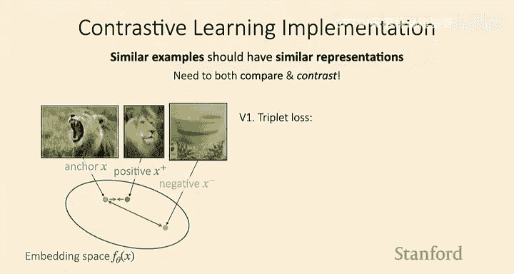
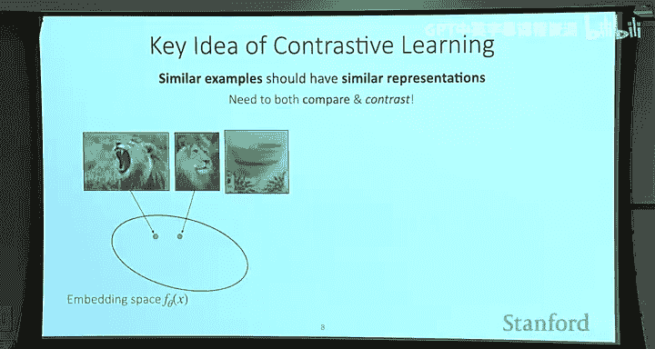
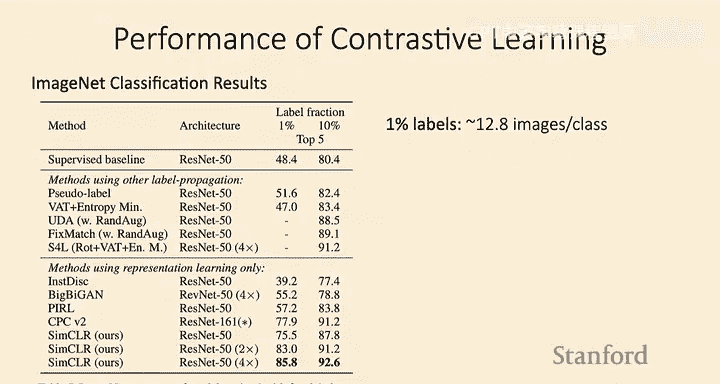
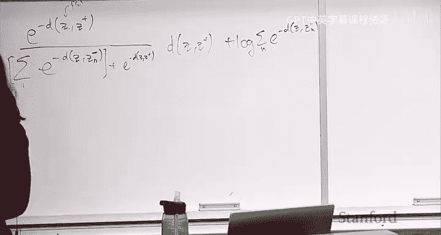
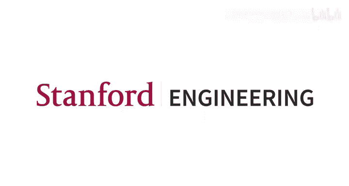

# 斯坦福大学《深度多任务与元学习｜Stanford CS330 Deep Multi-Task and Meta Learning 2022》中英（豆包翻译 - P7：-07-.Unsupervised Pre-Training_Contrastive Learning l 2022 I Lecture 7.zh_en - GPT中英字幕课程资源 - BV1dWpPepEsj

So to start to get into today's content， so far we've been talking a lot about few shot learning by using me learning。

 and the problem set it for this was we were given data from some number of training tasks。

 and we wanted to quickly solve a new task more quickly， more proficiently or more stably。😊。

And we overviewed a few different methods for doing that， black box metal learning methods。

 optimization based metal learning methods， and non parametric methods。

And one big assumption that these algorithms make is that you have access to a set of training tasks。

And there may be scenarios where you don't have a large number of training tasks。

 and so that's really the motivation for the lectures that we're going to be talking about and the topics we're going to be talking about this week。

And in particular， we're going to be considering scenarios where you only have one large batch of unlabeled examples。

 and we want to kind of pretrain models that allow us to perform well with small amounts of data。

 perform well on new tests with small amounts of data by pre-training on this unlabeled data。

And so in particular。This week is all about unsupervised representation learning and the lecture today will be on one class of methods for doing that。

 which is called Contrasive learning， and the lecture on Wednesday will be another class of methods for doing that which are methods based off of reconstructioncon。

😊，And at the end of this lecture， I'll talk about kind of。

It should be apparent as we kind of go through the lecture but also talk about how these methods relate to metal learning methods。

 it actually turns out that there actually is a pretty close relationship between the methods that we'll talk about today and the methods that we've actually already been talking about for the past two weeks。

Cool，So the goals for the lecturer to understand contrastive learning， including the intuition。

 design choices， and how to implement them and how these algorithms relate to better learning。

So unlike Me learningning， the main data that we'll have access to an unsupervised pretraining is a large unlabeled data set。

 and so that will have a large set of examples denoted as XI without their corresponding labels。😊。

And。The goal of this unsupervised pretraining process is to take this unlabeled data and produce a pretrained model。

 such that when we take that pretrained model and fine tune it on a much smaller labeled data set。

 we can do well on our new task。So you can in many ways think of this as the same setup as the metal learning algorithms you've seen before。

 except instead of having access to a large number of tasks。

 we have access to this diverse unlabeled data set。

And then what we'll be talking about this week is this first arrow on the slide here where how do we basically go from that diverse unlabeled data set to a pretrain model？

The unlabeled data set could be a bunch of images that you found on the internet。

 it could be a bunch of sentences or text， it could also be something more domain specific。

 like if you're in an education domain， maybe it's a lot of student solutions to a problem。

 but you don't have feedback or labels on those solutions， things along those lines。

And so today we'll be talking about contrastive learning for unsupervised pre training。

 and really the key idea behind contrastive learning is that。We want to learn our representation。

And specifically， a mapping from inputs to。A vector representation such that similar examples have similar representations。

So examples that are semantically related to one another should map to points in space that are closer than examples that are semantically different from each other。

And so for example， maybe you have two examples with the same class label。

 we want to learn a representation space such that these examples have。😊。

A very similar representation。Of course， if we did something like this with examples with class labels。

 we actually would need labels for those examples in order to train those examples to have similar representations。

 and this is very closely related to things like Siamese networks and prototypical networks where we were training a network to predict whether or not two examples had the same class label or whether they had different class labels。

And so。Yeah， the stuff that we talked about on Wednesday last week in some ways can be viewed as a form of contrastive learning。

 but it requires labels。 And so what we want to do is think about how we might。

Do something like that without access to labels。And so there's a few different things that we could imagine doing。

 in particular a few different ways that we could imagine creating examples that might be semantically similar to one another。

😊，One thing that we could do is we could take an image and say that。

Patches of that image that are nearby to one another probably should have a similar representation because if they're nearby to each other。

 that means that they're probably maybe from the same object or from a similar part of the same object。

And so that's what was done in the CPC paper， they tried to encourage those patches to have a similar representation。

Instead of taking patches of an input， we could also augment an example。And so in this case。

 we could take our image and then we could flip it and also crop it and say that the augmented example should have a similar representation as the original example。

And if your if your augmentations preserve the class of the image。

 then this should produce representations that correspond to the kinds of semantic categories that you may want to correspond。

So something like this was done in the Sclar paper。

 there's also a version of this where we can take videos and say that images that are nearby in time from the same video should have a similar representation。

😊，So really the key idea behind contrastive learning is to take things that we intuitively think should have similar representations。

 encourage them to have similar representations， such that we can then use that representation space in order to do transfer to different downstream tasks。

😊，So then there's a question of how do we actually implement this intuition in practice？

So we can use a running example of trying to say that the two images at the top have similar representation and the two images at the bottom have similar representations。

Now， one thing you could do is you could say that maybe the first image is x。

 the second image is x prime， and you could train for a model F that encourages the representation of the first image and the representation of the second image。

 we could basically encourage this to have to be kind of very close。

 maybe a Euclidean space or in some other space。😊，And we could。Basically。

 optimize for representation functions such that these are close together。

Now does anyone see kind of a problem with an objective like this？

Stamment presentation regardingYeah， exactly。Yeah， so there's a degeneerrated solution to this loss function。

 which is to basically just map everything， all of the images to a single constant vector。

 and then you would minimize this loss function very nicely because you would achieve zero loss here。

But it means that you don't get a very good representation space。And so。

We can't simply minimize the difference between these representations because of that collapse and instead of only comparing examples and saying that examples should have similar representations。

 we also need to say what needs to be different， we need to also contrast the images as well。😊。

And so that's one of the key ideas behind contrastive learning。And so in particular。

 if we take these three examples here， we have our embedding space。

 then we could try to train for our embedding space in a way that。

First embeds these examples and then brings together the representations of similar examples。

 while also pushing apart the representations of differing examples。And so。

This is basically the key idea behind contrastive learning and from here there's really just only two key design choices behind these algorithms The first is how do you actually implement the loss function we'll go over two different loss functions in this lecture but there's actually a number of loss functions that people have used in practice。

And then also choosing what to compare and contrast。

 we talked about some options at the very beginning with the pictures of the dogs。

 but there's other considerations there as well。Cool。

 so let's first get into the kind of implementation of the loss function for contrastive learning。So。

The first， I guess in terms of first some terminology。

 if we want to bring two examples together and push apart two examples。

 typically we'll refer to the first example as the anchor。

 because that's what we're going to be comparing and contrasting to。

And then we'll refer to the next example as a positive example。And the third example is the negative。

 so we're trying to bring the positive towards the anchor and push the negative away from the anchor。

And really the simplest form of loss function is referred to a triplet loss。And。

We can start by just taking the loss function that we wrote down before。

 and instead of only minimizing the distance between the embedded x and x prime。

We can also add a term that basically maximizes the distance between and actually using the notation here。

 we'll call this x plus that will also maximize the distance between the embedded x and the negative。

 So this would correspond to。F theta of x minus。F theta of x minus。Squared。嗯。

And because we have a negative here， we're going to be maximizing this distance when we minimize this overall objective function。

夹。Dont。He classes which children contrast again。Just expect this loss function for all the different classes for just。

Yeah， so the question is what happens if you actually have a lot of different negatives that you want to contrast against。

 and we'll get into that actually after this slide。一。

Away so that you can control how much you push away。Yeah， so the question is。

 is there a way to control how much you push away from the contrasting examples。

 and there's actually two different aspects of that question。 One is it maybe for some examples。

 you want to push away more than others and。In practice。

 contrastive learning algorithms will push away the same amount for all of the negatives。

 but that doesn't mean that all of them will end up at the same distance because some of them will naturally be harder to push away than others。

 And so oftentimes even if you push apart all of them the same amount， they will。

They'll still give you kind of a meaningfully， the distances in the space will be meaningful。

But the second part of that question is there's actually an issue with this loss function to some degree。

 which is that。This term of the loss function。Is somewhat unbounded。

Which is that you can kind of basically put this to infinity。

 you can make them like maximally far apart。And so when designing either your embedding function or your loss function。

 you need to make sure that you don't have an unbounded loss function。

 otherwise it will go to negative infinity and there's a few different ways to accomplish this one thing that you could do is you could make sure that your embedding space is normalized in some way is bounded itself。

But one thing that's common to do with a triple loss is to actually use a hinge loss here。

Which is that instead of kind of rewarding it more and more the more that it pushes away。

 it says that once it's a certain distance away。Then it no longer gets rewarded for pushing it any further。

And so you probably have seen something like a hinge loss in。In like a machine learning class before。

 the way it looks like is if we look at。啲。诶。The distance。We want to。

In this case or kind of the difference of these distances， basically， as this increases。

 we want it to get a lower loss， so the Y axis here is going to be the loss value。So as it increases。

 we want it to get a lower loss， but at some point。

We want it to not continue getting rewarded because it doesn't need to push it all the way to negative infinity。

 And so what a hinge loss would do is basically give you a shape that looks like this。Where。

Up until some point it's going to be rewarded for increasing the distance。

 and after that it will just sit at zero loss。And。This kind of。

This distance right here is referred to as your margin。And this is something that you can control。

 this is like a hyperparameter， and this controls how much you are how far apart you want your examples to be。

And so the way that you actually。We'll implement this is instead。

Having your loss function be the difference between these two things you're going to。

First you will add your margin， maybe your margin is referred to as epsilon。

And then you will basically bound this below by zero。And so。You can take the max between this。

And zero， and this will basically just apply this function to。To what we had before。

And then we'll minimize this whole thing。With respect to theta。

And so that loss function is written out right here。入。

an xx plus Xx minus comes from the same mini batch I mean I don't know how we are group over thetable xx plus xx minus。

Yeah， so the question is where do x x plus at x minus come from？Yeah。

 so they can come from these triplets can come from a number of different places。

In one case if you have labels then it could come from the whether or not examples have the same label so you could sample two examples with the same label and one example with a different label and that would give you an anchor a positive and a negative。

 one of the other things that we talked about is instead of using class labels you can also use augmentations and so you could sample an example and sample a different example that would be the anchor and the negative and then to get another positive。

 you can augment and create another view of the anchor by for example。

 crop applying a random crop or flipping the image or doing something like that。

We deal with one mini mini bed。 So it means all of them from is the same mini bed is not honest correct。

So in practice， you'll sample a mini batch of these triplets and so you'll sample not just one triplet。

 but you'll sample a mini batch of them。Is it for each one， each of the element。choose也大。cate ex。

I hope x minus153。So yeah， to sample an anchor， you can basically。

 when you sample an image from your unlabeled data set， that can be the anchor。

 you sample a different image and that can be the negative。

 and then generate the positive you can augment the anchor。To get the positive。

So we'll also render an algorithm too， which should maybe give a little bit more intuition for this。

Yeah。if negative examples are accidentally included the same class the training so the question is what happens if the negative example is accidentally kind of the same class as the anchor and this is generally a great question and in practice especially when you have unlabelled examples and you're contrasting against augmentations you will sample negatives that may actually be somewhat similar to the example that the anchor that you sampled。

This is okay， the most important thing is that。Well。

 the most important thing is that that happens somewhat rarely。 And so general。

 if you have a really huge data set the。And you just want to kind of。Yeah。

 if you have a huge data set， then the number of examples that you have from a particular class will be somewhat small and the likelihood of actually anchor and negative being very similar to each other will also be small。

😊，有。The embedding space in the distance metric make up the difference to the results here。这他警备。うそな。

Space you can get different combinations of distances and I what we get those helpful。

You you're askingDoes the distance function here， is that important or you're asking something different？

呃。そかして。How hopeful it is。Yeah， I think that there's really two common choices。

 one is to use Euclidean， and the another is to use kind of basically negative cosine similarity。系。

To my knowledge it's not critical。 and you probably want to。Consider both of those two options。

 but beyond that， I don't think that people get super creative。有。Thank you don let me know something。

Its very good。We' just positive。Yeah， so one thing that is different here is that these positive and negatives are they're actually quite different from a class label。

 and they may not correspond exactly to your class labels。

They're going to instead correspond to some other。Kind of notion of relatedness and so forth。Sorry。

 what was your question？比如个是。そル。Yeah so I'll go back to the slide that I had here so augmented versions are the top right beyond that there's I have two other examples here。

 one is to use image patches or to use basically in this case they actually often use overlapping image patches from the same image or if you have a video you can use nearby frames and these are also somewhat popular choices as well in computer vision augmented versions is like the definitely the most popular example of this。

 but using things like basically things that are nearby in some space。

 either in image space or in time or something else is also very popular。

I guess I also provide some intuition for that， for example， with video frames。

 kind of the intuition there is that things that cooc in time will be related to one another。

 but it does end up being fairly data dependent and if your data if your data。

For whatever reason doesn't obey that have。Videos that are constantly changing over time' are more random in terms of their sequence than that may yield representations that aren't as good as something that has a little bit more temporal cohers。

Yeah。In addition the mission as they go for。Is it possible stretch good ons for？Yeah。

 so you can view augmentations essentially as a form of hyper parameterameter or as a form of domain knowledge that's going into the algorithm and the choice of augmentation is actually really really important to actually how the performance ends up at these algorithms ends up being and there's actually a lot of。

Literature on different forms of augmentations that work well often for images。

 and there's also some work outside of computer vision domains that look at other augmentations as well。

 but it does end up being quite important。And so if you look at， for example， the Simclear paper。

 I know that they included a study of different kinds of basically how well different kinds of augmentations work。

最后。Normally you can discovered what ofs in our journey。

There is actually a paper that discovers augmentations， and I'll cover it later in the lecture。Cool。

 so。

We've talked about the triplet loss and so that's what we went over on the board。

 and this is really the simplest form of contrastive loss and it actually works pretty well。Yeah。

 it's pretty nice a good place to start。Compared to something like Siamese networks。

 which we talked about on Wednesday， it's actually extremely similar to Siese networks。

 especially if you're using class labels as your positives and negatives。😊。

And you can essentially think of it as Siamese that works from the standpoint of if this distance in your embedding space is small。

 then classify the examples as being the same class。

 otherwise classify them as being in a different class。Really。

 the key difference between this triple loss and Siese networks is that。

When you use this triplet loss to learn a representation。

 you're going to be learning this kind of metric space。

 this representation space from which you can measure the distance between examples。

 whereas the siteese networks works were only there learning a classifier。

 and it was just giving you the probability that they were correct or not rather than a representation where you can measure these kinds of distances。

Cool now one that comes up in。This。With this loss function is that。The negatives。

 choosing good negatives is difficult。And in particular。

 if you're in your embedding space and you sample a negative that's already very far away。

 then you're just going to have zero loss at that space and you won't actually be learning anything from that negative。

And so you really want to try to find negatives that are difficult。

One thing that you could do is what's called hard negative mining where you explicitly search for negatives that are closer and use those negatives to actually allow it to continue to learn and continue to getting good gradients from this loss function。

U。But we can also just basically， essentially， instead of just sampling one negative。

 we can sample multiple negatives and incorporate that into the loss function as well。

And this gets out the question that was asked before。

 which is what if I don't want wanted to contrast against one thing。

 what if I want to contrast against multiple different things？And so。

The second version of the loss function that will look like。

 the second version of the loss function is something that is going to do more of an n classification rather than these binary comparisons。

😊，And so instead of thinking about just having one negative。

 we're also going to think about having multiple other negatives。

And essentially what we're going to want to be able to do is classify。ong。

The turquoise and pink and yellow and salmon colored dots。

 which of those is the positive and which one is the negative？Or which one is a negative？And so。

If we want to perform that kind of classification， it's going to look a lot like a softm。😊。

So we can measure the distance between。The positive in the anchor。

And the negative in the anchor or the negatives in the anchor。

And what are kind of the probabilities that an example will be。

The positive will be something like E to the negative distance between x and x plus。

Divided by basically a softm， so we're just going to exponentiate and normalize these distances where we are dividing by the distance between。

The anchor in each of the negatives。And so。This basically gives you the probability that x plus is a positive example rather than being a negative example。

And when you actually then compute the loss for this， oh， actually sorry。These should technically。

 I guess， be F of x， or equivalently you could write these as D of Z。Or D of and D of Z plus。

And D of Z。And D of z minus So D will just correspond to either。

The Euclidean losses before or something like negative cosine similarity。

And then what the loss function looks like is。This is a probability。

Minimize the negative log probability so we'll。Take the log of this and minimize this with respect to theta。

Yeah。summing over the negative examples。Oh yeah， sorry。 This is something over the negative examples。

 And so yeah， great catch。 So this is over n。 and then this is。Z minus n。

So we need to know during training， we need to know what the positives and negative examples are。嗯。

We don't a priority know how good of a negative they are。

 but this loss function will basically take into account all of them。有。

Could we also sum over all the negative examples using the triplelet loss？Yeah。

 so the question was can we also sum over all the negatives using the triplet loss。

 this actually ends up being very， very similar to doing that。

 so if you actually write this out with the log。The numerator will become log of E to the negative distance or negative log of E to the negative distance。

This actually just becomes D of z and z plus， and then with the denominator you get something like。

Plus log of sum of e to the negative distance of z and z minus， and so you have a log sum X here。

 but if you basically think of the log in the E canceling out。

 this is basically just like summing up the distances there。Yeah。

 so I didn't get that explained like what are trying to achieve here。Yeah。

 so the question was just the。The question was， can we just basically take the triplet loss and just add up all the negatives？

What I was simply saying is that this loss function is actually already very similar to the triplet laws。

 but where you summ over the negatives here。And so。The question is。

 why don't we just do something like this？And this loss is actually already doing something a lot like that。

 except instead of summing， we're going to do a log sum。Oh， sorry。 yeah。

 What is the loss function doing at， So yeah， there's a few different。

kindind of intuitive ways to think about this loss function One is very similar to the triplet loss。

 which is that it's pulling together the things， the positive and the anchor and pushing apart or maximizing the distance between the anchor and the negatives。

The second intuition that you can think of it as is basically classifying whether or not an example is a positive example or a negative example。

 given the anchor。😊，And so this looks a lot like a softm where。

Your logits corresponds to this negative distance between your example and the anchor。Yeah。

 mean I think I still just have a hard time grasping why the top is positive at the bottom is some over negative example。

Like I'm sorry for this loss function。On the。Like， yeah， it says like see。すこ。

But we'relam open negative account。哦。For the bottom part， and I'm not sure why that。Yeah。

 so the well so I guess one other form of this loss function that I can mention is one where you you just sum over all the examples on the bottom and so you also。

Add something where the positive example also comes on the bottom。

I don't know if that makes more sense to you， so yeah this is also a version that you can do I think this version actually I think is what is done in this first paper。

 whereas in the second paper they actually didn't include this and I think that the intuition perhaps for not including it is that is that you really only want to push apart the you really only want to push apart the anchor and the negatives。

 you don't really want to push apart the anchor and the positive。😊。

And this denominator is basically pushing them apart。Do have any knowledge it was the class。嗯。

So the question was， do we have any knowledge about the class of Z in the unlabeled case。

 you don't have any knowledge about the class of any of the examples？そせ在。マイナス。Yeah。

 the question is why would we then want the anchor to be closer to z plus versus z minus。

 this comes down to how we sample positives and negatives and so on the next slide I'll talk about how we sample it。

Yeah， going back to like hard innovative native mining。

 could you like interpret that as adversial really good trying to find the hardest examples of your translation？

Yeah， the question is can we interpret hard negative mining as a form of adversarial loss and yeah exactly so basically if you' the way that it would look like in the case of the triple loss。

 for example is you find the negatives that maximize this loss function rather than minimize those and specifically pick those and so in some ways it is a form of an adversarial or a form of an adversary。

Cool。Here's the loss function just kind of written out on the board。

I talked a little bit about how this is in some ways the generalization of the triplet loss to multiple negatives。

Now， let's actually walk through。One algorithm that explicitly walks through also how we sample the positive negatives。

 And I think that that should help clear clear up what has been。

To clearear up some of the questions that have been asked。So。

The input to this algorithm is just a set of examples， X， just unlabeled examples。

And so what the Sclar algorithm does is it samples a mini batch of those examples。

 so it samples n of those examples。And to generate positives， it's going to。

Augment those examples with some augmentation function and so here we're sampling some images which are our mini batch of examples。

 and we're going to augment each of those examples twice to get X tillilde and X tillilde prime。

And so for example， the augmentations here correspond to changing the color。

 cropping in different ways， and distorting or flipping and so forth。And so， for example。

 we take our example， then we augment in two different ways and do that for every example in our mini batch。

😊，Then once we have these augmentations， we're going to embed our augmented examples into our embedding space。

 So this corresponds to just running。Each of these augmented examples through our encoder F theta。

And then from there。The positives are going to correspond to。Auggmentations of the same image。

And the negatives are going to correspond to augmentations of different images。

And so the things that we're going to try to bring together are these augmentations of the same image and the things that we're going to try to push apart are basically everything else in the batch。

So this is one way to generate positive negatives， there's also other ways to generate positive negatives that we'll talk about on a future slide。

And so intuitively， we don't know the classes of these images， but we do know that。

If we design good augmentations， then the augmented vincies are actually very different images。

 but they have the same class because theyre generated from the same image。Likewise。

 these have different classes and so forth。As was mentioned before。

 it's possible that you'd also sample a chair in this batch and you might end up pushing apart。

Other chairs。That's okay as long as you not every example you're pushing apart is also a chair。

You could also think of this as doing something。A form of more fine grain classification where you're basically trying to discriminate different instances rather than different classes。

Does that answer your question？Yeah， so eventually。

 this kind of thing will lead to an embedding space where even if。

Even the class that's in a shared and if we had two different images of chairs。

 so they might be separate。But the distance for bring two chairs would be lesser than the with a chair and adult Yeah exactly so the result of this algorithm should be an embedding space such that chairs are closer to each other than chairs and dogs and。

Part of that also relies on your augmentation function and ideally your augmentation function will generate other things that look like chairs。

 and so by pulling together those things it will make it more difficult for the network to push apart an example of a different chair because you have to these have a similar representation。

Yeah。Do you explain the suret way to augment twice and？as opposed argument wants。Yeah。

 so you could also just augment once and basically use the unamented example as the anchor and the augmented example as the positive。

One thing that this does give you is it gives you more negatives and more anchors and more positives。

If you have a good augmentation function， I think that augmenting twice and using augmented examples both as anchors and positives and negatives should work well。

 I would also expect that if they include some of the original examples as positives anchors and so forth。

 or basically have the identity function be part of your augmentation class。

 that would also be a very reasonable choice。If ironity is not a part of the condition。It a good。

Like isnt national outcome distribution for the in kind of。

 because it's only been written on our vendor quite。Yeah， the question was。

 if the identity function isn't in your augmentation class。

 then will these images be out of distribution in comparison to these images？In general。

 these augmentation classes are designed such that they。

are exhaustive in that they cover a much wider space than the original space and such that they aren't completely disjoint from the original space。

 and so in practice that ends up not being an issue if you design your augmentations well。

 but it does mean that when you design your augmentations。

 you shouldn't design it to basically be disjoint from your original space。Yeah。

 so we're not embedding the original examples at all。Yeah， in this case we're not actually well。

 and so forth， if identities include in your augmentation class， then we are， but if it's not。

 then we're not actually doing that。有。So if this is completely unsupervised， then can't we？Aally。

 I like two doors instead of a dog and a chair。Yeah， so if this was completely unsupervised。

 can't we accidentally？Sample two dogs rather than a dog in a chair。 And yes。

 this relies on the fact that。That kind of sampling two dogs is less likely than sampling a dog and something else。

 it also relies on the fact that when you augment you'll create things that you have to push together and that will make it harder to push apart two dogs than it is to push apart a chair in a dog。

Cool， and so just to finish out the algorithm， we talked about attracting and attracting things of the same image。

 augmentations of the same image and repelling augmentations of different images。

 what this ends up looking like is once you embed into your Z space。

 then in this case they're using cosine similarity to compute the distances between all of the different pairs of augmented examples。

And what the loss function ends up looking like is basically exactly what we have written on the board here。

 where we take the distance between。Between the two augmented versions of the same image。

 so that's going to be Z and Z plus here it's written as ZI， Tilde and ZI Prime Tilde。

So the eye is the same， that means that they're from the same original image。

And then the denominator is over examples that are。That are of different。Initial images。

And so those are an augmentation of one image versus a augmentation of another image。Yeah。

In this loss functional algorithm kind of assume a sort of balance。BssesBecause if there's a huge im。

すまいも。Yeah， so the question is， does this algorithm assume that your unlabeled data is unbalanced and in particular if it's unbalanced and you have like a ton of dogs and only a small number of chairs？

Then maybe it wouldn't work well。 That's a great question。 I don't know of any。

I don't know if it works off the top of my head that have analyzed that。

 although I vaguely remember some works showing that。In general。

 these algorithms can work much less well if your data is not balanced。

 and this is actually a really important。Thing to keep in mind because。

Data sets like ImageEt are balanced because we know the labels of the data or they're more balanced because we know the labels。

 but in cases where we don't know the labels， we have no way of telling if they're balanced or not because we don't know the labels and so。

啲嗯。Yeah， it's in general， in practice when putting these algorithms。into practice。

 it's important to keep that in mind， if you ask on Ed I could also potentially try to point you to things that have specifically looked at unsupervised learning with imbalanced data。

Cool， and so you apply this process iteratively to update your encoder。

 and once you have your encoder， you can then either train a classifier on top of that representation or fine tune the entire network。

One of design choices I'll mention， it's not kind of written in the equations。

 but the Simclair paper found it pretty helpful to actually use the representation right here as your pretrained representation rather than the one right here。

 and that means that there's this kind of additional projection head that's taking the representation and project it into another space and then doing doing the compare and contrast in that other space。

And they found that this may performance somewhat better。

 you could imagine that it gives a little bit more flexibility。So the network。

 although it also introduces additional hyperparameters in determining like where should this representation be in the network？

有。About the lost。But see assume that I need a two， two simple。基就これか。

I mean I they come from a different different parts of group。Because。あ選挙これ断もこういう政府へ変一。Sose。

Maybe in the first and second， both are for a similar cat， right but in the in this formula。

 they still want to I mean， make the distance larger between these two。

So denominator here is examples that have always augmentations of different examples。

 although they may be examples of the same class which we had mentioned before。

 and ideally that happens with lower probability than examples of different classes。Yeah。

Sick through the layers before the final。Or就。Performance for the other。

So that unit can unit perform that。For。どし。So the question is。

 can UNNe perform better for these contrastive algorithms？

So we'll talk more about architectures that reconstruct the input in the Wednesday lecture I don't think you necessarily need something like a unit here because this representation doesn't need to be this like a very large image be it can still be much lower dimensional or lower dimensional Yeah imagine having like skip connections here for example。

 Yeah I think that you could you could imagine doing something like that I guess。

I don't know of any papers that do that， but my intuition would say that that could be bad from the standpoint of it could just completely ignore this part and just use their representation。

 like use the information through those skip connections。To do the contrastive learning。

 But that's somewhat speculative。 And I don't know if any papers is that yet。Cool。

 so how will these algorithms actually work for learning representations？

The here are some results from the paper， from the algorithm that we just went over。

 and here they're comparing to。ImageNe classification， the top five accuracy。

And they're looking at if you only use 1% of the Imnet labels or 10% of the imagenet labels。

And here 1% corresponds to about 12。8 images per class and 10% corresponds to about 128 images per class。

 and so once you get down to 1% you're almost in the few shot learning regime or possibly you can consider that in the few shot learning regime if you're kind of have 10 to 50 examples per class。

诶。And we're comparing to a baseline that only trains with supervised learning on those labeled examples。

 as well as some semi supervised learning methods and some other representation learning methods。

And the results show that first you get really substantial improvements over just supervised training from scratch。

 you go from in the 1% case， from 48% accuracy to 85% accuracy。Which is pretty significant。

And you also see pretty significant improvements over other semi superupvised and unsupervised methods。

And this。We see this kind of especially as being the case in the 1% label setting。

 so for example in comparison to well CPC， which is another contrasted method。

 we see about a 7% performance improvement compared to big byg。

 you see a 30% improvement and so forth。😊，So you' methods this work pretty well and overall 85% accuracy on INet is I feel like not too shabby。

 and it's nice that we can get that while using only 1% of the labels in the data。Yeah。我的车。Oh yeah。

 what does the 2x and 4X mean so Re 50 is the standard Re 50 architecture。

 2x means that the width of the hidden layers is 2x larger and 4X means it's 4 x larger。

 so it's just a larger network and we see that it does better with larger networks。

So what about when music？もったでいか。What about when using 10% of the labels？Yeah。

 so we see that the performance， it also does quite well in the 10% setting。

 the performance improvements are somewhat smaller and there's a semisupervised method that gets 91。

2 whereas this gets 92。6， but it is still kind of the best method compared to the methods that were state at the art in 2020。

you saying that you only get 12 labeled images， but you also get up。beled yeah。

 they're using the entire image that data set as unlabeled。

 and then they're only using 1% of the labels。あぐらい見るそ。本出し。

It's in the life show now we frame to the weekly frame in network book。

We know we also train to the same images but every。

Yeah are the representations useful beyond just imagenet classification do the representations generalize well the short answer is they do generalize to some degree and we'll see some results in。

Towards the end of the lecture on it。Cool， and then there's one other experiment that I think is actually quite important in the Sclair paper that was looking at。

Not just performance， but how performance varied with the number of trainee epochs and the batch size。

And the results are here， so the X axis is the number of training epoX or how long you're training for。

 and the different bars within each of those correspond to the batch size with the blue on the left being the smallest batch size of 256。

 which is still a decently large batch and the bar on the far right being batch size of 8，192。

And it's important to train for 600 plus epochs， I think this isn't too surprising in unsupervised learning settings because you need to learn a lot about the data。

One thing that I think is。Perhaps more important to note here is it requires a large batch size。

 so if you train with a batch size of 256， that does a lot worse than if you train on a batch size of 1000。

 for example， and that difference can be if you train for a really long time。

 that difference is only 2%， if you train for a shorter amount of time。

 that difference can be more than 5%。Yeah， any in does it Yeah。

 so why does it need a large batch size？就。We'll talk about this both intuitively and more mathematically。

One way to interpret the contrastive loss function is basically you're trying to classify between。

Classify kind of one image from all the other images in the data。And。

you can sort of think of this kind of the denominator of this loss function as trying to sum over all the other examples in the data set。

 you're trying to classify between one example and everything else。And。In the summation right here。

The examples， the negatives that have the smallest distance are really going to dominate this sum because we're exponentiating here and so something that has a distance of say like 0。

01 versus a distance of 10 because we're expentiating this。

 this is going to play a much like e to the negative 0。01 versus e to the negative 10。

 this is a much， much larger number， and so this is going to be play a much larger role in the summation right here。

And this means that。😊，Because these examples with a really small distance are dominating。

 if you're subampling and having a much a smaller batch size。

 then you might miss the examples that actually dominate that loss function。

And so you're not actually going to get a very good estimate of your loss function if you're missing the examples that actually have played the largest role in this summation。

So that's part of the intuition。And then。More mathematically， if we want to think about this。but诶嗯。

Think about whiteboard spaces。I guess this is well。So this is our loss function right here。

 I'm going to also remove this just because。This is what this is what Sinclear does。

 so this is our loss function。😊，嗯。You can essentially think of what we do when we subsample as。

Sort of bringing this summation outside of the log。I guess specifically。

 maybe one thing to first note is that。In normal supervised learning we subsample all the time and it's not a problem and so in it's totally fine to have small batches and the reason for that is our kind of typical loss function might be something like log probability of y given x where this is kind of a summation over x comma Y。

And。When this is our loss function。If we subsample and sample a smaller batch of x and Y。

We'll still in expectation， get the correct gradient。No。

Things are a little bit different when we actually try to subsample from this summation right here。

And in particular， if we write out this loss function。It ends up looking like first。

The distance or yeah， the distance between Z。N Z+， this is all fine。Plus the log of the sum over N。

E to the negative。D of z and z at minus。And the challenge to here is right now。

 this summation is inside of the log。And essentially， when we sample mini batches。

 what we're doing is we are saying that， well， maybe this is like approximately equal to D of z of z plus。

Plus， a sum over。Our mini batch。Times log of some over。Kind of an inner mini batch。

Of E to the negative D of Z comma Z N。 So this is really what we're optimizing when we do mini batch sampling。

 because instead of sampling all of the negatives in our entire training data。

 we're sampling a mini batch of them。And。Now there's a question of， okay what？What actually happens。

 like what's the relationship between these two equations？

And there's something called Jensen's inequality that's actually super useful。And。

One of the things that Jenen's inequality can tell us is it tells us that log。S of x。

 I always forget which way it goes， is greater than or equal to the summation of log X。😊。

We write this。And so what this means is that it means that when we take the summation on the outside。

That gives us a lower bound compared to when it's on the inside。

And so that means that this approximation right here。

When we actually are doing this sort of mini batch sampling。We're getting a lower bound。

On our original objective。And that means that when we actually minimize this objective。

We're actually minimizing a lower bound on our original objective。And。

It's not good to minimize lower bounds on things because then you may not actually be minimizing your original objective。

诶。And so that's I guess some additional intuition for why having a larger batch size is helpful because basically we're not actually getting a bound on our objective。

 and so if we sample something closer to our original data。

 then we're actually going to become closer to optimizing our original objective。

Any questions on that？こ証てさんハハしすね。The question is， is there a way to control how tight the bound is？

i mean。You can like one thing that you could do is just sample your whole dataset set rather than sample mini batches。

 although that's sort of what we're trying to get away from or to sample larger batches so I mean that's kind of why larger batches make sense I don't know of any way to。

To make it tighter， but if you do， let me know。CoolSo yeah， the kind of sum is that。

In normal mini batchch supervised learning， the summation is already on the outside and we're all good and so we can estimate this with mini batchching when the summation is on the inside of a log。

Then mini batching that is not really kind of the correct thing to do。But we do it anyway。

 because that's what deep learning is like。And then I also wanted to go through kind of solutions to requiring a large batch size。

so诶。One thing that you could do is instead of trying to sample your entire data set at every single iteration。

 you can。Basically store the representations from the previous batches with something that looks a lot like momentum。

This is not exactly correct because your encoder is going to be changing over the course of training。

 and so if you store those previous representations， they're going to be a little bit stale。

But it allows you to somewhat decouple the batch size from。From this estimate。

 it allows you to get away with smaller batch sizes because you're basically accumulating batches over multiple iterations。

This is called Momentum contrast or Moco， and they were able to get good results with a mini batch size of 256。

Another thing that you can do that was proposed in the literature is instead of having any negatives whatsoever。

 simply try to predict the representation of your image under a different augmentation。

 and so is kind of more of a predictive method it's called bootstrap your own latent。

It actually doesn't require any negatives， it just requires examples of positives。

 and when they plotted performance with respect to batch size。

 they found that it dropped off much less， especially up until 256 in comparison to the S method。

And so it's more resilient to batch size， although it's something that's also。

Doesn't have some of the。Kind of nice contrastive interpretation that we've talked about so far。

And then overall， in terms of the performance of these methods。

 if you actually look at how good they are in terms of self-supervised learning for imagenet accuracy。

 we see that like some of the papers that we covered were from a couple years ago。

 but they really remain near state of the art for self-supervised pre-training and in particular you can see Moco V3 is like very close to the state of the art。

 I haven't actually looked at what is exactly the state of the art。

 so I'm not sure if it may also be a contrasted method or maybe something that's a little bit different。

一。Most of here that gross remain long some。Its the order entire toulator。

 so can't we just try to some of with some log E to be off some samples and then assume there' to。

It could me a if you by being。If you're wing this way。

 can we just take the logom explain to some of Robs？All the United。

 which means not one of the the loss function and then just sample patch from there and say that it is。

On would。So you're saying that why do we have this loss function in the first place。

 like why not have this outside of the log？If you it me one this was this is correct。

If you move the thumb outside of the log， then it becomes a lower bound。

According to Jenen's inequality， so if the sum is on the outside。

 it's a lower bound in comparison if it's on the inside。Yeah。

 and unfortunately sometimes I wish Jenen's inequality went the other way。Yeah。

Yeah sorry most of the greatest numbers here for。One object image。

But whether something approaches be applicable when we even apply multiple objects？Bボ目なかて。Yeah。

 so the question was a lot of image images just have one example or one object in the image and with this work if you have multiple objects in an image。

 the I guess I don't know of any like specific detailed experimental studies on that。

 but I'll show a couple instances where contrastive learning has been used in settings outside of I debt。

 and that might provide some has some answer to your question。Cool。

 and so I guess moving towards that to some degree。

These methods have been really good for visual categorization， things like ImageNe。

One challenge that comes up is that we've mostly been focusing on augmentations and there's a lot of scenarios where we don't have。

A good hand engineered augmentation function that we can use for these methods。

And even in those cases， the general framework of contrastive learning can still be very useful。

And so。K of alluding to something that came up earlier。

 you can actually try to learn the augmentation function。

And this was a really cool paper that actually basically formulated an adversarial optimization where。

For your augmentation function， you tried to optimize it in a way that maximized the contrastive loss。

Of course， if you do this in a completely unbounded space。

 then it will just give you arbitrary images out。 But what you can do is you can say that。

That augmentation function， it can only change the image by a small amount within some L1 sphere。

And this paper was actually competitive with SimClair on image data。

 which means it was able to find augmentations that were as good as the hand engineered augmentations。

And it was also able to get good results on domains that aren't images。

 so domains like speech data and sensor data。Cool， and then one of the thing that we had mentioned earlier is instead of using augmentations。

 we could use。Basically， our positives could be frames in a video that are nearby in time。

 and the negatives could be things that are further away in time or from other videos。

And there have been a number of papers that have done something like this。

 and they've been able to get good results on tasks like robotics tasks。In this paper。

 you can take basically a data set with a ton of diverse videos of humans。

Do this sort of time contrastive learning where you pull together frames that have similar representations and push apart frames that have different representations。

 and there was also an additional loss that sort of did a form of contrastive learning between videos and language。

And it found that if you use this to pre-train a representation。

 you can give a robot 20 demonstrations or less than 10 minutes of supervision and get a policy that looks something like this。

 gets around 60% success rate on putting lettuce in a pan and 40% success rate on folding a towel。

And then the last thing I'll highlight is this isn't really fully self supervised。

You can also apply contrastive learning between images and text。

And what this looks like is you learn a representation of the images。

 you learn a representation of the text， if you have data that tells you whether or not that basically kind of captions an image。

 then you can tell it that captions，And images should go together and images and other captions or yeah。

 images and other captions should be pushed apart。And so this is the key idea behind a model called Clip。

And it actually a really performant model and it gives you very useful representations。

 it also can give you very good zero shot classification performance。

 so on INet it was able to give you imageNe accuracy that matches a supervised ResNet。

But even more interestingly， if you give it images that don't look anything like IageNet like Sketes。

 or this more adversarial INet data set is able to get performance that's much higher than something that is trained in a supervised fashion on IageNet。

对。Just be because they heard。Maive amount of be。Yeah so are these results because of the magic of contrastive learning or is it because of the data set。

 certainly the data plays a huge role here。The diversity of the data that is given will help it be able to do well on these kinds of things。

That said， there are a number of works that have kind of tried to alate the role of self supervised learning versus the data set and have found that things that are。

More self supervised or kind more similar to something like C do better than something that's trained in a purely supervised fashion。

Cool，So to summarize contrastive learning， it's a very general and effective framework。

 and we've seen how it can be used to compare and contrast lots of different things。

One thing that's nice about it is that you only need an encoder， f theta of x。

 you don't need a generative model of your data， and this means that you can probably get away with a smaller model than if you had used a generative model。

诶。The other thing that can be viewed as a pro is if you have some domain information like augmentations that can be incorporated into the algorithm to generate other positives。

The challenge is that negatives can be hard to select。And as a result。

 it often requires a large batch size。This is a little bit kind of。

The kind of other side of the coin with respect to the generative modeling not being required。

 you can usually get away with a smaller model， but you need a larger batch size oftentimes。

 and so you might still need a large amount of GPU memory， for example。

 to train these kinds of models。And then the other challenge is that it has been most successful with augmentations。

 like we talked about， and there might be domains where you don't have augmentations available and there are a couple solutions for that。

 but it's something that is still an open area of research。有。Little modeling， but is contrastive。

And sort of a good preach a goodeem for in here。The question is is contrast of learning a good pre-training scheme for generative modeling I guess I often view generative modeling as something that you do with data that's unlabeled and so if one of the nice things about unsupervised pretraining is you can get a lot of juice out of unlabeled data and so if your task is already something that that can be done up with unlabeled data like generative modeling。

 then it may be that you don't need a good pretraining method because maybe you already have a lot of data that you can use。

诶。I guess more specifically， I also， I don't know of any works that pretrain with contrastive learning and then fine tune on a narrative modeling task。

 but it's possible that there are some works out there。就。Can this be combined with？IfFor example。

 you have a multi label problem。Different examples can either be in the same classroom。The the我。

Can this be combined with fine tuning。So。So we talked about learning representations。

 and then you do often fine tune their representation。

 You often put it like some sort of classifier on top of the representation。

 then you can fine tune end to end。 Are you thinking about something other than that。

I guess I'm thinking about the way that you would generate these。And whether you。Change down。Right。

So you could also imagine fine tuning with a contrastive loss。

 similar to how things like prototypical networks are doing classification with this kind of like this looks very similar to a classification loss and you could fine tune with something like that。

诶。Yeah so you could certainly do something like that that definitely the default that I've seen the vast majority of work do is to either freeze your representation and put something on top of that or additionally fine tune end to end。

 but I could certainly imagine that you could fine tune with a contrastive loss as well and if you can't fit your loss function in the form of something like a contrastive loss。

 you may actually do better than that other approach。Cool。

 and then the last thing I like to talk about in the last seven minutes is how this relates to some of the meta learning algorithms that we have talked about in class。

And。As you might have guessed， some of these equations look a lot like the equations that we saw in the non parametric few shot learning lecture。

And you can， in many ways， formulate an algorithm， a metal learning approach that looks a lot like the contrastive approaches we've talked about today。

And so if you're given an unlabeled data set， say you're doing something like SimClair where you generate positive and negatives by augmenting。

Then you can basically create a labeled data set where you create an image class by augmenting your example。

 and you create multiple examples from that class by augmenting it multiple times。

That will give you a data set for that image class and then to create a task。

 what you'll do is you'll want to be able to classify between different image classes。Now。

 once you have this label data set， you can create tasks that actually just run your favorite metal learning algorithm。

On this data。And it turns out that there's actually a very kind of。

Close mathematical relationship between doing something like this with an algorithm like prototypical networks and the Scl algorithm that we talked about in lecture。

This paper in the bottom right goes in depth on that， but there are really two key differences。

And therere relatively small differences in my mind。

 the first is that Sclia samples only one classification task per mini batch。

 and usually metal learning algorithms will sample a mini batch of tasks。

And the second difference is that Sclair， it's really going to look at all pairs of negative examples or all pairs of。

Yeah， all pairs of examples in your batch， whereas metal learning only compares the query examples to the support examples and never compares in contrast query examples with other query examples。

So in this way you could perhaps view the being the S loss being a little bit more efficient with its batch because it's going to compare and contrast everything in the batch。

 but otherwise these algorithms end up being extremely similar。

And they also end up doing something extremely similar in practice as well。 So if you。

 here's just one experiment in that paper you。Take it unlabeled dataset。

 I think they took the imagenet unlabeled dataset set。 they augmented with the Scl augmentations。

And compared using Simclair versus using this approach with protypical networks and R2D2。

 where R2D2 is an optimization based metal learner that has a number of kind of bells and whistles to it。

And you see that。When you then kind of pretrain these representations on INet and then fine tune them on these other image classification problems。

 you see extremely similar performance between Simclair andtotypical networks。

 you also see very similar performance between SimClair and R2D2。

 and in some cases R2D2 is able to do a little bit better as well。Yeah。竹村。ベベロ年度。

Meths you' see mostly fuel short but。This is a short problem。Yeah。

 so this is actually not a zeroshot problem so it's pretraining on it's pretraining representations with this approach and then fine tuning on the entire data from the entire training data set from these data sets and so the other difference that I sort of didn't mention on this slide is on the previous slide is that me training and the training time is very similar but what happens at test time is actually a little bit different。

 so typically in fu shot learning we。we'll give it a few examples embed them and make a classification and actually in this case at test time what they're doing is they're learning the representation with better learning and then they're just fine tuning the whole network and that's a little bit different from what we've been doing in the previous lectures。

诶诶。Yeah， and so they're really just comparing the representations that were learned rather than the specific few shot learning approach that happens at test time。

じゃあ。if I imagine the past sampling， I think with met only。

 they would have had like more samples instead of one sample， but are much smaller。田もさん歩少し。

And so how does the optimization compare？看で。Yeah， so the question was how do we？In metal learning。

 like N and K， you choose N and K， usually you choose an N that's maybe smaller than 256。

 at least that's certainly what a lot of papers have done。

I can't remember exactly what they did in this paper。

 if you' happy to follow up on it or you could take a look at the paper and I'm guessing that they probably use something similar to 256 and so maybe the values of those hyperparameters do actually affect performance。

Yeah。So this solid contrast to digital organizations， right？If you assume that each class has。

I'll bring that to four or five。For instance， it's like a for food or fire short。For that plus。

 in a way， so I wanted to was this mixing this too so like when youre a supervised few short models。

Can we include contrastive rhythm into training mental approaches？Yeah。

 so I guess first I do think that it's very similar to one shot learning because there's one positive one anchor and generally one shot learning is harder than like five shot learning and so I would suspect that you get better representations from one shot learning than five shot learning The other question is can you use contrastive learning？

Do the training， but we don't specifically do anything with support samples or query numbers like we just compare this support in query。

 but we don't do anything in trial support like in the support space or query space。

Liba and unsupsed men Beth。In introducing contrast of learning there。Yeah， so in protypical networks。

 it does this sort of like aggregation in the case where you have more than one shot。

And the question is if you do something like that and additionally include elements of this。

 which I think would sort of be similar to training like both one shot and five shot in a way。

 because one shot is very similar to this， does that help and I could see that improving performance and I think that the protypical that works papers showed that actually sometimes one shot training can actually be better than five shot training when you test on five shot because your training on something harder。

So we never actually get the information out of the support samples， like we don't train them in。

They can surprise manner。 and we also don't do anything with the query。Yep。yeah。

 so you could also use these augmentations in addition to the labels that we have in the Mediterranean data。

And that would be kind of like sort of like a semi supervised medal or anything as well。

 and we'll probably talk about that a little bit on Monday next week。Cool， so to wrap up。

 we talked about contrastive learning。On Wednesday this week we're going to be talking about another form of unsupervised pretraining which are Re based methods yeah so that's the rest of contrastive learning as a couple of reminders your project proposal is due on Wednesday and the homework is due next Monday。

