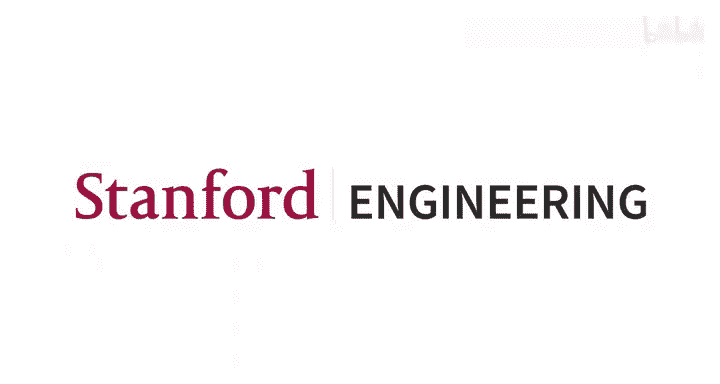

# 斯坦福大学《深度多任务与元学习｜Stanford CS330 Deep Multi-Task and Meta Learning 2022》中英（豆包翻译 - P8：-08-.Unsupervised Pre-training for Few-shot Learning l 2022 I Lecture 8.zh_en - GPT中英字幕课程资源 - BV1dWpPepEsj

I'm going to be revisiting some unsupervised pre tradinging stuff today。

 this is reconstruction based methods as opposed to the contrastive methods that we looked at on Monday。

All right， so the plan for today we're going to do a little recap on what Chelsea talked about on Monday so we're going to talk about the unsupervised learning problem setup and just go over contrastive learning briefly and then the meat of the lecture is going to be about reconstruction- based unsupervised pretraining so the main difference here is that we're not learning by comparing multiple examples we're sort of learning one example at a time by just trying to computer representation and then reconstruct the example and we're going to talk about a couple different instantiations of this idea。

Some of them you've probably heard of before， some of these big fancy hopefully not scary models and a lot of this content is going to be stuff that' homework3 is on so it behooves you to pay attention and you're the people who came so you're already ahead of the curve and if you pay attention you'll be even farther ahead of the curve so hopefully by the end of the lecture you'll have some familiarity with some of these now pretty widely used methods for unsupervised pretraining and some of the ways that we can then fine tune in these models once we've pretrain them and ideally be ready to breeze through homework3。

All right， so just to start this recap， so as Chelsea said on Monday and unsupervised learning。

 we have some large unlabeled data set， ideally a diverse unlabeled data set。

 we do this first gray arrow which is unsupervised pretraining and this gives us our pretrain model。

And then once we have a pre-trained model， we usually use some often small data set for a fine tuning to specialize this model to a particular task。

 and the goal is to get sort of a good predictive model for this particular task。And after that。

 we talked quite a bit about contrastive learning on Monday。

 so the basic idea here is that examples that are similar。

 in some sense should have similar representations。

And so this could be examples that have the same class label。

 this could be examples that just come from nearby regions of an image if we don't have class labels。

 could be augmented versions of the same example by flipping or cropping or adding noise。

 or if we have sort of temporal structured data， like videos。

 we can take video frames that come near each other in time to get sort of positive pairs。

Another thing that we talked about is it's not good enough to just take things that are similar and push their representations together because then we end up with this degeneracy where everything gets the same representation so we actually need to contrast things too and that's how we get this wonderful name contrastive learning and sort of the most straightforward implementation of this is this triplet loss so here we have a triplet because we have kind of our anchor example and then we have a positive example which we say is sort of the similar one and then the negative example which is different。

 we push together the similar ones and we pull apart the negative ones。

And then you can generalize this to have more than one negative。

 so this is this sort of nway classification loss， which is used in the Sclar paper that you might remember。

 which is also known as the N accent or normalized temperature scale cross entropy loss。

 which is really。Awesome name one minor correction from Monday is there were some questions about whether or not the similarity score for the positive pair shows up in the numerator and the denominator and it does so in the simple loss we the similarity score for the positive pair in both the numerator and the denominator and the reason that's useful is since we have this positive score in the denominator and the numerator we know that this fraction is going to be between zero and1 and so we can sort of interpret this as a classification probability and so really we can kind of just think about this contrastive objective as like training a classifier with our representation so it makes it a little easier to think about the loss and what it's doing。

How do we feel？I love the enthusiasm， keep bringing the energy folks。Okay。

 so now let's talk about some reconstruction based on supervised objectives， so again。

 the main difference。Between these methods and the contrasted methods are we're not comparing and contrasting multiple examples。

 we're sort of doing this one example at a time， which makes things a little easier。

And the simple intuition for these methods is that a good representation of our data is one that lets us reconstruct it。

So if we have some image， love this lovely little dog。

 we might pass it through our encoder to get a representation。

 and ideally if we have a good representation， we should be able to decode this representation back into our original input and ideally with a decoder that's not absolutely massive。

 as it should be sort of a a reasonable size decoder。

And sort of the bonus of this type of setup is that we don't have to worry about things like sampling negatives or using large batch sizes because again。

 this objective is purely defined on just a single training example。

 and so we don't have this sort of more complicated relationship between multiple examples and a batch to worry about。

Okay， so that gives you a little bit of a flavor of what we're talking about。

 and we can make it a little more concrete。So we have this intuition that a good representation is what lets us reconstruct the input。

 so how do we actually train the thing， well we really just define some loss function that tells us how close our reconstruction is to the original input。

 so for images we might use just L2 or squared L2 distance。

And then we we train this whole thing end end。 So we train the encoder and the decoder end to end。

 and hopefully by the end， our encoder gives us representations that are useful。

 So thats that's kind of a neat story， but I'm curious if people have any。

Creing suspicions on what can go wrong in this situation。If you've ever trained a VA。

 you might know the answer。Everything， it is included under everything， yes。So。His mouth that next。

And both it was just memorize。you saw my slides， didn't you？Very impressive。 So， yeah， So I mean。

 one way to think about this is， according to this last function we've written down。

 would the identity function be a good encoder or decoder。😊，That's not actually totally rhetorical。

 I'm curious if it would be。So the answer is yes， it would be because if we have the identity function as an encoder。

 R is just x and if the decoder is the identity function， x hat is x or loss is zero。

 and that's like a great loss function or a great encoder and decoder for this loss。

 but it's not really useful so the question is how do we fix this。😊。

And there are a lot of different ways to fix this， but we're going to focus on one common one that people use。

If R is basically unconstrained， if it's just as high dimensional as our input。

 then there's no reason the encodeder can't just copy the input into the representation and then the decoder just copies that representation to be its prediction。

 and this is not really useful， we're not learning anything meaningful。

And so the key idea that people use to kind of get around this issue is adding some sort of a bottleneck on our representation。

 so the most common maybe most intuitive type is just make it lower dimensional。

 so we might have an image that's like 100 by 100 pixel pixels and our representation might only be 64 dimensions。

 so intuitively it's much harder to just copy the whole image into this low dimensional space and so the hope is that these latent dimensions in our representation will actually be forced to represent some high levelvel concepts that are more kind of efficient in storing information than just memorizing one pixel at a time。

Okay so let's say we train this model now because we have this encoder that compresses our input into some more compact in some sense representation how do we actually do the few shot learning part Well we'll throw away our decoder and we can just initialize a prediction head on top of this representation so really what we've just learned as a feature extractor of our data and now we'll just treat this as a normal machine learning problem we can fit some sort of prediction head to these representations instead of the raw images this could be an MLP or it could just be like an SBM or whatever。

And we'll train it to make classifications course， so here we're doing like five way classification。

 we just have a classifier now。And the simplest recipe here is we'll freeze the encoder and just fine tune this prediction head or just fit the prediction head。

Okay， so this is the basic auto encodecor or bottlenecked autoender setup。

 which is kind of the you can maybe think of like the simplest thing that kind of works and the pros here are that it is very simple。

 it's very general， you can kind of do this for pretty much any sort of data because all you need to do is pick this loss this distance function。

 which you can usually come up with some sort of distance function from most data modalities。

You also have this advantage compared to contrastive learning that we don't need to select these positive and negative pairs。

 and this is often the sort of most difficult part of the contrastive learning setup。

 and so it's really nice to get rid of that。But the major downsides here in particular is that we have to design this bottlenecking mechanism and turns out this is really hard to do well。

 so you can use this sort of low dimensional bottleneck in practice this doesn't really give you that good of representations。

 even if you make it relatively low dimensional。And you might wonder well why is that a lot of this is known mostly just empirically by training them。

 but what you end up with is still sort of representations that mostly memorize the images and don't actually encode sort of any sort of high level or interpretable concepts that are likely to generalize well beyond just reconstructing this exact image。

 and you really do kind of end up with representations that just encode the specific details needed to minimize the reconstruction loss but not really anything that is easily adaptable to new tasks。

 and so what ends up happening a lot of the time is R is more like a hash of your input then a sort of conceptual summary。

And if you think about， for example， using the GZip representation of an image as its representation for fine tuning。

 like that's not going to be a very informative representation。

 even though it's going to be smaller than the original image。

 and so just compressing is not at least in this sense of dimensionality is not good enough to actually force our encoder to squeeze out sort of useful reusable features。

So how do we encourage the encoder to extract these high levelvel reasonableable features and one strategy that people use is just other types of bottlenecks so we can bottleneck our representation in many ways。

 we can use information bottlenecks that essentially add noise to the representation。

 we can use sparsity bottlenecks that constrain the number of dimensions that can be nonzero。

 we can also use capacity bottlenecks to force the decoder to be relatively weak so that the representation needs to be sort of easy to decode。

 but the strategy that actually is most common in practice is to worry less about designing a bottleneck and just make the task a little bit more difficult to force the encodeder to learn something a little less trivial。

And that's going to take us to our next section on masked autoenrs。

 which is sort of a class of models that encompasses a lot of the large pret models that we have these days that we use in practice。

How are we doing so far？Any questions？Is everyone having fun though？Yes。そ很。

Have of author colorss one I the cash。 doesn't mean you can somehow。

Extract the information of all samples that went into the out color。就是你那个。然后面。Yeah。

 so in the you can， so it depends on the exact model and the capacity and the training data。

 but in the same way that you can hash functions are generally difficult to invert。

 but if they're imperfect， you can invert them， a lot of the times yeah。

 you can not only just decode a particular representation back into its image。

 but you can kind of fiddle with these models in a way that lets you extract multiple examples from the training distribution。

 which can pose sort of a privacy risk。就是。Great。So the公 back to the。う。

Since the model is kind of just memorizing detail from you。Eventuallyally， if you just slap it。好。帮保。

二十そで。Yeah， so I mean if you have， I guess the question is， if the representations aren't that great。

 like can we sort of get around that by just making our predictor higher capacity and we definitely can if we have a lot of data that we're able to fine tune on。

 but the idea is in the best case setting， we're going to learn representations that let us perform well on our downstream tasks with really simple predictors because the simple predictors are the ones that we can fit with only a little bit of data that are very difficult to sort of overfit with。

 and so if we need to do this sort of thing that sort of means like our objective not working very well because ultimately just means we're not going to be able to do few shot learning as well because we'll need a lot of data to fine tune with。

Yeah。With， can we go back？B for thinking then saying you can sort of exact image。Yeah， so I mean。

 you could imagine sort of like a cross encoder where instead of reconstructing x。

 you reconstruct like X pauses。Yeah， so I don't there's not a specific paper I'm thinking of that's like extensively evaluated this sort of thing。

 but sort of colloquially yeah you can do that， I'm not sure how it directly compares to stuff like Bert or。

Yeah， any of these models here。In a way。That sort of is what masked autoenrs do。 They in a sense。

 they do come up with these positive pairs and then。Just hang on， all right。

But if you're still wondering that at the end， come grab me。

All right so we want to go beyond this bottleneck approach to the auto encoders because designing a good bottleneck that actually forces our encoder to give us good features is really quite tricky。

And so the common solution people use now is called mass autoenderrs。

 and the issue that this sort of gets around is like our regular autoenrs are really trying to predict X from like X。

 and this is sort of a degenerate task。And so we add this bottleneck to try to avoid our degenerate solutions。

 but maybe the task is just too easy and the easiest way to solve the issue is not to design a really fancy or really perfect bottleneck。

 but just make the task a little bit harder。And so that's sort of the approach that we're taking with mass autoenrs where we no longer predict x from X。

Instead， we just mask out a little bit of the input and we try to reconstruct the other part of the input。

 And so in this sense， going back to your question earlier。

 we sort of are doing this in that now X and y are not the same。

 there's sort of like this positive pair that's generated by literally just like partitioning the input into pieces。

And this does work really well， so you're just like five years too late。But otherwise。

 that would have been like a brilliant research idea。嗯。

So that's sort of the gist of mass auto encoders， and this is even though this is a relatively small departure from the autoencoders we already saw。

 it's a really， really powerful framework for representation learning that is pretty widely applicable。

Okay， so let's go over kind of the general recipe for how mass autoencors get trained in practice。

 so again， just like when we're training a regular autoencoder。

 we need to pick some sort of distance function that tells us how good our reconstructions are given the original input。

 so this part is the same。And then for a training batch of examples， for each example。

 what we're going to do first is we're going to sample what we're going to define。

 which is a masking function， so we're going to take that example and we're going to generate X tillilde which is sort of the masked out version of that example and then y which is like usually just going to be everything else。

 so typically X tillilde and y are just going to be disjoint subres of the input so in the image example it's literally like partitioning the image and one part is X tillilde the other part is Y。

And then we're going to make a prediction with our model f theta that gets not x。

 but x tilde as input。And then we computer loss， so our loss is going to be between why which is the sort of held out part of the input and why hat。

 which is what our model thought the held out part of our input is。In some cases。

 the target might just be all of X， not just the held out part。

 but this is a relatively minor detail that doesn't make a huge difference in practice。

And so these highlighted parts are basically our design choices or our control knobs。

 and two of them are pretty much the same as regular autoenderrs， the model， and the loss functions。

 its really just this masking function that we are now able to define。

 which gives us sort of one more knob to turn。And so again， as an example， in the case of an image。

 we'll split it up into two subregs， and our model might be a convenet or a transformer。

 which we'll talk about a little later。And our distance function might just be L2 distance。

 in the case of language or one dimensional sequences。

 we might just mask out a couple of the words or the tokens in our sequence。

 and that's sort of our noisy input and our targets are just the words that were there or the original data there。

Here often and pretty much all the time now， the model that we use as a transformer such as BEt。

 which again we'll talk about soon。And the loss function or the distance function here is usually kale divergence or cross entropy between the model's predicted distribution of what it thinks the missing words were and what they actually were。

Okay， so probably to talk about a couple of specific instantiations of this framework。

Probably the most famous one is Bert， which maybe you've heard about。

 which is this large transformer model that's pretrained on a huge amount of text that's really good for fine tuning on new usually classification tasks。

And basically BerRT gets as input two sentences， but that's sort of a detail of Bt training。

 it computes representations of the sentences， and then it predicts basically the missing words in both of those sentences and it just does this task for many。

 many TPU hours and then you get out a good model at the end。

So let's look at this in a little more detail。So again， we might have this text input and here。

 again， as sort of just a quirk of Bt， we used two sentences instead of just one for training。

 but it doesnt not a huge， it's not hugely important。And so we apply our masking function。

 which gives us our masked out version of that input。

 and I've just annotated the time step in the sequence here that hopefully will make things a little easier to see what's going on。

And so I've randomly sampled three of the time steps to mask out。And I'm going to define my targets。

 which are just the original words there。And then we stick this entire sequence with the mass tokens through BRT。

 and that gives us a prediction for every time step in the sequence of what the word is likely to be。

 a probability distribution over all words of what it thinks the word is there。

 that probability distribution isn't very interesting except for the time steps where we masked out the word because for all the other time steps we know what the word is so we just compute our loss on those masked out time steps。

 and this gives us basically three distributions that are actually needed for training。

 which is the model distribution for time step two for time step six and time step 9。

And our last function here again is going to be kL divergence and this is going to work out to be the cross entropy between the sort of one hot distribution that is our actual labels here。

 so basically a one on Biden and a zero for everything else and the distribution that our model predicted for each of those time steps so what that works out to be is the negative log likelihood of Biden on this distribution for time step two。

 the negative log likelihood of president for this distribution at time step6 and the negative log likelihood of was at this time step9 and we just sum those or really average often in practice。

And this is our loss for training。And then we just optimize this end to end， and we are happy。

Just a couple of details about the way that Bert does masking just for completeness。

Bert masks out 15% of the time steps at random just uniformly。And of these 15%。

 80% of them get replaced by literally the mask token that I've used here。

 and the other 20% actually get replaced with just a random word instead of a mask token。

And I'm curious if you just think for a moment why we might want to use a mixture of mask tokens and random tokens instead of just replacing it with a mask token all the time。

 if you think about how we're ultimately going to use this model once we've pretrained it，Yeah。

You don't want to constrain your model to only a sentences。Yeah。So they're crazy。先ど。Yeah。

 so you definitely don't want to sort of overfit to the types of sentences that you see during training。

 but it's sort of a specific type of sentence we're only seeing during that we would only be seeing during training that we want to avoid and that's what I'm trying to get at。

So real are great。Right so so in other words， we also want to have good representations of words that are not mask tokens so in a sense during training。

 if we replace a word with a random word and we ask our model to tell us what the original word was there now our model in addition to just filling in mask tokens is also basically solving this task of for every word in the sequence assume the word that you see here is not what was actually there in the original text。

 what do you think the word would have been and so now we have a model that not only gives us good representations of words that are masked out but every word in the sentence and that's important because at fine tuning time right we're going to be getting sentences that have no mask tokens in and we're just going to be shoving like real data into the model and we don't want to be overfit like you were saying to only the data we see in training which always has mask tokens in it。

 so that's sort of the motivation for why we sometimes actually just mixing a random word。Yeah。

 so when predicting the identity of one mass token， can it see the identity of the other mass token？

Yeah， and that's for computational reasons， I mean you could。

 you could only mask one token at a time， but then you're sort of using only a very small amount of your sequence for training at every time step and you have to make your batch very big and the thing that makes that difficult is now you basically need to tune this percentage of the input that you're masking right if you don't mask enough。

 then you're not really like learning very quickly because you're only predicting one word at a time but if you mask too much now the task is too hard because you can only see like a couple words and there's like a lot of blood has been spilled like trying to figure out like the right way to sort of do that masking。

And a perfect segue to this final point is it is possible that we can do better than just picking random time stepss and two common ways people do this are they mask out longer spans of text at a time so not just like a single word here in a single word there and also do what we call salient span masking。

 so looking for kind of information dense parts of the sequence or the image and masking those out instead of just like masking out random words like was or on or something。

And in certain settings， these can make a huge difference in how good your pre trade model is。

 we have three questions， I think I saw you and then you and then you。

Is there been any work on looking at how similar the random token？

VersHow similar the red and tokens are to the brown foods tokens and how that might affect。春。

you want it to be， you can make it truly more difficult by making it like troublesomeally similar。

Yeah's a good question， I'm not aware of actually ablating the criterion for how you pick a random token。

 as far as I know Bt just samples uniformly from the entire vocabulary。

But it would be interesting to see if you pick synonyms， basically， is that harder？Yeah。

 it's a good question。Someone back here。I'm sorry， I don't know if I make pause design go closer。

 like instead of post can get you fit in a line number and any thick words to figure out how the design board。

What the original word was。Yeah。Yes。Oh yeah so the last question was just that what do you actually do when you put in a random word。

 what are you predicting and the ideas you replace like for position nine。

 your replace was with like Apple， and then the model has to predict what word originally was there。

When we're select for information that standss， its like what we're saying is we're looking for something with like high entro or whatever。

Yeah， that's a good question so the question was when I say information dense spans what does that actually mean。

 there are a lot of here or six people use but oftentime times people will just take another model that has been trained to recognize essentially like dates and names and just like pick out all the dates and names which often end up being high entropy portions of the text right if you say my name is blank。

 it's gonna be extremely high entropy distribution right because it could just be anything so essentially that but it's difficult to actually compute the entropy itself so we use this proxy which is classifying the type of word it is。

Why don't we use a random mask for all topics instead if the mask industry are random to a committee？

That's a good question， I guess I would suspect that using random tokens are a little bit more damaging than mask tokens because for a mask token the model sort of knows it can ignore that time step。

 there's no information there， whereas if you replace everything with a random token。

 the model sort of now has to solve two tasks first it has to figure out which are the time steps that have like。

Real tokens and which are the ones that don't have real tokens。

 and then once it has figured that out， then it has to try to figure out what was the original token for those time steps where they are sort of determined to be false。

 So I don't know that's just my one potential guess， but it seems like it could just be harder。

 but it's a good question。Yeah the laws completed on all that opens。So for Bt。

 we just compute the loss on the masksed out tokens。Oh no I'm sorry， including the random tokens。

 so yeah， the loss is just computed on tokens that are perturbed。

 so masked or replace of the random token， but the tokens that are not changed。

 we don't compute a loss。Do I has to change the tokens， which weren't supposed to be changed。

we don't compute a loss for those tokens at all， it doesn't matter。

 but intuitively what should happen is since we are replacing some of the tokens with random words。

Bert sort of should be acting as if like every word might have been replaced with a random word。

 and so it should be giving you a representation at every time step that is useful for predicting kind of the likely words that would have gone there。

like adversarial tokens， which could let completely mess up。Absolutely， they're pretty rare。

 but there are people who basically use BerRT to come up with adversarial things to mask out。

 to like train another model like Bert I'm going to move on because just because we have a lot of content but。

I love the questions。 I really do。Okay so zooming back out from Bert。

 I hope that was useful to see that in a little more detail， but although Bert iss the most famous。

 this sort of masked pretraining kind of approach is not a language specific phenomenon。

 and especially recently， people found that this worked really。

 really well for learning representations of images too。And also with transformers， so it's a very。

 very similar kind of learning setup so here from an image what we do is we chop the image up into a sequence essentially。

 so we turn the image into a grid of like subregions or patches。We mask out in this case。

 instead of 15%， we mask out 75%， which gives you some sense of the way that information is spread out or how information dense like the signals are in these two cases。

 which is sort of interesting。First we just mask out tokens the exact same way we do in language just a different percent。

 and then we compute the representations in this case of only the unmasked patches。

 so we flatten out that sequence of all the patches that didn't get masked out。

 we stick them through our encoder， we got a representation of all of those。

 and then we insert placeholder patches into all the locations that were masked out so now we have sort of the same shape as our original image in the places that weren't masked we have our model' representation and in the places that were masked we just have placeholder tokens。

And then we run this through a decoder to get a prediction of what the rest of the image looks like。

And so at fine tuning time， we just throw away the decoder， we just use the output of the encodeder。

 but with the whole image。And this is really， really a powerful learning setup as well。

 and actually this sort of mass autoenr pre training。

Can give state of the art a few shot image classification performance and actually can do better than supervised pretraining so if you do this procedure on INe and then fine tune on INe with labels。

You can actually do better than if you just trained on INe with labels from the gego。 So in a sense。

 you're sort of extracting even more information from your training data set by doing this procedure and then fine tuning with labels than if you just train with all the labels to start。

 So that's pretty cool。But in addition to that one thing I think that's interesting is to compare with contrastive learning so this is a really I think informative figure to get a sense of maybe some of the strengths and weaknesses of mass autoencors versus contrastive learning and the interesting regime I think is right here so here we have MAE which is this mass autoencoder model for images and then moco is this momentum contrast contrastive learning method sort of V3 but whatever and what's really interesting is that if we don't do any fine tuning and we just fit we freeze the pretrained model and we just fit a linear head on top of the frozen models' representations。

 contrastive learning works significantly better than the mass autoencoder。

 so it's the difference of a little more than 4% but if you actually fine-t some of the model itself it seems that the mass autoender。

 pre-trained model， finet better than the contrast of pretrained models and so it's almost like a little bit of a tradeoff of representation quality of the frozen pre-trained model versus like。

Tunability。So it's not clear that it's actually a trade off。

 but it seems like for these two classes of methods， at least right now。

 the contrastive models give you slightly better representations。

 but the mask models maybe fine tune a little better。

So if you have only a tiny bit of fine tuning data。

 maybe the contrastive models are better because you don't have enough data to like fine tune a lot of the model。

 but if you have a decent amount of fine tuning data。

 which often we have more than like 30 examples in the hundreds of examples。

 the masked methods can work really well。So now we've talked a lot about transformers。

And I should say that。Masked auto encoders work really well and they have gotten a lot of attention。

 but sort of one of the things I think that has been the engine of a lot of that progress is the transformer architecture because to do this sort of mask completion task requires a highcapac model that you can scale and in order to apply this recipe across data modalities it's nice if you have some architecture that's not really modality specific and transformers give you that so transformers are this sort of general purpose architecture that you can pretty much just like directly point at。

Language or images or molecules or like sequences of states and actions and reinforcement learning。

 you don't really need to change the architecture and so it makes it really easy to kind of transport this masked representation learning approach to new modalities so I think it's important that we spend a little time just looking at transformers some of you might be familiar with it already。

 but hopefully you'll learn something。So okay， what is a transformer。

 so we' got a little bit of a peek in the previous slides。

says any innovation behind by coned learning doesn't perform as well as possible。我 go。

Let me think about that。No， I don't have a concise answer for why I would expect this to be the case。

I I guess one way and so mean my short answer is I don't have an answer I'm very confident in if I had to totally hazard a guess。

 I guess you could say that。The pretraining objective for contrastive learning is a little bit more like just doing classification。

 like we saw on that early slide we're basically coming up with a classification score for the positive pair compared to other pairs and so it's almost like your pretraining like in a pseudoupvised way so it kind of makes sense that if your downstream task is to do image classification。

 maybe pretraining this way is going to work pretty well without changing the model at all。

 whereas the masked pretraining approaches is a little more different than classification but maybe you're extracting more signal from the data and so if you're able to finetning the model it'll work better。

 but because the pretraining objective is a little different than your downstream task。

 it's not necessarily going to work as well with like no fine tuning at all。

That's the best I can give you。比如。Oh gosh sorry， yeah the question was。

 do we have any intuition for why contrastive methods might give us better representations but not fine tune as well。

 and the TLDR was that maybe the contrastive objective is a little closer to doing classification based on the derivation we saw before and so it maybe kind of makes sense that without any fine tuning they do better at classification。

Okay， so transformers， this is a nice figure from the vision transformformer paper that I thought is a good at least 20。

000 foot view of the inputs and outputs of a transformer。

 so we haven't cracked into the main meat of it yet。

 but to see sort of what's going in coming out of the model。

 transformers operate on sequences of data， and sequence in the very general sense。

 so this can be a sequence of words， it can be a sequence of here image patches。

 it could be a sequence of like bombs in a molecule， it can be kind of whatever you want。

And so the way a transformer works is we somehow convert our data into a one dimensional sequence。

We convert these into a sequence of embedding， so in the case of an image patch we just have like a linear transformation that takes like our whatever 16 by 16 grid of pixels and projects it into some usually like something like 768 or 1024 dimensional embedding space。

 so now we have this sequence of image patch embeddings。

And then before we stick this into our actual transformer encoder。

 we do one extra thing which is really important well sort of too first we concatenate what we call a class token in the beginning of the sequence。

 and this is just because at the end when we actually want to make a classification score we need to pick one of these representations to actually like stick in our final predictor MLLP and so we just have a special token in the beginning for that。

 but the really important thing is we have this thing we call the position embedding so we get our embedding for each image patch here but we concatenate this number which really practice isn't literally a number but it's an embedding that is specific to each like literal position in the sequence。

And this actually turns out to be really really important because the transformer architecture itself doesn't discriminate between locations and the sequence。

 so it's just giving you an output that's a function of like the set of things you put into it and so if you don't add something to tell the model that this is the embedding at position1 and this is the embedding at position two。

 you end up with a model that sort of totally permutation invari of your input so if you totally scrambled like the patches in the image you'd get the same output and that is not that's not good。

 we want our model to be able to reason about the relative position of things。

Okay so what's inside this transformer encoder， the transformer encoder has a few main pieces that we'll dig into in more detail in the next slide but at a high level we basically have this fundamental block that we just apply over and over and over so we'll have something like five or 10 or up to like 100 of these blocks that we apply in a row and then we just take the output of the final block and inside each one of those what do we do Well first we have a normalization step where we just take every embedding in our sequence and we normalize it separately so every embedding should have zero mean and s deviation1。

Then we do what we call multihead attention， which is basically the only step in this whole process where the embeddings at like time step 1 and another time step will interact with each other。

 So this is where all of the inter time step interaction occurs。

 and we'll go into the math of what exactly is happening later。

We have a residual connection that wraps around both of these。

And then we have another normalization step， and then we apply an MLP just separately to every time step。

 so again there's no communication between the embedding of different time steps。

 it's just a sort of weight tied MLP， and then we have another residual connection that skips both of these。

 and then we have 12 or 24 of these blocks that we train end to end。

So that's sort of the high level picture of the mechanism in a transformer。

 and again this multi had attentionten is the only time we're reasoning across time steps and it does so in a totally sort of order independent way。

And another thing that's worth noting is that really the only difference between transformers for different modalities again is this initial embedding step。

 so if you want to apply a transformer to your new type of data。

 whether it's language or code or molecules or images or 3D point clouds or whatever all you need to do is figure out how to take my original data which is the raw data and turn it into some sequence and then you stuff in the transformer and usually you'll get something reasonable。

 there are definitely better and worse ways to do that so I don't want to make it seem like a trivial point but it is pretty much the only decision you need to make。

Okay so let's look at things in a little bit more detail and this is one of the denser parts of the lecture。

 so feel free to ask questions if I've not explained anything adequately。But here。

 let's look at a language example just to not get too focus on one modality or another。

So we get some input sequence in this case， it's a sequence of words。

 and we have T elements in this input sequence。We're here at Tus6。

And the first step that we're going to do is for language， we're going to do a tokenization step。

 and this is needed to basically convert our words into indices。

Because that's how we're ultimately going to convert them into vectors。

 so we have literally a big mapping we store that we fit using like a large corpus of text and every word or really in practice like subword sequence of letters just gets assigned some number。

So that's sort of the first step here and then the second step is to do this embedding lookup where every index。

 every token index has its own learned vector， and this is how we're going to get our initial input sequence to our transformer。

 so every word gets a number and then we just look at the row in our big embedding matrix corresponding to each of these token indices and that's sort of our initial embedding。

The only asterisk there is we add a positional embedding。

 like we said before to be able to know that the word Joe came first in the sequence。

 not tenth0th of the sequence。So this is sort of that first step outside of the gray box on this last slide。

 this is sort of preparing our initial embeddings to then put into our many transformer blocks and this is how we do this in the language setting。

All right， so then let's get to the gray box that's what we're all here for so again this is just one transformer block and in practice we're going to have many of these in sequence all of different parameters that we learn。

And the first thing that we do is we're going to normalize all of these vectors in our sequence independently。

 so each of these vectors is going to have mean zero and unit in deviation。And so again。

 we have this chunk now of T by D， where our sequence length is T and D is the actual embedding dimension or the hidden state dimension of our model。

Then we have this self-attention step， which is sort of where the magic happens， so to speak。

 where we will compute this self-attention matrix which essentially tells us how related or how similar the token at one location is to a token at another location and this is kind of what tells us like how we should be propagating information between time steps and this is sort of hypothesize to be what makes transformers really powerful is that it can do this explicit sort of point to point reasoning instead of for an RN where if you have information here that's relevant to something much later in the sequence。

 you have to kind of recognize that here and then remember it as you process all of the tokens in between the difference is with a transformer。

 I am directly comparing each token to every other token so I don't have to do that。Okay。

 so how does that work？Well we compute a new set of representations a。

 which is the same shape as the input representations， but it has this particular form。

 which is maybe a little bit like what the hell at first。

 but we'll go through it one step at a time so there are really two main pieces。

 so A again is the output of the self-attention step。

And the two main pieces are what we call the self-atten matrix and the value matrix。

 so the self-attention matrix is this thing that I've drawn right here。

 this is the T by T matrix that tells us how similar is the thing at one location to a thing at another location and the value matrix is basically like if I say that my representation at this time step really only depends on the thing at this other time step。

 the value matrix tells you what is the actual representation that you're going to be pulling from that other time step that's going to replace your current representation。

To be more specific about this， so Xq is just your input here。

 x times some D by D or even a down projection to a lower dimension。

 but some transformation matrix which is a linear transform， and then the same thing with XK。

 it's just another learned linear transform and again with XV it's just another learned linear transform。

 so you just have three different projections of your input vectors。

And you take to get your attention matrix， you take the inner product of all pairs of what we can call the queries。

And the keys， and this gives us some matrix， and then we do a softm to sort of normalize each row to sum to1 so every time step basically gets assigned a distribution over all time steps in the sequence。

 and then when we do this matrix multiplication with the value matrix。

 what we're doing is we're doing a weighted sum over the value vector for every time step in the sequence weighted by the softm attention score for each of those time steps。

And。Yeah， so when we do this final matrix multiplication to get A。

So the question was can you say that sentence again the answer is no。

 but I'll try to be similar because I don't remember what I said essentially what a is doing is for every time step。

 so the value of a1 is roughly just going to be awaited sum over each Xv so that the projected version of each one of these vectors weighted by the attention score for each one of these time steps。

 this self-attention matrix is this t by T thing， meaning for each time step in our length t sequence。

 we have a length t vector and that vector is a probability distribution over all of the time steps and we just do a weighted sum over their value vectors。

And so just as an example， if this is our self-atten matrix。

 literally like the number right here in the matrix is going to be like x of the inner product of the third row of the query matrix and the second row of the key matrix over the sum of the X of the third row of the query matrix and all of our keys。

This is just the softmax， but I've just written it out for like a particular cell。Yesや。Lird wait。

H model are just the Ws of PWs。And the MLPs。Yeah， so after selfattention we do another residual connection and normalization and then we have an MLP that we apply。

 it's the same MLP for every time step， it's the weights are shared。

 but it's just sort of like a post processing on the output of self-at but yeah so now it's all the parameters so it's the the WQ the WK。

 the WV and then this is a one hidden layer MLP so we have two weight matrices here and that's all the parameters other than like your input andbedding matrix which is relatively few parameters。

Yes。Instead of learning WQ and WK cases since just Yeah， it's not obvious。

 but yes mathematically it's equivalent， so actually in an early version of the slide I wrote it out with just the collapsed single matrix because like when you do the transpose of xk right we get x times WQ times WK transpo times x transpose so you can just define a new matrix that's wQWK transpose and it's like it's the same right but it's not the same because when you train it turns out it's like easier to train if you have both of the matrices because when you do one step of gradient descent like you're going to update。

While we're getting in the weeds， but like each matrix is going to get like a rank one update and if you have a product of two matrices they both get a rank one update so like the update you make to each of them to the thing in aggregate is richer so in some sense it's like easier to optimize it's not totally well understood but yeah people still do it with this double matrix way because it just seems to work better。

It's a good question though。그 관심。I don't know the answer to that。I think he was first belong to。

 will you mean by rank one update？Now we're officially in the weeds， but I'm happy to talk。嗯。こすの。嗯。

Yeah good so someone's paying attention at least so this is not multi-head attention。

 this is single-headed attention and so really what we'll do with multi-headed attention is we won't do this once we'll actually repeat this basically this WQWK and WV matrices we'll all have an extra index which will be the heads until you'll repeat this like eight times in parallel。

And each one of them will take like a project usually like a different subspace of x because maybe。

Right， so like if you have like yeah， basically one of the words in the sentence might be related to like it might have multiple senses。

 for example， and so you know if you have the word bank like maybe it's related to like river because it's like a river bank but maybe it's also related to like you know Federal reserveser and you haven't disambiguated what kind of bank it is yet so you want to tend to both but you want to do them separately so you do them in the two different heads and then later on you combine them。

That's sort of a detail of real transformers that we'll admit for now。Okay， and so oh yeah， yeah。

 So is this normalization before after usually after， sorry folks。

That's a great question it's pretty much purely empirically decided as far as I know there are some papers that。

Try to analyze some of these decisions and give rationales behind them。There's a paper， I think。

 called Transformer circuits or a mathematical framework for transformer architectures or something like this from Anthropic。

Gets into this in more detail。My understanding is it's largely because it's what works best。

 but I'm not sure actually the location of the normalization makes a huge difference in the final performance。

 it's kind of arbitrary。Okay。Yes， sorry， I don't know if you explain this。

 but how exactly do the positional embedding to are they but how do you make them so that？

ransformers。So it's literally， your embedding lookup gives you like a TB byD。Sequence。

 you have a sequence of blank T and you do your embedding lookup and you get a D length vector for each time step。

 your positional embeddings can literally just be like a stack of learned vectors and like you have one for the thing at time step zero and one for the thing at time step1 and so on and so forth。

 and you actually just literally add them together。And that's what forms your input sequence。

 and you just learn them。There are other ways of doing it that aren't learned that also work。

 and there are more complicated ones that try to make it easier to generalize to longer sequences than you are during training。

 but like the basic idea it's just like a vector you add to the。To the raw inputs。Rightright。

I'm going to move on。So the last question was your question， which was。嗯。B I your questions again。

How do you thinkbedding right yeah so the question was about the positional embeddings and where do they actually come from and basically it's just you have a learned vector for every time step in your sequence and for each qualify time step you just look up the one of that index there are more complicated ways of doing it。

嗯。Okay， so now we have the gray box which is great because we love it and we're pretty much done now so we have lots of these blocks and we train them all into to end and we get some representation for every time step in our sequence and then finally if for example we're doing like mask pre-training。

 we just have a final linear transform that projects the representation at every time step into the dimensionality of our vocabulary and then we do a softm this gives us a distribution over all the words in our vocabulary and now we can just do like you know maximum likelihood training or whatever and this is pretty much。

The whole thing。그。All right， so we've talked about pre training， we've talked about transformers。

 how do we actually fine tune these guys once we have them pretrained。Let's look at one more example。

 so here appended I've preended this class token that we talked about before because it's not really needed to understand pretraining but for fine tuning。

 we're going to use it。We're going to just push this sequence through our model and when we do fine tuning。

 oftentimes we'll just take the representation of the class token and we'll fine tune a new prediction head。

 which is often just a linear transform or a small MLP on top of this class token representation。

Because that's pretty straightforward， that's pretty much what we said before we were talking about regular autoenrs。

 but one of the big questions on hopefully on your mind is do do with what do we do with this guy during fine tuning so I mean we could freeze these parameters。

 we could fine tune all of them。There are other options。

 maybe we fine tune some of them or we could freeze them but inject some new parameters that we're going to fine tune and turns out in practice people usually do sort of option three here。

 so in some sense they kind of freeze and fine tune them in lots and lots of different ways and we're going look at one of these methods in a little more detail so that you have some intuition about what that actually means。

And the method that we're going to look at， which again， there are many。

 and I don't mean to pick this one as like the end all beL。

 but I think it's reasonably concise to get your arms around。

 so I think it can be useful to work through， it's called low rank adaptation of language models。

And again， the intuition is like we want to fine tune our model a little bit in some sense。

 so we don't want to necessarily fine tune all the parameters of our model because we don't want to destroy all of the knowledge in the model。

And you know。Of course， there's a question of like what does a little bit even mean。

 so I'm curious if people have just like a sense of if we want to fine tune our really big model。

 we want to fine tune it kind of a little bit just enough to learn the task， but not too much。

 like what would that。What would that mean to you in terms of maybe what a method might look like or what we might want to avoid。

 what failure mode we might observe？じゃあ。Perhaps maybe you don't want to lose the ability to do the unit。

Or no。You don't want the。The whole装。Right。How we use this problem。嗯嗯。Right， so in some sense。

 we want to preserve the original model because if we totally throw away the original model。

What's the point of starting from the pretrain model？Yeah can we go back or。

I guess just so is it given any this for using must with Morney？Is it make cost or。殺されてる。

I follow downstream bus and how does it go up under the flow？

so the class token actually is in the vocabulary， it's just another。

Uusually it's like tokens zero in the vocabulary and it does show up during pretraining for Bt there's actually I omitted one thing about Bt training。

 which is that we don't just do the masked language modeling。

There's actually this extra task this next sentence prediction task where we take the representation of the class token and we just do binary classification。

 which is whether these two sentences are consecutive sentences or not。

 so like half the time you'll sample two random sentences from your data set half the time there'll be one after another and you just have to do this classification and that's how we sort of train that representation。

But later work has show that you actually don't need to do that， it doesn't really make a difference。

如我这么 some的人就。Yeah， so as far as I know the class token is just it's in the input during training。

 but not yeah， it's not used， I don't think you mask it because it will always be the class token。

 so it'd be sort ofgene， but you still get decent representations out of it。

So this is kind of mysterious。But there's a follow paper called Roberta。

 which is basically upbling some of the things in Bt。

 and turns out you don't need to do the next sentence prediction thing and you can still fine tune in fun。

So if you're curious， you can look into that。Okay， this is going to take forever。Okay， we are。

Here okay， so we talked about what a little bit might mean， and basically we've gotten to it。

 which in my mind is we want to preserve the knowledge in the pretrain model。

 we don't want to totally obliterate everything that's there。

And that's sort of like a learning-based objective， practically speaking。

 we also want to avoid having to actually store a new copy of every single parameter of our model for every new task that we want to fine tune on right like a lot of these pre-trained models are very big if hundreds of millions。

 billions or even hundreds of billions of parameters。

 it'd be really annoying if we need like a whole new copy of the model for every new task that we want to fine tune on so the other motivation here is like we just don't want to have to add that much every single time from like a storage perspective。

And so to get into this one method that addresses these issues。

 I want to take a brief walk back in time to 1972。To describe this sort of particular view on what a linear transformation actually does。

 which ultimately gets at this question of what is a little bit。

So consider the fine linear transform， which is the building block of neural networks in general。

 but also transformers specifically。And we know that for some rank R matrix。

 which is a linear transform。We have a decomposition of this form。And using this decomposition。

 we know that。If we evaluate the matrix vector product with some input。

 we can just rewrite it so we can push the x inside the sum。

 and we have this essentially weighted sum of each vector V weighted by this inner product of x with this particular U subR。

So this is just like。Algebra， barely algebra， this point。

And one way we can interpret this is that this matrix vector product WX is really outputting a sum over what we can think of as memories。

 so each VR is sort of like a memory， and each UR is kind of like a key that determines how relevant a particular input is to that memory。

So if x is totally irrelevant to a particular memory， VR， then that means x will be orthogonal to UR。

 and so this inner product will be zero， so we won't include that memory at all in our output。

If X is very aligned with a particular UR， that means that memory is going to show up very strongly in our output。

 So this is not really even new math。 This is just kind of another way of thinking about the linear transformation which is useful for motivating all sorts of things in like computational neuroscience and ultimately machine learning。

 but it's useful here because now we can go back to what does it mean to fine tune a little bit and we can say。

 well， a little bit means we just only want to add a couple of memories。

And what that means is we ultimately just want to make a low rank change to W。

And that's convenient because a low rank matrix can be stored much more effectively than the full rank matrix。

 so we've kind of addressed both things here， we're going to preserve most of the knowledge because the new matrix is only going to differ from the original matrix by some low rank change and we can store this change very efficiently because a low rank matrix is not a lot of parameters。

And this' is exactly what Laura does。 so when we do fine tuning。

 ultimately we're going to start with some pretrain parameters， W knot。These are frozen。

And our fine tune parameters are just going to differ from our pretrain parameters by some low rank matrix AB transpose。

So both A and B are these D by P matrices， so sorry I should have written W not and WFTR D by D。

 so we're just assuming the matrix is square， but there's nothing specific to square matrices here。

 this works perfectly well for non square matrices。And so when we compute this matrix product。

 we get some low rank D by D matrix that we add to W and we fine tune just A and B here so we don't fine tune W n。

 and so we only end up needing to store kind of2 by two times D times P new parameters instead of two times d squared new parameters for every layer。

One minor note is that we do it's usually much easier to fine tune these models if at the initialization。

 we're starting out with the same function as the pretrain model。

 so that means we want AB to be initialized with zeros。

But the way we do that is a little bit tricky so if we initialize both A and B as all zeros。

 we're actually not going to get any gradient for either of them so we won't learn anything and so if we want the product A B transposedse to be zeros but we want to be able to learn things we actually need to initialize one of them as all zeros and the other with basically non-zero like random normal random initialization so that's kind of a detail you'll see that in homework three but it's something to keep in mind。

So like I said， that's Laura， I hope that was somewhat interesting to think through， but there are。

 lots and lots of different methods for lightweight fine tuning that people have come up with in the last few years。

 this is one sort of survey of a lot of them which plots the percentage of the parameters of the original model that actually need to get updated with the actual accuracy and we can see at least for this evaluation which is just one benchmark Laura is in the relatively like heavy weight in terms of these lightweight methods。

 but also the high performing methods。But keep in mind， even though this is relatively heavy weight。

 it's still only fine tuning less than 1% of the parameters of the model。

And what's really interesting is that in the same paper， the paper has a nice。

Direct and audacious title like lightweight fine tuning is better than in contextex learning or something。

 but sort of their main result here is that actually this is the case。

 at least in some settings where if you use some of these lightweight fine tuning methods in the right way。

 you can get better few shot performance than a GPT3 model that's like，10 or 100 times bigger。

And so in a sense， if you have sort of more than a couple of examples。

 in context learning is still very powerful， if you only have like one example to adapt on。

 but if you have a few more if you have in the like 20 to 70 regime。

 which is I think what they studied in this paper， fine tuning can be more parameter efficient or scale better than in context learning。

But again， this is very， very hot off the press， so to speak。

 so I don't want to make any claims that are too categorical。And you'll make a similar。

 slightly simpler， but a similar comparison in homework theory actually。Okay。How are we doing。

 we're doing great， good for us。Last section。So we've talked about reconstruction as a heuristic for representation learning。

 we've talked about autoencors which are sort of the first stab at using this and now we've talked about masked autoencors which sort of try to address some of the issues with them。

 and I want to talk about another related class of models another sort of related kind of heuristic for pretraining which is autoregressive models which I believe you saw in a previous lecture on black box metal learning but I want to revisit it in this context because I think it's interesting。

So in a sense， autoaggressive models are very closely related to me auto encoders。

 but they sort of simplify a couple of things。So first we can think about what some of the downsides of mass autoenrs actually are。

 so I mean maybe the most obvious one is like we have this extra thing we have to pick like we have to decide how we're going to do the masking and like maybe there are better and worse ways to do that and it's not always obvious what they are and so it just like you causes those stress and we lose sleep and all sorts of things。

There are other things like as someone asked before， we're only masking out some of the examples。

 sometimes it's 15%， sometimes it's 75%， can we mask out more why not。

 well we're only using basically part of each example to train on。

 we're only using the parks that we masked out and we're not computing loss for all the other time steps so in a sense we're not like fully utilizing each training example。

And then finally， the downside is that once we've pretrain this thing we can't actually sample from it。

 we don't have a generative model， we can't sample from the original generate new samples from the new data distribution。

 which sometimes is interesting and fun。Okay， so basically the idea behind autoaggressive models is we're going to simply ask。

 well， instead of masking out a random subset of the input。

 what if instead our sort of learning objective is just take a prefix of the input and predict the next word or the next pixel or the next token or the next patch or whatever。

So now we don't have to pick a masking strategy at all， in a sense， we're masking every token。

And so what we're going to learn is simply this autoaggressive model。

 which parameterizes a distribution over the next token or the next word or whatever given the proceeding。

So if we have again， a training sequence like Joe Biden is the US president。

 we're going to actually convert this into six different training examples by masking out every word in the sequence and conditioning on the ones before it。

So we don't really have this constraint of only using 15% of the example anymore because we're computing a loss on every single time step。

And here I've added a beginning of sequence token because we need sort of something to put in the model to get our first prediction for what the first word is going to be。

 so one difference here is for mass language models。

 sort of the output at a particular time step is what we think that word is if it's masked here。

 the output at a particular time step is what we think the next word is going to be。

 So we have this like shift by one going on。So what this looks like when we actually stick it into our model is we have XN。

 which is just the BOS token， so we put that in our autoaggressive model and this gives us some distribution over next tokens given just BOS。

And then we look at the next token in the sequence。

 and this is used as both the input at the next stage， as well as the target for the previous stage。

 So x1 is actually the target y 0。And then we also put this combined sequence through our models。

 so now we have BOS N Joe and we get a prediction over what we think the next token is going to be。

 and then we roll this out。 So we see the next token we see Biden。

 that's the target for the previous step。 and it's also the sort of incremental input for this step and we do this forever and ever。

So this is great， we can do this and you can write papers that people will talk about a lot。

 which is awesome。But I think I've sort of cheated a little bit here in terms of comparing auto aggressive models to mass auto encodederrs。

 So I've said how。With mass auto encoders， we only mask out 15% of the example。

 we're not using the whole example here， we're masking out everything that's great。

But I've left something out， and you might be wondering。Well。

 why can't we just do mass auto encoding， but like use the same example multiple times until we've maed out everything right if we're masking out 20%。

 well we'll just mask it out five different times， we'll use a different 20% every time。

 and now we've used the whole example。And that's totally true， we can do exactly that。

But the difference is for an autoaggressive transformer。

 the representation that we compute for each prefix is independent of all the stuff that comes later。

And the significance of that is we can actually do this sort of efficient training where we mask out everything really efficiently and what I mean by that is we only have to compute a new representation for sort of the marginal new token at every time step so when we're predicting what the first token is going to be we have to compute a representation of B but then when we're predicting the second token。

 we can actually just reuse the representation we compute it of BOS and we just have to compute the representation of the one new word that we're seeing。

And so on and so forth。And so if we were doing this with a mask auto encodecoder。

 every time we change a single mask since the attention is going both ways。

 the representation for every token depends on every other token in the sequence。

 if we change just one mask， we have to do a completely new forward pass of our model on the entire sequence。

 whereas here every time we add a new token we only have to actually compute one new representation。

 and so this makes the fact that our sort of attention is only looking backwards。

 makes it much more efficient to do this。So that's why we really are gaining something over just doing masked auto encoding with different masks。

P。To use these models for life。Stpe checking or something like that where you really would。Yeah。

 so one of the trade offs that I think I'll mention in the summary is that the representation quality is a little bit worse for other aggressiveive models in general because。

You have a more constrained model， it can only look one direction。So you have some benefits。

 but you also have some drawbacks。The is architecture so no so the way we get around that actually is maybe easiest to visualize if we just look at this attention map I drew here so basically what's going to happen for the autoaggressive transformer。

 everything is the same except what you end up doing is you literally zero out。

 all of the attention scores that are on the upper half of the attention map and so literally when you do this weighted sum all of the terms in this soft max matrix which would be the attention of a token to a token in the future are manually set to zero so they can't affect the output。

你就是。You0 zero。13。We can do scholarship representations publicly。しベあれな。左見て。What to change for that。No。

 so the representation of a token at time T only depends on the tokens before。Before tea。

So if I have in the auto aggressiveive case。들으 들어 들어으으으 들어으。In the other aggressive case。

 when I compute the representation for Biden， this is only a function of the representations of Joe and B O。

 So when I add is for my next training example。The representation of Biden is going to be the same because again it's only going to be a function of the words that come before it。

 so if I add words after it， they don't factor into the representation of Biden at all。

You try to change it because the meaning of the people will change vision and H won't try to change it。

 right？Like they are at Newodlelands。You want complete to the new program for the baby sports as well。

嗯。So it's a question that when I add a new word。Is that going to change the representation of previous tokens？

Yeah in a sense this is a limitation， so the question is， yeah， when we add new words。

 don't we want the representation of prior words to change because like it's extra context and in a sense。

 yes in a perfect model we would be able to do that。

 but by making this simplification we have some other benefits which is that we can do this form of masking and reuse the representations if we didn't have this constraint that the attention the map was masking this way。

 we would have to do a complete new forward pass for every example it would be much less efficient。

And we also wouldn't be able to sample from the model because it wouldn't give us an actual auto aggressive distribution that we can sample one token at a time and just condition on the past stuff。

Yeah， one more and then we'll move forward with a couple more slides。

The word that the model produces next is completely wrong is that wrong representations so cache and use to predict future Yeah that's a good question so during training we do what we call teacher forcing so we oh sorry so if the model samples like a bad word basically like a random word like Joe Biden Do you know what's going to happen during training we don't use samples from the model we sort of only use as input a prefix of our training data and just predict the next word so we never actually use like a prediction of our model as part of the training process but at sampling time this can happen where basically like your model will by some bad fortune sample kind of a random or low probability word and it'll get totally derailed and it'll just start saying like do do do do do do do do and then just have to stop generating and try again the representations if we already have。

all the。She just directly got。Well， so the representation here of Biden is not just going to be of the word Biden。

 it's going to be Biden in the context of Joe。Yeah， so it's instance specific。Yeah， that's important。

 we're not just caching the representation of individual words。

 we're caching the representation of this prefix of the sequence in this specific context。

So sort of caching within a single batch。And so just to hammer this home。

 auto transformers are all over the place these days， so you have the whole GPT family。

 but you also have Mechatron， which is a model from NviIDdia， you have OPT。

 which is sort of an open reproduction of GPT from some of the researchers。Meta。

Just because they were later， doesn't mean we can laugh at them， okay？Itsそ。別なの？啊。We love being meta。

And then there's other open efforts from not from companies。

 from open source communities like GPT NeO。And there are models for vision too that are autoaggressive transformers for Rl and for decision making for navigating the web and also for multimodal settings for vision and language。

 so one case study of this is a model from DeepMd called fllamamingo and they're sort of getting at this question of like how would you build a multimodal autoaggressive model And hopefully the answer is not from scratch and that's what they sort of show in this paper。

 So for the most part what we've been showing is fine tuning as a form of specialization So we take a general purpose model we use fu shot data to make it a task specific model。

 but in flamingo， what they do is they use fine tuing as a way to actually just combine to pre-trained model So they have a pre-trained autoregressive language model and a pretrained vision feature extractor and they fine- tune with a little bit of multimodal data to get this autoregressive image language model and I'm not going go through the architecture because we're running a little low on time but it looks kind of weird but it's actually pretty straightforward。

But what's really interesting about it is you do this autoaggressive pretraining。

 basically with unsupervised data scrape from the web of websites that have both images and text。

 And now you get a model that you can do few shot prompting the way you can with J3。

 but you can have images in the input too。 so you can do sort of few shot image captioning or visual question answering。

😊，And what's kind of cool is that actually the few shot performance of the largest version of their model actually approaches state of the art for models that are fine tuned like on the whole training set。

 so that's pretty cool。One little note is just that our autoaggressive model is actually different from mass autoenrs and to skip right to the punchline。

 the answer is no， in a sense， an autoaggressive model is really just a mass autoencor with a specific form of the mask function where we just。

X is just a pre of x tillde is just a prefix of x， and y is just the next token。Okay。

 so just to summarize today， we talked about sort of the main intuition for autoencoderrs。

 which is that a good representation is one that lets us reconstruct the input。

 and we talked about massed autoencoders， which are a modification of this basic autoencoder that restores sort of a partially deleted input。

 and this helps avoid some of the degeneracies of unmasked autoencoderrs。

These mass autoenrs are state of the art and Pre training in fu shot learning for both vision and language。

 and we saw autoregressive models which are really a special case of mass autoenrs。

A couple pros and cons of contrastive models and autoencos and mass autoencoders。

 I don't know if I need to really enumerate these because I guess we're right about out of time。

 but I think the main tradeoff that you can think about is that especially using some of these new contrastive learning methods that don't require sampling negatives anymore。

 really one of the biggest tradeoffs is that the contrastive models learn really high- quality representations。

 but the mass autoencoders might be a little better if you're actually going to finet tune the model so if you just want to compute representations and like pre-caash all the representations and then throw away the model。

 maybe the contrastive model will work a little better。

 but if you want to keep your actual pre-train model around and finet it a bit。

 the mass autoencoderrs might work better。

