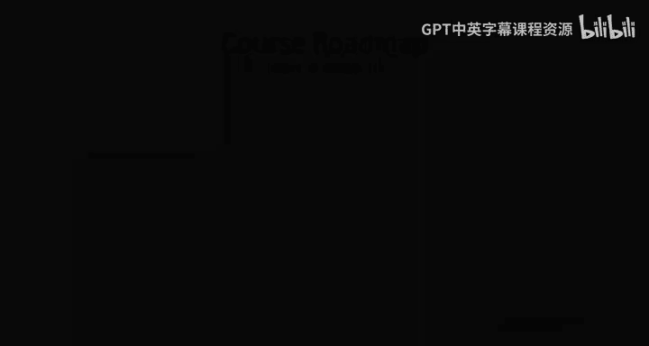
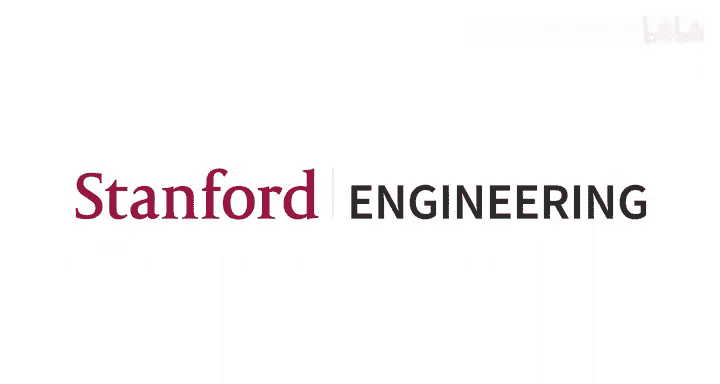

# 斯坦福大学《深度多任务与元学习｜Stanford CS330 Deep Multi-Task and Meta Learning 2022》中英（豆包翻译 - P9：-09-.Advanced Meta-Learning TopicsTask Construction l 2022 I Lecture 9.zh_en - GPT中英字幕课程资源 - BV1dWpPepEsj

Cool， so now the word the start of week five of the quarter figured to give a little bit of a road mapap。

So far we've seen multitss learning and transfer learning basics。

 and then we covered some of the core metal learning algorithms and last week we covered core unsupervised pretraining algorithms and really at this point we'll start to dive into slightly more advanced topics。

In particular this week we're going to focus on two different advanced me learning topics Today we're going to be talking about task construction and some challenges that can come up and also some opportunities for constructing tasks in different ways。

And on Wednesday， we'll be talking about large scale meta optimization and ways that you can。

Do things at a larger scale， basically。And then next week we'll be talking about some Bayesian me learning ideas。

 including actually a bit of a kind of crash course on variational inferences。

 which I think should be useful for at least either a refresher for some of you。

 but also for other people， something that's really useful to know about if you aren't familiar with it already。

Awesome， so today we're going to be talking about task construction and really the question of the day will be how should we define tasks for meta learning in order to get good performance？

And so this is going to cover both a problem that can arise in meta learning。

 which is often referred to as memorization， and it happens when tasks are constructed in a particular way。

And then we'll also talk about not just a problem， but also an interesting opportunity of trying to construct tasks from unlabeled data and augment the set of tasks that you have available。

The first part of the lecture will be covered in homework4， homework4 is optional。

 but if you do choose to do that then a lot of the stuff that we'll talk about in the first half of the lecture is quite relevant for that。

😊，And so the goals for the end of the lecture is to understand when memorization can happen in meta learning and also understand techniques for constructing tasks automatically。

Awesome， so first let's recap a little bit of what we've covered so far and in particular Ive mentioned trying to clarify some of the terminology so this is the terminology that we've been using in class where or in all the lectures where essentially the kind we have a set of tasks we have a set of mera tasks and a set of meta testing tasks and everything in the green boxes is on the left is a training data or a support set per task and everything in the red box is what we use to measure generalization and this is referred to often as the test set for that task or the query set for that task。

😊，And one thing that we noted was that you can sort of。

 we're actually using these like these test sets on the top during the meta training process。

 so we're sort of training on the test set， but' not we're still evaluating on something that is completely new。

 which is are these new heldout meta test tasks。Now one clarification and one point of confusion that came up is sometimes in the homeworks。

 we were referring to me training and metatest as sometimes being referred to as train and test。

 this is really confusing and ambiguous and so it's something that we'll try to fix in future iterations of the course。

To somewhat try to make it less into US in the homework。

 the train sets were referred to support and query。

 and so that was differentiating from the train and Tu。

 but it also already still somewhat confusing and hopefully this clarification helps resolve some confusion there。

Asome。And then。Beyond the setup， we've talked about black box metal learning。

 where the key idea is to parameterize a learner as a neural network。

And this network is the inner loop of the meta learning process it learns from a few examples。

 sometimes this learning process is also called in contextex learning。

 and you'll see that terminology used a lot in the NLP literature and also used in Home3。

And then when we actually go about training this neural network to learn from these examples。

 that's the meta learning process or the outer loop process。

The benefits of blackB Me learning is that it's very expressive。

 you can represent this inner loop can represent a wide range of learning procedures。

 but the downside is that it can be a challenging optimization problem。

 which you probably saw in homework one。😊，We've also covered optimization based metal learning that embeds gradient descent inside the me learning process。

 this incorporates the structure of optimization that we know and love。

 but it requires a second order optimization， and so in homework two you may have found that that second order optimization can make it slower a little bit harder to deal with。

And then lastly， we also talked about non parametric metal learning。

where you create an embedding of all of your examples and then do some form of nearest neighbors to compare the test example with your training examples and output the label that you think of the example that you think you're closest to。

嗯。Great， and so as you are hopefully seeing in Home2。

 this can be easier to optimize and computationally faster。

 but it is largely restricted to classification problems。😊，And then lastly。

 in terms of the task construction process。What we've seen in the first two homeworks is kind of Nway classification problem。

 but the same ideas can be applied to having different tasks correspond to different regions or corresponding to different robotics tasks。

And in kind of all of these settings， you need to construct a set of tasks using a significant amount of labeled data。

Great， so now let's talk a little bit about kind of the main topic of this lecture。

 which is memorization and unsupervised me learning。😊。

And so I'd like to start this off with a bit of a thought exercise for you。And in particular。

 this is kind of one picture of a black box metal learner that takes his input a training data set and a test input and gives you a predicted label for that test input。

And the thought exercise is。When you train this on a set of tasks， each task is indexed by I。

One thing you could consider doing is passing in the task index。

 a one hot identifier of the task index into your black box metalerer。

And my thought exercise first is when you pass in。Both the trained data set and the task identifier what would happen during meta training。

有。So the response was it might learn to associate the task identifier and the training data set and memorize it。

 what is it？So。的。Another？All of that stuff is really complicated。So point。Yeah。

 so the examples that show up in the training data set are pretty complicated。

 whereas this one hott vector is not very complicated。

 and so what it might do is it might learn to rely on the task identifier rather than using the training data。

And during budget trading， this probably。Isn't a problem。

 basically it might just learn to rely on this task identifier instead。

 basically the task identifier and the training data are redundant。

 they both encode information about the task。嗯。And then my next question is。

If it does start to rely on this task identifier， what would happen at metata test time if you pass in？

A new trading data and a task identifier for a new task。 And so this would be a one hot vector。

For one hot vector that's different than the one hot vectors that it saw during training。

 particularly during me training。有。Performance would probably be really terrible because it would try to rely on the task identifier again。

 but since it's a one hot representation it has no correspondence with any of the ones that' seen before Yeah。

 so the answer was。The performance would probably be pretty terrible because the OneHt vector for the new task is different from any of the oneHt vectors it saw before and because it's relying on that。

 it wouldn't be able to actually perform the new task。

So it in sum it won't generalize to the new task， so okay。

 this seems like kind of an initial thought exercise now。A second thought exercise。

 what if instead of giving it a one hot vector， what if we gave it a paragraph？

That describes what the。What it should do， like how to do the task or what the task is。

Does anyone have thoughts on what would happen？During meta training and perhaps also during meta testing。

是这对问题。Com on how。本证。It was going be more complicated。All。这くでよ。救会。还有个。Yeah。

 so the paragraph is going to be a lot more complicated than a one hott vector and what the network decides to use will depend on how complicated the paragraph is versus how complicated it is to discern the task from the training data。

It depends on basically whether it's easier for the neural network to use the description or to use the data。

And similarly， if in terms of generalization to new tasks。

 in some ways it depends on what it decides to use during meta traininging。

 and also the structure of that paragraph， it may be that it can actually generalize to the new task using the paragraph description if it has kind of learn sufficiently general representations of natural language text。

 but it could also be that maybe it sees a new word in the new paragraph for the task that it hasn't seen before。

 and it can't interpret what the goal of the task is。Okay。

 so these are two initial thought exercises and to start kind of getting you thinking a little bit now。

The key problem that arises in both of these thought exercises is that the model can minimize the Mediterranean loss without actually looking at。

The support set without actually looking at the training data for your task。

 And this means that it won't actually necessarily learn a learning procedure。

That relies on that training data。And so if we go back to how we've been constructing tasks for a few shot classification problems。

诶。Typically we'll do it something like this where for taskask one， we sample some images。

 we assign some labels kind of an arbitrary or random way。

 but we make sure that the labels are consistent between training and test or between support and query。

And likewise， for the second task， we'll again sample a new set of labels arbitrarily assigned。

Labels to images， and we'll do this for each of the tasks。

And one thing that you can note here is when we do this across different tasks， the piano class。

 for example， has a label of four for the first task， and it has a label of three for the third task。

And so this means that when we randomly assign class labels to image classes for each task。

The tasks are mutually exclusive。And what I mean by that is there doesn't exist a single neural network that can classify the images in task one and the images in class3。

Because you have a fundamentally different label being assigned to the same image class。

And as a result of the fact that the tasks are mutually exclusive。

 it means that in order to actually solve and be able to minimize the me loss。

They have to actually use the training data， they have to look at the assignment of labels to images in the training data in order to accurately make predictions on the test sets or the query sets。

Cool， everyone following。U。Now， the third thought exercise is。

 what if we assigned labels in a way that was consistent across tasks？And so in particular。

Say that we assigned the labels like this。What I mean by consistent is I mean that the image class of piano or the image class of this breed of dog is always going to be the same across all of the tasks。

And so。This means that the tasks are non mutually exclusive and a single function could solve all of the tasks。

And so then my question to you is。Is what would happen in this case？有。For new threat。可。Yeah。

 so just like the previous thought exercises。You would still memorize and you wouldn't actually learn how to learn because you can just learn a single function that classifies rather than relying on the support data。

有。Could it also be the case for your queryries？是个。In the support。

Would would that result in the problem？You're saying that you're asking。

 is it also a problem that for the query images you would have seen them in the support？

I so for different。So。一交。firstFor task one， it is in the core Re and then for past three is in。it。

 so the question is in some cases like the same images is in the query set for some tasks in the support set for other tasks。

 and also this class is appearing multiple times， that's actually not a problem and I would guess that for most of you the way that you implemented homework one。

 you may have actually had images appear sometimes in the support set and sometimes in the query set。

 you can get a little bit more out of your data if you have it appear have it be allowed to appearing in either the support set of the query set。

Cool， so in this case， the network can just learn to classify the inputs irrespective of the training set。

诶。And so in particular， what can happen is that when you train a black box metal learner。

 it can basically learn to just ignore this input and just classify based off of the X test based on the query example。

And likewise， even for an optimization based me learner。

 it could also learn to basically ignore this and primarily rely on just the initial network in order to make predictions。

It's a little bit more difficult in this case because it actually has to learn how to ignore the gradient descent step。

 but it can also figure out how to do that。有。There's also one other problem we are assigning multiple imagess like piano。

is same the same index。But this actually。Its my mis。And you know。

 I purpose to commemorize this story？Yeah， that's a great question。 So the question was。

One thing you may have noted here is that there are actually multiple meanings。

 like even though the labeling is consistent， there are multiple meanings for a given label。

For means both a carousel and a piano， for example。

 and so this does mean that the network does need to have enough capacity in order to be able to kind of lump those concepts together and we'll actually start to see some experiments and this may also start to hint towards some solutions to the problem。

Cool， so it can ignore things and actually if you run meta traininging on this exact example that I gave you and then evaluate it on examples from new classes。

 its ability to learn from a new data。😊，诶。The accuracy。Goes to around 7。

8% or 50% in these two different problems and this is for the mammal algorithm so it's even something that has to use a gradient descent step and so it's actually running fine and tuning at test time not it's just not giving you a very accurate。

Accurate model on these new classes， if you did evaluate on the classes it saw during training。

 it would be able to give you good accuracy because。Those are classes that it saw。Cool。

 so then there's this question of， okay。We're not shuffling the labels and when we don't shuffle the labels。

 this is a big problem， our performance really plummets。But is this actually a problem in practice？

And for image classification， we can just shuffle the labels。It's。

And something that we can do is also very easy to do。

 and so it's not really a problem for image classification problems。Like I mentioned。

 is also not a problem if you see the same image classes。As what you saw during me。

But it is actually going to be a problem in some cases。

 if you want to be able to adapt with data for new tasks， and if you aren't looking at problems。

 exactly like some of the few shot classification problems that we saw before and that we've seen in the homeworks。

So let's look at a few examples where this may actually be a problem。so嗯。

This first example is a robotics task， so say we want different tasks are going to correspond to manipulating objects in different ways。

 so one task might be to close the drawer， another task might be to pick up the hammer and hit a nail。

 another task might be to stack these two blocks。This seems like a very natural task distribution for a me learning system。

And maybe kind of the new task， the metat task is to close the box。Now。

 this is a case where this can be a problem， it can be a problem in a couple different scenarios。

One is that if you're doing this from image observations。诶。

The system can just look at the initial image。See what's in the initial image。

 If it sees that there is an open drawer in the initial image， then the task is to close the drawer。

Or if it sees that there is a hammer in front of a nail， then the toss must be to hammer the nail。

And so that's one scenario where。It doesn't actually have to me learnn in order to minimize the mera loss。

Another scenario is maybe we aren't in an image based setting， maybe kind of just get some waypoints。

 or maybe the initial image is somewhat ambiguous。We might be in a scenario where maybe we want to tell it like give it a language description of what the task is。

 like close the drawer or hammer the hammer。In those cases， if you also give it a task description。

 which should be helpful we giving it more information。

 that will also make it much harder to generalize to a new task。So this is one example。嗯。

One more example， let's consider a pose prediction task。

 so say you want to predict the orientation of an object in an image。嗯。

And so maybe your Mediterranean tasks， you're predicting the orientation of a couch。

 in other case you're predicting the orientation of。

 I think this is a very old monitor or television。And then at meta test time。

 you want to be able to predict the orientation of a chair。

This is also a case where you can kind of look at the image and you don't actually need the meta training data in order to be able to predict the orientation。

 but if you give it a new object， it may be ambiguous what the canonical orientation of that object is。

And because of that ambiguity， it actually， you do want it to actually look at the me training set。

 or sorry， the support set or the training set for that test task in order to actually figure out what the canonical orientation is and how to predict the orientation of the object。

So this is another example where memorization can occur。

 and in this case it would memorize the canonical orientations of the objects seen during meta training and it would no longer it wouldn't be able to figure out what the canonical orientation of the new objects are because it didn't actually learn to pay attention to the support set。

So do people agree that this is a problem？过 ok。More or less。嗯。

Now there's a question of whether we can actually do something about this。

And so to think about whether we can do something about it。

 let's try to formalize the problem a little bit more。

And in particular we saw that if the tasks are mutually exclusive。

 then a single function cannot solve all of the tasks， and this could be due to label shuffling。

 it could be due to hiding information and in this setting，啲诶。

The medlinging process will not memorize and you should be able to generalize to new tasks。

On the flip side， if the tasks are not mutually exclusive。

That a single function can solve all the tasks， and it can just it can just。Ignore the training data。

And in this latter case， memorization can occur， and the reason why memorization can occur is that there's actually multiple solutions to the meta learning problem。

There's multiple ways to minimize the Mediterranean loss function。And in particular。

If we view the meta learning process as taking as input。

 the training data and the test input and relying on our meta parametersa theta。

One solution to the Po example would be to memorize the canonical pose information in your meta parametersas and ignore the support set。

And then another solution， which is one that we would often want， if we want to generalize。

 is to carry no information about canonical pose information in theta and instead try to acquire it from。

The task training center。And so here are two solutions and in general。

 there's actually going to be an entire spectrum of solutions where you could。

 based on how the information flows， so you could store some information in theta and acquire some information from the support set。

 and likewise and basically there's kind of a spectrum of solutions in between these two extremes。

 although in practice you'll probably get either one of these two extremes。有。

When you're doing the training， we' get a fix of validation set。

 which has like some objects which are not seen and when you're using the hyperparmeters。

or under solution part because。Yeah， so the question is if we have kind of a meta validation set or a set of validation tasks。

诶。We should be able to tell if our model is generalizing to new tasks， and as a result。

 maybe we can tune the hyperparameters in some way in order to actually encourage it to generalize better。

In general。Absolutely you'll see that it won't generalize to validation tasks。

 the tricky part is how do you tune the hyperparameters in order to actually get it to generalize versus not generalize。

And so the you can diagnose the sort problem with held out validation tasks。

 but you you can't necessarily solve it， you can maybe try to tweak the learning rate in some way to try to kind of。

T to get it to do the right thing， but in general it's tricky to do it purely based on learning rate or purely based off of the size of the architecture。

Was it or something？So the question was， if you kind of pass this into a hyperparameter optimizer。

 wouldn't be able to fix this problem， and it really depends on the hyperparameters that you expose to the model。

And in particular， we're going to need some form of regularization to encourage this to not happen。

 I guess the other thing that I'll mention is in general。

In general I see this solution happen more than this solution and the and I think that that's because acquiring information from Dtrainin can be an imperfect process。

 you actually have to acquire it from a more complex object and as a result，Oftentimes。

 you can actually get a slightly lower Mediterranean error with this solution than with this solution。

Cool。If we view it as if we view this kind of from the standpoint of how the information is flowing。

We might be able to think about trying to control that information flow。And in particular。

 we think of。The Mediterranean process as。Something like this。And the。

There's like a number different there's basically three objects that you can use to get a prediction。

 there's information in theta， information in Dtrain and information in X test。And。

We're primarily going to focus on the first two information and theta and information in detrain。And。

When we think about how detrain and theta。Affect the corresponding prediction。

We can try to think about basically encouraging it to use this。

This information more so than using the information from theta。No。

One thing that would be nice to do is if we could。Try to maximize the information。

 the mutual information between the。Support set and the prediction。

If we could maximize that mutual information， I think that that would give us exactly what we want because the。

Because then we'd be encouraging it to use information from Dtrainin。

And this wouldn't in any way be competing with。Optimizing the mera loss。But unfortunately。

 optimizing mutual information， like actually estimating this and optimizing it is pretty difficult。

And then so instead。What we're going to try to do is。

Try to minimize the information coming from theta。And that's something that's easier to do。

 of course， if we only minimize the information coming from theta。😡。

That we won't be able to do things well。I what you mean by maximizing information between this？Yeah。

 so the question is， can I clarify what I mean between maximizing the mutual information between the support set and the query set prediction？

I guess I mean that in the kind of mathematical sense。

 so if you view these as two different random variables。

 then you can define the mutual information between。

Two variables like A and B as I guess there's a number of different ways to define it。

 but like one way to define it is in terms of like the entropy of two different variables。

 another way to define it is the。Kale divergence between the。The joint distribution and the。

The joint distribution and kind of the product of the marginals。And basically。

 mutual information is going to be telling you。How interrelated are these two random variables？And。啲。

If they're completely independent， then they have zero mutual information。诶。

And by actually trying to maximize that mutual information。

 it means that we want why to actually change when detrain changes。

And so if we're able to maximize that quantity， that means that when we change Dtrain。

 why we'll actually change， and that means that it will actually rely on detrain rather than completely ignoring it。

Yeah keep that kind of like the out of baby permissioning for the task。

Any time to kind to fight you with those need does it。Sorry。

 can you I missed like one word in the first part is theta。So in the initial letters， we have a no。

Bing which has the really information about shared tasks。

And then we will try to find you with traininging data。Yeah。

 so you can think of data as the shared information。

 although in this case I'm actually just referring to it as the metaparameters。

 like the parameters that you're optimizing during the meta training process。But yeah。

 when you think of it as a random variable， sometimes it can be helpful to think of it also in terms of the kind of the shared structure。

 but here really I'm referring to it as the。As the Mediterranean parameters。qu嗯。

So it'd be awesome if we can maximize the mutual information because then we'd be telling it to rely on detrain to basically make different predictions for different de train。

Unfortunately， it's difficult to optimize that quantity。 And so instead， what we can try to do is to。

Minimize information coming from theta。And of course。

 we can't only minimize information coming from theta。Because if we did that， then。

We wouldn't store any information in the at all， and we then wouldn't be able to do very well。

 we'd just basically be learning from scratch in that case。And so instead。

 what we're going to do is we're going to try to minimize。

The information and theta and also minimize the me loss。

And we'll need to balance those two terms such that。

Such that we're getting kind of a Mediterranean loss that we're happy with。

 while also trying to minimize the information and theta as much as we can。Now。

The way that we actually go about doing this relies on kind of。

Some knowledge of what's called an information bottleneck and we'll actually be covering information bottlenecks on Monday next week。

So I don't want to go too much into it right now， but the intuition behind what we'll be doing is。

We're essentially just going to be adding noise to theta。And。When you add noise to theta。

 you're removing information。From what's in theta， you're increasing the entropy of that random variable。

And so by doing so by basically trying to minimize training loss under minimize meta training loss under a noisy version of data。

 that means that you're going to be trying to basically telling it to be able to do meta traininging with less information in theta as compared to previously。

And so this kind of specific equation for what this will look like is you have your Mediterranean loss function that I've just written out as L here。

The way that you write out a typical information bottleneck is the kL divergence between your distribution over theta and some prior distribution。

 which is just a。whichch is just just kind of a standard Gaussian distribution。

 and the reason why this corresponds to adding noise is Q is going to be a Gaussian distribution with a mean of theta and a variance of kind of a diagonal。

😊，Vance and so Gaussian distribution basically is a sample from that Gausian distribution。

 it corresponds to adding noise to the mean of the Gausian distribution。

 and hence what you can think about it as adding noise to the variable。

And so essentially what this is going to do is it's going to try to place precedentnce on using information from。

The support set over using information from theta because using information from theta is now going to be harder because now you have to use information from theta after noise has been added to theta。

And you resample the noise every time you use the metaparameters data。

Yeah one you dont contain the share structure within the task or not the task render。

But good awesome。also still calculateulate。还是。We was switch it predict or does sort different from。

そう。Except for your sofa example， you can actually try to create the label so far from the because when you're generating it us。

 we know which the object coming from right， so。You can always standard price to。

You make information。It's an interesting idea。Here we're just kind of blindly trying to add noise and reduce information from theta。

 maybe we could try to do it in a slightly more targeted way by trying to kind of explicitly say you shouldn't be able to predict the memorized information from theta you were suggesting that you shouldn't be able to predict kind of the task。

 the task identifier which wouldn't quite work， the tricky part is that in the pose example。

 the memized information basically corresponds to the canonical orientation of each of the mera objects and it has it for all the objects。

And it's， well， I don't see any way to try to hit that information in a targeted way。

 but we could also discuss it and if any good ideas come out of it。

 then it could be interesting to explore。Yeah。As your support set for the metachometers？

And then try to predict that as had fire。For that and that would restrict Europe。

Information about the tax conversion in the broker。

So you're saying that are you saying to erase this arrow and have an arrow from here to here。

 or are you saying to add an arrow from detrain to theta？And then。

Just trying to throw one possible in of what my objectvic set was。To take us we are sport。エラポンさん。

Programtrometers and then go back two patients， learn a neural le that we try to predict。

It's Oscar going Denifier。I'm back for for Street Europe。Stor information about tests。Yeah。

 so you could try to have something like on top of the activations that basically has it such that it can't predict the task identifier from that。

 the tricky part is you don't want to restrict information from Dtrain in any way。

 you only want to restrict it from data and not from Dtrain。

 but maybe we can also discuss it a little bit more after class。Cool， now this lot。

 this regularizer that adds noise to weights， it's actually used in other parts of deep learning。

 it's often referred to as kind of ba by blackck prop where you're basically imposing a Gaussian distribution on the weights of a neural network。

And。Once you define this regularizer， which is basically just adding noise to the weights。

 you can really combine it with your favorite metal learning algorithm and it's applicable to any of the algorithms that we've talked about in this class。

Cool， so how well does this work， so I mentioned that this sort of regular is actually it's been used in kind of standard deep learning。

 it hasn't actually been that successful in standard deep learning and usually you can get kind of a few percentage improvement。

嗯。But if we look at the metal learning settings， it actually tends to have a more drastic effect。

So for example， if you take the OmnigGlot data set which you've been working with in your homework。

And you remove the label shuffling such that the labels are consistent across tasks。

 we refer to this as non mutually exclusive omnilot。

The original mammal algorithm in this case will get very low performance。😊。

There's another work that proposed a form of regularization that may actually be somewhat similar to what was suggested。

 but it also doesn't work very well， whereas if you do this approach of adding noise to the weights。

You're actually able to recover a lot of the performance in comparison to using label shuffling。

And similarly on the post prediction task， which is more interesting than the omnigat task it's harder to just shuffle the labels。

 if you look at the mean squared error between the predicted orientation and the correct orientation。

 we see that we can get a much lower mean squared error。

When incorporating this kind of form of metaregularization。

And you see an improvement both with the mamal algorithm。

 as well as an algorithm called conditional neural processes。

 which are a form of a black box metal learner。Yeah。ち。Was if we subsequently， this often like。

That's random moves to all of the week。やこ。How it's compared to just like essentially keeping？

The earlier layers of the network fixed but then distributed Schch the last layer。

Like setting you have to completely around the noise so that you can't really like。

So it's like out of the world。Train like the final prediction task。

But it still like learns the picture so it's kind of like the of that in that sense Yeah so the question is how would so this is adding noise to all the weights。

 how would this compare to kind of mera the earlier layers as normal but then like always reinitializing the last layer and you' would also do that during me training right and then fully train the last layer in the inner loop yeah so。

I think that something like that would。嗯。O the top of my head I think that something like that would work in general。

 things like protypical networks actually often don't suffer from this memorization problem because you're forcing it to do nearest neighbors。

 it has to use that learning algorithm and it's much more difficult to kind of memorize how to map from inputs to labels。

 when you literally have to do these sorts of nearest neighbor comparisons and so given the relation to things like protypical networks。

 I would expect that to work especially for classification。

 I might have to think about it a little bit more for regression but I suspect that something like that might work because。

Because you're forcing it to。To learn part of the network from scratch。In the inner loopbe。

 but I may also need to think about it more to yeah。走。

What's the intuition I guess between adding noise versus something like dropout I guess I guess Yeah so the question is what's the difference between adding noise versus something like dropout so the in this paper we actually looked at adding noise to the weights and also adding noise to the activations and something like dropout's going to be a lot more similar to adding noise to the activations and we found that。

We found that adding noise to the activations actually worked in some cases but didn't work well in all cases。

 and so the reason why there's a W here is it kind of refers to adding noise to the weights versus adding noise to the activations and so you can see the activations results in the paper。

诶。啲。Part of the challenge with adding noise to the activations or doing something like dropout is。

It can still， I guess it depends on like which。Which layer you add noise to。Essentially。

 say you have a neural network。That is making predictions about a corresponding input。嗯。

SoAnd then say you kind of decide to like， I don't know。

 try to add noise here or maybe you can even just add noise and let's okay。

 still see add noise right here。You're basically just trying to minimize and have less information here。

But what the network can do is。Especially for classification tasks。

 the amount of information in a label is very small。If you're doing like 10 way classification。

 then it's just log 10。And so if you're trying to minimize information in the activations。

It can actually minimize information just by basically stuffing the label here， and that's very。

 very little information that it needs to store， and that's actually less information than what it needs to memorize。

I don't know if that was the most clear explanation， but basically。

It's kind of the place where it's memorizing is really in the weights of the neural network and not in the activations of the neural network。

But the short answer is it works a lot better on the weights than the activations。Cool。Yeah。

 I guess we don't have dropout in these comparisons。

 but you could also just try applying things like weight decay or a version of Bay biBck crop。

 and we see that it works much better。It works but better with the kind of regularization that we've talked about。

Cool， now one thing that I'd like to briefly mention for people who are more theoretically inclined and want to dig a little bit deeper into this is。

This form of regularizer， you could ask like we've seen in practice。

 it really improves generalization a lot， but does it？

Actually do so kind of in a more provable sense， and there's a way to kind of basically derive a generalization bound。

For this approach， it looks rather complicated， something like this。

But basically what this amounts to is we're trying to bound the generalization error or basically how well will this meta algorithm generalize to new metat tasks。

 so that's the left hand side， the right hand side is a bound on the error。

 and so this corresponds to the error on the meta trainingin set。Plus， the generalization gap。

And this term in the generalization gap is exactly the metaregization that we're applying when we add noise to the weights。

So really the gist of this is that。You can actually theoretically show that you can bound the generalization error and actually improve generalization。

 or at least you're bound on the generalization by using this form of regularization。Cool。

 so to summarize the memorization problem， we talked about this。😊。

basically this form of overfitting and mental learning where you're memorizing a mapping from X to Y。

 you're memorizing a function。And basically you're memorizing， yeah。

 the x to Y function rather than actually using the training data rather than learning to learn。嗯。

And this is analogous to standard overfitting and supervised learning where you instead of memorizing functions。

 you're memorizing individual training data points。And similarly。

 you can sort of think of kind of metaregization as also being analogous to standard regularization and supervised learning。

嗯。Although in supervised Learner， you're kind of regularizing the hypothesis class。

 you can also think of this as regularizing the hypothesis class of the meta learner。

And this has a particular interpretation of controlling information flow。

 and you can view kind of the specific metareization that we talked about as trying to minimize the description length of the meta parametersas。

😊，And so these are also somewhat analogous， although like I briefly mentioned before。

 we actually see a much more drastic improvement from applying this regulargization in some metal learning problems in comparison to kind of standard regularization in deep learning。

Any questions on memorization？That's a great question。 Do I want to go into that。

 I guess I put it on the slide。So。Description length is。Maybe I shouldn't have put it on the slide。

I think I'd rather not go into it now but happy to talk about it in office hours and if you're interested in learning more you can read up on the MDL principle。

 which is the minimum description length principle and comogoal complexity and I guess the gist of it is it's thinkingy about the length of the program that it takes in order to express a。

A function， the length of the minimum program。Yeah，Is that essentially just the amount of。第二。Yeah。

 basically it's a measure of information。Co。Okay， so we've talked about a problem that comes up if you construct tasks in a certain way。

 and I'd encourage you to， for those of you that are doing projects along the lines of Fu shot me learning。

 I'd encourage yourself to kind of。Ask yourself project。

 if this sort of issue might come up in your project。And if so。

 you can maybe consider revising your project or think about the regularization techniques that we've talked about or possibly develop a new regularization technique。

Cool， and then the second part of this lecture， I' like to talk a little bit about。TaskWell。

 another form of task construction， which is unsupervised task construction。嗯。

And earlier in this lecture， we revisited a few different examples of classification。

 imitation learning。And Land cover classification。And these are all scenarios where we assume that we have labeled data from lots of different tasks。

And there might be scenarios where we only have unlabeled data。

 or maybe we have a mix of unlabeled data and labelbeled data。

Last week we talked about a class of approaches that can handle the setting where we only have labeled data during pre tradinging。

 and we did this with different unsupervised pre tradinging algorithms like contrastive learning and like vast autoencors and we pretde a representation and then fine tuned something on top of that representation。

And today we're going to talk about algorithms that actually end up looking very similar to those previous algorithms。

 except instead of just running fine tuning on top of their representation。

 we're actually going to be doing explicit me learning and doing the same kind of fu shot learning that we've seen in algorithms like black box metal learning and nonparmetric methods and so forth。

And the。The general recipe for。This algorithm is going to be something like we are given an unlabeled data set。

Then we will propose tasks from that data set。And then run metal learning。

On the tasks that we proposed。And this is going to look a lot like the recipe that we saw for contrastive learning as well。

 where we are basically constructing tasks using different augmentation functions。😊。

Of course the key step here is this middle step， it's easy to get， well。

 given unlabeled is data is just a given， running by alerting is what we've already talked about over the past few weeks。

So the big question is how do we propose tasks？and。Yeah。

 our goal will be to try to automatically construct tasks from unlabeled data。

Now I'm curious if anyone has thoughts on if you were to try to kind of set up some desideorrata for a set of tasks。

Do you have thoughts on what you would want generally that task set to look like？这。今啲。hands on the这个。

But。我的听。He some more prosecutor。Similar instances should be。Like the same class。

 And then I would like to have a。Like set off。た有有。Yeah。

 so for it's going to depend a bit on the data definitely。

 and also it's going to depend a bit on the tasks， so if at meta a test time you expect to be doing a 10 way classification task。

 then the task you construct during this process will be different than if you think you're going to be doing like1000 way classification。

And so you want to construct things that look similar to what you are going to see at meta test time。

 you could also imagine doing something similar to contrasted learning。Yep。Can how you gaming me。

I the clusters， so like they should be prominent enough in the data set to be like。

To individually be classified as a cluster and the difference between those clusters or not。

Did you look at the next slide？later League。YeahYeah， to repeat the。I guess the。Maybe to summarize。

 maybe we want the tolas to be something like kind of like what you get from Cap means to be somewhat distinct from each other。

 while also being somewhat diverse， I guess。So yeah。

 what I put on the slide is I think that we really want two key criteria。

 one is that we want the task to be pretty diverse。

And the reason why we want this is that we want them to be able to cover the test house that we are likely to see。

During meta test time and of course， if you know information about what you're going to see about meta test time like if it's 10 way versus 1000 way。

 you can incorporate that and actually make it less diverse to make it more similar to that and then the second thing you want is you want it to have some structure so if you propose completely random tasks。

Then your metal learner won't actually be able to learn those tasks with a few examples。

 and this maybe gets a little bit at the Ka means's comment a little bit， which is that。

If you cluster data， kind of intuitively what that's doing is it kind of finding the structure underlying the data。

 and we can try to leverage that structure when。During the kind of meta learning process。Yeah。

Is there way to formally defined covering the test tasks？

It's easy to define in if you can represent the task distribution in a parametric manner。🤢。

If there is kind of some yeah parameter underlying the task distribution。

 then you can kind of say is this in the support of the distribution。

 if the tasks are not possible to describe in a parametric manner if they're kind of more nonparametric。

 like one task is to like pick up a shoe and another task is to push a chair。

 like maybe you can parameterize the shape of the chair and the shape of the shoe。

 but in general that's something that's much harder to characterize。Cool。

 so we'll talk about how we might try to。Recover diverse and structured tasks。

 both for image data and text data。This is really the main overview slide and then on the next few slides we'll basically just go through a few examples for how and walk through examples for constructing tasks that maybe look like this and also how these algorithms are used in practice。

So the first example will actually be using something a lot like Kaian's clustering。

And in particular， we're going to be doing this with images， and if you just have image observations。

It's hard to run clustering on raw pixels。And so what we'll first do is run unsupervised learning in order to get some embedding space。

 a lower dimensional embedding space。And once we have this lower dimensional embedding space。

 it's going to be much easier to construct tasks。And in particular。

 if we want to construct a classification task， then we can。

Find different clusters in this embedding space and define a task as discriminating between examples from those clusters。

So for example， one task， one three way classification task would be to be able to classify between purple examples。

 green examples， and orange examples。And another task might be to classify between like the red dash cluster and the yellow dash cluster。

And。By running clustering to get these tasks， we're going to get parts of the space that have a little bit more structure in contrast if we just randomly kind of sliced like hyperplanes like decision boundaries through this space。

 then we may end up kind of getting much less structure because you may get kind of two examples that are very close together。

 but they'll actually have different label。And in particular。

 to propose a task once we have this embedding space。We first sample。

If we want to do a two way classification task， we sample two clusters。

 so like the red cluster and the blue cluster。We sample two images from those two clusters。

So the blue image and the red image。And then that will give us a support set for that task。

 and then to get a query set， we then sample two additional examples from each of those clusters and get a corresponding。

AQuery set for that task。And then once we go and try to sample another task。

 we can simply sample another set of clusters like the purple cluster and the green cluster。

And then if we wanted to sample- these are two way classification tasks。

 if we wanted to do an Nway classification task， then we can sample N clusters and discriminate between examples from those N clusters。

And you could note that these。These tasks don't correspond to exactly categorizing different like typical image categories。

 but they still have a lot of structure to them， for example。

 the first task corresponds to classifying if something is like a circular shape versus if you have a pair of objects and the second is maybe classifying wine bottles or bottles of beverages and。

And something that also has a particular kind of shape。Cool。

 and then once we have defined these tasks， we just run meta learning on those tasks。

So this is one way to get tasks that are fairly diverse and are fairly structured。诶。

And the result of this process should be a representation or a meear model that is particularly well suited for downstream view shot classification tasks。

And it should be something that's actually better than the initial representation that we used in step one。

And the reason for that is we're explicitly going to be optimizing for few shot generalization in these examples and kind of fewshot classification depending on whatever form of N classification we set up in Step2。

And so there's a few different ways to actually instantiate the different steps here。

 So the first step we could use some unsupervised learning methods。 This paper is a couple years old。

 so it's going to use。Some superupvised learning methods that are a couple years old。

 but you can also plug in something more recent as well。

Clustering to automatically construct tasks for unsupervised me learning or cactus。

And then you can combine this with a metal learning algorithm that operates on those tasks like mammal or prototypical networks。

And then we can look at some of the results， so we looked at。

Using this approach to construct tasks in combination with both mammal and prototypical networks。

 and so if you combine cactus with Mammal， this is the result that you get。

And we evaluated it on Mini ImageNe， which if you give full labels， you get an accuracy of 62%。

If you just do， I guess you can't。First evaluate a few different unsupervised baselines。

 which just corresponded to doing Can neighbors logistic regression or an MLP on top of the pre-trained representation。

 and you get fu shot accuracy that's pretty low in around 30%。

You can also do something that uses clustering。And in contrast， if you actually。

Run this approach to construct the tasks and do meta learning on top of those tasks。

 you get an accuracy that's much higher around 51%。

And if you use a representation that's a bit better， the deep cluster representation。

 you actually do even better than that。Yes。So where we just send out。cost。好不。

Coluster A happens correspond with this label the side。Oh。

 are you specifically referring to this method right here？もう？

Ba all four of these methods correspond to different ways of using the unsupervised representation on its own。

And basically using different kinds of， yeah， like classifiers or something on top of that。Yeah。

So are they labels at de time， not de time？Oh awesome question yeah are there labels at metat time yes。

 so in this case there are 25 labeled examples at metatatest time。

 so the meta training set is completely unlabeled and then at metatatest time。

 you run it the same exact way as kind of normal labeled meta training time where you are given a very small training data set in this case of like 25 examples。

 five examples of five different classes。Your boer。と住。Yeah， so basically at Mediterranean time。

 we are kind of creating our own labels， me on that， and then at meta test time。

 we're using real labels。有。view this process as first。

 you have the unsupervised projection to a low dimensional space。 and then each。

Learning a distortion of that space that moves some images closer together and other images farther away。

And then if so， can you characterize the kinds of distortions that can be learned via this process。

 like there's a kind of a family of allowable transformations， right？Yeah。

 so you can definitely view this as like distorting the space in different ways and then learning like。

Learning to classify for those different distortions。

 you're asking are there ways to kind of characterize the kinds of distortions that could be represented？

第二个。My question is， it seems like the。Adopptability。

 this depends a lot on the initial unsupervised clustering。

You really just transferred a lot of the burden。And if it produces clusters that don't correspond to all of your matter。

And so then it seems like it's limited by like， well。

 how much can you distort or change the space after this？Yeah， absolutely。

 so it's going to rely a lot on the initial clustering and I guess I should clarify that we in this method you cluster more than once and you could。

If I remember correctly the before clustering more than like each time we scaled and I think we like kind of applied some kind of random scaling to the。

To the embedding and that was one way to distort it you could also imagine fancier ways to distort the space as well。

 you could also run it like you could also have multiple pretrain representations and presumably they'll have different things that they pick up on or different high level features and that may give you even more diverse tasks and so this really connects to like the diversity of tasks that you get and I suspect that there's。

In general， it seems like it's actually able to learn pretty diverse tasks that seem to cover things pretty well。

 especially given that the gap here is only like a 9% gap between supervised。

 but there's probably also a lot of room for improvement。

And these were results with mammal and mini imaged at55 shot。

 but it also you kind of see a similar trend with different embedding methods with different data sets。

 and also with protypical networks， protypical networks did underperform in some cases。

 but in general they're both able to do pretty well。😊，Cool。

 so that was one way to construct tasks and coming back to some of what we saw with contrastive learning。

 you can also construct tasks in a very similar way to what we saw with contrastive learning。

For image data in particular， we know that an image label won't change if you apply certain transformations。

 like if you drop out some of the pixels or translate the image a little bit or reflect the image。

 and so if you take omnilot and you apply a transform like this or if you kind of flip it minini- imagenet image。

 the kind of the underlying categorization of the image won't change。

And so we can use this to construct tasks so we can construct tasks in the same exact way as what we saw in contrastive learning。

 where we first randomly sample some images， assign a label to those images。

And then for each of those images， we also augment those images in some way and then assign the same label to those。

And then the first image set becomes our support set， and the second becomes our query set。

And you could also augment in a different way for your support set as well。

 if you didn't want to use the original images。诶。And so in practice。

 you can use whatever you know about the image domain。 So for Omniglat。

 you would use something like translation and pixel dropout。

 you wouldn't want to flip the image because that may actually flip the。

Plip the category label of that character。Whereas for mini I you would probably do things like flipping。

 and so these auto augment here， which corresponds to a number of different transformations。And。

If you use this approach to her task construction， it gets really strong omniglot performance。

In particular， the performance is kind of in the 80s to '90s on omniglot in many cases。

 and in the five shot setting this actually gets pretty close to a fully supervised baseline on omniglot。

 and this makes sense because we know a lot about the structure of omniglot images。

We have a lot of domain knowledge about that。Whereas for many images it ends up doing somewhat similarly to the clustering approach that we talked about before。

😊，And in some cases， it's kind of slightly underperforms that approach， and that also makes sense。

 we have， I think， a little bit less domain knowledge about。

About the kind of transformations that will affect。Natural images。

CoSo those were a couple examples with images and with how to construct tasks that when you have unlabeled images。

You can also apply the same recipe with text as well with a different task construction technique。

One option which we've seen before is to formulate a language modeling problem where the support set is a sequence of characters and the query set is the following sequence of characters。

We've seen this kind of example where the inner loop of the meta learning process kind of goes through each of these examples。

 you might have these examples as your support set and these examples as your query set。

And you have different tasks like translating between languages， math problems。

 or spelling correction。So this is an example， a way to construct Mediterranean tasks with just purely unlabeled text。

But we might not want to use this option in all cases， for example。

 it may be hard to combine with optimization based metal learning。

 and it's also not necessarily the best suited for kind of simple binary classification tasks。

The second option which we。Is basically the kind of other form of generative pre training we talked about is to use mask language modeling。

And the tasks here will just correspond to askinging different words。

And concretely the way that you can do this is。For a given task。Sample a set of unique words。

 of n unique words， and assign each of those words a unique ID。So for example。

 you could sample the word democratic and the word capital。And assign an idea of one to Democratic。

 an idea of two to capital。And then you can sample。Sentences with one of those two words。

And mask out the word。And then the task is to classify。Which word was mask out？

And so this is going to give you an N classification problem if you sample n wordss because it'll be basically be given like for these n wordss。

 which of those words corresponds to the masked out word？😊。

And this allows you to construct kind of text classification problems without actually having access to any。

Labeled text data。And so kind of concretely for the Democratic and capital example。

We can have a support set that looks like this where M corresponds to the masked out word。

 the sentence corresponds to the input， the class corresponds to the label。

And we have two examples from class one and two examples from class two。

And then the query will correspond to a new sentence that also has a word masked out。

 and you need to be able to predict whether or not the label is one or two。

 or basically whether or not the word is democratic or capital。Cool， so with this kind of approach。

 you can apply it either in a fully unsupervised way or you could actually。

 and really with the other approaches too， you can combine it with some supervised tasks if you have some tasks available。

And so here are some kind of what the results look like if you either apply it in a fully unsupervised way。

Or everything on kind of the right hand side of the table is if you is kind of a more semi supervised or supervised approach。

Bert corresponds to kind of what we talked about last week with Standard self Supervised learning。

 SMLMT is the proposed unsupervised approach。😊，诶。MultTask BerRT corresponds to multitask learning and fine tuning on the supervised tasks。

There's also an optimization based me learner that's applied only to the supervised tasks as well as a hybrid method that does me learningar on the proposed tasks and the supervised tasks。

 so this is more of like a semiupvised me learning approach。

And what we see is the by incorporating these tasks generated from the unlabeled data。

 it's able to do significantly better than only using the label data and also only using the label data both for。

Does multitask learning and also for meta learning。And also we see that the。

For each of these different text classification problems， in many cases this is able to。

Or in some cases， this is able to outperform like a burn based pre tradingding。Cool。

 this is already a lot of results， but if you want more results。

 there's kind of more in the paper that's linked。Cool， so。In the second part of this lecture。

 we talked about kind of this form of unsupervised pre training， it endeds up looking a lot like。

The unsupervised pre training that we talked about last week where we saw mass language modeling。

 we saw autoaggressive language modeling， we saw generating tasks from augmentations。

It has this kind of recipe of given an unlabeled data set。

 proposed tasks with these different techniques and then run metal learning on it。

 and really the key difference between these methods and the ones that we saw last week is that we're actually going to be explicitly running。

Meedal learning and using kind of the meal learner to perform few shot learning rather than just doing kind of fine tuning this on top of some pretrained representation。

And we also covered a few different ways to propose tasks that have been suggested in prior work。

 which includes classifying between augmented images and different image instances and like classifying a masked word。

嗯。Cool， any questions on yeah？送完。We favorized a little bit shorts。说。

And I would not like the always figuring out which school verdict takes。哦，怎门这该是过去。you in another bit。

Given enough test task data or given enough data on the metaT task。嗯。Yeah。

 so the question is if you have enough metatest data would kind of the unsupervised pretraining methods that fine tune in their representation start to outperform what we've talked about and yeah the answer is yes。

 so these kind of approaches are really going to shine if you're in a few shot regime at metat time because they're explicitly optimizing for F shot learning and the settings in which unsupervised pre-training are going to do well are settings where you have a bit more data of your target task because you're not actually you don't need to explicitly optimize for few shott learning you can simply fine tune with a reasonable starting point。

this method is that actually in the few shorts， we don't have ma rainel。

I do I sentence this with a mask。Because on lifting also。Yeah， this is a great question。

 so all of these tasks its a good observation。All of these tasks。Like you see this M token。

 this math token in the sentences and at test time you often won't have math tokens。

 and so I think that's part of the reason why this is particularly well suited as a semisupervised approach more so than an unsupervised approach。

 if you really kind of go through these numbers carefully， it'd be nice if there was like a bar plot。

 but if you go see them quickly or more thoroughly you'll see that the semisupervised approach is more performant。

 and I suspect that this is because there's a bit more of a distribution shift between the unlabeled tasks and the labeled tasks。

Yeah， so there's one task where unsupervisedes actually。

Better than all of the approaches that use label data， I'm not sure exactly why that's the case。

 I'd have to kind of look at the paper a little bit more closely， but yeah。

 it's kind of an interesting finding。Awesome， cool， so that's it for today。

