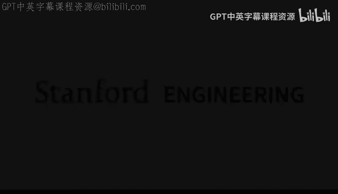
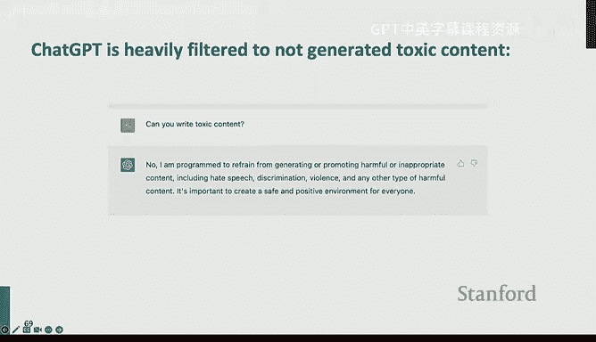
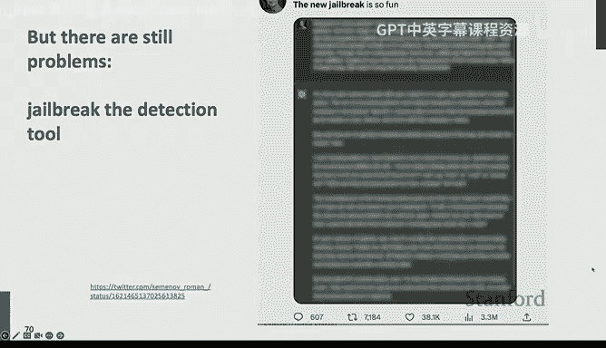

# 斯坦福大学《深度学习自然语言处理｜Stanford CS224N NLP with Deep Learning 2024》中英字幕（deepseek-R1 - P10：-10-2023 _ Lecture 11 - Natural Language Generation.zh_en - GPT中英字幕课程资源 - BV1U5RNYgEfp

Hello everyone。 My name is Lisa。 I'm a third year PC student in the NL P Group。

 I'm advised by Percy and Tatsu。 Today I will give a lecture on natural language generation。

 and this is also the research area that I work on。

 so I'm super excited about it and I'm happy to answer any questions both during the lecture and after class about natural language generation。

 So NLG is a super exciting area and is also moving really， really fast。

 So today we will discuss all the excitement of NLG。😊。

But before we get into the really exciting part， I have to make some announcements。 So first。

 it is very， very important for you to remember to sign up for AWS by midnight today。

 So this will concern this is related to your homework 5。

 whether you have GPU access and then also related to your final project。 So please。

 please remember to sign up for for AWS by tonight。 And second。

 the project proposal is due on Tuesday next Tuesday。

 And I think assignment 4 should just due hopefully you had fun with machine translation and stuff。

 And also assignment 5 is out today。 I think just now， and it is due on Friday like basically Friday。

 midnight。 And last， we will hold a transformer we hold a hug and face Transer library tutorial this Friday。

 So if your final project is related to implementing transformers or playing with large language models。

 you should。😊，I go to this tutorial because it's going to be very， very helpful。😊，Also， yeah。

 just one more time。 Please remember to sign up for AWS because this is the final hard deadline。😊。

Okay， cool。 Now moving on to the main topic for today。

 the very exciting natural language generation stuff。

 So today we will discuss what is N G review some models。

 discuss about how to decode from language models and how to train language models。

 and we will also talk about evaluations。 And finally。

 we'll discuss ethical and risk considerations with the current NG systems。

 So this natural language generation techniques are going to be really exciting because this is kind of getting us closer to explain the magic of chat GT。

 which is a super popular model recently。 and practically speaking they could also help you with our final project if you decide to work on something related to text generation。

 So let's get started to begin with let's ask the question of what is natural language generation。😊。

So natural language generation is actually a really broad category。

 People have divided NLP into natural language understanding and natural language generation。

 So the understanding part mostly means that the task input is in natural language。

 such as semantic parsing， natural language inference and so on。

 whereas natural language generation means that the task output is in natural language。

 So NLG focuses on systems that produce fluent， coherent and useful language output for human to use。

😊，Historically， there are many analog systems that use rule based systems。

 such as templates or infiling。 but nowadays， deep learning is powering almost every tax generation systems。

 So this lecture today will be mostly focused on deep learning steps。So first。

 what are some examples of natural language generation its actually everywhere including our homework。

 Mach translation is a form of NLG where the input is some utterance in the source language and the output is generated text in a target language。

😊，Digital assistant， such as Si or Alexa， they are also analogga systems。

 so it takes in dialogue history and generate continuations of the conversation。😊。

There is also summarization systems that takes in a long document， such as a research article。

 and then the idea is trying to summarize it into a few sentences that are easy to read。

So beyond these classic tasks， there are some more interesting uses like creative storywriting。

 where you can prompt a language model with a story plot。

 and then it will give you some creative stories that are aligned with the plot。

 There is data to text where you give the language model some database or some tables。

 And then the idea is that it will output some textual description of the table content。😊。

And finally， there is also like visual description based analogG systems like image captioning or like image based storytelling。

😊，So the really cool example is the popular chat GT models。 So chat GPT is also an analogg system。

 It is very general purpose， so therefore you can use it to do many many different tasks with different prompts。

 For example， we can use chat GT to simulate a chatbot。

 It can ask it can answer questions about like creative gifts for 10 years old。

 It can be used to do poetry generation。 like， for example。

 we can ask it to generate a poem about sorting algorithms。 and it's actually， well。

 I wouldn't say it's very poetic， but at least it has the same format as a poem and the content is actually correct。

😊，So chat GPT can also be used in some really useful settings like a web search。

 So here Bing is augmented with chat GT， and there are some Twitters that saying that the magic of chat GBT is that it actually makes people be happy to use Bing。

😊，So there are so many tasks that actually belong to the N G category。

 So how do we categorize these task。 One common way is to think about the open endedness of the task。

 So here we draw a line for the spectrum of open endedness。 On the one end。

 we have tasks like machine translation and summarization。 So we consider them not very open ended。

 because for each source sentence。 The output is almost determined by the input。

 because basically we are trying to do machine translation。

 The semantic should be exactly similar to the input sentence。

 So there are only a few ways that you can rephrase the output like authorities have announced that today is a national holiday。

 you can rephrase it a little bit to say today is a national holiday announced by the authorities。

 but the actual space is really small because you have to make sure the semantics doesn't change。

 So we can say that the output space here is not very diverse。😊。

And moving to the middle of this spectrum， there is dialogue tasks。

 such as task driven dialogue or ch chat dialogue。 So we can see that for each dialogue input。

 there are multiple responses， and the degree of freedom has increased here。 we can say， like。

 we can respond by saying good and you。 or we can say about thanks for asking barely surviving all my homeworks。

 So here we are observing that there are actually multiple ways to continue this conversation。

 And then this is where we say the output space is getting more and more diverse。😊。

And on the other end of the spectrum， there is the very open ended generation tasks like story generation。

 So given the input， like write me a story about three little ticks。

 there are so many ways to continue the prompt。 right we can write about them going to schools building houses like they always do。

 So the valid output here is extremely large。 And we call this open ended generation。😊。

So it's hard to really draw a boundary between open ended and nonop ended tasks。

 but we still try to give a rough categorization。 So open ended generation refers to tasks whose output distribution has a high degree of freedom or and nonop ended generation tasks refers to tasks where the input will almost certainly determine the output generation。

 examples of non open ended generations are machine translation summarization and examples of open ended generations are story generation chii dial taskoriented dialogue。

 etc。 So how do we formalize this categorization。 One we formalizing is by computing the entropy of the NLG system。

 So high entropy means that we are to the right of the spectrum So it is more open ended and low entropy means that we are to the left of the spectrum and less open ended。

😊，So these two classes of NG tasks actually require different decoding and training approaches。

 as we will talk about later。😊，Okay， cool。 now let's recall some previous lectures and review the NLG models and trainings that we have studied before。

😊，So I think we discussed the basics of natural language generation。

 So here is how auto aggressiveive language model works。 At each time step。

 our model would take in a sequence of tokens as input。

 And here it is Y less than T and the output is basically the new token Y T。 So to decide on Y T。

 we first use the model to assign a score for each token in the vocabulary。 denoted as S。

 And then we apply softmax to get the next token distribution P。

 And we choose a token according to this next token distribution。😊，And similarly。

 once we have predicted y t hat， we then pass it back into the language model as the input。

 predict y hat t plus1， and then we do so recursively until we reach the end of the sequence。😊。

So any questions so far？Okay， good。So for the two types of analoggy tasks that we talked about。

 like the openend non open ended tasks， they tend to prefer different model architectures。

 So for non open ended tasks like machine translation。

 we typically use an encoder decoder system where like the regressive decoder that we just talk about function as the decoder And then we have another bidirectional encoder for encodecoding the inputs。

 So this is kind of what you implemented for assignment for。

 because the encoder is like the bidirectional LSTM and the decoder is another LSTM that is autoregressive。

😊，So for more open ended task， typically other aggressive generation model is the only component。😊。

Of course， like these architectures are not really hard constraints because a other aggressive decoder alone can also be used to do machine translation。

 and an encoder decoder model can also be used for story generation。😊。

So this is kind of the convention for now， but it's a reasonable convention because like using decoder only model for MT tends to hurt performance compared to an encoder decoder model for MT and using an encoder decoder model for open endeder generation seems to like achieve similar performance to a decoder only model and therefore if you have the compute budget to train an encoder decoder model。

 you might just be better off by only training a larger decoder model。

 So it's kind of more of an allocation of resources problem than whether this architecture to type check with your task。

😊，So， okay， so how do we train such a language model In previous lectures。

 We talked about that the language models are trained by maximum likelihood。 So basically。

 we were trying to maximize the probability of the next token Y T， given the preceding words。

 And this is our optimization objective。 So at each time step。

 this can be regarded as a classification task。 because we are trying to distinguish the actual word Y T star from all the remaining words in the vocabulary。

And this is also called teacher forcing， because at each time step。

 we are using the gold standard wise Y star less than T as input to the model。

Whereas presumably at generation time， you wouldn't have any access to Y star。

 so you would have to use the model's own prediction to feed it back into the model to generate the next token。

 and that is called student forcing， which we'll talk in detail later。Oh， sorry。 Yeah。

 I began it two slides ago about auto regress。 and we never use that word before。 What does it mean。

 Autoregressive。 Oh， it just means like， so let's look at this animations again。Oops， sorry。

 it just looks like you are generating word from left to right one by one。 So here。

 suppose that you are given Y less than T。 And then auto aggressively， you first generate Y T。

 And then once you have Y T you fit it back in generate Y T plus one and then fit it back in。

 generate another thing。 So this left to right nature because you are using chain rule to like condition on the the tokens that you just generated。

 This chain rule thing is called auto aggressivegress。 And typically like， I think conventionally。

 we are doing left to right， auto aggressive by generating from left to right。

 But there are also like other more interesting models that can do backward or in filling in and other things。

 This idea of generating one token at once is auto aggressive。😊，Cool， any other questions。Yep。

So at inference time， our decoding algorithm would define a function to select a token from this distribution。

 So we've discussed that we can use the language model to compute this P。

 which is the next token distribution。 And then G here。

 based on our notation is the decoding algorithm， which helps us select what token we are actually going use for Y T。

😊，So the obvious decoding algorithm is to greedily choose the highest probability token as Y T hat for each time step。

😊，So well， this basic algorithm sort of works because they work for your homework for to do better。

 There are two main avenues that we can take。 We can decide to improve decoding。

 and we can also decide to improve the training。😊，Of course。

 there are other things that we can do we can improve training data and we can improve model architectures。

 but for this lecture we will focus on decoding and training。😊。

So now let's talk about how decoding algorithms work for natural language generation models Before that。

 I'm happy to take any questions about the previous slides。😊，Okay， yeah， sorry。

 Could you should explain one more time the difference between teacher forcing and student。

I think Ill go into this in detail later。 But sure。 So basically for teacher forcing。

 the idea is like you do teacher forcing when you train the language model because you already observe like the gold text。

 So you kind of use the gold text up until time step T put it into the model。

 And then the model would try to predict why T plus1。

 whereas student forcing means that you don't have access to this gold reference data。 Instead。

 you are， but you are still trying to generate a sequence of data。

 So you have to use the text that you generate yourself using the model and then fit it back into the model as input to predict T plus1。

😊，That's the primary difference。Cool， so what is decoding all about at each time step。😊。

Our model computes a vector of score for each token。

 So it takes in preceding context Y less than T and produce a score S。

 And then we try to compute probability distribution P。

 All of these scores by just applying softmax to normalize them。😊。

And our decoding algorithm is defined as this function G。

 which takes in the probability distribution and try to map it to some word。

 basically try to select a token from this probability distribution。😊。

So in the machine translation lecture， we talked about greedy decoding。

 which selects the highest probability token of this P distribution。😊。

And we also talk about beam search， which has the same objective as greedy decoding。

 which is that we are both trying to find the most likely string defined based on the model。

 But instead of doing so greedily for beam search， we actually explore a wider range of candidates。

 So we have a a wider exploration of candidates by keeping always like K K candidates in the beam。😊。

So overall， this maximum probability decoding is good for low entropy tasks like machine translation and summarization。

 but it actually encounters more problems for open ended generation。😊。

So the most likely string is actually very repetitive when we try to do open ended tax generation。😊。

As we can see in this example， the context is perfect normal。 It's about， I mean。

 a unicorn trying to speak English。 And the but the continuation。

 the first part of it is looks great。 It's like valid English。 It talks about science， but suddenly。

 it starts to repeat。 and it starts to repeat， like， I think。😊，A institution's name。

So why does this happen If we look at， for example， this plot。

 which shows the the language model' probability assigned to the sequence。 I don't know。

 We can see like here's the pattern it has regular probability。 But if we keep repeating this phrase。

 I don't know。 I don't know。 I don't know for 10 times。

 Then we can see that there's a decreasing trend in their negative log likelihood。

 So the y axis is the negative log probability。 We can see this decreasing trend。

 which means that the model actually has higher probability as the repeat goes on。

 which is quite strange because it's suggesting that there is a selfampplification effect。

 So the more repeat we have， the more confident the model becomes about this repeat。😊。

And this keeps going on。 We can see that for I am tired， I'm tired to repeat 100 times。

 we can see a continuously decreasing trend until the model is almost 100% sure that it's going keep repeating the same thing。

😊，And sadly， this this problem is not really solved by architecture here。

 The red cloud is a LSTM model， and the blue curve is a transformer model。

 We can see that both model kind of suffers from the same problem。

 and scale also doesn't solve this problem。 So we kind of believe that like scale is the magical thing in N LP。

 But even even models with 175 billion parameters， will still suffer from repetition。

 if we try to find the most likely string。😊，So how do we reduce repetition。

 One canonical approach is to do ngram blocking。 So the principle is very simple。 Basically。

 you just don't want to see the same same ngram twice。 If we set n to be3。

 then for any text that contains the phrase I am happy。

 the next time you see the prefix I am Ngram blocking would automatically set the probability of happy to be 0 so that you will never see this ngram。

 this tri again。 But clearly， this， this ngram blocking hereuristic has some problems because sometimes it is quite common for you to want to see a person's name appear twice or three times or even more in a text。

 So but this ngram blocking will eliminate that possibility。😊。

So what are better options that possibly are more complicated， For example。

 we can use a different training objective。Instead of training by ME。

 we can train by an likelihood objective。 So in this approach。

 the model is actually penalized for generating already seen tokens。

 So it's kind of like putting this nground blocking idea into training time rather than at decoding time force this constraint at training time。

 we just decrease the probability repetition。😊，Another another training objective is coverage wealths。

 which uses kind of the attention mechanism to prevent repetition。 So basically。

 if you try to regularize and enforce your attention so that it's always attending to different words for each token。

 then it is highly likely that you are not gonna repeat because repetition tends to happen when you have similar attention patterns。

Another different angle is that instead of searching for the most likely string。

 we can use a different decodi objective so maybe we can search for strings that maximizes the difference between log probabilities of two models say that we want to maximize large model。

 minus large small model in this way， because both models are repetitive。

 So they kind of cancels out。 So like they would both assign high probabilities of repetition。

 And after applying this new objective， the repetition stuff will actually be penalized because it cancels out。

😊，So here comes the broader question is finding the most likely string even a reasonable thing to do for open ended tax generation？

😊，The answer is probably no， because this doesn't really match human pattern。

 So we can see in this plot。 the orange curve is the human pattern。

 and the blue curve is the machine generated text using beam search。

 So we can see that with human talks， there are actually lots of uncertainty as we can see by the fluctuation of the probabilities。

 like for some words， we can be very certain for some words， where are a little bit unsure。

 whereasas here for the model distribution is always very sure it's always assigning probability one to the sequence。

 So because we now are seeing a there's a mismatch between the two distributions。

 So it's kind of suggesting that maybe searching for the most likely string is not the right decoding objective at all。

😊，Any questions so far before we move on。I is the underlying mechanism for like some detector of whether some taxes is generated by Cha？

Not really， because so this can only detect the really simple things that humans are also able to detect that repetition。

 So in order to avoid like the previous problems that we've talked about。

 I'll talk about some other decoding families that generates more robust text that actually look like this。

 whose whose probability distribution looks like the orange perb。

 So I wouldn't say this is like the to go answer for water marking or detection。 Oh yeah， okay， cool。

 So she asked about whether whether this mechanism of plotting the probabilities of human text and machine generated text is one way of detecting whether some text is generated by model or human。

 And my answer is， I don't think so， but this could be an interesting research direction。😊。

Because I feel like there are more robust decoding approaches that generate text that actually fluctuate a lot。

😊，So， yeah， let's talk about the decoding algorithm that is able to generate text that fluctuates。

 So given that searching for the most likely string is a bad idea。

 what else should we do And how do we simulate that human pattern。

 And the answer to this is to introduce randomness and stochasticity to decoding。😊。

So suppose that we are sampling a token from this distribution。 A P， basically。

 like we are trying to sample Y T hat from this distribution。

 It is random so that you can essentially sample any token in the distribution。Previous。

 you are kind of restricted to selecting rest from or grocery。

 But now you can select bathroom instead。So however， sampling introduces a new set of problems。

 since we never really zero out any token probabilities。

 vanilla vanilla sampling would make every token in the vocabulary a viable option。

 And in some unlucky cases， we might end up with a bad word。

 So assuming that we already have a very well trained model。

 Like even if most of the probability mass of the distribution is over the limited set of good options。

 The tail of the distribution will still be very long because we have so many words in our vocabulary。

 And therefore， if we add all those long tails in aggregates， they still have a considerable mass。

 So statistically speaking， this is called heavy tail distribution。

 and language is exactly a heavy tail distribution。😊，So， for example。

 like many tokens are probably really wrong in this context。

 And then given that we have a good language model， we assign them each very little probability。😊。

But this doesn't really solve the problem because there are so many of them。

 So you aggregate them as a group will still have a high chance of being selected。

And the solution here that we have for this problem of long tail is that we should just cut off the tail。

 We should just zero out the probabilities that we don't want。

 And one idea is called top K top K sampling， where the idea is that we would only sample from the top K tokens in the probability distribution。

Any questions for now？Okay， yeah， well the model we were looking at a second ago had some very low probability samples as well on the graph right I would talk sampling deal with that。

You mean this one or you mean the orange blue graph of the human versus。Oh， yeah。 yeah。

 So top K will basically eliminate。 It will not。 It will make it impossible to generate the super low probability tokens。

 So technically， it's not， it's not exactly simulating this pattern because now you don't have the super low probability tokens。

 whereas human can generate super low probability tokens in a fluent way。 But yeah， that。

 that could be another like hint that people can use for detecting a machine generated text。 yeah。

it also depends on the type of text you want to generate where novel are more creative writing it then you decide to have correct Yeah。

 for sure， K is a have parameter that depending on the type of task。

 you will choose K differently mostly for close ended task K should be small and for open endeded K should be large。

 Yeah question in the back。How come like I guess intuitively。

 this builds off of one of the earlier questions， why don't we consider the case？

Like where we sample and then we just weight the probability of each word of by like score or something rather than just looking at top K。

 we don't do like a weighted sampling type of situation。

 so we still have that small but nonzero probability of selecting。

I think top K is also like weighted。 So like top K just kind of zeros out of the tails of the distribution。

 But for the things that it didn't zero out， it's not like a uniform choice among the K。

 It's still trying to choose proportional to the scores that you computed。

 Is that just like a computationally it's more efficient because you don't have to do for 17000 word be like or something。

Yeah， sure。 that could be one gain of 12 K decoding is that your selfm will take in fewer fewer candidates。

Yep， that's not the main reason。 Yeah， yeah， I'll， I'll keep talking about the main reasons。

So we've discussed this part。 And then here， this is the formula this is kind of the formulaly what is happening for top K sampling。

 Now that we are only sampling from the top K tokens of the probability distribution。

 And as we've said， K is a hyperpara so we can set K to be large or small， if we increase K。

 this means that we are making our output more diverse。

 But at the risk of including some tokens that are bad。 if we decrease K。

 then we are making more conservative and safe options。

 but possibly the generation will be quite generic and boring。😊，So is top K decoding good enough。

 The answer is not really because we can still find some problems with top K decoding。 For example。

 in the context， she said I never blank， there are many words that are still valid options such as18。

 but those words got zeroed out because they are not within the top K candidates。

 So this actually leads to bad recall for your generation system。😊，And similarly。

 another failure of top K is that it can also cut off too quickly。 So in this example。

 code is not really a valid answer， according to common sense because you probably don't want to eat a piece of code。

 but the probability remains nonze， meaning that the model might still sample code as an output。

 despite with low probability， but it might still happen。

 And this means bad precision for the generation model。So given these problems with top K decoding。

 how can we address them， How can we address this， this issue of like。

 there is no single K that fits all circumstances。 This is basically because the probability distribution that we sample from our dynamic。

 So when the probability distribution is relatively flat。

 having a small K will remove many viable options。 So the having a limited cable will remove many viable options。

 And we want K to be larger for this case。Similarly， when a distribution P is too picky。

 then we want the like a high K would allow for too many options to be viable。 And instead。

 we might want a smaller K so that we are being safer。

 So the solution here is that maybe K is just a bad hyper parameter。 And instead of doing K。

 we should doing we should think about probability。

 We should think about how to sample from tokens in the top P probability percentiles of the cumulative probability mass of the CF。

 for example。So now the the advantage of doing top P sampling。

 where we sample from the top P percentile of the cumulative probability mass is that this is actually equivalent to We have now a adaptive K for each different distribution。

😊，And let me explain what I mean by having like an adaptive K。 So in the first distribution。

 this is like a regular power law of language that's kind of typical。

 And then doing top doing top K sampling means we are selecting the top K。

 but doing top P sampling means that we are zooming into maybe like like something that's similar to top K in effect。

 But if we have a relatively flat distribution like the blue one。

 we can see that doing top P means that we are including more candidates。

 And then if we have a more scoot distribution like the green one。

 doing top P means that we actually include fewer candidates。

 So by actually selecting like the the top P percentile in the probability distribution， we are。

 we are actually having a more flexible K and therefore have a better sense of what are the good options in the model。

 Any questions about top P top K decoding。😊，So everything's clear。Yeah， sounds good。

 So to go back to that question。 doing top K is not necessarily saving compute Well。

 or like this whole idea is not really compute saving intended， because in the case of top P。

 in order to select the top P percentile， we still need to compute the softm over the entire vocabulary set in order for us to do top K properly to to compute the P properly。

 So therefore， it's not really saving compute， but it's improving performance。😊，酷 moving病啊。

So they are much more to go with decoding algorithms besides the top K and top P that we've discussed。

 there are some more recent approaches like typical sampling。

 where the idea is that we want to relate the score based on the entropy of the distribution and try to generate text that are closer to the negative whose probability is closer to the negative entropy of the data distribution。

 This kind of means that if you have a closeend task or nonopend task you want it has smaller enpy。

 or you want a negative log probability to be smaller。 So you want probability to be larger。

 So it kind of a type checks very well。 And additionally。

 there is also epsilon sampling coming from Zang。 So this is an idea where we set the threshold for to lower bound probabilities。

 So basically， if you have a word whose probability is less than 003， for example。

 then that word will never appear in the output distribution。 that word will never be。😊。

Through your outfit because it has so little probability。Yeah。the entrepreneur。Oh， cool。

 great question。 So the entropy distribution is defined as。Like。

 you can suppose that we have a discrete distribution。 We can go over it。 like。

 well just enumerate x。 And then it's like negative well probability。😊，O X。

 so like if we read it from from an expectation perspective。

 it's basically expected of well probability of。Okay， I I have to do a here。 So， so this is the。

 the entropy of a distribution。And then so basically。

 if your distribution is very concentrated to a few words， then the entropy will be relatively small。

 if your distribution is very flat， then your entropy will be very large。Yeah。

 what if the epsilon sampling is set size that we have no about。Oh yeah。 I mean。

 like there will be some back off cases， I think。 So in a case that theres no valid options。

 you probably still want to select one or two things， just as an edge case， I think。Okay， cool。

 moving on。 So another hyper parameterameter that we can tune to affect decoding is the temperature parameter。

 So recall that previously at each time step， we ask the model to compute score。

 and then we renormalize that score using softmax to get a probability distribution。

 So one thing that we can adjust here is that we can insert this temperature parameter Tau。

 to reweight the score。 So basically， we just divide over the S W by Tao。 And after dividing this。

 we apply softmax， and we get a new distribution。😊。

And this temperature adjustment is not really going to affect the monotity of the distribution。

 For example， if word A has higher probability than word B previously， then after the adjustment。

 word A is still going to have a higher probability than word B。

 But their relative difference will change。So， for example。

 if we raise the temperature tau to be greater than one。

 then the distribution P T will become more uniform。 It will be flatter。

 And this kind of implies that there will be more diverse output because our distribution is flatter。

And its more spread out across different words in the vocabulary。On the other hand。

 if we lower the temperature tau less than one。 then P becomes very spiky。

 And then this means that we， if we sample from the P will get less diverse output。 So because here。

 the probability is concentrated only on the top words。 So in the very extreme case。

 if we set tau to be very， very close to 0。 then the probability will kind of be a one hot vector where all the probability mass will be centered on one word。

😊，And then this kind of reduces back to Arcm assembly or griditty decoding。

So temperature is a hyperparameter as well as as for K and P in top K and top P。

 It is a hyper parametermeter for decoding。 It can be tune for beam search and sampling algorithms。

 So it's kind of orthogonal to the approaches that we discussed before。😊，Any questions so far。Okay。

 cool。 temperature is so easy。😊，So， well， because sampling still involves randomness。

 like even though we do， we try very hard in terms of truncation， truncating the tail。

 sampling still has randomness。 So what if we we're just unlucky and decode a bad sequence from the model。

😊，One common solution is to do reranking。 So basically， we would decode a bunch of sequences。 like。

 for example， we can decode 10 candidates。 but like 10 or 30 is up to you。

 The only choice is that you want to balance between your compute efficiency and performance。

 So if you decode too many sequences。 then of course， your performance gonna increase。

 but it's also very costly to， to just generate a lot of things for one example。😊。

And then so once you have a bunch of sample sequences。

 then we are trying to define a score to approximate the quality of the sequence and re ranknk everything and re ranknk all the candidates by this score。

 So the simple thing to do is we can use a perplexity as a metric as a score as a scoring function。

 But we need to be careful that because we have talked about this。 Like the extreme of perplexity。

 Like if we try to arc max lot probability。 when we try to aim for a super low perplexity。

 The text are actually very repetitive。 So we shouldn't really aim for extremely low perplexity and perplexity。

 to some extent， it's not a perfect rescoring function。 Its it's not a perfect scoring function。

 because it's not really robust to maximize。😊，So alternatively。

 the rerunkers can actually use a wide variety of other scoring functions like we can score text based on their style。

 their discourse coherence， their entaillement， factuality properties， consistency， and so on。😊，嗯。

And additionally， we can compose multiple re ranks together。 yeah， question。

 mentioned or any number of candidates。 Yeah， What's the strategy to these other candidates Oh yeah。

 So basically， the idea is to sample from the model， right。

 So will you sample from the model each time you sample you' are gonna get a different output。😊。

And then that's what I mean by different candidates。 So if you sample 10 times， you will get 10。

 you will very likely get 10 different outputs。And then you are just given these 10 different outputs that you that come from sampling。

 you can just decide， re ranknk them and and select the candidate that has the highest score。 Oh。

 because we are sampling here。 Yeah， yeah， for example， if we are doing like top P sampling， then。

 well， suppose that A and B are equally probable。 Then you might sample A。

 you might sample B with the same probability。Okay， cool。

 And another cool thing that we can do is re rankingking is that we can compose multiple re rankings together。

 So basically， you can suppose you have a scoring function for style and you have a scoring function for factual consistency。

 You can just add those two scoring functions together to get a new scoring function and then rerank everything based on your new scoring function to get text that are both good at style and good at factual consistency。

😊，Yes。じゃあ、そのい。Do we just the decoding that has the highest score sampling based the idea is you just take the decoding that has the highest score because you already have like say 10 candidates so out of this 10 you'll only need one and then you just choose one that has the highest score。

Yeah。Cool， any other questions？Yes， sorry。What is perplex Oh yeah。

 perplexity is like you can kind of regard it as log probabilities proportion it's like E to the negative log probabilities It's kind of like if if a token has high perplexity。

 then it means it has low probability because you are more perplexed。😊，Okay。

 so taking a step back to summarize this decoding section。

 we have discussed many decoding approaches from selecting the most probable string to selecting to sampling。

 and then to various truncation approaches that we can do to improve sampling like top P top K Epsilon typical decoding。

 And finally， we discuss how we can do in terms of reranking the results。

 So decoding is still a really essential problem in N G。 And there are lots of works to be done here。

 still， especially as likeGP so powerful， we should all go study decoding。

 So it would be interesting if you want to do such final projects。

 And also different decoding algorithms can allow us to inject different inductive biases to the to the text that we are trying to generate。

😊，And some of the most impactful advances in N L G in the last couple years actually come from simple but effective decoding algorithms。

 For example， the nuclear sampling is， the nuclear sampling paper is actually very。

 very highly cited。😊，So moving on to talk about training NLG models。Well。

 we have seen this example before in the decoding sites。

 And I'm just trying to show them again because even though we can solve this repetition problem by by instead of doing search。

 doing sampling。 but it's still concerning from a language model in perspective that your model would would put so much probability on such repetitive and degenerate text。

 So we ask this question。 Well， it's repetition due to how language models are trained。😊，Oh。

You have also seen this cloud before， which shows this decaying pattern or like this self amplification effect。

 So we can conclude from this observation that model trained via a M E objective wears a really bad。

 like wears really bad mode of the distribution by mode of the distribution。 I mean。

 the agon max of the distribution。 So basically， they would assign high probability to terrible strings。

😊，And this is definitely problematic for a model perspective。So why is this the case。

 Shouldn't M LE be like a gold standard in machine translation in machine learning in general。

 not just machine translation， Shouldn't ME be like a gold standard for machine learning。

 The answer here is not really， especially for text because M LE has some problem for sequential data。

 and we call this problem exposure bias。 So training with teacher forcecing leads to exposure bias at generation time。

 because during training our models inputs our gold context tokens from real humangene text as denoted as Y hat less than t here。

 but during generation time， our models' input become previously decoded tokens from the model。

 Y hat T， and suppose that our model has minor arrow then like Y hat t hat less than t will be much worse in terms of quality than Y star less than t and this discrepancy is terrible because it actually causes a discrepancy between training and test time。

 which actually。😊，It's model performance， and we call this problem exposure bias。

So people have proposed many solution to address this exposure bias problem。

One thing to do is to do schedule sampling， which means that with probability P。

 we try to decode a token and feed it back in as context to train a model。

 And with probability1 minus P， we use the gold tag。 we use the gold token as context。

 So throughout training， we try to increase P to gradually warm it up。

 and then prepare it for test time generation。 So this leads to improvement in practice because using this T using this P probabilities。

 we are actually gra like trying to narrow the discrepancy between training and test time。😊。

But the objective is actually quite strange， and training can be very unstable。

Another idea is to do data set aggregation， and the method is called dagger。Essentially。

 at various interval during training， we try to generate a sequence of text from the current model and then use this and then put this sequence of text into the training data。

 So we are kind of continuously doing this training data augmentation scheme to make sure that the training distribution and the generation distribution are closer together。

😊，So both approaches， both schedule sampling and data set aggregation are ways to narrow the discrepancy between training and test。

 Yes， question。What is the goal。Gold token just means human text。 It means like， well。

 so when you try a language model， you will see lots of corpus that are human reason。

 Go is just human。😊，Yeah。Okay， cool。 so another approach is to do retrievetrieval augmented generation。

 So we first learn to retrieve a sequence from some existing corpus of prototypes。

 And then we train a model to actually edit the retrieved text by doing insertion。

 deletion or swapping we can add or remove tokens from this prototype and then try to modify it into another。

 into another sentence。 So this doesn't really suffer from exposure bias because we start from a high quality prototype so that at training time and test time like you don't really have the discrepancy anymore because you are not generating from left to right。

😊，Another approach is to do reinforcement learning。

 So here the idea is to cast your generation problem as a Markov decision process。

 so there is the state S which is the model's representation for all the preceding context there is action A which is basically like the next token that we are trying to pick and there's policy which is the language model or also called the decoder。

 and there is the reward R， which is provided by some external score and the idea here well we won't go into details about reinforcement learning and how it works。

 but we will recommend the class C 2，3 234。😊，So in the reinforcement learning context。

 because reinforcement learning involves a reward function， that's very important。

 So how do we do reward estimation for tax generation。

 One really natural idea is to just use the evaluation metrics。 So whatever。

 because you are trying to do well in terms of evaluation。

 So why not just improve for evaluation metrics directly at training time。 For example。

 in the case of machine translation， we can use blue score as the reward function In the case of summarization。

 we can use root score as the reward function。😊，But we really need to be careful about optimizing for tasks as opposed to gaming the reward。

 because evaluation metrics are merely proxies for the generation quality。

 So sometimes suppose that you run RL and improve the blue score by a lot。

 but when you run human evaluations， humans might still think that while this generate tax is no better than the previous one or even worse。

 even though it gives you much better blue score。😊。

So we want to like be careful about this case of not gaming the reward。😊。

So what behaviors can we tie to a reward function。 This is about reward design and reward estimation。

 There are so many things that we can do。 We can do crossmodality consistency for image captioning。

 We can do sentence similarity sentence simplicity to make sure that we are generating simple English that are understandable we can do formality and politeness to make sure that I don't know。

 like your chatbo doesn't suddenly yell at you and the most important thing that's really。

 really popular is recently is human preference。 So we should just build a a reward model that captures human preference。

 And this is actually the technique behind the chat G model。

 So the idea here is that we would ask human to rank a bunch of generated text based on their preference。

 And then we will use this preference data to learn a reward function。

 which will basically always assign high score to something that humans might prefer and assign low score to something that humans wouldn't prefer。

😊，Yeah， question。More expensive。So is the largest。Oh yeah， sure， I mean。

 it is going to be very expensive， but I feel like compared to all the cost of training models。

 trading like 170 billion parameter models， I feel like Open AI and Google are well they can't afford hiring lots of humans to do human annotations and ask their preference。

😊，Yeah， this is a great question。 So I think it's kind of a mystery about how much data you exactly need to achieve the level of performance of chat GT。

 But roughly speaking， I feel like， I mean， like whenever you try to fine tune model on some downstream task。

 Similarly here， you are trying to fine model on human preference。 It do need quite a lot of data。

 like maybe on the scale of 50 K to 100 K。 that's roughly the scale that like anthropic actually released some data set about human preference。

 that's roughly the scale that they released， I think。😊，If I remember correctly， Yeah， question。

We talked a about earlier about how many of the state of the art language models use transformers as their architecture。

 how do you apply reinforcement learning to this model？To， what do you mean to transformer model。

 Yeah Yeah， I feel like reinforcement learning is kind of a modeling tool。 I mean。

 it's still an objective that you are trying to optimize instead of an IO E objective。

 Now you are optimizing for an R objective。 So it's not real it's kind of orthogonal to the architecture choice。

 So transformer as an architecture， you just use transformer to give you probability of the next token distribution or to try to estimate probability of a sequence。

 And then once you have the probability of a sequence， you use that probability of a sequence。

 pass it into the the R objective that you have。 And then suppose that you are trying to do policy gradient or something that you need to estimate the probability of that sequence。

😊，And then you just need to be able to back through transformer， which is doable。Yeah。

 so I think like the question about architecture and objectives are orthogonal。

 So even if you have an ITM， you can do it。 You have a transformer， you can also do it。Y。Cool。

 hope I answered that question。Yeah， and just like model for example。

 can do another transformer calculate Yeah， I think that's exactly what they did。 So so for example。

 you would have G3 right you use G3 as the generator that generate text and you kind of have another pre model could probably also be G3。

 But I'm guessing here that you fine tunenet to learn a human preference。

 And then once you have a human preference model you use the human preference model to put it into R as the reward model。

 and then use the original G3 as the policy model and then you you apply R objectives and then update them so that you will get a new model that's better at everything。

Okay， cool。 Yeah。 actually， if you are very curious about RLHF。

 I would encourage you to come to the next lecture， which is and where Jessse will talk about RLH S。

 which is RLHF is shorthand for R L using human pre using human feedback。😊，So takeaways。

 teacher forcing is still the main algorithm for training tax generation models。

 and exposure bias causes problems in tax generation models， for example。

 it causes models to lose coherence causes models to be repetitive and models must learn to recover from their own bad samples by using techniques like scheduled sampling or dagger and models shouldn another approach to reduce exposure bias is to start with good text like retrieval class generation。

😊，And we also discussed how to do training with RL。

 and this can actually make model learn behaviors that are preferred by human perform that are preferred by human or preferred by some metrics。

 So to be very up to date in the best language model nowadays， chat GT。

 the training is actually pipeline for example， we would first pretrain a large language models using internet corpus by selfservision and this kind of gets you G like sorry G3。

 which is the original version。 And then you do some sort of instruction tu to fine tune the language model to fine tune the pretrain language model so that it learns roughly how to follow human instructions。

 And finally， we would do RLH to make sure that this models are well aligned with human preference。

 So if we start RLH from scratch。 it's probably going to be very hard for the model to converge because RL is hard to train for text data。

 etc。 So RL doesn't really work from scratch。 But with all this smart tricks。😊。

About pre training and instruction tu， suddenly now they're off to a good start。Cool。

 any questions so far。O oh， yes。微是。Is the difference between Tigerger and general？Just how long。嗯议。

You mean the difference between dagger and schedule sampling is how long the， the sequence are。 Yeah。

 I think roughly that is， that is it because like for dagger， you are kind of trying to。

 you are trying to put in。Full generated sequence。 But I feel like there can be variations of dagger。

 dagger is just like a high level framework and idea。

 There can be variations variations of dagger that are very similar to schedule sampling。

 I think I feel like for schedule sampling it kind of a more smooth version of dagger because dagger for dagger。

 you have to like， well， basically for this epog， I am generating something。

 And then I after this epoc finishes。 I put this into the data together。

 and then train for another epo。 whereas dagger seems to be more flexible in terms of when you add data in。

 Yes，gg。😊，the models coming out， but like how does it help the model they can do。

I think that's a good that's a good question。 I feel like if you regret the model。 For example。

 if you regret the model on its own output， I think well。

 I think there are there should be smarter ways than to exactly re on your own output， for example。

 you might still like consult some gold reference data， for example。

 given that you ask the model to generate for something。

 And then you can instead of using say you ask the model generate for five tokens。

 And then instead of using like the model generation to be the six token。

 you probably try to find some examples in the trading data that would be a good continuations。

 And then you try to plug that in like connecting the generation the model generation and some gold text。

 And then therefore you are able to kind of correct the model。

 even though it probably went off path a little bit by generating its own stuff。

 So it's kind of like letting the model learn how to correct for itself。😊，But yes。

 I think you are right。 If you just ask the model to， if you just put model generation in the data。

 it shouldn't really work。Yeah， any other questions？Cool moving on。Yes。

 so now we'll talk about how we are going evaluate N G systems。

 So there are three types of methods for evaluation。 There is content overlap metrics。

 There is model based metrics， and there is human evaluations。So first。

 count overlap matrix computer score based on lexical similarities between the generated text and the gold reference text。

 So the advantage of this approach is that is very fast and efficient and widely be used。

 For example， blue score is very popular in M T and Ro score is very popular in summarization。嗯。

So these models are very popular because， well， these methods are very popular because they are cheap and easy to run。

 but they are not really the ideal metrics。 For example。

 simply relying on lexical overlap might miss some refings that have the same semantic meaning。

 or it might reward text with a large portion of lexical overlap。

 but actually have the opposite meaning。 So you have lots of both false positive and false negative problems。

So despite all these disadvantages， the metrics are still the to go evaluation standard in machine translation。

 Part of the reason is that M is actually super close ended。 Its very non open ended。

 And then therefore， this is probably still fine to use like blue score to measure machine translation。

😊，And they get progressively worse for tasks that are more open ended。 For example。

 they get worse for summarization， as long as the alpha text。

 because the alpha text becomes much harder to measure， they are much worse for dialogue。

 which is more open ended。 And then they are much， much worse for story generation。

 which is also open ended。 And then the drawback here is that because like the Ngram metrics，😊。

This is because like， suppose that you are generating a story that's relatively long。

 Then if you're still looking at word overlap， then you might actually get very high N gra scores because of your taxes very well。

 not because it's actually of high quality， just because you are talking so much that you might have covered lots of points already。

Yes。like cosine similar Yes， exactly。 That's kind of the the next thing that I will talk about as a better metric for evaluation。

 But for now， let's do like a case study of a failure mode for blue score， for example。

 So suppose that Chris asked the question。 Are you enjoying the C S 224 other lectures。

 the correct answer， of course， is hack。 Yes， So if we have this， if we， if one。

 if if one of the answer is yes， it will get a score of  point61。

 because it has some lexical overlap with the correct answer， if you answer， you know it。

 then it get a relatively lower score because it doesn't really have any lexical overlap except from the exclamation mark。

😊，And if you answer， yep， this is semantically correct。

 but it actually gets zero score because there is no lexical overlap between the gold answer and the generation。

😊，If you answer hack no， this should be wrong。 but because it has lots but because it has lots of lexical overlap with the correct answer。

 it's actually getting some high scores。😊，So these two cases are the major failure modes of lexical based Ngram overlap metrics。

 You get false negative and false positives。😊，So moving beyond this failure of lexiical based metrics。

 the next step is to check for semantic similarities。

 and model based metrics are better at capturing the semantic similarities。

 So this is kind of similar to what you kind of raised up like a couple minutes ago。

 We can actually use learned representation of words and sentences to compute to compute semantic similarities between generated and reference text。

😊，So now we are no longer bottle bottlenecked by engramm。 And instead， we are using embeddings。

 And these embeddings are going to be pretrained， but the methods can still live on because we can just swap in different pretrain method and use the fixed metrics。

😊，So here are some good examples of the metrics that could be used。

 One thing is to do vector similarity。 This is very similar to homework one where you are trying to compute similarity between words。

 except now we are trying to compute similarity between sentences。😊。

There are some ideas of how to go from word similarity to sentence similarities， for example。

 you can just average the embedding， which is like a relatively naive idea， but it works sometimes。😊。

Another high levelvel idea is that we can measure word mover's distance。

 The idea here is that we can use optimal transfers to align the source and target word embeddings。

 suppose that your source word embedding is Obama speaks to the media in Illinois and the target is the president grace the press in Chicago from a human evaluation perspective this two are actually very similar but they are not exactly align word by word so we need to figure out how to optimally align word to word like align ob to president align Chicago to Illinois and then therefore we can compute a score。

 we can compute the pairwise word embedding difference between this and then get a good score for the model for the sentence similarities。

😊，And finally， there is B score， which is also a very popular metric for semantic similarity。

 so it first computes pairwise cosine distance using Bt embeddings。

 and then it finds an optimal alignment between the source and target sentence。

 and then they finally compute some score。 So I feel like this details are not really that important。

 but the high level idea is super important is that we can now use like we can now use word embeddings to compute sentence similarities by doing some sort of smart alignment and then transform from word similarity to sentence similarities。

😊，To move beyond word embeddings， we can also use sentence embeddings to compute sentence similarities。

 so typically this doesn't have the very comprehensive alignment by word problem。

 but it has similar problems about you need to now align sentences or phrases in a sentence。😊。

And similarly， there is blur， which is slightly different。

 It is a regression model based on Bt to So the model is trained as a regression problem to return a score that indicate how good the text is in terms of grammaticality and the meaning of the reference text and similarity with the reference text。

 So this is kind of a trading evaluation as a regression problem。😊，Any questions so far。OK cool。

你看布房嗯。😊，So all the previous measured approaches are evaluating semantic similarities。

 so they can be applied to non openended generation tasks。 But what about openend settings。 So here。

 enforcing semantic similarity seems wrong because a story can be perfectly fluent and perfectly high quality without having to resemble any of the reference stories。

 So one idea here is that maybe we want to evaluate open ended text generation using this mouth score。

 Mo score computes the information divergence in a quant embedding space between the generated text and the gold reference text。

 So here is roughly the details of what's going on。

 Supp that you have a batch of text from the gold reference that are human written and you have a batch of text that's generated by your model。

 step number one is that you want to inbed this text。

 You want to put this text into some continuous representation space。

 which is kind of the figure to the left。 but it's really hard to compute any distance metrics in this continuous embedding space because。

😊，Well， different sentences might actually lie very far away from each other。

 So the idea here is that we are trying to do a k means cluster to discretize the continuous space into some discrete space。

 Now， after the discretization， we can actually have a histogram for the for the gold human written text and a histogram for the machine generated text and then we can now compute precision recall using this to discretized distributions and then we can compute precision by like forward k and recall by backward k。

 Yes question。😊，Why do we want to distize it？Why do we want to discretize it？

 So imagine that you suppose maybe like it's equivalent to answer why is it hard to work with the continuous space。

 The idea is like if you embed a word， if you embed a sentence into the continuous space。

 say that a lies here and you invitevent another sentence in the continuous ways lies here。

 Suppose that you only have a finite number of sentences。

 Then they would basically be direct delta distributions in your manifold， right。

 So it's hard to like you probably want a smoother distribution。

 but it's hard to define what is a good smooth distribution in the case of text embedding because they are not super interpretable。

 So therefore， eventually you will have like a if you embed everything in a continuous space。

 you will have like lots of direct delta that are just very high and then not really connected to to to its neighbors。

 So it's hard to So it's hard to quantify divergence or a distance metrics in that space。😊，Well。

 for example， you can， you have to make some assumptions。 For example。

 you want to make Gaussian assumptions that I want to smooth all the inbeddings by like a Gaus by convolving it with a Gaussian。

 And then you can start getting some meaningful distance metrics。 But with just the inbeddings alone。

 you' are not gonna get meaningful distance metrics。

 And then it doesn't really make sense So smooth things using Gaussian。

 because who said word representations are Gaussian related。 yeah。😊，Questions。いかでアす。

I think this requires some Gaussian smoothie。Yeah， I think the cloud is made with some smoothie。

 Yeah， I mean， I didn't make the cloud， so I couldn't be perfectly sure。

 but I think the fact that it looks like this means that you smooth it a little bit。😊。

These are kind of sentencing weddings or concatenated wordingbes。

 because you are comparing sentences to sentences， not words to words。Yeah。

 so the advantage of Mo score is that it is applicable to open ended settings because you are now measuring precision and recall with regard to the target distribution。

Cool， so it has a， it has a better probabilistic interpretation than all the previous similarity metrics。

😊，Cool。Any other questions， yes。Theres for comes。不信。Yeah。

 how is that different from just trying to maximize its assimility between the target？Oh yeah。

 that's a good question。 Well， this is because in a case where it's really hard to get exactly the same thing。

 Like， well， for example， I would say that if maybe because I've never tried this myself。

 but if you try to run Mo on a machine translation task， you might get very high score。

 But for if you try to run blue score on an open ended text generation。

 you will get super well score。 it's just not really measurable because everything is so different from each other。

 So I feel like Mo is kind of a middle ground where you are trying to evaluate something that are actually very far away from each other。

 but you still want a meaningful representation。😊，Yeah， of course， Im， I mean。

 if your source and target are exactly the same or， are just different up to some reras。

 you will get the best mo score。 But maybe that's not really what you're looking for because。

Given the current situation， you only have generations that are very far away from the gold text。

 How do we evaluate these type of things。Yes， question in the back。

 I'm sure trying to understand the most Scott。 Is it possible to write out。

The math even in just kind of pseudo simple form Yeah， I think it's possible。 I mean。

 maybe we can put this discussion after class and because I kind of want to finish my slides。 Yeah。

 but happy to chat after class， theres some tapeer about if you search for mouth score。😊。

I think it's probably the best paper in some IML or Europe's conference as well。Okay， so moving on。

 I've pointed out that there are so many evaluation methods。

 So let's take a step back and think about what's a good metric for evaluation methods。

 So how do we evaluate evaluations， nowadays， the gold standard is still to check how well this metric is aligned with human judgment。

 So if a model match human preference。 In other words。

 if the metric is very correlated with if the metric correlates very strongly with human judgment。

 then we say that the metric is a good metric。 So in this plot。

 people have people have put out a blue score and human score why an X axis respectively。

 And then we， because we didn't see a correlation a strong correlation。

 this kind of suggest that blue score is not a very good metric。😊，So。Actually。

 the gold standard for human evaluation， the gold standard for evaluating language models is always to do human evaluation。

😊，So automatic metrics fall short of matching human decisions and human evaluation is kind of the most important criteria for evaluating text that are generated from a model。

 and it's also the gold standard in developing automatic metrics because we want everything to match human evaluation。

😊，嗯。So what do we mean by human evaluation， How is it conducted， Typically。

 we would provide human annotators with some access that we care about like fluency coherence open for open ended text generation。

 Suppose that we also care about factuality for summarization。

 we care about the style of the writing and common sense， for example。

 if we are trying to write a children's story。Yes。Essentially。

 like another thing to note is that please don't compare human evaluations across different papers or different studies because human evaluations tends to not be well calibrated and are not really reproducible。

Even though we believe that human evaluations are the gold standard， there are still many drawbacks。

 For example， human evaluations are really slow and expensive。So。

 but even beyond the scale and expensiveness， they are still not not perfect because first。

 human evaluations， the results may be inconsistent and it may not be very reproducible。

 So if you ask the same human， whether you like A or B。

 They might say A the first time and B the second time。 So。

 and then human evaluations are typically not really logical。

 And it's really and sometimes like the human annotators might misinterpret your question。

 Sose that you want them to measure coherence of the text。

 Different people have different criteria for coherence。

 Some people might think coherence is equivalent to fluency。

 and then they look for grammaticality errors。 Some people might think coherence means how well your continuation is aligned with the prompt or the topic。

So there are all sorts of misunderstandings that might make human evaluation very hard。😊，And finally。

 human evaluation only measures precision， not recall。

 This means that you can give a sentence to human and ask the human， how do you like the sentence。

 But you couldn't ask the human like whether this model is able to generate all possible sentences that are good。

😊，So it's only a precision based metrics， not a recall based metrics。

So here are two approaches that tries to like combine human evaluations with modeling。 For example。

 the first idea is basically trying to learn a metric from human judgment。

 basically by by trying to use human human judgment data as training data and then train a model to simulate human judgment and the second approach is trying to ask human and the human and model to collaborate so that the human would be in charge of evaluating precision。

 whereas the model would be in charge of evaluating recall。😊，Also。

 like we have tried approaches in terms of evaluating models interactively。 so in this case。

 we will no longer care we not only care about the output quality。

 we also care about how the person feels with when they interact with the model。

 when they try to be a coauthor with the model and how the person feels about the writing process。😊。

Et cetera。 So this is called trying to evaluate the models more interactively。

So the takeaway here is that content overlap is a bad metric。 semantic based。

 like model based metrics become better because it's more focused on semantics。

 but it's still not good enough。 Human judgment is the gold standard。

 but it's hard to do human judgment。 It's hard to do human study well。And in many cases。

 this is a hint for final project。 The best judge of the output quality is actually you。

 So if you want to do a final project in like natural language generation。

 you should look at the model output yourself and don't just rely on the numbers that are reported by blue Sw or something。

😊，Cool， so finally， we will discuss ethical considerations of natural language generation problems。😊。

So as language models gets better and better， ethical considerations becomes much more pressing。

 So we want to ensure that the model are well aligned with human values。 For example。

 we want to make sure the models are not harmful， They are not toxic。

 and we want to make sure that the models are unbiased and fair to all demographics groups。

 So for example， here， we also don't want the model to generate any harmful account Basically I try to prompt chat GPT to say。

 can you write me some toxic content。 chat GPT politely refuse me which I'm quite happy about but there are there are other people who kind of like try to jailbreak chat GPT。

 The idea here is that chat GPT actually， I think internally。

 they probably implement some detection tools so that when you try to prompt it adversarly is gonna avoid doing adversarial things but here there are many very complicated ways to prompt chat G so that you can get over the firewall。

 and then therefore still ask check。😊。

GPT to generate some， I don't know， like bad English。

But so another problem with this large language models is that。They are not necessarily truthful。 So。

 for example， this very famous news that Google's model actually generate factual  errors。

 which is quite disappointing。 But I mean， like。But the way the model talks about it is very convincing。

 So like you wouldn't really know that it's a factual error unless you go check that this is not the picture of the this is not the first picture or something。

So we want to avoid this type of problems。 Actually。

 like the models have already been trying very hard to refrain from like generating harmful content。

 but like for models that are more open sourced and are smaller。 the same problem still appears。

 And then typically like when we do our final projects or really work with models。

 we are probably going deal with much smaller models。

 and then therefore we need to think about ways to deal with these problems better。

 So text generation models are often constructed from pretrain language models。

 and then pretrain language models are trained on internet data。

 which contains lots of harmful stuff and biased。😊。

So when we when the models are prompted for this information。

 they will just repeat the negative stereotypes that they learn from the Internet training data。

So one way to avoid this is to do extensive data cleaning so that the pre traininging data does not contain any bias or stereotypical content。

 However， this is going to be very labor intensive and almost impossible to do because filtering a large amount of Internet data is just so costly。

 that is not really possible。Again。With existing language models like G2 medium。

 there are some adversarial inputs that almost always trigger toxic content。

 And these models might be exploited in the real world， in the real world by you intendeded people。

 So， for example， there's a paper about universal adversarial triggers where the authors just find some universal set of words that would trigger bad contents from the that would trigger toxic content from the model。

And sometimes even if you don't try to trigger the model。

 the model might still start to generate toxic content by itself。 So in this case。

 the pretrain language models are prompted with very innocuous prompts。

 but they still degenerate into toxic content。So the takeaway here is that models really shouldn't be deployed without proper safeguards to control for toxic content or any harmful contents in general。

And model should not be deployed without careful considerations of how users will interact with these models。

So in the ethic section， one major takeaway is that we are trying to advocate that you need to think more about your model。

 about the model that you are building， so before deploying or publishing any NLG models。

 please check if the model and output is not harmful and please check if the model is more robust it' robust to older trigger words and other adversarial prompts and of course there are more so well basically one can never do enough to improve the ethics of tax generation systems。

😊，And okay， cool， I still have three minutes left， so I can still do concluding results。😊。

The idea here， well， today we talk about the exciting applications of natural language generation systems。

 So， but well one might think that while given that chat GPT is already so good。

 are there any other things that we can do research wise。 If you try interacting with these models。

 if you try to interact with these models， actually。

 you can see that there are still lots of limitations in their skills and performance， For example。

 chat GPT is able to like do a lot of things with manipulating text。

 but it it couldn't really create like interesting contents or it couldn't really think deeply about stuff。

 So it's still So there are lots of hat roomss。 and there are still many improvements ahead。😊。

And evaluation remains a really huge challenge in natural language generation。 Basically。

 we need better ways to automatically evaluate performance of N L G models because human evaluations are expensive and and not reproducible。

 So it's better to figure out ways to how to compile all those human judgment into a very reliable and trustworthy model。

😊，And also with the advance of all these large scale language models。

 doing like neural doing like neural naturalural language generation has been reset。

 and it's never been easier to jump into this space because now there are all the tools that are already there for you to build upon。

😊，And finally， it is one of the most exciting and fun areas of NLP to work on。 So， yeah。

 I'm happy to chat more about NLG if you have any questions both after class and in class。

 I guess into one minute。😊，Okay， cool。 That's everything。 So do you have any questions If you don't。

 we can end the class。😊。

