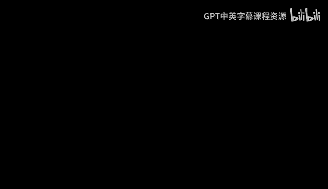
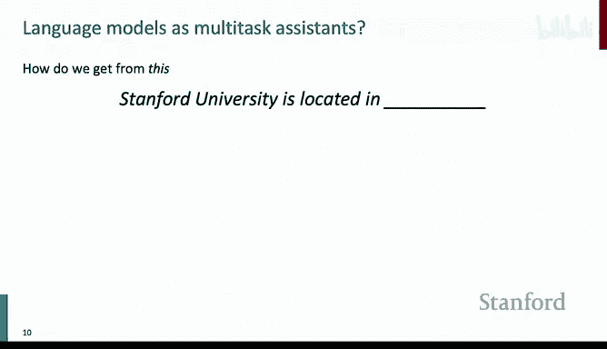
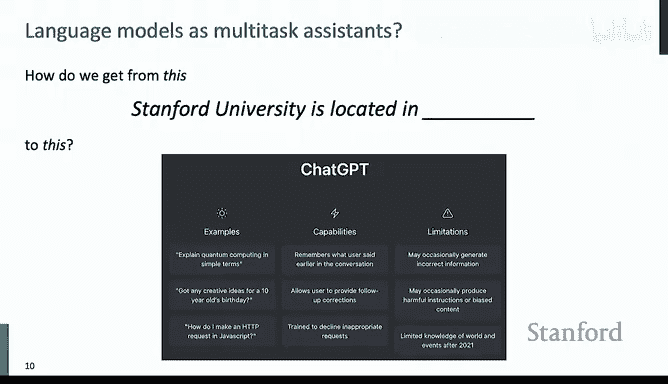
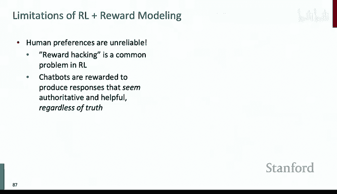
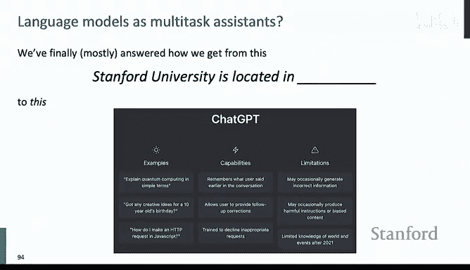
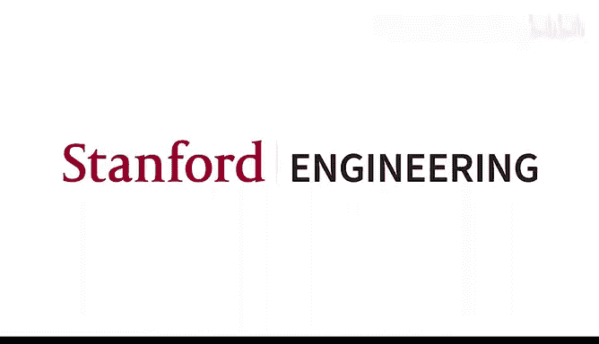

# 斯坦福大学《深度学习自然语言处理｜Stanford CS224N NLP with Deep Learning 2024》中英字幕（deepseek-R1 - P11：-11-Lecture 10 - Post-training by Archit Sharma.zh_en - GPT中英字幕课程资源 - BV1U5RNYgEfp

Good evening， people。How he is doing？All right， my name is Archsha Sherman。

 I'm a PhD student at Stanford and I'm very， very excited to talk about post training generally speaking for large language models。

 and I hope you guys are ready to learn some stuff because。😊。

This has been one of the last few years in machine learning have've been very。

 very exciting with the advent of flourish language models， C GPT and everything to that extent。

 and hopefully after today's lecture you will be more comfortable understanding how we go from pretrain models to models like C GPT and well take a whole journey through prompting instruction fine tuning and DP and RLHF。

😊，So， let's get started。All right。So something that has been very fundamental to our。

Entire field is this idea of scaling loss， and models are increasingly becoming larger and larger。

 and they're expanding more and more compute。 So this is a graph of models starting all the way back in 1950s to somewhere around。

 these are still， this is an outdated graphs。 So like this shows up to 10 to part 24 flops or floating point operations that go into pretraining these models。

 But the number is well above 10 to part 26 now。 But you can see the graph and the way it's trending。

😊，And more and more compute requires more and more data because you need to train on something meaningful。

 And this is roughly the trend on the amount of language tokens that are going into the language models and pretraining。

 And again， this plot is outdated。😊，Does anybody want to guess like we in 2024， 2022 we were at 1。

4 trillion tokens or words roughly speaking in language model pretraining does anyone want to guess like where we are in 2024？

😊，Thank。That's a pretty good guess。 Yeah， So we're close to 15 trillion tokens。

 Recent Lama 3 models were roughly trained on 15 trillion tokens。 So yeah， just， just for a second。

 App that these are a lot of words。 This is not。 yeah。 I don't。

 I don't think anybody of us listens to like trillions of tokens in our lifetime。

 So this is where we are right now。😊，And。I hope you guys were here for the pre， pretraining lectures。

Cool， so what do we do。 So like， I mean， broadly speaking。

 we are really just learning to predict text tokens or language tokens。

 But what do we learn in the process of pretraining， Why is， Why are people spending so much money。

 so much compute， Because these compute and tokens take dollars to do and were were on the order of spending hundreds of millions of dollars on these round。

 So why are we doing this。😊，And this is basically a recall from whatever youve probably learned till now。

 But were learning things like， oh， were learning knowledge。

 Stanford University is located in Santa Clara California or wherever you want to like。

 say you're learning syntax， you're learning semantics of the sentences。

 These are things that you would expect to learn when you're training on language data， broadly。

 you're probably learning a lot about different languages as well。

 So like depending on your text data distribution， you're learning a lot of things。 but。😊。

The models we interact with are very intelligent。 So where is that coming from， Like， I mean。

 just simply learning about very factual things。 And it's a very simple loss function we are optimizing。

 And where is that intelligence coming from。And this perhaps is the interesting bit。Recently。

 like people have like。Started accumulating evidence for that when you optimize the next token prediction losses。

 you're not just learning about syntax。 You're not just learning knowledge。

 but you're starting to like form models of agents， beliefs and actions as well， so。

How do we know this again， A lot of this is speculative evidence。

 but it's maybe to like form an understanding that the losses we are optimizing are not just about the data fitting the data。

 because you start learning something maybe more meaningful as well。For example， like I mean。

 in this specific case， we change the last sentence and the prediction of the text of the next text that that is predicted changes as well。

 So here it starts with Pat watches a demonstration of a bowling ball and the leaf being dropped at the same time。

 Pat， who is a physicist predicts that the bowling ball in the leaf land at the same rate。

 we all know gravity the way it works。 But when you change the last sentence to Pat。

 who has never seen this demonstration before。😊，Pa predicts that bowling ball will fall to the ground first。

 Maybe somebody who' has never seen this experiment before might intuitively believe that。Correct。

 so like， I mean， the language model was able to predict this。 So how do you predict this。

 You have to have some notion of understanding of how humans work to even be able to predict this。

 And that's maybe like something that is not obvious when you're simply optimizing to predict the text。

Similarly， like， I mean， these kind of examples are we're going run through some examples to like sort of communicate that when you're pre training these models。

 you're learning much more than just language tokens and so on。 You're also learning about math。

 like you're able to understand what a graph of a circle means and what the center is and where how to like understand equations。

😊，Probably my favorite example， something I use pretty much everyday day is you're learning how to write code。

 So I don't know how many of you have interacted with Co pilot before。

 but if you have like you probably know， like if you write down a few command。

 write down a function template， it will automatically complete code for you。 So again。

 it's not perfect。 but it has to have some deeper understanding of what your intent is for something like that to emerge。

😊，And similarly， we have examples from medicine as well。 I don't know about you guys， but like。

 whenever I have some issue， I probably go to child GP D or clo or something to that artifact and ask them a diagnosis for those things as well。

嗯。I don't recommend that。 Please don't take medical advice from me。 but yeah。😊，So。Broadly。

 like the way we're seeing language models at this point is that like they're sort of emerging as this general purpose。

 multitask assistance。And it's very strange， right， Like， I mean。

 we start off with text token prediction and were reaching the stage where we can like sort of relied them on them to do many。

 many different things。 So how are we getting there。 And I'm sure you all are aware of like。

 what these models are。 So， yeah。😊，So today's lecture is largely going to be about how do we go from something Stanford University is located。

 this very simple pretraining task a very simple procedure。 Well， it's more complicated。

 but in abstract terms， it's not very complicated to like something as powerful as John G。😊。

Good， so。I recommend you guys stopping me asking me a lot of questions because is there's a lot of fun examples and a lot of fun techniques。

 So like I， I want you guys to like learn everything about here。😊。

So the overall plan is we're gonna talk about zero shot and few shot in context learning。

Next we're going to follow up with instruction fine tuning and then we're going to talk about optimizing for preferences and this is where roughly things are right now in the industry and when we're going to talk about what's next。

 what the limitations are and how do we move from here。Cool。

 so we're gonna start up with zero shot and fu shot in context learning。broadly。

 we're going to take an example of G or the generative pretrain transformer。

 And this is a whole series of models that started off in roughly 2018。 and like up to 2020。

 they were building G， G2， G3。 So we're going to start with this example and。😊，Yes。

 so it's a decoder only model that is trained on roughly 4。6 GB of text。

 and it has 12 layers of transformers there。 and it's traineded with the next token protection laws。

And。The first model obviously was not extremely good， but it started showing that， like， hey。

 like this technique for pretraining can be very effective for general purpose tasks。

 And we're gonna see some examples。For example， like， I mean。

 here it's able to do the task for attain and。嗯。Yeah， and。GP1 itself was not very strong as a model。

 So like， but they took the same recipe。 And like， I mean， tried to like increase the model size。

 So they went from hundred17 million parameters to about 1。5 billion parameters。

 And we're now scaling up the data alongside as well。

 So we went from 4 GB of data to approximately 40 GB of data。

 and pretraining is a whole different like melting pot of techniques。

 And there's a lot that goes into it。 But like roughly， for example， here。

 they filter data by the number of upwards on the red data。And yeah， so this is roughly where we are。

 And I think one of the things that started emerging with G 2 is zero shot learning。

And what do we mean by zero shot learning。Conventionally in the field， like when we pretrain models。

 there was the idea that you take a few examples， you update the model and then you are able to adapt to a specific task。

 But as you pretrain on more and more data and more and more task。

 You sort of start seeing this phenomena where they're able to do the task basically zero shot。

 They're showing no examples of how to do a task and you can start thinking you can do it summarization。

 you can follow some instructions， you can do maybe a little bit of math as well。

 So this is where the idea of zeroshot learning started to emerge。😊，Yeah。

 so how do we do zero short learning or taskspecific learning from these pretrain models？ Really。

 the idea is like we have to be creative here。 We know that these are text prediction models。

 If you put in a text， they will complete whatever follows。

 So if we can sort of courseer these models into completing the task we care about maybe it's question answering。

 we can start getting them to solve tasks here。 So for example。

 if you want to ask questions about Tom Brady， you sort of set it up。

 you sort of put information about Tom Brady and then you put a question that you wanted to answer and then it will autocompte in some sense。

 So this is one early perspective on these models these are very advanced autocomplete models。😊。

And similarly。If you want to figure out like which answer is true or which is not。

 something that is very useful to measure is log probabilities so。For example。

 we want to figure out what is the word it referring to here in this sentence。

 the cat couldn't fit into the hat because it was too big。

What we can do is we can take this sentence， replace it with either the cat or either the hat。

 and then you can measure the probability of which which one does the model think is higher。

 and you can sort of get the idea of what the reference here is。😊。

So none of this is like in the training data， it's simply learning to predict text。

 But you can start seeing how like we can leverage these models to do other tasks as well。

 besides prediction。So。This is just more evidence about like how GP2， not task specific fine tuning。

 not task specific training， it simply is learning to predict text and it establishes the state of the art on many。

 many different tasks simply by scaling up the model parameters and scaling up the amount of data it's traineded on。

😊，So this is a fun example。 So if you want to do sumization for data or like you have a news article that you want to summarize。

 So how do you get a zero shot model to do it？ This answer is you put the document into the context and you simply put T LDR in front of it。

😊，Now， like， I mean， if most of the data on Internet， whenever you see T。

 you'll naturally summarize it。 So， yeah， you can get zero short performance in summarization here as well。

 And again， this is not trained to do summarization in any specific way。

 And it's still doing really well simply because of its pretraining data。😊，So， yeah。

 I think G22 T LDR is somewhere there。 And like some of the very task specific train models are like。

 and I think you will see the trend with， again， if you were aec Raford or somebody。 like I mean。

 you see like these school things emerging。 Your next step would obviously be。

 I'm going scale this up a little more。 I'm going make an even bigger model。

 I'm going to train it on even more data。 And we'll see how things go right， So that's how we got G3。

 we went from 1。5 billion parameters to 1，75 billion parameters。

 we are well over like 40 GB of data to 600 GB of data。 Of course。

 like now we are in liketer of data。 and text a very compressed representation。

 So like ter of data is a lot。😊，And， you know， we， we talked about zero shot learning。

 The cool thing that emerged in G3 is like。😊，Good ahead。

 so typically like failure used to record the passage rate。No， you typically put the passage。

 If you have like interact read it or something like that。 typicallyy。

 somebody will write an entire post and then end with T LDR。 Here's a summary of the thing。

 Too long Did't read。 Or if you have you。Opppo interior comes first。Oh yeah。

 there are situations where it also comes first。 But one reason is that these are like decoder only models。

 So like they often these are causal attention models。

 So they typically need to see the context before。 Yeah I understand I'm just curious like from my experience of earlier comes worse then。

😊，好，这里。啊不啊不的发。Okay， there's probably a lot of data where the T LDR comes first。

 but there's probably a lot of data where T LDR comes after as well。Cool。

 so we saw zeroshot learning emerging in G2。Few short learning maybe seem slightly easier。 But like。

 this is where things started getting really funny。

 I that like you're starting to beat state of the art simply by just putting examples in context。

 So yeah， what does few short learning mean here。 What does what are we talking about。😊。

As I mentioned， like the typical idea here is is that like you want to solve translation。

 So you would put some examples of translation into context。And。You know。

 this is a correction task here or maybe one you're interested in translation and no gradient updates。

 no learning in any conventional sense whatsoever。 You put a few examples in。And that's it。 Like。

 I mean， you know how to solve the task。 Isn't that like crazy， Like your。

 You guys did the assignment on translation， right。So， but this is what the modern NFB looks like。

 so。Yeah， you put in some examples and you have the entire system and。

This is where things got really interesting is that all these task specific models that were created to like be really。

 really good at translation or really good at summarization。 You can just put。

 let's look at this graph。 So if we start with a zero short performance of this in a similar fashion that I described earlier。

 and you start somewhere there。 You put one example in of translation from English to French。

 you get to somewhere like already at a fine tune level。 few examples in。

 you're already starting to like be close to the state of the art models。😊，Wait， but in that graph。

 the state of theR is really high， isn't it definedR5D and verdo？The bird plus was here， I think。

 is like what I'm referring to why do you say to the art。

 like birds trained exclusively on a lot of translation data might be like slightly barrierious。😊，嗯。

And I think thats the relevant comparison here is is the in context learning starts to emerge at scale。

So， and this is， I think， like， the key point is that。

some of this is contested just to be very upfront， but like there is this idea of emergence of this property as you train in more compute in more scale。

 there's more recent research which suggests that if you plot the X axis correctly。

 it feels less emergent， but the general idea is as you increase the number of parameters and increase the number of compute that is going into the models。

 the ability to just go from a few examples to really strong performance is very compelling。Cool。

And yeah， I think， as I explained earlier， the general idea is that this is very different from the conventional idea of finening that we typically go for instead of like iterating over examples。

 putting into context and doing gradient updates， we are actually just going for few short prompting。

 We are going put in few examples。 and that's going to give us the system。😊，Go have to clarify your。

Yes， I mean， the exact details roughly can depend on the prompt template that you use。

 but typically you would just put examples so like see otter and put these examples and then whatever your task is。

 you can just let the model complete from there because it can infer the task。

Based on the examples you've given。Any other questions？Go。So。Yeah， like I mean。

 we have gotten from zero short prompting。 and like we've seen we're seeing that few short prompting is becoming really competitive with good models。

 But there's still limitations to this。 Like， I mean， you cannot solve every task that you see here。

 and particularly like things that involve like richer multistep reasoning is something that actually can be pretty challenging。

 And just to if you' human struggle at these task as well。 So things like addition and so on。 like。😊。

These are， these are probably like still still hard to do。

 like when you keep increasing the number of digits， but。

One thing that you have to start being creative with。

 I alluded to this earlier is that you can get these models through do the task if youre creative in how you prompt the model。

 And this is what we're going to see next。😊，So this technique called chain of thought prompting emerged here。

 and the idea that we have explored thus far is that we put in examples of the kind of tasks we want to do。

And we expect the motor to  zero short， learn what the task is and go from there。

The idea is that like instead of just showing what the task is。

 you show them examples where the reason through the task。

 So they're not just learning to do the task， but also learning how the reasoning is working。

 So in this example， initially we started with like， we have to solve a simple math problem。

 And we are just shown exactly the answer directly。 Instead of doing that。

 And if you do that directly， you'll observe that the model gets the answer wrong。Instead of that。

 what if you show models how to reason about the task。

 show it a chain of thought and include that in the prompt as well。

And then you ask it a new question。 The idea is that now the model is not just going to output an answer。

 It's going to reason about the task， and it's going to do actually a lot better。

And this has been shown to be very effective。Chain of thought is also， as you can see， like， I mean。

 it's again， something that improves a lot with model scale。It's not just。Yeah。

 but what you can probably start seeing is like， it's nearly better than supervised best models here。

 so。Par models roughly were about40 billion parameters。

And simply with this chain of thought kind of a skill， you're already like beating state of the art。

Cool。So。Yeah， so I show you examples of chain of thought reasoning to this point where you should go through a reasoning chain。

 but you can be even slightly smarter than that。 You might not even need to show them any examples。

 You just need to trick them into thinking about what to do next。So yeah。

 this this idea emerged in this paper called where。

 let's think step by step where instead of even showing an example， you just start your answer with。

 let's think step by step。😊，And that's it， like I mean。

 the model will start reasoning about the answer itself instead of just like auto completing to an answer。

And you get something like this。So。Maybe you don't even need to show any examples。 Like。

 you can probably induce the reasoning behavior through zero shown behavior as well。And， again。

What the final numbers look like is like compared to zero shot performance that we got from essentially auto completing。

This zero shot chain of thought substantially improves the performance。 So you go from like 17。

7 to 78。7。 It's still worse than still putting like examples of reasoning and multi shot few shot chain of thought as well。

But you can see like how much it improves the performance simply by asking it to let's think step by step。

And maybe this is like a lesson that interacting with these models is like。

When you interact with these models you might not get the exact desired behavior from these models upfront。

 but often like these models are capable of doing the behavior that you might want and often you have to think about how to induce that behavior such that and the right way to think perhaps is like what is the pretraining data。

 what is some data on the internet it might have seen which induces a similar behavior to the kind I want。

And you probably want to like， think about that and then induce these kinds of behaviors from those models。

And yeah， like， I mean， you know， we we've hand designed some of these prompts。

 You can also like get an LM to design these prompts as well。

 There's like recursive selfimprov ideas here that happen。

 and you can bump up the performance a little bit more。😊，Good， so。

What we have seen so far is that as models get stronger and stronger。

 you can start forcing them to do your task， zero shot or with few short examples。

 and you can trick them into thinking what task you want them to solve。

But the downside is that theres only so much you can fit into context。

 This might not be very true anymore。 what is like becoming increasingly larger context。

 but it's still somewhat unsatisfactory think you have to trick the model into doing your task rather than like it just doing the task you wanted to do。

And。Potentially， like I mean， going forward， like， you probably still want to fine tune in these models for more and more complex tasks。

And that's where were gonna go forward with this。Next section we're gonna cover is instruction fine tuning and。

The general idea we have right now is that。As you talked about。

 pretraining is not about assisting users。 It is about predicting the next token。 Now。

 you can trick it into assisting users and is following the instruction you want to。 But in general。

 that's not what retrained it for。 And this is an example where if you asked G3。

 pretty strong model to explain like moon landing to a 6 year old in a few sentences。

 And it will follow with more questions about what a 60 year old might want。

 This is not what you wanted the model to do， right。So。

ItsThe general term that people use these days is that they are not aligned with user intent。

 And the next section that we're going to cover are going to talk about how to align it with user intent so that they don't have to trick the model into whatever we wanted to do。

And this is the kind of like desired completion we want at the end of instruction tuning。And yeah。

How do we get from those pretrain models to models which can respond to user intent。Again。

 I hope this was covered somewhere in the class， the general idea of pretraining and fine tuning。

 but what you have probably seen thus far as that you're pretrain on a lot of different language task data but then you fine tune on your specific task So youre taking the same decoder only models and you're fine tuning to some task with very little amount of data The thing that is going to be different now is not that we're no longer fine tuning on a little amount of data we're going to fine tune on many。

 many different tasks and we're going to just try to put them into a single usable UX for users and this is where。

Find tuning or instruction。 Find tuning comes in。Goodol。So， again， the recipe is not very。

 very complicated here。 We're going to collect a lot of examples of instruction and output pairs。

 and the instructions are going to range over several tasks different forms。

 There's going to be a question answering。 there' are going to be sumization， translation， code。

 reasoning and so on。 And we're going to collect a lot of examples related to all those tasks。

 And the idea is like I mean， we train on instruction and output pairs exactly with them。

 And then we're going to evaluate on some unseen tasks as well。😊。

So this is a general paradigm of instruction fine tuning。And。Again。

 it's the same idea which we explored in pre training is that data plus scale is really important。

 And these days， like a mean。You start off with like one task。

 You're now extending it over thousands of thousands and thousands of tasks with like 3 million plus examples。

 And this is generally like a broad range of tasks that you might see in instruction， fine datasets。

And yeah， you might even think of like， why are we calling it fine tuning anymore？

 Like it's almost starting to look like pretraining， But yeah。

 we can these are just terms so you can decide whatever is you are comfortable with。😊，诶。So yeah， we。

 we get this like huge instruction data set。 We find you in our model。 The next question is like。

 how do we evaluate these data sets。诶。Now， I think you guys will see another lecture on evaluation。

 so I don't want to like dive too deep into this。But generally。

 evaluation of these language models is an extremely tricky topic。

 There's a lot of biases that you need to deal with。 and a lot of this will be covered。

 but some more recent progress on this is like we are starting to curate these like really large benchmarks like MML U where the models are tested on a broad range of diverse knowledge and this is just one example which is and these are the topics that you will see。

😊，And just to give some intuition of what the examples in these evaluation look like under astronomy。

 you might be asked， what is true for type 1 a supernova。

Or you might be asked some questions about biology。 And theres a huge host of tasks for this。

 And you can typically like， these are multi choice questions。

 And you can ask the model to answer the question if their instruction fine tune already hopefully they can like simply answer the question。

 but you can also chain of thought prompt these questions or few short prompt these questions too。

And。Recently， there's been a huge amount of progress on this benchmark。

What people have observed is like more and more pretraining on more and more data and larger models is simply just like climbing up these。

 The number on this。 So 90% is often seen as a benchmark number that these model wanted to cross because it's roughly like human level knowledge or understanding。

 And recently the Gemini models verly cross this number So yeah， go ahead。

Isn't this like the entire sort of thing all over again， like imagine it at some point you're like。

 okay， maybe my methods are to。😊，Like two fine tuned implicitly on the image and I and isn't something like that happening here as well？

😊，嗯。Yes， I think this is a tricky topic because a lot of the models。

 often there is this idea about whether your test sets are leaking into your training dataset and there's are huge concerns about that。

 It's a perfectly valid question to ask how do we even evaluate。

 this is why evaluation is actually very tricky。 but one general thing to be careful about is like at some point like it doesn't matter what a trained test is if the models are generally useful。

😊，If their models are doing useful stuff， like， does it matter like how if you test。

 if you trained on everything you care about and it does well on it， Like， does it matter。So yeah。

Again， we still need better ways to evaluate the models and to understand what methods are doing and how theyre。

 if they're improving the model or not。 But at some point like that those boundaries start to like be less important。

Cool， so massive progress on this benchmark starting with G2 and like we are roughly at 90% which to the point where these benchmarks are starting to become unclear if like improvements on these are actually meaningful or not。

 In fact， like most of the times when the models are wrong。

 like you might often find that the question itself was unclear or ambiguous So all evaluation benchmarks have a certain limited utility to them。

😊，So yeah， gonna go over like another evaluation example of how this recipe like changes things。

 So T 5 models were instruction fine tune on a huge number of tasks。 and another trend to。

 which I think will be the theme across this lecture is that as your models become larger as they're trained on more data。

 they become more and more responsive to your task information as well。

 So what you will observe here is like as the number of parameters increase。

 we have like T 5 small flat T5 small。 and we go up to 11 billion parameters where we have t 5 x Excel。

 You'll see that the improvement actually improves like going from a pretrain to an instruction model。

 The instruction model is all the more better at following instructions。 So the difference is plus 6。

1 and goes to plus 26。6 as the models become larger。😊。

So this is another very encouraging trend that you probably should train on a lot of data with a lot of compute and。

😊，You know， pre traininging just keeps on giving。So。Yeah， you。

I hope you guys get a chance to like play with a lot of these models I think you already hopefully are。

 but yeah before instruction fine tuning， something when you're asked a question related disambiguation QA。

 you get something like this and it doesn't actually follow the let's think by step by step instruction very clearly。

 but after instruction fine tuning it is able to answer the question here。😊，And yeah。

 like more recently， people have been like researching into like what the instruction tuning dataset sets should look like。

 There's a huge plethora of instruction tuning dataset sets now available。 Like。

 this is just a representative diagram。 And there's a open source community developing around these as well。

Some high level lessons that we have learned from this is。

One lesson that I think might be interesting is that we can actually use really large strong models to generate some of the instruction tuning data to train some of our smaller models。

 So take your favorite model right now， G4， maybe or maybe cloud or whatever。

 And you can get it to answer some questions and generate instruction output pairs for training your open source or smaller model。

 And actually is a very successful recipe。 So instead of getting a human to collect all the instruction output pairs or getting humans to generate the answers。

 you can get bigger models to generate the answers as well。

 So that's number one thing that like has recently emerged。😊。

Another thing that is being emerge or is like being discussed is how much data do we need。

 I talked about millions of examples。 But like people have often found that if we have really high quality example。

 you can get away with 00 examples as well。 So this is the paper less is more for alignment。

 And this is still an active area of research and how like data scaling in instruction tuning affects the final model performance。

And， yeah， crowdsourcing these models can be effective as well。

 So they are in very cool benchmarks that are emerging， like open assistant。😊，Yeah。

 a lot of activity in the field and hopefully like a lot more progress as we go on。 Yes。

 a question sort of in the spirit of this lema paper doesn't like code or like。😊，I don't know。

 like math word problems have this desired structure。

 so like shouldn't we just like be code models between like some English stuff and then just be like。

 okay， this is the best reason we can get at some point right。

Because like court has the structure like you're going sort of step by step and you're sort of。

Thinking in some way in like a sort of taking down a higher concept in model。

 so you can consider that course has like a high value dokens。So maybe like just doing。

So I think there's， again pretraining is a whole dark card that I am not completely familiar with。

 but code actually ends up being really useful in pretraining mixtures and people do like up code data quite a lot similarly like I mean。

 but it depends upon what the users are going to use the models for right Some people might use it for code。

 Some people might do this for reasoning， but that's not the only task we care about As you might see later on in the next step we'll discuss this as well is that people often use these models for creative tasks。

 they wanted to write a story they wanted to generate a movie script or so on。

 and I don't know if like necessarily training on reasoning only task would help with that。😊。

So go ahead， would you expect like there exists like some data distribution。

 which is like high value for。Creative tasks。Yes， like， I mean， it seems like。

A lot of people write about stories and everything on the Internet all the time， like。

 which is not code。 And sometimes like there's this idea of hallucinations as well in this like field。

 But you can often think like， hey， like， creativity might be。

A byproduct of for hallucinations as well。 So I don't know what exact data would likely lead to like more creative models。

 But generally， like， there's a lot of data or a lot of stories that are written on the Internet。

 which allows the model to be creative。Yeah， but I don't know if I have a specific answer to the question。

Cool， so we discuss instruction fine tuning。 very simple and very straightforward。

 There's like no complicated algorithms here。 Just collect a lot of data。

 and then you can start leveraging the performance at scale as well。 Like as models become better。

 These models also become more easily specifiable and they become more responsive to task as well。😊。

We're going to discuss some limitations。 And I think this is like really important to understand why we are going to optimize for human preferences。

故收。We talked a bit about this。 like instruction fine is necessarily contingent on humans labeling the data。

Now， humans。It's expensive to collect this data， especially as the questions become more and more complex。

 You want to answer questions about which maybe at physics PhD level or things to that effect。

 These things become increasingly expensive to collect， so。Yeah。

 this is maybe like perhaps obvious like collecting data。

 Pretrain does not require any specific data。 you scrape data off the web。

 but for instruction for entertaining， you probably need to recruit some people to write down answer to your instructions。

 So this can give them very expensive very quickly。But there's more limitations to this as well。

 And we， we're just discussing this， like there open ended task related to creativity that don't really have like an exact correct answer to begin with。

 So how do you generate the right answer to this kind of a question。And。Yeah。

 like language modeling inherently like penalizes all token level mistakes equally。

 This is what super supervised finening does as well。 But often like not all mistakes are the same。

 So this is an example where you're trying to do this prediction task。 Avatar is a fantasy TV show。

 and perhaps you can see like， I mean， calling it an adventure TV show is perhaps okay。

 but calling it a musical may be like a much worse mistake。

 But both these mistakes are penalized equally。😊，And I think one general aspect。

 which is like more becoming increasingly relevant。

 is that the humans that you might ask might not generate the right or the highest quality answer。

 Your models are becoming increasingly competitive。 And you want， in some sense。

 you're going to be limited by how high quality the answer， humans can generate。

 But often I find that the models are generating better and better answers。

 So do we really want to keep relying on humans to write down the answers or do we want to like somehow go over that。

😊，So。These are the three problems we have talked about with instruction fine tuning and。

We made a lot of progress with this。 but this is not how we got child G。

And one high level problem here is that even when， even when we are instruction fine tuning。

 there is still a huge mismatch between。The end goal is to optimize for human preferences。

 generate an output that a human might like。 And we're still doing prediction kind of tasks where we're predicting the next token。

 but now in a more curated data set。 So there's still a bit of a mismatch going on here。

 And it's not exactly what we want to do。Hopefully， like， I mean。

 I'm going to take a second here to pause because this is important to understand the next section。

 And if there's any questions。Feel free to you ask this step taken。first。

That's a good question so I think this is still one of the more important steps that you take before taking the next step。

 but people are trying to like remove the step altogether and jump directly to the next step so there' is work emerging on that but yeah and this is still a very important step before we do the next step。

is problem also present in pre training and if so， how do you avoid that versus by having a lot of data？

Yeah， that's a great question。 There's true there's one difference。

 one major difference on pretraining。 pretraining covers a lot more text。

 So just for context like I mean， as we talked about。

 it's pretrain is roughly 15 trillion tokens whereas like supervised instruction fine tuning might be somewhere on the order of millions to billions of tokens。

 It's like a few orders of magnitude lower。 typicallyyp you'd only see one answer for a specific instruction。

 but during pretraining， you'll see multiple texts and multiple completions for a same kind of a prompt。

😊，Now that's good because when you see multiple answers or completions during pre training。

 you sort of start to weigh different answers， you start to put probability mass on different kind of answers or completions。

 but instruction fine might force you to put an weight on only one answer。😊，Does it okay。

But generally， yeah， like I mean， this is a problem with both the stages。 You're right。Anything else。

Cool。So， as。This whole thing alludes to we're going start to attempt to satisfy human preferences directly。

 We're no longer going to like try to like get humans to generate some data and try to do some kind of a token level prediction loss。

 We're going to try to optimize for human preferences directly。 And that is the general field of RHF。

 And that's the final step in typically getting a model like charge G。

So we talked about how collecting demonstration is expensive。

 and there's still a broad mismatch between the LM objective and human preferences。

 And now we're going to try and optimize for human preferences directly。

So what is optimizing for human preferences even mean to like concretely establish that。

 let's go through like a specific example in mind， which is summarization。😊。

We want to train a model to be better at summarization。And we want to satisfy human preferences。

 So let's imagine that a human is able to prescribe a reward for a specific summary。

 Let's just pretend there is a reward function you and I can assign， say like reward。 This is plus1。

 This is -1 or something to that effect。😊，Okay。So in this specific case， we have this input X。

 which which is about an earthquake in San Francisco。

 So this is a news article that we want to summarize。And。Let's pretend that we get these rewards。

 and we want to optimize this， so。We， we get one summary Y 1。

 which gives us an earthquake hit and so on。 And we assign a reward of 8。0 and another summary。

 which gives us a reward of 1。2。Generally speaking like the objective that we want to set up is something of the following form where we want to take our language model P theta。

 which generates a completion y given an input X， and we want to maximize the reward of R X Y where x is the input and y is the output summary in this specific task。

And maybe like just to like really concretely point out something here。

 this is different from everything that we have done in one very specific way。

 we are sampling from the model itself in the bottom term。

 if you see like we're using y from P theta Everything we've seen so far。

 the data is sampled from some other source either during pretraining either in supervised fine tuning and we're maximizing the log likelihood of those tokens。

 but now we're explicitly sampling from our model and optimizing potentially a non-diiable objective。

😊，过。So broadly， the IHF pipeline looks something like this。

 And first step is still instruction tuning， something we have seen up until now where we take our pretrain model。

 we instruction tune on a large collection of tasks。

 and we get something which starts responding to our desired intent or not。😊。

But there are two more steps after this， which are typically followed in creating something like instruct GB。

 The first step is estimating some kind of a reward model， something which tells us。

 given an instruction， how much would a human like this answer or how much would a human hate this answer。

 So we looked at something like this earlier。 But I didn't talk about how do we even get something like that。

 That's the second step。 And then we take this reward model。

 And we optimize it through the optimization that I suggested earlier。

 So the maximizing the expected reward under your language model。😊。

And we're going to go a lot over in the second and third steps。

So the first question we want to answer is， how do we even get like a reward model what about what humans are going to like。

Like， this is a very interdefined problem， generally speaking， so。There's this two problems here。

 the we can address。 First is a human in the loop is expensive。 So let's say like。

 if I ask a model to like generate an answer and then I get a human to label with some kind of a score。

 I'm doing this over millions of completions。 That is not very scalable。😊，I。

 I don't want to sit around and label millions of examples， so。This is very easy。 Like。

 we're in a machine learning class。 So what are we gonna do。

 what were gonna do is we're gonna train something which predicts what a human would like or what a human might not like。

 And this is roughly。😊，This is essentially a machine learning problem where we take these reward scores and we try to train a reward model to predict given an input and output what the reward scores would look like。

Simple， simple machine learning regression style problem。 You might have seen this earlier。Co。Now。

 there's a bigger problem here。 And sorry， go ahead。 one。 So do we use like。

 I don't know like just ems。That's a fire， or do we use a real language model？嗯。

That's a good question。 General， like what we do is like we still typically need reward models where they need to be able to understand the text really well。

 So like bigger models and like， they're typically initial from the language model that you trained。

 pre traineded as well。So you typically start with a pretrain language model and do some kind of prediction that we'll talk about and they'll give you a score。

How do you， if you're doing that， how do you separate eggs work？

How does the length will know which part。It doesn't need to。It can put the x and y。

 like it only sees x and y as an input， so it doesn't need to typically see it separated。

 It's just going to predict a score at the end。The X and y is more for notational convenience here because for us。

 x and y are different x's， a question user asked and y is something the model generated。

But you shut the whole thing， you s the whole thing as well。Cool。Now。

 this is the bigger problem here。 and human judgments are very noisy。

 We've talked about we want to assign a score to a completion。

 This is something that's like extremely nontri to do。 So if I give you a summary like this。

 what score are you going to assign on a scale of 10。😊，If you ask me on different days。

 I'll give a different answer。 first of all， But across humans itself。This。

 this number is not calibrated in any meaningful way。 So you go a assign number of 4。16。6。

 and different humans will just simply assign different scores。 And there are ways to address this。

 You can like calibrate humans。 You can give them a specific rubric。 You can like talk to them。

 But it's a very complicated process。 And like still like theres a lot of room for judgment。

 which is not typically very nice for training a model like this。If your labels can vary a lot。

 it's just hard to predict。So the way this is addressed is that instead of trying to predict the reward label directly。

 you actually want to set up a problem in slightly different way。

 What is something much easier for humans to do is give them two answers or maybe many answers and tell them。

 ask them which one is better。So this is where the idea of asking humans to rank answers comes in。

 So if I give you a whole news article and ask you which summary is better。

 you might be able to give me a ranking that， oh， this second summary is the worst。

 but the first one is better。 And the third one is somewhere in the middle between those two。

 So you get like a ranking， which gives you preference over summaries。😊，And hopefully， like， I mean。

 you can see like the idea that is important here is that。

Even when we have some kind of a consistent utility function， even when I have。

 it's much easier to compare to something and know that which is better than this。

 rather than ascribing it an arbitrary number on a scale。

And that's why the signal from something like this is a lot better。Now， how do we get like。

 we talked about we need like， we get this kind of a preference data。

 And now we need some kind of a reward score out of this。 and we shove in like our input。

 we shove in a summary as well。 And we still need to get a score out of this。

 But it's not clearly obvious to me。 like， how do we take this data and convert into that kind of score。

嗯。Incomes are pretty good friends named Bradley Terry and essentially like there's a lot of study like many in economics and like psychology。

 which basically tries to model how humans make decisions in specific case like this Bradley Terry model essentially is that a probability that a human chooses answer y1 over y2 is based on the difference between the rewards that humans assign internally and then you take a sigmoid around it。

 So if you have looked at binary classification before the logic is simply the difference between the reward of some y1 minus y2 or the difference between the winning completion and the losing completion。

😊，Is everybody with me till this point？So the idea is that like if you have a data set wherere given y1 and Y2。

 where y1 is a winning completion and we have a winning completion YW and a losing completion YL。

 the winning completion should score higher than the losing completion。😊，Go ahead sorry。

 what is Jay is that a long or？Sorry， what what like， what is the type of J。

 Like this number here that we're getting has the expectation。

 Is it a log prop or what is it's an expected log props。 It will be a scalar at the end。 Sigmoid is。

 so you're taking the， let's say you have a reward model， which gives a score。

R1 to like YW and r2 to YL， you subtract that number， you get another number。

 you put it into stigmoid and you get a probability。

Because sigmoid will convert a logict into probability， and then you take a logarithm of that。

And you take the expectation of everything and you get this final number。

 which tells you how good your reward model is doing on the entire data set。

So like a good model of humans should behave like this A good model of humans would score very low here。

 so it would generally assign a higher reward to the winning completion and generally assign a lower reward to the losing completion。

😊，Cool。The math is just beginning， so hold on to your seats。嗯。Cool， so now let's see where we are。

 We have a pretrain model P， P Y given X， and we got this like fancy reward model。

 which tells us that hey， how we have a model of humans and it can tell us which。

 which answer they like and which answer did not like。😊，Now， to do R HF， generally， like I mean。

 we've discussed what this will look like， we will copy our pretrain model or our instruction tune model。

 and we will optimize the parameters for those models。

 And I suggested that the parameter objective that we want to optimize is the expected reward。

 when we sample completions from P theta。😊，And we're going to optimize our learned reward model instead of like the true reward model。

 which humans would have typically assigned。Do you guys see any problem with this。诶。

Is there something that's wrong here or like that might go wrong if we do something along these lines？

girlfriend份。It might collapse， yes， but generally， at least from my intuition。

 like if you're ever doing something and you have you're optimizing some learned metric。

 I'd be very careful because typically your loss functions are very clearly defined。

 But here my reward model is learned when it's learned， it means it will have errors。😊，Yes。

So it's going to be trained on some distribution， it will generalize as well。

 but it will have errors and when you're optimizing against a learned model。

 it will tend to hack the reward model， so it might exploit the reward model might erroneously assign a really high score to a really bad completion if your policy learns or if your language model learns to do that。

 it will completely hack that and start generating those jish completions。So。

Just as a general machine learning tip as well， if you're optimizing a learn metric。

 be careful about what you're optimizing and make sure that it's actually reliable and the way and this is obviously not desirable。

 Like I mean， if you start optimizing this objective。

 you're going converse to gibberish language models very， very quickly。

 So typically what people do is that you want to add some kind of a penalty that like avoids it drifting too far from its initialization。

😊，And why do we want to do that， Like if it cannot drift too far from its initialization。

 we know the initialization of the model is a decent language model。

 and we know it is not necessarily satisfying this reward model too much。

 And we also know that like the reward model is trained on a distribution of completions where the initial model is So typically we when we talk about training this reward model。

 we have trained on certain completions， which are sampled from this initial distribution。

 So we know the reward model will be somewhat reliable in that distribution。

 So we're just going to simply add a penalty， which tells us that you should not drift too far away from the initial distribution。

 And just to go over this。 we want to maximize the objective where we have。😊，R M  Phi。

 which is our learned one model。 but we're gonna。Add this term beta log ratio。

 and the ratio is our the model we're optimizing P theta and our initial model PDD。

And what this says is that if we assign a much higher probability to certain completion as compared to our pretrain model。

 you're going add an increasingly large penalty to it。

And simply you're paying a price for drifting too far from initial distribution。

 If you guys have taken like machine learning this。

 the expectation of this quantity can is exactly the Kba Lib divergence or KL divergence between P Theta and PPD。

So you're penalizing drifting between two distributions。 Go for it。

questionShouldn't you also do this like at a penalty in the previous version where you had to find tuning or is this only relevant for the RLHF That's a good question so。

I think people do add some kinds of regularization in fine。

 it's not nearly not as critical when you're doing this with R like the incentive is to exploit this reward model as well as much as possible。

 and we'll see examples where。Like the learned rewardal predicts like it's doing really well。

 But the true reward models are completely garbage。 So it's much more important in this optimization。

😊，Good， so。Now。This assumem does this course does not assume background on reinforcement learning。

 So we're not going to go into reinforcement learning。

 but I just want to give a very high level intuition about how this works。

And reinforcement learning is not typically easiest used for language models being applied to several domains of interest。

 gameplay agents， robotics， developing chip designs and so on。And。

The interest between like R and model Ls。 It's also like dates back to roughly like 2016 as well。

 But like， it's been really successful recently。😊，And especially with the success of our lecture。

The general idea is that we are going to use our model that we are optimizing to generate several completions for an instruction。

 we are going to compute the reward under our learned reward model。😊。

And then we're going to simply try and like update the in update our model to increase the probability on the high reward completions。

 So when we sample a model， well see completions of varying quality。😊。

And we'll see some good completions， good summaries for our task， some bad summaries for our task。

 and we will try to update our log probabilities in a way such that the reward for when you use the updated model。

 youre typically in the high reward region。Does a high level summary like make sense。故。

And our leadership is incredibly successful。 I think this is a very good example of。

 this is the same summarization example， and。😊，I think the key point here is that the performance improves by increasing the model size。

 for sure。 We have seen this in many different example。

 What you can actually see is that even very small models can outperform human completions if you train it with R chef。

 And this is exactly the result you see here， the reference summaries are human generated。

 And when you evaluate。😊，I mean， you ask humans which ones they prefer。

 They often prefer the model generated summary over the human generated summary。

 And this is something you only observe with R LHF。Even at small scale。 And again。

 the same scaling phenomena still hosier。 bigger models do become more responsive。

 but our itself is very impactful here。Go。The problem with RHF is that it's just incredibly complex。

 Like I gave you a very high level summary that's like doesn't there's whole courses on this for a reason。

 So it just， and this image is not for you to understand。 It's just completely to intimidate you so。

😊，You want to fit a value function to something Theres you have to sample the model a lot。

 It can be sensitive to a lot of hyper parametersa。 So there's a lot that goes on here and。Yeah。

 if you start implementing an R pipeline， it can be very hard。

And this is the reason why like a lot of Rev was restricted to very。

 very like high compute high resource places。 and it was not very accessible。

 So what we're going to talk about and cover in this course is something called direct preference optimization。

 which is a much simpler alternative to Rev。 And hopefully， like that's much more accessible。

 But please bear with me。 There will be a lot of math on here。

 But the end goal of the math is to make come up with a very simple algorithm。

 So hopefully like its and feel free to stop me and ask me questions。😊，为变保似你真。

In terms of like GBT4 versus three like how much does the number of parameters in the base model help with like to reduce the number of parameters or like in order the number of examples from humans or Yeah that's a really good question so generally speaking as the if you hold the data set size constant and simply increase the models size it will improve quite a lot Sure but the nice thing is that you can reuse the data and you can keep adding data as you keep like scaling models up so typically like nobody tries to reduce the amount of data collection you just keep increasing both the things。

CoSo we talked about RLHF and the current pipeline is something like we a reward model on the comparison data that we have seen so far and were going to optimize we're going to start with our pretrain or instruction tune model and convert it into an RLHF model using the reinforcement learning techniques。

😊，Now the really the key idea in direct preference optimization is what if we could just simply write a reward model in terms of our language model itself？

😊，Now， to intuitively understand that like what is going on。

 a language model is assigning probabilities to whatever is the most plausible completion next。

 but those plausible completions might not be what we intended。

 but you could restrict the probabilitybabil simply to the completions that a human might like and then the log probabilities of your model might represent something which the humans might like and not just some arbitrary completion on the internet。

 So there is a direct correspondence between the log probability that a language model assigns and how much a human might like the answer。

 They can have like a direct correspondence in them。

 and this is not some arbitrary intuition that I'm trying to like come up with。

 We will derive this mathematically。😊，So the general idea of a direct preference optimization is going to be we' are going to write down reward model in terms of our language model and now that we can write our reward model in terms of our language model。

 we can simply solve directly fit our reward model to the preference data we have。😊。

And we don't need to do the R step at all。 So we start off with some preference data。

 and we simply fit our reward model to it， which directly optimizes the language parameters。

And maybe at a high level， why is this like even possible， Like。

 we did this like really cumbersome process with fitting a reward model and optimizing it。😊。

But in the whole process， the only external information that was being added to the system。

 like was human labels， labels on the preference data。 When we optimize a learned reward model。

 there is no new information being added into the system。

 So this is why something like this is even possible for quite a few years， this was not obvious。

 But like as we will see， like some of these results like start to make sense。

So we're gonna to derive direct preference optimization。I'll， be after。

 I'll be here after the class as well if you have questions。

 but I'll hopefully like this is clear so。Yes， we discussed that we wanted to solve this expected reward problem where we want to maximize the expected reward。

 but we subtract this term， which is the beta log ratio which essentially penalizes the distance between where our current model is and where we started off so we don't want to drift too far away from from where we started。

Now， it turns out that this specific problem， instead of doing like an iterative routine。

 there's actually a close form solution to this problem， so。

The close form solution looks something like this。嗯。Again。

 if you have seen the Bzman distribution or something to that effect before。

 this is very basically the same idea。 But the idea is this if we're going to take a pretrain distribution。

 P，T， Y given x， and we're going to reweightate the distribution by the expected reward。So if if。

 if a completion has a very high reward， it's going to have a higher probability mass。

 and if it has a lower reward， it's going to have a lower probability mass and it's determined by the expected reward。

 And beta is a hyperparameter， which essentially coverss like。

 what is the trade off between the reward model and the constraint。

And as beta becomes lower and lower， you're going to start paying more and more attention to the reward model。

So the probabilities look something like this。 And there is this like really annoying term the Z X。

 And the reason why it exists is that the numerator by itself is not normalized。

 It's not a probability distribution。 So to construct like an actual probability distribution。

 you have to normalize it。 And Z X is simply just this normalization。😊。

So we X is the sum Yeah and that's exactly like it's sum over all wise for a given instruction。

 And that's exactly where this is very pesky is like it's intractable。

 If I take an instruction and try to sum over every possible completion and not just like syntactically correct ones。

 every single possible。 we have 50000 tokens， maybe even more and the completions can go arbitrary long。

 So this space is completely intractable， this quantity is not easy to approximate even。😊。

So the main point here is that if you're given a reward model。

 you can actually there does exist at least a close form solution which tells us what the optimal policy will look like or optimal language model will look like。

😊，But if you do a little bit of algebra， just move some terms around， take a logarithm here or there。

 I promise this is not very complicated。 You can actually express the reward model in terms of the language model itself。

And I think this term is reasonably intuitive as well。

 what it says is that a completion Y hat has a higher reward if the model。

 my optimal policy assigns a higher probability to it relative to my initialized model。😊。

And this is scaled by beta。 So the beta log ratio is what we're looking at here。

And the partition function， let's just ignore it for now， but it's intractable。

 but the beta log ratio is the key part here。Is everyone。For那个 them。Awesome， okay。So。

Right now I'm talking about optimal policies， but really like every policy is probably optimal for some kind of a reward。

 right， Like this is mathematically true as well。 So the important bit here is that you can actually express you take it current policy。

 take your initialized model and you can get some kind of a reward model out of it。

 and this is the exact identity which leads to this so。😊。

Reward model can be expressed in terms of your language model。Barring the。Log partition term。

 which well see what happens to it。Go， I'm sorry I don't know think you got like why is it that we can swap because there is a thing that we're trying to optimize and how do peace start turn into PR。

Yeah， for now， like we're not optimizing any reward model。

 All I'm saying is that if I take my current language model， it is。

 it probably represents some kind of a reward model implicitly。Because of this relationship。

 because this holds for every P star and every reward model， what I'm saying is that like there。

 if I plug in my current language model， it also represents some kind of a reward model。

 I'm not saying it's optimal。But I say because at the beginning， PR is T Yes。

 and so we just get that the reward is00 And so do we do initially it's 0。

 But like we can optimize the parameters。 Okay， yeah， yeah， but that's a good observation。

 That is basically0 in the beginning。 But how do we start optimizing it。Ill get to。

Any other questions？So the ideas they're given to the lender。啊。

such that that makes the language model optimistic based on it。🎼Yes， that's that's the next step。

 yes。But the key idea is that like my log， my language model。

 the probabilities already implicitly define a reward model。😊。

I think that's really the main point here。 And this mathematical relationship is exact。Good。Now。

 like， I mean， I'm obviously ignoring like。The elephant in the room here。

 which is the partition function。 It's not going to magically vanish away。 So like。

 if this was just the beta log ratio， that would be really nice， I can compute all these quantities。

 I know how to compute the log probability under my language model。

 I know how to compute the log probability under my pretrain model。

 and I can compute the reward score， and I can optimize this。

 but I don't know what to do about my log partition function。😊，This is where something fun happens。

So。Recall what the reward modeling objective was when we started off。

 like we started off with our friends Bradley Terry again。

 And what we really wanted to optimize was the reward difference between the winning completion and the losing completion。

😊，嗯。And really， like， I mean， that's all we care about。 We don't care about the exact reward itself。

 What we care about is maximizing the difference between the the difference between winning and losing completion。

And that's actually really key here， because if you plug in the definition of the RM theta there。

 what you'll observe is that the partition function actually just cancels out。Now。

 why does it cancel out？嗯。The input is exactly the same。

 The X is actually exactly the same in the difference。 So the partition function。

 Z X will just cancel out。 Like it's the same in both the terms。

 So what do you get is that the reward difference between the winning and losing completion is the differences between the beta log ratio for the winning and losing completion。

😊，You can plug in the terms。 You can work it out。 It's fairly simple。 So the partition function。

 which was our like。Which was something we could not address。 We could not compute， actually。

 just simply vanished away。I'm so sorry。 Ze doesn't appear in the baary moment。But it appears here。

In this equation， So how does plug in the volunteer model。So we're going to take this equation。

The last line that you see。 And we're gonna to plug in， in place of R M  Phi。So， and in this。

 the first loss equation。 Oh， So the first loss equation is the Bradlet loss model。够。

So this really is it like I mean， the key observation is we could express our reward model in terms of language model and our problems with the partition function actually go away because we are optimizing the Bradulator model and what do you get is something like this is that we're going to express the loss function directly in terms of our language model parameters theta and we're going to be able to directly optimize on our data。

😊，Without doing any R L steps or not。 And this is simply a binary classification problem。

 So we're really just trying to classify whether an answer is good or bad。

 And that's really what we're doing。Before I go on， like people want to like， absorb this in。

 like I mean feel they're okay with it。don't get why when and are they human Good question。

 It's the same data set we started within R HF as well。

 But the way the process works is that you take a set of instruction and get the model to generate some answers。

 And then you get humans to label which answer they prefer。 So their model generated。Typically。

 they can be human generated as well， but theyre typically model generated。

 and then you get some preference labels。All they need is a label saying， which is a better answer。

What do you lose here。You must be losing some information because of。

Lack of information about like other。You're canceling out because of the lack of any information about the partition function。

 you are bound to lose information about other possible completions which you would have taken into account in like standard RLHF。

That's a really good question。 I don't think I'll be able to completely answer this question in time。

 But like， partition function is almost kind of a free variable。

 So I think the problem here is that the reward model。There think of when you。

 there's many reward models that satisfy this optimization。

 So there's a free variable here that you can actually completely remove。

 And that's what this optimization benefits from。 So think of it this way。

 like if I assign something a reward of plus 1 and assign something a reward of -1。

 that's basically the same as saying as it's a reward of plus 199。😊。

And it it will give you the same loss。Right， so that scale doesn't shift invari in a ways。

Is in that case somehow。Not what you want， though。Like， okay， like if。

 if you're actually training a reward model right， like 199 is like much。

 you should pay much less attention to that as compared to like。

That's but0 what we're assumingsum is our choice model here is like if a human prefers something over the other。

 like the probability is governed only by the difference between the rewards。

So that's an assumption that every R LF also makes。 and like DPO also makes。 Now。

 is that assumption true。Not completely true， but like， it holds to a fairly large degree。

But that's a good question， yeah。Cool， I'll move on in rest of time。And really， like， I mean。

 the goal of this plot is to like， we actually get fairly performant models when we optimize things with DPO we So in this plot。

 I think the main thing that you should look at is PPO， which is the typical R pipeline。

 And we are evaluating the models for summarization。 and we're comparing to human summaries。😊。

And what we find is that DP and BP sort of do similarly。

 but you're really not losing much by just doing the DPO procedure instead of R。

 And that's really compelling because DP is simply a classification loss instead of like a whole reinforcement learning procedure。

So I want to quickly summarize。What we have seen thus far is that we want to optimize for human preferences。

 So and the way we do this is like instead of relying on uncalibrated scores。

 we are getting comparison data and feedback on that。

 And we use this ranking data to either do something like RHF where we first fit a reward model and optimize using reinforcement learning。

😊，Or we do something like direct preference optimization。

 We simply take the data set and do a classification loss on that。嗯。And yeah。

 like there are trade offs in these algorithms， like people。

 when they have a lot of computational budget， they typically maybe go for R lecturecher or some routine like that。

 but if you're really looking to get the bang for your buck like I mean you might want to go for DPO and that's like probably going to work out of the box。

It's still an active area of research。 People are still trying to understand how to like best work with these algorithms。

 So like I'm not making any strong claims here， but like both of these algorithms are very effective。

 D is just much simpler to work with。Good。So yeah， like， I mean， let's see like。

 we went through all this instruction tuning R， what do we get。

Instruct G is the first model which sort of followed this pipeline。 It defined this pipeline。

 So we got models which did 30000 or so tasks。 Remember when we were doing like only one task。

 and now we have scaled it up from thousand0 tasks with like 30000 different tasks with many。

 many different examples。 So that's like where we are with instruct G。

 and it follows this pipeline that we just described。 in this case。

 they're following a specific RHF pipeline where we explicitly fit a reward model and then do some kind of a reinforcement learning routine on top of it。

嗯。And yeah， like the task collected from labelers looks something like this。

 I leave it to your imagination， or you can look at the details。

But how we started off with this model was something like completions we see from G 3。Which。

 you know， explained the moon landing to a six year。 And like。

 it is not really following the instructions， but instruct G will give you something which is meaningful。

 So it's inferring what a user wanted from the specific instruction。

 And it converting to a realistic answer that a user might like。And yeah。

 there are just more examples of what an instruct GPPT like model would do。

 whereas your base model might not follow the instructions to your desired intentions。

And yeah like we went from instruct GP to charge GP and it was essentially this pipeline。

 the key difference here is that it is still doing the instruction tuning。

 but it is more optimized for dialogue， more optimized for interacting with users so the core algorithmic techniques that we discuss today are what give us charge GP but you have to be really careful about the kind of data you're training on。

And that's really the whole game。 But this is the foundation for Ch GT。and。Yeah， it。

 it follows the same pipeline as well。And you might look at， you might interact with child GD。

 I'm sure you all have interacted whether it's in form or not。 But like。

 this is an example of what a child G interaction might look like。You want to make a Gen Z。

 So like I mean， you can， you know， the idea here is that it's like very good at responding to instructions and intent。

 This is not something that we could like even few shot in very easily。

 These are kind of instructions are hard to come examples for。

 But like this is probably not something you get trained on either。

 but it's able to like infer the intent and generalize very， very nicely。😊。

And that's something I find personally， very remarkable。Cool。

 and there's been a lot of progress on the open source front as well。

 So like DPO is much simpler and much more efficient。 And essentially。

 all the open source models these days are using DPO。

 So this is a leaderboard that has maintained by hugging hugging face here。 So like， I mean。

9 out of 10 models here are trained with DPO。 So that's been something that's been enabled the open source community to instruction tune their model betters as well。

😊，And same is being used in many production models now as well。 Miral is using DPO。 Lama 3 use DPO。

 So these are very， very strong models， which are nearly GP4 level。

 And they're also like starting to use these algorithms as well。

And something that's very cool cool to see is like。

 like we went through all this like optimization and like， I mean math and stuff。

 But what is really fundamentally changing in the behavior。

 And I think this is a really good example is that if you simply ask an instruction for and ask for an SFD output from an instruction tune model。

 you'll get something like this。 But when you are let of the model。

 you actually get a lot more details in your answer。

 And they'll probably organize the answers a little better。

 And there's something that they maybe humans prefer。

 That's why it's a property that is emerging in this model。😊。

But it's something that's a very clear difference between simply instructiontu models and models which are R L shaft。

So yeah， we discuss like this whole R S of routine where we are directly modeling the preferences and we are generalizing beyond label data。

 And we also discuss R can be very tricky to correctly implement the deepio sort of implements this or like avoid some of these issue。

 And we briefly also touched upon the idea of reward model and reward hacking。嗯。😊。

And when you're optimizing for learned reward models。

 you will often see this example is that there is a way for it to just simply crash into the object some key repeated repetitively crashing the boat to get more and more points。

 That wasn't the goal of this game。 So this is a very commonly example that is shown for reward hacking If you to not specify rewards well。

 the models can like learn weird behaviors which are not your desired intent。

 And thiss something a lot of people worry about as well。

 part of the reason is reinforcement learning is a very strong optimization algorithm。

 It's at the heart of Al go alpha 0， which like results in superhuman models。

 So you have to be careful about how you specify things。😊，And the other thing is， like。

 even optimizing for human preferences is often not the right thing。

 because humans are not do not always like things which are in their best interest。

 So something that emerges is that they like authoritative and helpful answers。

 but they often like don't necessarily like truthful answers。So one property that happens is like。

 is that theyll prefer authoritativeness more than correctness。

 which is maybe like not something nice。 Please go ahead。

All sides I'm curious that maybe likegT things。 so now widely used by the public will maybe change the how people were made rewards because I always feel like now when I go to gives five detailed paragraphs of information sometimes I just ignore that。

 but maybe in the original reward function in the original。

 people that less that's a great point because as these models integrate more and more into our systems。

 they're going to collect more and more data and they will like pick up on things。

 maybe undesirable things as well。 as far as I understandgB is really cutting down on the verbosity。

 which is like a huge issue that all of these models are trying to cut down on and they are dealing with that part of the reason why that emerges is that when you collect preference data at scale people are not necessarily reading the answers。

 the Turks might just simply choose the longer answer and that's the property that actually goes into these models So but hopefully these things will improve over time as they get most people。

😊。

And yeah， hallucinations is not a problem that is going to go away with R。

 And we talked a bit about reward hacking as well。嗯。Bses from things and so on。 But hopefully， like。

 I mean， what I want to conclude at is like， we started with pretrain models。We。

 we had these things which could predict text。 and we got charge GPD。 and hopefully。

 like it's a little more clear how we go from something like that to charge ED。

And thats I'll end here。👏Thanks。

