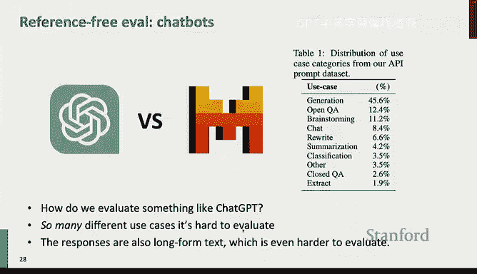
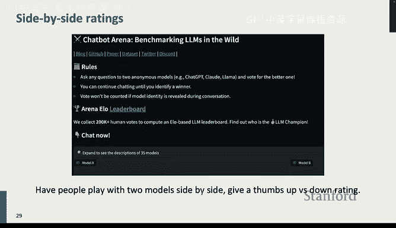
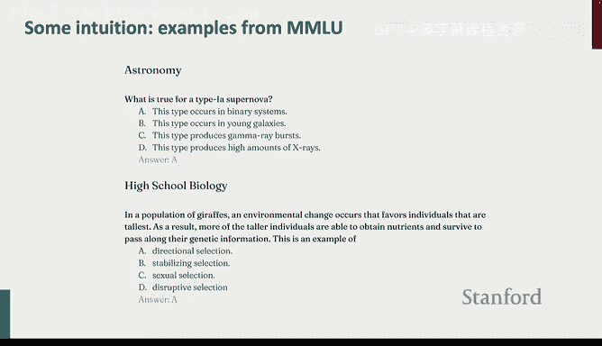
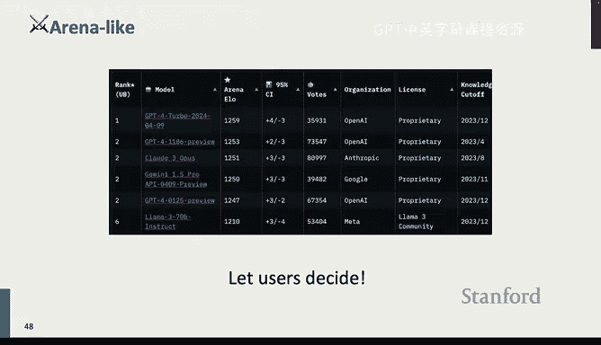

# 斯坦福大学《深度学习自然语言处理｜Stanford CS224N NLP with Deep Learning 2024》中英字幕（deepseek-R1 - P12：-12-Lecture 11 - Benchmarking by Yann Dubois.zh_en - GPT中英字幕课程资源 - BV1U5RNYgEfp

Great， so I think let's get started because we have a lot to cover today so my name is Janan for those who don't know me I'm a third yearPG student advised by Tatsu and Percy。

 and today I'll be talking about benchmarking and evaluations so benchmarking and evaluations are honestly something that I think not enough people look at in academia。

 but if you really want to put something in production and you really care about let's say real world machine learning evaluation is really key let's talk about that。

😊，So overview of what we'll talk about first is different reasons for measuring performance。

 then I'll talk about text classification and how you measure performance there。

 then text generations and how you measure performance there。

 and finally like how do you evaluate current large language models and some issues and challenges with the ways that we actually perform evaluations。

😊，Okay， so my mental model of how you actually develop a machine learning model is that first。

 you will be training your model。 So here measuring performance is really key because you need to have a loss that you need to know when basically how to optimize。

 then once you are optimizing your loss。 the second step is basically development。

 So usually this is high prepar tuning or， for example， if you have。😊。

E least stopping during your models， like if you see that your model is not performing that well。

 you might or that there's like some overfitting happening。

 you might decide to stop or you might decide to like change the learning rate during the training of your model。

 So development is kind of the second step。And here you need to measure performance because you need to know how to do actually models。

 sorry， high parameter tooling and， and like changing high parameters。

Then the third step is essentially model selection。 So if I have a task that I really care about。

 which model performs best for my task， That might be a model that I have trained。

 It might be a model that another group has trained。And finally， at least in the real world。

 you would decide to deploy your model。 And here， measuring performance is really key because you need to know whether your model is good enough to put in production in the parallel universe that we live in。

 there's also the publishing。 So you basically need to。😊。

Test like evalu your model on standard benchmarks。 And the reason why we do that is essentially for communicating to different groups。

 the quality of our model。So at every step of this pipeline， you really need to measure performance。

 And that's what we'll talk about today。 But what is key to understand is that at different steps。

 you need to measure performance in different ways。

 So it is really not a single way of of not a single ideal way of measuring performance。

So for example， on the left， when you train your model for evaluatingu performance。

 you really need to have a way of measuring performance that is super fast， super cheap。

 and differentiable because usually I mean with neural networks you basically back propagate the loss。

 so it needs to be differentiable and finally you really cannot have a way for your model to optimize some shortcuts to optimize the loss even though it's not really what you wanted to optimize。

😊，And as you move more to the right， basically you're allowed or like you will measure performance less often。

 so it's fine if it's more expensive， but you really。😊，Like the。

 the risk that that or you really need your， your measuring like your。

 your evaluation metrics to be higher quality because the issues。

 if you put a model in production are higher。So during the development stage。

 you need a way of measuring performance that is fast。

 cheap and also kind of avoiding shortcuts because when you do hyper tuning。

 you're essentially also optimizing over a certain objective。😊，Model selection。

 it can be a little bit less fast and less cheap。 but still you will have to do it that many times。

 And most importantly， when you deploy a model， you really want the way to evaluate performance to be trustworthy。

 because once you put something in production， this kind of no way to go back for what happened during that time where it was in production。

 You also want things to be very task specific。 So if I care about a certain task when I put when I put my model in production。

 it really， you really need to evaluate on that specific task， I don't care about other tasks。

 And finally， you need your metrics to be absolute。

 So the reason why I'm highlighting that is that under three other steps。

 you really just care about comparing between things。

 today is very different than if you if you want to kind of have a threshold which says if I have less than 95% accuracy。

 I'm not putting my model in production。😊，Okay and now let's talk about publishing。

 this is a little bit different than honesty evaluation in the real world。

 but when when you basically do academic benchmarking and when you evaluate your models and academic benchmarks。

 you want the benchmark to be reproducible and standardized and the reason why it's basically because for the next five or six or10 years。

 everyone will be evaluated on that one benchmark and you want papers in three years to be comparable to yours So it's really important that your evaluations are reproducible honestly you don't really care about that in the real world。

😊，You also want things to be easy to work with because researchers are usually a little bit。

 they don't want to do additional work that they need to。

 And also they usually don't have that much resource it needs to be fast and cheap。

 And finally one one thing which I really want to highlight is that for the academic benchmarks that we usually have it's fine if the metrics that we use are not perfect because really what matters is that over 10 years the direction that your metrics is showing you to go into like basically how the fuel is moving。

😊，Really， if， if the metric is saying that it's slightly better。 sorry。

 that it's better over 10 years that in reality， the the， the field has made some progress。

 So at a meta level， it's fine if we use crude metrics in in。😊，In acadeia。And also。

 you kind of need to。To balance between difficulty and simplicity。

 And what I mean by that is that if your benchmark is way too complicated。

 then basically all methods will have essentially random performance。

 So no one will use your benchmark。 And if your benchmark is too simple。

 then the baseline will be so good that no one will use your benchmark because no one can be the baseline。

 This is really something that is specific to academia in the real world。

 you're not gonna be able to change。 has that you're performing based on like how good your model is。

 So that's why I kind of just want to highlight that because usually people talk about evaluations。

 but there's really different well like different ways of evaluating and different reasons why we evaluate。

😊，that all make sense。 Also feel free to ask questions。Great， okay， so benchmarks in academia。

 This is really the way we drive the field。 So this is the M M L U benchmark。

 I think Archchid briefly mentioned it， but I'll talk about it later again。

 So this is the most standard benchmark right now。 And you basically see that in the last4 is years。

 It has gone from 25% accuracy， which is essentially random because it's multiple board choice and there are four choices to around 90 is percent accuracy。

😊，So， yeah， benchmarking is really what drive the progress in the field。 And again。

 you see what I mean here。 What I meant here is that it's not really the differences between small points that matter。

 at least in academia， you have to take a step back and you have to think what matters is like how your models will perform over 10 years。

 and making sure that the model on the top right here is better than the model on on the bottom left。

 even if even if the benchmark is not perfect。 And I think MU is a pretty good one in that sense。

Okay， so there are two main types， at least classically of tasks in N LP。 closeend tasks。

 So I'll talk about it later。 But essentially you can think about classification where you know exactly the label。

 the correct label for the task that you're performing。

 So here this is the IMDV data where you're asked to say whether the sentences has positive sentiment or negative sentiment。

 So the text is read the book， forget the movie。 So this is about a sentiment classification of the movie。

 So here it's basically negative。 And then iss open ended evaluation。 So think about chat GPT。

 like how do you evaluate something like that。 where really theres no correct answer and there are many。

 or there are many possible correct answers。 and they all have like different qualities So we're gonna distinguish between those two。

😊，So close ended evaluation。So as I just said， close ended tasks，s a limited。

 it's basically defined when as the task where there's a limited number of potential answers。

 think like less than 10， and often there's just one or maybe a few correct possible answers。😊。

So this really is standard machine learning。 If you think about standard classification。

 you can just do accuracy。 you can look at your precision， your recalls。

 There's nothing special here about NLP。 That is not to me to say that it's simple。

 It's just that there's nothing special about NLP here。😊，So some tasks， some closeend tasks。

 I already told you about sentiment analysis。 So usually this is a binary binary classification task。

 where you just have to say whether the sentiment is positive or whether it's negative。

 another task is entailment。 Also for sentiment analysis。 The typical benchmarks。

 I always put it next to the task。 is IMDB and SSC from Stanford entailment is S and I also from Stanford。

 where basically you have some text。 So here soccer game with have multiple males playing。

 And then you have a hypothesis。 some men are playing sport。

 And you have to say whether the hypothesis is implied or entailed by the text。 So here it is。😊。

Other tasks， part of speech， typical benchmark， pantry bank and name entity recognition。

 which is a kernel benchmark。A few other tasks， you don't need to know all of them just to give you a brief overview co referenceence resolution。

 So it is actually a pretty challenging N LP task where you have to say what pronoun which pronoun refers to what knownun。

 So you have here a sentence Mark told Pete， many lies about himself， himself。

 which Pete included in his book， he should have been more truthful。

 And now you have to say what does he refer to。Whether he refers to Pete。

And then there's question answering where you basically have a long text and you ask a question。

 and sorry， the test ask a question， and you're supposed to provide an answer based on on the text that you have before。

So those are some examples of close ended tasks。And again。

 the key here is that the way we evaluate those is just standard machine learning。

 can look at accuracy， precision， recall F1 score。 Hopefully you all know about these type of metrics。

 but if you don't， you should look at Chris Peach's class。 I think it's CS 224 U。

 but his lecture is online。 it's actually really good。 on different metrics。😊。

So the ways that people evaluate some of these benchmarks is usually by looking at many of them concurrently。

 So the most common， I would say， like super or multitask benchmark is called super gluelu。

 So here you see on the。On the。Columns here you have all the different tasks in Super gluelu so I think are eight or nine and then you really just look at the average performance in each of these benchmarks and you get a ranking on that and that is kind of an attempt to measure general language capabilities This is what people used to do I would say until maybe two years ago I will tell you about what people do now around the end of the lecture。

😊，But yeah， super gluelu is definitely something you should at least be aware of。

And the example of tasks that are in superglu one is bull queue， which is simply you have some text。

 You have some question， and you have to say whether the answer is yes or whether it's no。

 So that's very easy to evaluate。 You just look at acuracies or precision re entailment。

 we already talked about And then the other ones like co referenceference resolution。

 which we also talked about。 And meaning of words， which is something where you have two sentences with the same words。

 and you have to say whether they actually mean the same thing in this sentence。 For example。

 if if you have bank， it could mean bank like water and bank like money。

 and you have to say whether in this two sentences， they refer to the same concept。

And there are some question answering tasks， too。So this is about super glue。

 are there any questions？こ。And。So， again， although。

I said many times that this is essentially just classical machine learning。

 I want to emphasize that it doesn't mean that it's simple。

 And you really have to think carefully about what you do when you use those type of closeend tasks。

 in particular， you're gonna have to choose whether you look at acuracies， precision。

 recall F1 score， rock curves， AU C curves。 If you don't know these names。

 you should really check out the S to learn documentation or the lecture from crisp speech that that I linked above。

 both of which are really good， But depending on which metric you will choose。

 you will have you will decide on very different type of algorithms。

 And the usual example is that if。😊，Let's say you look at spam。

 you want to do classification of whether email is spam or not。 Most emails are not spammed。

 thankfully， at least， I hope。 So let's say that 90% of emails were actually not spam。

 and only 10% of them are spam。 if you look at the accuracy。

 then just a random classifier that predicts the most likely label will get 90% accuracy。

 And that seems if you don't know really about the data， like 90% accuracy seems good。

 But in reality here， it means that you're not classifying anything So that's why you want to look at precision recall and F call。

😊，Anyways， I will not talk too much about that because again， this is not specific to NLP。

 but it doesn't mean it's easy。Another issue is that once you have multiple different tasks。

 there's a question of how do you aggregate these metrics。 So right before I told you， oh。

 you just take the average between all of these things。

 this honesty is a really terrible thing to do， but that's actually what people do。

But these columns actually mean very different things。 Some of them are accuracies。

 others are F1 score， others are correlations。 and you just average everything。

 I can't remember which benchmark， but I remember a few years ago。

 there was one benchmark where actually one of the columns was you were better。

 basically you had better performance if if the value was lower and you still took an average of these things until someone realized that they were like。

 maybe we should take put a minor is there。 So So yeah， be careful。

 And like don't always think that what people do in academia were like yeah。

 that what people do is correct。 you should think a little bit about that。😊。

Then now some other questions I want you to think about where do those labels come from。

 I said that is usually a real answer。 But how you actually get those labels is， is unclear。

 So I will tell you about like some issues in the next slide。 And， and also related to that。

 there might be some superior correlations。 And that's what we're gonna talk about right now。

So we already talked about SNLI， so entailment， so here you have again， your premise。

 the economy could still be better and the hypothesis。

 the economy has never been better and you have to say whether the hypothesis is implied by the premise。

😊，And what this paper from 2019 found is that actually all the different models were performing really well。

 But if you looked， if you just classified based on the hypothesis。

 you could also perform really well。 So even if you did not look at at the premise。

 which seems like something that you need to take into account because it's part of the task。

 you could perform well。 And the reason why is because they realize that when the humans actually wrote the the hypothesises。

 they will ask or write a hypothesis， which is not entailed by the premise and how humans usually do that is by adding in negation。

 So if you only look at the hypothesis and you see that this ingation。

 it's very likely that it's not entailed by by the premise。 So again。😊。

Even though this is standard machine learning， be really careful about what metric you use and what。

 where do the labels come from and don't do everything。 Like。

 don't just use what people do thinking that like if there was an issue， people would have realized。

食啊。So that is previous correlations。 Any questions on close ended tasks。こ。Okay。

 open ended evaluations。 I'm going to mostly talk about that because this is what is specific to NLP。

So open ended evaluation or open ended tasks， is essentially the opposite of the closeend task。

 which is to say that there are many possible correct answers。 and you cannot enumerate all of them。

 So you really can't use standard machine learning metrics and more os even more than the fact that you cannot enumerate all the possible answers。

 usually there are different levels of correctness。 So if I asked you to write a book。

 or if I ask ChaGPT to write a book， like it might be a decent book。

 but there might be a better book that it could have written or that another model could write。

 So it's not just right and wrong， there's like it's a continuum Yeah， it's a continuum。

So standard examples for open ended tasks， the two most common ones are summarization。

 So summarization， you have a long piece of text。 and you just has to summarize it in less than X characters standard benchmark is the CNN and Daily Ma benchmark。

 So the way they actually collected that data set is that they took a lot of CNN articles。

 And you know at the top of CNN articles， you have bullet points that kind of say like what are the most important things in the article。

 So they use this as as essentially the gold summary。

So this is the classic one for sumization for translation。

 You basically have sentences in two different languages。

 and you have to translate from one to the other。So those are the classical ones。

 the way that people currently do it is I would say the most standard task right now is instruction following。

 instruction following is kind of the the mother of all tasks in the sense that you can view any previous task as just a chatbot or like some question that you ask to basically chatGPT you can think classification I could just ask chatGPT to do that。

 you can think summarization I could ask ChagPT to do that So essentially you could just view chatbot as the most general type of task and you you can ask it to perform any possible task and you should just provide the answer for that task So this is what we call instruction following So as you might think evaluation is very hard in that domain and that's what we'll talk about later is how do you evaluate something like ChaGPT。

😊，Okay， so types of evaluation methods for text generation or open ended tasks。

 The classical ones are content overlap metrics， which I'll talk about。

 then so that's really comparing just the the the words between a reference answer a gold answer that humans wrote and the actual generation generation that you got from your model。

 Then there's the model based metrics where you basically。😊，Turn evaluation into machine learning。

 So you ask you train a model to basically become an evaluator。 And then this human evaluation。

 which is。EUsually see it as the gold standard for open ended tasks。So content overlap metrics。

 So as I just said， this is really just comparing word by word or group of words between the generated sequence and some reference。

So here I have the generated sequence being the woman went to the hardware store and the gold reference which is the reference written by humans。

 I actually don't even know what the task is， but the reference here is they walk to the grocery store。

😊，And then what you do is that you just compare the two different sentences by looking at the lexical similarity between those two texts。

And this is super fast and efficient and the way you usually do that is by using Ngram overlap metrics so what I mean by this is that the simplest possible thing is just to say whether for every word in the generated sequence。

 whether it appears in the reference sequence and if it does then you kind of increment your performance so Ngrams is essentially the same thing but instead of looking at a single word you basically look at diagramgrams。

 trigrams and kind of multiple words next to one another。😊，So the usual overlap metrics。

 the most common ones are blue and the Rouge， blue means blue and the Rouge means red。

 that's not what they stand for though and I always forget what they stand for。😊，But basically。

 blue what it is is that。It's an Ngram overlap metric， that。Triesries to look at precision。

 Well Ho is what looks at it looks at the recall。 So as I， as I said before， as Iud did before。

 what is important， even if you turn everything into a kind of sentence classification。

 you have to think about whether you care about precision or recall。So those metrics are not ideal。

 but until I would say two years ago， they were a gold standard for translation and summarization for translation people use blue because。

You really want to。Yeah， you really want to， you basically look at the。

 let's say I'm translating from French to English。 I want to look at the generated sequence in English and actual reference sequence in English。

 And I want to know whether every bygram that I generated appears。

 Well like how many of the diagrams that I I generated appears in。In the reference sequence。

there's one additional thing， which is that you don't only look at precision because you could get a very high precision by actually predicting something very small。

 For example， if you always predicted the word the only generated the word the。

 you would most likely get very high precision because the usually appears in every sentence or like。

 let's say a full stop。 So there's also like some length penalty。And who is kind of the opposite。

 It just looks at Ri。 So those are the， the common。

The common content overlap metrics and just to illustrate why those are not ideal。Well。

 they have many issues。 But one of them is that they don't really take into account the semantic relatedness between words。

 So imagine that Chris asks you， are you enjoying the CS S 2，24 N lectures， Of course。

 the the gold answer is he， yes， So that's the reference answer。

 So now let's say that the model just generates， yes， So here what you're gonna have is。

 if I look at the blue the blue score I will have 67% essentially blue score。

 Because two of the words that I generated or two of the unigrams that I generated in the reference in the gold reference。

 If I generate， you know it， then I will only have a single token in the generated sequence that appears in the reference sequence。

 which is the exclamation point So I get a much lower blue score。😊，And if I just say yup。

 then that doesn't appear at all in the generated sorry in the reference sequence。

 So I get 0 blue score， which is a false negative because really。

 it literally means the same thing as he yes。 So hopefully， you see that like。😊。

These metrics really have issues。 Also， you can have false positives。 For example， if you say heck。

 no， then most of the words are the same。 So you get 67% blue score。

 but it really means something completely different。诶。Does that make sense， Any questions。Cool。

 so very naturally， now that you know everything about word embeddings， what you might ask is， oh。

 why do we look at words if what we could do is looking at like learned representations which really kind of maintained the semantic similarity between words。

 So this is exactly what people have done around 2019， I think。

 is that they took some some or even before， actually 2016， they took some word embeddings。

 they associated every word in the。😊，In the reference sequence to a word embedding every word in the generated sequence to the corresponding word embedding。

 And they basically start comparing the word embeddings。

 So a very simple way of comparing word embeddings is just you take the average between the word embeddings in the reference sequence and the average between the word embeddings in the generated sequence。

 and you maybe look at cosine similarity。 I mean， now there are mono ways of doing it。 But honestly。

 at this point， it's not that important。 So you can think about averaging。Another one， as you know。

 at this point。😊，Word embeddings all't really take into account the contextual or like the context of the of where the word basically appears。

 So a better way of getting good representations for for word is by looking essentially at B。

 So what you could do is you could take a bird model。 you could pass the generated sequence to it。

 you get some embeddings。 And then you can take bird again， the same bird。

 you pass the reference sequence to it。 you get some other embeddings。

 and then you do again some comparison。 I mean， this bird score pretty famous paper。

 they do like some smart comparison。 But it's not that important to understand what exactly they do。

 What is important is that they take like some smart averaging between those words。any questions？

Okay。嗯。So that was the simplest type of learning methods， which is word matching。😊。

Another slightly more complicated one is called blurt， also pretty famous。

 which is a mix between blue and B。 So the way that they did that is that basically they took a pretrained B And then they do some continual pretraining by trying to predict the blue score and some other metrics。

 And then they fine tune。 That's the important part is that they fine tune their pretrain model to actually do the evaluation that they care about。

 So let's say that I have a lot of different sequences and I have some human annotations of how I should be evaluating it。

 I could just treat that as a normal machine learning task。

 And I just fine tune my B to do the evaluation。😊，So this is blurt。Any questions。Yes。

If you pretrain on blue， wouldn't it cause the same problems as the if you're appreciating class as blue。

 then your bird would learn the ability to model languages semantically in the first place。Yeah。

 that's a very good point。 So actually I also find it kind of surprising。

 so they did two things first they do the real pretraining of BRT and then they do continual pretraining for predicting blue and the reason why is because usually they say we have a lot of sequences in our data that are unlabeled so we have like some reference sequences and some generated sequences。

 but we don't have like the human annotation of whether this is good or bad。

 So we will treat that as unsupervised learning objective So what do use for their unupvised learning objective while you have to use something and they basically use blue and they also use actually bird score So they use like many different task and they basically do multitask learning。

😊，国。Okay so one important issue with all these methods is that really they are they can only be as good as the references are。

 and in reality， the references are usually not that good。

 So this is this is a paper that looks at summarization of news。 So basically as I said before。

 most of the news summarization benchmarks they usually take the reference summary as being the bullet points that you find at the top of an article and this is usually not that good。

 So here what you see on sorry on the left， this is what if you look at the correlation between the x axis being the human rate of or like the human evaluated performance of every model and in the y axis。

 you see the Roge L， which is just a variant of Roge and you look at whether basically these two are correlated and what you see。

😊，I that they are essentially not correlated， which means that Roe under standard references is really not correlated to what humans would say is a good summary。

 that is not to say that Roe is a bad score。 that is to say that actually the references are bad because if you look at the exact same thing。

 but now you ask experts to write very good summaries。

 then you see that the correlation actually increases by decent amount。 still not perfect。

 Roe is definitely not perfect。 but at least it's much better。

 So this is to say that the metric itself is not always perfect。

 but not only this the references are usually actually not great。😊，狗。

So that begs a very natural question， which is， can we just dump and。

 basically move away from reference based evaluation。 So as we just said。

 reference based evaluations are the ones that compare human written references to some model outputs using some different type of metrics。

😊，And。Those used to be the standard metrics for evaluating or the standard benchmark for evaluating N LP tasks。

 I would say up to like two or three years ago。 right now。

 I think papers still have to always show the blue scores， like， for example， in translation。

 because reviewers one dose， but I don't think like anyone in the real world actually uses them。

 but I might be wrong on that。So yeah， so blue Rouge B score。

 and I was mostly talking about blue and Rouge score is actually still decently used and actually pretty good。

😊，Okay， so reference free evaluation。 So reference free evaluation is basically you have a model and you ask it to give a score。

 but don't know human references。 So the way that this is that this used to be done is essentially by taking a model like Bt again。

 But instead of comparing between a reference reference answer and a generated answer。

 you could just ask it to take the input and just predict the score。

 That's like one simple way of doing it。 that used to really not work well。

 And I say used to because until basically chat G and G4。 Now what people do。

 and honestly that works super well is that you just ask a G for to do the same task you would ask a human。

 So you give like a very long text。 And then you you give the generated summary and you ask like how good is it essentially。

 And that works surprisingly well。 So common benchmarks here。

 I'll pack a Eval and empty bench there are many others， now。

 honestly most people start using this type of。😊，But we'll be talking a piece of about likea Eva。

Good。 so let's talk a little bit about human evaluation before looping back to basically GPT4。😊。

So as we saw the metrics until now， are， they all have some shortcomings and are definitely not as good as if you ask directly human evaluation because they are based on on references。

😊，ESo human evaluation is really the gold standard for open ended。Open ended tasks。

 And not only is it really the。The standard way of doing evaluation or like the gold standard for evaluation。

 It's also the gold standard for developing new automatic evaluations。 So every time you。

 you develop a new automatic evaluations， you will want to compare to what humans would have basically predicted。

😊，Okay， so doing human evaluation at first， it might seem very simple。

 You basically ask humans to evaluate the quality of some generated text。 See simple， right。

 but actually， it's super complicated。 And it's it's a real like challenge and there has many issues。

 So first， oh， sorry， I'll talk about that before。 maybe one additional thing is that you should not only ask the human。

 usually ask it also to。😊，As them to evaluate across different axes， for example。

 the fluency of the text or the coherence of the text or like common sense， or like the style。

 grammaticity， redundancy and like different axes that you might care about。😊。

Another thing to note is that you should absolutely never compare different human evaluations。

 So if there's one paper that says oh， humans have evaluated the fluency of our text to be。

 I don't know， four out of five and in another paper that says like three out of five like they use different humans different ways of like prompting the humans so it's absolutely not comparable。

😊，Okay， so let's go back to some of the issues。So as I said。

 human judgments are regarded as the gold standard but it definitely has issues。 first。

 it's super slow as you might expect， humans are definitely not as fast as automatic metrics。 second。

 at least in academia， it's still pretty expensive to do because I mean。

 when you pay well your workers it's pretty expensive to do well human evaluation。😊。

Another part is inter annotated disagreement。 So if I take two random people in this room and I ask them to evaluate the quality of a generated text。

 I can assure you that you will really not agree。 So this is even if especially if it's subjective。

 it's really bad。 But even if you talk for like one hour before。

 about like how you should be evaluating generations。

 I can most likely guarantee to you that you will， you will still disagree on many of the evaluations。

 And to give you an example when we were doing I'll pack a form last year。

 which is something where we basically had to take some。😊，Inputs and then take two models。

 think chatd GT， LPAC， and these type of models， and you just have the two models predict an answer。

 and then you ask the humans to say which answer they prefer。This is a very simple task。

 And this is what I will talk about it later。 This is what like a lot of people basically use right now for evaluating models likegPT。

 So an actual question is whether humans are good at doing that。

 And what we saw is that so we were five researchers doing that。 And the five of us。

 we talked for like two or three hours， we wrote extremely detailed rubrics about how to do the evaluations and still we only agreed 67% of the time。

 So 50% is like random。 And if we just label things independently， we only agree 67% of the time。

 And we really try to do our best。 like we were working on this thing。

 So it's not as if we were trying to do it like quickly。 So really people disagree。 Of course。

 if if you then allow like discussions between the annotators。

 then agreement actually improves but then it becomes even more like slow and more expensive。😊。

Intra annotated disagreement。 This is something that is extremely annoying。

 which is that if I ask a human， if I ask myself right now to evaluate something or like in three hours。

 like after I have dinner or after I want to to run。

 I will actually give different different annotations yes。😊。

What the samples you might need to verify。You mean for validating。Yeah。

 so this is a very good question。 Honestly， there's no good answer。

 The usual way that people do it is that you look at some statistical。😊。

Like some statistical metrics， basically where youre like， okay。

 I want to compare between these two models。 I'm gonna look at I'm gonna perform a T test。

 And Im I want to know that like my P value is less than a certain amount。

 What people usually do also when they have humans annotations。

 I unfortunately didn't put a slide on that。 But they have a metrics for computing the intra annotator。

 basically agreement and they try to achieve a certain intra annotator agreement。 And if not。

 they will essentially ask for more humans or for relabelings。😊，Yeah。It's not reproducible。

 And this is like partly because of the two things that we said before。But also partly because。Yeah。

 I mean， mostly because of the two things before。 So this is an interesting paper。 I think it's。

 I forgot which here I think it's from 2021， I'm not sure。 where basically， they say。

 and I read from the abstract here， just 5% of human evaluations are repeatable in the sense that there are no prohibitive barriers to repetition and sufficient information about experimental design is publicly available for rerunning them。

 So this is a paper that I analyzed， I think1 hundred 28 different papers that were published across like  five years。

 I think between 2015 and 2020。 And they found that essentially only 5% of those papers were reproducible。

😊，So honestly， working with humans is hard。That's definitely something to remember。

Another part is that humans only。Basically evaluate precision and not recall。

 So what I mean by that is that if I， if I， if you show me what the model generated。

 I can only evaluate that generation。 I cannot evaluate all the other possible generations that it could have generated because then you really have to sample a lot of things and that that become way too so and way too expensive。

And finally， usually the incentives are not aligned。

 So what you want is for the humans to basically do the best possible evaluations。

 But what crowd workers usually want is basically to maximize the amount of money that they get paid per hour。

 So to give you again， a concrete example when were doing our platform。😊，I。

 I think we were paying relatively well in the sense that we were paying 1。

5 times the minimum wage in in California。 And then we divided basically， we。

 we looked at how much time we would spend to do the thing like in basically to evaluate a single example。

 the best we could。 And then we divided by that time to basically know how much。

 how much we would pay for every example。 And what we realized that。😊，They ended up being paid。

 I think，2 or 2。5 times the minimum wage because they were just doing things like2。

 three times faster than us。 And I don't I mean， we could be slow。

 but I think what was happening is that they were just trying to maximize the dollars that they were getting per hour。

 And as a result， they were finding like shortcuts for doing their evaluations。

 And this is something that you really see in a lot of papers。 for example， in our case。

 you saw that humans really preferred longer answers。 And of course。

 if you give me two two very long like two sorry generations And you asked me with minimal amount of work to say which one is better。

 Like if I see a longer one， I'm like probably there are more details prior better。Anyways。

 it's not to say that everyone is like that， but definitely it's the incentives are online。

 so you have to be careful of this。Other challenges first。

 you have to decide how to describe the task。 You really have to give very detailed rubrics for how do humans have to evaluate the task。

 then is' a question of how do you show the task to the humans For example。

 the order in which you give examples are actually really important in our case because we had two examples side by side actually which one is on the left and which one is on the right is actually also very important。

 So all these things really matter。 Of course， you can randomize these things away。

 but but it is like it adds challenges。 What metrics to use， I mean， this is not specific to humans。

😊，Selecting the annotators。 This is also very complicated。 You might think， okay。

 I have some money now I can go on on Amazon mters and I can just ask them to evaluate or to do some annotations。

 But in reality， you want to have the good annotators。

 So how it usually works in Amazon in Mtk is that basically you say， oh。

 here's a task and want like 30 different people to do these annotations。

 and then they start annotating and then you。😊，If they don't achieve the level that you want。

 you basically pay for what they they are annotated until then。 and you。

 you work with someone else afterwards。 So then there's a question of how do you decide whether they achieved the performance that you want。

 So you probably have to do like some good labeling before and then look at like some accuracies of how well and like some intra annotator agreement review and with like the other researchers on your team。

So it is very complicated。And not only this， you have to monitor that over time。

 So there are mean different ways you can monitor that over time， looking again at the accuracy。

 So maybe every， let's say， a typical thing is that every batch of example that you label。

 you give a few， you give a few examples that are actually ones that you already know what the gold label is。

 and you see how well they are performing on that。 Another way to look at is like the time that they take to annotate。

Yeah。Okay， so that was about humans。 So human evaluation is hard， but it is the gold standard。Okay。

 now let's talk about reference free evaluation and chatdbots。

 So I already told you about about it before very briefly。

 how do you evaluate something like Chad GT， This is extremely complicated because basically。

 you could ask it any task you want。 and it can answer text that is arbitrarybitrarily long。

 and that just makes evaluation extremely hard。😊，So as I suggested before。

 the usual way that it's done is that you take two models， you put them side by side。

 you ask the same question and you just ask either some humans or some model as we will see afterwards which one is better so this is the most common benchmark right now I would say for human evaluation it's called chatdbot arena where basically anyone can go online and just play for free with some of like the best models out there and all they ask you is to say whether you prefer the one on the right or whether you prefer the one on the left essentially and then once they reach I think a crazy amount of data 200000 human votes for example。

 they basically add it to a leaderboard and the way they add it to a leaderboard is that they essentially I don't know if you know how chess works but they basically look at the eO ratings so they basically put everything as if it was a tournament such that not every model has to play against every other model and then they get e。

そそ。Okay， so what's missing with this side by side human evil。 As I said。

 this is really the gold standard for evaluation of chat L Ms。 But there are still some challenges。

 First， like it's basically random people online that ask random questions and they provide like their preferences。

 So that might may not be representative， although arguably when you have that many examples like it becomes actually pretty representative of what people would want。

 or so。It's probably better than whatever we have， but it is still not ideal。

 And then really the big， the big issue is cost。 This takes a huge community effort。

 And a lot of people to work on that。 Also， it takes a lot of time to get new models on the benchmark and only the notable models。

 So think like the open AI models and the cloud and like the Google ones and the Facebook ones are going to be benchmarked。

 you will never have for your random model 200000 people who are willing to annotate it for free。

 So this is an issue。 And again， like as we talked about in the first slide。

 even for those big companies， they can definitely not do that for like development of their model。

 This is something that comes at the end for a model selection。😊，Okay， so how do we make it faster？

 So one very natural solution is basically to ask a large language model to do the evaluation for you。

 So imagine that I want to compare toGT with Miral I basically add as GT4 to evaluate which one is better。

 This is surprisingly good and I will show you some results afterwards and some common versions are pack a Eval and empty bench。

 probably the two most common ones。😊，So when we started doing that that's a problem I told you about we started that around last year and we found that using G4 essentially for evaluation is at least if you look at the prices now would be 100 times faster and 100 times cheaper than if you use human evaluations but and this is very surprising。

 the agreement with humans actually higher than humans agree with themselves。

 So what I mean by that is that if I ask so this is what we found， if I ask for humans。😊。

Let's say I have a pool of four humans， and I take out one human。

 and I look at the agreement between that Dutch human preferences and the mode of the preferences of the three others。

 And I do that in a leave one out fashion。 And I look at this agreement。 this will be lowered。

 than if I ask for the model to predict essentially the preference of the mode of the humans。

 So in some ways， models are more highly correlated with humans than humans themselves。

 which is very surprising。 And I will tell you about it in two seconds a little bit more。

 when we did that， we actually use that for collecting human preferences for HF。

 So that's what we call AIF。 I think Archchid told you about these things。 last week。😊，嗯。

So going back to this issue or this like surprising result that actually models are more highly correlated with humans than humans themselves。

 The reason why this is is because humans are actually have high inter disagreement and have high variance essentially models。

 they will always be very consistent。 or maybe not perfectly like there's still some sity。

 but essentially they will always predict the same label。 So they have very little variance。

 So here what you see on this plot is sorry x axis。 we estimated the variance。

 and you see that the human has a variance of like around 31 or 33。

 while if you look at the red point， this is basically if you just add G4 to do evaluations。

 So even though the bias is still pretty high So bias by definition for humans is0 for G4。

 it is like around 32% the variance is much lower than than humans。

 So this is why you can see that actually sometimes the agreement is higher。

 but that's really becauses。😊，or very little variants in LLM。Yeah，Does that make sense。Yeah。

 lens is higher than a human。 So it means it being the lens is higher than Exact So which which is actually a good sign。

 because that means it's that makes it much easier for for research。

 The bad sign is that the bias is still high。😊，Okay so things to be careful with when you work。

 I mean， this is both with humans and with LLMs。 there will be some spurus correlation。

 So we already talked about spurous correlations， but you will see a lot of those one very common example is length。

 So if you as I told you before， if you ask crowdworkers。

 which examples they prefer they are highly biased towards longer output。 So here the blue is humans。

 It's around I think 70% preferences for longer outputs and models are around the same bias。

 and another example is preference for lists。 So usually if you see lists in an output models prefer these examples and models model and humans prefer these examples。

 another bias or sps correlation is a position I told you like which one do you put on the left。

 Which one do you put on the right when compared when you ask humans to label there's the same thing with models but this is usually pretty easy to control for。

 you just randomize both another issue is G for selfbias。😊，So very naturally。

 might like you might wonder if I use GPT4 to to evaluate itself like it will probably bias it will prefer itself than other models。

 and this is true。But less than what you might think， I will tell you about later。Okay。

 soll back here Eval try。Wait， until what time do I have。いや。Oh， thanks。Great， okay， Alpaa Eval。

 So Alpaa Eval is the benchmark that we developed when when we were working on Alpaca。

 So as I told you before， we need one thing which is very important is what you use for the development。

 So basically for highed tuning。 So what we did is that we basically did not trust many of the benchmarks out there at this point for instruction following。

 So we just developed a very small benchmark for ourselves。

 And this is what we were doing for high parent tuning。 And then it kind of became its own thing。

 So Alpaa Eval in a few numbers， it has very high correlation with chatbot arena。 So the ranking。

 If you look at the correlation between the ranking and chatbot arena and in Alpaa Eval。

 it's 98% so very high。 And it takes around3 minutes and $10 to evaluate。 And the way it works。

 I think already mentioned it， but basically you take an instruction。

 you generate an output from one one model。 and then from another model that you're comparing it to。

😊，And you ask G 4 to basically give the probability that it prefers the model that you're evaluating versus the baseline that you're comparing to。

And then you do some reweighting and the reason why you do some reweighting is because these models as I said。

 are very biased towards longer outputs， so you want to reweight such that if it's a longer output you give it a slightly less high preferences。

 high preference， and then you average across the entire data set and you get a rate rate。

 so that's how it works。😊，你关身子。个。So a system level correlation。

 So here what you see on the X axis is basically Al Eva。 I mean， it's a slight transformation of it。

 But essentially Al Eval scores。 And on the y axis is this chatbo arena， which is the gold standard。

 And you see that things are relatively highly correlated。 and on the on the lower plot。

 you see basically the correlation。😊，Between different benchmark and Chadbo Are Wina。

 and you see like empty benchch and Al Paka Eva， which are the two ones that use LLM for evaluations。

 are relatively highly correlated with Chadbona and MMLU。

 which is the automated one that doesn't use in LLM， is also very highly correlated。😊。

So I told you very briefly about the fact that we had to do some reweighting。

 so I'm not going to tell you how we do it， but I want to tell you why we do it。

 one of the issues that we realized a little bit too late is that if you take something like G4 and you just ask it。

 you prompt it to be much more detailed to basically provide much more detailed answers its win rates so its performance on on your benchmark goes from 50% to 64。

3 thats this one64。3 if you ask it to be more concise like it decreases to 22。

8 and it really doesn't fit like our mental model of what benchmark should be doing。

 if I just change tweak a little bit the prompt， I don't want my model to change completely itss ranking So that's why we have to do some reweighting and you see that after the reweighting you basically have that performance after you ask the model to be more。

This is very close to the performance without any prompt tuning。Go。

So I told you slight or very briefly before about self bias。

 I do want to say that I'm pretty surprised about this result， but actually self bias exists。

 but is's not as high as you might。Think， so here you see on the Xaxxes， the ranking。

 or like the the different models that you're evaluating and on the sorry， that's on the rows。

 And on the columns， you see who is evaluating， which model are you using for evaluation。

 And you actually see that regardless of the model that you that you evaluate with。

 the ranking will be the same。 So even though it's true that if I look at。Mial。Evalued by Mial。

 it gives itself a much higher accuracy。 It is， It still prefers cloudde and G4。

 So it's not as bad as what you may think。 It's still bad， though。Go。Okay。

 so that leads me to talking about current evaluation of LMs。😊。

So I'd say three main ways that people currently evaluate Ls。 The first one is perplexity。

 which is essentially just looking at training losses or validation losses。

 The second one is basically averaging everything。 which is actually surprisingly more common and what you may think。

 And the third one is is this arena like or where you basically have comparisons between models and either use humans or use models to do the evaluation。

 And usually how it works is that pretrain model。 let's say the new like when Lama 4 comes out or like when G 5 comes out。

 they basically mostly show perplexity and like average over everything。 and the fine tune models。

 they usually tend to show average over everything and arena like performance under arena like models。

 And the reason why is because models that are that are fine tuneed。

 usually the log likelihood that they predict is not。😊，嗯。Yeah， it's not calibrated for your data。

So what do I mean by everything。 I would say the two most common benchmarks that basically look at everything are helm and hugging face open on leaderboard。

 It's really just a collection of a lot of different auto automatically evaluated benchmarks。

 and youre evaluated across all of them。 So what are some of the common benchmark that we use。😊，1 is。

 yeah， measuring like math performance。 So GSM 8K， that's a pretty common one。

 That's basically great school math。 M M L U is multiple choice question answering on like math science history legal bench is is on the legal aspect。

 And you have met Q I。 So I believe this is for how M QA is yeah， medical licensing exams。

 So you basically ask many， many different questions that you can automatically evaluate。

 And you hope that by taking averages it will say like how well your model performs。

 So that's kind of like the newer version of super gluelu。

 I would say one data set that I want to highlight， which is probably one benchmark。

 which is probably the most widely used and the one that people believe the most is MM M L U。

 So massively multitask language understanding。 So this is。

 I think maybe Orchard mentioned it last week。😊，But this is basically multiple choice questions on 57 different tasks。

 So you have tasks like formal logic， conceptual physics， econometrics and， and these type of tasks。

 So here's an example。 What is true for type 1， a supernova。 this type of cures in binary system。

 this type pro cures in young galaxies。 and you basically have to say which answer。

 So that seems very simple。 I mean， the task is not simple。 But the way you evaluate it seems simple。

 And then like high school biology， interrop of giraffes and environmental and。

 And then you this is an example of directional selection。 So that seems simple。 But actually， it's。

 it's also more complicated than what you might think。😊，And I think I will tell you。Okay。

 I will tell you about it later。 but that's， that's one of the most common。

 probably the most common benchmark And what people actually look at。 For example。

 when Mark Zuckerberg like， said that Lama3 was out， he， yeah， he talked about MM ML U scores。

 which I find kind of crazy。😊。

But yeah。Other capabilities that people look at coding。

 coding is a very common one that people evaluate on for two different reasons， One， because coding。

Its usually if you perform well on code， usually actually these models perform well in reasoning。

 which is actually pretty cool。 So that's like highly correlated of things that people care about2。

 I mean， a lot of us are code is。 So we like to have better models for helping us coding。 And three。

 the other point is that it's actually pretty easy to evaluate because you can write test cases So you basically ask the model to generate very long code or like functions to do something。

 And then you just run a test and you see whether it succeeds or not。😊，Yes。

Going back to the  few% of evaluation， some of them was shortcom answer apparently。

 how would you validate like shortened QA type of thing where it's like multiple choice makes sense。

 but if it's like short answer QA， how would you say something is correct as an automatic metric？

think its the top there at the QA。Yeah， I actually don't know。 I actually don't know。Yeah。

 I should check， sorry。So I don't know specifically for this one。

 but Hpot QA and B QA are other QA's data sets， and they plug at F1 for the true false and then they also have an exact match。

 which is pretty punitive because like if you say President Reagan and the answer is like President Ronald Reagan。

You电 you but anyway so use like an exactly。Interesting。Yeah。嗯。Cool， thanks。Okay。

 so you coding another one that people start looking at our agents。

 I think Shaca is gonna give an lecture on it So I'm not going to talk too much about it。

 but one cool thing that LMs can do right now is basically cool apis and then take actions in the real world essentially or like take control of your computer you should not control to your computer So an actual question is like how do you evaluate these type of things。

 this is a real challenge because I mean， the biggest challenge is that if for example。

 if I really wanted to evaluate like how good it is at coding or like how good it is at doing things in my terminal。

 I need to give it access to my terminal and I really don't want to give LLM access to my terminal So you really need to sandbox environment for the specific cases of terminal I mean it's pretty easy to sandbox but once you want to do evaluation of like a model that I don't know pinks people and slacklack or writes things in your emails and you have to write an entire sandbox environment for all the applications that you want your。

😊，To have access to。 So this is actually really complicated and something that people really have to deal with in kind of the real world。

Well this will have to， because right now， it's still not in production。Okay。

 the last part is or dependult one Perplexities。 So one thing which is very surprising。

 at least the first time you see it is that really the performance that you have on pretraining。

 is extremely highly correlated， with basically performance on any downstream task。

 at least for the current types of Ls。 So what I mean by this is that if you just look at your training performance just predicting the X word。

 it's extremely highly correlated。 So this is the X axis， which is essentially perplexities。

 and the y axis， which is just the average over like many different tasks what you will see is that task that perform well on your。

😊，On perplexities， where I actually have high， higher average scores and。As a result。

 a lot of people actually end up when they develop just looking at perplexities and they just trust it enough that they don't need to do the downstream evaluations。

 I would not recommend doing it。 but if you have to have something like quick and dirty。

 it usually works pretty well， One thing to be careful with， though。

 is that the perplexities are not going to be comparable across different data sets。

 So you really have to be careful with like what perplexities you're looking at。 and two。

 it will depend on the tokenizer。 So if you have like Lama 3 or and you compare it to Gemini。

 even yeah， even on the same data， it's gonna to give different different scores and it's not comparable yes。

😊，The， the easy answer。 I mean， it's not the only answer。

 But the easy answer is that if the vocabulary changes， the the size of the vocabulary changes。

 then clearly the type of， I mean， everything is not on this like the the upper bound is different。

 capacity sequence like。What are sequence like normal。 Yeah， but I'm talking。

 but I'm not talking about that。 I'm talking about the fact that I mean。

 just think about it if you have a vocabulary size of one。Oh。

Then I have to always predict the same thing。 So like， like the basic your entropy depends。

 Your entropy is upbounded by log of like the cardinality of your vocabulary size。

 So you're gonna depend on that。こ。And the last one is thatna， like as I already told you。

 basically you compare different models。 you make them fight essentially against each other and you have eO ratings at the end。

 So that's really a more general way of saying it is I really just let the users decide。😊。

And that works also pretty well。Okay， issues and challenges with current evaluations。😊，First。

 consistency issues if you look at question answering sorry multiple choice questions。

 if you just change so you see on the top left and top right。

 if you just change ABCD to like random symbols the generations that you will give are actually going to be different and then the rankings between different models will be different so even things that are very simple like multiple like selecting out of four choices will be very dependent on exactly like how you format these choices。

😊，And one real example that that's what I was alluding to before is MMLu。

 So MMlu seems really simple to evaluate。 You just ask it to say like which one of the four the model prefers but actually for a very long time。

 I think for nearly one year there were three main implementation of MMLu and people were comparing between those three having no idea that like those three gave like different scores。

 and the reason like the two main differences were one people use different prompts。

 So that clearly will give different answers。 but two。

 they were using different ways of sampling to get the actual to get the actual like most likely prediction。

 So one of them， for example， was saying I have the four choices。

 now to get my most likely let's say that the correct answer is D。

 I will just look at the most likely answers out of ABCD。😊。

Even though like Ziggo was another answer that has a higher likelihood。

 I will not look at it because I will basically do constrained decoding and if I do constrained decoding here。

 I will say that the correct answer is D。 but if I actually just look at the most likely token。

 I will not get the correct answer。 so like those were two different implementation and a third different implementation。

 which seems really different is that instead of generating the correct token which is basically the letter ABCD。

 you can look at。😊，After this question， what is the likelihood that the answer， sorry。

 that the model would generate this。 So you would look at the log likelihood。

 or like the perplex essentially of predicting this thing log likelihood of predicting that。

 And it gives very different answers。 So if you look at the top right。

 you see that Lama 65 B M ML U on helm was 63。7 and the original Mu is 63。6。

 But on harness which is the thing that actually hugging face uses， is 48。8。

 So that's like a huge difference。 Yeah， What is helm harness original image to these three things there。

 Yeah， one， I can remember which one does what。 But each of them does something different。 Actually。

 now it's not true anymore。 So the middle column change what they're doing。

 So they start matching the other two ones。 But at that time they want't。😊。

I'm not sure which one my guess was， would be that they did the。The last one。

 but I'm not entirely show。Okay。Questions。こ。Another issue， contamination。

 So here you have harass here。 if you don't follow him on Twitter， you should。

 And he basically said that he was looking at like code benchmarks。

 And he was saying that pre pre2021， I can remember which or G4 was getting 10 out of 10 on questions on codefor。

 but after 2021 or like more recent problems， it was getting0 out of 10， which seems very。

 very strange。 So that really strongly points to the fact that it was contaminated。

 and it was probably the model was probably pretrained or like that data or the codefor data was probably in the pretraining dataset。

 And of course， if you I mean， essentially you you do training on your test set。

 then you're gonna perform really well。 And Suzanne said also to follow。

 also said something similar for Phi 1。5。 which is the model from Microsoft。😊。

So what is challenging here is that we've closed models。

 I mean there are two things actually are challenging one is that those are pretrained on so much data that even if we had access to the data it would be hard to actually know like if they were pretrained on your test set。

 but two， those are all closed source models， so you really don't even have access to the data set so you have no idea if they were pretrained on that data。

😊，Overfitting issues that's also relatively related， but could be slightly different。

 so here you see how much time it took for standard data sets to achieve like query quotes human level performance and what you see is that on the recent ones where you really have this pre-training in less than like six months you perform at human level performance we don't really know if it's because of the contamination or if it's simply that like a lot of people are basically developing and trying to do hyperparmeterory tuning on these test sets we don't know why。

 but it's clearly an issue with overfitting。😊，So how do you alleviate that One。

 you can have private test sets。 So there's a paper from， I think。

 two weeks ago that presented GSM1k， which is the same thing as the GSM 8k that we saw before。

 which is the math data， but tries to re basically regenerate or resample this data or recollect this data And then they look at how well different models perform on both the GSM 1k and the GSM 8k。

 And what you see is that at least the open source models。 they。

 they perform much worse on on a new data than the one that people are able to tune on。😊。

This is not true do full， like cloud and G4。Another one is dynabbech， or just dynamic test sets。

 So ideally， every X number of days， you would basically have new instructions or new inputs to the models。

 and， and your data set would basically be dynamic。 That's essentially also what chatbot arena does。

 So that definitely helps。😊，Another way of alleviating conminators is that you may try to estimate or like to look at whether the models were actually trained on your test set。

 so one very simple way of doing it which actually works I think relatively well is just looking at the probability of different answers。

 and you will see that if your model is really sure by a certain answer。

 then probably was trained on that answer。Another one， which is also really cool。😊。

As looking at the order of your test set。 So if your model was。

 if a model was trained or pretrain on the test set。

 then most likely it thinks that example 2 comes after example 1。

 So if you switch example 1 and example 2 and you see drops in log likelihood， then most likely。

 the model was actually pretrain on that dataset。嗯。过。Any questions here？Okay。

So another issue is that， I mean， really， there's a monoculture of N LP benchmark benchmarking。

 What I mean by this is mostly the fact that we all just look at English。

 And this is a paper from 2021 2022， I think， But they look at A L 2021， which is the。

Probably the most common conference in or like yeah， conference machine in an LP。

 And they look at the best papers。 So the Oval papers。 And they saw that out of the 461 papers。

70% of them only look at English。 and 40% of them only look at accuracy。

 So essentially just performance。 So there are very few papers that look at multilinguality and like even like efficiency on interpretability or fairness。

 And there's a similar paper from that analyzes another conference in 2008。

 and it was essentially the same findings。 So unfortunately， it doesn't seem to improve over time。

The thing is there are actually a lot of benchmarks for multilingualality， I just hired a few here。

 mega global bench extreme， those have at least 30， 40 languages and many。

 many different tasks so it's not that we don't have the benchmarks is that there's no incentives unfortunately in academia to actually train or like sorry to evaluate on those benchmarks。

 so if you have the chance use those benchmarks。😊，Another issue is that really。

 we reduce everything to a single metric。 So I already told you before the way we aggregate metrics。

 this is usually kind of broken in， in some of these super benchmarks。But also。

 we only look at performance。 And in the real world。

 like we really care about computational efficiency， too， we also care about biases。

 and we care about many other aspects。 And like most of these benchmarks don't consider those。

 Another part is that we usually average across every example。

 we just say that every example has the same value， essentially the same weight。

 So this is definitely unfair for like minoritized groups。 But more than this， I think if。

 for example， if you think about like agents where maybe one example will be like how well it performs on。

I don't know， writingri code that will actually be put in production versus just like。

Like answering your daily question about where I't know where to buy the best burger。

Like the value that you will get out of these examples are very different。 And right now。

 when we evaluate stuff， we don't actually consider that。 So that's， I think， a real issue。 And also。

 we basically， we don't take into account that different people have different preferences。

So a few shout outs， one considering computational efficiency。

 So M L Perf has a great benchmark when basically， instead of trying to maximize the performance on a certain benchmark。

 they say， I want to achieve that performance in the least amount of time。😊。

So now you basically consider both like accuracies and like speed either for training or for for inference。

😊，For biases， discrival is a good data set from Antropic where basically they have some templates and so they try to ask questions like knowing whether someone should should keep the insurance or not and they have templates where they change like the race or like the gender of in the template of the person and they see how the decisions made by the model would change。

😊，And， I mean。Unfortunately， but unsurprisingly， you will see that some groups are much more discriminated than others。

Other biases in our evaluations。 I already told you slightly about multilingual issues。 But honestly。

 this this issue about English is like much more prevalent than you would think。 For example。

 blur and Roeco， they really assume that you basically have access to words。 Like。

 you know how to tokenize and how to get words。 So I used to work with T and Vietnamese with Vietnamese。

 you have spaces in between words and tell you have no spaces between words。

 Like you have no idea how to run like blur rouge。 Like really these it's much more than just the data。

 like all all our algorithms are are really like。😊，Focused on English， right East Western languages。

B biased L M based evaluation。 So one thing is that I told you about is that it's really cool because now you can use essentially G 4 for doing labeling。

😊，But that also means that given that G4 is very consistent。 if it has some biases。

 then most of essentially the NLP community will have these biases scaled up， essentially。

So one benchmark which tries to look at whose opinions LLMs reflect by default。

 this is actually pretty cool work that looks at the。

Output distribution of LL Ms on public opinion surveys。 So just trying to understand whether L Ms。

Reflect opinions from from which groups。 And they find that at least after。

When you only do pre training， the model is actually relatively well。

they are not too optimized to a single group。 but after， so this is in red。 But after fine tuning。

 you basically see that the models really start being optimized for certain preferences。

 which is unsurprising because that's how we actually train the model。

 and typically these models are actually。Mostly show preferences from， actually。

 the answer as if they were from I mean， white and Southeast Asian。

 So I think the Southeast Asian is actually pretty interesting。

 I think it's probably because a lot of these models were the human data that was used for supervised fine tuning。

 and for all HF， was actually labeled by people in Southeast Asia。

 which would explain why these models have these type of use。😊，And usually， also highly educated。

Okay， so this is the main challenge， the challenges of all challenges。

 we saw that there are many challenges in evaluation in at least in academic benchmarking。

 but the biggest one is that really there's no incentives for us to move to anything else。

 and this is actually pretty interesting paper that looks at machine translation between all the papers of or many papers from 2019 to 2020 in machine translation and they found that 82% of papers。

 they only evaluated blue scores。 And as we said， like blue scores have many， many issues。 and。😊。

If you see， like we know that there are many better metrics。

 but still people are not incentivized to look at anything else。 And actually。

 reviewers will usually ask you to show performance on blue scores。

 So it's not even that you're incentivized not to look at something else。

 you're also incentivized to continue。 And it kind of makes sense because you want to be able to compare to methods from 2。

3 years ago， but it also means that we it it's hard for the academic field to change to other benchmarks。

 but this is really specific to academia。 Like in reality。

 if you know that your metric is bad to switch。😊，嗯。O。

Evaluation takeaways so first I mentioned that there were different types of evaluation and different desired properties for different types of evaluation。

 then I talked about closeended tasks and how you evaluate those the fact that it's basically standard machine learning but that you have to think carefully even though it's standard machine learning of how you evaluate them then they are open-ended tasks where you look at content overlap metrics typically so things like blue and Roe and Bco and then you have chatbot evaluations which is extremely difficult but people have start doing with using essentially LLM based evaluations and then we talked about challenges one of them being consistency the other one contamination and the third one biases in reality。

 honestly the best evaluation is just check your outputs。😊，I think too many people。

 they just believe numbers in reality， like。Never just believe numbers。

 Like I remember when we did initially Alpaca。 like we we kind of believed our Alpaca Eval。

 But but once we saw playing with it， that's when we were like， okay， this thing is actually， I mean。

 at that time good。 Now it' it would be a pretty bad model。 But at that time， we were like， okay。

 this thing is actually pretty good。 we should do something about it。

 even though on maybe standard academic benchmarks。 it was pretty bad。😊，So yeah。

 don't rely on numbers。And I'm happy to。What time is it。To take any other questions。That就没 have了。Yes。

 question about， so there's this whole issue of bias which we're really trying to deal with。

 but we're sweeping under the rug here， so if we have a problem in which we're dealing with a very specialized domain。

诶。Yes， we try and go and run a referencery valves using like let's say GPT4。Shi like。

Is it considered bad practice to be checking a subset of these GPT4 evals。

 breaking them up ourselves and then like and then？Using and then using ourself。Like like。

Inserting our and our bias into this process by actually looking at many， many， many data points。

So just to make sure and understand your question， you're saying that if we try to look at ourselves at the answers。

 we might be incorporating some biases there Yes， but we should look at the answers to make sure that GT4 isn't being biased when it looks at the answers there's this tension here and I don't know what the because in a controlled science experiment。

 you would blind yourself to look at these answers， how do you deal with this Yeah。

 that's a good question， I actually don't quite know， but one thing。

I actually feel less concerned about biases of a single person。

 My issue of the G4 biases is that it's the same across every model。

 So things really scale up and kind of。😊，It's really it becomes a monoculture and I think that's less that's much worse than if everyone incorporates a little bit of the biases that they have in their direction。

 I'm not saying that that's the best answer， but I think it's slightly better and then just going with whatever they have yeah how does one following up on that how do it avoid the situation if we're like one is trying to solve a problem with a model and one evaluates it with DT chat DT4 and then one starts to like look at it and say okay it is good and stuff and then one goes okay。

 this is great？😊，And everyone else in the world and UPT4 thinks it's a terrible。

 terrible model and it's just someone being and just some academic being like pressuring themselves into publishing something that doesn't actually work。

 how does the field structurally avoid situations like that？

Well I think that's one reason why they want sanitized benchmarks and why every reviewer actually wants sanitized benchmarks because at least even though everyone knows that they' are wrong they understand how they are wrong。

 so I think that's like one perspective， another thing which is not doesn't completely answer your question but。

😊，I think could be a potential solution is that how I view G4 is just something that is really good at performing what I wanted to perform right now the thing is I not very specific about what I wanted to perform and as a result it it will basically come with its own biases that come from its pretraining data or fine tuning data a potentially better way of doing it is that I could write exactly what I wanted so right now when we do the prompting to G4I basically ask a question。

 simple question like how good it is the summary out of five but a much better way would probably be writing a very detailed rubric of everything that has to be in this answer for it to be a good answer and if you think about it this is exactly what professors do when they evaluate for class like they basically say okay Yan is okay T but I cannot trust him like blindly so what I will do is that I will write a very detailed rubric and I trust that he can apply that。

😊，And I think that's also how we should be thinking about GP4， this is not how we currently do it。

Any other questions？

