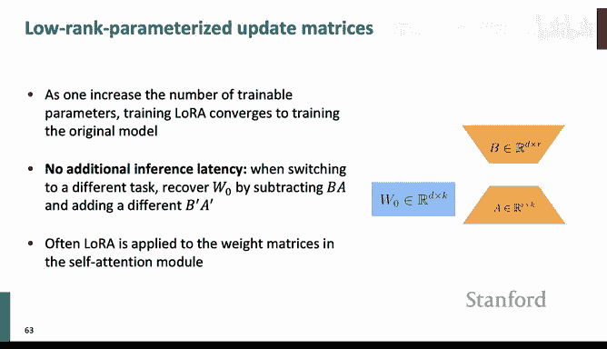
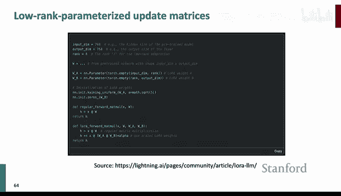

# 斯坦福大学《深度学习自然语言处理｜Stanford CS224N NLP with Deep Learning 2024》中英字幕（deepseek-R1 - P13：-13-Lecture 12 - Neural Network by Shikhar Murty.zh_en - GPT中英字幕课程资源 - BV1U5RNYgEfp

Okay， cool。 let's just get started。 Welcome everyone to lecture 12。

So you know so far we've learned a lot about how like you know we convert words into vectors。

 how we convert sentences into vectors and you know basically take actions in the real world using that so like classified documents we learned about you know transformers we learned about pretraining it is going to be a little bit different I'm going to be talking about how you can train large models on GPUs and a few basics about how you know these ML systems work and it has nothing to do with natural language at all。

 but hopefully it's going to be useful for final projects。😊。

So I'm going to spend some time on mixed precision training some time on multi GPPU training with DP and FSDP and hopefully by the end of the lecture。

 these terms will make sense and some time on parameter efficient fine tuning。

But before we get into the lecture just some announcements proposal grades are going to be coming out shortly hopefully by the end of the day thank you so much for all the hard work I know you know it's kind of getting a little bit crammed with a lot of deadlines for assignment4 and the project proposal so thank you so much for all your hard work the other thing is the project milestone details should be out shortly if not already out on the website so it's worth 5% of the overall grade it's due 12 days from now and it's a maximum of two pages and really the way to think about the milestone is to use this as a forcing function to get work done for your final project and yeah with that out of the way let's just jump into the material so I'm going to start by thinking about how parameters and gradients and generally numbers are。

Resented in computers， and I promise it's going to be relevant to deep learning pretty soon。

 So let's start with floating point。 How many people here are familiar with this cartoon depiction of FP 32 Can just get。

Okay so some of you so yeah let let's kind of recap how floating points are represented in computers so firstly FP32 that's like 32 bytes so the memory requirement is it 32 bits so the memory requirement is four bytes okay and so if you're thinking about neural networks and for every single neural net parameters you need four bytes of GPU memory and the way to convert this cartoon into a real number is something like this so first bit there is the sign and then the stuff in green represents the range and then the stuff in blue represents precision okay。

嗯。And yeah and so for FP 32 you know there is like you can represent like a pretty large range and it's fairly precise right and so the larger the stuff in green is the more numbers you can represent which means more smaller numbers and also like larger numbers and the more stuff in green the more stuff in blue we have the greater a precision in representing actual numbers okay。

😊，So another popular data type that takes half the memory of FP32 is FP16。

And the way we reduce memory is we're going to reduce the stuff in green。

 So there's going to be less range， less dynamic range。 and also the stuff in blue。

 which means there's going to be less precision。 Okay， but the good thing is that we can save memory。

 So， you know， we slash memory requirements in half。😊。

So let's think of a scenario where you know you're trying to train a big neural network and your model parameters and gradients are represented in FP 32。

 you start training and suddenly you get an out of memory good error okay and so just based on you know what you've seen so far。

 one possible solution is you cast everything into FP16。Okay， and if you do that。

 you reduce memory usage by half。So let's kind of work through what are some possible problems with doing something like that。

 so you know like I said because there's less stuff in green there' is going to be less range and so that means a lot of very small numbers will get converted to zero and a lot of really large numbers will get converted into Ns okay。

And there's also less precision because you have less bits in blue。

 which means you're going to get rounding errors for example， 1。

0001 gets converted to one in half precision and I have a little screenshot of how you can test various properties of data types right so。

Basically the things to look at are the eilin， the epsyin is like the smallest number such that if you add that to one you don't lose any precision if you add a number thats smaller than eyilent to1 that gets just rounded down to1 and the smallest normal is the smallest number that can be represented in FP16 anything smaller than that it goes straight to0 okay。

And for neural network training， if a lot of small numbers get rounded down to 0。

 that's actually not good。 So here is a diagram that I took from an en videodia blog post that's just showing。

Just sort of some gradients during the course of training and more than half of these gradients will literally just get set to0 in FP16 which is kind of a problem and that has to do with the range of FP16 and the second problem is we're with precision right so we have basically less precision and so our updates are not going to be precise。

😊，Okay。So the solution here's one possible solution right so we are going to use FP 16。

 but we are also going to use FP32 okay so thats that's sort of the high level idea。

 And what were going to do is we' are going to maintain a copy of the model in FP 32 and let's call those master weights and then you get a little bit of data you run a forward pass and then when you run your forward pass you run it by converting from FP32 into FP 16 okay。

And then you get a gradient on a backward pass and then get your gradient in FP 16 Okay so everything so far has happened in FP 16。

 then you take your gradients， upcast them into FP 32 and then update your master weights And then once you update your master weights。

 you copy them into the FP 16 version of the neural network okay。😊。

So this seems like a reasonable scheme。 you know， I'm using FP 16 on my GPU but I have the full sort of 32 bit precision also lying around somewhere so I can have more precise updates。

 Okay， can someone tell me why this is still problematic。😊，Any guesses？

W to be like there least slow because you have to copy。

The 32 bit versions from my GPP into like some dis memory。然我。Yeah， so so that's a good point。

 So you can often like overlap Io with like forward and backward passes。So practically。

 this is not a problem， but yeah， that's a good point。 potentially， if your network is very。

 very small， this could be a problem。gradientds are usually fairly small。

 like individual gradients are usually fairly small。

 and when you copy the FP16 computer gradients onto FP32。

 you may be setting in your network somewhere else where you don't want to。So yeah。

 so thats that's pretty much pretty much the right answer。

 So you know let's kind of go back to this diagram that we had。

 So this shows gradients in the backward pass。 And you know I said that we're going to compute all our gradients in FP 16 whats going to happen like most of them will just get converted to0 okay which is which is something that we really would like to avoid。

😊，Okay， so here's a possible solution。 So what you can do is you can， you get your batch of data。

 you run your forward pass and F P 16。You compute your gradient。 But then when you have the sorry。

 So were here。 So you get a batch of data， you compute a forward pass in F P 16。 you get your loss。

 You scale the loss by some large value。 Okay， let's say 100， Let's 1000。

 And then you compute gradients。 And now you just like scale your gradient by a large number。

 And so everything that we had on the left hand side of this red line just gets shifted to the right。

 And hopefully there's less stuff that will get rounded down to0。 Okay。

And then compute your gradient in FP 16， copy it into FP 32。

 and then divide it by the scaling factor。And then you update your master winds。Okay。

 so this will solve both the problems that we talked about Okay and so this is basically what we call mixed precision training Okay and its relatively simple to implement this in Pytorch。

 All you have to do is you need to instantiate this grad scalealar object and then。

Within the context of like this autocast， you want to run your forward and backward passes and then scale down your gradient and then update your model parameters。

 okay。But then this seems a little complex you know we have to deal with sort of scaling the loss and then scaling it back down what if you multiplied it by 10。

000 and that leads to Ns and so then you have to kind of scale you have to update your scalar you have to like in the next iteration multiply by 1000 you know and you have to kind of adjust to sort of network dynamics okay so wed like to not do gradient scaling so can we do something better okay so the reason we why we have to do the scaling is you know just recall sort of the role of sort of the bits in green。

That kind of tells you what is the dynamic range of the data type。

 and we needed scaling because FP 16 has a small， much smaller range compared to F P 32 right。

And so because of that， FP16 cannot represent very small numbers。 Okay， so how do we solve this。

Any ideas。3。Yeah so here's a problem right so in FP16 because you have fewer bits for the exponent。

 you can't represent very small numbers。 So if you have something that's smaller than I don't know6 e minus5 it gets down sort of rounded down to0 and that's because of the dynamic range of FP 16。

 so how do you solve that。bits absolutely so that's the right answer so what we are going to do is we're going to sacrifice precision so that's the idea for B float 16 which stands for brain floats 16 so you're going to have exactly the same number of bits for representing the range so that's going to be8 bits so as the same dynamic range as FP32。

😊，But a lot less precision。And it turns out that this is okay for neural network training okay。

And now if you use Bflow 16， you don't need to use grad scalealrs anymore。

 it's as simple as wrapping your model forward pass and backward pass within the right context。

The one caveat about Bf 16 is that it's not available on all GPUs so you need to have the latest sort of Are N video architectures which the A100s。

 the A100s， the A6000s have， but if you have like a older GPU then you might not be able to utilize Bf 16 can you having less precision for the same amount EBIS？

Yeah， so it's B6 thing and oh， never mind， sorry I'm looking。

So here are some kind of results so someone fine tuned this little bit for sentiment classification or a single A 100 at the very top is float 64 which is like you know really really rich 64 bit representation of floating points it takes about 25 minutes and you get a pretty high accuracy but it also takes a lot more memory okay and all the way down were using mixed precision training with B float 16 and now we have reduced training time by roughly a third more or less have the same accuracy a little bit better actually because there's some regularizing effect from the you know the half precision representation and then a lot less memory。

😊，Okay。And the reason we see speed ups for training is because matrix multiplies tend to be faster when you are multiplying in half precision。

Okay， so before we move on， are there any questions about this。Okay， cool。 So let's。

 let's keep going and let's sort of change the setting， right， So now。

 now we have more than one GPU now we have multiple GPUus and we want to train a network over all of the multiple GPUs that we have okay。

😊，So let's start with some basics okay so here's a cartoon showing basically a model and an optimizer receiving some data from a data set okay and let's kind of work through what's stored on GPU V Ram okay and this is going to be somewhat of a lie and I will point out what my lie soon but you know just to keep things simple we have the neural net parameters okay so let's say we're doing mixed explicit training and so its stored in FP16 and then we have an optimizer okay and。

😊，You know， when I first saw this， you know。F years back I was very surprised to see that optimizes also need memory。

 but if youre using something like atom， then you need to store the atom momentum term and the at variances and every time you get a gradient you have to update atom momentum and variances and that's what you use for updating your parameters and because youre using mixed precision training these have to be represented in sort of FP32 okay。

😊，So， so that's， that's， that's what the picture looks like if you have a single GPU。

Now let's say we have multiple GPUs Okay， and what wed like to do is first divide our data into let's say we have four GPU right so we'll divide our data into four parts and well maintain a synchronized copy of the model and every model receives its own slice of the dataset okay。

In the beginning we have a synchronized model and everyone has their own copy。

 we run a forward pass okay so this forward pass receives different data points and so every model is going to have different activations and correspondingly every model is going to have different gradients okay so you run a backward pass every model has a different gradient because there's different data points and then were going to run a synchronization step and what synchronization is going to do is communicate gradient between between different workers okay。

And so I'm going to introduce the first sort of MPI primitive in this lecture。

 and that primitive is called the all reduce operation。😊。

What AutoD does is it takes four pieces of information in this example on four different GPUs。

 it sort of merges everything together and then distributes it to all of the GPUs。😊，Okay。

And the communication overhead of doing that is two bytes per parameter because remember we have FP 16 gradients。

 Okay， so two bytes per gradient and then this needs to be communicated。

 And so the overhead is two bys per parameter。Okay， so that's the all reduce operation。

And then once gradients have been communicated， so they have to be communicated by you know sort of gathering on one worker and just sort of distributing the cumulative gradient。

😊，At that point， every optimizer has the full gradient and then the optimizer can you know update the model so that you maintain synchronization。

Okay， so that's the basic。 that's known as distributed data parallel， okay。

That's good but it turns out that it has really poor memory scaling so let's kind of go through our math for how much memory is needed right so we have the model parameters that's FP16 because we are doing mixed precision training。

😊，And then for the gradient， we also have the gradient and FP 16 right so two bytes for the gradient。

And then we have this stuff in green。 The stuff in green is。

 let's say were doing at So we need to well we need to store the master ways regardless of whether we are doing at or not。

 and then we need to store the momentum and the variance。

 Okay so that's 12 extra bys per parameter Okay and this needs to be stored on every single GPU okay。

😊，And so the question is， can we do better than this， okay。

And so now things are going to get a little bit more tricky。 So if you have questions。

 just stop me and you know we can go from there。So the way we are going to improve our memory sort of scaling is we are a set of techniques that are together known as zero that stands for zero redundancy optimizers。

 so this was you know a set of techniques released by Microsoft as part of that deep speed project okay。

And the idea is going to be that we are going to instead instead of having every GPU maintain all of this state so by the state I mean the stuff in blue。

 the stuff in orange and the stuff in green， you're going to sort of shard it so there' is going to be shard so that not every GPU has all of the parameters or all of the gradient but by communication they can sort of synchronize so that's pretty much what the sketch for this is going to look like okay so let's look at stage1 so like0 has like multiple stages so there's stage1。

2 and3 in stage1 we are going to shard the stuff in green so stuff in green was the optimizer state and so the way we're going to shard and still maintains synchronization is something like this so every GPU has you know the full set of parameters and FP16 and every GPU has its gradient for its data but it only。

😊，Ha a sharded copy of the full optimizer state。And the other requirement is that every GP is responsible for updating the parameters corresponding to its own shot okay so if you go step by step。

 this is what it looks like every every GPU has its own data。

Every GP gets a gradient on its subset of the data。 Okay， then we perform a reduced scatter。

 So now this is the second MPI operation of the lecture。

 So weve we've done all reduce This is the second one。 This is called reduce scatter。

 What a reduced scatter does is every GPU has。😊，The full gradient on its data and what you want to do is you want to take the chunk corresponding to let's say GPU1 so let's say you GPU0 and you've computed the full gradient for all the parameters and you want to communicate your the chunk for GPU1 to GPU1 okay and same for GPU2 and 3 okay so what you're going to do is from the full gradient just communicate the bits that a different worker wants to that worker okay and every GPU has to do that so that's called a reduce scatter。

And then once every worker gets the gradient corresponding to its shard。

 they are going to update its parameters and then once they have updated their shard theyre going to sort of perform and all gather so what that means is let's say you have a neural network with just let's say eight parameters two parameters on each GPU at the end of this each GPU has updated their subset of parameters and then theyre going to sort of do an allga to just sort of maintain synchronization so every GPU gets the full set of parameters that are all updated。

Everything is maintaining this and you're not sming them together in that way。

What makes this more efficient？嗯。So you could you repeat your question why this is better than doing approach So what you're going to do is。

Shared the optimizer state。So let's say in a Iranian example。

 we have a neural network with eight parameters，Earlier we needed the optimizer state for all of the eight parameters now every GPU has to maintain optimizer state for only two parameters。

So after the reduced scatters are done。You have the full gradient correspond to just two parameters。

 okay？So the optimizer state is just the gradient for two parameters。

The model is going to update only two parameters。Using the partial sort of optimizes state。

The entire set of parameters youll eventually get the rest of the parameters back。

 So you have the entire set of parameters。 You have all the stuff in blue。

And you have the full gradient for your subset。Where you don't have the full optimizer state。

So what you can do is you can only update the parameters for the bits of optimizer state you have。

 okay。So in our running example that I just made up you know GPU0 updates two parameters。

 GPU1 updates two parameters， and so on okay and then they communicate updated parameters to maintain synchronization。

Okay。More questions about this？Okay， so let's keep going。

 So so so far we have looked at three MPI operations， we looked at all gather。

 we looked at reduce scatter and we looked at all reduce okay。😊。

So it turns out that all reduce is actually equivalent to running a reduced scatter followed by an all gathered operation。

😊，And just recall that like for DP all we had to do was this all reduce operation and we we computed what's the communication overhead of that and it turns out that when you are doing this optimizer state sharding you have to do exactly the same amount of communication overhead。

Just because an all reduces equivalent to a reduced scatter， followed by an allga。Okay。

And so we basically saved memory for free。😊，Okay， so just， I mean， you should just always use this。

 okay。Because you're going to get memory savings and you don't have any additional communication overhead。

 okay。So we are happy we save memory。 and now， you know， we want to shard even more things。 Okay。

 so let's， let's start doing zero stage 2。 And now along with sharding this stuff in green。

 which was my optimizer state， I'm also going to shard gradients， okay。😊。

And now this is going to be a little bit more complex because we kind of still need need the full gradient for the worker' data slice。

 okay， but each GPU only has enough memory for instantiating the gradient for a small subset of parameters。

 So how are we going to deal with that。So we are actually never going to instantiate the full gradient in。

And then whenever a GPU gets a gradient in the backward pass。

 you instantiate a vector sort of temporarily for the parameter of which you just received a gradient。

And then compute the gradient and then just send it to the right worker。

 and then you destroy the memory that you just created。 Okay。

 so that's kind of the sketch and let's kind of go through this step by step。Okay。

So we have four workers okay each worker performs a backward pass and the backward pass happens layer by layer right so recall the lecture on Autoative so you have the loss and then you have this backward pass where layer by layer you compute gradients okay。

So now let's say you're at Leer J。You take the upstream gradient。

 you compute gradient for the parameters at layerger， okay。

Immediately the moment you compute those gradients send it to the right worker okay so there exists some worker that is responsible for layer J okay and what's going to happen is every GP that' is just computed the gradient for layer J for its data slice sends it to the right worker okay。

And then the moment you've done that， you delocate this memory that you just created。Okay。

And so this is。Kind of a fourth MPI operation， but really not very different from a reduced scatter。

 this is just a reduce so there are four GPUs that have a gradient and then they just have to communicate it to whoever is responsible for maintaining gradient for that layer。

Okay。嗯。And then， yeah， so there exists some worker that is responsible for a given layer。

 They're going to update。Its parameter sh using the full gradient that it received via this communication along with the optimizer state okay and then at the end to synchronize everything you have to perform in all gatherers before。

Okay， any， any questions about about。This like， high level sketch。Okay， so so let's keep moving。

 Okay， so recall that for0 stage one。It was basically free because it turns out that an all reduce is equivalent to a reduced scatter plus in all gather and we are kind of doing the same thing here。

 we have a reduce。😊，Followed by an allga。 So this is practically also for free。 Okay。

 so we've got in a way with saving memory without any communication overhead head compared to GDPP so far。

 Okay， so let's keep going。 Let's， let's try and see if we can shout even more things， okay。😊。

And I think someone sort of alluded to this in the audience early on。

 so what happens if you shard even your model parameters okay so lets say you run into a situation where you know forget about the optimizer state even your model wouldn't fit on a single GPU。

And so in that case， what you do is you split up your model。

 so you split up your model across all the different GPU so you shard your model parameters。

 which is the stuff in blue。But the caveat is that now we're not going to get this for free。

 We're not going to get memory savings for free。 There is going to be some communication overhead。

 okay。😊，And this is0 stage 3。 This is a final stage of 0。

This is also known as FSDP fully sharded data parallel for anyone who's heard that term before。嗯。

And here's sort of the high level sketch。 Okay， and I feel like this is kind of the easiest to understand compared to zero stage1 and 2。

 just because there needs to be communication at every step of the way。

 right you can't get away without communicating。😊，So the first thing we are going to do is we are going to take our model and we are going to convert the entire model into FSDP units okay so here's a sketch a simple deep neural network I'm going to convert that into multiple FSDP units three FSDP units here。

Okay， so that's， that's just a data structure。 an FSDP unit。 Okay， we've not done anything so far。

And then I have this FSDP unit， I'm going to convert this into another data structure called a flat parameter。

 and then I am going to assign a subset of these parameters to every single GP okay。😊。

So here we have 16 GPUs and a flat parameter consisting of 14 parameters plus some extra padding so that things divide properly and Im going to assign each parameter to a distinct GPU okay。

And so that's basically just a complex way of saying that we created some data structures and we just like divided up model parameters to every GPU okay so every GPU gets a subset of model parameters。

Okay， now let's start thinking about what my forward pass will look like。

 So there's no GPU that has the full set of parameters。 Okay， so you're running a forward pass。

 Let's say you're at layer 4。Now and there' is no GPU that has all of flare4 so you have to communicate so we need to do an allga operation that's the operation that we did to you know accumulate multiple things that are on multiple GPUs so that every GPU has a full thing so you perform in allga that so you have all pieces of flare4。

You run a forward pass okay and now you don't need La force。

 so you now discard your parameter shards okay。And now you have to run your backward pass。 right。

 So you' computed your loss。 and now you have to do a backward pass。Again。

 let's say you are back at layer 4， you have your upstream gradient， you don't have layer 4。

 so you need to do another all gather so you get all the parameters of layer 4。

And then you run a backward pass for layer force。 you compute the gradient for your subset of parameters。

 So recall that every GPU has different data points right So there's going to be different gradients for every GPU okay。

So then for layer 4， you do an all gather， get all parameters， computer gradient。

 every GPU has different gradients and then you have to do a reduced scatter so that you can send the full gradient to the GPU that is responsible for whatever parts of layer 4 that you are sending okay。

So。Yeah， so， so that's basically full FSDP。And then once you sort of run the forward and backward pass。

 then each GPU will update its own parameter shot using the full gradient that it received just now。

And then you do a synchronization， right？So let's kind of do a quick review of everything we've looked at so far。

So， those GDP。Which was you don't shot anything， you have the full model， full gradient。

 the full optimized state on every single GPU and all you're going to divide up is the full data set right so you have a big data set of 1 thousand0 examples。

 every GPU gets 250 examples okay and then you compute forward pass and a backward pass every GPU has a different gradient you need to communicate that gradient and then you synchronize okay。

And so that was called an all reduce operation in MPI terms。And then we looked at zero。

 which is now we want to save some memory。 We don't want the full sort of memory requirements of models。

 gradients and optimizer state on every single GPU and in zero stage one。

 we shouted the optimizer state so that there is you know so that you don't have to maintain the full optimizer state for every GPU you kind of break that down between all the different GPUs that you have and we saw that the communication overhead of maintaining synchronization in zero stage one。

Boil down to basically just doing an all reduce through this identity that says that an all reduce is a reduced scatter plus and allga okay and we save memory for free with zero stage one and two so you should just do it you know。

😊，And then with zero stage3 things got a little bit more complex because you have to divide up your model parameters。

 the optimizer state and the gradient， and so while you're running your forward pass。

 you kind of have to do some communication to get the full parameters for any layer for layer four in our example and then also have to do an all gather in the backward pass so you get the full gradient and then you have to do a reduced scatter so that you can send the full gradient for whatever chunk of the parameter to the right GPU。

And overall， that's like two all gathers plus a reduced scatter。

 so thats a lot more overhead than stages1 and2。😊，But if you don't have enough GPU VRA so that you can even load your model onto a GPU。

 then this is kind of what you have to do。嗯。Alright。

 any questions about MPI primitives or stages of of0 or FSDP。

Okay so I'm going to fix the lie that that I said earlier about the GPU VRA calculation。

So I said that there's just like model parameters and gradient and the optimizer state。

 but there is this thing there's this like final thing the model activation so like you know we've all seen that as you keep you know you want to increase the batch size and there is a point when the GPU says that it can't fit more stuff and that's because you also need to store model activations in the backward pass right and that scales linearly with the batch size so the larger the batch size the more the number of model activations that need to be stored and by the way if you're doing mixed precision this is in FP16 or Bf16 but it scales with the batch size okay。

😊，And so that's sort of the other thing that you have to think about。 And you know。

 you none of the techniques that we've looked at so far help with kind of sharddding model activations。

So okay， so we looked at a bunch of like you know basics of like multi GPU training and you know like a floating point but it kind of boils down to this very simple flow chart which you can use for your final projects when you find hearing models。

😊，So the first thing is always use mixed precision training。

 you know you barely ever see a hidden in performance by performance。

 I mean like generalization or like you know F1 or accuracy。😊。

And if youre using the newer MPR architectures， the H100s or the A100s or the A6000s。

 always use B floatat 16， it's just better and you can check that with that torch command。😊，Okay。

 so always use mixed precision training。 Now ask yourself this question。

 does batch size one fit on a single GPU， okay？If it fits and larger bat size。

 okay batch size one is too small， trail larger bat size and or use zero stage 2 okay。

0 stage two is for free， just use zero stage2 and increase your batch size。

If you can't fit even batch size one。Then you have to see if zero states 3 fixes your out of memory issues because now you're going to shard your model parameters。

Okay， and all of this is in the context of full fine tuning， right。

 So I'm fine tuning all of my model parameters。😊，Okay。

Sometimes the answer to that question is also no。 So you can't full find tune in your model on4。

 whatever a 1 hundred0s or， you know， a600s。And you've tried zero stage three。

 you've tried mixed precision training， you have a bad size of one。

 maybe you did gradient checkpointing， activation checkpointing and nothing works and so now basically you can do full fine tuning and so the thing to do is to try parameter efficient fine tuning okay and that' is going to give you a lot more memory savings okay。

So let's talk about parameter efficient fine tuning， okay。

So why is it called parameter effort in fine tuning？ So in full fine tuning， you know。

 you run a forward pass and a backward pass and you update every single model parameter。

And in parameter efficient fine tuning， you're only going to update a small subset of the full set of parameters。

 okay。And why would you want to do that， So you know。

 maybe you're in a setting where you cannotful fine tune even with that size one。

 you've tried all the tricks possible， it just wouldn't fit。

And so maybe you have to do parameter efficient fine tuning。

 Maybe the other possible reason why you want to do it is you know slightly more scientific you know。

 these like models these days are heavily over parametermetricized and you have a small data set and you。

 you believe that if you do parameter efficient fine tuning than you can get a better like generalization okay。

嗯。Or you believe that， you know， it's going to match for fine tuning。 Okay。

 sort of a second reason for wanting to do efficient adaptation。

So the plot on the right here shows in red， it's sort of the estimated growth in training compute for training the largest AI models。

And the line in blue is the global compute capacity。

So very soon we are going to overshoot the global compute capacity and going to need a lot more compute than you know the global capacity and so this is kind of not sustainable and you know there there are arguments to be made about how if we keep going down this route then you know AI development becomes concentrated in only the hands of a few well- fundunded organizations and you know as students we can't do it。

And so that's a problem and then also like if there's only a small number of players that are training and fine tuning module。

 then they may bias the model in specific ways that reflect their value systems and not sort of the broader public and so that's another reason to do to think about efficient adaptation。

And there's sort of this paradigm in machine learning in general and I been specifically to focus a lot on accuracy and sort of efficiency。

 and so the plot in the right here shows the percentage of papers。

Where the main contribution is a method that produces just， you know， more accurate models。

 versuss methods that produce same accuracy for more efficiency。

 And so we can see that for most conferences。The vast majority of papers are about accuracy。

 and there's very few papers about efficiency， okay。嗯。And。

 and so maybe this is kind of leading to this like monoculture。

 And maybe that's why we want to focus on efficiency。

The second maybe bigger sort of concern is that theres this huge hidden environmental cost of training and fine tuning large language models。

 so I was just reading some report where they said that the cost of training GPT3 was equivalent to 1。

1 million tons of carbon emission or some such number and they kind of estimated that that's the cost of running a coal power plant for 10 hours straight okay。

嗯。Alright， and， and for an example， closer to home。In in the reinforcement learning class。

 there was like you know the final project， not not the final project。

 a homework assignment and you know a lot of students implemented kind of a common algorithm one one or two algorithms that sort of outperformed everything else we used a lot more power okay and someone did this calculation that if everyone had used the most efficient algorithm that would have。

Sorry， if everyone had used the more efficient algorithm。

 that would have reduced the power consumption of the class by about 880 kilott hours。

 which is what an American household uses in a month。 Okay， so so there's another like you know。

 these are all reasons to think about like efficiency and like how you can like fine tu models with like less resources okay so let's。

 let's kind of jump back into like parameter efficient fine tuning。 Okay。

 and let's let's start by recapping what full fine tuning is。😊。

Any questions so far about any of this？Okay， so yeah， so let's recap full fine tuning。

 So let's say we have some large pretrain auto aggressivegress language model。😊，Let's say it's a GP。

And maybe we want to use it for summarization， maybe we want it for semantic parsing。

 so like converting natural language to SQL commands or maybe we wanted to answer questions about paragraphs。

 okay。And what do we do， we collect a data set of Xy pairs。

And then we do full find tuning in full find tuning。

 we are going to update all of the model parameters based on the gradient for some loss function。

Okay。嗯。And maybe that's not feasible G3 has 175 billion parameters and so there is just like a lot more parameters to learn and even once you have done full fine tuning you kind of have to store all of the parameters and if youre doing like several tasks you have to store parameters for every task okay。

😊，So can we do better？嗯。So the main idea is instead of updating all of the parameters。

 I am going to update a much smaller number of parameters。Okay。

And then instead of finding sort of a Delta The， which is the same size as the entire set of parameters。

 I have to search over a much smaller space。And then the added benefit is I can store this much smaller delta pretty easily on disk and hopefully it' is going to require less compute and hopefully it' is going to generalize almost as well as full find tu。

😊，So there's many different ways of kind of operationalizing this high level idea of parameter efficient fine tuning。

😊，The one I'm going to talk about today is Laurara， so that stands for low rank adaptation。

And that basically comes from this observation that when you have big language models that you fine tune。

Oftentimes， when you look at sort of the the like geometric structure of the gradients。

 they tend to have a low intrinsic rank okay。Do people remember rank and SVD。Allright， okay。

 so so these parameters So the gradients tend to have a low intrinsic crank okay。😊。

And so what the authors realized is instead of fine tuning the entire sort of parameters。

 you could instead fine tune a much smaller， let's say rank R matrix for every full rank matrix that exists in the model。

 okay。So let's say we have some pretrain rate matrix， W n。

And what I'm going to do is instead of applying some kind of arbitrary update。

 I'm going to make sure that the update has this following form okay So it is going to be the product of two low rank matrices。

 B and A。Okay， so A is an R cross k matrix and B is a D cross R matrix and r is the rank。

 much much smaller than either the sort of incoming dimension and much much smaller than the outgoing dimension。

Okay。And the term alpha， you can think of that as some kind of tradeoff between the knowledge that' is already stored in the prein model versus some additional knowledge that you want to add into the model okay so if alpha0 then you're not doing anything。

 if alpha is something really， really small then you don't really want to change your model parameters all that much and you want to add some really small task specific knowledge。

嗯。And then additionally， the only trainable parameters here are going to be A and B。Okay。嗯。Okay。

And then sort of the other thing to note about this is since I am representing updates as this product B times a as I increase R that' is going to converge towards full fine tuning right so you kind of have the slider that you can use to control how much fine tuning you want to do essentially。

嗯。And then the other important thing is inference latency。

 so what you can do is you can just store these learned matrices for every task and whenever you switch to a different task。

 you can just remove the extra term that youve added to every matrix for that task and add in sort of the task specific terms for the new task that you want to run inference on。

Okay， and and the cost of like storing these like much smaller matrices is also way lower than storing sort of the full delta okay。

嗯。And we'll kind of see where you should apply Laura。

 but like generally you want to apply it to the weight matrices in self attention。

Okay， so encode coded actually looks fairly simple。😊。

So what youre going to do is when you're running the regular forward pass then you sort of you know just like compute the hidden state as let's say the product of the matrix and the incoming feature vector now with Laura what you're going to do is you're going to freeze your model parameters youre going to compute the H as before and then to that you're going to add this additional offset term and that's the only thing that' is going to be trainable okay。

And that's pretty much all you have to do。 We have to do it for every single like weight matrix。

 for every single layer。 Okay， but yeah， so there's like an alter in the second last point。

 where you to find alpha restaurant or do you just like somewhere。😊。

So you yes， you define this somewhere if you set it to one。

That's like saying that I kind of want like an equal tradeoff between pretrain knowledge and the new task specific knowledge。

Typically people set it to one， you could set it to something larger than one if you believe your task is something that the model。

 the preter model has no idea about or something smaller than one if you don't want to change the model too much。

嗯。So so that's basically Laura in practice。 so I said there's a bunch of different parameter efficient fine tu methods right so I'm not even going to name all of these there is adapters some of you might have heard about adapters there is bitfi which is not here and so this like lots of different like p tuning but it turns out that like compared to a lot of these different methods it's it's kind of like you know pretty high high performing on a bunch of different tasks for these like relatively smaller models okay。

😊，And then if we try and look at some of the trying to fine tune some of the bigger models like GPT3 and then compare it with other parameter efficient fine tuning methods so full fine tuning is at the way top then we have bitfi。

 which is you only fine tune the biots adapters compared to that firstly Laura requires a lot fewer additional parameters that you need to store and it kind of gives you a good tradeoff for accuracy compared to full fine tuning and sometimes there's a regularizing effect from fine tuning only a small subset of your model parameters。

嗯。Okay。So you know， the question is like for every matrix you can apply Laura and I said that you want to apply it to the various learned weight matrices and self attention。

 the question is what what parameters you want to apply Laurara to and generally the rule of the thumb is that if you apply it to the matrix that takes your hidden state and converts that into queries？

And the matrix that converts your hidden state into values apply lower to those and that's pretty much going to give you the best performance overall。

The other hyperparameter for Laurara is the optimal rank so recall that these like two matrices B and A that are both like low rank and turns out that like already with a really small rank you can get a pretty high performance okay and this is much much smaller than sort of the hidden state dimensions of of the matrices for most models these days。

Okay。Alright， so we covered a bunch of things we talked about you know floating points and mixed precision training。

 multi GPPU training， DP， FSDP， Laura kind of boils down to a very simple flowchar that you can just like use for your project so if you were sleeping through the entire lecture maybe now the time to wake up and just like look at this flowchar。

So always use mixed precision training， okay。If you have the newer MPR architectures， use Bflow 16。

Try with a batch size one， okay if batch size one fits， try larger a bad size。

 and then always just use zero stage2。That size 1 doesn't fit， try0 stage 3。

 maybe try gradient checkpointing， activation checkpointing。 So it is a question assuming。

Because otherwise zero switch200。Oh yeah， so all of this applies only if you have more than one GP。

If you have a single GPU。Yeah， you have to do other things。

 maybe have to like heavily quantize the model and even then I don't think you can find tune in some of the bigger bigger models。

嗯。So assuming you have multiple GPUs you can try zero stage3 if you have out of memory errors with a batch size of one and if that doesn't work。

 you can try Lauraura okay and the main hyperparameters in Lauraura are the alpha the rank and what weight matrices to apply Laura2 apply that to the query matrix。

 apply that to the value matrix set rank to 8 okay that's a good starting point set alpha to1 okay just do that and you should be good to go okay so you can find few your models and things should be reasonably good。

😊，Okay， so I'm going to end now unless there's questions。Oh，There's one question， the back。

I was wondering if you just go back and walk through it a little bit on step sorrygon slide 48。Yeah。

 this diagram on the left right， okay。So let's go through this diagram So basically what this diagram shows is how the communication overhead is really not that bad if you have a fairly big model such that the time it takes to do a forward pass you can already sort of prefetch all of the parameters for the next layer okay so that's pretty much the idea so that's kind of like a standard idea I guess everyone should already be using like you want to make sure Pych does this by default。

 by the way， like you want to make sure that you know you sort of fully saturate your GPU and then sort of make sure that you kind of overlay that with any additional compute you're doing and that's pretty much what's going on here but let's sort of go through this kind of step by step okay。

😊，And so the starting point here is FSDP units， so is 01 into two are different FSDP units okay so。

What you start by doing is you want to run a forward pass on the first layer。

 We don't have the first layer。 Okay， so let's say you are GP K。 you don't have the first layer。

 So you have to do an allga to get all of the parameters for the first layer。So， that's A G0。Okay。

 at the end of age G0， every GPU has the full set of parameters for the layers corresponding to FSDP unit 0。

 Let's just say that's layer。 that's layer 1。 Okay， or let's just say that's layer 0。 Okay。

 So you have the full parameters for layer 0。 You run a forward pass。 So that's the stuff in blue。😊。

And while youre running a forward pass through the first layer。

 you're going to be smart about communication overheads and while you're running that。

 you're going to prefetch the parameters for the next FSDP unit Okay。

 so let's say layer two is a different FSDP unit。 So that's A G1 okay。😊。

And so you can see that there is like a little bit of overlap between forward 0 and AG1， okay。

At the end of getting all of the parameters for layer 1。

 you're going to do a forward pass Okay and so on。 And then you're going to do A A G2。

 and at the same time now， let's say you just have way too many parameters on your GPU。 okay。

 so you're gonna do a little bit of like memory free you're gonna free up some memory。 Okay。

 so that's the stuff in in yellow。 Okay， And so that's how that goes。 So you know。

 you basically overlay all gather operations with the forward pass。 Okay。

 and that's how you run the forward pass。 Okay， so the communication overhead is really not that bad。

 If you have like a really big deep neural network。 and assuming that you have。😊。

Kind of sharded everything properly， okay。And then you start the backward pass so in the backward pass I guess its a little bit tricky because you know you want to do these allga operations to get the full gradients so let's say it's a 10 layer neural network okay so you want to compute the full gradient at layer 10 you need to do an allga operation to get all of the gradients to get all the parameters at layer 10。

And then you have to do a reduced scatter okay so you have four GPUs。

 Everyone has the full set of parameters at layer 10。 They have different gradients。

 and so they have to kind of merge their gradients and then sort of split them up to the right GPU。

 And so that's the reduced scatter。😊，But that's not too bad because you can still like overlay reduce scatter operations with the backward pass。

 Okay， And so that's what you see happening in the backward pass there。Okay。嗯。

And then like along with these forward and backward passes at sort of。You know。

 regular intervals you have to make sure that you kind of free up GPU memory。 So for example。

 once you have run a forward pass through layer 1 now youre onto to layer 2 you don't need anything in layer one。

 you just like free up the memory in layer1 okay。That's pretty much the idea of behind this diagram。

So there's a few details here one of the details is like in FSDP unit zero is sort of treated differently so you'll see that unit zero is never freed up that's just sort of an implementation detail in FSDP I'll just quickly say one more thing about FSDP and take a question okay so。

😊，The presentation here makes it seem like its so simple and that it can be applied to any any neural network right but turns out that thats not the full picture so you need to do this kind of you need to kind of divide up your neural network into FSDP units okay。

😊，And depending on how you depending on what policy you use for dividing up your parameters into FSDP units。

 there's different communication overheads okay so for example。

 it makes sense to kind of have like multiple like consecutive layers in the same FSDP unit and so on。

 And so this is like very architecture specific So you start to use this in Pytorch youll see that the FSDP wrapper requires sort of a sharding policy and that is like very architecture specific So because everyone uses transformers now they're like very sort of you know handcrafted fine- tuneed policies for transformer like for creating FSDP units and shing strategies for transformers but let's you want to you know for your fine project you came up with a new architecture subquadratic attention。

 whatever。Maybe it's not going to be as efficient just because you don't have the right sharding policy。

 Okay， so that's like one detail about FSDP that that maybe you want to keep in mind。

Your questionification you mentioned you can throw away the weights that you don't need after each layer of forward pass。

 but then when you compute backward that， do you stream them back in each time or do you sort of cache some or cash recent or is there any cashchinging going on or do you throw them all away and stream them all back？

呃。So there might be some caching but in the system。

 but the idea is that you just sort of throw them away or at least to the user。

 it seems like you've thrown it all away in terms of like GPU Ram utilization。

And then we stream them each layer again。看了。And so that's why it's important to like shard it properly right so for example。

 if like every consecutive layer is you know is like sharded such that it's on multiple GPUs。

 then you kind of always are communicating right as opposed to you know you kind of did like all gather and then all of the sort of next three layers are loaded in okay so that's why you know how you shard in this like sharding policy becomes important。

😊，Okay， so if theres no more questions，s let's end early。 Thank you so much。

