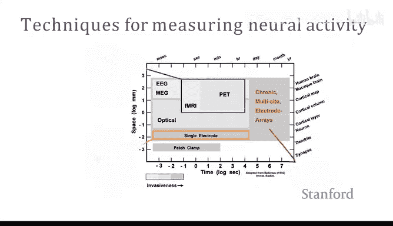
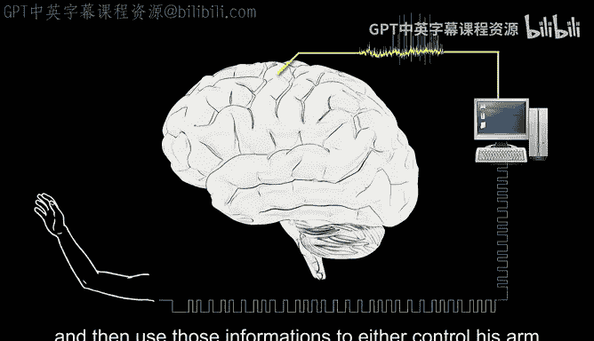
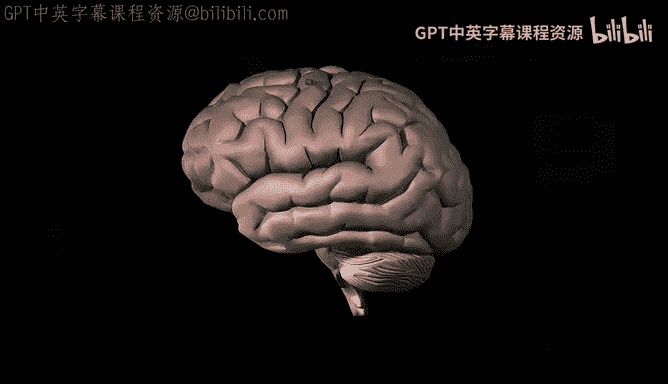
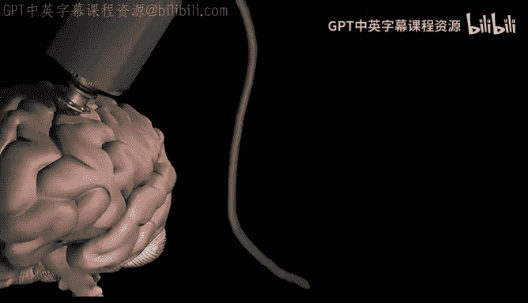
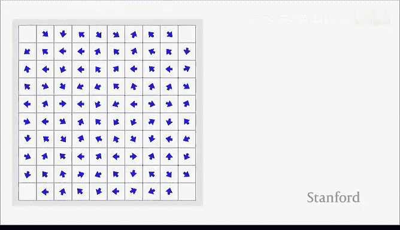
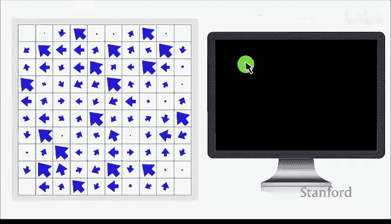
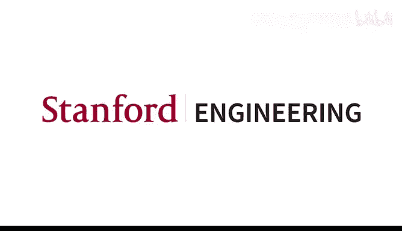

# 斯坦福大学《深度学习自然语言处理｜Stanford CS224N NLP with Deep Learning 2024》中英字幕（deepseek-R1 - P14：-14-Lecture 13 - Interfaces by Chaofei Fan.zh_en - GPT中英字幕课程资源 - BV1U5RNYgEfp

So thanks very， for coming。it's a really busy time in the quarter。

 Everyone's busy with the homework project and midterms。Yeah。

 today I'm going to tell you something I'm really passionate about is the speech pre computer interface。

My research。 so yeah， before that， so I'm just some self introduction。 so I'm Chao Fei。

I'm from the Stanford MPTL Lab。Our left trying to build speech build computer interfaces to help people restore communication or like restore movements。

So today， I think I'm just gonna。Really。Tell you guys how cool this break your interface is given that we have so many。

Recent development in the AI and the machine learning。And I hope you guys all can enjoy this talk。嗯。

Alright， so let me first start with a video to give you some motivations that why we want to build a brain computer interface。

And I think。What the story tell is that we saw this teenager Howard。

 whos 21 at the time of this video， was shot。And he lost all his dreams because of a severe stroke that also like made him in this kind of a locking state where he can move and。

He talked about he used to like going out and play football。

 making friends and just let her his emotion out。 I think all of this is lost to him。

 And I think the most important thing is that he couldn't really speak to express himself to let all the emotions out。

So Howard is just like one of those individuals who suffer from this kind of neurological disease disorder such as braint。

 stroke or LS that can cause like severe speech and motor impairment and even complete loss of speech。

These individuals， I think the life is really challenging for them。 right。

 Just think about you cannot speak。 You cannot move。 like， you still have a fully function brain。

But everything is lost。 all all your dreams could be shattered。So I think for people like Howard。

 as you just saw in this video。The way they can still like communicate with the outside world with their loved one is through this assistive communication devices such as one we just saw in the video。

 which is this kind of ladder board that has letters like organize physically and for people like Howard which may still like have there some residual eye movement。

 they can use their gaze to tell the his friend that where he' is looking at and then his friend can use the gaze to tell what ladder he's trying to say Just imagine how slow this process is if want to just say a sentence it might take you a few minutes to express like simple things like how are you like I'm feeling not comfortable today。

Like an alternative here is you can also use like a eye tracking device so that people can， you know。

 use eye trackings to。Type on the computer on on virtual keyboard， but。W， you know。

 just think about like， if you have to look at the computer screen all the times all day it's really tiring for for them。

 And also like these people are not like us， they probably even if they have still have like a residual eye movement。

It's very hard for them to move their eyes， so it's very tiring as well。嗯。

Maybe something different here， that。Maybe some of you guys have already seen this recently as some videos published by a company called Newlink。

For example， here's a one video here。 Let me see if you can play them。Hofully can them。All right。

I think here is that this company in New is developing this kind of like a tiny。啊。

Iplable device that can be actually placed inside your scalp and then rate the brain signals。

The hope here is that because for people like Howard， their brain is still fully functioning。

So we kind of the hope here is that maybe we can using this kind of like。

Direct interface with their brain so that they can still use their in brain to control like a computer or even like a robot to help them to live like a normal life。

 And here is a quote from this their participants， Lalan。

And he's pretty excited about being able to using this。Very state of art。

 B I to be able to connect with their families and then be able to support himself。

 I think this kind of like B C I， what am I trying to say here that for people like Howard or like a lot of people who has lost their。

Control of their body and language。 I think PC I can bring hope to them。

 So that's what Im going through。Motivate here today is that we are trying to use BI to really help these people。

 But I think before going into the details about how this is how this works。

 I just want to first go through a brief history of a brain computer interface just to help you guys understand how this thing works like why we can put such tiny devices into the brain and then suddenly can interpret what the brain is doing Like there's a lot of interesting stories here。

 So let me start with a brief history of BI。So first， back to the 19th century here。

A British scientist called Richard Caton。Started to do some experiments on animals。

 And one of the things he found is that you can actually measure the brain。

 like measure electricityities from the brain moreover。If you ask the animal。

 not ask about like let the animals do， do some task， say moving their heads。

 then you can see that their like the electricity changes somehow。

 So I think this is the very first early experiments that that scientists do to show that。 okay。

 actually， you can decode some signals from the brain。

 But we still don't know how exactly what those exact like exactly what those electric signals means here。

So fast forward。To 1924， a German scientist called Hansburger invented this device called the。Yeah。

 I always forget how to read that word。 But anyway， so it's sure for E E G。

 So it's basically it's kind of like on the right。 you can see that's kind of like this electrode that you can play place on the outside of your basic on your scale and then measure this kind of like a wave like signals。

So what does scientist Hansburger find is that。啊。First first， so first。

 he's the first scientist to find that you， you can actually measure this kind of like waveleths like like signals from like just this kind of like electro place on the head。

 And then he found that this kind of signals has a very different say frequency。

 depending on how the user， how the patient is。The function like the state of patients， for example。

 if the patient is in this kind of very calm state。

 then you will have generate this kind of a slow alpha wave around like 10 to maybe 20 herz。

 I don't I forgot the exact range。 But if the patient is open their eyes and then doing some like a cognitive demanding task。

 then you see a really sharp beta waves。 So here's the first scientist to discover that you can actually know the using this kind of likes to measure the brain。

 the electricity， E signal of the brain。And also， there's a funny story here that Hansburg used to be。

Use used to be a soldier。 And one day he was training on the horse。

 and then he fell from the horse and I suffered from a concussion。He also has like a twin sister。

 not a twins， but he has he has， he has a twin sister， and then。The story is that at the same day。

 her sister felt like there's something weird。 And then he's just starting to worry about worry about his brother。

 So her sister， his sister sent a telegraph to his， his brother and telling his brother that。

Is his brother。 Okay， So this really intrigueed Hanburger that， you know。

 maybe there's something called a telepathy that can connect to to people through this kind of like。

 I know， whatever， this brain wave。 So that's his motivations to start to study psychology and neuroscience and invent this E E G。

 which we are still using today to di， like things like epilepsy。Okay。And then。

People starting to using the this kind of E G devices to perform。

 like to use it to maybe things we can can somehow detect this kind of wave like things from the brain。

 And then we can also control the， like the frequency of the wave。

 So someone starting like a musician here starting to use this E G devices to。Perform music， right。

 anyway， So I， I guess you guys already get the idea that someone is controlling like doing trying to perform some music with his brain wave。

 I think this is a really cool experiment。 It's done in， I think， in the 1950s。😊。

And you can already see that people starting to get the idea that you can actually。

Bypass like the your body。 you can actually use your brain directly connect your brain to some like external device and controlling that device。

 So I think the idea here is that what if we can also leverage the same idea but to help people with like Howard。

 you know， you can help them to maybe control the body arm。But like the。

 the problem with this kind of like a E G。External measuring device is that the signal you get is very weak。

 Just imagine that。Your brain is generating， you know。

 we probably know that the like the brain has a lot of neurons， right。

 The neurons is actually generating a lot of like signals。

 And if you just put some electrodes on your on the scalp in the scalp。

 and then what you are actually measuring is like the average neuron firings of like maybe millions of neurons。

 which is。If you think about analogy is that if you are trying to see hear what people are saying in the room next to us。

 but we can only trying to figure out like they what they are saying in this room。

 what we are hearing is kind of muing of a lot of things。

 we can probably just tell maybe they are in this kind of like a happy mood or maybe they have reached a conclusion。

 but not exactly what they are trying to say。 So the limitation here is that。

This kind of EG device can only give us very low precision or like a low resolution signal。

 We want to get barrier signal， So help。I think the answer is trying to go inside the brain and then putting this kind of electrodes next to a neural and then trying to directly measure the new activities of these neurons。

And。For the purpose of this talk， we are mostly going to focus on。

The neurons in this region of the brain called motoral cortex。 So this brain。

 as some you of you may already know that brain has different regions that's doing different tasks。

 So in the center of the brains called motoral cortex。

 It's basically controlling all your muscles or oil your body muscles。

 So the hope here that if we can understand the neuron。

 the coding of like the information of the neuron that's encoded it here。

 then perhaps we can decode this information and I use this information to help people like Howard to to be able to control a external arm or being able to speak again。

嗯。So here's some。Very basic。Neuroscience啊。So we know that there's this kind of cell called neurons。

 right So each one of these thing is called neuron， and this is the body of neuron called Sooma。

 and then this is exxon。 So this is another neuron。

 So neuron connects through this tiny thing called synapse。

 So if neuron has want to transfer some information to another neuron just like in artificial neuro network。

 you have some。Neurons and now you want to send information to the next layer。

 you can basically this neuron will generate some action potential。

 which is just some like electricity here to signal that another neuron that there is some information there。

So if you put Chinese electrodes say on the exxon of this neuron here and measure the membrane potential。

 what you will get is something like this， so you will have like on the X axis is the time and on the Y axis is the measure the electric potential and then you'll see this kind of like a very sharp spikes spikes and then if you zoom into this spikes。

 you will see this kind of like a typical firing signature of the neuron which is like the like if the voltage suddenly goes up and then goes down。

So basically what you can measure at the neuron is that it's kind of very sharp spikes。

 that's what you will get by putting an electrodes next to a neuron。Okay。

 so how do we figure out what like what kind of information is encoded in this what call a spike train。

We can perform some behavior tasks here。 So， for example， here。

 suppose that we are still listening to a single neuron。 And this neuron is。

 let's say we are using a monkey for this experiment。 right。 So we are instructing。

 training a monkey to do two things。One thing is basically。

 we are trying to instruct monkey to move his hands either to the left or to the right。

 And then we measure the。Firing all the spikes of that single neuron and then see trying to get what kind of information is encoded by that neuron。

So what you see here is that each row here is basically a spike train of down neuron。

 as you just saw here each vertical line is just a spike of down neuron。Each row is a trial。

 a trial means that the monkey is just trying to move his hand in like one direction。嗯。

Then the vertical， if you see here that。Because like。

You can see here that the neuron seems to fire slightly different across trials。

 So I think that's one like fundamental properties of a neuro that it's very noisy。

 It's not like in an artificial neural network。 If you put something， you always get something out。

 whereas in a real neural network in a neural， real neural， things are really noisy。

 So sometimes they fire a little bit faster， but sometimes they fire a bit slower under the same experimental conditions。

And so， here。What we are trying to measure is that。

If what kind of information is this neural encoding when the monkey is move his。

Lme to the left or limb to the right。 And then one we can。Also。

Split this information encoding into two phases。 One is a preparation， and the other is execution。

 So for preparation， for execution。Execution means that the monkey is actually moving his， his。

 his his arms where where the preparation means that the monkey is preparing to move but hes holding his arm fixed。

 So he will actually move his arm at this。Rightr this go time here。

 So what you can see here is that it seems like this neuron likes to firing a lot during the execution when the monkey's hand is moving to the right。

And it also fires a little bit more。When the monkey is preparing to move to the left。

So this means that maybe the neuron is encoding some movement direction here。So basically。

 if you can repeat these experimentss for many different neurons and for a lot of different directions。

 And eventually， what scientists find is that the neurons， like if you fit， like say。

 for a single neuron。 if you fit the the firing rates of that neuron。

 Basically how how many spike is generating every seconds to different movement directions。

 you can fit is kind of like a cosine tuning curve to it。

 So what this tuning curve means that on the y axis is a firing rate and then on the horizontal axis is the movement direction。

 So this neuron prefers to like firing the most when the movement is say 180 degrees to some reference and then the firing gradually goes down。

So that's like one。 The first thing scientists just find like， how the， like single neuro encoding。

 like movement information。And then if you measure multiple neurons。

 like you will find that each neuron could encode very different informations。 For example。

 this screen neuron here， its tuning curve slightly shifted to the right and then the magnitude is shifted down。

 So its preferred direction is around maybe 250。Now with two neurons。

 you can actually decode out more actually decode about what the the intended movement direction is。

 right， So for example， with a single neuron， suppose that right now。

 I measure the firing rate is around like 30 spikes per second。

 Then there could be two movement direction with 1，20 and then 240。 However。

 with second neurons here。 you can see that we can basically eliminate the like suppose we measure the second neuron fires around like5 per5 spikes per second。

 Then we can。Exactly ping Po。 And that it's the actually the movement direction is 120 instead of the the other one。

 right。呃。However， we know that the neurons has some noises。

 so we actually cannot really exactly tell the movement direction by using two neurons here。 So。

 for example， in the third part theory due to the noise， the actual expose the ground truth like the。

The actual fire rate is those gray lines， but due to the noise。

 the firing rate is slightly shift to those dash lines。 And you can see that originally。

 if we can decode the movement direction is 120， but in this case。

The possibility become that theres four possibilities we cannot exactly， we cannot uniquely define。嗯。

However， you can see that maybe it's still more likely that the。

 the the direction that the monkey tries to move is like around 120 rather than the one。

2 language is like around 50。 And then the other one is more like greater than 240， right， so。

How do we deal with this kind of like a noiseisy neuron， like。

 how can we still uniquely more accurately， like， how can we still accurately decide decoding this intended movements from this kind of like multiple neuron recordings。

I think。We can basically use the machine learning here， right， so。

We can treat this as a kind of like a classification problem。 So here we are plotting。

Each dot here is basically a firing combinations of two neurons。

 and the color here basically represents the， the intended movement direction。

And then if you like somehow train a machine learning classifier here。

 then you can basically see we can draw some like decision boundaries where say on the right side where those if like on new measurement that we get that the firing rate somehow drops。

Fs onto this here。 Then we probably know that it's going to be the monkey is trying to move to the left direction。

 right。So， okay， so。I guess here， like。We know that， okay。

 we we can do this kind of single neural measurement。

 We can measure firing rates of multiple neurons。 And then by training a machine learning models。

 we can use this。Machine learning models with the neural data to infer like the what's the likely movement directions。

 So this is how we are going to build up to actually build a brain computer interface questions is for all these data you mentioned a neuron one that's a very like specific number where how do you pinpoint machine neuro concern。

Yeah， so here neuro ones basically like we are taking。

 So we are here make an assumption that each tiny。Electro here you see。

 is measuring like exactly one neurons， and then that electrode will be fixed， always be fixed。

 always measuring the five of that neurons。Yeah。But in the real case。

 it's not it's not always the case because like you think about it the brain brain is this kind of like a soft structure。

 So if you put the electrodes there， it move a little bit and measure different neurons。

 So that's one of the challenging problems of the BA。

Is that how you can deal with this kind of neural change？Recording change， yeah。All right。

 let's go back to here。Now， we can basically know that we can push some electrodes into the brain into a motor cortex。

 measure some signals。 And then we know how the neural in encode those signals。

 And then we can also build a。Machine learning decoder to deco those signals， right， So。

Basically have some like methods to be able to build a bring computer interface so that we can interpret。

What like a still functioning， fully functioning brain trying to do。嗯。One more thing is that。

 so how we can record these signals。So yeah， this is a very complicated。Figure。

 but don't worry about all the details。 What I'm trying to show here that basically there's a lot of different technologies that you can use to rec brain signals。

But when you think about this technologies you can think about it as in this kind of two dimensional。

Two dimensional away。 So on the Y axis is the thing about as a spatial resolution。So。The higher。

 so the higher up up you go on the Y axis。 That means that you can basically measure you。

You can basically measure like， very。The like the the basic show is like what， what's the。Region。

 like what's the size of the region of the brain that you can measure。

 So if you go really high up there， then that means that you can only measure。

 say a very large like like the average average brain activity of a very large。

 very large brain area， whereas if you go down the Y axis。

 that means that you can actually measure two very fine green scale like such as a single neurons。

Whereas the app the horizontal access here means that the temporal resolution。

That means that for technologies such as this kind of like a single neuraln recordings。

 you can basically measure， like exactly。At each time point， for example， like 1 milliseconds。

 what's the like electric potential Yes for that single neuron。

 whereas for technology recording technology such as M。

 which basically measures like the blood flow in a small brain region。

 It can only measure on average around like， like say。5 seconds or1 seconds。

 What's the blood flow changes in that small brain area。 So that's really like。

Average of a lot of information， because we know that the neuron fire is like this really like fast speed right to the firing。

The the electric potential change of neuron is usually around order of 1 milliseconds， right。

 if you can only measure things around。Like say one second。 you are basically like averaging。

 smoothing out a lot of informations。So ideally， we want to have something both have like a high spatial resolution and also temporal resolution here。

So what we will use in most of this。Right now， in a lot of like a clinical trial in our lab。

 this kind of like a。Motore array。 So each。Each electrode here is like a tiny needle that can measure maybe a signals of a few neurons。

 and then you put this needles into a small tiny like a square on the size of like a fingernail and then you can measure maybe on the order of hundreds of neurons。

Alright， so now we can have this devices to measure neurons。 That's going to a more like a。

Examples of how we do this here。

So here's， let's take an example for。Simple here。Suppose someone has have a， like say。

Sp cord injury and lost the connection to his body。 So his mind is still fully functioning。

So the question here is that whether we can still what kind of information we can still decode from his motor cortex。

 such that we can decode those informations and then use those informations to either control his arm or his own arm or like artificial arm。

What we are going to do is trying to put this kind of tiny electrodes。

 microe array into his mod cortex。Really penetrating into the surface of his motor cortex。

And each electrodes here， as you see here， is this kind of tiny needle and those。

G triangle is the size of a neuron， So each electrode maybe is measuring the firing potential of multiple like local fuel potential of multiple neurons around it。

And。We can pass all this information in real time。To a computer through this kind of like a wire right now。

And then this what we get on the computer here is that， for example， here。

 each block is basically the measurement of that one electrodes。And。

If we do some like behavior experiments as we just showed now。

 we can probably figure out the tuning curve for each electrodes， for example。

 this one is probably its preferred direction is to the left。So we can repeat experiments。

 behavior experiments for other， for other channels here。

Prob train a M L decoder to figure out what this channel。

 each channel is encoding the preferred direction for each channel。

 So once we have the decoder trained。And then。

At test time， we can basically ask our participants。

Who has the thing employee bring to trying to imagine to move his hand to some directions。

 And then the decokoder were trying to figure out the direction he's trying to move right。

 So that's the basic idea here。嗯。Let me go to a demo here。

So， this is one of the。Research coming out of our lab in 2017。So here you see a participant。

Is typing on virtual keyboard with with her mind。Right， and that on the bottom shows the。

Typing speed measured as the。Correct characters per minute。 So it peaks around 40。

 And then on average， maybe it's around like 20。I think this is really amazing。

 like think about like four people like Howard who used to have to using this kind of letterboard to communicate。

Now， with this brain computer interface， he can fully communicate by himself through like say a computer。

 So that's a huge improvement over that borderia。He still opens his eyes， I mean。

 she still opens her eyes。With eye tracking。Now for this experiment。So even even she close the eye。

Still work。Yeah， it will still work， but like， she won't have the visual feedback。 You know。

 she won't know where she's typing。If she came up with a。The character。

Without looking at the keyboard。Okay， I'm， that's something I'm gonna show next， so yeah。

And how you know whether the it's the person。Who mistypepe or whether it's the machining thats。

我夹出 in the佢嚟。改。I'm confused by what this in that character。Okay， oh， oh here。 So yeah。

 that that's a good question。 So let me clarify here。 I think the task here is maybe it's not。

Readable， but I think the task here is basically she is copying a sentence。

So we know the ground truth then we can measure like the error rate。And。Yeah。

The clicking motion or the like selection motion is that easy to distinguish or is there a certain way of knowing that the user's pressing down or does she visualize like a mouse or？

Actually that's really good question。 So as I just mentioned， right， so。We can decode movements。

 and we can also decode like， say， different gestures， say like。I see。

 you can use this kind of gestures or like move his her elbows。

 So he can just imagine different mod movements。 And then we can basically map deco those module movements and map that would say a click signal or different signals。

So let's see if the person looked at the keyboard and then remember the keyboard in the。

And then she close eye and that's their word。啊。I think that's really even like that's even hard for me to do right。

 I can， can you like remember the keyboard and then just control like say a mouse and I you keyboard every day。

 So I definitely remember the word。And then just close my eyes but this is like a virtual keyboard。

 so it's not like a physical keyboard we can use your muscle memories。Yeah， so， yeah。

 so maybe one thing I have to clarify here that the mental image for her is to say controlling like a like the words。

 I mean， it's just just like controlling a like a mouse， right。

 So shes not actually doing the touch typing， but she is actually moving like say a mouse。没。我先动。

Alright， so this is basically just a showcase that。Building up on other the knowledge。

 we have learned about the brain so we can basically decode some attempted movements from people like like this。

 I forgot her name。 but like I think it's T 6。 I code name T 6 that we can really help this kind of people to regain communication through this kind of PC I。

And I think。As I mentioned earlier， you can also use B I to control robotics arms。 So， for example。

 in this case。This is the participants Think Caltech。Os。

Hes using his mind to control this robotic sound， which grabs him a drink。注です。'All right。

えゆてるしゃってはなんですけど。实使。因为。嚟咗。这个这据。All right。And also， you can do things like。Restore working abilities。

I think as someone just mentioned right now， just now is that maybe。

There's like we can trying to restore different modalities of communication。For example。

 just now we are just using the movements and then using by restoring movements。

 we can control computer。 But like， how about we directly restore the abilities to do handwriting。

 right， because handwriting is very non actual ways to communicate。 So Frank。Frank Wi。

 a research center from our lab in 2021 published a paper to show that you can actually do this kind of handwriting BCI and he showed that it's actually really。

 really fast compared to the previous one Okay so now we have seen that there's a different ways to restore communication。

Here's just like a tape a measurement of different ways of communicating。

 right you can see on the very left is。Say sip and puff interface is very slow。 Basically。

 that means it's for someone who can。Not really move， but can still do some like a breathing。

 They can do this kind like a step and a path to say yes and no to communicate。 That's really slow。

 maybe around five words per minute per minute。 for a normal person。

 I'm really surprised that on average， a normal person can write。

Maybe5 like 13 or 14 words per minute。 That's really slow， but maybe that's just the average speed。

And on the very far right side is the natural communication。

 which can reach up to 150 and 60 words for for per minute。Just put everything into context here。

 So the 2D cursor， I just show you guys right now can do8 minutes per per minute，8 words per minute。

 and the handwriting can do around 18 words per minute。So compared to。The say。

 letter board or like this kind of eye tracking。We are doing it。 well， We are really。

Make a lot like advancement here。 but still far， way far from like the natural conversation speed。

 So the next question basically is， okay， how can we get there， Can I actually restore natural。

Can we actually restore speech with a brain computer interface。嗯。嗯。Together， I think。There's a。

Huge barrier here。 First is that。The language processing in the brain is a really complicated process。

 So， for example， here it' showing all the brain areas that's involved in the language。

 And when we still don't know exactly how this happens， but this is just the。

Our best guess at the how language is。Processing the brain on the very right。

 you see that there's a lot of the brain brain regions that's involved with。

Knowledge and reasoning in the center is a maybe area that's involved with semantics and syntax。

 And on the very left is about the perception of speech and then the production of speech。

Language is really complex， so。Maybe the hope here is that we can start with model cortex with model planning of language because things I've just shown you guys that we already know how the model cortex can encode movements right。

 and we can also know that in order to produce language we need to speak。

 and then maybe we can put some electrodes into this part of the model cortex that actually controls our oral facial muscles。

And then trying to decode some information there then see if we can actually restore speech。嗯。

To actually being able to restore speech is， I think it's more complicated compared to the restoring movements。

 So I'm trying to say here that this the production of speech is really a lot of complicated movements。

 And it's really rapid。 It's just more than just moving your hands to like certain directions。

So restoring speech is much harder than just decoding out those movements of each art decos。

So instead of trying to decode the movements of each articulators， because it's very hard， right。

 So also like for people who has a。Like Howard people like has lost speech。 It's basically。

 it's very hard to actually measure their speech artator movements。Instead of。

 maybe we can try to decode out this kind of like a discrete phones instead of like a this kind of continuous speech article of movements。

 because we know that all the languages。Ha this can be decomposed into this kind of the basic phoneatic units。

 For example， for English， we know that there's a different vows and different consonants。

 They are correlated with how you place your tones in your mouth and how you place your different speech articulators。

 So here we are trying to instead of decoding the actual articulate movements。

 We are trying to decocode these kind of discrete phonemic tokens。

And then there's a previous work work showing that if you put some electrodes on the model cortex。

 and then you can actually。Tell the differences by measuring the tell the differences of different phones by measuring the electric activities in the motor cortex。

 So there's a hope of。Being able to restore speech from by just putting electrodes in the model cortex here。

And indeed， so in 2021， researchers from UC SF actually demonstrate it's actually feasible to build this kind small vocabulary speech PC with this ecog recording technology。

 the difference between ecog and then the microe array I just show you guys is that whereas the microe array actually penetrates into the cortex。

 but the ecog stays on cortex。 So it doesn't actually record single neuron firings still record some average neural activity over a small region。

 So compared to microe array， they will have a slightly lower。Resolution。

 So that's why their prototype is around this kind of a small vocabulary PC I。

 which can only decode 50 words at around maybe 75% accuracy。

 But this is still very exciting work that showcase that you can actually achieve maybe achieve a this kind like a speech decoding using by putting some electrodes into motor contextex。

😊，Alright， so I'll just right now going to the research that's done in our lab。

 which is to build a high performance speech in neuro neuropath disease。So in 2022。

 So we recruited a participant code named T 12， who has L O S。 So T 12 she used to be a。

Very active person。 She likes to ride horse， likes to jog， but。Because of A S a couple years ago。

 she basically couldn't do all those things that she used to enjoy。And unlike most A S patients。

 her symptoms starts with or facial movements first。 so she still can move her hands a little bit。

 but she cannot really speak intelligibly。So we decided to put four microelect arrays into her brain。

2 arrays into her motor cortex and then two array into the part of the brokers area。

 which is supposed to involve with language planning。

 So the hope here is that we want to both decode the。The execution of of speech。

 the production of speech， which is is you can how you control your your like speech educators and also maybe some like high level planning about the speech。

 So that's why I want to put a array into two different brain regions here。

So the first thing we do after we put a race in her brain that we did some like behavior test to see what kind of information we can decode from those arrays。

 So here's a a very here's a result。 If's the first result we got is that we are trying to classify different task here。

The first plot is that we are trying to using this four arrays to classify the or facial movements。

So this dash line is the queue that she's actually。Executing those artificial movements。

 And then before this dash line， she is trying to prefer to do those artificial movements。

 So you can see that this two right line here so that you can。Classify， you can classify。

 you can predict those movements much better above chance using these two arrays in the motor cortex。

 whereas these two arrays in the broadcast area， you can basically。

 you cant really predict too much above chance， especially during the execution of those more movements。

And for single phonemes which we instruct our participants to speak single English volumess。

 you can also predict those things much higher like much higher above chance using this two array from the model cortex and also for the words for single words。

 right。So what these results tell us is that for those two arrays we have put into T12's mind。

 These two arrays in the model cortex contains a lot of information about the the phones being articulated。

 And also the， the words being articulated。 But those two arrays in the broadcast area。

 which is supposed to help us to figure out the planning of the speech production doesn't contain too much information。

 So that's really intriguing to us。 And we're still trying to figure out why， why that's true。

 So for the rest of the。Let's talk here。 mostly using only these two arrays in the motor cortex here。

So now we know that there's phoneatic informations being encoded in the those two arrays。

 What we' are going to do next is actually trying to build a real time brain to text the PC I。Here。

 so what we're going to do is。Let me just show you a video demo， first， to。know， get a sense of。

What the the the PC I trying to build。 So here。This is our participants。

 So she's connect to our decoding machine through this cable here。

 which transmits her neuro signals in real time to decoding machine。 And on this screen。

 you can see that there's a sentence here that we instructed her to copy to basically to read alo。

 And then this wants this rest。Square 10th green。She will try to speak， and then。

What you will see below here is what the machine is decoded。嗯。嗯，对对。嗯。嗯嗯。全もて。意 center。えて。Yeah。一个。嗯ね。嗯。

I didn know。 its school。嗯嗯哎哎。嗯。没。I don't see much pollution to on。Alright， so that's。

Almost perfect decoding results from her。 And you can tell from the video that although she can vocalize。

 but it's not really intelligible because of her limited artificial muscle movements。

 But we can still decode out from her brain signal that what she is trying to say。

 And this video is so the task what I just show is she' is trying to copy a sentence。

 but this is trying to answer a question here。嗯。嗯。哦。そで。And we also tried the different modalities。

 which is because。When she tries to attempting to articulate it very actually very tiring for her to actually to articulate those sounds。

 so what we try here is that only instructed her to move her mouth or move her articulators but but not vocalize。

 So what we call this a silent speech and we can still decode pretty well using this kind of like a silent speech modality。

I do not have much compare。啊就。来这一个。All right， okay。Okay。

 so let's just move on more technical details about how we build a speech piece here。So。

As I just mentioned， right， So the first thing we need to do is to try to build a decoder。

 And before building that decoder， we need to do some data collection。

 So here's our research scientist， Frank， sitting next to T12 and asking her to read that sentence on the screen and then we'll record the new activities of saying that sentence。

 So well have this kind of pair data， collect pair data where the input is a new activity and output is the target sentence want to decocode。

 So we basically have to basically go to。Where T 12 left。

 and then we'll do some data collection session there and then testing the decoder。

The way we collect data is that。Because we only have very limited time。

And we cannot ask her teacher to， to speak a lot of sentences， so。

Will divide the our data collection into this kind of block structure where we instructed her to speak 40 sentences every block。

 and then she take a break， and then we collect another block。

 So the data collection will last about 100 minutes for every research session and then。

Or train a decoder， maybe that takes like a 10 to 20 minutes， it's really quick。

After training a decoder， we'll start actually evaluating the performance of decoder by asking our participants to speak some new sentences and then see how well we can decode on those new set of sentences。

So in total， we did the experiments sessions over maybe three months of time。

 and then we collect about like 10，000 sentences from this like a switchboard telephone conversation corus。

 which I really want to emphasize that we want to decocode this kind of conversational English。

Once we have the data， then we can try to see how we can design a decoder that can best solve this task。

 So let's first define the problem here。 So we have some。Neural features inputs， right。

 So let's say we have some neural features， which is a time series。

 You can think about as a maybe similar to audio that the。At each time point。

 we'll get some feature vectors。嗯。The output of this decoder is a set of words， right。

 So we know that she's trying to speak some sentence。

 So we are trying to takecode the words from this infiniteial features here。As I said。

 as I mentioned earlier。 So instead of like directly decoding words from the input sentences。

 maybe want to have this intermediate target of phones to decode。 The reason is that。First。

 we know that。There's only 40 phonemes in English， so that's a much smaller set compared to the number of words。

 so if you want to train Dader， like I actually Da。Words then you will have。

 you need to have much more data to cover all the possible words。 whereas for volumess。

 you probably need way less data to cover all the 40 volumess here。

 So with install decoing directly decoding the words。

 we decided to decode an intermediate representation of phone from the neural input features。Okay。

 so。Basically， there's the two decos we want to design。

 One is the first is a neuro to volume decoder， and the second is the volume to decoder。

 So that's the two decoders that will have to design this task。

Let's focus on the newer Tphonium Dakota first。So basically， that， I think at this point of class。

 we probably know that we can treat this problem as a sequence to sequence problem。

 Right So the input is some feature sequence。 output is a token sequence。

And the four sequence 2 sequence problem， we can we probably know that we can use some like encoder and decoder models to。

 to solve this problem， right。However。For encoder deco model is's actually more powerful than we actually need because encoded and decoder model allows this kind of arbitrary alignments between inputs and outputs。

 That's really helpful for tasks such as the machine translation， whereas， you know， some languages。

Has like different award orders than other than other languages。 but here。We know that the。

The alignment is actually， it kind of like a more monoonic compared to the like。

 say machine translation where the alignment is arbitrary by monotononic。

 I mean that you know that the probably like that the say， for example。

 the first two neuro features probably like corresponds to the first volume in output sentence rather than the last volume in the output sentence。

 right， So this is kind of like a monoonic alignment。

So to solve this problems of monotononic alignments。

We can actually borrow ideas that people have developed for。

Machine learning tasks such as handwriting recognition and speech recognition where the task is also trying to decode a say a ladder sequence。

Or like phone sequence also ladder sequences from some like。Say speech features。

And the technique you are going to use is called connection is temporal classification。

 So for people who have taken C S 2，24 S， you probably already know what this means。

 but I'm going to do some little bit introduction about this thing。

 I guess I don't have too much time。 but I just quickly go over it here。So what CC。

 the connection T classification do is that giving some input sequence， right。

 the goal is that we want to decode some output sequence。

 but we don't know the exact alignment between them。

 And usually the input output has some length mismatch。 For example， in the case of like。

 say speech recognition where the input is could be have like length of like several thousands of frames。

 right where each frame correspond to a very like fine level。

 like fine highest temporal resolution features that recorded at the like say 20 milliseconds whereas the output only has a few tokens So that's like a huge length mismatch here。

What we can do is。Which can still using like， say， R and transformer model to predict what the output token is at each time step。

 right， And then we somehow have to figure out a ways to fill in between like fill in between the output tokens。

 some like spacers so that the output token can also have the same lens as the input output sequence can have the same lens as the input sequence。

 So what does CC loss does this introduce this additional blank token as the output。

With this blank token， what you can actually do is。For example。

 here is a example output of the CTC classifier。It's trying to produce this kind of like sequence here。

 right， What you can do is first， you merge repeated tokens。

And then you're taking out their blank tokens。So what you get is a much shorter sequence as correspond to output。

 So what CC loss it does is it allows you to。To do a sequence。

 to sequence problem that has a different input and output length and also have this kind of monoonic alignment property。

啊。Let me just skip through this detail here how you can train a CTC loss here。

Just skip through this thing。So now let's suppose that we have this CC laws that can actually train。

 be used the train to， to， to train our model right。

 The next problem is what kind of decoder we want to use for this task。

What kind of neural network decoders to use for the the stars。 I think at this point of class。

 I think most of you guys are convinced our transformer is really powerful， right， There's no。

 no reason for me to say more about it。 But in this case， we don't want to use transformer。

The reason is that we don't have a large dataset， as I mentioned， previous。

 we only have 10000 sentences right， And also， Transer is really good at dealing with long range dependencies。

 But here for the speech production， like there's no really required for long range dependency。

 So let's just go back to the very simple R。 We know that R works for small data sets。

 and it it can it can predict it can deal with short range dependency pretty well。

 And another nice thing about R is that it can it's very efficient to run in real time。

 It can do like put a very complicated R even run very efficiently on your on your mobile phone。嗯。1。

 like one， like the most popular R。We have learned as Ios I TM I uses this kind of like a memory state here。

 my cursor use this memory state to trying to store some long long term。

 like long range information and then use this different input and forget gate。

 input and output gates to control how you can write， read and write into that memory state， right。嗯。

But LM is also very complicated。There's a variant of STM called GRU G ret unit。

It's tries getting the idea here that just trying to combine this memory state and hidden states into just one hidden state。

 by doing that， you can also reduce some gates。 So GU is basically a more simpler version of L S that works really well。

 when you have a small， small data set。 So here we use G instead ofTM or task。

So now we know that how we can decode phonemes and then we have neural networker models to decode phones。

 right， We know how to train the model。 So at inference time by inference time。

 I mean that at testing time， you can pass in some neural activities into our decoders。

 and then you will decocode out some like phone probabilities， right。

 So there's maybe at the first time step， the highest probabil is I the problem here is that how do I figure out the most likely output sequences giving this phone probabilities。

 Right， So basically the task is to find the most likely output sequences here。嗯。I think。

For this problem， I think since we have already did。Something similar in the assignment 3。

 which is that we can use beam search to figure out the most likely sequence here。 However。

 there is a one caveat with the beam search when you're applying it to the CTC loss。

 but I'm not going to expand it too much here。Yeah， so let's just skip over that。Now。

 suppose that we can use the beam search to find the most likely volume sequences。

 How do we convert our volume sequences into words， right。

 So that's because we eventually want to decode a sentences， but not just like a sequence of volumes。

So one thing you can modify the beam search is that you can。

 if you have like an English dictionary where you can map each words into its pronunciations。

 then while doing the beam search， you can basically see that if you decode some phone sequences that's correspond words and can basically replace that volume sequence with that words。

 right。嗯。However， you can actually do better by using a language model。For example， here， that's the。

 the thing about that's the the decoding equation。 What I want to do here is that。Here。

 the axis is the input， the y is decod the word sequences。

 And then because not all word sequences are。Have the same likelihood right。 So some word sequences。

 say， suppose I decocode a sentence。 say I can spoke。 that doesn't。

 that doesn't seem like a syntactically correct。 So we can use maybe use the language model to evaluate the probabilities of each decodial hypothesis。

 And then using that as some sort of weight on the final decoding probabilities。

 So we're adding this extra term here called the probabilities of sentence here。 That's actually。

 you can just decompose that into the probabilities of each token， giving its previous tokens。

 and you can basically measure these things using any language model， right。

NowAnother thing we want to add here is another term is the word insertion bonus。

 So one problem about this language model， this probability of sentences that。Actually。

 longer sentences will have smaller probability than shorter sentence。

 That's just like the properties of this how you decompose that how you decompose the is probability here。

 So we want to actually to balance the length of the decod sequence here by adding some word insertion bonus。

 so。What we are eventually trying to optimize is this equation here using both the probabilities generated by the iron decoder and then using some sort of language more like weights and then were insertion points。

And also， some ways here， you can optimize。Okay， just trying to put everything together。

So suppose that you have a neural feature inputs here。

 which is you get the sub neuraler features every 20 milliseconds。 You pass that through a GRU。

 and then you got some formrop， right， This is all happens in real time。

 So everything has to be happen under like all computation needs to be done within 20 milliseconds。

You do a really quick beam search。 and then you find， okay， maybe this。

 this phoneme corresponds to the word I or the word I。 And then here。

 we want to use the agram language model instead of like a more powerful transformer language model。

 The reason is that。We want to really do a lot of like evaluation really quickly under 20 milliseconds。

 So if so suppose that you have like， say 100 hypothesis， right。

 And then you want to all evaluate the possibility of them。

If you use a transformer language model such as G3， which is really powerful。

 but you can really like do really fast inferences under 20 miseconds， right。

 So whereas the Ang language model， you can just load everything into memory。

 and all the evaluation is just a memory lookup。 So it's really quick。After that。

 you can get some probabilities out。 and then youll just keep say the top K hypothesis for the next step。

 next step of a beamM search here。 So that's how we use the ang language model in the real time decoding。

After that， we'll use a transformer language model。 So to。

Re rank all the hypothesis generated by the ngram language model。

 So this actually happens when you actually deco it out the entire sentence。

 Sa what I can keep the most likely。100 sentences。 And then I can， at this time。

 I can use the transformer language model。Which can quickly evaluate the probabilities。

 say only for 100 hypothesis under the time of maybe half a second， right。

 and then can get a better probability measurement of other sentences here。Yeah。

 so putting everything together。 this is how the entire system works when I show you the previous video just that。

Is that we can right now using this complicated， knockcom back multi stage machine learning model to accurately decode what the person is trying to see and build this high performance neural speech pro neural speech B I。

Right well almost time here， so just skip the evaluation part evaluation is how we measure the performance is basically measured in the what error rate。

 You also have all the data open to as a competition So if you guys are trying really want to curious about this thing you can try to play around with it。

I think。Here's， I think the most exciting thing about doing this research is that you actually。😊。

See how your research can impact people here。 So this is a quote from our participant T 12。

 And then this is how she reacts when this thing first worked for her。 It's really exciting that。😊。

She can speak after so many years of silence。Okay， so in the last five minutes。

 maybe I can just go little bit into what I think is the future of Bs Yeah。

 So I think what I've just shown you guys is that using B is。

 we can help people to either restore movements or restore communication。One exciting direction。

 I think is this kind of a multimod B I。Here is a work published by a group at UCS UCSF is that they are trying to decode not only the phones。

 but also speech， I mean， the actual speech and then also some art gestures so that you can actually move 3D avatons here。

And also， as I just mentioned， is that。嗯。The the final goal of this speech at PCI is you want to actually deploy it for peoples to be able to use it every day just as we use our phones。

 right， so。So here's a more recent development of speech PC I by our collaborators at UC Davis。

 What they do is they actually put four arrays into the motor cortex。

 meaning that they can actually have better signals than we do。

 So what they can actually show you that。 So for here。Just for reference， previous。

 I just forgot to mention that the， the final performance of our system is that we can get maybe around 25。

Percent whatever average rate means that for every 100 word。

The participant says 25 of them maybe as wrong。 So for this latest to work at the USA Davis。

They show that you can actually get close to 0 whatever rate in a few sessions by training the system more and more continuously。

 So it's actually being very。Close to being actually a usable system right now。

And here's a video of their participants using the system to speak， it's very accurate。She。

 he's actually using the system to。Every day right now for communicating with his family and of full work。

I really cannot be understandingstate how important that is。All right。

I think the most exciting direction， I think， happened。 at least like personally。

 I think is happening in our lab is that。We are to maybe trying to restore more effortless and natural communication by decoding this kind of inner speech。

So previously， all the speech pieces I just show you。

 I think the maximum speed we can do is maybe to go at 60 to 70 words per minute。

 but that's still far slower compared to natural conversation， which happens at 150 words per minute。

 So one of the reason is that for all these participants。

 if we ask them to trying to attempt to speak because they have been lost speed speech so many years。

 it's very hard for them to speak at a normal rate。 However， we know that。

We know that a lot of people have this kind of an inner speech right we're kind of like talking to ourselves self in our mind。

 I think the research question here is whether we can decode this sort of like an inner speech。

So it is like some like a preliminary work from one collaborators in our lab show that you can actually do so。

 So for example， here， shes the results show that by if you a tentive speech。

 which is why I just show you that you can do maybe at for a small set of words you can do say at the 90% accuracy。

 but if you ask the participants to imagineagining moving her mouth or imagining like a voice in her head。

 you can do pretty well right， So it's not as good as the。A tempempest speech。

 but still much better than， much higher than chance。

 So I think thiss showing that it's possible in the future that we can decode this sort of like an inner speech to fully restore like natural communication to people like a Howard and K off。

But I think there's a more controversial issue。Regarding this kind of inner speech。

 because what if like。You can decode something that's your like your private thoughts or private memories that you don't want to express。

 right， That's a very difficult question here。 and also。As I just mentioned。

 not everyone has in your speech。 And also， someone maybe like when you think about this kind of like speech。

 speeches， just a external， one external representation of your internal thoughts。

 So like linear representation that you want to put out through this kind of like like medium of speech。

 whereas your inner thoughts could be more complex， more multidimensional。

 So it's very hard to decide where you want to put a raise。

 and you very want to decode all those inner thoughts。

 But I think that's also very exciting opportunities for us to learn more about like the speech processing in the brain。

😊，And I just imagine， like， if you want to takecode this kind of inner speech。

 then you' also come into this。Facing a lot of new ethical questions。 that's really， I think。

 Start provoking。 for example， suppose should we allow B S to decode a reader in their memories。

 right， Like， what if like we decocode something you'd want to say， right？

 That's how can we deal with that。On the other hand， like。

 what if we can actually use these things to help people who has lost their memories due to like a Alzheimer's disease。

 right。Or we can read out some like subconscious fear that can help people to do their psychotherap。

 are these。Like， how should we decide whether we want to allow this kind ofer or decoding or not or you know。

 memory decoding or not or not。And also。I think a more like deeper question is like what if like one day we could do this kind of like a cognitive enhancement with BI。

 such as， you know what if you can move a robotic arm much faster than your real arm。

 is that allowed or like can you actually purchase a memory so that you can skip the CS S224 n class I think that's really a hard question to answer but it just like to throw this question out so that you know we are not it's not like only a BI problem。

 but we're also facing this problem right now right。

There's a lot of ways you can do enhancement or yourself。 So I guess like what what。

 what I'm trying to say here is that B I will raise a lot of new， a lot of new ethical questions。

 So this is taking this quote from this textbook here。 What it's trying to say is that， I think。

This question is。We're not really looking for an answer here。

 But I think the point here that maybe we just want to。Keep this in discussion with scientists。

 with engineers， with。With policymakers。 And just to make sure that everything。No， well， we are。

 we can use B I to help people that really need them and also be aware that there could be some of our potential。

Issues here。 Yeah， I think the。It give a summary here， so。I think I。

 I hope I can convince you guys that B I is a really cool new research directions。

 It's at the intersection of AI machine learning， neuroscience and neuro engineering。

 Well soon have this kind like systems。😊，That can really help people to be able to communicate again。

 And also， theses a really cool opportunity to understand how the brain process the process the languages。

I think I think the most important thing is that we are bringing hope to people like Harvard and T12。

All right， thank you everyone。Special thanks to the people in my last。

