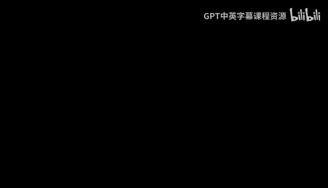
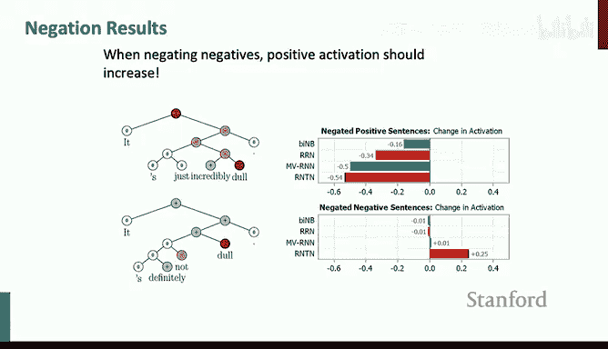
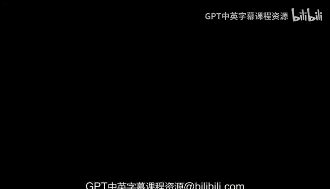

# 斯坦福大学《深度学习自然语言处理｜Stanford CS224N NLP with Deep Learning 2024》中英字幕（deepseek-R1 - P17：-17-Lecture 16 - ConvNets.zh_en - GPT中英字幕课程资源 - BV1U5RNYgEfp

Hi， okay， let me get started for today。 I guess I'm now down to the。

 the more select week 8 audience of people who actually want to learn。

 So my welcome and my pleasure for the people who show up today。 Thank you。 Thank you。😊。

Okay so what I want to do today is principally sort of talk about a couple of other neural network techniques which can be used for language I mean in some sense these two techniques are ge ones that people aren't using very much these days and that's partly why they get sort of stuck towards the end of the course because we try to teach people early on in the course the most essential things that you should definitely know about but you know the fact of the matter is you know in any scientific field。

 there are different ideas and techniques that bounce around and it's good to know a few of the different ideas that are out there because often what happens is people find new ways to reinvent things and put things together and see different insights from。

😊，So today I'm going to tell you a little bit about using convolutional neural networks for language and then a bit about tree recursive neural networks。

😊，But before that， just course organization， this is a bit after it happened。

 but I guess I've never been back to say it。 so thanks to everyone who filled in the midquarter surveys some people said very nice things about the lecture。

 fantastic lectures and really interesting content some people wish that we were teaching more about state space models I guess we haven't added that lecture in yet a couple of people thought it'd be good to have an exam in this class clearly they weren't people who have friends in CS231 in from what I've heard but yeah and then in general people are pretty happy how Ed's been going a bit less happy on how office hours have been going I mean honestly it's a hard problem I feel to do office hours you know some people are say oh you should just use Qt。

😊，I sort of remember badly to a year where we did everything but Q status and near the assignments due date。

 the queueword stretch six hours long， and that didn't seem such a good solution either。

 but we'll work along with it。😊，Finally， yeah on on cloud compute I know this is something that people variously do have issues with。

 So there are quite a few people that are still trying to do things with Google coabab。

 which I realize is sort of a very convenient nice interface but you sort of do suffer from access to GPUs on Google coabab。

 the best way to get better access to GPUs is to pay 10 bucks for a month of coabab pro which perhaps means that you end up paying for two months if it's May and June we can't reimburse you for that but it's not so many copies worth of money and it does just give you better access to GPUs courage you use the GCP credits and together API access that we've given to you you're also welcome to try other things Kegel notebooks can actually give。

😊，Better GPU access， but not all the nice features of coababs some groups have started using Moal。

 which is can also be a good way to get GPU access。😊，Okay， that was the intro to that。

 And so now I wanted to sort of talk about convolutional neural networks for language。 I mean。

 these slides are sort of positioned a bit as convolutional neural networks versus R andNs as opposed to versus transformers I mean。

 that's partly you could say because I haven't updated my slides enough， but in another sense。

 that's partly because that's how the ideas of convolutional neural networks really were explored。

 it was in the days when most people using thecursive neural networks for NLP。

 a few people set about saying， hey， maybe we should use convolutional neural networks for language as well。

 whereas in truth in the last five years when transformers have dominated。

 there hasn't been much use of convolutional neural networks for NLP。

 So if we think back to our recurrent neural networks。😊。

If you remember those that they kind of gave away of giving a representation for a sentence or part of a sentence。

 but they sort of computed forward through the string and so you kind of had to get a representation included in everything that came before you and then you。

 So you didn't really have a representation of the ceremony。

 You had a representation of Manet walked into the ceremony that you could use。😊。

So in contrast to that， convolutional neural networks basically say， well， you know。

 kind of like an Ngram model that we should be able to take ngramms of words like two grams or three grams。

 So for the example， tentative deal reach to keep the government open。

 that we can take each three gram tentative deal reached deal reached to reach to keep to keep the government。

 And we can make some neural representation for each of those。

 So notice just being done for every Ngram for a certain end。

 So there's nothing linguistically or cognitively， especially plausible here。

 but we're just going to sort of form representations of multiword units。

 which will then group in some form further way later on。

 And the standard way of doing that is with convolutional neural networks。

 So the classic case of convolutional neural networks is in vision。😊。

The convolutional neural networks were invented for vision where they gave you a kind of a translation invariant model so that you could recognise your kangaroo no matter where in the frame it was and so this little picture here which I just did a lower half side as that。

😊，Lower half of the slide is sort of what a convolutional neural network is doing in 2D vision so the convolution is like a mask that you're sliding over the image and the mask is defined by weights which are the little things shown in red and so for each place you slide your mask to you're then calculating a score by taking well what's effectively a dot product of the mask terms by the elements in that patch and that's then filling in the matrix on the right that's shown in pink and so that's then calculating our convolved feature from the image that makes sense。

😊，Yeah so well， what happens if we then want to do that for language Well。

 you know for language we don't have a 2D picture， we've got a 1D picture。

 we've got a sequence of words。 So we can have tentative deal reach to keep government open so each of our words will have a word vector。

 I'm using four dimensionmenal in my examples to keep it compact on my slide and so then we can apply a filter that applies to an ngram。

 So this is going to be a filter for a trigram。 and so then we're going to slide that downwards in exactly the same way as for the vision case apart from we just sliding in one dimension so I calculate the dot product of the filter and this3 gra and that gives me a value minus one if I did my arithmetic right then I slide it down to the next position。

😊，work it out and I get minus0。5， slide it down， get the other values and then typically I can add on a bias terms so my bias is plus one in this example and then I'll stick it through a nonlinearity like a sigmoid or something like that。

 and so I'll be calculating a vector for a term for each。😊，Of these three grams。

 And so that is a convolution for a single filter。 And then commonly。

 what I'm doing after that is deciding that I'm going to have more than one filter。

 and I'll show that in a minute。 in this example， And in my vision example earlier。

 we sort of had shrinkage because we started off with seven words。 But because we sort of slid these。

😊，You know trigram over it we only sort of had space for five trigrams and so we ended up with something smaller than our input sentence Often people want to keep it the same size and the way you can keep it the same size is by having padding so if I put a zero padding at each end well now I'm going to get seven trigrams coming out as corresponding to my original seven words and normally are' just sort of pa it with zeros like that。

😊，You can actually。Increase the size of things because if you add padding of two at each end。

 you can then have a wide convolution， and so seven will then go to nine different things。😊，Okay。

 so if we only had one filter， things are pretty limiting。 And so commonly as in the vision case。

 what we're going to do is define multiple filters。

 And then we're going to be calculating a value for each of these filters over each of these trigrams。

 And so then we're getting out a new representation as a vector。 And you know。

 depending on how many filters we have relative to what the word dimensionality is。

 we might end up with something that's shorter as in this example。

 the same length or actually longer than what our input was in terms of word vectors。😊。

But commonly when we do that， we then in some way want to summarizemarise all of these filters and the most common way of doing that is to do something that's called max pooling and max pooling is something you see quite a bit in neural networks in general。

😊，And the way to think of max pooling that I think makes sense is that you can think of max pooling as doing what you want if you want to run something that's like a feature detector。

 so you know if you imagine that youd you learn these functions that will look at word vectors and that they will look for evidence of something particular so you know maybe this filter looks for the person is using eye language that it's。

😊，Matches the words I， my we our something like this。 And， you know。

 maybe this is a filter that matches， you know， speech verbs like or thinking verbs， I think， say。

 said， told， etc like that。 And so each of these is sort of some kind of feature of the text that you might want it a text。

 Well， if that's your model of it， when you sort of slide your feature detector down the piece of text。

 you sort of want to know， does this match anywhere in this piece of text is somewhere using an i word。

 regardless of whether it's in the first second， third or fourth position。

 And so that's effectively what you're getting out with max pullinging。

 that a feature is counting as firing to the extent that it fires strongly in any position in the text that you could match。

😊，That's not the only way you can think of doing it an alternative way you could do it is you could think of your feature detector as sort of measuring some quality of the text like casualness or learnness or something like that and then you might think oh well for overall wanting to know how casual the text is maybe I want to know the average of how casual it is in different parts of the text and so then you can do the alternative of average pooling and sometimes people do that as well you can do both you can both work at an average pool and a max poll and put both of them into the feature detector in general for the kind of feature people learn in your networks if you're just doing one or the other the result does seem to be that max pooling is the most effective that that kind of does the feature fire metaphor tends in general to be the best way of thinking about。

😊，Things。Okay， so if you want to do all of this in pietorrch con1D right so that I guess the one dimensional convolutions aren't the most common case and so you're using COv1D and all these kind of things that you can then be specifying so the output channels is the number of filters you have the kernel sizes saying the sizes how big it is which for my example is three and then you can sort of just collapse things with the max pooling。

😊，Okay，There's a space of other things that you can also do with convolutional neural networks。

 which I think are sort of less useful and less used and language cases but I can sort of see them quickly。

 So one thing you can do is sort of have a stride because when we sort of did every trigram of sort of zero tentative deal than tentative deal reach than deal reach2 you could feel like well theyre overlapping each other a lot。

 So they've actually got very similar stuff in them。

 and that would be even more so if we weren't using three gras we were using something like five gras So something that you can do is the stride is sort of how much you move along So if you move along two you'd have one trigram that's padding tentative deal。

 And then the next one would then be deal reach2 and then the next one would be to keep。😊。

So that they're overlapping by less as you go through it。嗯。Another thing that you can then do。

There's sort of stride like is rather than doing max pooling over the entire thing。

 you could do more of a local max pool so you could think that well I want to have this feature detector for something like use of eye language but you know if it's a big long sentence and there's eye language at four different points maybe you should get four points for that rather than just sort of the one point that you're going to get from max pooling so you could sort of do local max pooling sensitive to the stride so here I could look at the first two of these and max pull those two than the next two and max pool those the next two and max pool those and the next two and max pool those and you could sort of then end up with this sort of local max pooling as you go along。

😊，嗯。Okay， and then one other idea that's sort of related that you can do is， well。

 another way of capturing sort of does something match in multiple places is rather than only keeping the one max in each column。

 maybe you could just do a Km so you could keep the two maximum things in a column and that might be also be a way of seeing whether something is detected in two places or not。

😊，嗯。Okay， then。I've got lots of notions here。 Okay。

 so dilation is then the notion that what we'd like to do is sort of。

For our trigrams not only as adjacent things， but things that are spaced out so after having done our first layer of convolutional filters that took trigrams that got the sort of top right part here。

 we can then do a did trigram convolution which means that we're going to take the first third and fifth things and combined them in a convolutional filter and then we'll take the second。

 fourth and six things and combine them in a convolutional filter and so we've then got a trigram filter but it sort of has a bigger range of size that it can see and that sometimes used more commonly used in places like speech than a natural language。

Okay so those are the kind of tools we have for calculating things with these convolutions over text。

 and so next what I want to do do is tell you about a couple of pieces of work that made use of convolutions for natural language processing。

😊，I guess this is a decade old now because this is from 2014 this is the single most famous piece of work that made use of convolutional neural networks for natural language processing and E and Kim is now an assistant professor at MIT I mean in retrospect that's sort of actually pretty simple but I guess you know he got in early with the idea of hey maybe we could use convolutions for NLP and did a kind of a clear example of that the work pretty well and so this piece of work is very well known。

😊，So this was writing a sentiment classifier， so looking at a sentence and deciding whether it's positive or negative and actually for both the kind of models that I'm going to talk about today。

 we're going to use examples that are doing sentiments classification。

 he also considered other tasks， subject or objective language。

 question classifications as to what they were about。

 but the main application was doing sentiment analysis。😊，So what you're going to be doing。

And this paper shows things more in his notation， but it's exactly the same as we've just been talking about。

 that you're taking ngrams of word vectors， you're going to be multiplying them by convolution and calculating new vectors。

 and it's going to be done in his model for different sizes of ngrams。

 so it's going to have some convolutional filters that look at bygrams。

 summit trigrams and some of them that look at for gras。😊。

And then they just slid across the positions in the sentence。Then having done that。

 it does max pooling as we've been talking about， which gives a single number coming out of each filter and those max pool numbers from each filter and then going to be used as a classifier in a final simple softm layer to give the full answers。

😊，There's one other thing that came up in this paper。

 which is kind of just an interesting general idea to be aware of and it was something he sort of pioneered。

 which is the following that it's a very common case。😊，That what you've。

when you're sort of I guess this again occurs less with huge pretrained transformers but for sort of the classic case of models where you had word vectors and then you were training some neural network model on some supervised data there was this following pitfall of what happened when you fineted word vectors and so the setting is you know we've started off with our pretrained word vectors from G or word deve。

 whatever it is and then we've got a smaller sentiment analysis data set and that we're going to train a sentiment classifier and that will involve not only learning the parameters of our sentiment classifier but also we can backpro into the word vector representations and if you do that。

😊，It seems like that should be a good idea because you know。

Normal word vectors aren't you know especially attuned to predicting sentiment correctly they're sort of moreted to meaning of words as to sort of just what words are about and so it seems like it should help you if you could backpro into the word vectors and change them as you go along but if you do that they tends to be a problem and the problem is what you'll find is that some words will be in your sentiment training data set and when you learn with backpro these word vectors will move but some words just won't be in your training data and they're going to stay exactly where they were in the wordve vectors because there's nothing to move them around so what tends to happen is you sort of started off like this。

😊，AllOf tedious dull and plotloting were close by each other as having similar meanings and the indicators of something negative。

 But after you've done your training， tedious and dull as part of back have moved over here where they're part of the negative land and the classification boundaries moved over here but plotloting wasn't in the training set。

 so it's just sitting exactly where it was at the start of the process and now it's being treated as a positive word which is completely wrong And so that's tended to have the result that when people sort of train language neural network on a small supervised data set。

 you've got kind of ambivalent results that sometimes。😊。

Doing backpro into the word vectors would help because you could specialize your word vectors to your task。

 but sometimes it would hurt you because of this kind of effect that you sort of messed up the semantic relations that applied over the that were captured reasonably well in the initial word vectors。

😊，So the way that Yu and Kim dealt with that was a fairly simple way。

 he just doubled his number of channels and so he made two copies of each channel。

 each filter in his convolutional neural network and for one of them it used the finet word vectors and for one of them it kept the original word vectors and then he could have the best of both worlds。

😊，Okay， so this picture captures the sort of whole of his network。

 this picture actually comes on from comes from a follow on paper， which produce this nice picture。

 So we start off with a sentence。 I like this movie very much， which should be classified positive。

 So we have words in their word vectors。 And so then you're going to have convolutional filters that are both bygram filters。

 trigram filters and foreground filters。 And at each of those sizes。

 you're gonna have ones that work on the unfine tuneed word vectors and the fine tuneed word vectors。

 And so。😊，You're going to put these filters and slide them over the text and get representations and the way he's doing this。

 the filters are done without padding so that the foreground filters。

 you're getting smaller vectors coming out and the by ground filters you've got bigger vectors coming out and so then for each of these you're then going to max pool so you're just getting the highest value from it and then you're getting the highest value from the ones with the fine tuning of the word vectors and the ones not and so you're getting one feature out of each filter。

 you're then concatenating all of those max pooled outputs together So you're getting then one vector for the entire sentence which is a fixed size reflecting the number of filters and then you're just sticking this as a straightforward linear classifier in。

😊，To a softm that's then giving you a probability over positive or negative。

 And that was the entire model。😊，And the interesting thing was this actually worked pretty well for natural。

😊，Language classification tasks。 So this is a big table of results from his paper。

 So there are sentiment data sets like the Stanford Sentiment tree bank two versions of that。

 movie reviews there's another sentiment data set。 there's a subjectivity classifier。

 The Trek was the kind of question type classifier。 So various data sets。😊，And that。You know。

Various people， including us at Stanford， I guess all of these so hour results were ones we were doing at Stanford had built lots of models on various of these data sets and his argument was that by using this simple convolutional neural network you could do as well sometimes better than any of these other models that were being considered at the time for sentiment analysis Now there was at least one way in which maybe that comparison was too generous to the CNN so because if you remember back when we were doing dropout and we said dropout is such a good idea。

 I mean dropout I think came out in 2012 if I'm remembering correctly。

 so the reality is a lot of these other methods were being written before dropout。😊。

appeared on the scene whereas he was using dropout and that gave him an advantage and sort of better experimental technique might have been compare to redo the other models with dropout which he didn't but nevertheless it sort of shows that you could get strong results using convolutional neural networks with just a very simple architecture。

😊，Yeah so that's one more thing that you can do and so I mean the thing to think about here is you know we have this sort of toolkit of ways that you can do things。

 we started off with word vectors and bags of vectors which you used for simple classification we talked early on about window models and you know window models are sort of like what you get for convolutional neural networks but sort of more ad hoc then we have convolutional neural networks which are definitely good for classification and very easy to parallellyze which is good and we talked about recurrent neural networks which seem to be cognitively plausible reading through sentences from left to right but aren't easy to parallelize and then we've talked about transformers which to some extent is our you know best model for NLP and is being used everywhere。

😊，AndIndeed， you know what's happening now is that things are going in reverse and people are increasingly using transformers for vision as well。

 though there's still I think more debate in the vision world as between CNNs and transformers with some people arguing that both of them have complementary advantages。

😊，Okay， a couple of other just facts on the side and then I'll show you one other。😊。

Bigger fancier convolutional neural network model for language so we talked about for transformer models。

 the use of layer normalization which sort of keeps the size of the numbers in the middle layers of the neural network about the same by giving zero mean and unit variance there are slightly different ways that you can do that for convolutional neural networks。

 a standard thing to be using is batch normalization and indeed batch normalization was the thing that was invented first and sort of layer normalization and batch normalization a sort of doing the same thing of sort of scaling numbers to give them zero mean and unit variance but the way that they differ is sort of under what dimensions they're doing their calculations that。

😊，Layer norm is calculating statistics across the feature dimension。

 whereas batch norm is normalizing all the elements in the batch for each arm feature independently。

😊，OkayOne other little concept that turns up which actually sort of connects a bit to transformers as well。

 there's this sort of funny thing that you can all what I've presented so far was sort of convolutions that are some Ngram bygram trigram forgram and so there' also size one convolutions and at first sight that seems to make no sense at all because what's the point of doing a size1 convolution because you've just got one thing and it's staying just one thing but it actually does make sense because it corresponds to having a little fully connected layer that's only looking at the representation one position So in a language term is taking a word vector and putting it through a fully connected neural network to produce a new representation just。

😊，That word and that's sort of actually what we also have with the fully connected layers and transformers right that you've got a fully connected layer that's just at one well subword token position and calculates a new representation for it and so that's。

😊，Allows you to so create new representations with actually many fewer parameters than if you're allowing a fully connected layer across the entire sentence。

😊，Okay。And so this is then a more recent version of a convolutional neural network。

 still again used for text classification， but a much more complex one。😊。

From Koote Al in 2017 and again， this was still at the stage in which LSTM sequence models were dominant in NLP。

 I guess in 2017 this is sort of the same year that the first transformer paper came out and you know the motivations were sort of comparing vision and language and so at that point in time convolutional neural network models in vision were already very deep models。

 so people were using things like ResNe models that had 30 50100 layers in them and that stood in stark contrast to what was happening in the LSTM world for sequence models where commonly people were just using two layer sequence models and if youre wanting to go further you might be using a three layer sequence。

😊，or a four layer sequence model or occasionally if you got really。

 really deep people had used eight layer sequence models if they have a lot of data but essentially you know it was always in a single digit。

 the number of layers and then the second thing was you know in some sense the vision models were more raw signal models because they were operating on the individual pixel level whereas in NLP the standard was that we were using word level models still in the transformer models so it sort of seemed like things were much more grouped before they began and so the idea of this paper is well maybe we could do NLP kind of like it was vision so we'll start with the raw characters as our signal we're going to put them into deeper convolutional neural network and use the。

😊，sameme kind of architecture we use for vision and use that for language classification tasks and so that led to this VD CNN architecture。

 which is something that looks very like a vision system in design。😊，And so what do we have here。

 So at the bottom， we have individual characters and the individual characters get a 16 D representation。

 And then you've got some。Sort of size of piece of text that you're classifying which were then was 1024 and then at each stage we're then going to have convolutional blocks and so these convolutional blocks have a whole bunch of filters but they're also then going to group stuff together so that we're kind of sort of starting to collapse into multicharact units so we're starting off first of all。

 having you know 64 size3 convolutional filters and so that gives us a representation of 64 times the window size and then we're going to do that again and put it through another set of convolutional filters。

😊，Of size 3 and 64 of them， which gets us sort of up to here。 And then at each point。

 we also have residual connections， which we also saw in transformers that were pioneered in the vision space。

 so that we have a path that things and just go straight through。 But then when we get to here。

 we're then going to do local pooling。 So each pair of representations here will' be pulleded together。

 And so at that point， we've no longer got a length of the initial length of 1024。

 We've now got a length of 512。 So now we're going to be putting it through。Again。

 sort of trigram convolutions。 But now we're going to have 128 of those。Channels。

 we're going to repeat that again。 and then we're going to again group with pooling。

 So now we're going to have 256 long sequence because we've done local pooling of each pair And we're going to then have 256 filters at each stage。

 and we go up。 And then we do local pooling again。 So each of them is now representing an 8 G of characters。

 And we're putting trigram filters over those 8 G。 So really the amount of。😊，A sentence that。

The convolutional filters is seeing at this point as 24 characters。 So， you know。

 sort of seeing something like six word sequences or something like that。

 More convolutional blocks there。 then there， they then do this Kax pooling。

 So some of the ideas from the beginning of the lecture do show up。

 So you're then doing Kax pooling and finding the eight highest activations in the sequence。

 And that's sort of make sense for something like a text classifiedifier because you want to count up the amount of evidence。

 right， If you' got some category like is this about I don't know， copper mining。

 you want to be seeing whether there's a bunch of places in the text that's talking about copper mining。

 And then right up the top， they have several fully connected layers， which again。

 is very typical of what you are finding and vision networks such as something like。😊。

GGNe that after you've done a whole bunch of convolutional layers。

 you just stick it through multiple fully connected layers at the top and so that's what they're doing as well and this is your architecture for doing text understanding。

😊，嗯。Okay I think I talk through that in a lot of detail so I'll skip this slide Yeah。

 so their experiments were done on text classification data sets So various news classification data sets。

 DBP de ontology then doing sentiment analysis on Yelp reviews and Amazon reviews and here our results from there ones。

 So you know they're taking the previous known best published results which are。😊。

Shown here in table four。 and then they're considering。

Whether they can do better by using their architecture and that they used architectures of different lengths in terms of the number of layers of nine layers 17 and 29 layers and the result of the paper is in all cases they got the best results by their deepest network。

 which was a 29 layer model， which is sort of then sort of similar to what people were doing in vision and then you know there's some variations to which was best by using the max pool or the Kmax pooling。

 but in general is always the deep model and it varied a bit according to the data set。

 but at least sometimes they were able to produce the best results that were known。

 So I mean I guess for these text classification previous results were slightly better than their results but for some of the other ones like the DBP and the Yelp。

Their results all involved for both the Yelp data sets。

 their results were better than the best known previous results， the Amazon ones， one was better。

 one was worse but to a first approximation this meant that they could basically reach the state of the art of a text classification system with something that was just a deep convolutional neural network starting from a character level with none of the sort of having learnt word vectors in advance or anything like that。

 and so that was a pretty cool achievement which showed that you could go a fair way in doing things with just this sort of raw character level convolutional neural network sort of more like a vision system。

Okay so that's that and then for the final piece of the class I then want to tell you about something in the other extreme which is about tree recursive neural networks so tree recursive neural networks is a framework that me and students developed at Stanford so I mean really when。

😊，I first got to neural Network study in 2010 that sort of for about the first five years that what me and students worked on was doing these three recursive neural networks。

 and so they were sort of the Stanford brand ultimately。😊。

They didn't prove as successful as other things that came along。

 but I think they're linguistically interesting， and I think there's a clear idea here。

 which is still an idea that exists and I think there's maybe still some things to do with which I'll come back to。

 but the starting point is essentially being motivated by structure of human language And so most of this slide is sort of filled by a paper from Noam Chomsky and colleagues sort of discussing their views of the human faculty of language。

 what it is who has it and how did it evolve and I don't want to dwell on this and too much detail。

 but essentially in this paper， what they argue is that you know the defining property of human language that's not observed in other things that humans do is having that language。

😊，this recursive structure that you have this hierarchical nesting where the same structure repeats inside itself。

 So if you have an example like the person standing next to the man from the company that purchased the firm that's used to work at what you have is the whole of this is a noun phrase。

 the person headed by the person， and then it's standing next to then the first square bracket here is another noun phrase。

 the man from then inside that prepositional phrase， there's another noun phrase。

 the company that purchased the firm， and then the firm is another noun phrase that has the relative clause modifier of the firm that's used to work at。

 So we have these embedded layers of noun phrases with the same syntactic structure underneath them。

 and so for the kind of formalism。We use in linguistics of contextfr grammar it permits the kind of infinite embedding of nesting。

 which is the same kind of nesting that you get in programming languages where you can sort of use if statements and nest them as deeply as you want to because you just have the same repeating recursive structure。

 Now， of course， human beings can actually understand recursive infinite recursion and people don't actually produce infinite recursion that you can sort of say oh。

 and practice no one's going to go more than a deep when they're saying a sentence。

 but in terms of the structure of what the language looks like。

 it seems like you should be able to do an infinitely deep。

 and when you actually start looking at the structures of sentences。

 they do sort of repeat over the same structure quite deeply。

 So this is an example of a pentry bank tree， which is sort of the best known。Detroency Tree Bank。

 and so here's my random sentence analysts said Mr。

 Stroneak wants to resume a more influential role in running the company and well what we end up with sort we have these nested things of verb phrases so running the companies of verb phrase resume a more influential role in running the company is a bigger verb phrase wants to resume a bigger role in running the company is an even bigger verb phrase and then said Mr。

 Stroneak wants to resume more influential role in running the company is an even bigger verb phrase and so we have sort of one。

 two， three， four verb phrases all nested inside each other。😊，And so the idea was well。

 maybe we should be thinking of sentences as having this kind of tree structure and computing representations of meanings of sentences in terms of this tree structure so we have words that have representations in word vector space like we saw right at the beginning of the class。

 but then we can have a phrase like the country of my birth and the classic linguistic answer that you find both in linguistic semantics classes or philosophy of language is that we could should construct representations of phrases using the principle of compositionality which says that the meaning of a phrase or sentence is determined by the meanings of its words which are our word vectors and the rules that combine them so maybe we could take the phrase structure tree of a sentence and combine。

😊，The word vectors together by some means， and then we can construct a representation of the meaning of phrases in a more linguistic way。

 giving us a vector representation of the meaning of the phrase。

 which we could also put into our vector space and wed hoped that a phrase like the country of my birth would appear in the vector space in a similar place to where words representing locations appeared。

😊，Okay， so what we want is to be able to start with word vectors and par up a sentence。

And as we pass the sentence， we're then going to be computing representations for the different phrases of the sentence。

And so the difference here is now， you know。You know。

 the difference between recursive and recurrent is sort of a fake difference， right。

 They both come from the same recur word。 but rather than having the recursion just happening along a sequence as in a recurrent neural network。

 we're going to have the recursion happening up a tree structure。

 So are computing representations for linguistically meaningful phrases。And so therere sort of。

What we're going to do with that is， you know the easy cases if we know the phrase structure tree。

 we can take the representations of the child nodes。

 put them into a neural network which could give us the representation of the parent node。

 but we'd also like to find the tree structure and so a way we could do that is then get a second thing out of the neural network。

 we could get a score for how plausible something is as a constituent。

 doesn't make sense to combine these two nodes together to form a larger constituent and then we can use that in a PAser。

😊，So。Formerly the very simplest kind of trinial network and the first one we explored was when we had two child vectors。

 we're going to be representing the parent vector by concatenating the two children。

 multiplying them by a matrix， adding a bias， putting it through a non nonlinearity to get a parent representation P and then we score whether there's a good constituent by taking another。

😊，For of learn parameters， which would do a dot product with P。

 and that would give us a score as to whether this was a good constituent to include in your past tree and the same W parameters were used at all nodes of the tree in the same way as in recurrent neural network kept using the same parameters。

😊，Okay so if we did that， if we had that， we could build a greedy PAser because what we could do is we could start with all the word vectors and we could just take every pair of words and put it through this system and calculate what the representation of that pair would be as a constituent and then get a score as to whether it seemed a good constituent or not and then we could just greedily decide this is the best constituent the cat and so if we do a greedy PAser we can commit to that and then well we already still know the possibilities to combining other pairs of words and we could just additionally score how good the cat combined with satAT is so that we're producing binary pars structures so now the best pair to combined greedily is the。

😊，Ma so we can combine them together and commit to those。

 we can score combining on with the mat and now that seems the best thing so we'll commit to that and we just sort of keep on up and we produce the binary powers of the sentence and this gives us our sentence representation。

😊，Okay， we just like that。Okay， and so that gives us our simple R&N and so back in 2011 we got some pretty decent results of showing that you could use this as a sentence PAsa that worked pretty well but beyond that that the representations we calculated for sentences and freezes were good enough representations。

 that you had use it for tasks like sentence classification， sentiment analysis。

 and it works reasonably well。😊，It works it only works reasonably well because if you start thinking about it further。

 you know there are sort of worse strong limitations of having this single W matrix that's used at all points to combine things that that if you sort of have that architecture。

 you sort of can't have different forms of interaction between the different words youre so just uniformly computing things and that sort of stands in distinction to the fact that different kinds of things in natural language seem kind of different you have。

😊，Different properties with verbs and their objects versus an adjective modifying a noun。

 just in terms of what the roles of the different words were。

 So we started to see limitations of this architecture。 And so in following years。

 we started exploring other ways to build tree recursive neural networks。

 which had more flexibility as to how things were combined together。

 And I'm not going to show you all the details of all of that。 But I will show you one more。😊。

Model that we used for building tree recursive neural networks。

 and that was used in sort of some of our sentiment analysis work called the recursive neural Tensor network。

It wasn't actually the final net version that we did After that。

 we sort of started taking LSTM ideas and extending those to the tree structured case and we worked on tree LSTMs。

 but I'm not going to show that this year but the idea of recursive neural tensor networks is you know when pairs of words or phrases combined together in linguistic semantics cut terms。

 depending on the pairs of words they modify each other in different ways。

 So if you have an adjective of a noun like a red ball sort of red is giving attributes of the noun。

 whereas if you have something like a verb and its object like kick the ball you've got a very different role for the object as the righthand side versus the red ball。

 it's sort of the opposite way around so we want to have more flexibility in the way we can calculate meanings of phrases depending on what。

😊，In it。 And the way we came up with doing that is to come up with what we call this neural tensor layer。

 And so the idea in the neural tens layer is that we had the representations of the。

The child words or phrases。 And so rather than so directly putting。

 rather than directly concatenating them and then。Putting it through a sort of a linear transformation like a regular neural network layer。

 instead what we could do is that we could learn。😊，In between matrices。

 and if we put several of those together， we're then getting a three dimensional tensor and we can multiply a vector by a tensor times a vector and then we'll end up getting out vectors for each one we'll have multiple such vectors。

😊，Okay， and the the place that we applied this model is for this task of sentiment analysis。

 So let me just tell you a little bit more of what we did here。 And this is sort of， in fact。

 going backwards to the Stanford Senment tree Bank there was already used in the E and Kim work。

 So the goal of sentiment analysis is to see whether piece of text is positive， negative or neutral。

 So a lot of the time doing sentiment analysis is pretty easy。 You know。

 in the 2010s and probably even today， you know， quite a few people's sentiment analysis systems are essentially just。

😊，Keyword matching， right。 If you see great， marvelous， wonderful， positive sentiment。

 If you see something of poor， bad， negative sentiment。

 and so lots of the time you can sort of effectively do a kind of dictionary matching and get pretty good sentiment。

 especially on longer documents。 But you know， on the other hand。

 people use language and lots of interesting ways。 And it's not always that easy。

 So if you look at something like movie reviews such as the snippets you get on rotten tomatoes。

 you get snippets like this and rotten tomatoes。 with this cast and this subject matter。

 the movie should have been funnier and more entertaining。 And if you just think of it as okay。

 we're doing dictionary matching。 There's the word entertaining。

 that's definitely positive and funnier。 that's positive。 So there are two positive words。

 So this should be a positive。😊，But， of course， it's not a positive review。

 This is a negative review because it's saying， well。

 I'm just reading it out again with this cast and subject mad on the movie should have been funnier and more entertaining。

 right， So the compositional structure of human language goes together to mean that these because it's。

😊，buried under should have been the funnier and entertaining are actually lacking。

 And so it's a negative review。 And so these were the kind of examples that we were interested in and saying。

 could we sort of actually understand the structure of sentences more and do a better job at sentiment analysis。

 And so up until this time。😊，People had just sort of had pieces of text and a classification judgment of positive and negative。

 so we decided we were going to do more than that and come up with the Stanford Sen T Bank where what we did was pard up a whole lot of sentences。

 almost 12000 of them and then what we were going to do is put sentiment judgments on every linguistic phrase of the sentence So for something like this example。

 you know with this cast is a phrase， no sentiments had just been neutral En is a phrase。

 a one word phrase， its sentiment is positive。😊，嗯。You know， funnier and more entertaining。

 That's a phrase。Very positive。 But then by the time we get embedded under should have been funny and more entertaining。

 That's a bigger phrase， its sentiment is now negative and the movie should have been funnynier and more entertaining that's an even bigger phrase it's negative。

 And so we were passing up trees like that。 and these examples are very small。

 I'll show you a big examples later， but you can sort of just see that in the trees there are blue nodes and orange nodes corresponding to positive and negative sentiment reflecting units at the different sizes And so the interesting thing is then this gave us a richer annotated data set because it's not only sort of whole sentences。

 or whole articles that were annotated for sentiment。

 we had annotations for different phrases and simply the fact that you were annotating phrases meant that you could learn。

😊，More from the examples so even if you're using something very simple like a naive based classifier because there are annotations on words and smaller phrasers。

 you could learn a bit more about which were positive and which were negative and so that was the first result that we could people a baseline method of a by naive based classifier。

 which is a very common sentiment classifier that if you just trained with sentiment classifiers。

 you got 79% on this data set if you trained with。😊。

If you trained using every node of the tree bank you got 83% so you got a 4% lift and so that was kind of good these other two lines show a two of our early treer andNs and the negative part of the result is they weren't really better than a bite grand naive Bays classifier they were better than a unigram naive Bays classifier but a lot of sort of the extra information that you want to capture for sentiment analysis you can get from bygrams because that can already tell you sort of not good somewhat interesting and things like that。

😊，But then so the other hope was to have a more powerful model。

 And so that then led into use of this recursive neural tensor network。

 which allowed sort of the mediated multiplicative interactions between word or phrase vectors。😊，嗯。

And so we built that。 And so then here are the results of that model that's shown in red。

 So by having our recursive neural tensor network， we were able to build somewhat better neural network that。

😊，Performed at least reasonably better than a bygram naive based model， right。

 that we were getting so about two and a half percent better than a bygram naive based model。

 So that was progress， that I think perhaps the more interesting thing isn't sort of the aggregate results。

 But the fact that because we were building up this model。😊。

The computed representations over constituency tree that it actually made judgments of different parts of sentences and how they combined。

 So here's a movie review sentence。 there are slow and repetitive parts。

 but it has just enough spice to keep it interesting。

 So I hope you'll agree with the judgment that overall that's a positive statement about the movie。

 And so the recursive neural tensor network builds the tree structure over this sentence。

 and it says you know slow and repetitive that's negative。 there are slow and repetitive parts。

 it's all negative to hear。 but for the part over to the right。

 interesting Sp they're both positive and spice to keep it interesting。 that's positive。

 it has just enough spice to keep it interesting， positive and it correctly predicts that when you put these two halves at。

😊，Sentences together the overall judgment is that this remains a positive review and it gives a positive judgment overall。

 so that was kind of cool and in particular the fact that we were building these phrase judgments meant that it seemed like we could actually do a better job of sentence understanding in the way that sort of any linguists doing linguistic semantics would like to see sentence understanding so one of the things that neural networks when looking at language have often been faulted for and are still faulted for to this day using transformer models is you often find the result that neural network models just don't pay attention to thegeian that you can be having some sentence and you can compare the sentence of you know a lot。

😊，Of students are studying for their final exams versus a lot of students aren't studying for their final exams。

 And the negation just gets lost， that it doesn't produce the differences in representation and meaning that you'd like it to。

 So somewhat interestingly，With this model， it seemed like because we were modeling the cur of building up of sentence structure that we actually could do interesting things with modeling negation right so in particular。

😊，That what you， the results that you'd like to get is if you have something like it's just incredibly dull。

 So dull is a very negative word。 Incredible is a positive word by itself。

 But when you're sort of saying incredibly dull， it's definitely still negative。 And this。😊。

Our recursive neural Tensor network is correctly modeling。 It's just incredibly dull。

 is very negative， despite incredible being a sort of positive word so。😊，You know。

 actually in this model， there was fiveway classification。 So there was very negative。

 somewhat negative， neutral， somewhat positive， very positive。

 So there's sort of some bouncing around as to whether it's given classification very negative versus somewhat negative。

 I can't really explain why in the middle， it goes to somewhat negative and then goes back to a very negative。

 that that's the results that came out of the network。 and at any rate， it all stays negative。

 the fact that incredible by itself incredibly， I a positive word。

 it's seen in the modification of dull as that keeps it negative。😊，But on the other hand。

 if you put a negation in here， it's definitely not dull。 Well， then what happens。 Now。

 interestingly， the word not by itself is a negative word that if you just sort of do the raw statistics of it。

 not occurs much more often in negative sentiment sentences than it does in positive sentiment sentences。

 So you know， if you want to be a more positive person， use negation less。

 So not by itself is negative。 but if you then combine it together not dull， or in this case。

 definitely not dull。 Well， not dull is you have two negation so that they cancel each other out and you get something that's positive。

 And so it's definitely not dull comes out as a positive sentence。😊。

And so the interesting result here is that。😊，If you compare what happens between， you know。

 if you have negated positive sentences， So， you know， it's definitely not good。

Various models can model that correctly。Not as a negative word。 And so therefore。

 it weakens the positivity of the positive word。 And so putting a knot in front of a positive into a positive sentence makes it less positive。

 And even though。😊，Not very well。 but even an naive Bs model can do that because not by itself is seen as a negative word。

 But the hard case is what happens if you negate a negative sentence。 Well。

 the result that you should get is it becomes more positive and。

Neither a byground naive based model or our earlier attempts at recursive models can capture that。

 whereas this RNTN structure was able to correctly modify。

 capture this sort of semantic modification structure and say， hey。

 that's made the sentence much more positive。 So that was a cool result。 And to some extent。

 you know， this result， I think still isn't captured as well by any of the current transformer models。

 even though they have many other advantages and are much better than a tree recursive neural network。

😊，So， I mean。Yeah， so just to say a couple， this is basically the end to just say a couple of final remarks about these three recursive neural networks。

 You know， the reason that they became uncompetitive is because they just didn't allow the kind of。

Associations and information flow that you have in a transformer right these models had a strictly context-free backbone and the only information flow was tree structure following the context-fr backbone whereas in the transformer you've got this attention function where in every position you're looking at every other position and so you going have much more general information flow and in general that is just good and transformers are much more powerful but you know on the other hand。

 to the extent that you actually want to model the sort of semantics of human language carefully as to sort of what modifies what and how does negation or quantifiers and the sentence behave in some sense these models were more right and so one of the things I'm still kind of interested in is are there any。

😊。

oppportunities to combine together some of the benefits of both of these ways of thinking and have something that's a bit more tree structured whilst still more flexible like a transformer。

😊，Okay， that's it for today， thanks a lot。😊。

