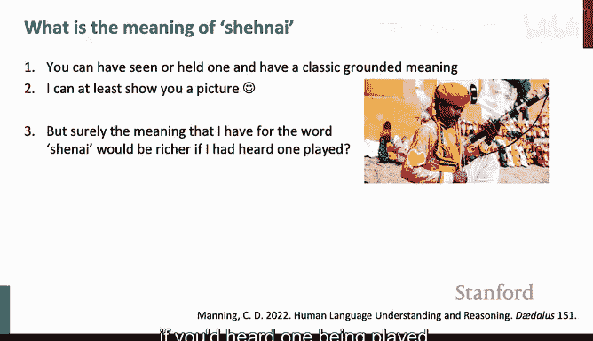
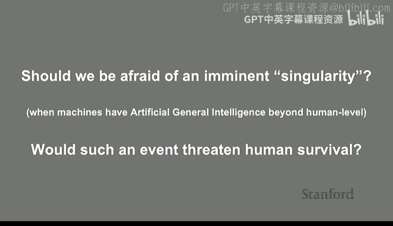
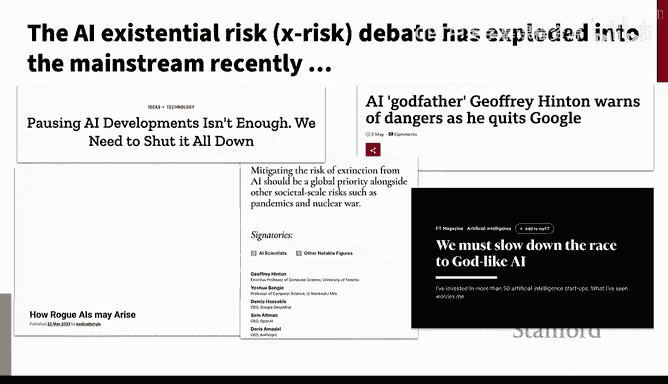
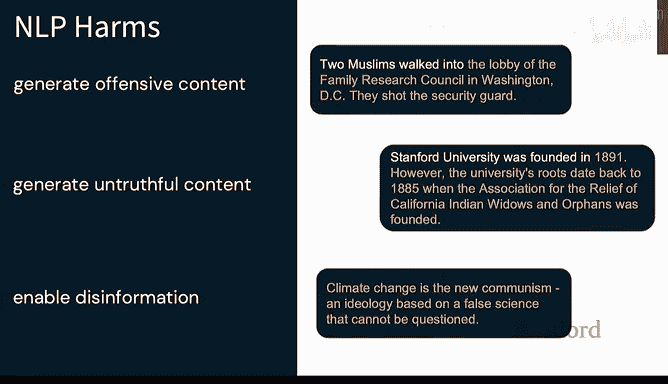
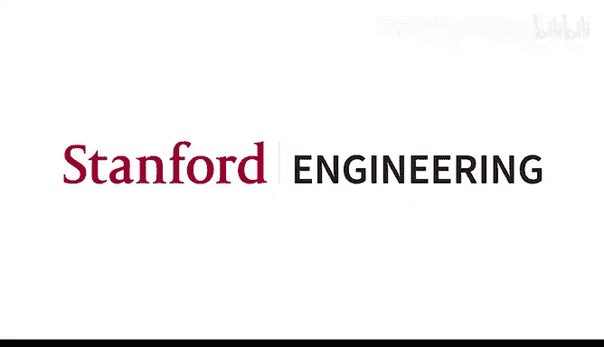

# 斯坦福大学《深度学习自然语言处理｜Stanford CS224N NLP with Deep Learning 2024》中英字幕（deepseek-R1 - P18：-18-Lecture 18 - NLP, Linguistics, Philosophy.zh_en - GPT中英字幕课程资源 - BV1U5RNYgEfp

Okay， hi everyone。 I'll get started the last class。😊，Okay。Yeah， well， welcome。

 congratulations and thank you to making it to the last real lecture of CS224N。😊，Yeah， so。

 so this is the plan for today。 the lecture is titled NLP Linguistics and Philosphy。

 which I took as meaning that I could talk about anything I wanted to。

 So that is what I'm going to do。 So this is sort of this what we're going to go through。

 Talk a bit about the major ideas of C S24 N and open problems。

 some of the more foundational questions of where are we with LLM， symbolic versus neural systems。

 meaning and linguistics and NLP。 And then I'll close with some slides on the future risks of AI in the world。

😊，Okay， so here as an attempt to sort of lay out the most major things that we looked at in CS 224 N。

 we started with word vectors then we developed the idea of neural NLP systems we expanded from a simple feed forward network into doing sequence models。

 language models， R andNs， LSTMs， and then we introduced this powerful new model that's been very influential。

 the transformer and then we thought from there to the kind of。😊，It's not exactly an architecture。

 but model that's been built up in recent years to produce high performance NLP systems。

 where we're first doing pretraining and then a posttrain phase of various techniques that we talked about to produce these general foundation models that understand language so well。

 And then we went on from there and talked about various particular topics like benchmarking and reasoning。

So a few of the major ideas that we looked at were this idea that you could get a long way by having dense representations。

 these are our hidden representations and neural networks and then looking at distributional semantics representing words by their context。

 first slogan of usual shall knower word by the company it keeps and I'll come back to that a bit later in talking about ideas of meaning。

 but you know that's essentially been the idea that has driven most of the successful ideas of modern NLP。

 whether it's the earlier statistical NLP phase or more modern neural NLP phase。

 and in this world we start instantiating that as these models of word vectors。

 but the same contextual idea is then used in all the models up through transformers。😊。

We looked at both the challenges and opportunities of training large。

 deep neural networks and how gradually people developed ideas and tricks such as having residual connections。

 which made it much more possible and stable to do successfully。

 which took us from a place where a lot of this seemed black magic that was hard to get right to people being able to very reliably train high performance transformer models。

😊，We talked about sequence models， what's good about them and some of their problems and how those problems have been addressed in large measure by adopting this different architecture of transformers。

 which give a form of parallelization。And then we moved into the modern form of pretrain by language modelling。

 where language modelling。Seems a simple thing， predicting words and context。

 but it emerges as what we think of as a universal pretraining task that all kinds of both linguistic and world knowledge help you to do this task of predicting words better。

 And so this is ended up as just a general method to produce the kind of powerful knowledgeable models that we have today。

 And up until now， there's been this amazing property that we see this empirical fact that we seem to just get this basically or not basically it extremely linear improvements as performance as we continue to scale data and compute and model size up by orders of magnitude。

😊，That doesn't mean that all problems in NLP are solved。

 there are lots of things that people still work on and see opportunities to try and make things better and a few of these are mentioned on the next few slides。

There's a real question of how much these models are good at actually learning to be able to do things generally rather than just being very good at memorization。

A lot of the benefits of what we're getting from these large pretrained language models is that they've seen a huge amount of stuff。

 and therefore， they know everything。 They've seen every pattern before。

 and they know how to use things。 I've occasionally use the analogy that large language models that sort of like talking encyclopedia。

 that they're really in many ways more like a huge knowledge store。

 the necessarily something that is intelligent in the sense of being able to work out how to solve new problems and generalize as human beings do。

 A kind of interesting fact actually is that in some ways。

 transformer models are actually worse at generalizing than the older LSTMs that preceded them。

 So here's just you one little graph I'm not going to spend a lot of time on。

 But this was looking at data that's being。Grated by a finite autometer and then trying to learn it from a limited amount of data with either an LSTM or transformer。

 And the observation is that you know， at the scales that they're working。

 even having seen quite limited exemplification， the LSTM is basically it' sealing the entire of this graph。

 It's just at the one line。 because it generalizes in good ways because of its LSTM architecture。

 whereas the transformer needs to see a ton more data before it actually learns the patterns well。

 And so if we think of one of the。😊，Prime attributes of human intelligence is actually。

 we're amazing at。😊，Figuring out and learning things from very limited exposure， right， You know。

 there's something that you don't know how to do。 and a friend shows you once what you do to make it work。

 And by and large， you know， you'll improve a few times with practice。

 but you can learn effectively new skills from these kind of single shot examples。And。

That's not always what we seem to be seeing in our models。

 There's a lot of interest in what's going on inside neural networks that a lot of the time neural networks still appear as black boxes。

 where we have no real idea of how they're doing， what they're doing and as perhaps for your final projects。

 the main thing you're doing is measuring the final performance number and seeing if it goes up or not。

😊，So there's a lot of interest in better understanding what do they learn。 How did they learn it。

 Why do they succeed and fail？ And a lot of that work is starting to look more closely into what's happening inside neural network computations。

 There is some work of that sort that actually goes back quite a fair way。

 So here's an old blog post by Andre Cappay while I was a grad student here in 2016。

 And he was looking at LSTMs and how did they learn。

 And he found that one of the neurons in an LSTM cell was effectively sort of measuring position along a line of text and as the line of text got along。

 it sort of value started to change because the model was learning that there was sort of a line length of this text and that the line was likely to be ending at that point。

 And in recent times， there started to be with transformers as well， a lot。😊。

Work looking at mechanistic interpretability or causal abstraction。

 trying to understand the internals of models。A problem that's far from solved and in many respects。

 probably unsolvable is the multilingual question of dealing with all the other languages of the world。

That you do have to keep in your head that whatever you see for English。

 it's worse for every other language in what they're getting out of modern language models。 Now。

 you know， there is a good news story here。 I don't want to claim that everything is terrible。

 So in this graph， which is kind of small。 the blue line was the performance of GT 3。5 English。

 And then all of the， the green。Bars are then the performance of G 4。 And so， you know。

 there's a genuine good news story here， which is， look， not just for English。

 but for a lot of other languages for Greek， Latvian， and Arabic， Turkish。

 all of them in G 4 better than English was in G 33。5。 So， you know。

 that's the good news argument that，😊，You know， building these models big is， in some sense。

 raising all boats。 But， you know， these are still all huge languages。 And， you know。

 things are starting to drop off at the bottom of this table for。

Languages where the performance is worse than English and G 3。5。 but even for those languages。

 they are languages for which much less written data is available， but theyre still large languages。

 So the ones that the three at the bottom are actually all Indian languages。

 they're Punjabi Muarati and Togu and which are languages that are each spoken by millions of people。

 they're not small languages So the real question is what happens when you actually get to the small。

 low- resourcesource languages， So the vast majority of languages around the world don't have millions of speakers。

 they vary from having hundreds of speakers to hundreds of thousands of speakers and there are thousands of such languages。

 a lot of those languages are primarily oral and have very limited amounts of written text。

 Now some of those languages are likely or many of those languages are likely to go。

innctIn the coming decades。 but many of those language communities would like to preserve their languages。

 And it's very unclear how the kind of language technologies that we've been talking about in the later parts of the course can be extended to those languages。

 because there just isn't sufficient data to build the kind of models that we've been looking at。

So I imagine you've gotten some idea in this course of how evaluation is a huge part of what we do that effectively a lot of the way that progress is being driven is by defining evaluations of what models should be able to achieve。

 and then people working to measure systems and improved systems。

 So they do better on what we see as good language other understanding or other properties。

 one of the concerns that many people have about what's happened with the large。

 recent closed models from large companies is a concern that all of the benchmarks are being sullied and not to be trusted。

 So here's one example that comes from tweet of Horace hearrss。 And he's noting。

 I suspect T4's performance is influenced by data contamination， at least。On code forces。

 one of the coding benchmarks of the easiest problems on code forces。

 it solved 10 out of 10 pre2021 problems but zero out of 10 recent problems。

 They're strongly points to contamination。 And the worry is that every time you're seeing these fantastic results of how well the latest best language model is performing that at this point。

 so much data is on the web that gets included in the pretraining data for these large language models that essentially they're memorizing at least a good share of the questions They're appearing in these challenges。

 So they're not actually solving them in a fair way as an independent test set at all。

 They're just memorizing them。 And so they're sort of issues then as to you know what kind of thoroughly hidden test sets we can have or dynamic evaluation mechanisms So we can actually have benchmark integrity。

😊，Another huge area the number of us involved in the Stanford elsewhere is making NLP work in different technical domains。

 So domains including biomedical or clinical， medical NLP have a lot of differences of vocabulary and usage。

 they have a lot of potential good uses， but they also have a lot of potential risks of doing harm if the language understanding is incomplete。

 I myself have been more involved doing things in the legal NLP working with other people at the Reg labb with Danho in building foundation models for law。

 and there are all kinds of ways， again， in which this kind of technology could be really useful。

 the biggest problem in most countries， It's bad in the United States。

 but it's way worse in a place like India is that most people can't get access to the。

ind of legal help that they need to solve their problems because of the cost of it and the lack of trained lawyers。

 So if more could be done to be able to help people via。NLP tools， you know， in principle。

 that would be great。 But in practice， the tools still don't have good enough language understanding。

 So in the red lab， there's a just completed study out at the moment， looking at legal N LP systems。

 and we were finding that the hallucination rate， the rate at which there is made up stuff in their legal answers。

 was effectively for one question in6， which is in a very good accuracy rate。

 if you're someone who's wanting to rely on these systems， for legal advice。😊。

There are lots of things also to work out dealing with the social and cultural aspects of NLP。

 NLP systems。Remain very biased against various cultures and religions there。

They have certain social norms， you could say that they pick up from somewhere。

 but those social norms are very biased， it's against certain groups and related to there being small languages that I mentioned before that there are lots of issues with underrepresented groups in having the kind of NLP that they'd like to have。

😊，Okay， so that's sort of the summary of that bit。 So for the next bit。

 I thought I'd just sort of give one more bit of perspective on where are we with the best language models like G4。

 I mean， I think it's really interesting at this moment of where we are because， you know。

 on the one hand， the performance of these models is just amazing And you know。

 even as someone who works in NLP and has worked in it for many， many years now， I mean， you know。

 I can tell a sort of story that these models， you know。

 that we do this training to predict the next word and it's conditioning on a lot of text and it knows about things and it does。

😊，But， you know， in some sense， these things still seem like magic， right。

 It's just kind of hard to believe how this could possibly work。 So in this example。

 I asked Cha GT 40， I did that this this morning， I asked that to write a sonnet explaining the transform and neuralnet architecture in which every line begins with the letter T。

 and it's sort of still frankly blows my mind and I don't actually feel I can really explain even to myself in a way that's convincing how this large transformformer。

 is able to take all its pretraining text and reading that instruction and as a next token prediction machine it's successfully produces something that is a sonnet and every line begins with the letter T。

 I hope you remember from your high school English class。😊，Sonets are meant to have A B rhyming。

 It's a little bit imperfect here。 net set。 Some people will complain about that。

 but's basically a rhyme。 behold， unfold， grasp class。

 right so it's basically doing the writing rhyming right and the lines are meant to be an ammbic pentameter。

 and it's basically produce lines and ammbic pentameter to delve into the world of neural nets。 know。

 ammbic pentameter。 Yeah， it's incredible。 So here's its sonnet it came up with to delve into the world of neural nets transformers rise。

 a marvel to behold。 through layers deep， the networks's path is set to learn from data patterns to unfold。

 The tokens feed into attentions grasp to weed their import context to a line The queries。

 keys and values in a clasp to process sequences with power fine through heads of many multifaceted site to parallel。

😊，capturing the span， transforming each a matrix math delight to synthesize with elegance and plan。😊。

The models might， in every task shows to turn raw data into wisdoms prose。 Now。

 you could object that I'm not sure this exactly explain the transforming neural net architecture。

 It's a little bit abstract。 I'll give it that。 But， you know， in another sense。

 it did it did in one place or another， evoke quite a bit of stuff about transformers with queries。

 keys and values and multiheads， stuff， parallel eyes with matrix math whatever else。 yeah。

 still still kind of blows my mind how well that works。 And you know， indeed。

 as natural language understanding and sort of world understanding devices， I mean。

 these devices have clearly crossed the threshold in。😊，They're very usable in many contexts。

 So here there's now started to be some fairly good studies that have been done on。

 you know how much value people can get out of using LLMs like G4 So this study by Delaqua and a whole lot ofs including Ethan Moick。

 they took a bunch of consultants from the Boston Coning group。 and so you know， the like that means。

 you know， 23 year olds graduating from universities like this one， but more on the East Coast。

 they've become， you know， Boston consultants， you know， not exactly dummies。😊。

And so they found in this study so you， a controlled task there are actually so three groups。

 but the big contrast is that know two of the groups were using G4 to do consulting tasks and one of the groups wasn't using G4 to do tasks。

 The difference between the two that were was one of them was given more training on how to use G4。

 but that didn't seem to make much of a difference。

 but their result was that the groups using G4 in their study completed 12% more tasks on average they did the task 25% more quickly and the results were judged 40% higher quality than those not using AI。

 which I think is a pretty stunning success of how G4 or similar LLMs are good enough to。😊。

Actually help people get real work done。 you know， with whatever asterisks you want to put about the quality of management。

 consultant work in various instances。Yeah， I mean， and the interesting result is that， you know。

 using these LLM seem to be a big leveler。 And actually。

 you see exactly the same thing for people using coding LLMs that they are a huge assistance for people whose own skills are weaker and they're much less of an assistance。

 for people whose own skills are strong。😊，Okay， so that's a good news story。 But， you know。

 if on the other hand， you're more like the good news story for human beings。

 here is a study that goes in the other direction。 Can G4 write fiction that matches the quality of New Yorker fiction writers And the result of that study was not even close that G 4 was measured as 3 to 10 times worse at creative writing than a New Yorker fiction writer。

 So they still hope for human beings Hang on there。😊，And so， you know。

 I think that's kind of you know， the dual screen picture that we have at the moment。 in some ways。

 these things are great and useful in other ways， they're not so great。

 And I think that's something that we're still sort of going to be seeing playing out in the future years。

 I think living in Silicon Valley we see a lot of the positive hype。

 So if you just want to see a little bit of the negative on the other side late last year。

 there was a piece in the Financial Time。 which was titled generative AI hyp intelligent。

 and I won't read all of this but basically they were wanting to express considerable skepticism of the current AI boom。

 investors should keep their heads， expectations for generative AI running way ahead of the。😊。

Iitations that apply to it as investment in geneative AI grows so does pressure to create new use cases By 2027 IC thinks enterprise spending on generative AI will reach 143 billion up from 16 billion this year。

 so 10 times up Open AI hopes for more funding to pursue humanlike AI It is worth remembering that when examining Altton's plan for superin models predict they do not comprehend that limitation cast out on AI achieving even humanlike intelligence and then they sort of start talking about some of the problems with you know limited gains for large skilled workers inaccuracies in the work they produce。

😊，And suggest that the limitations will become more obvious as generate AI tools roll out。

 that will put pressure on providers to address costs。 AI could add 4 trillion profits says McKinsey。

 but pricing clarity is lacking without it companies cannot predict what financial gains AI can accomplish and AI cannot predict that either。

Okay， that's that topic。 I'm chugging through my topics。 The next topic is。

 I wanted to return and say a bit more about symbolic methods that dominated AI from the 60s until about 2010 versus what I termed here is cybernetics。

 because the original alternative going back to the 50s and 60s was called cybernetics and in。😊。

And very real sense， neural networks is a continuation of the cybernetics tradition。

 rather than the AI tradition that started in the 50s and 60s。 In this context。

 Stanford is the home of the symbolic systems program。 So at the moment。

 we are unique in having a symbolic systems program。

 So the name symbolic systems came about because at the time it was started So I guess philosophy was an active part of the symbolic systems program and John Bwes shown in this picture。

 he actually died young。 So he actually died in 2000。 John Barwes。😊。

Had a very strong belief that youre meant to be。Dealing with meaning in the world and the connection between people's thinking in the world。

 And so he refused to allow the program to be called cognitive science。

 as it's called at most other places。 And it ended up being called symbolic systems。 Now。

 at one point， there were two universities that had symbolic systems。

 because John Bwes actually moved away from Stanford and went to Indiana。

 which is where he is originally was from。 And so Indiana also had a symbolic systems program for a number of years。

 But they've actually changed theirs to cognitive science now since he died。

 So we are unique in having symbolic systems。 And so the idea of symbolic systems。

 This is sort of what's on。The website website with a bit of interpretation， right。

 So symbolic systems studies systems of meaningful symbols that represent the world about us。

 like human languages， logics and programming languages。

 and the systems that work with these symbols like brains， computers and complex social systems。

 Coning that to the sort of typical view of cognitive science。

 which is focusing on the mind and intelligence as a naturally occurring phenomenon。

 Syic systems gives equal focus to human constructed systems that use symbols to communicate and to represent information。

😊，Right so in AI terms， you know， AI as a field and the name AI arose around arguing for a symbolic approach。

 right that John McCarthy， who's the color photo there and who founded Stanford's artificial intelligence and the original famous Stanford AI lab。

 So John McCarthy came up with the name artificial intelligence and he very very explicitly chose a new name to disassociate what he was doing from the cyberbernetics approach which had been pursued by people including Norbert Winer at MIT who's shown on the right side So Marvin Minsky。

 the teeny photo down here sort of founded artificial intelligence。😊，And said M I T。

 McCarthy worked with him for a few years。 And then McCarthy came to Stanford。

 and two of the other most prominently AI people Newell and Simon。

 who were at CM MU and the other two people on the right side。 And so。In particular。

 Newell and Simon。Develop。Well， actually， no， let me say a sentence first。 Yeah， so， I mean。

 McCarthy's own background was a mathematician and logician， right， so that he wanted to construct。

An artificial intelligence that looked like math and logic effectively， right。

 And that sort of most AI as a symbolic system。 And that was developed as a position in the philosophy of artificial intelligence by Newell and Simon。

 And so they developed what they called the physical symbol system hypothesis。

 So that said a physical symbol system has the necessary and sufficient means for general intelligence action。

 And so， you know， that's a super strong claim。 It's not only claiming that having a symbol system allows you to produce artificial general intelligence。

 but through the necessary clause that you can't have artificial general intelligence without having a symbol system。

 So that was sort of the basis of classical AI， right so。😊，And that kind of contrasts a bit with the。

 you know， So cybernetics， you know， had its origins in sort of control and communication。

 So it's much nearer to of an electrical engineering kind of background and was wanting to sort of unify ideas of control and communication between animals maybe perhaps more than humans and machines。

 Yeah， so， I mean， you know。Sort of in yeah， so cybernetics comes from a Greek word Kubernetes。

 which is sort of interesting all the uses it has。 So it's exactly the same route that occurs both in Kubernetes。

 If you are familiar with that as， you know， distributed containers on modern systems， but also。

 it's actually the same route that the word government comes from。

 because it's a control system as well，😊，U。Yeah， so under the cybernetics tradition was where neural nets first started being explored。

 The very earliest neural nets the most famous ones of Frank Rosenblts。

 which we used for vision the neural net was actually wired to say just a teeny bit about this。

 in case you think that AI hype is only a thing of the 2020s。

 there was just as much AI hype in the 1950s when Roseblt unveiled his perceptron。

 So in the New York Times article about it。 New Navy device learns by doing P psycholog shows embryo of computer design to read and grow wiser。

 The Navy revealed the embryo of an electronic computer today that it expects willll be able to walk。

 talk， see， write， reproduce itself and conscious。😊。

of its existence and this hype is all the more incredible when you get to the later paragraph of the article and you find out what the demonstration was actually of and the demonstration that people were shown was that this device learned to differentiate between right arrow and left arrow pictures after 50 exposures。

😊，So there you go。Okay， yeah。 so what， what do we make of this in the case of NLP and language and。

 you know。😊，The position I would like to suggest is， you know。

 there's just no doubt that language is a symbolic system， right， that humans developed。😊。

Language as a symbolic system。 It's perhaps most obvious that if you think about it in writing。

 we have symbols of the letters and words that we use。 But even if there's no writing and you know。

 the majority of human language use over time there's been verbal human language use。

 that even though the substrate it's carried on where the sound waves or in sign languages。

 movements of hands， even though that's a continuous substrate。

 the structure of human languages is a symbol system。

 we have symbols which are the sounds of human languages， the cat we have an a an。

 those are symbols and they're recognized in the symbolic way by language users and indeed all the pioneering work and categorical perception in cognitive psychology is done with the sounds of human languages。

 the phonemes。😊，Linguists call them。 So spoken language also has a symbolic structure。 But， you know。

 going against New and Simon， the fact that。Humans use a symbol system for communication doesn't mean that the processor of the symbols。

 the human brain has to be a physical symbol system。 And so similarly， we don't have to design NLP。

 our computer processes as physical symbol systems either？ the brain is you know。

 clearly much more like a neural network model。 and probably neural models will scale better and capture language processing better than something there's a symbolic processor in the same way。

 I mean， that sort of leaves behind the question of， well。

 why did humans come up with a symbol system for communication， I mean， after all， you know。

 we could have just hummed at different frequencies and that could have been used as our system of communication？

 I mean， I think the dominant idea， which seems reasonable to me。 But who knows is that。

Having a symbolic system gives signaling reliability， right。

 that if you have discrete target points that are separated。

 then that gives you an ability when there's degradation of the signal to recover it well。Yeah。

 so where does that leave linguistics， which has mainly been developed in terms of。

Describing a symbolic system， I think the right way to think about it as linguistics is good for giving us questions。

 concepts and distinctions when thinking about language acquisition， processing and understanding。

 And indeed， one of the interesting things that's come about is that So as NlP and AI have been developed further and as able to do a lot of lowlevel stuff that there's actually the sort of higher level concepts that linguists often talk about a lot。

 things like compositionality and systematic generalization。

 which I'll come back to in a few minutes。 the mapping of stable meanings for symbols。

 the reference of linguistic expressions in the world。

 that they get talked about more and more in artificial intelligence context。

 building neural systems。 And I mean， I think one way to think about is。😊，You know。

 a lot of the early neural network work of most notably visual processing。

 but also other kinds of sensory stuff like sounds。 I mean。

 doing that is sort of what gets you to insect level intelligence。

 And if you want to get higher up the chain and insect level intelligence。

 then a lot of the kind of questions and properties of linguistic systems become increasingly relevant。

At a slightly more prosaic level。😊，That I don't think one necessarily wants to believe all the fine details of different linguistic theories。

 but， you know， for how human languages are structured and how they behave， I think yeah。

 most of our broad understanding of linguistics is right。

 And so therefore when we're thinking about NLP systems， and we're thinking about you know。

 understanding how they behave， wanting to know whether they have certain properties。

 thinking up ways to evaluate them， a lot of that is done in terms of linguistic understanding。

 wanting to see where they capture facts about sentence structure， discourse structure。

 semantic properties， like natural language inference。

 whether you can do things like bridging an Ara， which I did not cover this year's class because we skip the co-reference lecture when we slice one lecture the class。

 metaphors， presuppositions， all of these things are linguistic notions。

 and we try and get our NLP model。😊，To capture。So I just want to say a couple more remarks about。

 you know， the role of human language in human intelligence。 I think this is kind of interesting。

 So an interesting person in the history of linguistics is this guy Wilhelm Von Humbbot。

 who was a prominent German academic， So so really the American education system was borrowed from Germany。

 right So up until the Second World War， the preeminent place of science and learning was Germany and Germany essentially by von Humbbot's work developed the idea of having graduate education and the US copied graduate education from Germany and started doing its own。

 But you know in that context， there was still。😊，Case that for people in the United States prior to the 1930s that generally people would go to Germany to finish their education。

 either to get their PhD or to do a postdoc or something like that， right so you know。

 if you trace back my own academic tree or most other academic trees of people who got PhDs in the US。

 they actually go back a few generations and then they go back to Germany。 So。

We don't think of that as much in the modern world。 Yeah。

 so Humboldt was influential in developing the university system。

 but he also worked a lot on language。 And he's someone that Chomsky always cites because he's known for this famous statement about that human language must make infinite use of finite means。

 So the fact that we have a limited supply of words and sentence structures。 but out of those。

 we can recursively build up an infinite number of sentences。

 And that's in Chomsky view supporting the kind of symbolic structured view of language that he's been advocating。

 But I think there's sort of another interesting take of von Humboldt's。

 which we can argue whether it's right or not。 But I think is kind of interesting And one of the things he wants to stress is that。

😊，Language isn't just something used for the purpose of communication that he。嗯。

I should actually introduce something here。😊，So Carneman andverseky to wellknown cognitive psychologists。

 And they introduce this idea that there are two kinds of thinking。

 system 1 cognition and system 2 cognition and system 1 is the kind of subconscious thinking that you're not really thinking of just we process stuff when it comes into our heads。

 whether visual signals or speech and system 2 thinking is the conscious。

 Let me think about this and try and figure out what's going on。

 I'm solving the math problem style of thinking and。You know。

 I think you can see in Von Hmoldt's writings essentially the same kind of distinction between system 1 and system 2 cognition。

 although he refers to system 1 cognition as acts of the spirit and system 2 cognition， as thinking。

 Yeah， then so。Basically， he argues for a version of the philosophical position of the language of thought of suggesting that effective system to thinking requires extension of the mind through the symbols of language。

 And so he argued that having language is absolutely a necessary foundation for the progress of the human mind。

 And I think that's actually an interesting perspective， which I have some sympathy with。 I mean。

 you know， obviously， we can think without language。 You know。

 we can feel afraid we can think visually and about how things that fit together。 but。😊。

I think it's fairly plausible that for the sort of more abstract。

 larger scale thinking that humans engage in and has LED them to sort of higher levels of thought than a chimpanzee gets to that language gives a scaffolding inside the mind that makes that possible。

 Another version of that is from the philosopher Daniel Dennett。

 who just actually died a couple of months ago。 So Dennett wrote this book called from bacteriaactia to bark and back。

 And the main thing this book was about was the origin of human consciousness。

 And I'm not going to talk about human consciousness。 today。 but。😊。

He introduced this model of four grades of progressively more competent intelligences and so the four levels he outlined was that the bottom one was Darwinian so Darwinian intelligence was something that was predesigned and fixed it doesn't improve during its lifetime。

 improvement only happens by evolution through genetic selection。

 So things like bacteria and viruses are Darwinian intelligences。

 So then after that was Scarian intelligences， and so they improve behavior。

 by learning to respond to reinforcement， so something like a lizard or you know perhaps a dog we could argue about how intelligent dogs are。

 has Scarian intelligence。😊，Then the third level up paperarian intelligence is things that learn models of the environment so they can improve performance by thinking through plans and then executing them and seeing how they behave。

 so in a computational sense， paperarian intelligence kind of means that you can do model- based reinforcement learning。

😊，And so primates like chimpanzees can definitely do the kind of planning and model based reinforcement learning that gives you a preparingarian intelligence。

 But actually， a lot of recent evidence shows that a lot of simpler creatures can also do it。 so。😊。

I'm not sure the facts here。 So all the studies you see are about crows from the South Pacific Australia and Fiji and places like that。

 So I'm not sure if northern hemisphere crows are dumber， but at least southern hemisphere crows。

 can learn plan so that they can do multistage planning to work out ways to get a piece of meat that's down a hole by learning to pick up a stick and poke it in and so you know that even crows can be paarian intelligences。

 But what Dennett suggests is that there's a stage beyond paperarian intelligence。

 which he calls Gregorian intelligence。 And the idea of Gregorian intelligence is that you can build thinking tools which allow you to do a higher level of control。

😊，Of mental searches。 And so he suggests that， you know， things like， well。

 mathematics is a thinking tool， but well， also a democracy is a thinking tool。 but nevertheless。

 out of the space of thinking tools， the human language is the preeminent thinking tool that we have。

 And so he suggests that， you know， the only biological example we have of a Gregorian intelligence is human beings。

😊，And so I think in that kind of sense， you can say that there's a very important role for language。

😊，Okay， two parts to go in my summary。 Okay， so the next one is。

 what kind of semantic should we use for language？ And so this is going back to the question I mentioned for word vectors。

 And this is kind of interesting， so。😊，The semantics that's been dominant in philosophy of language or in linguistic semantics is a notion of model theoreticalore semantics。

 where the meaning of words is there denotation， what they represent in the world。 I mentioned this。

 I think， in an early lecture， so that if you have a word like computer。

 the meaning of computer is the set of computers， This one， that one， that one。

 all the other computers around right So denotational relationship between a word and its denotation in the world or in a model of the world。

 And that was the notion that was used in most of the history of AI for doing symbolic AI。

 And that then contrast with this sort of distributional semantics that the meaning of a word is understanding the context in which it's used。

 which is effectively what we're using for our neural models。😊，Yeah。

So if you look at the traditional view of understand interpreting the meaning of human language。

 and this is what you'll have seen if you did an inlog class at some point。

 right that we have a sentence， the red apple is on the table and you get to write in some logical representation。

 first order predicate calculus or whatever， this one's a bit different to allow and thus where normally for first order pre calculus you only do for all and there exists。

 but you have a sort of a formal logic。 And you know in the early week in weeks one and two of the logic class。

 you have some English sentences for which you translate into formal logic and then after that。

 you forget about human languages and you just so start proving stuff about formal logical systems。

 And so to some extent， what you're going a philosophy class represents the。ition of Alfred Tske。

 so Tskey believed that you couldn't talk about meaning in terms of talking about human languages because human languages were quoteimpossibly incoherent Yeah。

 and so from about the sort of 1940s until 1980 you know Tski was the preeminent logician in the US he was in Berkeley。

 And so that was very much the view of the logicians of the world。 But during that period。

 one of his students was this guy， Richard Montague。

So Richard Montague sort of rebelled against that picture saying I reject the contention that an important theoretical difference exists between formal and natural languages and so he then set about showing that well you could start building up a formal semantics for describing the meaning of natural language sentences。

 and so Richard Montague's work became the foundation of the work that's used in semantics in linguistics as well for anyone who's done1ling 130 or 230 the picture you saw a sort of a Montague picture of semantics。

 and so that was the semantics that was。😊，taken over and essentially used as the model of doing natural language understanding for most of the history of NLP。

 you know， roughly 1960 to 20001517 you and so the picture essentially was that if we wanted to have a sentence that we interpreted like the red apple is on the table。

 what we would do is we'd first produce a syntactic structure for the sentence so we would pass it and then using ideas roughly along the lines that Montague suggested。

 we would construct its meaning by looking up meanings of words in lexicon and then using the compositionality of human languages to work out the meanings of progressively larger phrases and clauses in terms of the。

Meanings of those words and the way that they are combined。

 slightly reminiscent of my discussion of tree structures to meanings in the last lecture I gave and so you would build up a meaning representation of a sentence。

😊，And so this could then give you a semantic meaning of a sentence that you could use in a system。

 This is approximately a slide， except retitled that I actually used to use in CS S 2。

24 N in the 200s decade right？ So we have us we have or part of a sentence。 I get， oh no。

 it's a whole sentence Here it is。 How many red cars。 what。😊，Can I get this sentence？

 I think there's a sentence here。 How meant。Oh how many red cars in Palo Alto does Caty like。

 How many red cars in Palo Alto does Caty like I sorry， yeah。

 the cars sorry got hidden underneaththe。 Yeah， so we have a sentence， we parse it。

 we look up meanings of words in a lexicon。 we start composing them up。

 we get a semantic form for the whole sentence which we can then convert into SQL and we can run against a database and we can get the answer。

 And this was in outline the kind of technology that was widely used for natural language understanding systems that were built anywhere from the 1960s to the 200s and10s。

 And you know， in particular， they were used not only in a purely kind of rule-based grammar and lexicon way。

 this same basic technology was incorporated into a machine learning context where your goal was to start to learn various of these parts。

😊，Not only learn the Paser， but you could also learn semantic meanings of words and learn composition rules。

 And so the acny of that work was then what was called semantic parsing that was pioneered by Luke Zeelmoyer and Mike Collins in the 200s decade and then taken up by others。

 including Percy Liangs。 So Percy Liang's PhD thesis。

 but also actually his early work at Stanford before he was convinced to do neural networks。

 was doing semantic parsing work。😊，So， you know， these systems could actually work and were used in limited domains。

 but theyre always extremely brittle。 And yeah， the interesting thing is sort of what of humans。

 I mean， there is， you know， some evidence that humans do something like this that they work out the structure of sentences and compute meanings in the bottom up。

 mostly projective way。 You know， there's a lot of controversy as to exactly how human understanding of sentences still works。

 But， you know， there are so many people have argued in support of human brains doing something similar。

 that's obviously not what we're getting with current day transformers。 And so， you know。

 the question is， do our current day。😊，Those neural language models provide suitable meaning functions。

 And that's， you know， a complex question because， you know， in many ways， yeah， they seem to。

 They do an amazing job at understanding whatever sentences you put into them。

 But there are still some genuine concerns as to where they。😊。

Making shortcuts or work to a certain extent and don't actually have the same kind of compositional understanding with systematic generalization that human beings do。

😊，Okay so that's the traditional denotational semantics view。

 and that contrasts with the kind of use theory of meaning and in the first or second lecture and at the beginning of this one。

 I attributed that to the British linguist JR Fth， you shall know a word by the company at keeps。

 but it's not only a position of Fth， it's also been a minority position of philosophers in particular it was advanced by Witgenstein in his later work and his work Phil investigation。

 So in that work he writes， when I talk about language， word sentences， etc。

 I must speak the language of every day is this language somehow two coarse and material for what we want to say。

 then how is another one to be constructed and how strange that we should be able to do anything at all with the one we have philosophical investigations that's written in this sort of vaguely poet。

😊，Liary style， but the point of it is meant to be saying。😊，Look。

 these logician people are claiming you can't use natural language human languages to express meaning。

 and you have to translate into this symbol system。

 But isn't that a weird concept that one symbol systems no good。

 but this other symbol system somehow fixes things。And then about denotational semantics， he writes。

 you say the point isn't the word， but it's meaning。

 And you think of the meaning as a thing of the same kind as the word。

 They're also different from the word here。 The word。 They're the meaning。

 So that's the symbol and its denotation。 The money and the cow that you can buy with it。

 But contrast， money and its use。 And he goes on from there to argue for the kind of， you know。

 the meaning of money is the way that money can be used in the world。

 The meaning of money isn't pointing at pieces of money。😊，Okay， so this。

 this is what's referred to as a use theory of meaning。 And so the question is。

 is that a good theory of meaning， So some people just don't accept。

This kind of distributional semantic use theories of meaning as a theory of meaning or semantics。

 most prominently in recent NLP work， that's the position of bender and co that they just take as axiomatic。

 the only thing that counts as having a meaning is that you've got form over here and meaning over there。

😊，But I think that that's too narrow。 I think we have to argue that meaning arises from connect meaning of words arises from connecting words to other things。

 And although in some sense， you could say connecting words to things in the real world is privileged。

 it's not the only way that you can ground meanings， you can have meanings in a virtual world。

 but you can also have meanings by connecting one word to other things in human language。

And the other thing that I think you need to say is， you know， meaning isn't a sort of a 0。

1 thing that， you know the denotation of word or you don't。 I think meaning is a gradient thing。

 And you can understand meanings of words and phrases， either more or less。

 And so this is an example I gave in a piece that I wrote a couple of years ago。 Okay。

 what is the meaning of the word Chennai， well。Maybe a few of you know it。 but if you don't。 Well。

 what could I do， Well， you know， if you'd seen or held one， you'd have classic grounded meaning。

 know something about the denotation。 well， if that's not the case。 Well， you know。

 I could at least show you a picture of one。 here's a picture of one。

 so that gives you some information about why the chna is， but you know。

 is that the only thing I can do。 I mean， suppose well， sorry， I left out a bullet point。 you know。

 so this gives you a partial meaning of chna， but surely you have a richer meaning if you'd heard one being played。

 and well， its showing you a picture of one， the only thing I can do。 suppose you'd never， you know。

 seen， felt or heard one。 but you know， I told you it's a traditional Indian instrument a bit like an oboe。

 Well I think you understand something about。😊。

The meaning of the word at that point。That， you know， it's sort of connected to India。

 It's a wind instrument using。Reads thats used for playing music。 You know。

 I could tell you some other things about it。 I could say it has holes sort of like a recorder。

 but it has multiple reads and a flared end， more like an oboe。

 Then maybe you know a bit more about it。 shouldnna， even though you've never seen one。😊。

And if you then extend what we do more in our sort of corpusbased linguistic learning， you know。

 you could imagine it's not that I tried to define one for you。 Instead。

 I've just shown you a textual use example。 So here are several of those。

 So here's one textual use example。 from a week before Chenai players SAT in bambooma chas at the entrance to the house playing their pipes because Babu disliked the Chenais whale but was determined to fulfill every conventional expectation the groom's family might have。

😊，So if that's all you know about Schna， you know， in some ways you understand less of the meaning of the word than if you'd seen one。

 but actually in other ways you understand more of the meaning of the word than if you've just seen one because you know。

 from that one textual example， you know some things。

 you have heard a characterization of the sound as wailing and you know that it's connected with weddings。

 which you don't get from just having held or looked at one or even you know having had someone stand in front of you and play it。

 and you know， that's an important part of the meaning of a Chena to people。

 And so that's a sense in which I think so meaning comes from various kinds of connections。😊，Okay。

 last topic， our AI future。 yeah， so there are different senses of our AI future and lots of things that we can be worried about。

 One thing we can be worried about is whether we're all going to lose our jobs interesting question。

😊，Here's a newspaper article from The New York Times。M of the machineine Make idle Hand。

 prevalence of unemployment with greatly increased industrial output points to the influence of labor saving devices as an underlying cause。

 This was published in the New York Times in 1928。 But you know。

 it turns out that quite a few people like labor saving machines like washing machines and dishwashers and sewing machines lots of useful labor saving machines。

 And well， you know， this was published in 1928， just before you know。

 at a time when a small group of immensely powerful and rich men dominated the United States just before the Great Depression。

 But what happened in the decades after that。😊，Greatly changed policies in the United States LED to boom years that distributed wealth and work much more evenly across the country and the country boomed。

You know， here's another one。 In the past， new industries hired far more people than those they put out of business。

 but this this is not true of many of today's new industries。

 today's new industries have comparatively few jobs for the unskilled or semi-killed。

 just the class of workers whose jobs are being eliminated by automation。 you know。

 this was time magazine in 1961。 So this is a longstanding fear。

 which at least so far has not been realized， you know。

 here we are in which a country in which not everyone might have the work that they wish they had。

 but that overall almost everybody has a job and many people working a lot of hours a week。

 whereas once upon a time， the claim was that before the end of the 20th century would only have to do a three day work week because there wouldn't be much work to go around。

 imagine。Yeah， so another fear is will almost all the money go to five to 10 enormous technology giants。

 I actually think this is a more serious worry。 This seems to be the direction that we headed in at the moment。

 I think there's no doubt that modern networks and a concentration of AI talent tend to encourage this outcome。

 but you know， essentially this is the modern analog of what happened in the early decades of the 20th century you know。

 the equivalent then was transportation networks。 And was domination of the new transportation networks like railways that led to a few people dominating the economic system。

 But what happens there would be you know， essentially comes down to a political and social question。

 So as I was mentioning before， after the great depression， countries successfully dealt with the。😊。

poliistic power of a small number of companies and with political leadership， we could do that again。

 The problem is that there's not much sign of political leadership right at the moment。

 but that's a political problem to solve rather than actually being a technological problem to solve。

😊，So the next problem is should we be afraid of an imminent singularity when machines have artificial general intelligence beyond the human level。

 in particular， would such an event threaten human survival So this is concern that as increasingly exploded into the mainstream with discussions of AI existential risk and in quite a few of discussions that have been leading to the setting up of things like AI safety instits in the US UK are motivated by maybe there are these worries of out of control。

 artificial intelligence taking over and deciding to eliminate humanity so we get these sort of article headlines like pausing AI developments isn't enough we need to shut it all down。

😊。

How rogue AIs may arise。 AI godfather Jeffrey Hinton warns of dangers as he quits Google We must slow down the race to Godlike AI。

I don't personally give these。😊，Concerns too much credence。

 And I think theres started to be increasing pushback against them。 So in the other direction。

 Francois Chalet， who is the architect of Ka， sort of argues that does not exist。

 any AI model or technique that could represent an extinction risk for humanity。

 Not even if you extrapolate capabilities far into the future via scaling laws。

 Most arguments boil down to this is a new type of technology。 It could happen。Joel Pino。

 whos Me AI leader， refers to existential risk discourse as unhinged and points out the flaw of the lot of the utilitarian argumentation that goes along with discussions of these risks。

 which is， you know， if you say the elimination of humanity is infinitely bad， that means， you know。

 any any non-zero chance multiplied by infinity will be bigger than the badness of anything else that could happen in the world。

 but that that isn't actually a sensible way to have rational discussion about the outcomes and many people。

 including Timindy Jereru have argued that a lot of the。😊，Well， a lot of。

What a lot of the outcome of this focus on existential risk and if you're more cynical。

 a lot of the purpose of this focus on existential risk is to distract away from the immediate harms that are arising from companies deploying automated systems including their biases。

 worker exploitation， copyright violation， disinformation。

 growing concentration of power and regulatory capture by leading AI companies and that's something that is worth you thinking about that behind all the discussions about amazing AIs and all the things we can do with them。

 like get our homework done or generate wonderful images that there are lots of things underneath about disinformation。

 deception， hallucinations， problems of homogeneity decision making。

 violation of copyrights and people's creativity， lots of。😊，emissions。

 erosion of rich human practices。 So we need to be conscious of the sort of present day harms that can come about from AI。

 And for NLP as well， there are various kinds of harms that we've touched on。

 which include generating offensive content， generating untruthful content and enabling disinformation So the disinformation one is an interesting one。

 that if models can reason well about texts， can they also be persuasive in communicating incorrect information or opinions to users。

 Perhaps there are new possibilities for doing very personalized misinformation propagation that easily persuades human beings better than traditional methods of political advertising and there' starting to be evidence that that's true。

 It's still being debated in the literature。 But there's now multiple。

suggesting that humans can be influenced by disinformation generated by AIs。

 and it seems reasonable to think that we're going to start to see more use of that in political systems and elsewhere。

 which is potentially quite scary。😊，You know， perhaps the worst of it isn't going to be tech space。

 That's likely that visual。Fakes are going to be even more compelling in political context。

 And this sort of seems like whether it happens in the US for this election or in other countries in their elections。

 that we're likely to see some major incident where AI generated fakes can be seen of having a major impacts on political systems。

So I sort of think really， what we should be doing is worrying not about existential risks。

 but worrying about what people and organizations with power will use AI to do that this is a pattern that we've noticed multiple times also with social media。

 right in the early days of social media。 there was the idea that this was meant to lead to new freedoms for people across the globe。

 bringing the positives of free political thought and improved human lives In large measure。

 that isn't what's happened。 that new technologies get captured by powerful people and organizations who master the new technological options and AI and machine learning as being increasingly used for surveillance and control。

 And we're seeing that around the world at the moment。😊。

So my final thought to end with is a thought about Carl Sagan。 So when I was young many decades ago。

 Carl Sagan did the series Cosmos on television， explaining the miracles of the universe。

 And at the time when I was a teenager， I loved cosmos。 Now， this was a long time ago。

 So much more recently， there's now a new generation of Cosmos。

 And the book is advertised on the basis of with a new For by Neil de Gth Tyson。😊。

I think Carl Sagan was a good guy and he didn't only write cosmos。

 He wrote a number of other books and another of the books he wrote was the demon haunted world。

 which has a theme that's a little bit closer to some of the things that connect with what we're dealing with here。

 So in that book， he writes， I have a foreboding of a world and my children's or grandchildren's time when awesome technological powers are in the hands of a very few and no one representing the public interest can even grasp the issues when the people have lost the ability to set their own agendas or knowledgeably question those in authority。

 when clutching our crystals and nervously consulting our horoscopes。

 our critical faculties and decline， unable to distinguish between what feels good and what's true we slide almost with。

😊。

noticing back into superstition and darkness I think if you look around the US and many other parts of the world today。

 this is actually much more the risk that humanity is facing and why education。

 which we try to provide at Stanford and other places is an important thing that should be valued and all the other things that go along with this of having things like open source that supports the broad dissemination of learning。

😊，Thank you。

