# 斯坦福大学《深度学习自然语言处理｜Stanford CS224N NLP with Deep Learning 2024》中英字幕（deepseek-R1 - P19：-19-2023 _ Lecture 16 - Multimodal Deep Learning, Douwe Kiela.zh_en - GPT中英字幕课程资源 - BV1U5RNYgEfp

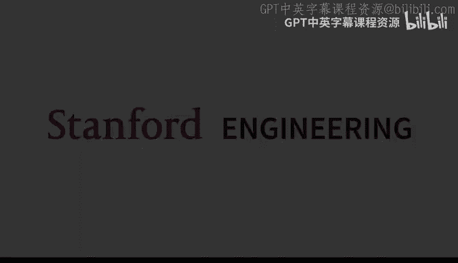

So today I'm delighted to introduce our first invited speaker whos Doachquila Dow has also been as well as being invited and I'll tell his background he's also in the symbolic systems program has been an adjunct professor and has been involved with some students in that role as well。

 but in his invited role he's originally from the Netherlands where he even learn some logic among other things back in the old days。

 but in more recent times he's been a prominent deep learning researcher for a number of years he worked at face now Meta in the Fair unit and was involved in various ideas including retrieval augmented generation after that he then spent some time at hugging face he's become interest in looking at multimodal models which is what he's going to be talking about today。

😊，Welcome down， it's great to have you。😊，Thank you very much。Allright， that works right。 Yes， yeah。

 thanks to everyone for coming。 I understand that you get points for being here。

 So you're not really here for me。But thanks for coming anyway so I'm going to talk about multimodal deep learning。

 it's gonna have an NOP focus， of course， as for discourse。

 but it's also because otherwise I would really be talking for many more hours than I have time for here so I'll try to really keep it focused on the things that I think will be most useful for you to learn and so the first thing you should understand is that this whole concept of multimodality is kind of illdefined actually so if you go to the dictionary you'll see that it means having or involving several modes or modalities or maxima and so what mode here really means is so it could be mode in the very generic sense or it could be a very precise sense of the mode of a statistical distribution and so depending on the paper you're reading in some cases people really mean the statistical sense in other cases people really mean is sort of very vague concept of a modality where it really means the type of information that you're getting。

Example of modality in that case is an image or speech signal or audio in general or even all。

 So smell or things like that。 So in this lecture we're just going to focus mostly on text because this is an NOP course and we're going to focus on images mostly as the other modality to keep it simple。

All right， so why does it matter， Why does we care about multimodality and so there are a couple of really good reasons in general for this。

 the first one is about faithfulness。 So if you look at how we humans understand the world。

 how we make sense of what happens in the world that is very multimodal so we perceive the world。

 not just using vision or just audio， but we synthesize information across all of these different modalities and that's how we understand the world and each other。

 there's also a very practical argument for doing it。

 it's because the internet is multimodal so if you go to， I don't know。

 like Facebook or something like that， like it rarely happens that is just text or just an image that's usually a combination of multiple modalities。

And then the final good reason that we're just starting to hit now if you're really following where the field is going。

 we're kind of running out of text data for these large language models。

 So one interesting way to keep scaling on the data side is to make use of all of these other modalities So if you can have your language model also watch all of the videos of cats in the world。

 It's going to understand the concept of catch cat much better。

 And that's what we want to have in these models。 we want them to understand the world in the same way that humans understand it。

😊，So right now， multimodality is really one of the main frontiers of this new foundation model drive that we're all in right now。

There's a thing called the McGrk effect。 Let's see if it loads up。

 but so what we'll see when this loads is this guy over here and we' have the same audio effect being played。

 So the audio is exactly the same。 And this man is going to say something like and so you're hearing a be there。

 I think if you look at my mouth because that's what I said。

 But if you then change the video to where he says with exactly the same audio。

 you're going to hear the other version。 So unfortunately。

 I can't really like swap in the different audio here。 So you have to trust me for it。

 we might suddenly start hearing a guy saying。

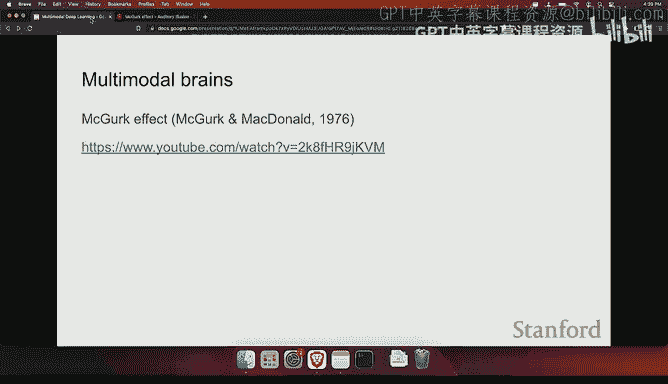

All right， so multimodal applications。😊，When we have multiple modalities。

 we can do all kinds of interesting things and as I said。

 most of the use cases we have on the internet they're all multimodal and there are some really kind of obvious things we would be interested in if we have information from these different data sources from different modalities so obviously we might want to do retrieval so maybe given a bit of text we want to find the right image or maybe given some image we want to find the right text for it so we can match them up obviously we can also do this in a generative settings so then we have image captioning which you probably heard of we can do text to image generation so that's image synthesis and so stable diffusion everybody in the audience here has probably seen that then we can do visual question answering where we have an image and text and then we need to generate some new text we have multimodal classification where we have image and text and we need to have a label for example。

 whether something is hate speech or not and then in general we want to be able to have a richer understanding of information。

which means that we combine images and text and then use it for downstream applications that require better understanding or better generation so this field really is super hot right now。

 so there's this this nice paper title I predict that this paper is going to do really well in terms of citations just because it has such a ciable title I think a lot of people are not actually going to read it。

And so I mean， I've been in this field for quite a while now。

 and people have been saying this for a really long time。

 I think Chris would agree that so for decades， people have been saying that multimoal is the next big thing。

 but now it's really true， I think。Allright， so the outline for what we're going to be talking about So first I'm going to tell you a little bit about early models。

 then we're going to do a bit of a deep dive on some of the specifics。

 then we're going to go over particular type of fusion。

 contrastive models or late fusion Then we're going to go through a little bit of the history of multimodal foundation models then we're going to talk a little bit about evaluation a little bit about other modalities and then I'll make some predictions for the future and hopefully maybe give you some cool research ideas or things to talk or think about。

All right， so obviously there's a lot of work that happened before deep learning。

 but I think if you want to start from like the deep learning revolution and what was happening in images and text then a good starting point is for example。

 wasabi or device or Richard toker who you've probably heard of has done some really cool early work in that really pioneered a lot of these ideas。

 and the basic gist of this is that we have a vision model on the one hand， we have a language model。

 So this really I mean the first lecture of this course。

 I think was about word embeddings so that's just your basic word embedding model and now we need to figure out how to align them in the same multimodal space So the way you do that is you get some sort of similarity metric a score function or like a kernel function if you're thinking about this from a support vector machine literature perspective and now you need to figure out in a max margin or margin loss how you want to align these to。

Points in your embedding space， right， So things that are similar。

 you want to bring them closer together， things that are not， you want to bring them further apart。

 And if you do that in this multimodal embedding space。

 that means that you can do interesting crossmodal transfer where you can take the word embedding for something like auto or like horse。

 And then you can find close images in the embedding space to that thing。

 And now now you've solved the retrieval problem。 So this is a really nice early application。

 And I think a lot of the stuff that I'm gonna talk about in the in the early slides。

 You're gonna see this income over and over again， you're gonna see it get kind of reinvented with fancier models。

 But it's basically all the same stuff。So you can do crossmodal transfer where you have images and text。

 but you can also combine them together so that you get a multimodal word embedding and so this just gives you a more accurate representation of how humans understand word meaning because when we think about the word moon or cat or something we can go to Wikipedia and read that a cat is a small carnivorous mammal that people like to keep as pets or we can just go and look at pictures of cats and now we understand what a cat is and I would argue actually that for a lot of people the picture of the cat is much closer to the meaning of the concept of cat so some early work where people were trying to do this is from Bru at al where they did multimodal distributional semantics using this very elegant approach called bag of visual words So just like who has heard of bag of visualual words。

Very few people。 Okay， so it's， it's surprisingly simple。 And so I kind of like it。

 It's nicely elegant。 So you take a picture of a moon in this case。

 I think you can see it in the back too， right， So we use an algorithm like sift to find interesting key points。

 So it's sort of where the difference between the pixels and the pixels next to it where the the difference is big。

 Those are sort of the spots you want to be looking at。😊，And for each of these key points。

 you get feature descriptors， so relatively small vectors like 32 dimensional events are kind of on the implementation of this and what you can do now with these feature descriptors is you can cluster them using k means and then you assign every one of these points so you can count how often they occur so in this picture of the moon we have like actually the count is so there are three like red dots right so that's why the red dot 1 is three。

 So what that gives you is an idea of the visual words very similar to the original be of words model that you hopefully have heard about maybe in the first sector so that's the visual equivalent of the textual thing and so if you do this and you then concatenate or you apply Sd to fuse the information what you get is a word embedding that is much more representative of human meaning as reflected in the dataset sets that people used to care about at the time。

After that there were a couple of people me included who tried to take these ideas and then really applied deep learning to them so some of the very early versions of this use convolutional neural networks and then you can transfer the features from your confnet and you take your word embeddings which you've seen in the first lecture and then you can concatenate them now you have a multimodal work vector or you can do something slightly fancier so you've seen the Sgramm model you can also try to do skipgramm predictions onto image features so when you see a work like cat in some context like the cute little cat set on the Me then when you see CA you also want to predict cat pictures。

So super easy ideas， but it turned out that this gives you much richer word representations。

 so that's kind of cool， but obviously words are very limited。

 what we really care about is not words but sentences。

 so then people started really looking into sentence representations and how can we figure out how to get compositional understanding in the sentence representations and how do we align that with images。

So the loss here is very similar to what we saw with words and pictures。

 but now we just have the sentence encoder right and so there are some really cool early papers from Andre Kpay and Richard Soer also had some work here and then you know so the basic idea is just that instead of having these word embeddings。

 we now have an LSCM in these papers or some other kind of recurrent neural network or in the case of this one recursive neural network and then we try to align the features together and so these three or four papers are actually very important。

 This one by me is less important， but it's still kind of interesting because we showed here that grounded sentence representation。

 So if you actually just use this part here as a sentence encoder for NOP tasks the ability to just predict pictures from it already gives you a really good sentence representation so just by predicting pictures。

 you can sort of imagine what things look like and that gives you a really good meaning。

which you can then transfer to， I don't know， sentiment classification or something else。

And then of course， once we have census encoders then we also have decoders and so when the sequence to sequence architecture came out which you've probably also heard about in this course。

 what you can do instead of having a text encoder for like your source language if you're doing machine translation is you can plug in a confnet。

 instead of an LSTM encoder and now you can generate captions。

 so that's exactly what people did we used to have all of these fancy diagrams in our papers then where we explained the LSTM and how that works。

 probably people don't learn that anymore these days they do。Very good。

 They They might make a comeback。 I think， you know， at some point。

 transformers are going to go away， listen。And so one of the things that people figured out in machine translation very early on is that you can do alignment of words between your source language and your target language and you can do the same thing actually with images right so if you want to align the word in your generated sequence with something in your picture then you can do the use the same approach for that and that approach of course it's called attention so you've learned a lot about the attention probably in dis course and so yeah that was one of the building blocks of these systems as well where you can do very interesting things and really see that when it has to generate stop for the stop sign that is' really actually looking at the stop sign so there's a really cool alignment going on there in these models。

And so the final kind of early model we should talk about a little bit is GNS。

 who here is sort of GANS。Okay， that's a lot more than backial words。 I guess that makes sense。

 And so so yeah， the basic idea of， again， is really that you have this generator and discriminator and you want to have the generator generate images that the discriminator cannot all distinguish from so it cannot distinguish fake and real images right And if you do that。

 you can actually condition that on the piece of text and then you can generate images using some some text prompt So that's what kind of the first versions of stable diffusion we're doing things like this and it's all the natural progression to that model。

So those were the early models。 Maybe do people have any like burning questions about this。

 or does this all make sense。

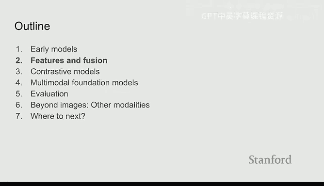

Alright。

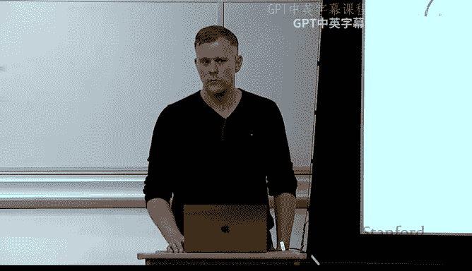

So let's do a bit of a deeper dive then in particular on features and fusion。

 So those are really the kind of core building blocks for all of this multimodal stuff but before we go there。

 maybe very briefly， like if all of this multimodal stuff is cool and sort of useful and doesn't look that difficult like why aren't we all doing multimodal things so why do we focus on specific modalities And I think there are a couple of problems just to be aware of So one is modalities can sometimes dominate。

 especially text is much more dominant than vision or audio in many use cases So you can already just have a model that that picks up on the text signal and basically learns to ignore the image completely。

 which actually happened embarrassingly for visual question answering。 We'll get to that。

 So visual question answering。 you could do that without actually looking at the picture。

The additional modalities can add a lot of noise。 So it makes your machine learning problem more difficult。

 You don't always have full coverage。 right So as I said， if you look at Facebook posts。

 sometimes you have text， sometimes you have pictures， sometimes you have both。

 but you don't have a guarantee that you always have both。 So how do you deal with that。

 in many cases we just really weren't ready， it was too complicated to implement stuff and also just in general。

 like how to design your model really to combine all the information is actually quite complicated。

 So in order to maybe drive the point home a little bit so featuringurizing text I guess we all know how to do that by now。

 especially sort of in the age of transformers and before in LM we just said like you have your batch by your sequence So batch size by sequence length by embedding size。

 So it's always like 3D tensor。 And that's how you encode your textual information when you pump it through your neural net。

 And so with images。trickier because you can just kind of look at the patches。

 but then if you do convolutions， you're kind of like shifting over the image and then you're aggregating right and in many cases。

 you don't really want to be this uniform。 you want to have something that actually looks at the things in the picture So this is called region features where you would use an object detector as a first step for processing your image and then you would have a conf net backbone that encodes the features for that particular subimage like this guy like skateboard or something it has its own like vector representation right and then in terms of dense features。

 we now also have vision transformers。 So just very quickly go over has to make sure we're on the same page So there are all these models like Yolo is a really good one if you haven't heard of that yet So we're at Yolo V7 now I think create I don't know So there's a new one coming out other year or something。

 But the basic idea is that we get these bounding boxes for things in the images。

segmentations with the bounding boxes is what people tend to use and they have labels So this is labeled like backpacker or something。

 And so you can do this as a preprocessing step on your image to get a much richer representation of what is really in that image。

 which you can then pump into your system as we'll see later。

 And so then how you encode the information that is in these little bounding boxes or actually in the image itself in general。

 we just use a standard continent for that。 And so this probably feels like super obvious now。

 but in 2014 when people were starting to discover this it was really very surprising that you could just use off thes shelf co features to really replace the entire computer vision pipeline。

 So people used to do all of this very fancy sophisticated stuff and people spent decades on trying to refine this。

 and then it was all thrown away and replaced by a co that does all of that stuff for free And so the cool thing you get there is that you can transfer very easily across different tasks so you can have。

very generic continent and then use it to all kinds of very specialized things like spotting buildings in Paris。

 for example， or flowers or other stuff。And then of course， in the age of transformers， how far。

 how far we're already quite a well in this is only the first transformer actually in the slide deck。

 So you know we're making good progress So vision transformers are what we would use these days to encode the images where you have these flattened patches and then you would do kind of the standard birth architecture。

 maybe as you would know from this course and then you do classification so this is all like standard transformer。

 everything standard except now your input here is not words or tokens。

 it's patches of an image and then you classify that。Allright。

 so then we have a bunch of features and now how do we combine information right So let's say we have two vectors U and V。

 So you know it sounds easy right how we could combine them。

 It turns out that they're actually very many ways to combine。

 So I don't think it's really useful to go over all the different ways here。

 but you can do very simple things so obviously inner product or similarity is what you would use if you want to do crossmodal things if you want to embed things in the same vector space。

 but you can do sort of fancier projections on top of different combinations that are kind of linear or you can do multiplicative things where you multiply the components elementwise or you do some sort of gating over the different features。

 you can do attention， you can do fancier biline things， you can do very fancy compact biline things。

 So there's really a wealth of literature kind on all the different ways you can combine two vectors and so this is called multimodal fusion and most of the literature on multi。

😊，Moordality is essentially about this question， what is the best way to do fusion and that's it。

So so I think within that discussion it maybe useful to distinguish between different levels of fusion so you can do it very early where basically you make sure you have the different features and then you just kind of in the sort of modern sense of attention。

 you would attend to everything in all the features from the beginning you can first treat them separately and then combine them or you can treat them as completely separate and then you only combine the final scores and so so that's kind of what we would call early fusion and then sort of my invention for calling the middle part would be sort of middle fusion and then you have late fusion where you really just combine the scores or the logicits but you don't really have any interaction between the information from the different modalities。

So you can do really fun stuff with multimodal fusion。

 So this is a paper I really like film where you have this sort of very special feature map。

 this sort of F here and it gets modulated by a multiplicative vector。

 So this gamma and and additive sort of bias vector。

 this beta and you have a different one for every layer of a restnet that is conditioned on some encoding of the thing you're after。

 So in this case， are there more cubes than yellow thing。

 So we have some vector representation for that。 And we use that vector representation to modulate the restnet blocks at every layer of the confnet。

😊，So， you know， you can really do very fun things where you're sort of modulating one network with the other one and really try to have them learn as much as possible from that。

Alright， so let's talk about late fusion then。 So late fusion is what we would now call contrast models。

 But the basic idea is that we have this similarity score。

 So we have the two kind of we process the modalities completely independently。

 And then at the very end， we do some combination。 And the most famous instances of that these days is clip。

 So who's heard of clip。Okay， so clip from open AI。 so it's again。

 exactly the same contrastive loss that we've seen in all these early approaches。

 it does kind of negative sampling。 But then in batch。 So you just have a batch。

 you have two things that are aligned right So like this the first piece of text and the first image they are aligned。

 So this is the right answer。 And I just want to make sure that I rank this thing higher than all the alternatives。

RightAnd I want to make sure I rank this thing higher than all the alternatives。 So it's a very。

 very simple idea。 really， really nothing special about this architecture that that was sort of invented here。

 but what made this thing so cool was first of all。

 it was transformers and it was transformers all the way。

 So your text encoder would be a transformer and your image encoder would be a VIT image encoder。

 So also transformer。 And it was trained on lots and lots of web data。

 So Elec Raford is really a genius at creating very high quality datas and he created。

 I think 300 million image text pairs for this data trained a bigger model on on it than people used to do。

 And then we got this amazing model out of it。 And so so moving away from the words there to the sort of text that you would see on the Internet so the caption for an image on the web。

 It's not going to say dog or cat。 It's going to say a photo of a cat doing something， something so。

😊，That means that you can do kind of zero shot label predictions where you have a photo of the and then you need to figure out what the right label is for a given image using this kind of prompt right so the thing you probably all know about prompting large language models and so you can prompt vision and language models in very much the same way and do zero shot generalization。

So if you want to read really good paper， I would recommend that you read this paper。

 this is really one that's going to teach you how to write really good papers。 It's thorough。

 and it's really worth a very close read， I think if you're interested in this field and so I think when it came out actually on ImNe itself。

 it didn't really outperform BNe。RightSo， so you might think， oh， yeah。

 it actually is not all that special。 But what really made it special was that it generalized much better to these other data sets。

 right， So this， this resnet thing here is is pretty terrible at some of these kind of adversarial versions of imagenet and clip is super robust to that。

 So it's just a way better image encoder in general。😊，So very， very quickly after a clip。

 there was this paper from Google using a line which was basically exactly the same idea。 You know。

 the field is not really that creative at all。 It's like the same idea。

 But then you just keep like throwing more data and more compute at it。

 And it often works much better。 So that's what they found here， too。 1。

8 billion image taxpayers instead of 300 million gives you a better model。

Surprise but so's still very cool。 and what is really cool。

 I think is that there's this organization called Lyon whereve they've started this open source collective to create really high quality dataset sets。

 and so the Ly， the initial data set was how many examples in the initial Ly 400 million。 he knows。

 I know that he knows。 And so so now there's a much bigger version of Ly that's even multilingual and it has 5 billion examples。

 right So stable diffusion was trained on sort of the image， the English subset of this thing。

 And that's one of the reasons that it's so awesome。 It's because it's just seen a ton of data。

 and that really makes your system a lot better。 So if you're looking for like the ultimate data set to play around with with your own ideas if you have an enough compute。

 obviously， than you should really look at this data set。😊，Alright， Any questions about。

Up until this point。No， all right， so then we'll move on from late fusion to kind of middle fusion。

 early fusion And this really is kind of the core of what I think a lot of people in the field right now or if you're interested in getting in this field or if you're going to go into industry and you're going to be using this stuff like this is what you should really understand and。

Again， like the ideas sort of stack onto each other so I've kind of sequenced the slides to give you an idea sort of of how the scientists kind of came up with the next step and you can really see the architecture just get slightly more and more advanced。

 but basically a lot of it is just more data and more compute again so who knows how BRT works。

Everybody should raise their head in this way。 So， yeah， so， so Bt is kind of so canonical。

 I think everybody kind of gets how bird works。 right So I don't think we need a real refresher。

 But I think you can think。 And so the reason I have to slide this because I want you to think about if you have a bird model。

😊，And you have a bunch of images。 How are you going to turn that birdt model into something multimodal。

So there are a bunch of like obvious things you could do given the kind of features I told you about in the sort of ref fusion process。

 so how are you going to do that？

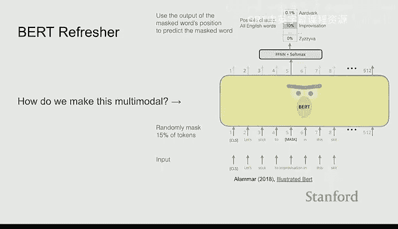

Does everybody want to like？Say something。Thank you for your doing classification。なすは。

And then just concaten it to whatever encoder， like maybe an ANN or whatever your're training on the data concatenated。

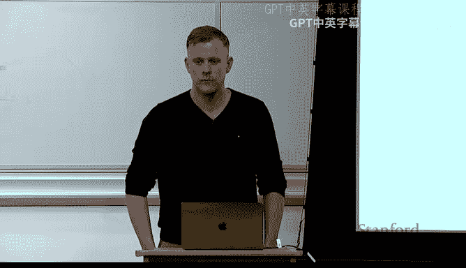

Exact， yeah， so you can take the connet features and classify your token from bird， concatenate them。

 and then classify for like a cat or something like that or whatever the thing you're interested in yeah。

Yeah so that's one thing you could also like take the con features and like give them to the birdRT model in lots of different ways。

 we can use the region features。 So I think a lot of people when Bt came out who were working in vision and language processing were thinking exactly about okay so do we do like middle fusion late fusion。

 do we do early fusion， how do we do the fusion and so there were a lot of papers all coming out basically at around the same time where people were doing versions of this so Bt was really kind of the innovation and then everybody sort of just plugged it into their own thing because of huggingface transformers and things like that。

 So the first thing is visual birdt this was one of the very early ones where you have this image and people would do object detection on this so you get like a hat and a record and shirt and things like that So you could just really take these features and then plugged them into your your transformer model。

you try to recover the features， and so this really is probably like the simplest way to do it。

 right？And so this is what we call a single stream architecture where you have all of these kind of concatenating the original input features and then putting them through the same transformer。

 what you can also do and that's something that this model called Vbert did is where you have two different streams。

 so you essentially have these two parallel transformers。

 but at every layer you kind of give them cross attention。So or coattention as they call it。

 but it's basically like so you just make sure you have an attention map thatpens both and then you just do your full normal transformer layer again。

 And then so this you can train just like your regular birth so you have your masked model mass language model here and here you do sort of some equivalent of that and then you also have your next sentence prediction。

 which you probably remember from your birth lecture， but instead here we're saying okay。

 it's this image aligned with this piece of text or not。There's also Lexmer。

 I mean I could go on forever there like 100 papers that came out is all at the same time。

 So Lexmerd had a different crossmodal output encoder。

 a bunch of different ways of encoding the position information right So you could say okay。

 I just have a bunch of bounding boxes that are feurized。

 but I don't care about where they are in the image。

 So it's just kind of like just a bag of bounding boxes。 or you could say I found it here。

 like this is the particular like top left and bottom right coordinate。

 And that's what you featureurized into your network。You can also do do something even dumber。

 And I can say that because this is my paper where you just take the the image itself。

 you put it through a restnet and then you do a little bit of pooling on the final feature maps and you just get give those feature maps to Bert。

And so you then need to distinguish between like your text segment embeddings and your vision segment embeddings。

 but so this actually works surprisingly well。 You don't have to do any any additional training。

 you can just take bird out of the box。 initially you freeze it。

 you learn to project into bird token space then you unfreeze your restnet and then finally you unfreeze your bird and now you have a very good multimodal classifier on the problem you care about So a lot of these other papers。

 they're doing what they call multimodal pretraining where first you have a bird model and a renet so they're kind of unimmodally pretrained and then you cobble them together and then you have a multimodal sort of intermediary pretraining step before you fine tune it on the problem you care about And what we showed here is that you don't really need that actually in many cases So it's a very strong baseline。

You can also go to the pixel level completely so that's what they did in this other paper called pixelel B where it's basically exactly MMBT so the previous supervised one but here they do do the multimodal pretraining step and show that think for VQA it helps a little bit so there are many of these birdss doing sort of visual things people really tried everything here's another one called unitE where they added a bunch of different losses we can really talk about this for a very long time we're not gonna do that I'm just going kind of talk you through some of the more interesting ones so this one I think is quite interesting Vt because here this is really the first instance where we are completely gone from con features so we don't do any preprocessing on the image。

 no region features no backbone that feurizes the parts of the image we care about we just have these patches of the image so really integrate。

We flatten those patches。 we just pumped them into the transformers straight away so this really is like sort of Bt and VIT together in one model and this worked really very well so that's been the trend so here's here's a nice very long list of all of these different models and what they do and so really the distinctions are just in what is the text encoder that you use so do you use Bt or something fancier or better Roberta what is your vision encoder so in many cases you have these region features so you would do an RCNN sting or you could just do asnet or VIT you have different kinds of fusion so either single or dual stream as we talked about right so visual Bt or Vbert different pretraining task so mass language modeling image text matching there's a bunch of like funkier once you can do and then finally you can do multimodal pretraining on all of these different data sets that have aligned data。

So you are probably wondering like okay so what is really the interesting difference between a lot of these and so I have another recommended paper that if you're interested in this space you should really take a look at it's also a really well done paper where they they unmask multimodal pretrain so basically they say。

If you take all of these little model inventions and you train these different models on exactly the same data in exactly the same way。

 it turns out that they're all basically the same。So that's a lot of kind of you know wasted effort on the part of the field because everybody is saying oh my model is better but it's actually just because you trained it on different data and there's no real sort of model innovation going on in a lot of these things so I don't mean to sound discouraging or anything like that but you know like I think that's why this paper is really nice and really important is because it just shows us what really matters。

So this is also work that I did myself calledFor with my team where we wanted to take these ideas really to the limit。

 So a lot of the things that you've seen now So the visual birdst and the vberts and the things like that they're all about multimodal questions。

 So how can we do visual question answering something like that where we just have these two modalities we only care about problems that always involve these two modalities and where we want to go and this is kind of the basic premise。

 I think of foundation models in general is that we have one model to rule them all So this one model can consume data from all of these different modalities and you can synthesize across all of these different modalities and then do useful things with that information so with flavoror that's exactly what we try to build。

 So we wanted to have one foundation model that is good at vision and language and computer vision and natural language processing is jointly pretrained on all of these different data sources So it's also trained on just C news。

Cral and bookcorpus。 so it's very good at the sort of things you would expect Bur to be good at it's trained on imagenet for image data so it's good at the things that you would expect a kind of basic image model to be good at。

 and then you have this PMD data that we created out of publicly available image text pairs that we also trained it on。

 So this PMD datas is really just if you take all the data sets that were ever created that have image texts that are publicly available。

 So unfortunately the clip data and the Google aligned data and all of these data sets they haven't been open source So this is before rely on so now there's a good alternative to this but so this PMD data if you combine all of these image texts。

 you get 70 million of them so that's still pretty decent size and then you can take all of this data basically to solve all of these problems that we know we care about in these different fields so you can do multimodal reasoning you can do language understanding you can do visual recognition all with exactly the same model。

That's a very powerful idea I think if you work at a company like Facebook。

 you don't want to have different models for all kinds of different things。

 you want to have one model that you can really use for everything that's going really make your life a lot easier so the exact architecture here is that on the one hand we have this image encoder where we take the image we encoded as patches and we just do what we call mass image modeling but it's basically mass language modeling and just on the image tokens right。

And then on the other side， we have the mass language modeling on the language。

 so your regular sort of bird thing and then we have a multimodal part where all of this information gets combined。

 So we have a mass multimodal modeling loss term where you can also do image text matching So this is like your bird next sentenceus prediction thing and then we also have a global contrastive loss which is exactly like a clip So if you do all of this stuff。

 it's just all transformers all the way down it's sort of a very elegant way。

 I think to combine a lot of this information。 and when you do that you get something that can really do a lot of things very well。

 So we're not going to talk about that table is just way too many numbers。

 but so just trust me were pretty thorough generating the table here and so over 35 different tasks if you compare flavor to all kinds of different ablations in terms of clip models then this is just a much better way to get to this information。

So I think this is a nice example of where we're probably going to go with the field in the near future。

So the other trend that we see very obviously in the field right now is that everybody cares about generative models so you language models and image generative models。

 there's just a trend where we want to be generative。 we want to move away from this contrastive。

 discriminative stuff to the more interesting， more richer representations maybe that you get out of generating sequences or images。

 So this SVlM paper was one of the first ones where they really had this separate decoder that was trying to generate or kind of complete captions which they showed gives you a lot richer representations。

 I think this is actually the current state of the art now it's called coca。

 So a lot of these models they all again look very similar。

 but in this case now we're starting to really see these text decoder。

 So initially with clip I think that's also what they were trying to go for openaiI being a company that really likes generative models。

 but they couldn't really get it to work。 And I think so it took as a while as a field to。

Really figure out how to do this the right way。And so right now we're really kind of in the age of language models right and so one of the interesting things you can do with language models is just keep them frozen and then learn how to project into the language models so the MMBT architecture I talked about where we had this bird model we kind of kept it frozen and we to learn to project into the token space you can do exactly the same thing。

 but then with a much fancier model or something like T5。

 even where you just have an encoder decoder or some kind of generative part of this。

 you keep that thing frozen and then you learn to project into the token space off that frozen language model and then you can do lots of fun stuff。

 it turns out so what they show in this paper is that you then get few shot learners So all of the things you see with GT3 where you can just give it some kind of in context examples and it's gonna to figure out binding kind of on the fly so it says like this is。

DX and this is a blanket so what is what is this and then it gives you the answer that it's a DX so it really learns in context how you decide the feature mappings。

 which is really kind of solving the grounding problem that a lot of this multimodal stuff started with。

So I think that's very cool。 And then probably one of the coolest papers right now or models right now that you might have heard of if you follow the field this flamingo out of deep mind where they take a Chchilla language model and so this is really an optimal language model and now you have this vision encoder that encodes multiple different images that you can then do reasoning over and then kind of autocomplete。

 So what this gets you is just a much more powerful model because you can do your generative over lots of different images。

 So it's really like stepwise。 you can see it right we started off with very simple transformers and now we're actually at something that is starting to get pretty complicated because we have these building blocks like a perceiver resampler where we have a bunch of different images that we featureize。

 and now we need to compress the information because sometimes we have three images sometimes we have five images so we want to make sure that we can compress it so that it's always ready for。

😊，By the next layer of the language model and then so this paper again is a really good paper to read because they actually so this is not me。

 this is not my code。 This comes from the actual paper so they just have the diagram together with the code so that you can really understand what is doing which I think is really great And so once you you have your perceive re samplingling step。

 what you then do is you do gated across attention。 This is how you implement it。

 and so this gated across attention， you do that before your frozen language model layer。

 So you really just have a frozen Chchilla language model and you learn to kind of modulate the information that goes into that language model。

 you propagate the gradients all the way back。 you just don't update the language model So you're really kind of trying to figure out how am I going to design my signal so that my language model can do the most with it how am I going to combine the information So you'll notice that now we do it before the layer right in a lot。

This other stuff， you would do the attention after the layer， but here you do it before。So Kpathhi。

 I think more than 10 years ago had this image with Barack Obama kind of setting his foot here on the scale to make somebody think like you know they're a lot heavier than they really are。

 So this is obviously funny to us but not to an AI system I think unless it really understands the scene。

 And so that's why Kpathhi at the time said this would be a really good visual tuuring test。

 like if a system can this out then it's actually really smart。

 And so obviously it's been a bit of a challenge for everybody working in the field then to get something that actually works on this。

 And so fllamingo， as it turns out， kind of gets the joke。But yeah， so it's。

 it's a bit unclear if it really gets a joke because if you read this conversation。

 it's sort of kind of getting steered in the right direction， right。

 but at least we're making progress。 Let's put it that way。And then so in fllamingo。

 you still have a lot of moving parts， but you can really take this almost to the full extreme where you've try to freeze almost everything。

 And you just want to learn this kind of mapping between your image encoder and your language model or your image encoder and your encoder decoder architecture。

 And all you really do is just the projection between the two。

So there's this nice model called Blip2 where they experiment with like OPT for the language model and Fl T5 for the encoder decoder architecture。

 and this just gives you amazing results。 It gives you really complex captions and things like that without any real direct supervision on the captions itself。

 which is pretty impressive， I think so that just shows you the power of language models in general。

😊，So here are some examples so it can really do like different things from captioning to reasoning to visual question answering to like like location detection so you can have a long conversation with this system This really is kind of the future where we're going right where we're going to have a chat GT but it's also going to be able to see the world in a way。

And so I think an interesting thing so youve probably heard of like chain of thought prompting and things like that where you ask a language model like let's think step by step and you can tell a vision and language model generate a rationale for why something might be the case so you generate a potential explanation for what your answer might be and then after that you ask it to answer the question and it turns out that if you do that sort of multimodal chain of thought prompting。

 then a system gets much better and so know this is like the new state of the art on science QA or a benchmark like that just because it learns to unpack the information and so I think we're really as a field just starting to figure out what the potential is of this。

And I think this paper is where they also showed that multimodal chain of thought prompting reallyy gets you pretty amazing results。

 and they show very nice results on raven matrices and like very complicated kind of IQ test sort of things that humans are supposed to be really good at。

 but you have to be a pretty smart human to really be good at this and this system just nails it。

 So you know we're making super fast progress。 And we started off from a very simple bird model that was able to look at some pictures。

 and we're getting to these very sophisticated foundation models。😊。

So that was my short history of multimodal foundation models。

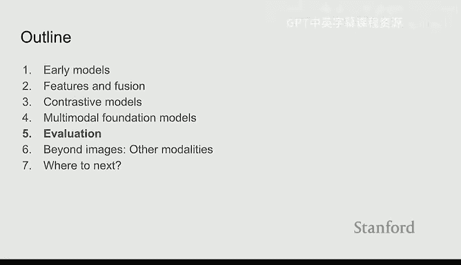

So how much time do I have left？2All right， okay， plenty of time。

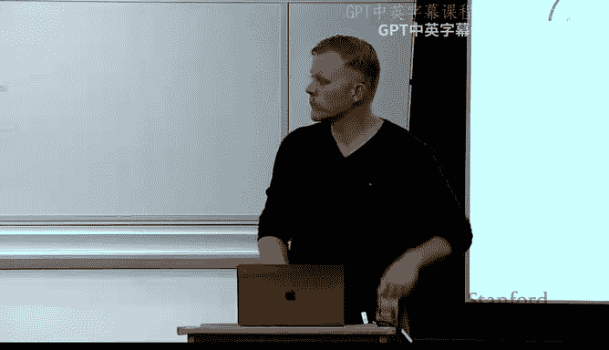

嗯。Yeah， please questions。Do we do much great processing of image？

So I noticed a lot of the images they just look like they were。And boxes。

 I where just passed through and kinda node。Sensitive shape。Yeah。

 so I think the history of computer vision has been very similar to the history of natural language processing where we thought we needed all of this structure and all of these different things。

 and it turns out you can just throw it all away and just have a big transformer over the patches。

Sorry， yes， CS231。😊，You mentioned a couple of times like models frozen。あさに。Yeah， yeah， sorry。

 I should have explained that better。 maybe。 So it just means that we are not updating the weights。

 so like if we go to this here， I think is a nice example。 So we have frozen selfattention。

 So that just means that when we do a forward pass， we go all the way to whatever we want to predict。

 we get some gradients， we take them all the way down。

 but we only update the nonfrozen layers so here， the gradients actually do get updated。

 but these just never change。 And so the reason you want to do that is because otherwise you're gonna drift way too far。

 So then you're gonna kind of destroy all of the cool stuff your language model has learned because you're just going focus on the small data that you're training it on。

 So you want to preserve the abilities of the language model。

 but you want to become good at the thing you care about。Other questions。Okay。Mulmodal fusion。

 iss there a benefit to doing like the earlier middle fusion as opposed to only doing delayed fusion？

Yeah， so so I mean we're going to talk about evaluation next。

 but so it really depends on the task that you care about And so I would say the earlier is always the better if you can afford it。

 and so like clip is very efficient to train it very late fusion right at the very end。

 so there's no interaction between the different modalities and so that's really good if you want to be very efficient and if you want to be for training。

 it's much nicer but if you want to have a richer understanding of the multimodal signal than you want to do earlier fusion。

So yeah， it's always a trade off。It it seems that images are just a lot more data than text。

 so how much more difficult are these to train and how much bigger does like the image processing have to be compared to the language model？

Yeah， so so images are are more complex in a way but there are also kind of higher bandwidth representations right so there's a lot of kind of like just pixels that our brains just abstract away right It's really about the scene that you're seeing and like you're not really。

Thinking too much about the pixels themselves so so like Jan Lacoon likes to say that language is just a kind of low bandwidth a proxy for a language of thought which is much richer and much higher bandwidth and like he thinks probably visual I'm not so sure but so yeah I don't think that there's necessarily a difference between kind of the scaling loss that you see in these systems or at least we still have to figure that out we'll kind of talk about that towards the end as well。

Also， have certain social and cultural bias， just like the natural enterprise。Oh yeah。

 they have terrible biases。So yeah， some people are actually working on who are in this very room。

 but so these models can be very racist also in what they generate or the kind of predictions they make so if you have an Asian basketball player standing sort of like this with a basketball very obviously there。

 then the model will think that he's playing ping pong because he's Asian。I'm not okay。

So these models， yeah， just like all neural networks。

 right this is really a big problem and one of the most interesting problems that you should be working on if you're a student and you want to make a difference is how do we get these systems to be much better at these sorts of things？

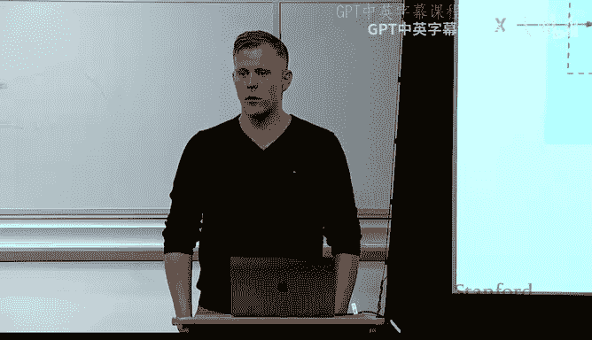

So in other examples， you show like the model interpret from the content of an image。

 So we we w to understand the content of a video。 So what actual challenges you use you might see like along this part and what improvements we can make to for this scope。

Yeah so you're asking about the attention mask sort of yeah so you can use the same idea for videos and you just look at the video and so these systems are so good now the object detectors are so good you can really track objects kind of real time as they go through your video and so you can try to check how that aligns with your attention mask in your model so a lot of so videos I think are sort of interesting but they're also not really interesting because you can very often just subsample images and solve the images rather than having to deal with the complex video。

嗯。回者。 maybe one more question and then we'll go do some evaluation。So these multi model models。

 when you only， let's say you only provide a single first media to the only text vision。

How is it performed in that case but it's actually more geared for multimodal cases Yeah so I mean that's one of the giant shortcomings of a lot of these models is that they're really just built for multimodal stuff and so what if I don't have an image and so I mean that's why we did flavor because we want to have one model that can do all of that stuff and that's why in an MT so the supervised multimodal by transformformer。

 we actually have an analysis of like how robust is this model to missing images or missing text but so I think a lot of lot of folks working on these early visual bird models that were kind of myopically focused on VQA which is actually a great segue to what I want to talk about next so it really depends on the task that you care about as I said and so I think if I'm going to tell you about multimodality I also have to tell you how you're going to check that the multimodal system is actually good at multimodal things and。

The the topic of evaluation， which actually is a super important topic and a lot of people they want to be cool and build big models。

 but I think it should be way cooler to do proper evaluation of these models。

 especially if you're in academia because you only have limited GPUs anyway right so what can you do？

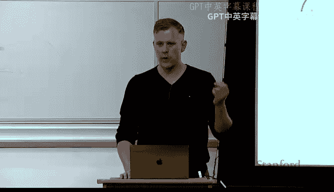

Sorry， I don't want to rub it in with it。So so how do you check， Well， there's this amazing project。

 So like ImNe really changed like the history of deep learning I think， and this other data set Coco。

 I think also really changed， especially vision and language but also， I think vision in general。😊。

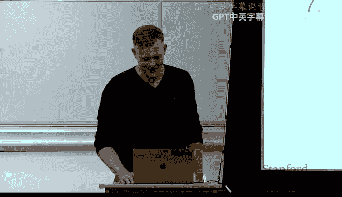

Where they have just a bunch of main sort of multimodal tasks。

 So these images are very richly annotated with all kinds of different things。

 So like the segmentation of the objects， the bounding boxes。

 the labels of the bounding boxes they come like sort of different pixel granularities is a huge data set its very fine grainined annotated in terms of like the categories that it has。

 and then you have five captions for each of these images。

 And so this really was the first data set that unlocked a lot of sort of vision and language processing at scale。

 because you had your picture and you had your caption And now you need to figure out。

 okay how do I give the right caption for this image So that image captioning or can I retrieve given some piece of text。

 the right image or the or the image for the piece of text。

 So there's a bunch of very impactful data sets that do the stuff and we already talked about Ly on but Coco really is the main one still I think that a lot of people kind of use as the colon。

Int of this data set category。And then the other thing that people really care about in vision and language processing is visual question answering and so there really are a bunch of academic groups who are or have been so focused on this task that they didn't really care about anything else and that's why you see a lot of models that are really optimize just for multimodal and nothing else and you can see that kind of reflected in the citation counts as of last night 3am where so the VQA just has way more citations than image captioning data sets even and so what you do here is you just have an image and then people ask very simple questions so annotators they asked these simple questions they give the answers and now we want to be able to answer these questions with machines and as I alluded to earlier one of the kind of embarrassing backstories of this data was that the initial version of the data was actually found to to have images。

Not really matter at all。 So you could just look at the question。

 and it could have something like how many slices of pizza are there。 And so， well。

 not in that particular case。 But in almost all of the data set。

 the right answer for how much or how many question was too。

So if you just predicted to every how much or how many questions you got like 70% accuracy on the accounting category。

 So careful data or evaluation benchmark design is also really a skill。

 And you really need to think about what you're doing。

 You can't just like set some data aside and evaluate it on。

 you have to really think about what you're doing。 And so there's GQA by Chris， actually。

 which is also just I think a better design version of this data set。

 maybe So you might want to use that these days。There are also kind of。

Very targeted data sets that really tried to measure one particular thing。

 And and I think one of the things we really want to get at with these models is what we would call compositionality。

 right so we want to be able to really take the parts and reason about the whole and understand the relationships between the different concepts。

 So clever was a very clever dataset that was designed really to measure the compositionality。

 both on the language side and on the vision side。 So you have to understand the relationships between all of these different objects in the images。

 So that's been a pretty impactful dataset。 I think for really forcing people to think about compositionality。

But a lot of these data sets really had big problems。 So， so one of the problems is， you know。

 they were too easy。 So V QA is sort of like plateauing out。 We can talk about that a little bit。

 too。 wasn't really realistic。 So you could solve V Q A。

 And that's probably gonna make some people's lives better。

 You're all like trying to process the means。 I can see everyone。Okay。

 let's get to the memes first then。 So so obviously so these memes are not actually in the data set so I could put some really hateful memes about sort of Hitler or something which are in the data。

 but that would be less fun So these are meanme meme examples to kind of demonstrate how the data was constructed and so one of the problems we had。

 as I said， like VQA， the V didn't really matter what we want to have is a data set if we care about multimodality specifically is like how do we get a data set that you can only get right if you are good at multimodal reasoning and otherwise you're just gonna screw it up and so this is what we came up with is if you have a meme like this one love the way you smell today I mean that's not very nice if you send this to your friends。

😊，So， but， so it turns out that that if you just swap out the background， now。

 it's a very nice thing to say， right， And like this one is， you know， I don't know。

 you're maybe a bit weird if you like this。 but there's， there's nothing wrong with it， right。

And so it's the same for this one here。 Like， look how many people love you with the tumble wheat。

 that's really sad。 And like， you know， if you， if you， if you change just one word。

 suddenly is like a really nice thing to say， right。So， so if you want to solve this。

 if you want to classify this correctly for the meanness。

Then you have to really understand multimodal reasoning。

 You have to understand the relationship between the image and the text in order to get to the right label right And so it was really constructed by design to do that。

 And so how we did it exactly is we use some really highly trained annotators。

 and then one of the big problems with a lot of these data sets is that nobody really knows who owns the meme。

 for example， right So somebody makes this meme now they technically own a copyright。

 And so when I made this data set， I was working at the Facebook and they were very afraid of copyright things。

 So what we actually had to do is we had to pay people to make new memes。嗯。And so so not from stress。

 so we could show them kind of the actual examples。

 and then they had to try to find images that were were kind of corresponding to the original source image and try to recreate a meme but now with an image that we could buy from Getty and so we gave a lot of money to Getty so that we could then release the data to the public so that people could do actually research on this and understand for their multimodal models whether they're good or not。

 And so we really tried to make it so that we had these benign benign confounders sorry startup world with cofounders so the confounder here is obviously you have your original meme and then you have your confounder where you swap out one of the modalities and here you have the other one right so we had our annotators do that as well。

 And so this led to a really nice data I think because it showed some of the intuitions that I think a lot of people。

The field had， which is that multimodal pre training doesn't really work。St and lower。

So multimodal pretraining doesn't really work。 And so all of this stuff that people have been doing with all their fancy visual bird models actually turned out maybe to not really be that useful anyway。

 And so maybe got you like one point extra right from visual bird to like a different visual bur like less than a point just just by doing that multimodal pretraining So that means like we still have to figure this stuff out right this data is far from salt and we we still have a long way to go despite all of these fancy models。

 And you know， a new paper coming out every week that does something new。 like we're not there yet。

And I think that's encouraging especially for you like when you can go out and solve it。

 So what we did with this data set is we organized the competition。

 We had 100 k in price money to try to see what people could come up with。

 And so there was a lot of nice work coming out of that。

 and we really kind of managed to crank the numbers up by quite a lot。

 but the solutions were slightly disappointing。 So I don't know if you've ever used kle。

 but if you want to really win on kgo， you just have to ensemble the hell out of all of the different models that are current state of the art and then you're very likely to win and so that's what happened here where you know there wasn't really the fundamental breakthrough。

 we had maybe been hoping for。 So that's still needs to be built I think。

So this other data I just want to kind of briefly talk about。

 so the theme sort of of this section is like if you make a data。

 think about it very carefully because you can really be very creative with this and really measure the things you're trying to get at So this data winter ground we were trying to figure out okay how good is clip actually So it looks really amazing and it's way better than things that were previously there。

 but does it understand compositional relationships in the same way that humans would understand it or is it sort of just fitting onto the data distribution and it can be very good at the head of the distribution。

 but it's terrible at the tail。 and you can probably already guess where this is going。

 so just to give you an illustration of what is in this data。

 you would have some plants surrounding a light bulb。😊。

Or you would have8 light bulbs surrounding some plants。

 So notice that the words here are exactly the same words。But in a different order， right， So， and。

 and so the visual depiction of these words is very， very different。 So if you're modeled。

 your contrastive model is actually good at understanding the visual semantic or the yeah。

 visual linguistic compositionality of these， these these examples。Then it can get it right。

 But again， if it's actually just overfitting on the data distribution that it's seen and it just kind of is biased or what it sees often。

 then it doesn't really get it And so one paper that we use as a source of inspiration for this work is this paper here。

 order work matters pretraining for little， So we actually found that the order of words doesn't even matter that much for general pretraining very often。

 which is also kind of a scary thing right so this is deep learning for NOP。

 we think that language is really important， but these models can reason about language。

 even if you shuffle all the words。And so that's probably not what we want to have and so that doesn't tell you something about how great we are as researchers。

 it tells you something about how terrible our evaluation benchmarks are right and that's what we need to fix。

So， so what we did with this data set here are some other nice examples like there's a mug in some grass or there's some grass in a mug。

 like these are very different pictures right， And so for us， these are trivial like so like。

 you know， what's the difference between a truck fire and a fire truck。They're pretty。

 pretty important， I think， also， to get that distinction right， so。Guess what。

 State of the art models often perform below random chancemps。So， you know， as I said。

 we still have a lot of work to do， which is good。 and so when this paper came out。

 I think the reaction was was really nice and so when Dolly2 came out。

 which so you probably heard of Dolly too right So it's sort of like stable diffusion。

 But then before stable diffusion。 and so this was really the first model that really showed like just how impressive these generative models can be when when they're creating images。

 So this is there's a mu in some graph you do have to kind of cheat a little bit because you have to add digital art here。

 if you don't add that than it breaks down completely So it's sort of pro tacking。

 I think or sort of tuning on the test set but okay you know So this is pretty good， right。

 So so it is definitely is better than I think a lot of people would have expected even a couple of years ago。

😊，But it's not perfect because people on the Internet like to take more pictures of spoons than forks。

So if you say there are fewer spoons than forks or there are fewer forks than spoons。

 it just really likes spoons more。嗯。You know。And so maybe it's like the matrix or something。

 I don't know， so。Spoonons are just nicer。So so again。

 what you can see here is that these models really are just reflections of the data that they're trained on right and yeah。

 so models are getting better。 but if you've looked at stable diffusion。

 it still can't count fingers and things like that， right， So again。

 there's a lot of cool work to be done。😊，Any questions on evaluation。No。

 okay so let's talk about other modalities then because so we've really just been focused on images and images are great。

 There are lots of images on the Internet and so that makes it it's sort of an obvious thing to focus on it's also。

 I think if you look at our brain。 like vision is very dominant modality So how we understand the world is very vision driven but it that doesn't have to be the case。

 So there's all these other interesting problems that involve different modalities。

 and so the most obvious one is just speech or audio so after after C income comes hearing and really we could do another lecture just like this just on speech and audio and there's lots of interesting stuff to talk about obviously we don't have time。

 but I'll give you another nice example of how amazing Al Raford is at creating datas。

 so there's this whisper model that came out of open AI not too long ago， which was trained on 680。

000 hours of multi。multitask speech data so speech with transcriptions and they trained this very fancy thing on there。

 which actually is not very fancy at all it's just the logmail spectrogram so how you represent the audio signal and then you feed that into a big transformer so this is sort of your encoder self-at here right and then you have your decoder where you have your cross attention and then you just generate the sequence so this is encoder decoder basic transformer model。

 but your input is convolutions one dimensional convolutions over the logmail spectrogram。

And so there's lots of papers that do very similar things。

 there's models like wave to Vec that try to turn the wave signal into vectors。

 or you can discretize it in lots of different ways。 So there's a wealth of literature。

 then I think one of the funny observations actually is that you can just reduce audio to vision anyway。

 so that's what you could sort of argue this logmail Spectrogram does。 but so not to my own horn。

 but in 27， I did this paper where we showed that you can just take a real audio sample。

 turn it into kind of a spectrogram， really just a spectrogram。

 So what is the spectrum of the audio file look like feed that to a regular continent。

 like an Alexnet even And then that gives you amazing auditory features。

 So now you can use this to distinguish between violins or guitars and things like that。

 So you know maybe you can just reduce all of this to vision。

 So one question maybe you could ask is like can we also reduce language to vision。

Or vision to language。So that's sort of what people are thinking about。So we talked about video。

 There was a question about video。 So a lot of these ideas also extend pretty directly to video。

 But now you just have more data， right So like fllamingo already had a bunch of different images in it。

 You can do flamingo over videos， Probably a lot of the images are pretty useless for what you're trying to do with this video model。

 right， So they， they're too similar。 It doesn't really add all that much information。

 So you want to subample the frames so that you get the most useful information out of your video。

 And so there's a bunch of approaches that that kind of take the keyframes。

 And then you just do a standard。😊，Joint vision and language transformer and gor thing on top of that。

 So this is kind of becoming hopefully by now a very familiar recipe， right， And so there's this。

 So Merlo is is a nice architecture that does this。

 And then they came up with Merlo reserve kind of facility name where they also added audio to this model。

 So this is now a trimodal model， right， And so we're going towards this foundation model that can consume all of these different modalities all in one go。

 And that's really like a clear trend in the field。😊。

Another very interesting direction I think where in the field we were very excited about this for a while。

 but I think it's sort of gone now because it's too difficult to create lots of highqu data in this setting but what you can do is you can simulated environments so this is a paper from Deepmind from 2017 where they had this agent walk around in maze and then it could have natural language instructions。

 it could also generalize to like decks and bls and different sort of groundings and assignments that you could do in that environment so this is a super interesting direction I think in the long term because this is how humans learn language right like we walk around in the world we interact with our environments。

 we have all of these different perceptual observations。 we synthesize them in our brain。

 we manipulate objects， we change our own viewpoint and that's how we learn everything we know about the world and so our language is very intricately connected to that world and how we observe it so I think that that might make a comeback。

At some point in the future， you can also do other stuff。

 So especially with this kind of conditioning or text that that we're seeing a lot of right， So so。

 you know， Dolly， too and stable diffusion and all of these different things and the original game we talked about at the beginning。

 you can do the same thing。 But now you're generating 3D point clouds， So this is a 3D coregi。😊。

Using a corgi。 And so this， this prompt can probably become much more complex over time。

 And you can do like sort of autoca design and just say， like give me a house。

 And it's just gonna design the whole house for you。

 So you can just like tweak the prompt and things like that。

 Like that that's all coming or or even already here in many cases。

 So so the final modality I I just briefly wanted to talk about is olfactory embeddings。是。

And sool means smell if you didn't know。 And so it turns out。

 so my PhD thesis was about grounding semantics in different perceptual modalality。

 So a lot of my work started in vision。 and then it okay now audio is sort of the obvious next one right So you can learn the meaning of violin。

 And then maybe you can learn that violin， like what a violin looks like and what it is and what it sounds like and that's gonna give you a richer representation。

 But for a lot of these words， what's actually very primitive to their meaning is what they smell like。

 because in our brains， that's really one of the core areas and one of the oldest areas in your brain。

 So what you can try to do if you want to complete all of your perceptual modalities is you can try to build olfactory and bening。

 So it was kind of a joke paper I did But the funny thing is it actually worked。

 so there's there's a catalog。😊，Sigma， aldrich， fine flavors and fragrances catalog。

 where you can look up words like melon and pineapple。

 and then it's going to give you all of the chemical compounds that produce the smell or taste。

And so if you do that， then you can count occurrences and then you can sort of do SVD or something like that only to get it to be a bit more of a real embedding model。

 So now you get smell embedding， smell vectors。 and then you can compute similarity judgments between these smell。

 So turns out Apple smells like pe。 and the chocolate and cocoa and sweet and coffee are sort of related So you get these clusters of different smells just based off of their chemical compounds。

 So this bag of chemical compounds model gives you a very rich representation。

 And so if you look at all of the words that are concrete enough to have smell right So like if you have a word like democracy in there that doesn't really smell like anything right So you ignore democracy。

 you just focus on the things that smell or that could smell， I guess。

 and then so the really interesting things。To me is that you this is much more correlated with human similarity judgments than the linguistic vectors we had at the time right so for a word like Apple like you can just get a word vector like you've learned in your first lecture and so you can do like skipgramram and things like that。

 but that thing is not going to be as correlated with human similarity judgments as this bag of chemical compounds model。

So that's pretty interesting， right， so even something like smell where maybe we think。

 you know this doesn't really matter if you really want to understand how humans understand language。

 then maybe you want to include this in your foundation model too。

But I would start with utter modalities。

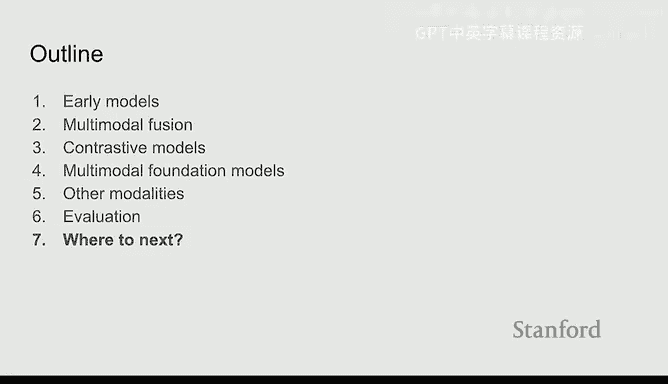

All right。Okay yeah sorry so where to next I'll just I think I've already said most of this actually so one foundation model is going to rule them all and so I mean there will be many of these but a lot of them are going to have very similar traits I think we're going to be looking at scaling loss and trying to understand really what is the relationship between the different modalities。

 which one do we want more off that sort of stuff。

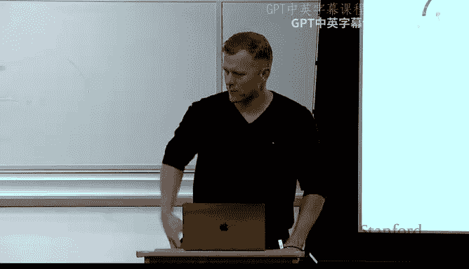

We're going to have retingal augmentation， this thing is going to be really huge if you've heard of RaG or if you haven't you should look it up so all of these parts of these models can also be multimodal。

 we need way better evaluation and better measurement we already talked about that too and that's all I have thank you。

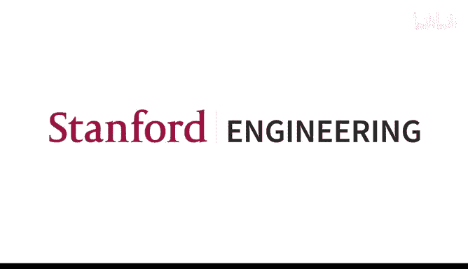