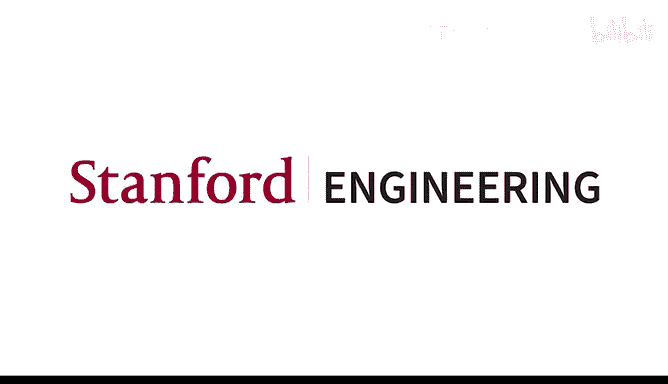
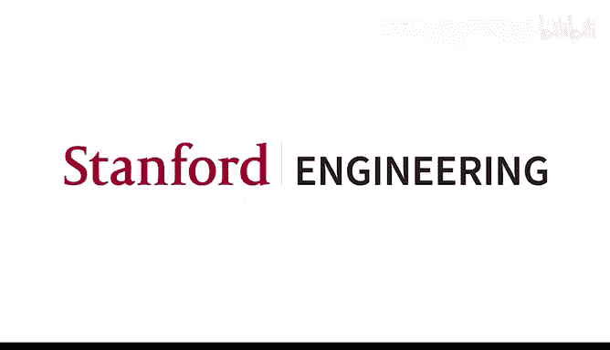

# 斯坦福大学《深度学习自然语言处理｜Stanford CS224N NLP with Deep Learning 2024》中英字幕（deepseek-R1 - P1：-01-Lecture 1 - Intro and Word Vectors.zh_en - GPT中英字幕课程资源 - BV1U5RNYgEfp

So the thing that seems kind of amazing to me and us is the fact that well。

 actually this course was taught just last quarter。

 And here we are with the enormous number of people again taking this class。

 I guess that says something， maybe approximately what it says is chat GT。😊。

But anyway， it's great to have you all。 Lots of exciting content to have and hope youll all enjoy it。

😊，So let me get started and start telling you a bit about the course before diving straight into today's content。

 for people still coming in， you know， there are oodles of seats still on either side。

 especially down near the front， there are tons of seats So do feel empowered to go out and seek those seats。

 if if people on the corridors are really nice。 they could even move towards the edges to make it easier for people。

 but one way or another， feel free to find a seat。 Okay so this is the plan for what I want to get through today。

 So first of all， I'm going to tell you about the course for a few minutes。

 then have a few remarks about human language and word meaning。

 then the main technical thing we want to get into today is start learning about the word tove algorithm So the word tove algorithm is slightly over a decade old now。

😊，Was introduced in 2013， but it was a wildly successful。

 simple way of learning vector representations of words。

 So I want to show you that is a sort of a first easy baby system for the kind of neural representations that we're going to talk about in class。

 We're then gonna get more concrete with that， looking at its objective function。

 gradients and optimization。 And then hopefully， if all goes， I stick to schedule。

 spend a few minutes， just playing around an I Python notebook。😊。

I'm gonna have to change computers for that。 then sort of seeing some of the things you can do with this。

 Okay， so this is the course logistics and brief。 I'm Christopher Manning。 Hi again， everyone。

 The head T A is。😊，Who unfortunately has a bit of a health problem。 So he's not actually here today。

 We've got a course manager for the course， who is。Who is up the back there。

 And then we've got a whole lot of Ts。 If you're a TA who's here。

 you could stand up and wave or something like that。

 so people can see a few of the Ts and see some friendly faces okay we've got some Ts and some other ones and so you can look at them on the website if you're here。

 you know what time the class is。 there's an email list but preferably don't use it and use theed site that you can find on the course website。

 So the main place to go and look for information is the course website。

 which we've got up here and that then links to Ed。

 which is what we're going to use as the main discussion board。

 please use that rather than sending emails。😊，The first assignment for this class。

 it's a sort of an easy one， it's the warmup assignment。

 but we want to get people busy in doing stuff straight away。

 So the first assignment is already live on the web page and it's due next Tuesday before class so you slightly less than seven days left to do it so do get started on that and to help with that we're going to be immediately starting office hours tomorrow and they're also described on the website we also do a few tutorials on Friday the first of these tutorials is a tutorial on Python and Ny many people don't need that because they've done other classes and done this but for some people we try and make this class accessible to everybody So if youd like to brush up a bit on Python or how to use Ny it's a great thing to go along to and who's right over there is going to be teaching it on Friday。

😊，Okay， what do we hope to teach， You know， at the end of the quarter when you get the eval。

 you'll be asked to rate whether this class met its learning goals。 These are my learning goals。

 What are they。 So the first one is to teach you about the foundations and current methods for using deep learning applied to natural language processing。

 So this class tries to sort of build up from the bottom up。

 So we start off doing simple things like word vectors and feed for neural networks。

 recurrent networks and attention。 We then fairly quickly move into the kind of key methods they use for NLP in 2024。

 I wrote down here transformers andd decoder models。

 I probably sort of written large language models somewhere in this list as well。

 But then pretraining and posttraining of large language models， adaptation， model interpretability。

😊，Agents， et cea。 But that's not the only thing that we want to do。

 So there are a couple of other things that we crucially want to achieve。

 The second is to give you some。Understanding of human languages and the difficulties in understanding and producing them on computers。

 Now， there are a few of you in this class who are linguistics majors。

 or perhaps a symbolic systems majors。 Yea or the symbolic systems majors。

 But for quite a few of the rest of you， you'll never see any linguistics in the sense of understanding how language works。

 apart from this class。 So we do want to try and convey a little bit of a sense of what some of the issues are in language structure and why it's proven to be quite difficult to get computers to understand human languages。

 even though humans seem very good at learning to understand each other。

And then the final thing that we want to make it onto is actually concretely building systems so that this isn't just a theory class that we actually want you to leave this class thinking。

 oh， yeah， in my first job wherever you go， whether it's a startup or a big tech or some nonprofit。

 Oh， there's something they want to do that they like there would be useful if we had a text classification system or we did information extraction to get some kind of facts out of documents。

 I know how to build that。 I can build that system because I did C S 2，24 N。😊，Okay。

 here's how you get graded。 So we have four assignments， mainly in one and a half weeks long。

 apart from the first one， they make up almost half the grade。

 The other half of the grade is made up of a final project。

 which there are two variants of a custom or default final project。

 which we'll get on to in a minute。 And then there's a few percent that go for participation。😊。

6ix late days。Collaboration policy， like all other C S classes。

 we've had issues with people not doing their own work。

 We really do want you to learn things in this class。

 and the way you do that is by doing your own work。 So make sure you understand that。

 And so for the assignments， everyone is expected to do their own assignments you can talk to your friends。

 but you're expected to do your own assignment for the final project， you can do that as a group。

 Then we have the issue of AI tools。 Now， of course， in this class， we love large language models。

 But nevertheless， we don't want you to do your assignments by saying， hey， chat GT。

 could you answer question 3 for me。 That is not the way to learn things。

 If you want to make use of AI as a tool to assist you such as for coding assistance。 go for it。

 but we're wanting you to。😊，Working out how to answer assignment questions by yourself。Okay。

 so this is what the assignments look like。 So assignment 1 is meant to be an easy on ramp。

 and it's done as a Jupyter notebook。 assignment 2。Then has people， you know， what can I say。

 here we are this fine liberal arts。An engineering institution。 We're not at a coding boot camp。

 So we hope that people have some deep understanding of how things work。 So in assignment 2。

 we actually want you to do some math and understand how things work in neural networks。

 So for some people， assignment to is the scariest assignment in the whole class。

 But then it's also the place where we introduce Pytorch。

 which is software package we use for building neural networks， and we build a dependency par。

 which will get to later as something more linguistic。😊，Then for assignment 3 and 4。

 we move on to larger projects using Pytorch with GPUs and we'll be making use of Google Cloud。

 And for those two assignments， we look at doing machine translation and getting information out with transformers And then these are the two final project options。

 So essentially， you know， we have a default final project where we give you a lot of scaffolding and an outline of what to do。

 But it's still an openended project， there are lots of different things you can try to make this system work better and we encourage you to explore。

 But nevertheless， you're given a leg up from quite a lot of scaffolding。 We'll talk about this more。

 But you can either do that option or you can just come up with totally your own project and do that。

😊，Okay， that's the course， any questions on the course？Yes， project Howard our mentor is assigned。

So if you， if you can find your own mentor， your interest in something and there's someone that's happy to mentor you。

 that person can be your mentor， otherwise， one of the course TAs will be your mentor and how that person is assigned is one of the Ts who is in charge of final projects assigns people and they do the best they can in terms of finding people with some expertise and having to divide all the students across the mentors roughly equally。

😊，Any other questions？Okay， I'll power ahead。 human language and word meaning。

So let me just sort of say a little bit about the big picture here。

 So we're in the area of artificial intelligence。 and we've got this idea that humans are intelligent。

 And then there's the question of， you know， how does language fit into that。 And you know。

 this is something that there is some argument about。 And if you want to。

 you can run off in onto social media and read some of the arguments about these things and contribute to it。

 if you wish to。 But here is my perhaps bias take as a linguist。 Well。

 you can compare human beings to some of our nearest neighbors like chimpanzees。

 bonobos and things like that。 And you know， well， one big distinguishing thing is we have language and they don't。

 But， you know， in most。😊，TheRes， chimps are very similar to human beings， right， you know， they。

 they can use tools。 they can plan how to solve things。 They've got really good memory。

 chimps have better short termm memory than human beings do， right， so that in most respects。

 is' hard to show an intelligence difference between chimps and people。

 except for the fact that we have language， But us having language has been this enormous differentiator。

 right， that if you look around what happened on the planet， you know。

 that there are creatures that are stronger than us faster than us more venomous than us。

 have every possible advantage， but human beings took over the whole place and how did that happen。

 we had language so we could communicate And that communication allowed us to have human ascendancy。

😊，But I'd like to so one big role of language is the fact that it allows communication。

 but I'd like to suggest it's actually not the only role of language。

 The language has also allowed humans， I would argue to achieve a higher level of thought。

 So there are various kinds of thoughts that you can have without any language involved。 You know。

 you can think about a scene。 you can move some bits of furniture around in your mind and there's no language and obviously emotional responses of feeling scared or excited。

 they happen。 and there's no language involved。 But， you know。

 I think most of the time when we're doing higher level cognition。 if you're thinking to yourself。

 Oh gee， my friends seemed upset about what I said last night。

 should probably work out how to fix that or maybe I could。

 I think we think in language and plan out things。 And so that it's given us a scaffolding。😊。

Do much more detailed thought and planning。 Most recently， of all， of course。

 human beings invented ways to write。 and that LED， so writing is really， really recent。 I mean。

 no one really knows how old human languages are。 You know。

 most people think a few hundred thousand0 years， not very long by evolutionary timescales。

 but writing， we do know writing is really， really recent。 So writing is about 5 thousand years old。

And so， but， you know， writing proved to be this， again。

 this amazing cognitive tool that just gave humanity an enormous leg up because suddenly。

 it's not only that you could share information and learn from the people that were standing within 50 feet of you。

 you could then share knowledge across time and space。

 So really having writing was enough to take us from the Bronze Age。

 very simple metal working to the kind of you know。

 mobile phones and all the other technology that we walk around with today in just a very short amount of time。

 So language is pretty cool。😊，But it's， you know， one shouldn't only fixate on。

The sort of knowledge side of language and how that's made human beings great。 I mean。

 there's this other side of language where language is this very flexible system。

 which is used as a social tool by human beings so that we can speak with a lot of imprecision and nuance and emotion in language and we can get people to understand we can set up sort of new ways of thinking about things by using words for them。

 and languages aren't static。 languagengus change as human beings use them that languages aren't something that were delivered down on tablets by God。

 languageages are things that humans constructed and humans change them with each successive generation And indeed。

 most of the innovation in language happens among young people。 you know。

 people that are either a few years younger than you are most of you。😊。

Are now in their earlier teens going into the 20s， right。

 That's a big period of linguistic innovation where people think up cool new phrases and ways of saying things。

 and some of those get embedded and extended。 and that then becomes the future of language。😊。

So Herb Clark used to be a psychologist at Stanford， he's now retired。

 but he had this rather nice quote， the common misconception is that language use has primarily to do with words and what they mean。

 It doesn't。 It has primarily to do with people and what they mean。Okay。

 so that's language in two slides for you。 So now we'll skip ahead to deep learning。

 So in the last decade or so。We've been able to make fantastic progress in doing more with computers understanding human languages in using deep learning。

 We'll say a bit more about the history later on。 But， you know。

 work on trying to do things with human language St in the 1950s。

 So it had been sort of going for 60 years or so。 And， you know， there was some stuff。

 It's not that nobody could do anything。 But， you know。😊。

The ability to understand and produce language had always been kind of questionable。

 where it's really in the last decade with neural networks that just enormous strides of progress have been made that's LED into the world that we have today。

 So one of the first big breakthroughs came in the area of using neural NLP systems for machine translation。

 And so this started about 2014 and was already deployed live on services like Google by 2016。

 It was so good that it sort of really， really rapid commercial deployment。 And I mean， overall。

 this kind of facility with machine translation just means that you're growing up in such a different world to people a few generations back。

 right， people， a few generations back that unless you actually knew different。😊。

Languages of different people。 He sort of had no chance to communicate with where now we're very close having something like the babel fish from the hititchhiker's guide to the galaxy for understanding all languages。

 It's just it's not a babel fish。 It's。Cell phone， but， you know。

 you can have it out between two people and have it do simultaneous translation。 And， you know。

 it's not perfect。 People keep on doing research on this。 But， you know， by and large。

 it means you can pick anything up from different areas of the world。

 as you can see this example is from a couple of years ago since it's still from the Covid pandemic era。

 But， you know， I can see this Swwahili from Kenya and say， O G。 I wonder what that means。

 stick it into Google translate and I can learn that Malawi lost two ministers due to a Covid infections and they died。

 right？ So， you know， we're just in this different era of being able to understand stuff。

And then there are lots of other things that we can do with modern N LP。 So until a few years ago。

 we had web search engines and you put in some text。

 you can write it as a sentences you wanted to But it didn't really matter whether you wrote a sentence or not。

 because what you got was some keywords that were then matched against an index and you were shown some pages that might have the answers to your questions。

 But these days you can put an actual question into a modern search engine like when did Kenendrick Lamar's first album come out。

 It can go and find documents that have relevant information。

 It can read those documents and it can give you an answer so that it actually can become an answer engine rather than just something that finds documents that might be relevant to what you're interested in。

 And the way that that's done is with big neural networks。

 so that you might commonly have for your query。 you've got a retreat。😊，neuralural network。

 which can find passages that are similar to the query。

 They might then be reraned by a second neural network。

 And then there'll be a third reading neural network thatll read those passages and synthesize information from them。

 which it then returns as the answer。Okay， that gets us to about 2018。

 but then things got more advanced again。 So it was really around 2019 that people started to see the power of large language models And so back in 2019。

 those of us in NLP were really excited about G2 It didn't make much of an impact on the nightly news。

 but it was really exciting an NLP land because G2 already for the first time meant here was a large language model that could just generate fluent text。

 that really until then NLP systems had done a sort of a decent job at understanding certain facts out of text。

 but we'd just never been able to generate fluent text that was at all good。 where here。

 what you could do with G2 was you could write something like the start of a story。

 a train carriage containing controlled nuclear material。😊，Was stolen in Cincinnati today。

 Its whereabouts are unknown。 and then G2 would just write a continuation。

 The incident occurred on the downtown train line， which runs from Covsington International stations in an email to Ohio news outlets。

 the US Department of Energy set is working with the federal railroad administration to find the thief dot dot dot。

 And so the way this is working is it conditioning on all the past material。

 And as I show at the very bottom line down here， it's then generating one word at a time as to what word it thinks would be likely to come next after that。

 And so from that simple method of sort of generating words out of one after another。

 it's able to produce excellent text。 And the thing to notice is， I mean。

 this text is not only kind of you know， formally correct。 know。

 not the spellings correct and the sentences real sentences， not disconnected。😊，But， you know。

 it actually understands a lot， right。 So the prompt that was written said there were stolen nuclear materials in Cincinnati。

 But， you know， G2 knows a lot of stuff。 It knows that Cincinnati is in Ohio。

 It knows that in the United States， It's the Department of energy that regulates nuclear materials。

 It knows if something is stolen。 It's a theft and that that would make sense that people are getting involved with that。

 it talks about， you know， there was train carriage。

 So it's talking about the train line where it goes。 It really knows a lot and can write， you know。

 coherent discourse like a real story。 So that's kind of。Amazing， but， you know。

 things moved on from there。 And so now we're in the world of chat G and G 4。

 And one of the things that well talk about later is this was a huge user success because now you could ask questions or give it commands and it would do what you wanted and that was further amazing。

 So here I'm saying， hey， please draft a polite email to my boss。

 Jeremy that I would not be able to come into the office for the next two days because my nine year old song。

 That's a misspelling for some。 but the system works fine despite it。

 Peter is angry with me that I'm not giving him much time and it writes a nice email。

 it corrects the spelling mistake because it knows people make spelling mistakes。

 It doesn't talk about songs and everything works out beautifully。

 you can get it to do other things So you can ask。😊，Get what is unusual about this image。

 So in thinking about meaning， one of the things that's interesting with these recent models is that they're multimodal and can operate across modes。

 And so a favorite term that we coined at Stanford。 It's the term foundation models。

 which we use as a generalization of large language models to have the same kind of technology used across different modalities。

 images， sound， various kinds of bioinformatic things， DNA， RNA， things like that， seismic waves。

 any kind of signal building these same kind of large models。😊。

Another place that you can see that is going from。Text to images。

 So if I ask for a picture of a train going over the Golden Gate Bridge， this is now。Darly too。

 it gives me a picture of a train going over the Golden Gate Bridge。

 This is a perfect time to welcome anyone who's watching this Stanford online。

 if you're on Stanford online and a not in the Bay Area。

 The important thing to know is no trains go over the Golden Gate Bridge but you might not be completely happy with this picture。

 because， you know， it shows the Golden Gate Bridge and a train going over it。

 but it doesn't show the bay。 So maybe I'd like to get with the bay in the background。

 and if I ask for that， well， look， now I've got a train going over the Golden Gate Bridge with the bay in the background。

 but you still might not be this might not be exactly what you want。

 like maybe youd prefer something that it's a pencil drawing。

 so I can say a train going over the Golden Gate Bridge detailed pencil drawing and I can get a pencil drawing。

 or maybe it's unrealistic that the Golden Gate Bridge。😊，And we has trains going over it now。

 So maybe be good to have some cars as well。 So I could ask for a train and cars。

 and we can get a train and cars going over it。 Now I actually made these ones all by myself。

 So you should be impressed with my generative AI artwork。

 But these examples are actually a bit old now because they are done with Darley too。

 And if you keep up with these things。 That's a few years ago is now Darley3 and so on。

 So we can now get much fancy things again， an illustration from a graphic novel。

 a bustling city street under the shine of a full moon。

 the sidewalks bustling with pedestrians enjoying the nightlife at the corner store。

 a young woman with fiery red hair dressed in a signature velvet cloak。

 is haggling with the grumpy old vendor， the grumpy vendor。

 a tall sophisticated man is wearing a sharp suit。 Sports a noteworthy moache。

 She's animatedly conversing on his steampunk telephone。 and pretty much we're getting all of that。😊。

Okay， so let's now get on to starting to think more about meaning。 So perhaps。😊。

What can we do for meaning， right？ So if you think of words and their meaning。

 if you look up a dictionary and say， what does meaning mean。

 Meing is defined as the idea that is represented by a word or phrase。

 the idea that a person wants to express by using words， the idea that is expressed。

 And in in linguistics， you know， if you go into a semantics class or something。

 the commonest way of thinking of meaning is somewhat like what's presented up above there。

 that meaning is thought of as pairing between what's sometimes called signifier and signified。

 but is perhaps easy to think of as a symbol， a word and then an idea or thing。

 And so this notion is referred to as denotational semantics。

 So the idea or thing as the denotation of the symbol。

 And so this same idea of denotational semantics has also been used for programming language。

Because in programming languages， you have symbols like while and if and variabless。

 And they have a meaning。 And that could be their denotation。

 So we sort of would say that the meaning of tree is all the trees you can find out around the world。

 That's sort of okay notion of meaning。 it's a popular one。 It's never been very obvious。😊。

Or at least traditional it wasn't very obvious as to what we could do with that to get it into computers。

 So if you looked in the premural world when people tried to look at meanings inside computers。

 They sort of had to do something much more primitive of looking at words and their relationship。

 So a very common traditional solution， was to make use of wordnet。

 and wordnet was kind of a sort of fancy thesaurus that showed word relationship。

 So tell you about synonyms and is a kind of things， So a pandas a kind of carnivore。

 which is a placenal， which is a mammal and things like that。 Good has various meanings。

 It's a trade good or the sense of goodness。 and you could explore with that。

 But systems like wordnet were never very good for computational meaning。😊。

They missed a lot of nuance。 Wordnet would tell you that proficient is a synonym for good。

 But if you think about all the things that you would say were good， you know， that was a good shot。

 which you say that was a proficient shot。 soundss kind of weird to me。 You know。

 it's a lot of color and nuance on how words are used。 Wordnet is very incomplete。

 It's missing anything that's kind of cooler， more modern slang。

 This maybe isn't very modern slang now， but you won't find more modern slang either in it。

 It's sort of very humanmade， etc ce。 It's got a lot of issue。

 So this LED into the idea of can we represent meaning differently。

 And this leads us into word vectors。So when we have words， wicked， badass， nifty wizard。

 what do they turn into when we have computers， well， effectively。You know。

 words to these discrete symbols that they're just kind of some kind of atom symbol。

 And if we then turn those into something that's closer to math。

 how symbols are normally represented is you have a vocabulary And your word is some item in that vocabulary。

 So motel is the that word in the vocabulary and hotel is this word in the vocabulary。 And commonly。

 this is what computational systems do， you take all your strings and you index them to numbers。

 And that's the sort of position in a vector that they belong in。

 And while we have huge numbers of words。 So we might have a huge vocabulary。

 So have very big and long vectors。 And so these get referred to as one hot vectors。

 for representing the meaning of words。 But representing。😊。

Words by one hot vectors turns out to not be a very good way of computing with them。

 It was used for decades， but it turns out to be kind of problematic。

 And part of why it's problematic is it doesn't have any natural。

 inherent sense of the meanings of words， you just have different words。

 you have hotel and motel and house and chair。 And so if you think about in terms of these vector representations。

 that if you have motel and hotel， there's no indication that they're kind of similar。

 they just two different symbols， which have ones in different positions in the vector or formally in math terms。

 if you think about taking the dot product of these two vectors， it's0。

 the two vectors are orthogonal。 They have nothing to do with each other。 Now。

 there are things that you can do with that， you can start saying， oh。

 let me start building up some other reason。Soce of word similarity。

 And I'll consult that resource of word similarity。

 And it'll tell me that motels and hotels are similar to each other。 And people did things like that。

 right， in Web search， it was referred to as query expansion techniques。 But still。

 the point is that there's no natural notion of similarity in one hot vectors。

And so the the idea was that maybe we could do better than that。

 that we could learn to include similarity in the vectors themselves。

 And so that leads into the idea of word vectors。 but it also leads into a different way of thinking about semantics。

 I just realized I forgot to say one thing back to slides。😊。

These kind of representations are referred to localist representations。

 meaning that there's one point in which something is represented， so。

That you've got here is the representation of motel。 and here is the representation of hotel。

 It's in one place in the vector that each word is represented。

 and they'll be different to what we do next。 So there's an alternative idea of semantics。

 which goes back quite a long way people commonly quote this quote of JR who was a British linguist who said in 1957。

 You shall know a word by the company it keeps。 but also goes back to philosophical work by Witgenstein and others。

 that what you should do is represent a words's meaning by the context in which it appears。

 So the words that appear around a word give information about its meaning。

 And so that's the idea of what's called distributional semantics in contrast to denotational semantics。

 So if I want to know about the word banking I say。Give me some sentences that use the word banking。

 Here are some sentences using the word banking， government debt problems turning into。

Baaning crises has happened in 2009， etc cea， etc cea。

 And knowing about that context words that occur around banking。

 those will become the meaning of banking。And so we are going to use those statistics about words and what other words appear around them in order to learn a new kind of representation of a word。

 So our new representation of words， is we're going to represent them now as a dense sort of a shorter dense vector that gives them meaning of the words。

 Now， my vectors are very short here。 These are only 8 dimensional。 if I counted right。

 So I could fit them on my slide。 They're not that short in practice。 they might be 2002000。

 but reasonably short。 They're not going to be like the half a million of the half a million different words in our vocabulary。

 And the idea is， if words have stuff to do with each other。 they'll have sort of similar vectors。

 which corresponds to their dot product being large。 So for banking and。try in my example here。

 both of them are positive in the first dimension， positive in the second dimension。

 negative on the third。 on the fourth， they've got opposite signs。

 So if we want to work out the dot product， we're taking the product of the corresponding terms and will get bigger to the extent that both of the corresponding ones have the same sides and bigger if they have large magnitude。

Okay， so these are what we call word vectors， which are also known as embeddings or new word representations or phrases like that。

 And so the first thing we want to do is learn good word vectors for different words and our word vectors will be good word vectors。

 if。😊，They。Give us a good sense of the meanings of words。

 They know which words are similar to other words in meaning。

 We refer to them as embeddings because we can think of this as a vector in a high dimensional space。

 And so that we're embedding each word as a position in that high dimensional space。

 And the dimensionality of the space will be the length of the vector。

 So it might be something like a 300 dimensional space。

 Now that kind of gets problematic because human beings can't look at 300 dimensional spaces and aren't very good at understanding or visualizing what goes on in them。

 So the only thing that I can show you is two dimensional spaces， but。😊。

A thing that is' good to have somewhat in your。Head is that really high dimensional spaces behave extremely differently to two dimensional spaces in high dimensional spaces。

 things can in two dimensional space。 you're only near to something else。

 If youve got similar X and Y coordinates。 in a high dimensional space。

 things can be very near to all sorts of things on different dimensions in the space。

 And so we can capture different senses of words and ways that words are similar to each other。

 But here's the kind of picture we end up with。 So we what we're gonna to do is learn away to。😊。

Represent all words as vectors based on the other words that they're percu with in context。

 And we can embed them into this vector space。 And， of course， you can't read anything there。 But。

 you know， we can zoom into this space further。 And if we zoom into this space and just show a bit of it。

 Well， here's a part of the space where it's showing country words and some other location words。

 So we've got sort of countries up the top there。 We've got some nationality terms。

 British Australianer， European further down or we can go to another piece of the space。

 and here's a bit of the space where we have verbs And not only if we got verbs。 But you know。

 there's actually quite quite a lot of fine structure here of what's similar that represents things about verbs。

 So you've got sort of verbs of you know， communication statements saying thinking expecting。

 grouping together， come and go group together。😊，Down the bottom， you've got forms of the verb have。

 Then you've got forms of the verb to be。 above them， you've got the common remain。

 which are actually sort of similar to the verb to be。

 because they take these sort of compliments of state。 So just that you can same as you can say。

 I am angry。 you can say he remained angry or he became angry， right。

 So those verbs are more so than most verbs sort of similar to the verb to B。

 So we get these kind of interesting semantic spaces where things that have similar meaning are close by to each other。

And so the question is， how do we get to those things and how we get to those things is then for。

 you know， there are various ways of doing it。 But the 1 I want to get through today is showing you about word devek。

Okay， I'll pause for 30 seconds for breath。 Anyone have a question or anything I want to know， yes。😊。

What better ideas reasonable。他派什么。But if doesn doesn't seem to solve the problem where there similar meaning。

Might depend on contexts， right so let's take your example about pro for distributed portfolio。丈。

Just few words to have their phone for back。But we kind understand the similar。Amer。

But if you're at contacts right， because you have different contacts。

 then this two words may not be similar and this word that you belong does not seem to。Yes， correct。

 So that's a good thought。 You can keep it for a few weeks to some extent。 Yeah。

 so for the first thing we're going do， we're just going to learn one word vector for a string。

 So we're going have a word， let's say it's star and we're gonna to learn one word vector for it。

 So that absolutely doesn't capture the meaning of a word in context。

 So it won't be saying whether it's meaning a Hollywood star or an astronomical star or something like that。

 And so later on， we're going to get on to contextual meaning representation。 So wait for that。

 But the thing I would like going along what I said about high dimensional spaces being weird。

 But the cool thing that we will already find is our representation for star will be very close to the representations for astronomical words like nebula and whatever。

😊，Other astronomical words you know， and simultaneously it'll be very close to words that mean something like a Hollywood star。

😊，Help me out。 No any words that mean something similar。 celebrity。 That's a good one。 Okay， yeah。😊。

Produing the embedding us to a lower dimensional space of visual eyes。

So that pictures I was showing you used a particular method called TN。

 which is a nonline dimensionality reduction that tends to work better for high dimensional neuraler representations。

 than PCA， which you might know， but I'm not going to go into that now， yes。😊，How do you know how do。

Its like。Space， but not too smart。I mean that's something that people have worked on it depends on how much it depends on how much data you've got to make your representations over。

 you know， so normally you know it's worked out either empirically for what works best or practically based on how big vectors you want to work on I mean。

 to give you some idea you know，😊，Things start to work well when you get to 100 dimensional space for a long time。

 People use 300 dimensions because that seemed to work pretty well。

 But as we people have started building huge and huge models with way， way more data。

 it's now become increasingly common to use numbers like 1000 or even 2000 dimensional vectors， yeah。

Okay， checker。So you mentioned that there are sort of hidden structures in small areas as well as large areas。

Anddiionalality increases different different structures will come up but generally we seem to use distance as the single metric for post which doesn't seem to me that we get it like distance between like this and that in space three will be be seen right so how would that only use distance we also use directions in the space as having semantic meanings I'll show a example that soon。

Yeah。😊，There really need to be between negative one and one。

 is there a reason for that or do we have bounds that we consider？So good question。 I mean， you know。

 they don't have to be。 and the way we're going to learn them， they're not bounded， but you know。

 you can bound things， sometimes people length normalize so that the vectors are of length one。

 but at any rate， normally in this work， we use some method called regularization that tries to kind of keep coefficients small so they're generally not getting huge。

😊，Yeah， given a specific word， for example， like the bank we use as before in the previous slides。

 So is there like like for the word representation。

 I there like a single embedding for each word or do we have multiple embedding for each word。

 So what we're doing at the moment， each word， each string of letters has a single embedding and what you can think of that。

Embbedding as， as kind of as an average over all its senses for example， bank。

Can mean like financial institution， or it can also mean like the river bank。 Yeah。

 And then what I said before about Star applies， the interesting thing is you'll find that we are able to come up with a representation where our learned representation because it's kind of an average of those will end up similar to words that are semantically evoked by both senseenss。

 I think I' probably about about go on at this point。Okay， word to V。 okay。

 so word to V was this method of learning word vectors that was thought up by Tamash Mikoov and colleagues at Google in 2013。

 You know， it wasn't the first method。 there are other people that did methods of learning word vectors that go back to about the turn of the millennium。

 It wasn't the last they're ones that come after it as well。

 But it was a particularly simple one and it particularly， you know fast runningning one。

 And so it really caught people's attention。 So the idea of it is that we start off with large amount of text。

 So that can just be thought of as a long list of words。 And in NLP。

 we refer to that as a corpus corpus It's just Latin for body So you know it's exactly the same as if you have a dead person on the floor。

 right， That's a corpus。😊，No yeah， so it's just a body， but we mean a body of text。

 not a live person， or sorry， dead person。 Yeah， if you want to know more about Latin。

 since some there isn't very good classical education these days， corpus， despite the US ending。

 is a fourth the clian New to noun。 And that means。😊，Plural of corpus is not cori。

 The plural of corpus is corpora。 So I'm sure sometime later in this class。

 I will read a project or assignment for it refers to cor。

 and I will know that that person was not paying attention in the first lecture or else they should have said corpora C O R P。

 O R A as the correct form for that。 Okay， I should move on。 Okay， so we have our text， then we know。

That we're going to represent each word。 So this is each word type。 So， you know， star or bank， etc。

 So wherever it occurs by a single vector。 And so what we're going to do in this algorithm。

 is we're going to go through each position in the text。 And so at each position， the text。

 which is a list of words， we're going to have a center word and words outside it。

 And then what we're going to do is use the similarity of the word vectors for C and the outside words to calculate the probability that they should have occurred or not。

 And then we just keep fiddling and we learn word vectors。 Now， you know， at first site。

 I'll show this more concretely。 Maybe I'll just show it more concretely first。 So here's the idea。

 We're going to have a vector for each word type or word type means you know。

 the word problems wherever it occurs， which is different。😊，ated from a word token。

 which is this instance of the word problems。 So we're going have a vector for each word type。

 And so I'm going to want to know， look， in this text。

 the word turning occurred before occurred before the word into How likely should that have been to happen。

 And what I'm going to do is calculate a probability of the word turning occurring close to the word into。

 And I'm going to do that for each word in a narrow context。 In example here。

 I'm saying I'm using two words to the left and two words to the right。

 And what I want to do is make those probability estimates as good as possible。 So inm particular。

 I want the probability of cocurrence to be high for words that actually do occur within the nearby context of each other。

😊，And so then the question is， how am I going to And once I've done it for that word。

 I'm going to go along and do exactly the same thing for the next word。

And so I'll continue through the text in that way。 And so what we want to do is come up with vector representations of words that will let us predict these probabilities quote unquote。

 well。 Now， you know， there's a huge limit to how well we can do it because， you know。

 we've got a simple model， obviously， when you see the word banking。

 I can't tell you that the word into is going to occur before banking， But you know。

 I want to do it as well as possible。 So what I want my model to say is after the word banking crises is pretty likely。

 but the word skillet is not very likely。And if I can do that， I'm doing a good job。

 And so we turn that into a piece of math。Here's how we do it。 turn it into a piece of math。

 So we're going to go through our corpus， every position in the corpus。

 and we're going to have a fixed window size M， which was two in my example。

 And then what we're going want to do is have the probability of words in the context being as high as possible。

 So we want to maximize this likelihood where we're going through every position in the text。

 And then we're going through every word in the context and sort of wanting to make this big。Okay。

 so conceptually， that's what we're doing。 But in practice， we never quite do that。

 We use two little tricks here。 The first one is， you know。

 for completely arbitrary reasons it really makes no difference。

 everyone got into minimizing things rather than maximizing things。

 And so the algorithms that we use， get referred to as gradient descent， as you'll see in a moment。

 So the first thing we do is put a minus sign in front so that we can minimize it rather than max it。

 that part's pretty trivial。 So the second part is here we have this enormous product。

 And working with enormous products is more difficult for the math。

 So the second thing that we do is introduce a logarithm。

 And so once we take the log of the likelihood。 then when we take logs of products。😊。

They turn into sums。 And so now we can sum over each word position the text。

 sum over each word in the context window， and then sum these log probabilities。

 And then we've still got the minus sign in front。 So we want to minimize the sum of log probabilities。

 So what we're doing is then wanting to look at the negative log likelihood。😊。

And then the final thing that we do is， you know， to。

 since this will get bigger depending on the number of words in the corpus。

 we divide through by the number of words in the corpus。

 And so our objective function is the average negative log likelihood。

 So by minimizing this objective function。 we're maximizing the probability of words in the context。

😊，Okay， we're almost there。 That's what we want to do。

 We've got a couple more tricks that we want to get through。 The next one is， well。

 I've said we want to maximize this probability。 How do we maximize this probability。

 What is this probability。 We haven't define how we're going calculate this probability。

 And this is where the word vectors come in。 So we're going to define this probability in terms of the word vector。

 So we're going to say each word type is represented by a vector of real numbers。

 these 100 real numbers。 And we're going to have a formula that works out the probability simply in terms of the vectors for each word that there are no other parameters in this model。

 So over here， I've shown this theta， which are the parameters of our model and all and only。

The parameters of our model are these word vectors for each word in the vocabulary。

 That's a lot of parameters because we have a lot of words and。

 and we've got fairly big word vectors， but they are the only parameters。Okay。

 and how we do that is by using this little trick here。

 We're going to say the probability of an outside word。

 given a center word is going to be defined in terms of the dot product of the two word vectors。

 So if things have a high dot product， they'll be similar and therefore。

 they' have a high probability of cocurrence。 Well， I mean similar in a kind of a weird sense， right。

 It is the case that we're going want to say hotel and motel are similar。 but， you know。

 it's also the case that we're going want to have the word able to appear easily before the word student。

 So in some weird sense， that also has to be similar to student。

 that has to be similar to basically any noun， right。Okay， so we're going to work with dot products。

 and then we do this funky little bit of math here， and that will give us our probabilities。😊，Okay。

 so let's just go through the funky bit of math。 So here's our formula for the probabilities。

 So what we're doing here is we're starting off with this dot product， right。

 So the dot product is you take the two vectors， you multiply each component together and you sum them。

 So if they both the same sign that increases your dot product。

 And if they're both big and increases it a lot。 Okay。

 so that gives us a similarity between two vectors。 and that's unbounded。

 That' that's just a real number， it can be either negative or positive。 Okay。

 but what we'd like to get out is a probability。 So for our next tricks， we first of all exps。

 because if we take E to the X for any X。 We now have to get something positive out， right。

 That's what exponation does。 Okay， and then well， since it's meant to be a。😊。

We'd like it to be between 0 and 1。 And so we turn it into numbers between 0 and1 in the dumbest way possible。

 which is we just normalize。 so that we work out the quantity in the numerator for every possible context word。

 And so we get the total of all of those numbers and divide through by it。

 And then we're getting a probability distribution of how likely different words are in this context。

Okay， yeah， so that this little trick that we're doing here is referred to as the softm function。

 So for the softm function， you can take unbounded real numbers。

 put them through this little softm trick that we just went through the steps of。

 And what you'll get out is a probability distribution。 So I'm now getting in this example。

 probability distribution over context words。 my probability estimates over all the context words in my vocabulary will sum up to one by definition。

 by the way， that I've constructed this。 So it's called the softm function。

 because it amplifies the probabilitybabilities of the largest things。

 That's because of the the X function。 But it's soft because it's still assigned some probability to smaller items。

😊，But， you know。It's sort of a funny name because， you know， when you think about Max， I mean。

 Max normally picks out just one thing， whereas the softm is turning a bunch of real numbers into a probability distribution。

 So this softm is used everywhere in deep learning anytime that we're wanting to turn things that are just vectors in R N into probabilities。

 we shove them through a softm function。😊，Okay。嗯。So。So。In some sense， this part， I think。

 still seems very abstract。 And I mean， the reason it seems very abstract is because I've sort of said we have vectors for each word and using these vectors。

 we can then calculate probabilities。 But where do the vectors come from。

 And the answer to where the vectors are going to come from is we're going to turn this into an optimization problem。

 We have a large amount of text。 And so therefore we can hope to find word vectors that make。

The context of the words in our observed text as big as possible。 So literally。

 what we're going do is we're going to start off with random vectors for every word。

 And then we want to fiddle those vectors so that the calculated probabilities of words in the context go up and we're going keep fiddling until they stop going up anymore。

 And we're getting the highest probability estimates that we can。

 And the way that we do that fiddling is we use calculus。😊，So， you know。

 what we're going do is kind of conceptually exactly what you do if you're in something like a twodisional space like the picture on the right。

 right that if you want to find the minimum in this two dimensional space and you start off at the top left。

 what you can do is say let me work out the derivatives of the function at the top left and they sort of point sort of down and a bit to the right and so you can walk down in a bit to the right and you can say。

 oh gee， given where I am now let me work out the derivatives。

 what direction to they point and they're still pointing down but a bit more to the right so you can walk a bit further that way and you can keep on walking and eventually you'll make it to the minimum of the space In our case。

 we've got a lot more than two dimensions。 So our parameters for our model the concatenation of all the word vectors。

😊，That is even slightly worse than I've explained。Up until now， because actually， for each word。

 we assume two vectors。 We assume one vector， when they're the center word and one vector。

 when they're the outside word。 Doing that just makes the math a bit simpler。

Which I can explain later。 So if we say have 100 dimensional vectors。

 We'll have 100 parameters for a v as an outside word。

100 parameters for as an outside word all the way through to100 parameters for zebra as an outside word。

 Then we'd have 100 parameters for a varca。A sent word continuing down。 So， you know。

 if we had a vocabulary of 400000 words and 100 dimensional word vectors。

 that means we'd have 400000 times two is 800000 times 100。 We'd have 80 million parameters。

 So that's a lot of parameters in our space to try and fiddle to optimize things。 But luckily。

 we have big computers。 And that's the kind of thing that we do。 So we simply say， ge。

 this is our optimization problem。 we're going to compute the gradients of all of these parameters。

 And that will give us the answer of what we have。😊，And， you know。This feels like magic。 I mean。

 it doesn't really seem like， you know， we could just start with nothing。

 We could start with random word vectors and a pile of text and say。

 do some math and we will get something useful out。

 But the miracle of what happens in these deep learning spaces is we do get something useful out。

 We can just minimize all of the parameters and。😊，Then we'll get something useful out。

 So what I wanted to， I guess I'm not gonna quite get to the end of what I hope to today。

 But what we， I wanted to do is sort of。Get through some of what we do here。 But， you know。

 I wanted to take a few minutes to sort of go through concretely how we do the math of minimization。

 Now lots of different people take C S 224 N and some of you know way more math than I do。

 And so if this next 10 minutes might be extremely boring。 And if that's the case。

 you can either catch up on discord or Instagram or something。 else， you can leave。

 But it turns out there are other people that do CS S 224 N that can't quite remember when they lasted a math course。

 And we'd like everybody to be able to learn something about this。

 So I do actually like in the first two weeks to kind of go through it a bit concretely。

 So let's try to do this。 So this was our likelihood。 And then we。

Already covered the fact that what we were going to do is have an objective function in terms of our parameters that was the average negative log likelihood across all the words。

嗯。I remember the notation for this， the sum。In the loopops。

I'll probably have a hard time writing this。 The sum of position M。

I've got a more neatly written out version of it that appears on the version of the slides。

 It's on the website。 and then we're going to be taking this log。

Of the probability of the word at position。T plus。Allrry。Position J， T plus J。Okay。

Trying to write this on my iPad is not working super well。 I'll confess。 We'll see how I get on WT。

Okay。Okay， and so then we had the form of what we wanted to use for the probability and the probability of an outside word。

 given a context word was then this soft maxed equation where we were taking the X of the。Outside。

 fact。And the center vector。Over the normalization term， where we sum over the vocabulary。Okay。

 so two。To work out how to change our parameters。 So our parameters are all of these word vectors that we summarize inside theta。

 what we're then going to want to do is work out the partial derivative of this objective function with respect to all the parameters theta。

 But， you know， in particular， I'm going to just start doing here。

 the partial derivatives with respect to the center。Word。

And we can work through the outside words separately。 Well， this partial derivative is a big。

 a big sum， and it's a big sum of terms like this。 And so when I have a partial derivative of a big sum of terms。

 I can work out the partial derivatives of each term independently and then sum them。

 So what I want to be doing is working out the partial derivative， of。😊，The log of this probability。

 which equals the log of that。With respect to the center vector and so at this point I have a log of two things being divided and so that means I can separate that out of the log of the numerator minus the log of the denominator and so what I'll be doing is working out the partial derivative with respect to the center vector of the log。

 the numerator， log X of UTVC minus，Partial derivative with respect to the denominator。

 which is then the log of。The sum。OfW equals one to V of x。哇。Okay。

 I'm having real trouble here writing。I'd look at the slides where I wrote it neatly at home。 Okay。

 so I want to work with these two terms。 Now， at this point， part of a。At this point。

 part of it is easy because here I just have a log of an exponential。

 And so those two functions just cancel out and go away。

 And so then I want to get the partial derivative of。

You outside transpose the center with respect to the center。

 And so what you get for the answer to that is that that just comes out as U 0。And。

Maybe you remember that。 But if you don't remember that， the thing to think about。Is okay。

 this is a whole vector， right。 And so we've got a vector here and a vector here。

 So what this is going to be looking like is like sort of U1， v1 plus U2， V2 plus U3 V3， etc along。

 And so what we're going to want to do is work out the partial derivative with respect to each element V right。

 And so if you just think of a sort of a single element derivative with respect to V1。 Well。

 it's going to be just u1 because every other term would go to 0。

 And then if you worked it out with respect to V2， then it'd be just u2 and every other term goes to 0。

 And so since you keep on doing that along the whole vector。

 that what you're going to get out is the vector， U1， U2 U。😊。

3 down the vocab for the whole list of vocab items。Okay， so that part is easy。

 But then we also want to work out the partial derivatives of that one。 And at that point。

 I maybe have to go to another slide。 So we then want to have。嗯。The partial derivative。嗯。

With respect to B， of the。Log。Of the sum equals the one to V of the X of U， W transpos V C， right。

 so at this point， things aren't quite so easy。 and we have to remember a little bit more calculus。

 So in particular， what we have to remember is the chain role。

 So here we have this inside function So that we've got a function。We've got a function G of VC。

 which you know， we might say the output of that is Z and then we've。

Put an outside that an extra function， F。And so when we have something like that。

 what we get is the derivative of F with respect to V C。 We can take the derivative of F。

With respect to Z times the derivative of Z， with respect to V C， right， that's the chain rule。

 So we are going to then apply that here。 So， first of all。

 we're going to take the derivative of log。And so the derivative of log is one on x。

 You have to remember that or look it up or get Mathematica to do it for you or something like that。

And so we're going to have one over the inside Z part， the sum of W equals1 to V of the X UW TBC。

 And then that's going to be multiplied by the derivative of the inside part。

So then we're going and have the derivative。With respect to B， C of the sum of W equals1。To be。

Of the X of。Okay， so。So that's made us a little bit of progress。

 But we've still got something to do here。 And so， well。

 what we're gonna do here is we're gonna notice， oh， wait。

 were again in the space to run the chain rule again。 So now we've got this function。 Well。

 so first of all， we can move the sum to the outside， right。

 because we've got a sum of terms W because1 to V。 And so we want to work out the derivatives of the inside piece with respect to it。

 Sorry， I'm doing this kind of informally of just doing this piece now。 Okay。

 so this again gives us an F over a function G。And so we're going to again。

 want to split the pieces up。 And so use the chain rule one more time。

 So we're going to have the sum of w equals1 to V。 And now we have to know what the derivative x is and the derivative of X is X。

 So that will be X of U X。TV 0。 And then we're taking the derivative of the inside part with respect to V of UX。

TVC。Well， luckily， this was a bit that we already knew how to do because we worked it out before。

 And so this is going be the sum of W equals one to V of this X。Times UX。Okay， so then at this point。

 we want to combine these two forms together so that we want to combine this part that we worked out and this piece here that we've worked out。

 And if we con combine them together with what we worked out on the first slide for the numerator。

Since this is， we have the。U 0， which was the derivative of the numerator。 And then for the。

Driiv of the the denominator， we're going to have。On top this part。 And then on the bottom。

 we're gonna have that part。 And so we can rewrite that as the sum from W equals1 to V of the X。

Of U X， T， B 0 times U X over some。嗯。Sorry， x equals one to v sum over W equals one to V of the x。

This part here of UW。Okay， so we can rearrange things in that form。 And then lo and behold。

 we find that we've recreated here this form of the softn equation。

 So we end up with u 0 minus the sum over x equals1 to V of the probability of x given c times u of x。

So what this is saying is were wanting to have this quantity。

 which takes the actual observed U vector， and it's comparing it to。The weighted prediction。

 So we're taking the weighted sum of the our current U expectors based on how likely we what they were to occur。

 And so this is a form that you see quite a bit in these kind of derivatives。 you get observed。

 observed minus expected， the weighted average。 And so what you'd like to have is your expectation。

 the weighted average be the same as the what was observed， because then you'll get a derivative of0。

 which means that you've hit a maximum。And so that gives us， you know。

 the form of the derivative of the。That we're having with respect to the center vector parameters to finish it off。

 you'd have to then work it out also for the outside vector parameters。 But hey。

 it's officially the end of class time。 So I'd better wrap up quickly now。 But， you know。

 so the deal is we're gonna work out all of these derivatives for each parameter。

 And then these derivatives will give a direction to change numbers。

 which will let us find good word vectors automatically。 I do want you to understand how this works。

 But fortunately， you'll find out very quickly， that computers will do this for you。

 And on a regular basis， you don't actually have to do it yourself。 more about that on Thursday。

 Okay， see you， everyone。😊。

