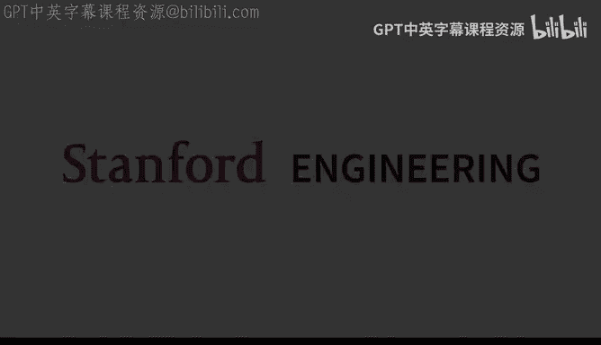
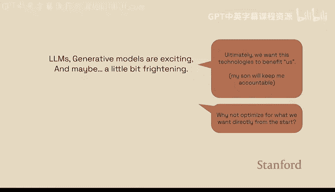
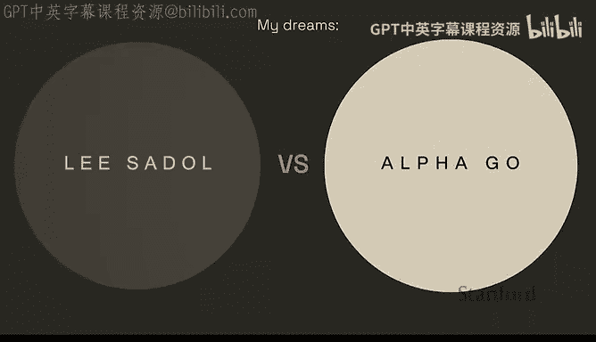
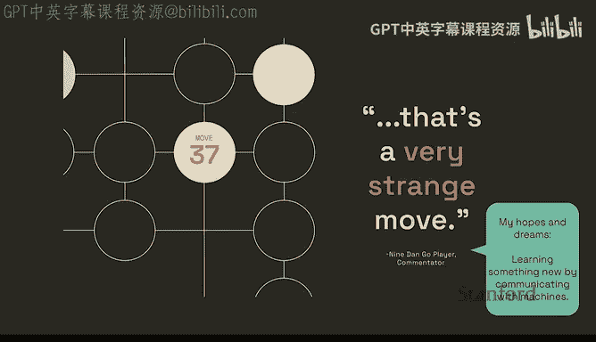
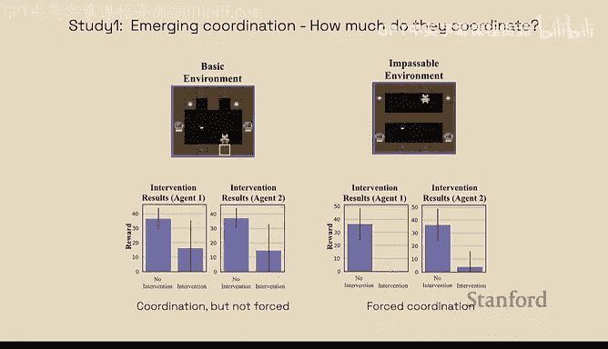
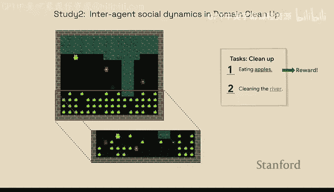
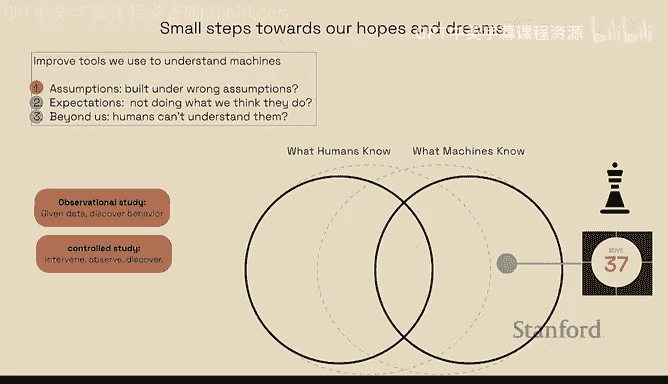

# 斯坦福大学《深度学习自然语言处理｜Stanford CS224N NLP with Deep Learning 2024》中英字幕（deepseek-R1 - P20：-20-2023 _ Lec. 19 - Model Interpretability & Editing, Been Kim.zh_en - GPT中英字幕课程资源 - BV1U5RNYgEfp

Today I'm delighted to introduce as our final guest speaker Bean Kim。

 Bean Kim is a staff research scientist at Google Brain， if you're really into Googleology。

 you know those funny words at the beginning like staff sort of says how senior you are and that means that means a good research scientist。

😊，So I discovered at lunch today that Bean started out studying mechanical engineering at Seoul National University。

 but she moved on to I don't know because it's better things or not。

 but she moved on to computer science and did her PhD and MIT and there she started working on the interpretability and explainability of machine learning models I think she'll be talking about some different parts of her work。

 but a theme that she's had in some of her recent work that I find especially appealing as an NLP person is the idea that we should be using higher level human interpretable languages for communication between people and machines。

 so welcome Bean looking forward to your talk and。😊，Good，Thank you。 Thank you。for having me。

 It's honored to be here。 It's the rainiesestt Stanford I've ever seen last night。

 I got here last night， but then I live in Seattle So this is pretty common。

 So I still was able to see the blue sky today。 and I was like， this works。 I really like it here。😊。

So today I'm going to share some of my dreams， chasing my dreams to communicate with machines。

So if you're in this class， you probably agree， you don't have to that large language models and generator models are pretty cool。

 they're impressive， but you may also agree that they're a little bit frightening。

Not just because they're impressive， they're doing really good job。

 but also we're not quite sure where we're going with this technology。In 10 years out。

 we we look back and say that technology was net positive， or we will say， that was catastrophic。

 We didn't know that that would happen。Ultimately， what I would like to do。

 or maybe hopefully what we all want to do is to have this technology benefit us humans。

 I know in 10 years time or maybe well 20 years or or earlier， he's gonna ask me。 He's gonna be like。

 mom， did you work on this AI stuff。 I watch some of your talks。

And did you know that how this will profoundly change our lives？And what did you do about that。

And I have to answer that question， and I really hope that I have some good things to say to him。

So my initial thought or an instill so or current thought is that if we want our ultimate goal to be benefit humanity。

 why not directly optimize for it， Why wait？So how can we benefit？

 There's lots of different ways we can benefit。 But one way we can benefit is to treat this like a colleague。

You know， a colleague who are really good at something。This col is not perfect。

 but it's good at something enough that you want to learn something from them。One difference is。

 though， in this case， is that this colleague is kind of weird。

 This colleague might have very different values。 It might have very different experiences in the world。

 It may not care about surviving as much as we do。 Maybe mortality isn't really a thing for this colleague。

So you have to navigate that in our conversation。So what do you do when you first meet somebody。

 there's someone so different， what do you do？You try to have a conversation。To figure out what。

 how do you do what you do， How are you solving decades old protein folding problem。

 How are you beating the World Go champion。

So easily what it seems。Are you using the same language， the science knowledge language that we use。

 atoms， molecules， or do you think about the world in a very different way？And more importantly。

 how can we work together。I have a one alien that I really want to talk to， and it's Alphago。

So Alphago beat World gold champion Isador in 2016。 Isador is from South Korea。 I'm from South Korea。

 I watched every single batch。 He was such a big deal in South Korea and worldwide， I hope。

And in one of the matches， Alphago played this move called moveve 37。 How many people watched。

Alpha go match， matches。And how many people remember moveve 37。Yeah， a few people， right。

 And I remember the9 Don commentator， who's been like talking a lot throughout the matches。

 suddenly got really quiet。😊，And he said， hmm。That's a very strange move。

And I knew then that something really interesting has just happened in front my eyes。

That this is going to change something this Alphago has made。

 something that we're gonna remember forever。 And sure enough。

 this move turned around the game for Algo and leading the alphago to win one of the matches。

So goal players today continue to analyze this move and still discuss。

 when people talk about this is not the move a human would fanantom。So the question is。

 how did Alphago know this is a good move。My dream is to learn something new by communicating the machine with machines and having a conversation。

And such that humanity will gain some new angle to our important problems like medicine and science and many others。

And this is not just about discovering new things。 If you think about rewardword hacking。

You have to have a meaningful conversation with somebody to truly figure out what their true goal is。

So in a way， solving this problem is a superet of solving AI safety too。

So how do we have this conversation？Conversation assumes that we share some common vocabulary between that that exchange to exchange meaning and ultimately the knowledge。

 And naturally， representation plays a key role in this conversation on the left。

 and we can visualize this on the left， we say what this is a representational space of what humans know。

 On the right， what machines know。Here in left circle。

 there will be something like this dog is fluffy。 And you know what that means。

 because we all share somewhat similar recovery。But on the right， we have something like Move 37。

 where we humans yet to have a representation for。So how do we have this conversation。

 our representation space needs overlap and the more overlap we have。

 the better conversation we're going to have Human are all good at learning new things like here everyone is learning something new so we can expand what we know by learning new concepts and vocabularies。

😊，And doing so， I believe， will help us to build machines that can better align with our values and our goals。

So this is a talk that I gave。 If you're curious about some of the work we're doing towards this。

 I highly recommend it's a YouTube video。 I clear keynote， half an hour。 You can fast do a bestfe。

But today I'm going to talk more about my hopes and dreams。And hopefully， at the end of the day。

 your hopeend dream is there。So first of all， I'm just gonna set the expectation。

 So at the end of this talk， we still don't know how the move 37 is made。 Okay， sorry。

 that's gonna take a while。In fact。The first part of this talk is going to be about how we move backwards in this progress。

And in terms of making this progress in our journey， I'm still very。

 very small portion of our entire journey towards understanding Rule 37。

And of course this journey wouldn't be like a singular path。

 there will be lots of different branches coming in。

 core ideas like Transformer helped many domains across that will be similar here。

 so I'm going to talk in the part two， some of our work on understanding emerging behaviors and reinforcement learning。

And all the techniques that I'm going to talk about is going to be in principle applicable to NLP。

So coming back to our， our dreams and hopes and dreams， 37。

So let's first think about how we might realize this dream。And taking a step back， we have to ask。

 do we have tools to first estimate what even machines know？

There has been many development in machine learning last decade now to develop tools to understand and estimate this purple circle。

So is that accurate？Unfortunately， many recent research show that there's a huge gap between what machines actually know and what we think the machines know。

And identifying and bridging this gap is important because these tools will form basis for understanding that moveve 37。

So what are these tools， How many people familiar with Sal and CM maps。A lot。

 but you don't have to explain what it is。 So salency map is one of the popular interpretability methods for simplicity。

 let's say on Inet， you have an image like this， you have a bird。

 the explanation is going to take a form of the same image。

 but where each pixel is with associated with a number that is supposed to imply some importance of that pixel for prediction of this image。

And one definition of that importance is that that number indicates how the function look like around this pixel。

 So for example， if I add pixel I Xj， maybe around Xj。

 the function moves up like the yellow curve or function is flat or function is going down like the green curve。

And so if it's flat like a blue curve or a red curve。

 maybe that feature is irrelevant to predicting bird， maybe it's going up。

 then it's maybe more important because the value of x increases and the function value goes up function value here like a prediction value。

So let's think about what are the few ways why this gap might exist。

 There are a few ways not exhaustive。 they're overlap a little bit。But helpful for us to think about。

 maybe assumptions are wrong。 So this alien， again。

 these machines that we train works in a completely different。

 perhaps completely different representational space。 Very different experiences about the world。

 So assuming that it sees the world that we do， just like we do， like having the gasal phenomenon。

 There's few that humans are have tendency to connect them。 Maybe machines have the two。 Maybe not。

 So maybe our assumptions about these machines are wrong。Maybe our expectations are mismatched。

 We thought it was doing X， but it was actually doing Y。我。Maybe it's beyond us。

 maybe it's showing something superhuman that humans just can't understand。

I'm going to dig deeper into one of some of these our work。 this is more recent work。So again。

 coming back to the earlier story about salientime， we're going to play with some of these methods。

Now， in 2018。We。Stumbled upon this phenomenon that was quite shocking。

 which was that we were actually trying to write some different paper Ga paper， of course Anzi here。

 But we were testing something， and we realized that train network and untrain network has the same。

 very similar salency map， in other words。😮，Random prediction and meaningful prediction were giving me the same explanation。

So that was puzzling。 We thought we had a bug， but it turned out we didn't。

 It actually is in indistinguishable， qualitatively and quantitatively。So that was shocking。

But then we wondered， maybe this one off case， maybe it still works somehow in practice。

So we tested that in a follow paper， okay， what if the model had an error， one of these errors。

 maybe it has a labeling error， maybe it has a sphere correlation。

 maybe it had auto of distribution at test time， if we intentionally insert these bugs。

 can explanation tell us that there's something wrong with the model。

It turns out that that's also not quite true。You might think that， oh， maybe superior correlation。

 another follow up work also showed that this is also not the case。So we were disappointed。

But then still we say， you know， maybe there is， there's no theoretical proof of this。

 Maybe this is again， a lab setting test。 We had grad students to test this system。

 Maybe there's still some hope。So this is more recent work where we theoretically prove that some of these methods。

 very popular methods， cannot do better than random。 So I'm going to talk a a little bit about that。

I'm missing one person。 I'm missing Pg Wei in the author list。

 I just realized this is also work with Pangwei。So let's first talk about our expectation。

 What is our expectation about this tool。Now。The original paper that developed this method。

 I G and Sha， talks about how I G can be used for accounting the contributions over each feature。

So what that means is that when the tool assigns zero attribution to a pixelix， we're going to say。

 okay， well pixelix is unused by the function。And that means that f will be insensitive if I perturb this x。

And in fact， this is how it's been used in practice。

 this is a paper published in Nature that uses the shop to figure out the eligibility criteria in a medical trial。

What we show in this work is that none of these inferences that seemed pretty natural were true。

And in fact， just because popular attribution methods tell you anything about it， attribution is x。

 you cannot conclude anything about the actual model behavior。So how does that work？

How many people here do theory proof？A few， great。 I'll tell you。

 I learned about theory proving from this project as well。

 So I'll tell you like the way that that we pursue this particular work is that first think about this problem。

 And we're gonna formulate into some other problem that we know how to solve。 So in this case。

 we formulate this as hypothesis testing because once you formulate into hypothesis testing。

 yes or no， there are lots of tools and statistics you can use to prove this。😊，So what is hypothesis。

 The hypothesis is that I'm a user。 I got an attribution value from one of these tools。

 and I have a mental model of， this feature is important or maybe not important。

Then the hypothesis is that whether that's true or not。

And what we showed is that given whatever hypothesis you may have， we can。

 you cannot do better than random guessing inating or invalidating this hypothesis testing。

And that means yes， it's sometimes it's right， but you don't do hypothesis testing if you cannot validate yes or no。

 you just don't because like what's the point of doing it。

 if you just don't know if it's as good as random guessing， right。And the result is that yes。

 for this graph， it's just a visualization of our results。

 if you plot true negative and true positive and line is random guessing because this is the worst method。

 that's the best method， all the equal distance is this line methods that we know Shop IG all falls under this line of random guessing。

That's bad news。But maybe。Maybe this still works in practice for some reason。

 maybe there were some assumptions that we had that didn't quite meet in the practice。

 so does this phenomenon hold in practice？The answer is yes， we did。

 We now have more image graphs and more bigger models。

 but here we test two concrete end tasks that people care about in intertrovertability or use these methods to do recourse or spirit correlation。

 So recourse for those are not familiar is you're getting alone and you wonder whether if I'm older。

 I would have a high chance of getting alone。 So I tweak this one feature and see if my value goes upward on very reasonable task if people do all the time。

 pretty significant im socially。So for two of these concrete and tasks。

 both of them boil down to this hypothesis testing framework that I talked about。

They're all around the random guessing line or worse than random guessing。So you might say， oh no。

This is not good。 A lot of people are using these tools， what do we do？

We have very simple idea about this。😊，So。People like。Developing complex tools。

 And I really hope you're not one of those people。Because a lot of times simple methods work。

 Who comes razor， but also simple methods are elegant。

 There's a reason perhaps a lot of times why they work。 They're simple。 you can understand them。

 they make sense。 So let's try that idea here。 So again， your goal is to estimate a function shape。

 What do you do。 Well， the simplest thing you do is you have a point of interest。

 You sample around that point。And evaluate the function around that point。 If it goes up。

 maybe functions going up。 If it goes down， maybe functions going down， right？

 So that's the simplest way you can kind of brute force it。But then the question is。

 how many samples do we need？So here， this is the equation that you boosting。

 you're lifting this line upwards that way by adding that additional term。

It's proportional to a number of samples， the more samples you have。

 the better estimation you have makes sense and differences in output。

 how much resolution do you care， do you care 000。1 to0。

1 to 02 or do you only care 0 slope to like slope 1， but that's resolution that you care about。

 and number of features of course。So if you worry about making some conclusion based on function shape。

三步。Easy。So。Can we infer the model behavior using these popular methods， the answer is no。

And this holds both theory and practice。We're currently working on even bigger models to。

 to show just like again and again， empirical evidence that， yes， it just really doesn't work。

 Please， you know， think twice and three times before using these methods。And also。

 model dependent sample complexity。 If your function is kind of crazy， Of course。

 you're gonna to need more samples。 So what is the definition of how do we characterize these functions。

And finally， we haven't quite given up yet because these methods have a pretty good root in economics and chaly valley and all that。

 So maybe they are a lot narrower condition where these methods work。

 And we believe such such condition does exist。 We just have to figure out when。😊。

Once we figure out what that condition is， then in given function， I can test it and say， yes。

 I can use shop here。 Yes， I can use IG here or no， I can't。That would be still very useful。

 so ongoing work。Before I go to the next one， any questions。Yes。Do the findings you have about the。

These models， like does it only apply to computer visual or does it apply to the NLP on？

Any model that has a function。😀Ha。😊，Yeah， very simple， simple actually。

 simple proof that can show simply any function to solves。😊，Any other questions。Wonderful， yeah。

 Chris this latest just relates to you lot bullet。 Id like it so things like。

For the last couple of years。やて。These dozens， maybe hundreds of people writing paper using Sheley values。

I mean it。Is your guess that most of that work gets invalid or a lot of it might be okay。

The whatever conditions where it's all right。系度自で。So two answers to that question。

My hypothesis testing results shows that it's random， right， so maybe in the optimistic case。

 optimistic case， 50% of those papers。You hit it。And on the other side， on the second note。

 even if maybe Shop wasn't perfect。 maybe it was kind of wrong。

 but even if if it helped human at the end test， whatever that might be。

 help doctors to be more efficient， identifying bugs and whatnot。

 And if they did the validation correctly with the right control testing setup up。

 then I think it's good。 you know， you figured out somehow how to make this noisy tools together work with human in the loop maybe。

 And that's also good。 And I personally really like shop paper。 and I' I'm a good friend with Scott。

 and I love all his work。 It's just that I think we need to narrow down our expectation。

 so that our expectations are better aligned。All right。

I'm going to talk about another word that's kind of similar flavor。Now it's an NOP。

So this is one of those papers， just like the many other papers that we we ended up writing。

 one of those serendipputity paper。 So initially， Peter came up as an intern and we thought we're gonna locate ethical knowledge in this large language models。

 And then maybe we're gonna edit them to make them a little more ethical。 Let us go。

 And then we thought oh， the wrong paper from David Baow。 and I also love David's work。

 And let's use that。 So that's the start of this work。😊。

But then we start digging into and implementing the room。 And like things didn't quite line up。

 So we do like sanity check experiment after sanity check。

 and we ended up writing completely different paper， which I'm going to about to talk to you about。

So。The this paper， the room， for those who are not familiar。

 which I'm going into detail a little more detail in a bit， is about editing a model。

 So you first locate a knowledge in in a model， like the space needle is in Seattle。 That's a fact。

 your knowledge。 You locate them。 You edit them because you can locate them。

 You can mess with it to edit that fact。 That's like the whole promise of it。 In fact。

 that's a lot of times how localization or editing methods were motivated in their literature。

But what we show is that this assumption is actually not true。And to be quite honest with you。

 like I still don't quite get why this is not。Related， and I。

 I'll talk more about this because this is like a big question to us。 This is pretty。

 pretty active work。So substantial fraction of factual knowledge is stored outside of layers that are identified as having the knowledge。

And you can you can， can see， can。 you will see this a little more detail in a bit。In fact。

 the correlation between where the location， where the fact are located。

 and how well you will edit if you edit that location is completely correlated， uncorrelated。

 so they have nothing to do with each other。So we thought， well。

 maybe it's the problem with the definition of editing。

 What we mean by editing can mean a lot of different things。

 So let's think about different ways to edit a thing。

 So we try a bunch of things with little success。 We。

 we couldn't find an editing definition that actually relates really well with localization methods。

 like in particular with from。So let's talk a little bit about Rome how Rome works super briefly。

 there's a lot of details missed out on this slide。

 but roughly you will get the idea so Rome is manetto 2022。

 they have what's called causal tracing algorithm and the way it works is that you're going to run a model on this particular data set counterfact data set that has this twople subject relation and object。

 the space needle look is located in Seattle。And so you're going to have a clean run。

Over the space needle is in Seattle one time。 So you stole every single module。

 every single value activations。And then in the second run， which they call corrupted run。

 you're going to add noise in the space needle is or the space。

Then then you're going to intervene at every single one of those modules。

As if from by copying this module to the corrupted run。 So as if that particular model was never。

Interrupted， noise was never added to that module。So it's a typical like intervention case where you pretend everything else being equal。

 if I change just this one module。What is the probability of having the right answer。

 So in this case， probability of the right answer Seattle。

 given that I know is the model and I intervened on it。So at the end of the day。

 you'll find graph like that where each layer and each token has a score。

 how likely it is if I intervene on that token in that layer。

 how likely is it that I will recover the right answer because if I recover right answer。

 that's the module， that's the module that stored the knowledge。Really reasonable algorithm。

 I couldn't find technical fl in this algorithm。 I quite like it， actually。So。

 but but when we start looking at this using the same model that they use G GPTj。

 we realized that a lot of these facts So so Rome uses just layer 6 to edit because there was supposedly the best layer across this data set to edit most of the factional knowledge is stored in layer 6 and they showed editing success and whatnot。

 But we realized the truth looks like the graph on the right。 So the red line is the layer 6。

 their extension paper called Me edits multiple layers that's the blue blue region。

The black bars are histogram of where the knowledge was actually peaked。

 if you test every single layer。 and as you can see， not a lot of facts fall into that region。

 So in fact， every single fact has like different region that where it peaked。

 So layer 6 for a lot of facts weren't the best layer。But the editing really worked。 It really works。

 and we we were able to duplicate that results。 So we thought what do we do to find this ethics ethical knowledge。

 How do we find the best layer to edit， So that's where we started。 But then we thought。

 you know what， take a step back。 We're gonna to actually do authentic check first to make sure that tracing effect。

 the tracing effect is the localization。😊，R implieslies better editing results。

 And that's when everything started to falling apart。So let's define some metrics first。

The edit success， this is the rewrite score， same score as room paper used。 That's what we use。

 And the tracing effect， this is localization。Is probablyable you can be the the slide。

So when we plotted the relation between tracing effect and rewrite score， the editing method。

 rail line implies the perfect correlation。And that was our assumption that there will be perfectly correlated。

 which is why we do localization to begin with。The actual line was yellow。It's close to 0。

 It's actually negative。In this particular data set。That is not even uncorrelated。

 it's not anti correlatedrelated。And we didn't stop there。 We were like， we were so puzzled。

 We're going to do this for every single layer。 and we're going to find our square value。

 So how much of the choice of layer。Versus the localization。

 the tracing effect explains the variance of successful edits。If you're not familiar with square。

 our square is like think about it as an importance of a factor。

And it turns out that layer takes 94%。 tracing effect is 0。0，1，6。And so we were really puzzle。

 we were like scratching our head， why is this true？But it was true across layer。

 We tried all sorts of different things。 We， we tried different model。 We tried different data set。

 It was all like roughly the case。 So we were at this point。

 we contacted David and we start talking about and， and we we resolved them。

 They acknowledge that this is a phenomenon that that exists。So apart from the layer。

 the other way which localization can happen is， are you looking at the correct to。

 is that the other like corresponding Yeah in this graph， the token？

The added benefit of the rest of the localization could only help you look at。

 which is their correct sub token is that it Yeah， and so looking at any of the sub tokens is sort of fine is what I should think of Yeah yeah。

 just layer layer is the most biggest thing。 That's the only thing you should care if you care about editing layers。

In fact， don't worry about local e at， it's extra wasted carbon climate effect。

 Yeah so that was our conclusion。But then we thought， you know。

 maybe the particular definition of edit that they used in the room was， was maybe different。

 Maybe maybe theres exist a definition of editing that correlates a lot better with localization because there must be。

 I'm still puzzled。 Why is this not correlated。 So we tried a bunch of different definitions of edits。

 You might inject on error。 you might you might in reverse the tracing。 you might want to erase a f。

 you might， we might want to amplify a f all these things like maybe one of these will work。

It didn't。So the graph that you're seeing down here is r square value for four different methods。

 and this wasn't just the case for Roman and memoryo， it was also the case for fine tuning methods。

That you want to look at the difference between blue and orange bar represents how much the tracing effect influenced R square value of the tracing effect。

 as you can see， it's iorable， they're all the same。You might feel that oh effect forcing。

 the last one has a little bit of hope， but still。Compared to the impact of layer， choice of layer。

 it's iorable。So at this point， we said， okay， well。

 we can't locate the ethics nor ethical knowledge at this project。

 We're gonna have to switch the direction。 and we ended up doing a lot more in depth analysis on on。

 on this。😊，So in summary， does localization help editing no。

The relationship is actually zero for this particular editing method that from what I know is pretty state of the R and the counter counteract data。

 it's not true。😊，Are there any other editing method that correlate better， No。

 but if somebody can answer this question for me， that will be very satisfying。

 Like I feel like there should something still be something there that we're missing。😊。

But causal tracing， I think what it does is it reveals the factual information。

When the transformer is passing forward， I think it represents where is the fact when you're doing that。

But what we found here is that it has nothing to do with editing success。

 Those two things are different， and we have to resolve that somehow。

But a lot of insights that they found in their paper is still useful。

 like the early little mid range general P representation last token， they they represent a factual。

 something we didn't know before。But it is important that to validate localization methods using the editing method now we know。

 and maybe not to motivate editing methods using via localization。

 Those are the two things now we know that。We shouldn't do because we couldn't find a relationship。

Any questions on this one before I move on to next one。You're not shocked by this。

I am shocked by this， I'm still so puzzled， like it should be， there should be something。

 I don't know。All right。So in summary of this first part。

 we talked about why the gap might exist what machines know versus what we think machines know。

 there are three hypothees。 there are three ideas， assumptions are wrong。

 maybe our expectations are wrong。 maybe it's beyond us。

 There's a good quote that says good artists still。

 I think that researchers doubt we have to be really suspicious of everything that we do。

 and that's maybe the biggest lesson that I've learned over many years that once you like your results so much。

 that's a bad sign。Like come back， like， go home， have a beer， go to sleep。

 And next day you come back and like put your paper and on your desk and think， okay。

 now I'm gonna review this paper。 How do I criticize this。 What do I not like about this paper。

 right， That's one way to look at， criticize your own research。 And。

 and that will improve your thinking a lot。So let's bring our attention back to our hopes and dreams。

 It keeps coming back。So here。I came to realize maybe instead of just building tools to understand。

 perhaps we need to do some groundwork。 what do I mean， Well。

 this alien that we've been dealing with， trying to generate explanations seems to be a different kind。

 so maybe we should study them as if they're like new species in the wild。

So what do you do when you observe a new species in the wild， You have a couple of ways。

 But one of the ways is do observational study。 So you saw some species in the wild far away。 First。

 you just kind of watch them。 You watch them and see what are they like， What are their habitat。

 how they what what are they， what are their values and whatnot。And second way。

 you can actually intervene and do a control study。

 So we did something like this with reinforcement learning setup。

I'm going to talk about these two papers， first paper。

Emergennt behaviors in multi agent systems has been so cool who saw this hide and seek video via open AI？

Yeah， it's so cool。 if you haven't seen it， just Google and watch it。 It's so fascinating。

 I'm only covering the tip of an iceberg in this。 But at the end of this hide and sick episode。

 at some point， the agents reveal a discover of bug in this physical system and start like antigraity flying in the air and like shooting hiders everywhere。

 The super interesting video you must watch。😊，So lots of that。

 and also humanoid football and captured the flag from Deep Min。

 Lots of interesting behaviors emerging that we observed。Here's the my favorite one。 But。

 but these labels。 So here these are labels that are provided by open AI running and chasing for building and ramp use。

 But and these ones are that are human or humans， when painstakingly one by one。

 watch all these videos and label them manually。So our question is， can we。

 is there a better way to discover this emergingnt behaviors。

 Perhaps some nice visualization can help us explore this complex， complex domain a little better。

 So that's our goal。So in this work， we're going to again。

 treat the agents like an observational study like a new species。

 And we're going to do observational study。 And what that means is that we only get to observe state and action pair。

 So where they are， What are they doing。 yeah， what are they doing。

And we're going to discover Asian behavior by basically kind of like a clustering the data。

 That's all we're gonna to do。And how do we do it pretty simple， a geneative model。

 have you covered the Bayesian generator modell graphica， no gotcha， okay？So， think about。hi。

That also what you teach？Yeah so this is a graphical model think about this as a fake or hypothetical data generation process so how does this work like I'm generating the data I created this system。

 I'm going to first generate a joint latent embedding space for that represents a numbers that represents all the behaviors in the system。

😊，And then I'm going for each agent， I'm going to generate another embedding。😊，And each embedding。

 when it's conditioned with state， it's going to generate policy。

 It's going to decide what it's going to do， what action is， given the state and the embedding pair。

And then what that whole thing generates is what you see the state and action pair。

 So how does this work Well， And then given this， you build a model and you do inference to learn all these parameters。

 kind of same business as your network， but its just have a little more structure。

So this is completely made up， right， So this is like like my idea of how these new species might work。

 And our goal is to， we're gonna to try this and see if anything useful comes up。

And the way you do this is one of the ways you do this is you optimize for a variation lower bound。

 you don't need to know that。 It's very cool。 actually。

 if one gets into this exponential family business， it's very cool。😊，C CS， S 228。Okay。

So here's one of the results that we had， it's a domain called Mujoko。😊。

Here we're going to pretend that we have two agents。

 one controlling back leg and one controlling the front leg。

 and on the right we're showing that joint embedding space Z omega and Z alpha。

While video is running。I'm going to try to。Put the video back。Okay。So now I'm going to select。

 this is a visualization that we build or online。 you can， you can go check it out。

 You can select a little space in agentnt1 space。 And you see it maps to pretty tight space in agent 0。

 and it shows pretty decent running ability。 So that's cool。😊。

And now I'm going to select somewhere else in agent1 that maps to kind of disperse area in agent0。

 It looks like it's not doing as well。And this is just an insight that we gain for this data only。

 But like I was quickly able to identify this type mapping business kind of represents the good running behavior and bad running behaviors。

 That's something that you can do pretty efficiently。

And now I'm going show you something more interesting so of course we have to do this because we have the data it's here。

 it is so cool， so we apply this framework in the open AI is hide and seek。 this has four agent。

 it looks like a simple game， but it has pretty complex structure 0dial observations。

 fivedial action space So in this work remember that we pretend that we don't know the labels given by open AI we just shuffle them in the mix。

😊，But we can color them our results with respect to their labels。 So again。

 this is the result of Z omega and Z alpha， the individual agents。

 But the coloring is something that we didn't know before。 we just did it after the fact。

You can see in the Z， omega。 there's nice kind of。Pattern that we can roughly separate what human。

 What makes sense to humans and what makes sense to us。 But remember， the。

 the green and gray kind of everywhere， theyre mixed。 So in this particular run of open A eyes。

 height and sick。 It seemed that those two representations were kind of entangled。

The running and chasing the blue dots， it seems to be pretty separate and distinguishable from all the other colors and that kind of makes sense because that's basis of playing this game。

 So if you don't have that representation， a you have a big trouble。But in case of like orange。

 which is fork building。It's a lot more distinguishable in hiders and that makes sense because hiders are the ones building the fort。

Then Seaers don't build a fort， so orange is a little more entangled than Seaers。

 perhaps if Seas had built more separate for building representation。

 maybe they would have win this game。So。This work， Can we learn something interesting。

 emerging behaviors by just simply observing the system。 The answer seems to be， yes。

 at least the for domains that we tested。 a lot more， more complex domains should be tested。

 But these are the ones we had。But remember that these methods don't give you names of these clusters。

 so you would have to go and investigate and click through and explore。

And if the cluster represents superhuman concept， this is not going to help you and I'll talk a little more about a work that we do try to help them。

 but this is not for you， this is not going to help you there。And also。

 if you have access to the model and the reward signal， you should use it， why dump it？So next work。

 we do use it， I're going to talk about this work with Nikco and Natasha and Shaen。So here。

 this time， we're going to intervene。 We're going be a little intrusive。

 but hopefully we'll learn a little more。So problem is that we're going to build a new multiagent system。

 we' going to build it from scratch such that we can do control testing。

 but at the same time we shouldn't sacrifice the performance。

 so we're going to try to match the performance of the overall system and we do succeed。

I had this collaboration with folks at Sford actually here in 2020。

 where we proposed this pretty simple idea， which is you have a neural network。

 why don't we embed concepts in the middle of the bottleneck where one neuron represents trees。

 the other represents stripes and just train the model end to end。And why are we doing this， Well。

 because in an inference time， you can actually intervene。 you can pretend， you know。

 predicting zebra， I don't think trees should matter。

 So I'm going to zero out this neuron and feed forward and see what happens。

 So this is particularly useful in the medical setting where there are some features that doctors don't want。

 we can cancel on and test。So this is the work。To extend this to our L setting。

 it's actually not as simple extension。 Then as we thought， it it came out to be pretty complex。

 but essentially， we're doing that。 And we're building each of the concept bottleneck for each agent。

And at the end of the day， what you optimize is what you usually do， typicalyical PPO。

 Just think about this as make the make data system work。

 plus minimizing the difference between the true concept and estimated concept。 That's all you do。

W are we doing this， You can intervene。 You can pretend now Agent2。

 pretend that you can't see Agent1。 What happens now， That's what we are doing here。

We're going to do this in two domains。 First domain。

 How many people looked at the Saest cooking game before。Yeah， it's。

 it's a pretty commonly used cooking domain in reinforcement learning， very simple。

We have two agents， yellow and blue， and they're going to make soup。They can bring three tomatoes。

 they get a war， they wait for the tomato and bring the dishes， a dish to the cooking pie。

 they get reward reward。 Finally， the goal is to deliver as many soups as possible given given some time。

And here， concepts that we use are agent prediction， orientation， agent has tomato， has dish。

 is thattera， et cetera， something that's immediately available to you already。And you can of course。

 tweak the environment to make it more fun so you can make it that they have to collaborate like you can build a wall between them so that they have to work together in order to serve any tomato soup or you can make them freely available。

 you can work independently or together。Whatever your choice。First。

 just kind of sand check was that you can， you can detect that the emerging behavior of coordination versus noncoordination。

 So when the impassable environment， when we made up that environment and suppose that ourL system that we trained worked。

 they were able to deliver some soups。Then you see that when we intervene this graph let me explain。

 this is a reward of an agent one， when we when theres a no intervention。

 So this is perfectly good world。 and when there was an intervention。

 this is average value of intervening on all concepts。

 but I'm also going to show you each concepts soon。

If you compare left and right， you can tell that in the right， when we intervene。

 reward deteriorated quite a lot for both of them。And that's one way to see up。

 they are coordinating because somehow intervening this concept impacted a lot of their performance。

But this is what what was really interesting to me。 And I'm curious anyone can guess。

 So this is the same graph as the one you saw before。😊。

But except I'm plotting for intervention for each concept， so I'm intervening team position。

 team orientation， team has tomato， et cetera， et cetera。It turns out that they're using。

 or rather when we intervene on team orientation， the degradation of performance was the biggest to the extent that we believe that orientation had to do with sub coordination。

Does anyone can guess why this might be？아 또 포지션。Theres orientation。Yes。

 just a clarification question on the orientation， is that like the direction that the teammate is part so it seems like orientation would but you。

I predict yes， yes， that's right。 Yes， Where were you when I was。

 when I was pulling my hair hair over this question。Yes， that's exactly right。 And， and initially。

 I was really puzzled。 Like， why not position， because I expected it to be position， But exactly。

 that's exactly right。 So the orientation is the first signal that an Asian can get about the next move of the other Asian。

😊，Because they're facing the pot。 they're going to the pot。 They're facing the tomato。

 They're going to get the tomato。Really interesting intuition。 some too obvious to some。

 but I needed the graph to work that out。😊，And of course you can use this to identify lazy agents if you look at the rightmost yellow agent。

 our friend just chilling in the background and he ladies if you train RL agent there's always some agents just hanging out。

 they just not do anything and you can easily identify this by using this graph。

 if I intervene it just doesn't impact any of their rewards。😊，That ones me。😀Ha。😊。

So the second domain， we're going to look at a little more complex domain。

 So this is studying interagent social dynamics。 So in this domain， there is a little bit of tension。

 This is called a cleanup。 You have four agents。 They only get rewards if they eat apples。

 just yellow things or green things or apples。But if you don't clean the river， then apple stops you。

 So somebody has to clean the river。 And you can see if you。

 if you are four people trying to collect apples， you can just stay someone else's to wait until someone else to。

 to clean the river and then collect the apples。 And in fact， that's sometimes what happens。

And concepts here again are pretty， pretty pretty common things。 Po orientation and。

 and pollution positions， etc。So。When we first plotted the same graph as the previous domain。

It it tells a story。 So the story here is that when I intervene on Asian1。

It seems to influence agent2， quite a lot。 if you look at this three different graph re。

 how rewardword was impacted when I intervene on agent 1， it's agent 3 and4 or5。

 but it seems that only agent 2 is influenced same with idle time， same with the interagnt distance。

 So we were like， oh maybe that's true， but we keep wondering there's like a lot going on in this domain like how do we know this is the case。

So， we decided to take。Another step， so。We're going to do a little more work here。 but not a lot。

 We're going to build a graph to discover interagent relationships。 This is the simplest。

 dumbest way to build a graph。 But again， I like simple things。 So how do you build a graph， Well。

 suppose that you have， you're building a graph between movies。 This is like not what we do。

 but just to describe what we're trying to do， We have each row， were gonna to build a matrix。

Each row is a movie， and each column consists of features of these movies。 So length。

 juhanggle of the movie and so on。And the simplest way to build a graph is to do a regression。

Exclude IT。And then we're going to regress over everyone else， and that gives me beta。

Which is kind of coefficient for， for each of these。

 And that beta represents the strength between strengths of the edges。

 So this movie is more related to this movie and not the other movie。 And Ta， you have a graph。

 It's like dumbest way。 There's a lot of caveats you shouldn't do this。 And a lot of times。 But。

 you know， this is the simplest way to do it。So we did the same thing here instead instead of movie。

 we're going to use intervention on concept C on A and N as our node。And to build this matrix。

 we're going to use intervention outcome， which wouldn't have been available without our framework for reward。

 resource collected and many other things。And when you build this graph， at the end of the day。

 you get betas that represent relationship between these interventions。Okay。

So I had a graph of that matrix， apparently I removed before I came over。

 but imagine there was a matrix。There is a nicely highlighted between agent1 and 4 and that only contradicting the original hypothesis that we had。

 And this is the video of it。 So when we stared at that matrix。

 it turns out that there is no high edge， strong edges between agent1 and 2。 So we were like。

 that's weird。 So there is strong edges between agent 1 and 4。 So we like dig deeper into it。

 watched a lot of a lot of sessions to validate what's happening。 and it turns out that。

The story was a lot more complicated， the one's orientation was important for four。

But when that fails， agent one and2 kind of gets cornered in and you can see that in the graph Age4 kind of get a get agent one and4 sorry one and2 blue and yellow agent kind of gets in the corner together they kind of get stuck and this is simply just accidental because of the way that we built this environment it just happened。

But， but the true， the raw statisticsistic wouldn't have told us this story that this was completely external。

 in fact， there was no correlation， no coordination between agent and1 and 2。

 but only after the graph we realized this was the case。Now this might be one off case。

 but you know what， a lot of emerging behaviors that we want to detect。

 a lot of them will be one off case， and we really want to get to the truth of that rather than having some surface level statistics。

So。Can we build multi agent system that enables intervention and performs as well inside sorry CS。

 there's a graph that shows the red line and blue line， roughly a line， that's good news。

 we are performing as well。😊，But remember these concepts。

 you need to label them or you to have some way of getting those concepts， petitions and orientation。

 that might be something that we would love to extend in the future。Before I go on， any questions？

You shy。我啥。😔，Cool。All right。So I did tell you that we're not going to move the solution to move 37。

 I still don't， Okay， I still don't。But I'll tell you a little bit of work that I'm currently doing。

 I'm really excited about that we started thinking， you know what。

 will this understanding moveve 37 happen before within my lifetime And I was like， oh， maybe not。

 but I kind of want it to happen So we start this is all about research right you started carving out a space where things are a little bit solvable and you try to attack that problem So this is our attempt to do exactly that to get a little closer to our ultimate goal or my ultimate goal of understanding that move 37。

😊，So before that， how many people here know Al0 from DeepM， Yes。

 Alpha0 is a self trained selftrain chess playing machine that beats that has higher low rating than any other humans and beat stockfish。

 which is arguably no existing human can beat stockfish。😊，So in a previous paper。

 we try to discover human chest concepts in this network。

 So when does concept like material imbalance appear in its network。

 which layer and when in the training time。In which we call what when and where plots。

And we also compare the evolution of opening moves between humans and Alpha0。

 these are the first couple moves that you make when you play chess。 and as you can see。

 there's a pretty huge difference Left is human right is Alpha0。

It turns out that alpha 0 can master or or supposedly master a lot of variety of different types of openings。

 Openings can be very aggressive。 Opens can be very boring。

 could be very long range targeting for long range strategy or short range Very different。

 So that begs a question， What does alpha 0 know that humans don't know。

 So't you want to learn what them might be。So that's what we are doing right now。

 We're actually almost we're about about to evaluate。

 So the goal of this war is teach the World chess champion a new ches superhuman chess strategy。

And we just got yes from Magnus Carlson， who is the world chess champion。He just lost to match。

 I know。 But， but you know， he's still，s still champion in my mind。

 He's still championed in two categories， actually。

So the way that we're doing this is we're going to discover new ches strategy by explicitly forgetting existing ches strategy。

 which we have a lot of data for。And then we're going to learn a graph this time。

 a little more complicated graph。By learning using the the existing relationships between existing concepts so that we can get a little bit of more idea of what the new concept might look like。

And Magnus Carson， So my favorite part about this work。 I talk about caring out。

 My favorite part about this work is that the evaluation is going to be pretty clear。

 So it's not just like Magnus coming in and I say， oh， your work is kind of nice and say nice。

 things about our work。 No， Magnus actually has to solve some puzzles。😊。

And we will be able to evaluate him whether he did it or not。

 so it's like a kind of success and fail， but I'm extremely excited。

 this kind of work I can only do because of Lisa who is a champion herself。

 but also a PhD student at Oxford and she played against Magnus in the past and many others chess in the world and she's going to be the ultimate presuphuman filtering to filter out these concepts that will eventually get to Magnus。

So I'm super excited about this。 I have no results， but it's coming up。 I'm excited， yes。😊。

Genrated because it's already so many puzzle out there。

 so I'm assuming that there's probably something new that。LikeWhat are the budget about？

Pos are actually pretty simple。 so the way that we generate concepts are within the embedding space of alpha0。

 and given that because Al0 has really weird architecture。

 so every single latent layer in alpha0 has the exact same position as a chess board。

 that's just the way that they decide to do it。 so because of that we can actually identify or generate the bore positions that corresponds to that concept。

And because we have MC T S， we can predict what move it's going to make。

 given that board position because at inference time。

 it's actually deterministic whole lot of zero thing。 So we have a lot of board positions。

 And that's all you need for puzzles。 you give up board board position and then ask Magnus to make a move。

 We explain the concept and then give magnets more board positions and see if we can apply as concept that he just learned。

So I really kind have。For example。Do。On the spot right， but it seems like you're kind of un in here。

Yeah， so if I were to ask stockfish to。So those puzzles。

 that we a different question because we're interested in whether we can teach human not stockfish。

 Stockfish might be able to do。 That's actually an interesting thing that we could do Now。

 I think about， but our goal is to just teach one superhuman。 Like if I have， for example。

10000 superhuman concepts。 And only three of them are digestible by magnetnus。 That's a win。

 That would be a big win for， for this type of research。Questions。Yeah。

 so so wrap up small steps towards our hopes and dreams。

 we talked about the gap between what machines know versus what we think machines know， three ideas。

 why that might be true， with three different maybe angles。

 we can try to attack and answer those questions and bridge that gap。

We talked about studying aliens these machines in observation study or control study。

 There are many other ways to study a species， and I'm not an expert。

 but anthropology and other humanities studies would know a lot more about this。

And maybe just maybe we can try to understand Move 37 at some point。

 hopefully within my lifetime through this chess project that I'm very excited about。😊，Thank you。😊。

好的。Yes识。Yeah。You talked about interpretsabilityial research that costs NLP， vision， and RO。你定这。

Taking certain interpretability techniques from one modality into other modalities， and if so。

 what's going？嗯。So it depends on your goal， I think like think about fairness research。

 which builds on strong mathematical foundation。 and that's like applicable for any questions around fairness or hopefully applicable。

 But then once you， if your goal is to actually solve。A fairness issue at hand for somebody。

 the real person in the world that's completely different question。

 you would have to customize it for a particular application。 So there are two venues。

 and I think similar is true in interpreterability like the theory word that I talked about。

 Shop and IG are used across domains like vision and texts。

 So that theory paper would be applicable across the domain。

 things like RL and the way that we build that generative model。

 you would need to test a little bit more to make sure that this works in NLP。

 I don't even know how to think about agents in NOP yet so it will need a little bit of tweaking。

 both directions are fruitful。小子快吃。saw of the recent work in which some amateur dough players found a very tricky strategy to trick up。

 I think it was Alphago， and that seemed like a concept that humans know that machines don't in that Venn diagram。

Yeah， actually， it's funny you mentioned that Lisa。Can beat alpha 0 pretty easily。

 And it's a similar idea because if you you， you kinda know what are the most unseen auto of distribution moves are。

 And， and he， she can break alpha0 pretty easily。 At least I guess that if he said Dole had known something more about AI。

 then maybe he would have tried to confuse Alphago。 But the truth is， you know， it takes a lot。

 it's a high stake game。 like Iido is like a。C the the famous star worldwide。

 So he wouldn't want to make a move that would it be seen as a complete mistake。

 like the one that Magnus made a couple of days ago that got on the news feed everywhere that he made this like all century wide mistake。

 And that's。It's probably hurts。Any other questions？Or or Apple zero， for example。

 or just like building building models that and play games really well。But I'm worried。

T about how these be applied to application。Do you have any applications that going to be hard。

No word。These work that that I've presented are pre new。

 but there has been a bit of discussion in in the robotics applying potentially this to robotics。

 And， of course， I can't talk about details， but。hs that。

Reinforcement learning in the wild people worry about are some of the surprises right if you have a tests for it。

 like if you have a unique test for it， you're never going to fail because you're going to test before you deploy。

 I think the biggest risk for any of these deployment systems is the surprises that you didn't expect。

So my work around the visualization and others aim to help you with that。

 so we may not know names of these surprises， but here's a tool that help you better discover those surprises before someone else does or someone else gets harmed。

Thanks for so much for the this is kind of an open ended question。

 but I was wondering we're talking about a lot of ways in which we try to kind of visualize or understand what's going on in the representation inside the machine。

But I was wondering whether we could turn it around and try to teach machines to tell us like what using our language and what they're doing and their representations。

 like can we go representatives of ours and then get the machine to do the translation for us instead of us going into Yeah。

 great question So it's a really interesting question because that's something that I kind of。

Tried in my work， previous work called testing with the concept activation vectors。

 So that was to map human language into a machine space so that they can only speak our language because I understand my language and just talk to me in my language。

 The challenge is that how would you do that for something like alpha0。

 Like we don't have a vocabulary for it， like move 37。

 then there is going to be a lot of missing valuable knowledge that we might we might not get from the machine。

 So I think the approach has to be both ways， we should leverage as much as we can。

 but acknowledging that even that mapping that trying to map our language to two machines is going to is not going to be perfect because it's a kind of proxy for what we think like a penguin is。

 there's a psychology research that says everyone thinks very differently about what penguin is。

 like if like a picture of penguin。Like everyone is thinking different penguin right now。

 Australia has the cutest penguin， the fairy penguin。 I'm thinking that right。

 but I don't know how many people are thinking that。 So given that like we are so different。

 machine is gonna think something else。 So how do you bridge that gap extend to 100 concepts and composing those concepts。

 It's gonna go out a wild very soon。 So there's pros and cons。 I'm into both of them。

 I think some applications exclusively exclusively just using human concepts are still very helpful。

 It gets you halfway。 But my ambition is that we shouldn't stop there。

 We should benefit from them by having having them teach us new things that we didn't know before。

Yeah， so the second thing you talked about withone who said that like where knowledge is like a location is super poorly。

全身。Do you think that has any implications for the later stuff you talked about？まてた。I don't know。

 but like。Trying to locate like specific strategies in the em space。

 like why not be a helpful what are the alternatives？

I guess I got to know the alternatives just because I feel like the wrong thing as。

That's possible so like it's like some transformed space of our embedding space in alpha0。

 maybe it's a function of applied to that embedding space so thinking about that as a raw vector is is a dead end could be we'll see how this chess project goes in couple months I I might rethink my strategy but interesting thought。

Yeah。So I'm a psychology major， and I do realize that a lot of this suffering we trying to hear like lesion and parts brain is how we figure out。

How our brains work。あ点かりです。Would there be stuff that？That's applicable to neural networks。

 and on the contrary， you think this be is interpretability。

A studyud the neural network help us understand own brain。 Yeah， I talked to Jeff Hinton。

 he would really like this。 So I believe I be you probably know this story。

 I think that's how it all started， right， The whole neural network is to understand human brain。

So that that's the answer to your question， interesting， however， in my view。

 there are some biases that we have in neuroscience because of the limitations of tools like physical tools and availability of humans that you can poke in I think that influences intererability research and I'll tell give you example what I mean so in you know cat the horizontal line and vertical line neuron in cat brain so they put the prop in and figure out this one neuron detects vertical lines and you can like validate it's really cool if you look at the video。

 the video is still online。Yeah， it's what is it， Yes， yes， yes。 So why， why did they do that， Well。

 Because you had one cat poor poor cat and you had， we can only probe a few on neurons at a time。

 right。So that that implies like a lot a few interpretability research actually looked at are very focused on like neuronwise representation like this one neuron must be very special。

 I actually think that's not true。 That was limited by our ability。

 like physical ability to prop organisms， but in your network， you don't have to do that。

 like you can apply functions to embeddings。 you can change the whole embedding to something else overr。

 So that kind of is actually a obstacle in our thinking， rather than helping。Okay。

 maybe we should call it there。 so for Thursday， when you're not having lecture on Thursday。

 there'll be Ts in the。😊，So if you have any you know last minute panic on your project or think we might have。

😊，Inside to help you， we probably learnt actually also。这不知道。加 the work。这你开就了30。

That means that Viina actually got to give the final lecture of CS224 in today。😊。

