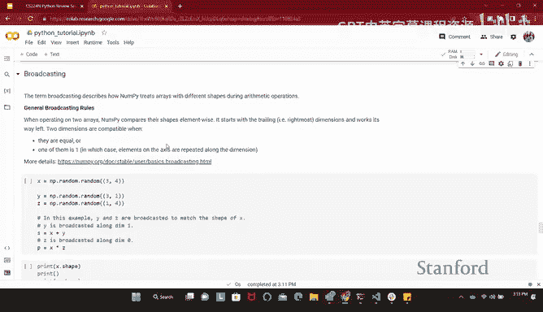

# 斯坦福大学《深度学习自然语言处理｜Stanford CS224N NLP with Deep Learning 2024》中英字幕（deepseek-R1 - P21：-21-2023 _ Python Tutorial, Manasi Sharma.zh_en - GPT中英字幕课程资源 - BV1U5RNYgEfp

All right hi everyone welcome to the 224N Python review session the goal of the session really will be to sort of give you the basics of Python and NmpI in particular that you'll be using a lot in your second homework and the homeworks will come after that as well we're sort of taking this tutorial from the background of anyone who hasn't touched programming languages to some extent。

 but also for people who have will be sort of going through a lot of that material very quickly and will be progressing to NmpI as well and as I mentioned first and foremost the session is really meant for the people who are here in person。

 so if you'd like me to slow down speed up at any point， need time for clarifications。

 feel free to ask as really meant for you first here and I really would like it to be sort of an interactive session as well。

All right， so this is a topic through the topics we'll be covering today going through first of all。

 why Python as a language， why have we chosen it for sort of discourse and in general why do people prefer it to some extent for machine learning and natural language processing。

 some basics of the language itself， common data structures。

 and then getting to sort of the meat of it through NmpPI。

 which I mentioned you'll be extensively using in your homeworks going forward and then some practical tips about how to use things in Python。

😊，All right it first thing why Python so a lot of you who might have been first introduced to programming might have done Java before a lot of people use MATLb in other fields as well so why Python Python is generally used for one because it's a very highle language it can look very very Englishlike and so it's really easy to work with for people especially when they get started out it has a lot of scientific computational functionality as well similar to MALb so when you talk about Npi you'll see that it has a lot of frameworks of very very quick and efficient operations involving math or matrices and that's very very useful in applications such as deep learning and for deep learning in particular a lot of frameworks that people use particularly for example。

 Pytorch and Tensorflowlow interface directly with Python and so for that those main reasons people generally tend to use Python and then deep learning。

😊，Okay so the setup information is in the slides if you'd like to look at them offline。

 I will be sort of jumping over that for now because I want to sort of get to the interruption to the language itself and then if we have time come back to sort of the setup information。

 a lot of it's pretty direct you can walk through it gives you steps for sort of how to install packages what is a Conda environment for example。

 and gets you set up with your first working Python environment so you can sort of run simple and basic command to get you to the language but for now I'm going to be skipping over this and coming back to it if we have time。

All right， language basics， so in Python you have variables and these variables can take on multiple values。

 the assignment operation there's an equal sign will allow you to assign this particular value to a variable a nice thing with Python is you don't have to instantiate the type of the variable to begin with and then only instantiate or an only assign values of that type so for example in certain languages we first say that this variable x is only going to be of type n and any value assigned from that the assign to it will throw an error Python is pretty flexible if I want to I can reassign I can start with x is equal to 10 and then later on like five lines later I can say x is equal to high as a string and there would be no issue。

You can do simple mathematical operations such as the plus and division signs。

 you can do exponentiation which is raising one value to another value so x is the power of y for example。

 using the double asterisks you can do typecastings for float divisions so if you want to ensure that your values are being divided resulting in a float value and not just dividing into integers。

 you can cast two different types like float if you want something to be explicitly an int you can also just put an int instead of the float with brackets around the result and that'll give you an integer value and then you can also do typecasting to for example。

 convert from integers to strings so in this case if I wanted to instead of doing 10 plus three as a mathematical operation I just want to write out 10 plus3 then I can convert the x and y values for example to strings and then add the plus sign as character as well to create a string and so a lot of these common operations you can look online as well people have lists for them and。

😊，how they were sort of done in Python。All right， some other quick things， so Boolean values。

 the true and the false they're always used with capital letters and some of the languages they might be lowercase。

 so just one thing to know Python also doesn't have a null value。

 the equivalent of a null value is none so sometimes when you want to say that this value you want to return none saying that I'm not really do anything here you want to do checks for example in if statements to say that this doesn't have a value then you can assign it to none so none sort of functions as a null equivalent so you're not returning anything。

 it doesn't have a value not the same as zero and another nice thing about Python is lists which are sort of mutable well come to that a little bit later but sort of mutable list of objects and means that you can change them they can be any type so you can have a mixture of integers。

 nonevalue， strings， etc。And yet， functions can return to non value as well。And another quick thing。

 instead of using the double and and in some other languages as people might do with Python I mentioned earlier it's very Englishlike so you can actually just write out if x is equal to three and and in English y is equal to four then return true or something it's quite nice that way so you can use and or and not and then just the comparison operators of equal equals to and not equals to we'll check for equality and inequality this one's pretty standard I feel across many languages and you can use them in Python as well。

😊，And yeah， remember， I're just quick thing the equal equal to signine is different from the assignment operator。

 This one checks for equality。 That one is just assigning a value。

 So a single equal sign versus two of them。All right， and then also in Python you don't use brackets。

 so Python you can use basically spaces or tabs， so either indents of two or four to be able to break up what is contained within the function or contained within like an if statement a four statement or any loops for example。

 and so the main thing is you can choose whether to do two or four。

 you just have to be consistent throughout your entire code base otherwise they will throw an error。

Now go to some common data structures and for this we'll transition to the collLab。

So this one will sort of show you in real time， This is by the way， a coab。

 a collab is basically a Jupyter notebook for those of you who are familiar with those that you can use that it's hosted on Google's servers the really nice thing about Jupyter notebooks is you don't have to run an entire file altogether together you can run it step by step into what are these called cells so if you want to see like an intermediate output you can see that pretty easily and that way and and you also writes。

 for example， a lot of like descriptions pertaining to cells which is really really nice to have as well a lot of people like tend to use these when they're sort of starting off with their project and one to debug things and collabab allows you to use these Jupyter notebook type applications hosted on their servers for free basically so anyone can create one of these and run their code。

All right， so lists are mutable arrays mutable means that you can change them so that once you declare them。

 you can add to them， you can delete them and they're optimized for that purpose。

 so they expect to be changed very often。 will'll come to what are called nuy arrays later and those tend to be pretty much fixed when you create a new one you'd have when you change one you basically have to create a new array which will have the additional information So this is highly optimized for changing things。

 So if you know， for example， and you're in a loop you're adding different elements to let's say a bigger entity。

 You'd want to use something like a list because you're going be changing that very often So let's see how they work so we start off with a names array with Z and J。

You can index into the list by so what it said this is index into the list by index。

 which means that you can。List out the elements in the list， depending on what's called the index。

 So it's what place that value is at within the list。 So0 refers to the first element。

 So Python's what's called zero index， which means it starts with 0。 and then it goes to one。

 So here 0 will be Zach。And then let's say I want to append something to the end。

 So to add something to the end of the list， the term is append， not add。 And so， I want to append。

I can now create a separate list， which is the original list itself with the added last element。

And what would currently be the length of this， it would be three because you have three elements and you can just quickly get that by using the lens function。

 not length， just three letters， LEN。All right， it's also really nice because Python has overloaded the plus operation to be able to concatenate lists so here I have a separate list right and all you need for a list definition is just bracket so this is a separate list altogether even though I haven't saved it in the variable just Abi and Kevin and I can just do a plus equal to which means that names is equal to names plus Abi and Kevin and this should output this full list。

You can create list by just putting the plain brackets or an existing list and then as I mentioned earlier your list can have a variety of types within them so here this list contains an integer value。

 a list value， so you can have a list of lists， as many sort of sublists as you like。

 a float value and a nonvalue。And this is completely valid within Python。

Slicing refers to how you can access only parts of the list， so if I only want， for example。

 in this numbers array， I only want012 slicing is a way that you can extract only those parts so the way slicing works is the first element is included and the last element is excluded so here I start with0。

1，2，3 so three is not included and so01，2 will be printed out。😡，There's also shorthand。

 so if you know that you're going to be starting with the first element of the array so if you know Im I want012 and it starts with0。

 then you don't need to even include the first index。

 you can just leave that and include the last index that would be excluded so that would be blank semicolon 3 and same deal with the end if you know that you want to take everything let's say from like five and6 till the end of the array you can start with what which youd like so0。

1，2，3，4，5 till the end and leave that sorry。Fun fact。

 so this semicolon when you take this just the semicolon itll take everything in the list。

 but it' will also create a duplicate in memory that's that's a very slight very useful thing to know because sometimes when you like pass list in an array sorry in Python which is out of scope of this tutorial you can only pass the reference to it so if you will change the array that gets changed this will create an entirely separate copy and memory of the exact same array so if you make any changes to it it won't affect your original array so this is a very pretty neat way to do that。

And then another fun thing that Python has which is pretty unique is you can index negatively。

 so negative indexing means you index from the back of the array so minus1 refers to the last element of the array minus3 will refer to the third last element and so what minus one will give you will be six in this case when minus three will give you will be everything because you're starting with the minus three elements so minus1。

 minus-2 minus-3 till the end and then this one seems kind of confusing right3 to minus2 so what this will do is it'll give you0。

1，23 so you start with three and then minus1， minus-2 so you leave off the the last because you exclude it within list you'd only get three and4 so that's what this is。

Okay， that's about lists。Tups are immutable arrays， so once you declare the values of these。

 they cannot be changed， so I start with you remember you started with like the list of Zach and J tus。

 you start with Zach and J。And you can still access them。

 you know I can still print out names zero same as I did with lists。

 but if I try to change it in this case， it'll throw an error so twos once you've instantiated them。

 they cannot be changed。And to create an empty tuple， you just create。

 you can either use just a tuple sign or oftentimes you can just use the parentheses buckets so you can just say。

 for example， as you did here， just parentheses to intantiate something。All right。And yeah。

 this one will come to a little bit later in shapes。

 but you can also have a tuple of a single value and all you have to do there is just put the value and put a comma。

 so that just shows that you have a tuple which is like an immutable array so you can't change it it's a list but only have one item。

And that's here。Okay I'll quickly move to dictionaries for those of you who might be familiar with other languages。

 this is the equivalent of like a hashmap or hash table what this is useful for essentially is mapping one value to another in a really really quick way so if I want to map for example a string to an index which you will happen to do a lot of in your homeworks this is a really really useful way to do that and so what it does is you can instantiate this dictionary and it says corresponding that Zach it's going to correspond to this string value whatever it is and so anytime I want to retrieve this string value。

 I just use this dictionary I index by it which is what I do here and then it outputs the corresponding value and it does that really really quickly。

😊，And yeah， so it's really useful， very， very commonly used， especially when you sort for example。

 you have like a list of strings or a list of items and you want to have a corresponding index for them because as you'll see in NLP。

 oftentimes you're using you're working with indices and numbers in particular。

 so it's a really great way to sort of move from like string formats to just like numerical index values。

😊，There's some other things you can do for dictionaries you can check whether certain elements are in there so if you for example try to index phone book is equal to Monsie。

 they'll throw an error because there's no string that says Monsie in that phone book dictionary and so sometimes you might be wanting to do checks before you extract a value and so this will just check for example。

 if I do print Monsie and phonebook it should say false or for example here Kevin and phonebook it should say false while something that's actually in the dictionary Zach will be true。

and then if you'd like to delete an entry from the dictionary。

 you can just do that using the Dell command。All right。

 let's move to loops quickly so loops are a really great way to optimize for the same of same kind of operation you're doing。

 it's also a great way to start to sequentially go over those list type or array type objects we were talking about earlier you know you have like a list of names right how do you access all of them so loops are a really great way to do that in Python they've apps checked away a lot of the confusing sort of parts in other languages that might be。

 you can really for example， first index on numbers So what you do is you have like a range function that you call so here you say range and the range of the last number you'd want so what this range function will return is0。

12，34 and that's what will be stored in this ivalue and here it's just printing out that i value So if I wanted for example loop over the length of the list of size 10 I just have to do for I and range 10 and then index that corresponding part of the list you technically don't even have to do that because。

Python you can just directly get the element of the list。

 so here I have a list of names where I have Zach， Jay and Richard。

 instead of saying first the length of the list and then doing this range operation。

 I can just directly say for name and names and then print out the names and it will just directly get the element in each list。

But sometimes you might want both， you might both want this element Zach as well as its position in the array and for that you can actually use this really helpful function called enumerate and so enumerate will basically pair those two values and it'll give you both the value which is here name for example。

 and it corresponding index within the array boths together so that's really really convenient versus for example having to do this like a little bit more complicated range operation where you first take the range and then you index the list。

How do you iterate over a dictionary so for dictionaries if you want to iterate over what's called the keys。

 so all of these first items that you first you put into the dictionary。

 you can just iterate the same way you would list you just say for name in， for example。

 phone book and you can output the keys if you want to iterate over what is stored in the list which is called a value you'd have to do the dictionary dot values and if you want both you use the dot items function and so that will print out both of these。

All right。So this is sort of covering the overarching， most commonly used sort of structures， lists。

 dictionaries， and then loops， and how to sort of efficiently use them within your code。

We'll quickly be moving to the sort of meat of what is really。

 really stronger by Python and what you'll be using a lot for your coming homeworks。

 especially homework2， which is nuI。Okay so for NI also I'm going to be going to the coab but just quickly wanted to mention what NI is so NmpI is basically an optimized library for mathematical operations you know people tend to like mathla because it's very very useful for these mathematical operations which people use in their research Pythons sort of solution to that is to have a separate library entirely where they make use of subroutines which are sort of like sub languagegus sorry sub scripts that are written in a different language called C or c plus that are highly optimized for efficiency so the reason C and C plus+ are much faster than Python is because they're closer to what's called machine language which is what the computer will read I mentioned earlier one of the nice things about Python is it's kind of high level it looks like English right to some extent you know we say literally like is you if X is equal to one or X is equal to two right but that also means that there's a lot more translation required on the computer's part before it understands what you mean and that's useful when you know we're writing out code where we want。

Understand it， but it's a little bit less useful when you're sort of running a lot of operations on a lot of data so the real benefit of something like lumpumpy is that if you have sort of your memory and your data in a particular format。

 it'll call these like we see scripts or what are call subroutines in a different language and itll make them very very fast and so that's the real benefit of using Numpy and almost everyone in sort of NLP is very very familiar with this because it'll be running a lot of operations on for example a cocurrence matrices which are really really big and it's very useful to have them optimized for time so that's really the benefit of using Numpy。

And Numpy basically it's involved for all these like math and matrix and vector calculations and it's different than a list。

 although you can easily translate between the list and a Ny array， Ny arrays are specifically。

 as I mentioned， designed to be used in these subroutines so they have a specific format they're instantiated differently。

 and you can translate between this and sort of your standard list easily。

 but to know that you can only do Ny operations on Ny arrays。

 you can't do Ny operations on list directly， you first have to like convert them。

 which is really simple， you just use Ny array function。

 but just know that they operate only on Ny arrays。😊，Okay， so for Nmpy。

 we're going to be going back to the collab。And then as I mentioned earlier。

 the real strength of NI is it supports these large multidimensional arrays and matrices for very。

 very optimized highlevel mathematical functions and just to step back for a quick second。

 what is a matrix， matrices are basically like rectangular structures of numbers that are used and you can treat them with specific rules for operations between different kinds of things so if you have a lot of data instead of individually potentially multiplying things if you can store them in this rectangular format。

 you have specific rules about how this matrix for example。

 interact with a different one and by doing that which is matrix multiplication or matrix math you can do a wide variety of mathematical operations a vector is generally this is conventional。

 none of these are like hard and fast rules but conventionally a vector is a matrix in one dimension so it's usually like a row vector or a column vector which usually just means that it's a list of values in only one dimension。

It's like， for example， here， when I come down to x is equal to nupy array of 1，2，3。

 that's aic only one dimension。Versus for example， Z， when this is Z down here。

 that is what's called like a two dimensional array because you have both rows， for example。

 like six comma 7， and then you have a comma 9 versus in this first one。

 you only have three values in one dimension。So that's sort of the conventional difference between the two Another convention is matrices is generally referred to two dimensional objects so as I mentioned is like Z this is two- dimensionional you might have heard the word tensor also tensors by convention usually are like higher dimensional objects so instead of having two dimensions you know two comma two you can have like n dimensions you can have two comma twoa two comma two comma two for like five or six dimensions and those are very valid to do mathematical operations on and those are often colloquially sort of called tensors in addition and this will be covered in the next tutorial in pytorrch those larger sort of tensors are also optimized for efficiency to be used on GPUs and so they're called tensor in a more concrete way because you're using these tensors with ptorrch and other sort of packages to directly do those quicker GPU operations on for deep learning。

So there's sort of this a quick sort of terminology difference between the three。

Okay so now let's start off with just some quick sort of representations of how are these matrices and vectors represented in NumpI this sort of goes back to your question about like what is the difference between like three comma versus like one comma three so it usually three comma in Nmpy array usually just means like you have one list of like one。

 two， three for example， like three values。😊，Versus if you add another list on top of that。

 this one comma3 essentially refers to the fact that there's a list of lists。

 so anytime you have two dimensions it always means that there's a list of lists and that being like a list of list of for example like a row so here one comma three means that there's one row and then three columns so it's saying there's one row of three comma four。

 comma 5 essentially and then each of those is like a column separately。You can easily reshape them。

 So these are basically the same format， but from Ney's perspective you'll see a little bit later for operations such as broadcasting。

 you need to have it， for example， sometimes in this one comma  three format or three comma 1 format and also like as I said three is I represents three numbers。

 one comma3 means like one row of three elements， three comma 1 will mean you have essentially in each column you'll have a separate array so you'll see sort of boxes around each of them there's an example that comes a little bit later in this cola which will make it a little bit more clearer So here if you can see the difference between like x and y one of them has only one bracket。

 which just says it's one list， only one list of one comma to comma3 The second one is two brackets which says it's a list with only one list in it that's a list of a list that's really the main difference between like these sort of two representations。

 So I could have like let's say like。A separate。One， I'm going to call this a， and I just do this。

So it's the same sort of elements， but this will be one comma three because it's showing that there's one outer list which shows the rows and then one inner list。

 which would like like to have each of those values。

So the benefit will come when I'm coming to a little bit later which is broadcasting and so it essentially will help you determine what dimensions you want to match against because sometimes youd want to have one comma3。

 like one comma 2 comma 3 applied only two rows in some other matrix well it will come to that a little bit later。

 but sometimes you might want to have it only applied to columns and so like if I have a separate matrix for example of0。

0，0，0，0，0，00 and I want the resulting matrix to be for example，1，23，1，2，3，1，23 along the rows。

 I me if you draw this out it might be easier。So。Let's say I like the zero，0，0，0，0，0，0，0。

And if I want to have a matrix that does one，2， three， one，2， three， one，2， three versus。1，2，3，1，2，3。

1，2，3。The difference in how to generate these two will be the difference in the shape like how you represent their shape。

 it's the same one，2，3， but the resulting array you're generating by repeating the one2。

 three values requires a difference in shape and so we'll come to that little bit later because this process of how do you generate these arrays is called broadcasting。

 but that's the real benefit of having an understanding of the shapes the same one。

 two three values are the same it's just how they're sort of used with regards to other arrays。

Alright， so yeah， vectors can be represented as sort of and this is what I talking about earlier as like n dimensions n by one or one by N dimensions。

 and they can result in this different behavior， kind of what like this that I talked about matrices are usually in two dimensions represented as n by N。

 These are just two examples。 for example， I generate， let's say， and I can also reshape。

 So I start with for example， this array。Which is a list of 10 outs or and it's important on quickly。

So I start off with this matrix A， which is basically a one dimensional list of 10 values。

 I can reshape it into a five by two matrix。 so you just have to make sure that your dimensions match。

 which means that like you can multiply them together and get the original size So if I start off with the 10 matrix I can make a two by5 matrix。

 I can make a five by two matrix I can make a 10 by1，1 by 10， I can't make for example。

3 and 5 because that it wouldn't fit into the original size。

 And for that this operation called reshape is really useful。

 you might be wondering why is there two parentheses。

 The way that reshape works is essentially it'll take in a tuple。

 So remember what I talking about earlier with tuples is if they're immutable objects they're defined by parentheses。

 So the outer parentheses is representing what you're inputting to the function and what you're inputting is a tuple so it uses a second set of parentheses。

So now just go to some array operations， So I start off with you know this array X。

 when you apply simple operations， for example， a max operation。

 sometimes you might want the max of the entire array。 if I do the max of the entire array。

 what's the max value of the entire array， by the way， just the entire thing。😊。

Yes six right so if I just do NP dot max of x it'll return one value and return6 Well let's say I want the max of every row right like and every in each of these rows I say I want let's say the max of each row I want two and then four and then six how do you do that and so Ny always has like usually in most of their functions and access variable and what the axis variable will do is it'll tell you which of these dimensions do you want to take the max over。

And the way to sort of think about it is this going gonna to be a little bit tricky but the way people describe it is the access is what you want to apply your function over。

 what you want to reduce over and what that means is I print out the shape of the original array it's3 by two I want to apply access one as I remember you know nuy is zero index it'll be01 so I want to apply the max over the second dimension the second dimension means that for each of these essentially you know that like for like the row dimension is the first dimension so it's not along the rows I'm going to be comparing columns and so compare this entire column to this entire column。

And so just remember for axes， usually the axis zero refers to the row axis and the axis one refers to the column axis。

 if you don't even want to remember that， you can just remember that from the original dimension。

 which of these it's referring to and that's the dimension you want to compare over or reduce over。

So it can be a little bit harder to grasp around usually the best way to sort of get around it's like just play with a bunch of sort of operations of min Max and things like that。

 but just remember like the axis is what you want to compare over。

 not the resulting thing so axis one means here column I want to compare between the columns I want to get for example compare one to two。

 three to4， five to six。Does that make sense。ok。And then what this will do is if I just do Npy dot axis。

 it'll just return basically since I'm comparing these columns， it'll just return a resultant column。

And so as I mentioned， you know for over the axis1。

 you get three values because you're comparing over these columns and each column has three values I'm kind comparing over rows as you mentioned。

 I get two values right and so this will just be the tuple comma which is just indicating that it's just a list It's not a list of lists It's just a list but let's say I want a list of lists you know maybe I want to do those operations I talked about earlier instead of reshaping which is always there it's always an option you can also use this feature called keep dims and what that'll do is it'll take the original dimensions which is two dimensions because you have three comma two' two of them and it'll keep that consistent So it'll be three comma one。

But it just means that instead of returning just the extracted column， which is just a list。

 it'll basically keep the column in the context of the original sort of x and it'll keep it as like a two dimensional value。

😡，All right。Now these are just some operations so in NHI you can use an asterisk as an e wise multiplication。

 so an asterisk means that I'm going to be comparing every single value to every single corresponding value in another matrix and you need your matrices to also be the same size for this one so this one it's basically an elementwise matrix it's not a matrix multiplication so you need to have them be the exact same size so this will compare for example one into three。

 two into three， three into three and four into three。All right。

You can also do matrix multiplication， which is a different operation entirely for those of you unfamiliar with matrix multiplication you would basically be multiplying a row of one matrix with the column of another matrix and for that to be necessary you need to have the second dimension of the first array be equal to the first dimension of the second array so for matrix multiplication if I have an。

😊，A into B， comma， B into。C， shaped matrices。 These two have to be equal for matrix multiplication。

 Just something to keep in mind， because oftentimes， if you're doing matrix multiplication。

 you need you have to make sure that these dimensions are the same， which means that， for example。

This is a valid operation， but this can sometimes throw an error。

Sometimes so it's just important to make sure that sometimes you。

 you don't want to make sure that these are exactly equal。

 You can actually just print out the shapes and make sure that these are equal to be doing matrix multiplication。

 And then for matrix multiplication， there's a couple of。

Functions you can use The first one is just NP do mapm which is NP do matrix multiplication you can also just use the at operation and that when both of those are overloaded。

 you can choose whichever one they'll result in the same exact operation and just a quick session let show you can to show what this will do is it'll multiply one into two sorry it'll come like one。

2 versus three，4 so it'll do one into three， two into three and add those two values so that's what matrix multiplication will do。

Okay and then dot products will what a dot product is that it takes two vectors so usually it operates on vectors and a vector as I mentioned。

 is just like a one dimensionional matrix， so it's just basically like three cross one for example a four cross one it'll element wise is multiply between two different vectors and will sum of those values and so here what a doc product do would be like one into one plus2 into 10 plus3 into 100 and for a Nmpy you can just do NP dot and then both of those vectors。

This one is just a side on how you would want the structure of the dot product to be for。

Arayse that are more so okay so phrases the best way for single dimensional vectors。

 this operation works directly anytime it's a multipledial matrix。

 then it treats it as a matrix multiplication， the NP dot dot function so for two by two matrix versus a two by two matrix dot product。

 it's not going to return the sum it's going to return the matrix multiplication。

 does that just something to keep in mind， if you want to make sure that your dot product is happening in the correct way。

 you would want to make sure that sort of similar to what I was talking about earlier， that。

Here this is I think the best way to show it。Okay， so you would want the second like what I mentioned like the last dimension of the first one to match with the first dimension of the next one because it's treating it as like a matrix multiplication here the error that it's throwing is it' three comma2 combined with three and so the way to sort of like fix that would be to have this be like for example like switch the two so you'd have two comma3 and then three comma。

It's really a dimension matching thing at this point。

 so it can be a little bit confusing but when you sort of the main thing to keep in mind is like for single dimensional vectors。

 you can just use NP dot dot directly and they'll give you the dot product value for higher dimensional matrices it treats it as a matrix multiplication and so if you still want to like for those higher dimensional values to ensure that you're getting a dot product youd have to make sure that the dimensions are aligned similar to these。

So anything that's two by two plus for both， any matrix who doesn't have a single dimension in any of them。

 yes， it would treat it as a matrix on matle， the same thing。Okay。Alright， okay。

 I'm going to move to indexing so similar to what I was talking about earlier remember with L。

 I was saying if you just do the semicolon， it'll create like the same array。

 same deal here the semicolon just means you take everything from the original array In fact it returns a copy so it returns a deep copy means that you have a complete separate copy and memory Okay now I'm going into sort of more details of how do you want to index quickly So if I for example have let's say this three by four matrix and I only want to select the zero and the second rows。

 how would I do that。So what's useful is that you can sort of treat a numpy you can treat different dimensions differently for indexing so a semicolon means you select everything in that dimension。

 which for example here is a semicolon in the second dimension。

 which means I'm taking all of the column values versus what's in the first dimension here it's saying a nuy array of0 and 2。

 So it's saying only the zero index and only the two index。

 which means only the zero with row and only the second row。

 So what this would look like would be something like。I have a matrix。Okay， I have a matrix。

 and I only want to select the zero throw and I only want to select column the second row。

 zero and second， and everything in the columns。Great。And then similarly， for example。

 if I want to select in the column dimension， I want to select the first and second rows and only the first row I can do that so you can basically treat them separately you can think how many columns do I want。

 how many rows do I want and then index so separately and that goes for as many dimensions as you want in your entire tensor。

So nice things also， if I want to， for example， take。I have this like。

 let me print that actually x here， I'll just generate the x。

Okay so this is x right So if I want to take all of the values of x that are above 0。5， for example。

 I can do that by using what's called Boolean indexing。

 so I just basically will say x indexed by everything in x that's bigger than 0。

5 so it's pretty direct and it'll just output all the values in this entire array that are bigger than 0。

5。All right， this one is also another way to do reshaping。 So I kind of mentioned earlier， you know。

 sometimes you want have this like list of three elements and you want to reshape it to a three by one。

Array， for example， you can also use what's called nupi do new access。

 This will essentially add another access in whatever dimension you want。

 So if I want to change go from like this three by four array to a three by。Three by four。

 two three by four by one， then I can just add a nuy dot mu axis there an even simpler way to think about it would be like a two comma two a two comma one。

And so it's another way to do what essentially what would be the reshaping operation。

Does that make sense， Also what this would look like， for example。

 let me just a little bit more concrete。So its basically I have this list， right。

 I have like a singular list。 And each in that list， I have a list of lists。

 so I have a list with element 1 and list of element 2。

 So this is what that reshape operation will do。And what Npi。nu access will enable you to do as well。

All right， I think we are a good time so the last main topic we'll be covering is broadcasting and what's really great about broadcasting is it'll allow you to operate with nuy array that are of different shapes but can be sort of if many operations in them can be repeated。

 it allows for that in a very efficient manner and this is actually one of the most I would say useful things about Ny and one of its defining features and what that means is if。

 for example， in this case right if we go back to this example that I had with。😊。

I start off with a000 array how do I generate this array versus how do I generate this array right instead of me saying。

 okay， element 00 plus one element 0，1 plus do all that stuff right instead of doing that one by one what broadcasting allows me to do is I can have only one vector of size 1。

2，3。

And it'll depending on how I do the broadcasting， which I'll come to in a second。

 I can duplicate it along the row dimension， or I can duplicate it along the column dimension。

 and NumpI allows for that do that on its own in the back end。

And so that's really what broadcasting means is I don't need to， for example。

 create a new array saying I want to create a new array to begin with。

 which is already like this and then add those two together， I can just duplicate this and get this。

😡，Alright， so now some rules for broadcasting。 And I mean。

 just quickly visually also just show what broadcasting will do。 Oh sorry。

So broadcasting this is a pretty good visual analogy I have this one by one comma 1 comma 2 comma 3 vector right and I want to basically add。

 let's say only the columns with this one comma 2 comma 3 vector so at broadcasting allows you to do is you only pass these two values in and on the back end it'll duplicate this along the column dimensions so let's say I have1。

 two2，3，1，2，3，1 two，3，1，3 and then it'll do the addition。Similarly， if I pass it a vector one， comma。

 two comma3 comma 4， and I want it to be added to each of the rows instead of each of the columns。

 it'll be able to do that by sort of duplicating it on the back end。

 so this is visually what's happening with broadcasting。All right。

Now some rules so how does NI know when and how to do broadcasting so the main two rules to keep in mind with for broadcasting is one it can only happen if all of the dimensions every single dimension between two arrays are compatible and when they say what is compatible either the dimension values are equal or one of them is equal to one and that is the only rule required so for example I start off with this x array right I have this like three by four x array will y is equal to three comma 1 be compatible。

😡，Yes， it will be why because you have three in the first dimension between the two which is the same。

 and in the second dimension， you have four and you have one。 So those are compatible values。

 And so what this tells NI on the back end is I'm doing， for example。

 an addition operation x plus y It knows that okay3 and three are the same but four and1 are not the same。

 know one of them has one dimension So I need to duplicate this y along the second dimension。

 which means I need to duplicate it along the call dimension and once it does that it duplicates it itll get four3 comma4 an array and then it can do the addition and it does that really fast So it's better to use broadcasting in this way。

 but then for you to create a separate array already duplicate it and then add them。Similarly。

 I have this Z array， which is one comma4 what X into z will do is first I'll check okay3 comma 1。

 okay， is that compatible， Yes， because you have three in one dimension and you have one in the second and four and4 are compatible okay so say I know that these are compatible in the second dimension Im need to change anything in the first dimension it'll know to duplicate them basically so you don't know to duplicate Z and so add it three times in the row dimension create a separate array and then multiply those two。

😡，So this is giving you an example of saying I started off with X。 I have Y。

 then the final shape will do common。 So a lot of times in deep learning， you will have the same。

Basically you'll have different batches of different images coming in， but you want to apply。

 let's say the same weight matrix to all of them。 And instead of duplicating that weight matrix 100 or even like potentially depending on the size of your batch size like a thousand times and then adding those together you use the same matrix and it'll know okay if I'm going be duplicating over the batch dimension。

 it'll do that for you on the back end so use a lot of times in deep learning because of this and basically in your second homework that's basically what we'll be doing implementing a feed for network in nuy and it'll say you have like this W matrix you have this like B matrix which is a will come to those in class and it'll ask you to implement their nuie because that's basically what you're doing is like you have this input image。

 you have a weight matrix which will somehow scale it to an output and that weight matrix will be applied to multiple images in your batch and those images can be different but their sizes will be the same and it's optimized for that。

Okay， so this is just more examples to sort of the same thing。

 your final thing that you'll be coming to is the size of three comma 4。Let's see。

 This one's sort of the example that I showed right here right which is that I have this array of flight say zeros。

 I have this nu this B array of size， what type were would this be because you have one outer list and inside this you have one inner list So it's just basically one row and then three values inside So yes。

 and so would this be compatible Yes， and so it'll know basically to duplicate over the row dimension and so you're gonna get duplicates in the row dimension。

 you're gonna to get 1，2，3，1，2，3，1，2，3， and that's what's happening here。So these are for example。

 a little bit sometimes when it says more complex behavior。

 what basically just means is that like if I have this B vector， which is three comma1。

 if I'm doing this B plus B dot transpose， I transpose is just changing the dimensions。

 it's switching them。 So if I have a two by three matrix transpose will be a three by two matrix。

 what that means visually is something like。Your row and rows and like column dimensions will get switched six goes to。

 I believe it's like  one，2，3 and the four or five， six。

 So like three rows versus like three columns。And what this is just saying is that a three by one and a one by three。

 both of those vectors will be compatible because remember in each dimension。

 it's either the same or a one， and so it knows to duplicate over both of those dimensions。

 and that's what's happening here。Okay， so I think we are right at time and what I would recommend is basically playing with variations of this for broadcasting and see December the two rules for broadcasting is just if it's compatible it's either the same value or it's one and whatever is the one dimension is what's going to be duplicated over on the back end So yeah it's not going to be compatible if they're divisible for example right so if you have like let's say six and three that's not compatible。

You can reshape it and then see if you'd like to have one the tricks you can use where you're sort of thinking like on the back end。

 how do I want this data to be multiplied， you can maybe reshape everything into like an like one by 18 matrix and then multiply everything and then reshape it back that's what you can do but you can never just directly for example。

 six by three make that compatible。Okay， so I think let's wrap this one just a quick example of another use of efficient numpy code。

 Quick note， never preferably don't use loops whenever you're dealing with large data matrices。

 mostly because loops are almost always about 100 times slower Numpy is usually very， very efficient。

 And this is just an example of what you can accomplish with Ny and the same thing using loops。

 So what this is saying is I have an x matrix of size thousand0 by thousand00。 And I want to apply。

 you know， let's say I want to add everything from row hundred onwards with plus5。

 So visually that will look like is' something like。😊。

I have this full matrix and I wanted everything here basically to be added with plus5 then in the loop format I can basically loop over the first dimension of 100 plus and do that or nuI I can basically do what's called Ny。

 a range which will generate integers in like basically 12。

345 like all the way up to that100 value in this case it's between 100，0。

 so I'll start with 10000100 to all the way 2000 in the first dimension and then just add that with five。

So this is just an example of how you would switch from using loops to using Nmpie。

 and it's a lot lot faster。

