# 斯坦福大学《深度学习自然语言处理｜Stanford CS224N NLP with Deep Learning 2024》中英字幕（deepseek-R1 - P22：-22-2023 _ PyTorch Tutorial,  Drew Kaul.zh_en - GPT中英字幕课程资源 - BV1U5RNYgEfp

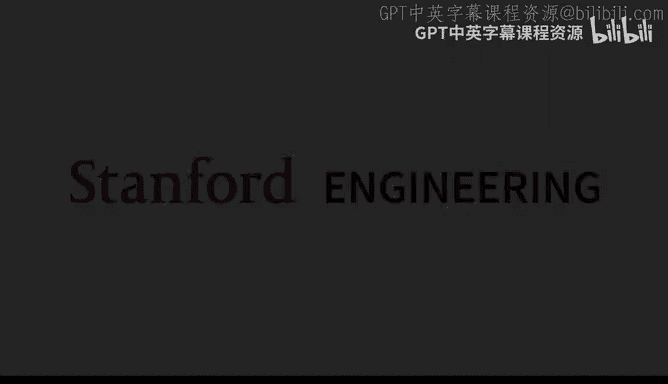

And so today I kind of just want to cover the fundamentals of pie torch。

Really just kind of see what are the similarities between Py torch and numpy and Python。

 which you guys are used to at this point。And see how we can build up a lot of the building blocks that we'll need in order to define more complex models。

 So specifically， we're going to talk today about tensors， What are tensor objects。

 How do we manipulate them。What is autograd， how Pytorch helps us compute different gradients？

And finally， how we actually do optimization and how we write the training loop for our neural networks。

 and if we have time at the end， then we'll try and go through a bit of a demo to kind of put everything together and see how everything comes together when you want to solve an actual NLP task。

All right， so let's get started。So if you go to the course website， there is a notebook。

You can just make a copy of this coab notebook and then just run the cells as we go。

And so to start today we're talking about Pytororch， like I said。

 it's a deep learning framework that really does two main things。

 One is it makes it very easy to author and manipulate tensors。

And make use of your GPU so that you can actually leverage a lot of that capability and two is it makes the process of authoring neural networks much simpler。

 you can now use different building blocks like linear layers and different loss functions and compose them in different ways in order to author the types of models that you need for your specific use cases。

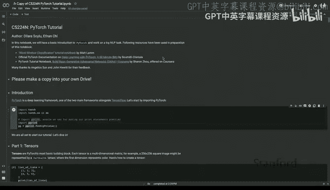

And so Ptorrch is one of the two main frameworks along with TensorF in this class will focus on pietorrch。

 but they're quite similar， and so we'll start by importing torch。

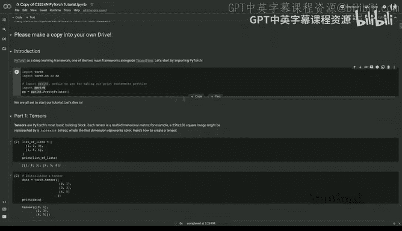

And we'll import the neural network module， which is Torch。nn。

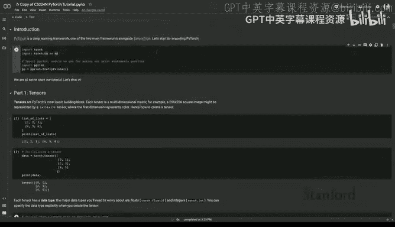

And for this first part of the tutorial， I want to talk a bit about tensors。

 One thing that you guys are all familiar with now is nu high arrays。

 And so pretty much you can think about tensors as。

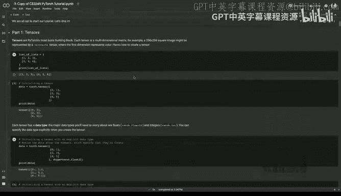

The equivalent in pi torch to nupy arrays， they are essentially multidimensional arrays that you can manipulate in different ways。

 and you'll essentially use them to represent your data to be able to actually manipulate it and perform all the different matrix operations that underlie your neural network。

And so in this case， for example， if we're thinking of an image。

 one way you can think about it in terms of a tensor is it's a 256 by 256 tensor where it has a width of 256 pixels and a height of 256 pixels and for instance。

 if we have a batch of images and those images contain three channels like red， green and blue。

 then we might have a fourdimensional tensor， which is the batch size by the number of channels by the width and the height and so everything we're going to see today is all going to be represented as tensors。

 which you can just think of as multi-dimensional arrays。😊。

And so to kind of get some intuition about this， we're going to spend a little bit of time going through essentially lists of lists and how we can convert them into tensors and how we can manipulate them with different operations。

 So to start off with we just have a simple list of lists that you're all familiar with in this case it's a two by three list。

😊。

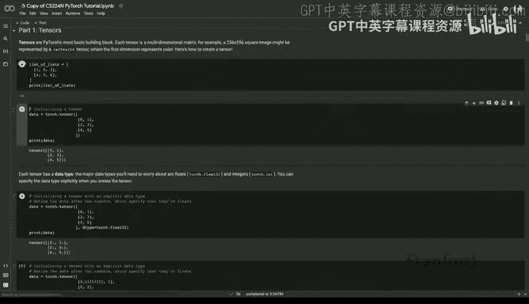

And now we want to create a tensor。 And so here， the way we'll create this tensor is by doing torch dot tensor and then essentially writing the same。

😊，Syntax that we had before， just write out the list of lists that represents that particular tensor。

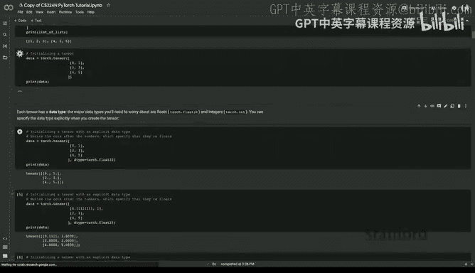

And so in this case， we get back a tensor object， which is the same shape and contains the same data。

And so now the second thing with a tensor is that it contains a data type。

 so there's different data types， for instance， there are different varying level of precision floating point numbers that you can use。

 you can have integers， you can have different data types that actually populate your tensor and so by default I believe this will be float 32。

 but you can explicitly specify which data type your tensor is by passing in the D type argument。

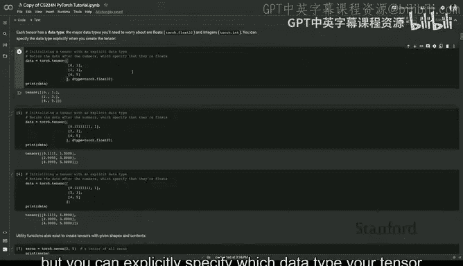

And so we see here now， even though we wrote in a bunch of integers， they have a decimal point。

 which indicates that they're floating point numbers。

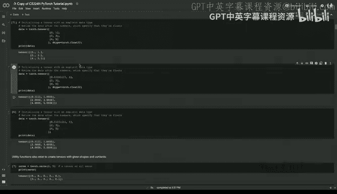

And so same thing here， we could create another tensor in this case with data type F 32。

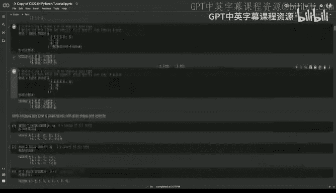

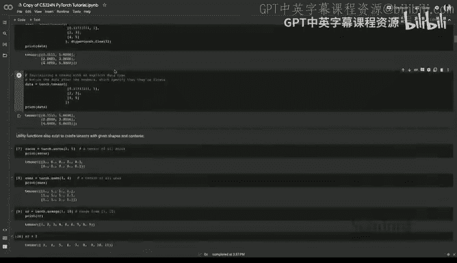

And。In this third example， you see that we create another tensor。

 we don't actually specify the data type， but Pytorarch essentially implicitly takes the data type to be floating points since we actually passed in a floating point number into this tensor。

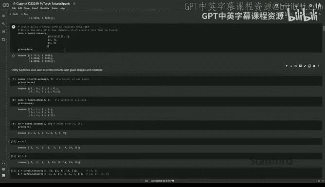

So pretty much at a high level， tensors are like multidimensional arrays。

 we can specify the data type for them， we can populate them just like nuy arrays。

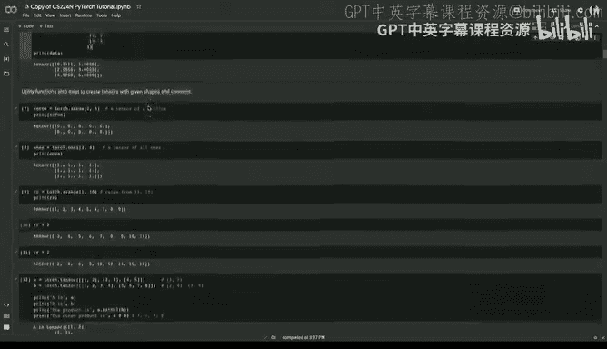

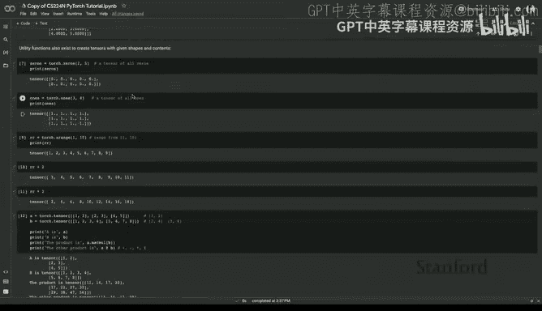

Okay， so now great， we know how to create tensors， we know that ultimately everything that we work with。

 all the data we have is going to be expressed as tensors。Now， the question is。

 what are the functions that we have to manipulate them？

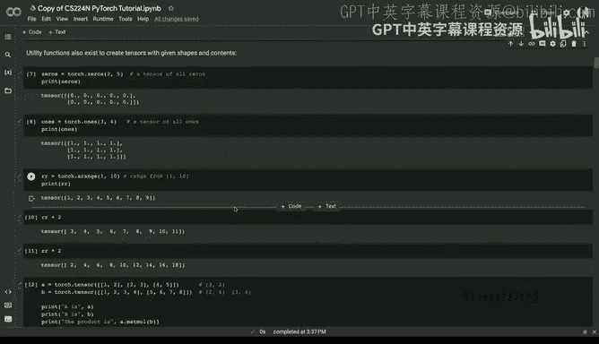

And so we have some basic utilities that can help us instantiate tensors easily。

 specifically torch do zeros and torch。1s these are two ways to create tensors of a particular shape in this case。

 tensors of all zeros or tensors of all ones and you'll see that this will be very helpful when you do your homeworks typically you'll want to just need to just create a bunch of zero matrix and it'll be very easy to just specify the shape here without having to write everything out super explicitly and then you can update that tensor as needed。

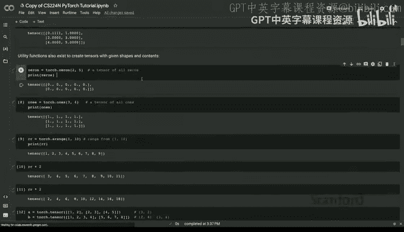

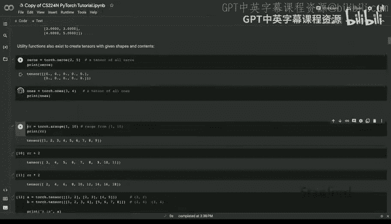

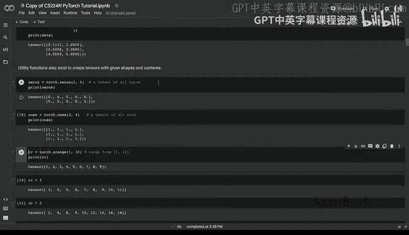

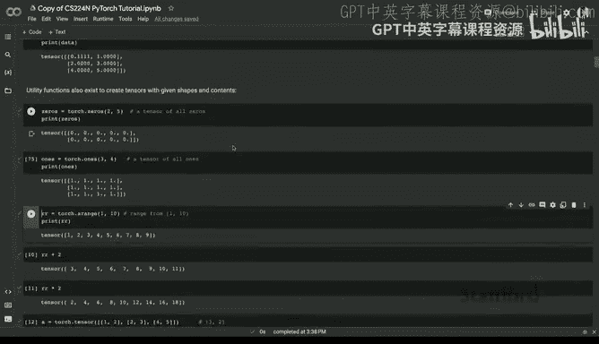

Another thing you can do is just like we have ranges in Python so if you want to loop over a bunch of numbers。

 you can specify a range， you can also use Torch do a range to be able to actually instantiate a tensor with a particular range in this case we just looped over the numbers one through 10。

 you could reshape this and make it one through5 and then6 through 10。

 That's another way to be able to instantiate tensors。

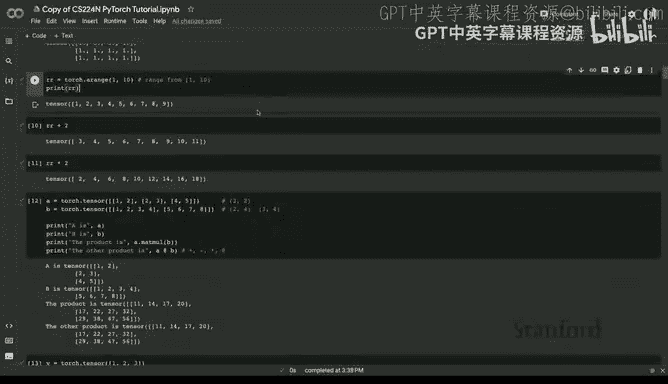

And finally。Something to note is that。When we apply particular operations such as just simple Python operations like addition or multiplication by default。

 they're going to be element wise， so they'll apply to all of the elements in our tensor so in this case we took our tensor I think this one was probably from earlier above and we added two everywhere here we multiplied everything by two。

😊。

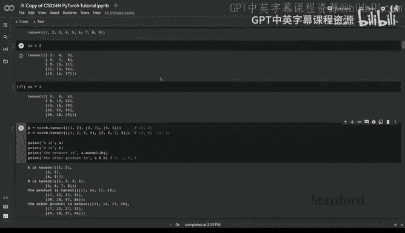

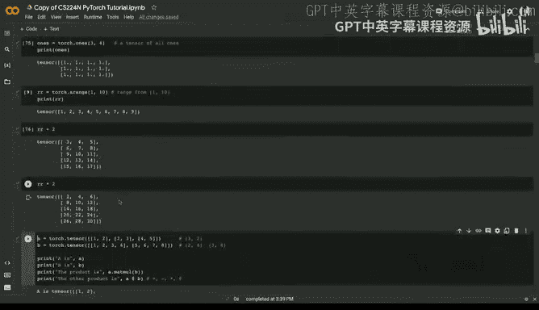

But pretty much the pytorch semantics for broadcasting work pretty much the same as the nup semantics。

 So if you pretty much have different matrix operations where you need to batch across a particular dimension。

 Pytorch will be smart about it and it will actually make sure that you broadcast over the appropriate dimensions。

 although， of course you have to make sure that the shapes are compatible based on the actual broadcasting rules。

 So we'll get to that in a little bit when we look at reshaping and how how different you operations have those semantics。

 in this case， we have to define the， I guess I'm not personally aware of how you would define kind of a jagged tensor that has unequal dimensions。

😊，But typically we don't want to do that because it makes our computation a lot more complex and so in cases where we have。

 you know， for instance， we have different sentences that we turn into tokens。

We might have different length sentences in our training set we'll actually pad all the dimensions to be the same because ultimately we want to do everything with matrix operations and so in order to do that we need to have a matrix of a fixed shape but yeah that's a good point I'm not sure if there is a way to do that。

 but typically we just get around this by padding。Okay， so we know how to define tensors。

We can do some interesting things with them， so here we've created two tensors。

 one of them is a three by two tensor， the other one is a two by four tensor。

 and I think the answer is written up here but what do we expect is the shape when we multiply these two tensors。

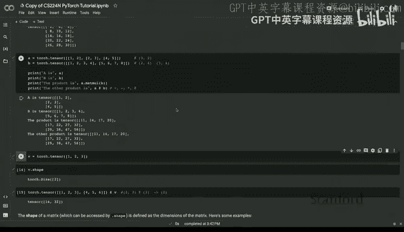

So we have a three by two tensor and a two by four tensor。Yeah， three by four。And so more generally。

 we can use Ma Mole in order to do matrix multiplication。

 it also implements batched matrix multiplication， and so I won't go over the entire review of broadcasting semantics。

 but the main gist is that，The dimensions of two tensors are compatible if you can left pad the tensors with ones so that the dimensions that line up。

 either A have the same number in that dimension or B， one of them is a dummy dimension。

 One of them has a one。

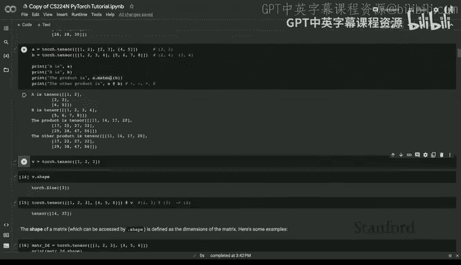

And in that case， in those dummy dimensions， Pytorrch will actually make sure to copy over the tensor as many times as needed so that you can then actually perform the operation。

 and that's useful when you want to do things like batch dot products or batch matrix multiplications。

And I guess the final point here is there's also a shorthand notation that you can use。

 So instead of kind of having to type out matm every time you can just use the ad operator similar to Ny。

 effectivelyect， that's kind of where we get into how batching works。 So， for example， if you had。😊。

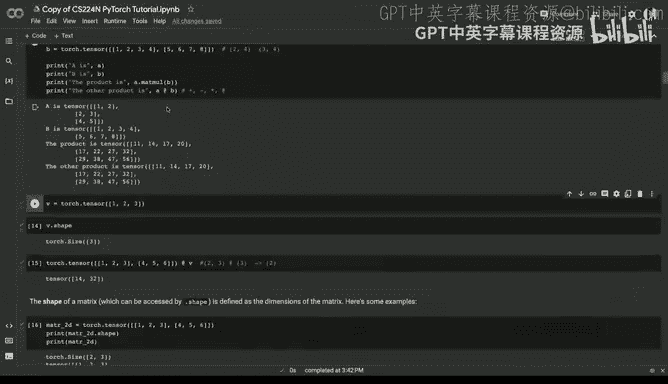

诶。Let's say two tensors that have。嗯。Some batch dimension， and then one of them is M by one。

 and the other one is one by n。 And if you do a batched matrix multiply to those two tensors。

 now what you effectively do is you preserve the batch dimension。

 and then you're doing a matrix multiplication between an M by one tensor and a one by n。

 So you get something that's the batch dimension by M by n。So effectively， they're kind of more。

 I think the full semantics are written out on the Pitorrch website for how the matrix multiplication works。

 but you're right， you don't just have these cases where you have two twodisal tensors。

 you can have arbitrary number of dimensions。 and as long as the dimensions match up based on those semantic style saying then you can multiply it alternatively。

 you can do what I do， which is just multiply it anyways， and then if it throws an error。

 print out the shapes and kind of work from there that tends to be faster in my opinion in a lot of ways but yeah。

 it's a good point。😊，All right， so yeah， let's keep going through some of the other different functionalities here。

So we can define another tensor and kind of one of the key things that we always want to look at is the shape。

 So in this case， we just have a1D tensor of length 3， so。😊，The torch dot size just gives us three。

 in general， this is kind of one of the key debugging steps and something that I'll try and emphasize a lot throughout this session。

 which is printing the shapes of all of your tensors is probably your best resource。

 when it comes to debugging， It's kind of one of the hardest things to intotu it exactly what's going on Once you start stacking a lot of different operations together。

 So printing out the shapes that each point and seeing do they match what you expect is something important And it's better to rely on that than just on the error message that pieytorrch gives you because under the hood pieytorrch might implement certain optimizations and。

😊，Actually， reshape the underlying tensor you have。 So you may not see the numbers you expect。

 So it's always great to print out the shape。😊。

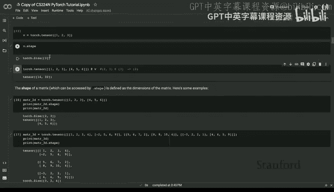

And。So yeah， let's so again， we can always print out the shape。And we can have a more complex。

 in this case， a three dimensional tensor， which is three by  two by4。

 and we can print out the shape and we can see all of the dimensions here。

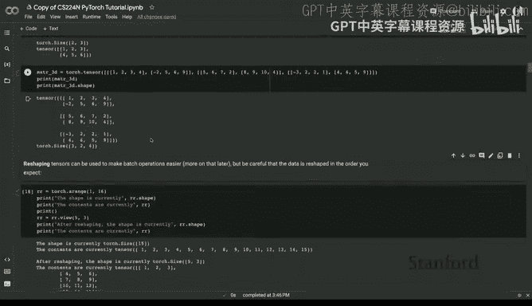

And so now you're like， okay great， we have tensors， we can look at their shapes。

 but what do we actually do with them and so now let's get into kind of what are the operations that we can apply to these tensors。

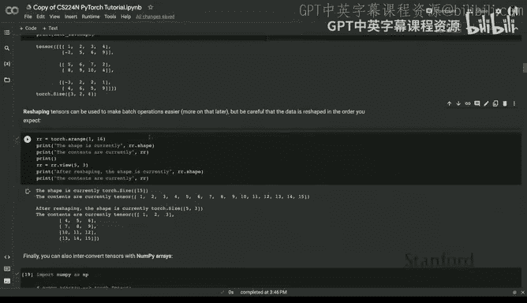

And so one of them is it's very easy to reshape tensors。So in this case。

 we're creating this 15 dimensional tensor that's。The number is 1 to 15， and now we're reshaping it。

 so now it's5 by three tensor here。And so you might wonder well。

 like whats what's the point of that and it's because a lot of times when we are doing machine learning。

 we actually want to learn in batches and so we might take our data and we might reshape it so now that instead of kind of being a long flatten list of things。

 we actually have a set of batches or in some cases we have a set of batches of a set of sentences or sequences of a particular length。

😊，And each of the elements in that sequence has an embedding of a particular dimension。

And so based on the types of operations that you're trying to do。

 you'll sometimes need to reshape those tensors， and sometimes you'll want to particularly sometimes transpose dimensions if you want to。

 for instance， reorganize your data so。That's another operation to keep in mind。

I believe the difference is view will。View will create a view of the underlying tensor。

 and so I think the underlying tensor will still have the same shape， reshape will actually modify。

The tensor。诶。All right， and then finally， like I said at the beginning。

Your intuition about Pytorch tensors can simply be their kind of a nice。

 easy way to work with non p arrays， but they have all these great properties。 like now we can。😊。

Essentially， use them with GPs。 and it's very optimized。 And we can also compute gradients quickly。

 and。To kind of just emphasize this point， if you have some nupy code and you have a bunch of nupy arrays。

 you can directly convert them into pitorrch sensors by simply casting them。

 and you can also take those tensors and convert them back to Ny arrays。

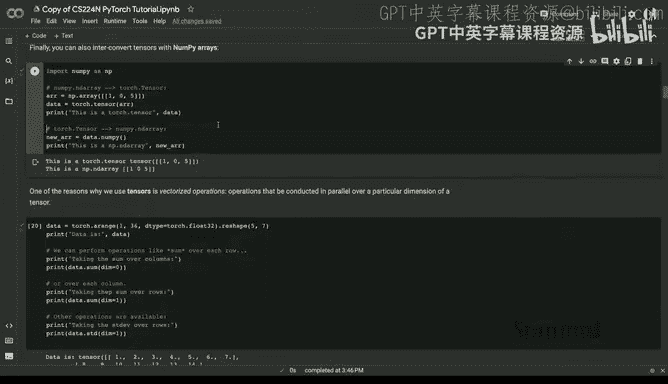

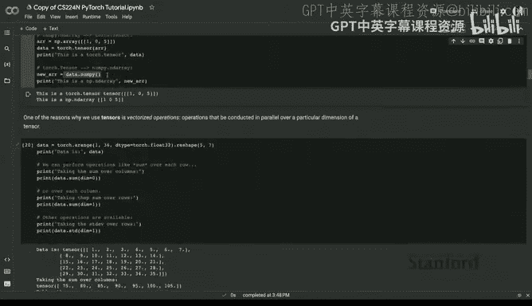

Allright。 And so one of the things you might be asking is， why do we care about tensors。

 What makes them good。And one of the great things about them is that。

They support vectorized operations very easily。 Essentially。

 we can parallelize a lot of different computations and do them， for instance。

 across a batch of data all at once。😊，And one of those operations you might want to do， for instance。

 is a sum so。You can take， in this case， a tensor， which is shape5 by7。嗯。

it looks like that's not working。You can take a sensor that's shape 5 by 7。

 and now you can compute different operations on it that essentially collapse the dimensionality。

 So the first one is sum。 And so you can take it and you can sum across both the rows as well as the columns。

 And so one way I like to think about this to kind of keep them straight is that the dimension that you specify in the sum is the dimension you're collapsing。

 So in this case， if you take the data and sum over dimension 0。😊，Because you know。

 the shape of the underlying tensor is 5 by7。You've collapsed the zero dimension。

 So you should be left with something that's just shape 7。And if you see the actual tensor。

 you got 75， 80 85， 90， you get this tensor， which is shape 7。Alternatively。

 you can think about whether or not you're kind of summing across the rows or somethingming across the columns。

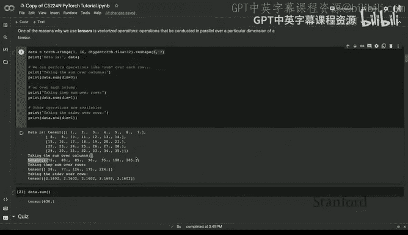

But it's not just some， it applies to other operations as well， you can compute standard deviations。

 you can normalize your data， you can do other operations which essentially batchge across the entire set of data。

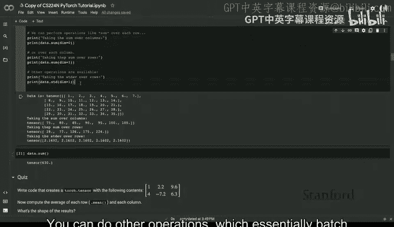

And not only do these apply over one dimension， but here you can see that if you don't specify any dimensions。

 then by default， the operation actually applies to the entire tensor。

 So here we end up just taking the sum of the entire thing。

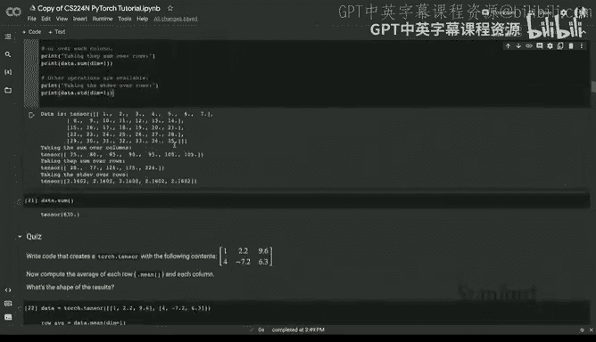

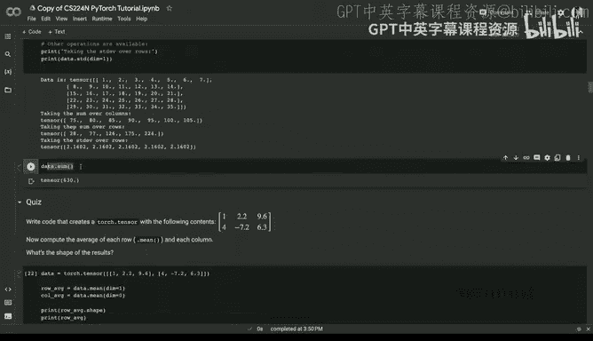

So if you think about it， the zero dimension is the number of rows。

 there are five rows and there are seven columns， so if we sum out the rows。

 then we're actually summing across the columns。And so now we only have seven values。

But I like to think about more just in terms of the dimensions to keep it straight rather than rows or columns because it can get confusing。

 if you're summing out dimension zero， then effectively you've taken something which has some shape that's dimension zero by dimension1 to just whatever is the dimension1 shape。

And then from there， you can kind of figure out， okay。

 which way did I actually sum to check if you were right。

 Numpy implements a lot of this vectorization。 And I believe in the homework that。You have right now。

 I think part of your job is to vectorize a lot of these things。

So the big advantage with Pytorrch is that essentially it's optimized to be able to take advantage of your GPU when we actually start building out neural networks that are bigger that involve more computation。

 we're going to be doing a lot of these matrix multiplication operations that it's going to be a lot better for our processor if we can make use of the GPU and so that's where Pytorrch really comes in handy in addition to also defining a lot of those neural network modules as we'll see later。

 for you， so that now you don't need to worry about， for instance。

 implementing a basic linear layer and back propagation from scratch and also your optimizer all of those things will be built in and you can just call the respective APIs to make use of them whereas in Python and nuI you might have to do a lot of that coding yourself。

😊，Yeah。All right， so。We'll keep going。So this is a quiz except I think it tells you the answer。

 so it's not much of a quiz。

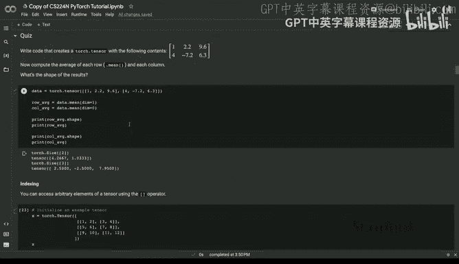

But。Pretty much， you know， what would you do if now I told you。

 instead of you know summing over this tensor， I want you to compute the average。

And so there's two different ways you could compute the average。

 you could compute the average across the rows or across the columns。And so， essentially。

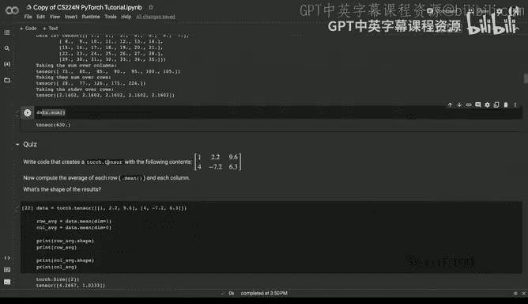

Now we kind of get back to this question of well， which dimension am I actually going to reduce over。

 and so here if we want to preserve the rows then we need to actually sum over the second dimension。

嗯。That are really the first0th and first。 So the first dimension is what we had to sum over because we want to preserve the zeroth dimension。

And so that's why for row average， you see the dem equals1。And for column average。

 same reasoning is why you see the dim equals zero。And so if we run this code。

We'll see kind of what are the shapes that we expect。 If we're taking the average over rows。

 then an object that's 2 by 3 should just become an object that's 2。 It's just a one dimensional。

Almost a vector you can think of。And if we are averaging across the columns， there's three columns。

 so now our average should have three values， and so now we're left with a one dimensional tensor of length  three。

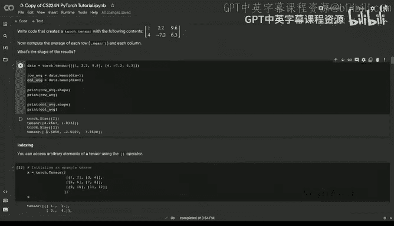

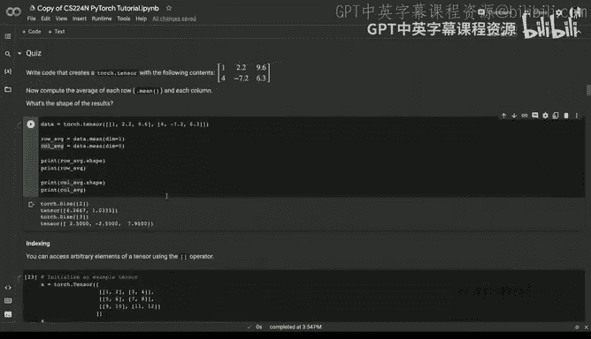

So yeah， does that kind of make sense， I guess， is this general intuition about how we deal with shapes and how some of these operations manipulated shapes。

So now we'll get into indexing。This can get a little bit tricky。But。

I think you'll find that the semantics are very similar to numpy。So， one of the things that。

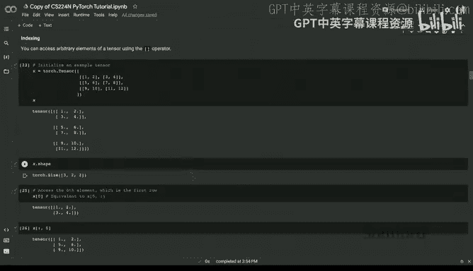

You can do a numpy is that you can take these nuy arrays and you can slice across them in many different ways。

 you can create copies of them。And you can index across particular dimensions to select out different elements。

 different rows or different columns。And so in this case， let's take this example， Tensor， which is。

Three by two by two。

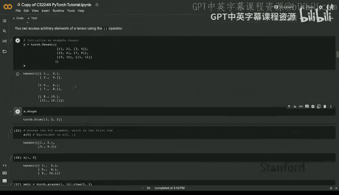

And。First thing you'll always want to do when you have a new tensor print its shape。

 understand what you're working with。And so。I guess。I may have shown this already。

 but what will x brackets0 print out What happens if we index into just the first element。

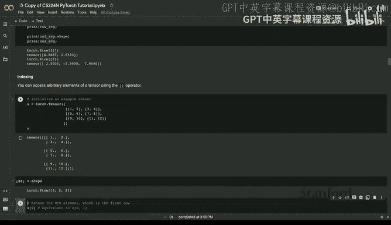

What's the shape of this？Yeah， two by two， right， because if you think about it。

 our tensor is really just。A list of three things， each of those things happens to also be a two by two tensor。

So we get a two by two object in this case， the first thing， one， two， three， four。

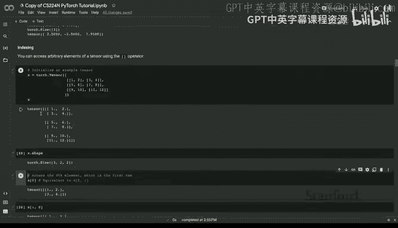

And so just like Numpy， if you provide a colon in a particular dimension。

 it means essentially copy over that dimension。

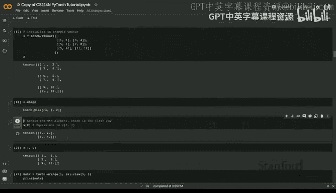

So if we do x bracket zero implicitly， we're essentially putting a colon in for all the other dimensions。

 so it's essentially saying grab the first thing along the zero dimension and then grab everything along the other two dimensions。

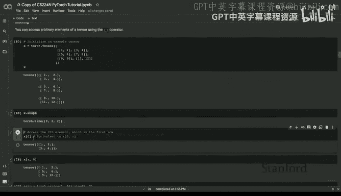

If we now。Take just the zeroth along the element along the first dimension。

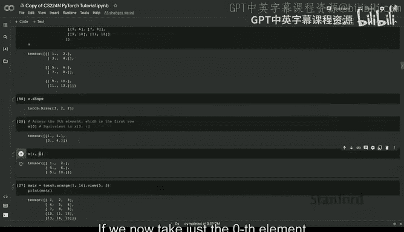

嗯。What are we going to get？Ultimately， we're going to get now if you look the kind of first dimension where these three things。

 the second dimension is now each of these two rows within those things， so like one， two and 3，4，5。

6 and 7，8， 9，10 and 11，12 so if we index into the second dimension or the first dimension and get the zeroth element。

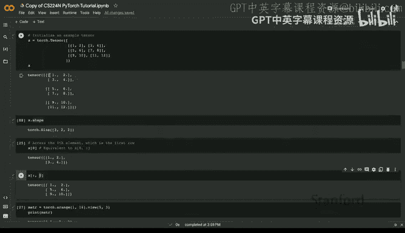

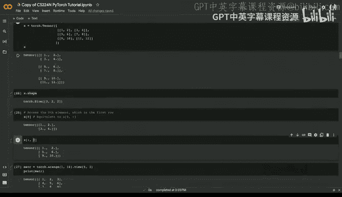

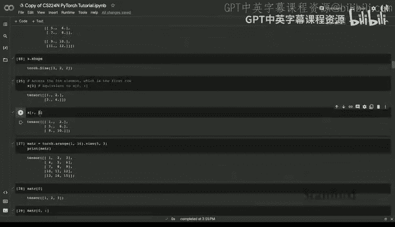

Then we're going to end up with one， two， five， six， and 9，10。

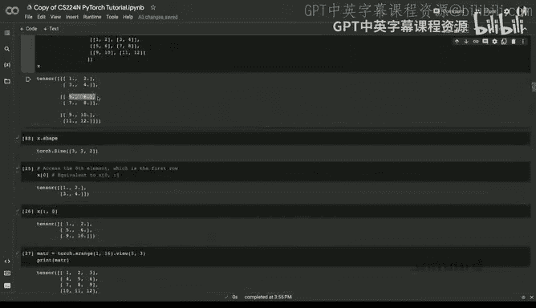

And。😡，Even if that's a little bit tricky， you can kind of go back to the trick I mentioned before where we're slicing across the first dimension。

 So if we look at the shape of our tensor， it's three by two by two。

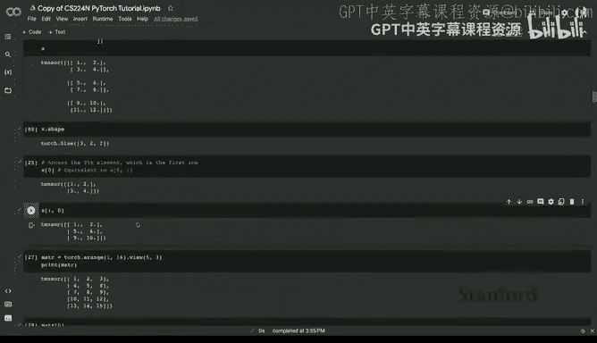

If we collapse the first dimension that two in the middle， we're left with something that's 3 by 2。

So it might seem a little bit trivial kind of going through this in a lot of detail。

 but I think it's important because it can get tricky when your tensor shapes get more complicated。

 how to actually reason about this。

And so I won't go through every example here since a lot of them kind of reinforce the same thing。

 but I'll just highlight a few things， just like numpy。

 you can choose to get a range of elements in this case。

We're。Taking this new tensor， which is。1 to1 through 15 rearranged as a5 by three tensor。

 And if we take the zero through third row， exclusive will get the first three rows。

And we can do the same thing， but now with slicing across multiple dimensions。

And I think the final point I want to talk about here is list indexing。

List indexing is also present in Nmy， and it's a very clever。

 shorthand for being able to essentially select out multiple elements at once。So in this case。

 what you can do is。If you want to get the zero， the second and fourth element。Of our matrix。

 you can just instead of indexing with a particular number or set of numbers。

 index with a list of indices。So in this case， if we go up to our tensor。

If we take out the zero， the second， and the fourth， we should see those three rows。

And that's who we end up getting。

Yeah， again， these are kind of a lot of examples to just reiterate the same point。

 which is that you can slice across your data in multiple ways and at different points you're going to need to do that。

So being familiar with the shapes that you understand what's the underlying output that you expect is important。

In this case， for instance， we are slicing across the first and the second dimension and we're keeping the first。

 the zero and。

We're going to end up getting essentially kind of the the top left element of each of those three things in our tensor。

 If we scroll all the way up here， we'll get this one。 we'll get this 5。

 and we'll get this 9 because。

We go across all of this the Earth dimension， and then across the first and the second。

 we only take the first。呃。The zeroth element in both of those positions。 and so that's why we get 1。

5，9。

And also， of course， you can， apply all of the colons to get back the original tensor。

Okay， and then I think the last thing when it comes to indexing is conversions。 So typically。

When we're writing code with neural networks， ultimately we're going to。You know。

 process some data through a network and we're going to get a loss。

 and that loss needs to be a scalar and then we're going to compute gradients with respect to that loss。

 So one thing to keep in mind is that sometimes you might have an operation and it fails because it was actually expecting a scalar value rather than a tensor。

 And so you can extract out the scalar from this one by one tensor by just calling dot item。

So in this case， you know， if you have a tensor， which is just literally one。

 then you can actually get the Python scalar that corresponds to it by calling dot item。

So now we can get into the more interesting stuff。 One of the really coolest things with Pytorrch is autograd。

😊，And what Autograrad is is hightorrch essentially provides an automatic differentiation package。😊。

Where when you define your neural network， you're essentially defining many nodes that compute some function。

And in the forward past， you're kind of running your data through those nodes。

 But what Pytorrch is doing on the back end is that each of those points。

It's going to actually store the gradients and accumulate them so that every time you do your backwards pass。

You apply the chain rule to be able to calculate all these different gradients and Pytorrch caches those gradients。

And then you will have access to all of those gradients to be able to actually then run your favorite optimizer and optimize。

 you know， with SGD or with Adam or whichever optimizer you choose。😊。

And so that's kind of one of the great features you don't have to worry about actually writing the code that computes all of these gradients and actually caches all of them properly。

 applies the chain rule， does all these steps， you can abstractstruct all of that away with just one call to dot backward。

And so in this case， we'll run through a little bit of an example where we'll see the gradient getting computed automatically。

😊，So。In this case， we're going to initialize a tensor。And requires grad is true by default。

 it just means that by default for a given tensor。Python。

Pietorrch will store the gradient associated with it。And you might wonder well， why do we have this。

 when we always want to store the gradient and the answer is at train time。

 you need the gradients in order to actually train your network。

 but at inference time you'd actually want to disable your gradients and you can actually do that because it's a lot of extra computation that's not needed since you're not making any updates to your network anymore。

😊。

And so let's create this right now。 We don't have any gradients being computed because we haven't actually。

Called backwards to actually compute。嗯。Some quantity with respect to this particular tensor。

 We haven't actually computed those gradients yet。 So right now， the dot grad feature。

 which will actually store the gradient associated with that tensor is none。

And so now let's just define a really simple function。 We have x。

 we're going to define the function Y equals 3 x squared。

And so now we're going to call Y dot backward。And so now what happens is when we actually print out Xt grad。

 what we should expect to see is number 12。And the reason is that。Our function y is 3 x squared。

 if we compute the gradient of that function。We're going to get 6 x， and our actual value was 2。

 So the actual gradient is going to be 12。And we see that when we print out Xtt grad。

 that's what we get。And now we'll just run it again。 Let's set z equal to 3 x squared。

 we call z dot backwards， and we print out X dot grad again。 And now we see that。😊。

I may not run this in the right order。Okay， so。Here in the second one that I reran。

 we see that it says 24。 and so you might be wondering， well， I just did the same thing twice。

 shouldnn't I see 12 again？And the answer is that by default， pytorch will accumulate the gradients。

 so it won't actually rewrite the gradient each time you compute it。 it will sumit。

 And the reason is because when you actually have back propagation for your network。

 you want to accumulate the gradients you across all of your examples and then actually apply your update。

 you don't want to overwrite the gradient。😊，But this also means that every time you have a training iteration for your network。

 you need to zero out the gradient because you don't want the previous gradients from the last epoch where you itererateated through all your training data to mess with the current update that you're doing。

So that's kind of one thing to note， which is that。

That's essentially why we will see when we actually write the training loop。

 you have to run zero grad in order to zero out the gradient。Yes。

 so I accidentally ran the cells in the wrong order， maybe to make it more clear。

 Let me put this one first。😊，So this is actually what it should look like。

 which is that we ran it once and I ran this cell first and it has 12。

 and then we ran it a second time and we get 24。Yes， so if you have all of your tensors defined。

Then when you actually called out backwards， if it's a function of multiple variables。

 it's going to compute all of those partials， all of those gradients。 Yeah。

 so what's happening here is that the way pie torch works is that。It's storing the accumulated。

 accumulated gradient at X。 And so we've essentially made two different。Backwards passes。

 We've called it once on this function Y and we've which is a function of X。

 and we've called it once on Z， which is also a function of X。 And so you're right。

 We can't actually disambiguate， which came from what we just see the accumulated gradient。

 But typically that's actually exactly what we want。

 because what we want is to be able to run our network and accumulate the gradient across all of the training examples that define our loss。

😊，And then perform our optimizer step。 So， yeah， even with respect to one thing。

 it doesn't matter because in practice， each of those things is really a different example in our set of training examples。

 And so we're not interested in， you know， the gradient from one example。

 we're actually interested in the overall gradient。So going back to this example。

What's happening here is that in the backwards pass， what it's doing is。

You can imagine there's the X tensor and then there's the dot grad attribute。

 which is another separate tensor， it's going to be the same shape as X。

And what that is storing is it's storing the accumulated gradient from every single time that you've called dot backward on a quantity that essentially has some dependency on X that will have a non-ze gradient。

And so the first time we call it， the gradient will be 12 because6 x，6 times 2，12。

 The second time we do it with Z， it's also still 12。😊。

But the point is that doc grad doesn't actually overwrite the gradient each time you call dot backwards。

 it simply adds them。 It accumulates them。 and kind of the intuition there is that。Ultimately。

 you're going to want to compute the gradient with respect to the loss and that loss is going to be made up of many different examples。

 and so you need to accumulate the gradient from all of those in order to make a single update。

And then of course， you'll have to zero that out because every time you make one pass through all of your data。

 you don't want。That next batch of data， So I'll also be double counting the previous batches update。

 You want to keep those separate。 And so we'll see that in a second。对。All right。

 so now we're going to move on to。One of the final pieces of the puzzle， which is neural networks。

 how do we actually use them in pie torch？And once we have that and we have our optimization。

 we'll finally be able to figure out how do we actually train a neural network。

 what does that look like and why it's so clean and efficient when you do it in Pytorrch。

So the first thing that you want to do is。We're going to be defining neural networks in terms of existing building blocks。

 in terms of existing APIs， which will implement， for instance。

 linear layers or different activation functions that we need。 So we're going to import Torch。

 NN because that is the neural network package that we're going to make use of。

And so let's start with the linear layer。The way the linear layer works in piytorrch is it takes in two arguments。

 it takes in the input dimension and then the output dimension。

And so pretty much what it does is it takes in some input。

Which has some arbitrary amount of dimensions。 And then， finally。The input dimension。

 and it will essentially output it to that same set of dimensions except the output dimension in the very last place。

And you can think of the linear layer as essentially just performing a simple A X plus B by default。

 it's going to。It's going to apply a bias， but you can also disable that if you don't want a bias term。

And so let's look at a small example。So here we have our input。嗯。

We're going to create a linear layer in this case has an input size of four and output'll put size of two。

And。All we're going to do is once we define it by instantiating with NN dot linear。

Whatever the name of our layer is in this case， we called it linear。

 we just essentially apply it with parentheses as if we were function to whatever input。

 and that actually does。The actual forward pass through this linear layer to get output。

And so you can see that the original shape was two by three by four。

 then we pass it through this linear layer which has an output dimension of size two。

 and so ultimately our output is two by3 by two， which is good， that's what we expect。

 that's not shape error。But， you know， something common that you'll see is， you know， maybe。

You decide to。You get a little confused and maybe you do， let's say。

2 by two， you match the wrong dimension。And so here we're going to get shape error。

And you see that the error message isn't as helpful because it's actually changed the shape of what we were working with。

 we said this was two by3 by four under the hood， Pytor just changes to a6 by four。

 but if we you know in this case it's obvious because we instantiated it with the shape。

 but if we didn't have the shape。Then one simple thing we could do is actually just print out the shape。

And we'd see， okay， this last dimension is size4， so I actually need to change my input dimension in my linear layer to be size4。

And you'll also notice on this output， we have this grad function。

 And so that's because we're actually computing and storing the gradients here。For our tensor。Yeah。

 so typically we think of the first dimension as the batch dimension。

 so in this case it said and this you can think of as if you had a batch of images。

 it would be the number of images if you had a training corpus of text。

 it would be essentially the number of sentences or sequences。😊。

Pretty much that is usually considered the batch dimension。

 the star indicates that there can be an arbitrary number of dimensions。😊，So for instance。

 if we had images。This could be a four dimensional tensor object。

 It could be the batch size by the number of channels， by the height， by the width。But in general。

 there's no fixed number of dimensions。 your input tensor can be any number of dimensions。

 The key is just that that last dimension needs to match up with the input dimension of your linear layer。

The two is the output size。 So essentially， we're saying that we're going to map。This last dimension。

 which is four dimensional to now two dimensional。So in general， you know。

 you can think of this as if we're stacking a neural network。

 this is kind of the input dimension size， and this would be like the hidden dimension size。

And so one thing we can do is we can actually print out the parameters and we can actually see what are the values of our linear layer or in general。

 for any layer that we define in our neural network， what are the actual parameters and。😊。

In this case， we see that there's two sets of parameters。Because we have a bias。

 as well as the actual。The actual linear layer itself。And so both of them store the gradients。

And in this case。You know， these are what the current values of these parameters are。

 and they'll change as we trained the network。Okay。

 so now let's go through some of the other module layers。嗯。So in general。

 NN dot linearar is one of the layers you have access to。

 you have a couple of other different layers that are pretty common， you have 2D convolutions。

 you have transpose convolutions， you have batch norm layers when you need to do normalization in your network。

You can do up sampling， you can do max pooling， you can do lots of different operators。

 but the main key here is that all of them are built in building blocks that you can just call just like we did with NN dot linear。

And so。Let's just go， I guess I'm running out of time。

 but let's just try and go through these last few layers。

 and then I'll wrap up by kind of showing an example that puts it all together。

So in this case we can define an activation function which is typical with our networks。

 we need to introduce nonlinearities in this case we use the sigmoid function。

 and so now we can define our network as this very simple thing which had one linear layer and then an activation。

😊。

And。In general， when we compose these layers together， we don't need to actually write。

Every single line by line， applying the next layer， we can actually stack all of them together。

 In this case， we can use N n dot sequential and list all the layers。

 So here we have our linear layer followed by our sigmoid and then。😊。

Now we're just just essentially passing the input through this whole set of layers all at once。

 So we take our input。

We call a block on the input， and we get the output。And so。

Let's just kind of see putting it all together， what does it look like to define a network and what does it look like when we train one？

So here we're going to actually define a multi layerer perceptionceptron。

 and the way it works is to define a neural network， you extend the NN dot module class。

The key here is there's really two main things you have to define when you create your own network。

 One is the initialization。 So in the init function。

 you actually initialize all the parameters you need。 In this case， we initialize an input size。

 a hidden size。 And we actually define the model itself。 In this case， it's a simple model， which。

Consists of a linear layer followed by an activation， followed by another linear layer。

 followed by a final activation。And the second function we have to define is the forward。

 which actually does the forward pass of the network。

 and so here our forward function takes in our input X。In general。

 it could take in some arbitrary amount of inputs into this function。

But essentially it needs to figure out how are you actually computing the output。

 and in this case it's very simple， we just pass it into the network that we just defined。

And return the output。And。Again， you could do this more explicitly by kind of doing what we did earlier。

 where we could actually write out all of the layers individually instead of wrapping them into one object and then。

😊，Doing a line by line operation for each one of these。

Layers。And so finally， if we define our class， it's very simple to use it。

 we can now just instantiate some input， instantiate our model by calling multilayer perceptron with our parameters。

 and then just pass it through our model。So that's great， but this is all just the full road pass。

 how do we actually train the network， how do we actually make it better？😊。

And so this is the final step， which is we have optimization built in to pi torch。

 so we have this backward function which goes and computes all of these gradients in the backward pass。

 and now the only step left is to actually update the parameters using those gradients and so here we'll import the torchtop optim package which contains all of the optimizers that you need。

😊，Essentially， this part is just creating some random data so that we can actually decide how to fit our data。

But this is really the key here， which is we'll instantiate our model that we defined。

We'll define the atom optimizer。嗯。And we'll define it with a particular learning rate。

 we'll define a loss function， which is again， another built in module in this case。

 we're using the cross entropy loss。😊，And finally， to calculate our predictions。

 all we do simply is just call model on our actual input。

And to calculate our loss， we just call our loss function on our predictions and our true labels。

 and we extract the scalar here。And now when we put it all together。

 this is what the training loop looks like。We have some number of epochs that we want to train our network。

For each of these epochs， the first thing we do is we take our optimizer and we zero out the gradient。

 And the reason we do that is because like many of you noted。

 we actually are accumulating the gradient。 We are not resetting it every time we call do backward。

 So we zero out the gradient。😊，We get our model predictions by doing a forward pass。

We then compute the loss between the predictions and the true values。Finally。

 we call loss stop backward， this is what actually computes all of the gradients in the backward past from our loss。

And the final step is we call dot step on our optimizer in this case we're using atom。

And this will take a step on our loss function。 And so if we run this code。

We end up seeing that we're able to start with some trading loss， which is relatively high。

 and in 10 epochs， we're able to essentially completely fit our data。

And if we printed out our model parameters and we printed them out from the start as well。

 we'd see that they've changed as we've actually done this optimization。

And so I'll kind of wrap it up here， but I think。The key takeaway is that a lot of the things that you're doing at the beginning of this class are really about understanding the basics of how neural networks work。

 how you actually implement them， how you implement the backward pass。

 The great thing about Pytorch is that once you get to the very next assignment you'll see that now that you have a good underlying understanding of those things you can abstract a lot of the complexity of how do you do backpro。

 how do you store all these gradients， how do you compute them。

 how do you actually run the optimizer， and let pytorrch handle all of that for you and you can use all of these building blocks。

 all these different neural network layers， to now define your own networks。

 that you can use to solve whatever problems you need。😊。

