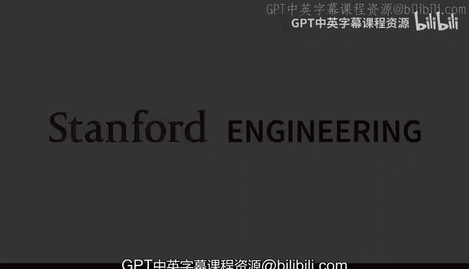
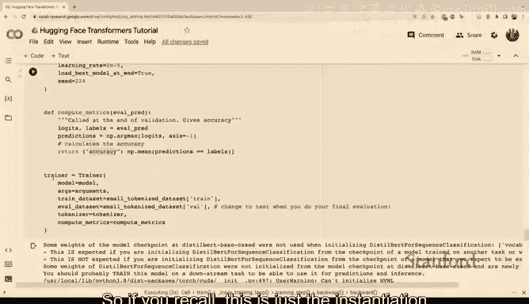

# 斯坦福大学《深度学习自然语言处理｜Stanford CS224N NLP with Deep Learning 2024》中英字幕（deepseek-R1 - P23：-23-2023 _ Hugging Face Tutorial, Eric Frankel.zh_en - GPT中英字幕课程资源 - BV1U5RNYgEfp

Hi everyone， welcome to the 224 and Huging F Transformers tutorial so this tutorial is just going to be about using the Huging F library it's really useful and a super effective way of being able to use kind of some off the shelf NLP models specifically models that are kind of transformer based and being able to use those for either your final project。

 your custom final project or something like that just using it in the future so these are it's a really helpful package to learn and it interfaces really well with Pytorch in particular too。

Okay so first things first is in case there's anything else that you are missing from this kind of like tutorial。

 the hugging face documentation is really good， they also have lots of kind of tutorials and walkthroughs as well as other kind of like notebooks that you can play around with as well so if you're ever wondering about something else that's a really good place to look。

Okay， so in the coab， the first thing we're going to do that I already did。

 but can maybe run again is just installing the transformers's Python package and then the data sets Python package。

So this corresponds to the hugging face transformers and data sets and so those are really helpful。

 the transformers is where we'll get a lot of these kind of pretrained models from and the data sets will give us some helpful data sets that we can potentially use for various tasks so in this case sentiment analysis。

Okay， and so we'll use a bit of like a helper function for helping us understand what encoding is what encodings are actually happening as well。

 So we'll run this just to kind of kick things off and import a few more， few more things。Okay。

 so so first， what we'll do is this is generally kind of like the step by step for how to use something off of hugging face。

 So first what we'll do is we'll find some model from like the hugging face hub here and note that there's like a ton of different models that are're able to use。

 there's Bt， there's G2 there's T5 small， which is another language model from Google。

 So there are a bunch of these different models that are pretrained and all of these weights are up here and hugging face that are freely available for you guys to download So if there's a particular model you're interested in。

 you can probably find a version of it here。 you can also see kind of different types of models on the side as well that for specific task。

 So if we wanted to do something like zero shot classification there are a couple of models that are specifically good at doing that particular task。

😊，So based off of what tasks you're looking for， there's probably a hugging face model for it that's available online for you to download。

Okay。So that's what we'll do first is we'll go ahead and find a model in the Hu and F hub and then you know whatever you want to do in this case we'll do sentiment analysis and then there are two things that we need next。

 the first is a tokenizer for actually know splitting your input text into tokens that your model can use and the actual model itself。

And so the tokenizer again kind of converts this to some vocabulary IDs。

 these discrete ideas that your model can actually take in。

 and the model will produce some prediction based off of that。Okay。

 so so first what we can do is again， import this auto tokenizer and this auto model from for sequence classification。

 So what this will do initially is download some of the you know key things that we need so that we can actually initialize these。

 So what do each of these do。 So first， the tokenizer。

 this auto tokenizer is from some pretrained tokenizer that has already been used So in general。

 there's a corresponding tokenizer for every model you want to try and use。 in this case。

 it's like CBt。 So like something around sentiment in Roberta。

 And then the second is you can import this model for sequence classification as well from something pretrained on the model hub again。

 So again， this corresponds to sentiment Roberta large English。 And if we want。

 we can even find this over here we can find it as。😊，U。Think English。 Yeah， large English。 So again。

 this is something we can easily find。 You just copy this string up here。

 and then you can import that。Okay， we've downloaded all the kind of all the things that we need some kind of like binary files as well。

 and then now we can go ahead and actually you know use some of these inputs right so this gives you some set of an input right this input string I'm excited to learn about howging face transformers we'll get some tokenized inputs here from the actual tokenized things here after we pass it through the tokenizer and then lastly we'll get some notion of the model output that we get right so this is kind of some legits here over whatever classification that we have so in this case good or bad and then some corresponding prediction and we'll walk through what this kind of looks like in just a second as well a little more depth this is broadly kind of like how we can actually use these together we'll tokenize some input and then we'll pass these inputs through the model So we'll talk about tokenizers first so so tokenizer。

😊，are used for basically just preprocessing the inputs that you get for any model and it takes some raw stringing to like essentially a mapping to some number or ID that the model can take in and actually kind of understand so tokenizers are either kind of like are specific to the model that you want to use。

 or you can use the auto tokenizer that will kind of conveniently import whatever corresponding tokenizer you need for that model type。

So that that's kind of like the helpfulness of the auto tokenizer。

 it'll kind of make that selection for you and make sure that you get the correct tokenizer for whatever model you're using。

So the question is does it make sure that everything is mapped to the correct index of the model is trained on the answer is yes。

 so that's why the auto tokenizer is helpful So there are two types of tokenizers there's a Python tokenizer and there's also like a tokenizer fast that the tokenizer fast is written in rust in general if you do the auto tokenizer orll just default to the fast one there's not really a huge difference here。

 it's just about kind of like the inference time for getting the model outputs。Yeah。

 so the question is the tokenizer creates dictionaries of the model inputs so to it's more like I think the way to think about a tokenizer is like that like that dictionary almost right so you want to kind of translate almost or have this mapping from the tokens that you can get from like this string and then map that into kind of some inputs that the model will actually use so we'll see an example of that in just a second。

So for example， we can kind of call the tokenizer in any way that we would for like a typical pietorrch model。

 but we're just going to call it on like a string so here we have our input string as hugging face transformers is great we pass that into the tokenizer almost like it's like a function and then we'll get out some tokenization so this gives us a set of input Is so to answer the earlier question these are basically the numbers that each of these tokens represent right so that the model can actually use them。

And then a corresponding attention mask for the particular transformer。Okay。

So there are a couple ways of accessing the actual tokenized input IDs。

 you can treat it like a dictionary， so hence kind of thinking about it almost as that dictionary form。

 it's also just like a property of the output that you get so there are two ways of accessing this in like a pretty pythonic way。

Okay。So what we can see as well is that we can look at the particular the actual kind of tokenization process almost and so this can maybe give some insight into what happens at each step right so our initial input strain is going to be hugging face transformers is great。

The next step is that we actually want to tokenize these kind of individual words that are passed in。

 so here this is the kind of output of this tokenization step。We get these individual split tokens。

 we'll convert them to IDs here。And then we'll add any special tokens that our model might need for actually performing inference on this。

So there's a couple steps that happen kind of like underneath when you use an actual and we use a tokenizer that happens a few things at a time。

One thing to note is that for fast tokenizers as well。

 there is another option that you're able to get to。

So you have essentially right you have this input string， you have the number of tokens that you get。

 and you might have some notion of like the special token mask as well right so using char to word is going to give you like the word piece of a particular character in the input。

So here this is just giving you additional options that you can use for the fast tokenizer as well for understanding how the tokens are being used from the input stream。

So there are different ways of using the outputs of these tokenizers too。

 so one is that you know you can pass this in and if you indicate that you want it to return a tensor you can also return a pietorrch tensor so that's great in case。

You need a pie torch tensor， which you probably generally want。

 you can also add multiple tokens into the tokenizer and then pad them as however you need。

So for here， for example。We can use the pad token as being this kind of like pad bracket almost and giving the token ID is going to correspond to zero right so this is just going to add padding to whatever input that you give so if you you need your outputs to be the same length for a particular type of model right this will add those padding tokens and then correspondingly gives you like the zeros and the attention mask where you actually need it。

Okay， and so the way to do that here is you basically set padding padding to be true and also set truncation to be true as well。

 And so if you ever have kind of like more。Any other kind of like features of the tokenizer that you're interested in。

 again， you can check the hugging face documentation。

 which is pretty thorough for what each of these things do。Yeah。

 so the question is kind of looking at looking at the hash hash at least and whether that means that we should have like a space before or not so so here in this case yeah so in this case we probably don't want like the space before right just because we have like the hugging like I don't know hugging is all one word in this case generally like generally like the tokenizers generally the output that they give is still pretty consistent though in terms of how the tokenization process works so there might be kind of these like you know instances where it might be contrary to what you might expect for kind of how something is tokenized in general the tokenization generally works fine so。

In most cases， kind of like the direct output that you get from the hugging face tokenizer is sufficient。

Okay， awesome， so one last thing past the adding kind of additional padding is that you can also kind of decode like an entire batch at one one given time So if we look again we have like our tokenizer we additionally have this method called like a batch decocode So if we have like the model inputs that we get up here。

 this is the output of passing these sentences or these strings into the tokenizer we can go ahead and just pass like these input Is that correspond to that into the batch decode and it'll give us kind of this good this decoding that corresponds to all the padding we added in each of the particular kind of like words and strings。

And if you want to， you know， ignore all the presence of these padding tokens or anything like that。

 you can also pass that into skipping the special tokens。Gotcha。

 so this gives like a this is a pretty high level overview of the how you would want to use tokenizers。

 I guess in you in using hugging face。So now we can talk about maybe how to use the hugging face models themselves。

 so again this is pretty similar to what we're seeing for something likeizing a tokenizer you just choose the specific model type for your model and then and you can use that or the specific kind of auto model class or again this auto model kind of takes almost like the initialization process。

 it takes care of it for you in a pretty easy way without really any too much overhead。

So additionally， so for the pretrained transformers that we have。

 they generally have the same underlying architecture。

 but you'll have different kind of heads associated with each transformer so attention heads that you might have to train if you're doing some sequence classification or just some other task so hugging face will do this for you and so for this we'll walk through an example of how to do this for sentiment analysis。

 so if there's a specific context like sequence classification we want to use we can use like this the very specific kind of like class a hugging face provides so distillbert for sequence classification。

Alternatively， if we were doing it using distillberrt in like a mass language model setting。

 we use distillberrt for massed LM and then lastly。

 if we're just doing it purely for the representations that we get out of distillberrt。

 we could just use like the baseline model so the key thing here or key takeaway is that there are some task specific classes that we can use from hugging face to initialize。

So auto model again is similar to kind of like the auto tokenizer so for this it's just going to kind of load by default that specific model and so in this case it's going to be just like kind of like the basic basic weights that you need for them。

Okay， so so here we'll have basically three different types of models that we can look at one is like an encoder type model。

 which is BertRT。A decoder type model like GP2 that's like performing these like you know generating some text potentially and encoder decoder models so Bart or T5 in this case so again。

 if you go back to kind of the hugging face hub， there's a whole sort of different types of models that you could potentially use and if we look in the documentation as well。

So here we can understand some notion of like the different types of classes that we might want to use right so there's some notion of like the auto tokenizer。

 different auto models for different types of tasks。So here， if again。

 if you have any kind of like specific use cases that you're looking for。

 then you can check the documentation here again， if you use like an auto model from pre like pretrained。

 you'll just create a model that's an instance of that per model。In this case。

 bird model for the bird based case。Okay lets we can go ahead and start one last thing to note is that like again。

 the particular choice of your model matches up with kind of the type of architecture that you have to use right so there are different these different types of models can perform specific tasks so you're not going to be able to kind of load or use Bt for instance or distill Bt as like a sequence to sequence model。

 for instance， which requires the encoder and decoder because dist distill Bt only consists of an encoder so there's a bit of like a limitation on how you can exactly use these。

 but it's basically based on like the model architecture itself。Okay， awesome。

 so let's go ahead and get started here。 so similarly here。

 we can import so auto model for sequence classification。 So again。

 this is we're going to perform some classification task and we'll import this auto model here so that we don't have to reference again like something like distillbert for sequence classification We'll be able to load it automatically and it' be。

I'll say alternatively， we can do distill Bt for sequence classification here。

 and that specifically will require distill Bt to be the input there。Okay。

 so these are two different ways of basically getting the same model here， one using the auto model。

 one using just explicitly distillber。Cool， and here， because it's classification。

 we need to specify the number of labels or the number of classes that we're actually going to classify for each of the input sentences。

Okay， so here we'll get some like a warning here if you are following along and you print this out because some of the sequence classification parameters aren't trained yet。

 and so we'll go ahead and take care of them。So here similarly。

 we'll kind of like walk through how to how to actually you know train some of these models so the first is how do you actually pass any of the inputs that you get from a tokenizer into the model okay。

 well if we get some model inputs from the tokenizer up here。

And we pass this into the model by specifying that the input IDs are the input IDs from the model inputs。

And likewise， we want to emphasize or we can you know show here and specifically pass in that the attention mask is going to correspond to the attention mask that we gave from these like these outputs of the tokenizer。

Okay。So this is option one where you can specifically identify which property goes to what。

The second option is using kind of a pythonic hack almost。

 which is where you can directly pass in the model inputs and so this will basically unpack almost the keys of like the model inputs here。

 so the model input keys， so the input IDs correspond to this the attention mask corresponds to the attention mask argument。

So when we use this star star kind of syntax， this will go ahead and unpack our dictionary and basically map the arguments to something of the same keys。

So this is an alternative way of passing it into the model。Both are going to be the same。Okay。

So now what we can do is we can actually print out what the model outputs look like， so again。

 these are the inputs， the token IDs and the attention mask。And then second。

 we'll get the actual model outputs， so here notice that the outputs are given by kind of these legits here。

 there's two of them we pass in one example and there's kind of two potential classes that we're trying to classify。

Okay，And then lastly， we have course the corresponding distribution over the labels。

Since this is going to be binary classification。Yes。

 it's like a little bit weird that you're gonna to have like the two classes for the binary classification task and you could basically just choose to classify one class or not。

 but we do this just basically because of how hugging face models are set up and so additionally you know these are the models that we load in from hugging face are basically just pitorch modules so like these are the actual models and we can use them in the same way that we've been using models before so that means things like lost stop backward or something like that actually will do this back propagation step corresponding to the loss of like your inputs that you pass in。

So so it's really easy to train these guys as long as you have like a label， you know。

 label for your data， you can calculate your loss using you know， the Ptorrch cross entropy function。

You get some loss back and then you can go ahead and back propagate it。

You can actually even get kind of the parameters as well in the model that you would probably get updated from this。

So this is just some big tensor of the actual embedding weights that you have。Okay。

 we also have like a pretty easy way for hugging face itself to be able to calculate the loss that we get so again。

 if we tokenize some input string， we get our model inputs， we have two labels positive and negative。

And then give some kind of corresponding label。That we assign to the model inputs and we pass this in。

 We can see here that the actual model outputs that are given by hugging face includes this loss here So it'll include the loss corresponding to that input anyways。

So it's a really easy way of actually calculating the loss just natively in hugging face without having to call any additional things from a Pytorrch library。

And then lastly， we can actually even use if we have kind of like these two labels here。Again。

 for positive or negative， what we can do is just take the model outputs， look at the legits。

 and see which one is like the biggest again。We'll pass that and take the arg max。

 so that'll give the index that's largest。 And then that's the output label that the model is actually predicting。

So again， it gives a really easy way of being able to do this sort of like classification。

 getting the loss， getting what the actual labels are， just from within hugging face。Okay， awesome。

So the last thing as well is that we can also kind of look inside the model in a pretty pretty cool way and also seeing what the attention weights。

 the model actually puts the attention weights the model actually has so this is helpful if you're trying to understand like what's going on inside of some NLP model and so for here we can do again where we're importing our model from some pretrained kind of pretrained model model weights in the the hugging face hub。

 we want to output attention to output attentions to true and output hidden states to true。

 so these are going to be the key arguments that we can use。

 we're actually kind of investigating what's going on inside the model at each point in time。Again。

 we'll set the model to be in eval mode and lastly we'll go ahead and tokenize our input string again。

 we don't really care about any of the gradients here again so we don't actually want to back propagate anything here and finally pass in the model inputs。

So now what we're able to do is when we print out the model hidden states。

 so now this is a new kind of property in the output dictionary that we get。

 we can look at what these actually look like here and sorry this is a massive output。

So we can actually look at the hidden state size per layer right and so this kind of gives a notion of what we're going to be looking like looking at like what the shape of this is at each given layer in our model as well as the attention head size per layer so this gives you like the kind of shape of what you're looking at。

And then if we actually look at the model output itself。

 we'll get all of these different like hidden states basically right so so we have like tons and tons of these different hidden states we'll have the last hidden state here。

 So the model output is pretty robust for kind of showing you what the hidden state looks like as well as what attention weights actually look like here。

So in case you're trying to analyze a particular model， this is a really helpful way of doing that。

So what model。 eval does is sorry question is what does the do eval do what it does is it basically sets your and this is true for any ptorrch module or model is it sets it into quote unquote eval mode so again for this like we're not really trying to calculate any of the gradients or anything like that that might correspond to like correspond to some data that we pass in or try and update our model in any way we just care about evaluating it on that particular data point so for that then it's helpful to set the model into like eval mode essentially to help make sure that that kind of like disables some of like that stuff that you use during training time so just makes it a little more efficient。

Yeah the question is it's already a pre trained so can you go ahead and evaluate it， Yeah。

 you can so yeah， this is just the raw pretrain model with no no fine tuning。

So the question is like how do you interpret these shapes basically for the attention head size and then the hidden state size so yeah the key thing here is you'll probably want to look at kind of the shape given on the side it'll correspond to like the layer that you're actually kind of like looking at so here like when we call we looked at the shape here we're specifically looking at like the first first one in this list right so this will give us the first hidden layer the second gives us a notion of kind of like the batch that we're looking at and then the last is like so this is like some tensor 768 dimensional I don't know our presentation that corresponds there and then for the attention head size it corresponds to like the actual query word and then the keyword for these last two。

But yes， so but for this， you know， we would expect this kind of initial index here。

 right the one to be bigger if we printed out all of the you know all of the layers。

 but we're just looking at the first one here。So we can also do this。

For you know actually being able to get some notion of how these different how this actually like looks and plot out these axes as well So again if we take this same kind of model input which again is like this hugging face transformers is great and we're actually trying to see like what do these representations look like on like a per layer basis so what we can do here is basically we're looking at for each layer that we have in our model right and again this is purely from the model output Ats or the actual outputs the model。

So what we can do is for each layer， and then for each head。

 we can analyze essentially like what these representations look like and in particular what the attention weights are across each of like the tokens that we have。

So this is like a good way of again understanding like what your model is actually attending to within each layer。

 so on the side， if we look here， maybe zoom in a bit。

 we can see that this is going to be like correspond to the different layers and the top will correspond to these are across the the different attention heads。

Okay，This one just give you some notion of like what the weights are。So again， just to clarify。

 so again， if we maybe look at the labels sorry it's like a little cut off and like zoomed out。

 but so this y axis here， like these different rows corresponds to the different layers within the model oops。

嗯。On the X axis here， right we have like the different attention heads that are present in the model as well。

 and so for each head we're able to for each at each layer to basically get a sense of like how the attention distribution is actually being distributed。

 what's being attended to， corresponding to each of like the tokens that you actually get here。

So if we look up again。Here as well， right， we're just trying to look at like basically the model attentions that we get。

For each kind of corresponding layer。The question is what's the the color key yellow is like higher higher magnitude and higher value and then darker is like closer to zero。

 so probably very navy is like zero。So what we can do is now maybe walk through like what a fine tuning task looks like here。

And so first， like in a project， you know， you're probably going to want to fine tune a model。

 that's fine and we'll go ahead and walk through an example of what that looks like here。Okay。

 so what we can do is well。Is。What we can do as well is use some of the data sets that we can get from hugging face as well so it doesn't just have models。

 it has really nice data sets and be able to kind of like load that in as well so here what we're going to be looking at is looking at like the IMDB data set and so here again it' for sentiment analysis we'll just look at only the first 50 tokens or so and generally so this this is like a you know helper function that we'll use for truncating the output that we get。

And then lastly， for actually kind of making this data set。

 we can use the data dicked class from a hugging face again that will basically give us this smaller data set that we can get for the train data as well as specifying what we want for validation as well。

So here what we're going to do for our like mini data set for the purpose of this demonstration is we'll use make train and Val both from the IMDB train data set。

 we'll shuffle it a bit and then we're just going to select here 128 examples and then 32 for validation so it'll shuffle it around。

 it'll take the first 128 and it'll take the next 32。嗯。

And then we'll kind of truncate those particular inputs that we get again。

 just to kind of make sure we're efficient。And we can actually run this on a CPU。ok。

So next what we can do is just see kind of what does this look like it'll just again this is kind of just like a dictionary。

 it's a wrappper class almost of giving you know your train data set and then your validation data set。

And in particular， we can even look at like what the first 10 of these looks like。So first。

 like the output。 So we specify train。 We want to look at the first 10 entries in our train data set。

And the output of this is going to be a dictionary as well， which is pretty cool。

 so we have some the first 10 text examples that give the actual movie reviews here。

 so this is given in a list。And then the second key that you get are the labels corresponding to each of these。

 So whether it's positive or negative。 So here one is going to be a positive if you0 is negative。

So it makes it really easy to use this through something like sentiment analysis。O。

So what we can do is go ahead and prepare the data and put it into batches of 16。 Okay。

 so what does this look like What we can do is we can call the map function that this like this small like data dictionary has it can call map。

And pass in a lambda function of what we want to actually do。 So here。

 the lambda function is for each example that we have。 We want to tokenize the text。 Basically。

 So this is basically saying， how do we want to。you know。

 pre processces this and so here we're extracting the tokens， input IDs that will pass as a model。

 we adding padding and truncation as well we're going to do this in a batch and then the batch size will be 16。

Hopefully this makes sense。Okay， so next， we're basically just going to。

I do like a little more modification on what the data set actually looks like。

 so we're going to remove the column that corresponds to text and then we're going to rename a column label to labels so again if we see this this was called label。

 we're just going to call it labels and we're going to remove the text column because we don't really need it anymore。

 we just have gone ahead and preprocessed our data into the input IDs that we need。lastly。

 we're going to set it the format to torch so we can go ahead and just pass this in to our model or our pi torch model。

The question is what is labels so label here corresponds to like again first in the context of sentiment analysis。

 it's like just yeah， positive or negative and so here we're just renaming the column。Okay。

 so now we'll just go ahead and see what this looks like again。

 we're going to look at the train set and only these first two things。

And so here now we have the two labels that correspond to each of the reviews。

And the input I that we get corresponding for each of the reviews as well。Lastly。

 we also get the attention mask， so it's basically just taking the what you get out from the tokenizer and it's just adding this back into the data set so it's really easy to pass it。

The question is we truncated which makes things easy。

 but how do you want to apply like padding evenly so here if we do pass in so first is like you could either manually set some high truncation limit like we did。

 the second is that you can just go ahead and set padding to be true and then basically like the padding is basically added base off of kind of like the longest like longest sequence that you have。

Yeah， so the question is I guess doing it for all of them。

 all the text list evenly so again it just like depends on like the size of like the data set you you're like you're loading it right so if you're looking at particular batches at a time you can just pad within that particular like batch。

Versus like， yeah， you don't need to like load all the data set into memory。

 pad the entire data set like for it like in the same way， so it's fine to do it within just batches。

Yeah， the question was how does how are the input IDs like added and yeah the answer is yes。

 it's basically done automatically so we had to manually remove the text column here and that kind of like this first line here but like if you recall like the outputs of token like the tokenizer it's basically just the input IDs and the attention mask so it just is smart enough to basically aggregate those together。

Okay， the last thing we're going to do is basically just put these so we have this like data set now that looks great。

 we're just going to import like a pitorrch data loader。

 typical normal data loader and then go ahead and load each of these data sets that we just had I mean specifying the batch size to be 16。

Okay， so that's fine and great。 And so now for training the model。

 it's basically like exactly the same as what we would do in typical pytorch。 So again。

 it's like you still want to compute the loss can back propagate the loss and everything。😊，Yeah。

 so it's really up to your own design， how you do the training。

So here there's only like a few kind of asterisks I guess。

 one is that you can import specific kind of optimizer types from the transformer's package so you can do atom with weight decay you can get a linear schedule for like the learning rate which will kind of decrease the the learning rate over time each training step so again it's basically up to your choice。

 but if you look at the structure of like this code we load the model for classification we set a number of epochs and then however many training steps we actually want to do。

We initialize our optimizer and get some learning rate schedule。And then from there。

 it's basically the same thing as what we would do for a typical kind of like Pytorrch model right we set the model to train mode。

 we go ahead and pass in all these batches from like the data loader and then back propagate。

 step the optimizer and everything like that。So it's。

 pretty similar from what we're kind of like used to seeing essentially。Awesome， so。

That'll go do its thing at some point Okay and so so that's one potential option is if you really like Pytorrch。

 you can just go ahead and do that and it's really nice and easy。

The second thing is that hugging face actually has some sort of like a trainer class that you're able to use that can handle most most of these things。

 so again if we do the kind of like the same thing here。

 this we'll actually run once our model is done training。

Like we can create our data set in the same way as before。

Now what we need to use is like this import of like a training arguments class。

 so this is going to be basically a dictionary of all the things that we want to use when we're going to actually train our model and then this kind of like additional trainer class。

 which will handle the training kind of like magically for us and kind of wrap around in that way。

Okay， anyway so if you can， okay， I think we're missing a directory， but。I think， yeah。

 pretty straightforward for how you want to train。So for for here at least again there are kind of the two key arguments。

 the first is training arguments， so this will specify have a number of specifications that you can actually pass through to it。

 it's where you want to log things for each kind of like device in this case like we're just using one GPU。

 but potentially if you're using multiple GPUs， what the batch size is during training。

 what the batch size is during evaluation time。How long you want to train it for？

How you want to evaluate it。 So this is kind of like evaluating on an epoch level what the learning rate is and so on so on。

 So again， if you want to check the documentation you can see that here there's a bunch of different arguments that you can give。

 There's like warm up steps， warm up ratio like weight decay。 there's like so many things So again。

 it's basically like a dictionary， feel free to kind of like look at these different arguments you can pass in but there's a couple key ones here and this is basically this basically mimics the same arguments that we used before and our like explicit pietorrch method here for hugging face。

😊，Okay similarly what we do is we can just pass this into the trainer and that'll take care of basically everything for us so that whole training loop that we did before is kind of condensed into this one class function for actually just doing the training so we pass in the model。

 the arguments， the trained data EVL data set， what tokenizer we want to use and then some function for computing metrics。

So if for're here， we pass in this function， EV and it takes EV predictions as input。Basically。

 what this does is these predictions are given from the trainer passed into this function。

 and we just can split it into the actual legits and the labels that are predicted or sorry。

 the ground truth labels that we have。 And then from here we can just calculate any sort of additional metrics we want like accuracy。

F1 square recallors and whatever you want。Okay， so this is like an alternative way of formulating that training loop。

Okay， the last thing here as well is that we can have some sort of callback as well if you want to do things during the training process so after every epoC or something like that you want to evaluate your model on the validation set or something like that or just go ahead and like dump some sort of output that's what you can use a callback for and so here this is just a login callback it's just going。

Log kind of like the information about the process itself again， not super important。

 but in case that you're looking to try and do any sort of callback during training。

 it's an easy way to edit in。The second is if you want to do early stopping as well。

 so early stopping will basically stop your model early as it sounds if it's not learning anything and a bunch of epochs are going by and so you can set that so that you don't waste kind of like compute time or you can see the results more easily。

The question is， is there a good choice for the patient's value。

 I it just depends on the model architecture， not really， I guess it's。Yeah。

 pretty up to your discretion。Okay， awesome and so the last thing that we do is just do call trainer。

train so if you recall this is just the instantiation of this trainer class called trainer。

trainin and it'll just kind of go so now it's training。

Which is great， it gives us a nice kind of estimate of。How long things you're taking。

 what's going on， what arguments that we actually pass in？嗯。So。That's just going to run。

 And then likewise， hopefully it'll train relatively quickly。 Okay， it'll take two minutes。

 We can also evaluate the model。Pretty easily as well。

 So we just called trainer dot predict on whatever data set that we're interested in。

 So here it's the tokenized data corresponding the， the validation data set。Okay。

 hopefully we can pop that out soon。And lastly， so if we saved anything to our model checkpoints。

 so hopefully this is。Saving stuff right now。Yeah， so this is going to be is continuing to save stuff to the folder that we specified And so here in case we ever want to kind of like load our model again from the weights that we've actually saved。

 we just pass in the name of the checkpoint like the relative path here to our checkpoint so notices how we have some checkpoint8 here。

We just pass in the path to that folder， we load it back in， we tokenize。

 and it's the same thing as we did before。There are a few kind of additional appendices for how to do like different tasks as well。

 there's appendix on generation， how to define a custom data set as well。

How it's to kind of like pipeline， different kind of tasks together。

So so this is kind of like using some a pre trained model that you can just use through kind of like the pipeline interface really easily。

UmThere's like in different types of tasks like mass language modeling。

 but feel free to look through those of your own time and yeah， thanks a bunch。

