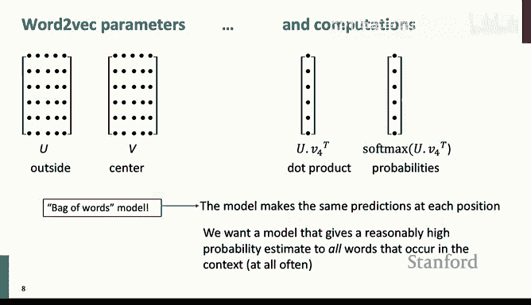
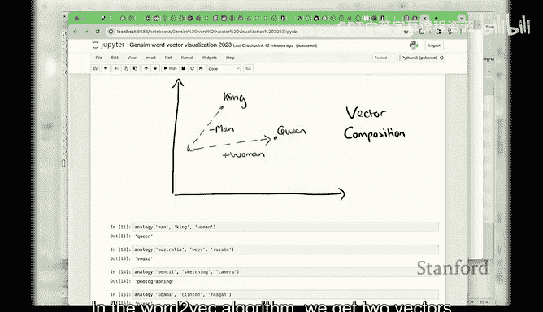
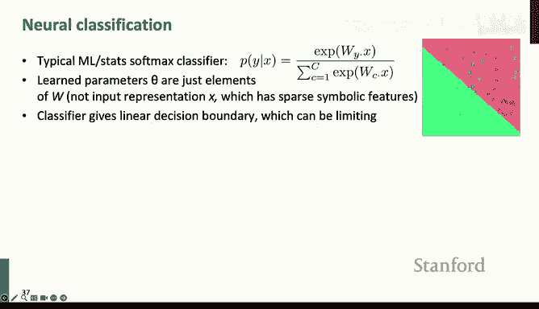
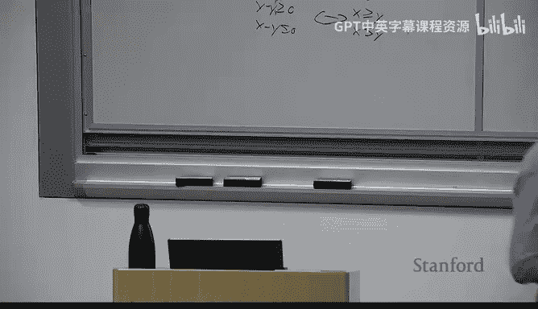

# 斯坦福大学《深度学习自然语言处理｜Stanford CS224N NLP with Deep Learning 2024》中英字幕（deepseek-R1 - P2：-02-Lecture 2 - Word Vectors and Language Models.zh_en - GPT中英字幕课程资源 - BV1U5RNYgEfp

Okay， I should try and get started。Okay， so what we're going to do today is we're going to try and do everything else that you need to know about word vectors and start to learn a teeny bit about neural nets and then we'll kind of get much further into sort of doing more with the math of neural nets next week So this is the general plan so I'm going to sort of sort of finish up from where I was last time with optimization basics then look a little bit more about word tove and word vectors and then some of the variants of word to V and then I'm going to briefly consider alternatives sort of like what can you get from just counting words in different ways then we're going to go on and talk a little bit about the evaluation of word vectors the topic of word sensors that already came up a couple of times last time when people are asking questions and then towards the end start to introduce。

😊，The idea of classification， doing neural classification and what neural networks are about。

 which is something that we will then expand on more in the second week。😊，Now before I get into that。

 just notes on course organization。 So remember the first assignment is already out and it's due before class next Tuesday So then our Python review session is going to be taught this Friday 330 to 420。

 It's not going to be taught here。 It's going to be taught in Gs B01， the Gs basement。

 and encourage everyone again to come to office hours and help sessions。 they've already started。

 they're listed on the website we're having these sort of offers our help sessions in classrooms with multiple Ts。

 So just turn up if you're on campus and you can be helped。

 And if you are on campus we'd like you to just turn up though we do also have a zoom option for Stanford online students。

😊，Finally， I have office hours， which I have not yet opened， but I will open sometime tonight。

 They're going to be on Monday afternoons now obviously given the number of people。

 not everyone can make it into my office hours and I'm going to do these by appointment so they're by 15 minute appointments on Callenley but you know I'm very happy to talk to some people and you know I put this little note at the end saying don't hog the slots some people think it'd be a really good idea if they really work out how to sign up every week for an office hour session than me with me and that's sort of a little bit antisocial so。

😊，Think about that Okay so at the end of last time。

 I did a sort of bad job of trying to write write on slides of working out the derivatives of word to V and hopefully you could read it much more clearly in the version that appears on the website where I was doing it home more carefully So that was saying that we have this lost function and our job was to work out its derivatives which would tell us which direction to go to walk downhill and so I didn't really quite finish the loop here。

 so you know we have some cost function that we want to minimize and then we work out the gradients of the gradient of that function to work out which direction is downhill and then the simplest algorithm is then that that we work out the direction downhill。

 we walk a little bit in that direction。😊，And then we repeat， we work out the gradient at this point。

 we walk downhill a little bit and we keep on going and we'll get to the minimum and with a sort of a one dimensionmensal function like this。

 it's sort of very simple。 we're just walking downhill that when we have a function of many。

 many dimensions when we calculate the gradient at different points。

 we might be starting to walk in different directions。

 And so that's why we need to do calculus and have gradients。

 And so this gives us the basic algorithm of gradient descent。

And so under the gradient descent algorithm， what we're doing is that we've got。How loss function J。

 we're working out its gradient。 And then we're taking a little bit of a little multipier of the gradient。

 So that alpha is our step size or learning rate。 And that's normally alpha is a very small number。

 something like 10 to the -3 or 10 to the -4。 maybe even 10 to the -5。

 So we're taking a really little bit of the gradient。 And then we're。😊。

Subtracting it from our parameters to get new parameters。 And as we do that， we will walk downhill。

 And the reason why we want to have a small learning rate is we don't want to walk too far。

 So if from here， we worked out the gradient and said it's in this direction。

 and we just kept on walking。 we sort of might end up way over here。

 or if we had a really big step size， we might even end up at a worse point than we started with。

 So we want to take little steps to walk downhill。 And so that's the very basic gradient descent algorithm。

 Now， the very basic gradient descent algorithm， we never use what we actually use is the next thing up。

 which is called stochastic gradient descent。 So the problem is for the basic gradient descent algorithm。

 we've worked out for an entire set of data what the。

Projective function is and what the slope at the point of evaluation is。In general。

 we've got a lot of data in which we're computing models。

 So simply trying to calculate our objective function over all of our data for our model。

 the training data for the model would take us a very， very long time。

 And so that's very very expensive to compute。 And so we'd wait a very long time before we make even single step of gradient update。

 so for neural nets， what you're always doing is using this variant that's called stochastic gradient descent。

 And so for stochastic gradient descent。 What that means is we pick a very small subset of our data。

 like maybe we pick 16 or 32 data items。 And we pretend that's all of our data。

 and we evaluate the function J based on that small subset and work out the gradient based on that small subset。

 So it's a noisy in accuratecur estimate of the gradient。 And we use that。😊，To。

Be the direction in which we walk。 So that's normally referred to also as having mini batches or mini batch gradient descent。

And。In theory， working out the gradient based on this small subset is an approximation。

 But one of the interesting things in the way things have emerged in neural network land。

 is it turns out that neural networks actually often work better when you throw some noise into the system that having this noise in the system gives you jiggle and moves things around。

 And so actually stochastic gradient descent not only as way， way， way faster。

 but actually works better as a system for optimization of neural networks。😊，Okay。

 so if you remember from last time for word tove， the idea was we started by just saying each word has a random vector representing it。

 So we will literally sort of just get random small numbers and fill up the vectors with those random small numbers。

 there's an important point there， which is you do have to initialize your vectors with random small numbers。

 If you just leave all the vectors a 0， then nothing works。

 And that's because if everything starts off the same， you get these sort of false symmetries。

 which means that you can't learn。 So you always do want to be initializing your vectors with random numbers。

 And then we're gonna go through each position in the corpus using our estimates。

 We're going try and predict the probability of words in the context as we talked about last time。

 then we So that gives us an objective function。😊，From which we can then look at our errors。

 look at our gradient and update the vectors so that they learn to predict surrounding words better。

 And so the incredible thing is that we can do no more than that。

 And we end up learning word vectors， which actually capture quite a lot of the semantics。

 the meaning and relationships between different words。 So， you know， when this was first。😊。

Discovered for these algorithms。 I mean， it really feels like magic that you can just sort of do this math。

 simpleple math over a lot of text and actually learn about the meanings of words。

 that is sort of just sort of surprising that something so simple could work。

 But as time has gone on， this same recipe has then been for all kinds of learning about the behavior of language from neural networks。

 So let's just。😊，Go through a sense of how that is。 But before we do that， so。

Let me just mention so for our word to V algorithms。

 the only parameters of the model are these word vectors。

 Theyre the outside word vectors and the center word vectors which we actually treat us disjoint as I mentioned last time。

 And when we do the computations we're considering the dot product between the various possible outside words with our center word and we're using those to get a probability distribution over how likely the model thinks that different outside words were。

 and then we're comparing that to the actual outside word in the context and that gives us our source of error。

 So as such this is what's referred to in NlP as a bag of words model that it doesn't actually know about the structure of sentences or even what's to the left and what's to the right。

 It's predicting exactly the same probabilities at each position to the left or right。😊。

But it's wanting to know about what kind of words appear in the context of the center word。

So I just wanted to stop this for a minute， and。Let's see。Not that one。

So let's give you some kind of a sense that this really does work。

 So this is a little Jupiter notebook that I've got for this。um。Okay， and so this is。

 and here I'm using a package gensim， which we don't continue to use after that， really。

 but it's sort of one package to let you load and play with word vectors。 and the word vectors。

 I'm going to use here are glove word vectors。 And actually I'm going glove was a model we built at Stanford。

 And I'm going actually talk about it a little bit later。

 so strictly speaking these aren't exactly word word vectors。

 but they behave in exactly the same way。 And so okay。

 so now it's loaded up my word vectors because the word vectors are a big data file。

 And so as we've discussed， for a word right， that the representation of any word here is bread is just a vector of real numbers right。

 So I'm using 100 dimensional word。😊，Vectors to keep things quicker for my class demo。

 So this is the word bread。 And then I can say， well， what's the representation for croissant。😊。

And this is croissant。 and we can sort of get a visual sense of， oh。

 they're at least a little bit similar， right？ So the first components are both negative。

 the second components are both positive。 the third components are both negative and large。

 the fourth components are both positive they seem like they're kind of similar vectors。

 So that seems kind of hopeful because that means that it knows the bread and croissant are a bit similar to each other。

 this package has a nice， simple function， where rather than doing that by hand。

 you can just ask it about all the word vectors and say which ones are most similar So I can ask it what words in its vocabulary most similar to USA And in this model。

 everything's been lowercase I should mention。 And so if I do that， it has Canada， America。

 U dot S dot A， than United States，😊，Well， they seem a fairly reasonable list of most similar words。

 though you might think it's a little strange that Canada wins out over the USA with dots over it。😊。

Similarly， I can ask of what's most similar to banana and I get coconut， mango， bananas， potato。

 pineapple， fruit， etc cea。 Again， pretty sensible。

 you know a little bit of a bias to more tropical fruits。

 or I can go to crust on and ask what's most similar to cr on the most similar things to crust on isn't bread。

 but it's things like brio baguette for kia， which sort of basically makes sense。

 though he is putting here。😊，And I got I'd already done， sorry。 Yeah。 I remember what this is right。

 So with this most similar， you've got a positive word vector。

 and you're saying what other words or most similar in position to that。

 There's something else you can do， which you can say is this is let me take the negative of that word vector and say what's most similar to the negative of it。

 And you could possibly think， that might be useful to find antonyms or something like that。 I mean。

 the truth is it isn't。 if you ask for the things the most similar to the negative of the banana vector。

 And in most other vectors is' the same。 You get off out these weirdo things that you're not really sure if they're words at all。

 or maybe they are in some of the language or some of them are names， like shnichis a Japanese name。

 But not very useful stuff。 don't really feel like a negative of banana。 but。😊。

Turs out that from there we get to this powerful ability of that was observed for word to Vec which is that we could isolate semantic components and then put them together in interesting ways So looking at this picture。

 what we could do is start with a positive vector for king from the origin up the king then we could use the negation to say subtract out the vector for man and then we could have another positive vector of add on the vector for woman and then we can ask the model is if you're over here in the space。

 what is the nearest word to you over there and so that's what this next thing does right。

 it sort of says positive vector for king negative for man also positive for queen。

 where does that get you to。😊，And that gets you to Queen。 Yeah。

 And so this was the most celebrated property that was discovered with these word vectors。

 that they weren't only good for meaning similarity， but that they were good。😊。

For doing these kind of meaning components， have these got referred to as analogies because。

 you can think of them as A as to B as C as to what。 So it's sort of like woman is to king。 No。

 sorry。 man is to king。 Well king is to man as。I'm saying this wrong way around。

 man is to king as woman is to what in the analogies。

 And so here I've defined a little function that is now saying this little function just automates that and willll compute analogies。

 And so now I can ask it in just this analogy format。 man is to king as woman is to queen。 And。😊。

That one was sort of the canonical example。 But， you know。

 you can actually sort of has have fun with this。 and I mean。😊，You know。

 this is pretty old fashioned stuff。 You know， I， I feel like I'm， maybe like now at this point。

 an old guy talking about how much fun we used to have sitting around the radio listening to radio plays because。

 you know， basically， no one uses this stuff anymore。 And there are much。

 much better and fancier things like chat GT。 But， you know， back in the day when I was younger。

 you know， it was really stunning already， just how this very simple model built on very simple data could just。

😊，Have quite good semantic understanding and do quite good analogy。 So you can actually， you know。

 play with this quite a bit and have a bit of fun。 So you can do something like analogy， Australia。

 comma， beer。😊，France。Okay， what do people think the answer will be？Close。

 the answer gives this champagne。 but that seems a pretty good answer。 I could then put in Russia。

 What what do people think， Boodka。 Yeah， it'll see， you can get back。 Boodka。 You know。

 this is actually works kind of interestingly。 You know， I could do a different1。

 I can do the test something different。 I can do something like pencil is to sketching。😊。

As camera is to。Photographing that works quite well。😊，We built this model in 2014。

 so it's a little bit out of date in politics。 So， you know， we can't do the last decade of politics。

 which is maybe unfortunate， but you know， we could try out older politics questions so we could try。

Obama。Is to Clinton。As。Reagan is to， if you remember your US world history class。

 any guesses what it's going to say。There's a Bush one。Any other ideas？P。

 some people have different opinions of Bill Clinton。What it answers is Nixon。

 which I think is actually kind of fair。😊，You can also get it to do some。

Just sort of language syntactic facts。 So you can do something like tallest to tallest。As。Long。

 it oops。As。Long is to算 easy。Yeah， so。😊，With this simple method of learning。

 with this simple bag of words model， it's enough to learn a lot about the semantics of words。 And。

 you know， stuff that's beyond conventional semantics， right， you know。

 like our examples with Australias to beer as Russia as to vodka。 I mean。

 that's sort of cultural world knowledge， which goes a little bit beyond what people normally think of as sort of word meaning semantics。

 but's also in there。 Yes。😊，If you。Perhaps drag the distance from let's say like man and King。

 does that also capture a concept of relationship between Jew earth。

 like would that give you back like ruler？Something like that。

 we're taking like a difference between two vectors does capture some cost of。Right。

The distance between men， so。所以。Man compared to king should be a ruler concept。

 But isn't that what I'm using， because then I'm taking that。

I'm taking the distance between man and king。Is what I'm adding on to woman to get the queen， right？

Right， yeah。 so I can， depending on how if you think of these words。

 depending on which thing you think of as the analogy， you can think of it。 You've both got。A vector。

 a difference vector between words gives you a gender analogy and one that gives you a ruler analogy。

 Yeah， absolutely。Any other questions。Yeah in the watch algorithm algorithm we get two vectors like for each world a U aD。

 but here you only have one vector， so how do you work？

Go from 2 to1。 Yeah， Good question。 I mean， the common way in practice was you just average the two of them。

 and， and really， you sort of find out that they end up very close， you know。😊。

Because if you think of it， since you're going along every position of the text。

 you're both going be the case where if the text is sort of， you know， the octopus has legs。

 you know， you're going to have octopus in the centre with legs in the context。

 Then a couple of time steps later， it's going to be legs in the centre with octopus in the context。

 So， you know， although they vary a bit for all the regions of neural nets vary basically end up very similar。

 And people normally just average them。 Yeah。So use the answer of one to then be placed into the analogy function of the another and see how far away you can go before it starts to break。

I think you can。 So wait， you're wanting to far。 How distant a relation between two words can you do before it starts providing。

😊，Relations。Are you wanting to sort of make two steps from somewhere or？はい就点。Go away。き？

So it doesn't always work。 I mean， there are certain examples that of fail。

 I'm sort of shy to try that now because I don't have a predefined function that did it。

 and that might take me too long， but you could play with it at home and see how it works for you。好菜。

I a quantification， why is it that we use two separate sets of vectors for word of effect is it just to get more parameters or is there I'll get back to that？

Maybe I should go on at this point。Let me move on and kind of just get through some more details of the word tovec algorithm。

 so。Just a technical point on this class。 So you don't make any big mistakes and waste your weekend。

 I mean， for most instances of 224 n， we've actually had people implement from scratch word to V is assignment too。

 But， you know， for this quarter doing it in spring quarter。

 as you probably know spring quarters actually a little shorter than the other two quarters。

 we decided to skip having people implement word to V。

 So don't look at the old assignment2 that says implement word to V or else you'll be missspending your time。

 wait for the new assignment2 to come out。 that， you know， despite that。

 let me just say a little bit more about some of the details， right Yeah， so why two vectors。

 So the two vectors is it just makes the math a little bit easy。 Yeah So if you think about the math。

 right， if you have the same。😊，Fectors for the center word and for the outside words。 Well。

 for whatever the the center word is， let's say it's octopus that when you're going through the。

Trying out every possible context word for the normalization。 at some point。

 you'll hit octopus again。 And so at that point， you'll have a quadratic term， right。

 you'll have the x squared of the octopus vector。 And that kind of messes up。 I mean。

 you clever people， you could work out the math of it。 But it makes the math more of a mess right。

 because every other term， it's something different and it's just like A X。 And then at one position。

 you've got an x squared。 So it just makes the math messier。

 And so they kept it really simple by just having them be disjoint vectors。

 But it doesn't make it better。 I mean， it actually turns out it works a fraction better。

 if you do it right， But in practice， people have usually just estimated them separately and then averaged them at the end。

 if you actually look at the paper。 nickel of it hour， you can find it 2013 paper。😊。

There's actually sort of a family of methods that they describe。 So they describe two methods。

 one of which was that you have an inside word that's predicting the words around it。

 And then the other one tried to predict the center word from all the words in the context。

 which was called continuous bag of words in their paper。 The one that I've described as hip gram。

 which is simpler and works just great。 But then the other part of it。😊。

Is for working out what loss function to be used for training。

 And what I've presented so far is naive， softm where we just consider every possible choice of a context word and just run all the math。

 You know， that's totally doable。 And with our modern， super fastt computers。

 that's not even that unreasonable to do。 we do things like this all the time。

 But at least at the time that they wrote their paper。 This seemed kind of expensive。

 and they considered other alternatives， like a hierarchical softm。

 which I'm not going to explain right now。 But I do just want to explain negative sampling。😊，Okay。

 so this is just to sort of see a bit of a different way of doing things。

 So for what we did last time， we had this sort of straightforward softmax equation。

 And so in the denominator， you're summing over every word in the vocabulary。

 And so if you might have 400000 words in your vocabulary， a lot of words in human languages。

 you know， that's kind of a big sum， especially when for each element of the sum。

 you're taking a dot product between0 dimensional 300 dimensional vectors and then exponentialonentiating it right。

 a lot of math going on somewhere in there。 So。😊，Maybe we could short circuit that。

 And so the idea of the negative sampling was to say， well。

 rather than evaluating it for every single possible word。

 maybe we could just sort of train some simpler logistic regressions where they're going to say you should like the true word that's in the context。

 And if we randomly pick a few other words， you shouldn't like them very much。😊。

And that's skip gram negative sampling。 So that's what this looks like as an equation。

 So we've got our centre word and our actual context word。 And we're saying， well。

 let's work out the term for the actual center word。 We'd like this to be。😊，High probability。

 So since we're minimizing， we're going negate that and have it go down。

 And then we're going sample some other words。 And we'd like this to be the opposite。

 But the other thing that we've changed here is now we're not using the softm anymore。

 We're using this sigma， which stands for the logistic function。

 which is often called the sigmoid sigmoid just means S shaped And but， you know。

 you could actually have an infinity of S shape functions and the one that we actually use is logistic function。

 So the logistic function has this form and maps from any real number to a probability between0 and1。

😊，So what we're wanting to say at that point is for the real outside world。

 we're hoping that this dot product is large。 So its probability is near one。

 And so that will then sort of help with the minimization。 And for the other words。

 we'd like their probability to be small。 So in what like them to appear sort of over here。

 And that's what this is calculating。 But as written。

 it's sort of sticking the minus sign on the inside there。

 which works because of the this is symmetric， right， So you're wanting to be over here。

 which means that if you negate it， you'll be on this side， which will be large。Okay。

 and so then the final bit of this， which is the asterisk is so we're going to pick a few words。

 you know， it might only be five or 10 that are our negative samples。 but for picking those words。

 What works well is not just to sort of pick sort of randomly uniformly from all the 400000 words in our vocab。

 What you basically want to do is sort of be paying attention to how common the words are。

 So something like that is a really common word。 And so we refer to that as the unigram distribution。

 that means you're just taking individual words independently。 how commonly they are。

 So about 10% of the time you'd be choosing the。 But so that's sort of roughly what you want to do for sampling。

 But people have found that you going actually do even a bit better than that。

 So the standard thing that they presented for word to V is you're taking the。😊。

G probability of the word and raising it to the power3 quarters。 What does that end up doing。

Question for the audience。If I take probabilities and raise them to the three quarters。

🎼Some less frequent words become sampling more right。 Yeah。

 so the ra to the three quarters means that you're sort of somewhat upping the probability of the less frequent words。

 So you're sort of in between， you know， between having every word uniform and exactly using the relative frequencies in the text。

 you're sort of moving a little bit in the direction of uniform。

 And so you get better results by going somewhat in the distance of sampling more uniformly。

 but you don't want to go all the way there， which should correspond to， I guess。

 putting a0 in there than three quarters。😊，Okay。Yeah。Okay。Let's see。 I had aside here。

 but time rushes along。 So let's not bother with your side。 It's not that important。 Okay。

 so that's the word tove algorithm that we've seen all of in its different forms。

A reasonable wonder that you could have at this point is。You know。

This seems a kind of a weird way of doing what we're wanting to do， right， The idea is， look。

 we have this text。 we have words and we have words in the context of words。

 It sort of seems like an obvious thing to do would be to say， let's just count some statistics。

 We have words and there are other words that occur in their context。

 So let's just see how often the words swim next to octopus and how often the word fish occurs next to octopus。

 Let's get some counts and see how often words occur in the context of other words。

 And maybe we could use that to calculate some form of word vectors。

 And so that's something that people have already also considered。

 So if we use the same kind of idea of a context window。

 we could just make a matrix of how often words occur in the context of other words。 And so。

 you know， here's a baby。😊，All my corpuses。 I like deep learning。 I like NLP。 I enjoy flying。

 and my context window I'm using is just one word to the left and the right。

 And then I can make this kind of cocurrence count matrix where I'm putting in the counts of different words in every context。

 And， you know， because my corpus is so small everything thing in the matrixes a0 or1。

 except for right here where I've got the twos because I have， I like twice， right， But in principle。

 I've got a matrix of counts for all the different counts here。😊，So maybe， you know。

 this gives this gives me a word vector， right， You know， here's a word vector for deep。

 is this long vector here。 And， you know， I could just say that is my word vector。 And indeed。

 sometimes people have done that。 But theyre kind of ungainly word vectors because if we have 400000 words in our vocabulary。

 the size of this matrix is 400000 by 400000， which is a lot worse than our word word vectors。

 because if we're making them only 100 dimensional， we've only got 400000 by 100。

 which is still a big number， but it's a lot smaller than 400000 times 400000。

 So that's inconvenient。 So when people have started with these kind of cocurrence matrix。

 the general thing that people have done is to say， well。

 somehow we want to reduce the dimensionality of that matrix。😊。

So that we have a smaller matrix to deal with。And so then how can we reduce the dimensionality of the matrix。

 And at this point， if you remember your linear algebra and stuff like that。

 you should be thinking of things like PC A。 And in particular。

 if you want to work for any matrix of any shape。 there's the singular value decomposition。

 So there's a classic， singular value decomposition， for any matrix， you can rewrite it。

 hass a product of three matrices， A U and a V， which are both author normal。

 which means that you get these independent。Vectctors， they're orthogonal to each other。

 And then in the middle， we have the singular vectors。

 which are ordered in size is the most important singular vector and these a sort of weighting terms on the different number of the different dimensions。

 And so this is sort of the full SVD decomposition。 But you know， part of it is irrelevant。

 because if I've got this picture， you know， nothing is happening on the part that's sort of shown in yellow there。

 But if you want， you know， at the moment， you know， this is just in a good full decomposition。

 But if we wanting to have sort of smaller low dimensional vectors。 well。

 the next trick we pull is we say， well， we know where the smaller singular vectors are。

 So we could just set them to0。 And if we did that， then more of this goes away and we。😊。

End up with two dimensional representations of our words。 And so that gives us another way of。

Foring lowdiional word representations。 And this had actually been explored before modern neural word vectors and using algorithms such as latent semantic analysis。

 And it is sort of half worked， but it never worked very well。 But you know， some people。

 especially in psychology， had kept on working on it。 And among other people in the early 2000s。

 there was this grad student Doug Rody who kept on working on it。

 And he came up with an algorithm that he called Cols。 and you know。

 he hed known as other people before him had known that just sort of doing an SVD on war counts didn't seem to give you word vectors that worked very well。

 but he had some ideas to do better than that。 So one thing that helps a lot as if you log the frequencies。

You can put log frequencies in the cells， but then he sort of used some other ideas。

 some of which were also picked up in word devek， one of which is ramping the windows so that you count closer words more than further away words。

 he is Pearson correlations instead of counts etc。 but he ended up coming up with a low dimensional version of word vectors that are sort of ultimately still based on an SVD and he got out these word vectors and you know interestingly。

 sort of no one really noticed at the time， but Doug Rody in his dissertation effectively discovered this same property of having linear semantic components。

 So well here we go here's one so this is actually you know picture from his dissertation and look here you know we've got this meaning component which is doer of an event and he's essentially shown with the way he's processed。

😊，Word vectors that the doer of an event is a linear meaning component that you can use to move between a verb and the duer of the verb kind of cool。

 But he didn't become famous because no one was paying attention to what he had come up with。

 So that， So once word to Vec。Became popular。 That was something that I was kind of interested in。

 And so working together with a postdoc， Jeffrey Pennningington， we thought that， you know。😊，一。

There was interest in this sort of space of having doing things with matrices of counts and how do you then get them to work well as word vectors in the same way that word deve worked well as word vectors。

 And so that's what LED into the glove algorithm that was what I was actually showing you。 And so。😊。

What we wanted was to say， look we want a model in which linear components sort of adding or subtracting a vector in a vector space correspond to a meaning difference。

 how can we do that and Jeffrey did good thinking and math and thought about that for a bit。

 and his solution was to say， well， if we think of that ratios of cocurrence probabilities can encode meaning components。

 So if we can make a ratio of cocurrence probabilities into something linear in the vector space will get the kind of result that word devek or dugug rowdy got。

 So what does that mean Well， so if you start thinking of words occurring in the context of ice。

 you might think that sort of solid and water are likely to occur near ice。

Gas or a random word like random aren't likely to occur near ice。But and similarly， for steam。

 you'd expect that， you know， gas and water are likely to occur near steam。

 but probably not solid or random。 And well if you're just looking at one of these。

 you don't really get meaning components because you get something that's large here or large here。

 But if you then look at the ratio of two of these cocurrence probabilities。

 then what you get out is that for solid， it's going to be large and small is going to be and for gas。

 it's going to be small。 And so you're getting direction in the space。

 which will correspond to the solid liquid gas dimension of physics。 Where for the other words。

 it'll be about one。 This is just a。The wave of your hands。

 This was the conception of the idea that if you actually do the counts this actually works out。

 So using real data， this is what you get for cocurrence。 And indeed。

 you kind of get these sort of factors of 10 in both of these directions of these two。

 And the numbers are over there are approximately  one。😊，So Jeffrey's idea was， well。

 we're going start with a cocurrence count matrix。 and we want to make this。

Turn into a linear component。 And well， how do you do that？ Well， first of all。

 it sort of makes sense immediately that you should be putting a log in， right。

 because once you put a log in this ratio be being turned into something that's subtracted。

 And so simply all you have to do is have a log by linear model where the dot product of two word vectors models。

 this conditional probability。 And then the difference between two vectors will be corresponding to this log of the ratio of their cocurrence probabilities。

 So that was basically the glove model， So you're wanting to， you know。😊。

Model this dot product such that it's being close to the log of the cocurrence probability。

 But you sort of do a little bit of extra work to have some biased terms and some frequency thresholds。

 which aren't very important。 So I'm going to skip past them。

 But I think that basic intuition as to what's the important thing to get linear meaning components is a good one to know about。

Okay， is everyone good to there？😊，Cool。Yes， oh I noticed the original X matrix you showed was like 3 by5 or something。

 Shouldn't it be square？ So yeah， I mean， if you're doing， sorry yeah。

 I maybe should have just shown you a square one。 if you're just doing vocabulary to vocabulary。 Yes。

 it should be square。 but there was a bit in the slides that I didn't mention that there was another way you could do it where you did it words versus documents and then it' would be nons square that yeah。

 you're。 So we can just。😊，Just con consider the square case， okay。So， you know， hey。

 I showed you that demo of the glove vectors， and they work great， didn't they。😊，So， you know。

 these are good vectors。 But in general in NLP， we'd like to have things that we can evaluate and know whether things are really good and so。

😊，Everywhere through the course， we're going to want to evaluate things and work out how good they are and what's better and what's worse。

 And so one of the fundamental notions of evaluation that will come up again and again。

 is intrinsic and extrinsic evaluations。 So an intrinsic evaluation is where you are doing a very specific internal subtask and you just try and score whether it's good or bad。

 So normally intrinsic evaluations， a fast to compute。

 help you understand the component you're building。

 But they are sort of distant from your downstream task and improving the numbers internally。

 may or may not help you。😊，And that's the contrast with an extrinsic evaluation。

 which is that you've got some real task。 you want to do question answering or document summarization or machine translation and you want to know whether some clever bit of internal modeling will help you on that task。

 So then you have to sort of run an entire system and work out downstream acuracies and find out whether it actually helps you at the end of the day。

 but that often means it's kind of you know indirect so harder to see exactly what's happening in your task。

 So for something like word vectors， you know if we just sort of measure are they modeling word similarity well。

 that's an intrinsic evaluation but you know we probably like to know whether they model word similarity well for some downstream task which might be doing web search。

😊，Right， we'd like。When you say， you know， cell phone or mobile phone that it comes out and about the same。

 So that would then be web search might be our extrinsic evaluation。Okay， so for word factors。😊。

2 two intrinsic evaluations， the ones we've already seen。 So there's the word vector analogies。

 you know， I cheated when I showed you the glovev demo， I only showed you ones that work。

 But if you play for it yourself， you can find some that don't work。

 So what we can do is sort of have a set of word analogies and find out which ones work。 Now。

 you know， in general Gv does work， you know， here's a set of word vectors showing you the sort of male female distinction。

 It's kind of good and linear， but in general for different ones it's going to work and it's not work and you're going to be able to score what percentage of the time it works。

 All we can do word similarity。 how we do word similarity is we actually use human judgments of similarity。

 So psychologists ask undergrads。😊，And they say here is the word plane and car。

 How similar are they on a scale of one to 10 or 0 to 10， maybe actually。

 I think it's 0 to 10 here on a scale of 0 to 10 and the person says7 and then they ask another person and they average what the undergrad say and they come out with these numbers。

 So you know ti tiger gets 10。 Book and paper got an average of 7。46 plane and car got 5。

77 stock and phone got 1。62 and stock and Jaie are got 0。92 noisy process。

 but you roughly get to see how similar people think words are And so then we ask our models to also score how similar they think words are and then we get models of how well the scores are correlated between human。

😊，Judgments and our models， judgmentments。 And so here are sort of a big table numbers that we don't need to go through all of。

 But， you know， it sort of shows that a plain SVD works terribly。

 simply doing SVD over log counts already starts to work reasonably。 And then you know。

 here's the two wordve algorithm， Cbo and skip gram。 and here are numbers from our glove vectors。

 And so you get these kind of scores that you can then score different models as to how good they are。

And well， then you couldnt all sorry。 Yeah， that's the only thing I have there。 But， you know。

 what can you do for。Downstream evaluation。 Well， then you want to pick some downstream task。

 And so a simple downstream task that's been used a lot in NLP is what's called named entity recognition。

 And so that's recognizing names of things and what type they are。

 So if the sentences Chris Manning lives in Pao autoto。 you want to say Chris and Manning。

 that's the name of a person and Pao and auto。 that's the name of a place。 So that can be the task。

 And well that's the kind of task， which you might think word vectors would help you with。

 And indeed the case， right， So what's labeled as discrete was a baseline symbolic probabilistic named entity recognition task。

 And by putting word vectors into it， you can make them the numbers go up。

 So these numbers for glva higher than the ones on the first line。😊。

And so I'm getting substantial improvements from adding word vectors to my system， yay。😊，Okay。

I'll pile ahead into the next thing。 This next one I think is interesting。

 we should spend a minute on， and it came up in your questions last time。 Word have lots of meanings。

 Most words have a whole bunch of meanings。😊，Words that don't have a lot of different meanings。

 are only some very specialized scientific words。 Okay。

 so my example of of word with multiple meanings is probably not the first one you think of all the time。

 the most famous example of a word with a lot of meanings is bank， which already came up last time。

 And I use star， which is another one。 Here's a word that you probably don't use that often。 But you。

 it still has lots of meanings。 So the word pike。 What are some things that the word Pike can mean。

A fish。 Yes， it's a kind of fish。 Okay， we've got one。 What else can a pipe be。 Yeah， yeah。

 for the Dunngeons and Dragons crowd。 Yeah， there's a long arm， right， Yep， that's another one， yeah。

😊，A road， right， Yes， So Piike is used as a shorthand Well a shorthand for a turnpike。

 why it's called a turnpike， which is yeah， originally you've had， you know。

 the spy looking thing at the start of a sort of count people。 Okay。

 we've got three other thing means for Piike。 Yes， it's also crap。 like a fraternity。😊，证明白。

I'll believe you， I can't say I know that one。😊，Other ps？It be sharp as like a needle。Ping sharp。

Maybe， I mean， I think it's really the so pike as the weapon。Thele scratch your head。

One that I think a lot of you will have seen in diving and swimming， you can do a pike。😊，Olympics。

 if you see Olympic diving， there are ps， anyone's seen those？😊，Trust me， there's a pike。 Okay。

 And so we've sort of been doing the noun uses。 but， you know， you can also use Pike as a verb。

 right， you know， like once you've got your medieval weapon。

 you can p somebody and that's a usage of pke。😊，And you can do other ones， right， so here we go。😊，嗯。

Onces I got from a dictionary。 We got most of those， there are sort of weirder usages， right。

 like coming down the pike， That's kind of a metaphorical use that comes from the the road sense。

 but it sort of ends up meaning the future。 Yeah， in Australia。

 we also use pke to mean sort of chicken out of doing something。

 But I don't think that usage is really used in the US。 anyway， words have lots of meanings。

 So how can you deal with that。 Well， one way you could deal with it is to say， okay。

wordss have several meanings and so we're just going to say words have several meanings and then we're going to take instances of words and text。

 we're going to cluster them based on their similarity of a occurrence to which sense of the word to regard each token as and then we're going to learn word vectors for those token clusters which are our senses and you can do that we did it in 2012 before word defect came out So you see here we have bank1 and somewhere over here we have Bank2 and here we have Jaguar 1 Jaguar2 Jaguar3 Jaguar4 and you know this really works out great right So Jaguar 1 picks out the sense of the kind of car right and it's close to luxury。

😊，Inconverible Jaguar 2 comes right close to software and Microsoft。

 And this one's a bit of an historical one。 But， you know。

 that's when you were when most of you were 5 or whatever。

 You might remember Apple used to use large cats for versions of Mac O， right， So sort of Mac O 10。

3 or something like that， a long time ago was called Jaguar， right。

 So it's software close to Microsoft Jaguar 3， okay， string keyboard， solo musical drum base。

 that's because there's a Jaguar keyboard。 and then finally sort of what we think of as the basic sense。

 but turns out turns up rather less。 and textcor normally Jaguar and X to hunter is the animal。

 right， So it's done a good job at learning the different senses。😊，But。You know。

 that's not what's actually usually done these days。 And instead， you know。

 what's usually done is you do only have one vector for Jaguar。 And when you do that or Piike here。

 the one vector you learn is a weighted。😊，A weighted average of the vectors that you would have learned for the sensors。

 It's often referred to as a superposition， because somehow your net math people like to use physics terms。

 And so they call it a superposition。 But it's a weighted average。

 So you're taking the relative frequency of the different sensors and multiplying the vectors you would have learned if you'd had sense vectors。

 And that's what you get as the representation as a whole。And。You know。

 I can make a sort of a linguistic argument as to why you might want to do that， which is， you know。

 although this model of words have senses is， you know， very long standing and common。 I mean。

 it's essentially the way dictionaries are built， right， You look up a word in the dictionary。

 and it says sense 1， sense 2 sense3， and you get them to things like Banhor Ja Gueth were talking about。

 I mean。It's sort of really a broken model， right that like word meanings have a lot of nuance。

 They're used in a lot of different contexts。 They're extreme examples like bank。

 wherever it was where we have finance bank and bank of a river bank over here where it seems like the senses of this far apart。

 But you know， most words have sort of different meanings。 but they're not actually that far apart。

 and trying to cut them into senses seems actually very artificial。 And you know you know。

 if you look up five different dictionaries。 and you say how many senses does this word have。

 pretty much everyone will give you a different answer。

 So the kind of situation you have is a word like field， Well。

 a field can be used for a place where you grow a crop。

 It can be used for sort of natural things like a rock field or an。😊，Field。

 it can be used for a sporting field。 There's the mathematical sense of field。 Now。

 all of these things sort of have something to do with each other。 I mean math ones further away。

 but the physical ones are sort sort of flat spaces， but you know。😊。

The the sense of it being a sporting field is really kind of different from the sense of it being an ice field。

 I the ice field and the rock field different。 or am I just modifying them are they different senses。

 So really sort of have a kind of what a math person say is sort of like some probability density distribution over things that can be meant by the meaning of a word。

 So it's sort of maybe make sense to more use this model where you're just actually saying we have a vector that's an average of all the context。

 And we'll see more of that when we get contextual word vectors later on。😊。

But one more surprising result on this is since。You have the vector for Pi overall being the sum of these different sense vectors。

 you know， standard math would tell you that if you just have the single vector。

 there's no way that you can recover the individual sense vectors。

But higher math tells you that actually these vector spaces are so high dimensional and sparse that you can use ideas from sparse coding theory to reconstruct the sense vectors out of the whole vector。

 And if you actually want to understand this some of the people in statistics。 David Donoho。

 I think one of them， teach courses on sparse coding theory。 But I'm not going to try and teach that。

 But， you know， here's an example from this paper the Sun Diego Aurora E Al。

 where one of the E Als is toumma， who's now faculty and computer science here where they are starting off with the word vector and using sparse coding。

😊，To divide out sense vectors from one word vector。 And they work pretty well， right。

 So here's one sense of tie， which is piece of clothing， another sense of tie。

 which is ties in a game， this one is sort of similar to that one， and I'll admit。

 But this sense of tie here， as then a tie as sort of you put on your electrical cables。

 Then you have the musical sense of tie， right， at least four out of five。

 they've done a pretty good job of getting senses out of this single word vector by sparse coding。

 So sparse coding must be cool。 If you want to go off and learn more about it。😊，Okay。Okay。

 so that's everything I was going to say about words， vectors and word sensors。

Is everyone good to there Any questions。I'll rush ahead for the last two pieces。 Okay。

 so I just wanted to start to introduce in the last 15 minutes。

 the ideas of how we can build neural classifiers and how we start to build in general neural networks。

 I mean， in a sense， we've already built a very simple neural classifier because our word to model is predicting what words are likely to occur in the context of another word。

 And you can think of that as a classifier， But let's look at a simple classifier like our named entity recognize as as I mentioned before。

 So for the named entity recognizer， we want to label words with their class。

 So we want to say these two words are a person But the same words。

 Paris and Hilton are then locations in the second sentence。 So words can be ambiguous as。😊。

What their class is。😊，The other state is that they're not a named entity at all。 They're just a word。

 There is some other word。 And this is something that's used in lots of places as a bit of understanding。

 So if you've seen any of those web pages where they've you taggged company names with the stock ticker or there's links on a Wikipedia page to a Wikipedia page or something like that。

 right， you've got named entities where commonly after finding the name entities。

 you're doing this second stage of entity linking where you're then linking the named entity to some canonical form of it。

 like a Wikipedia page， but we're not going to talk about the second part of it for the rest of the day。

And so。😊，We could say that building with our word vectors。

 we've got this simple task where what we're going to do is we're going to look at a word in context because sometimes Paris is a name of a person。

 sometimes it's a location。 And so we're going to want to look at this word in its context and say。

 aha， this is a name of a location in this instance。

 And so the way that we're going to do it is we're going to form。😊，A window classifier。

 So we're going take a word with a couple of words of context on each side And for the words in our context window。

 we're gonna use our word vectors because we want to show theyre useful for something。

 And then we want to feed this into something that is a classifier。 And our classifier。

 it's actually gonna be a really simple classifier。

 we're only here going to do location or not a location。 So this one here。

 we're wanting to say for this window here， Yes， it's a location。 And whereas if it had been。😊。

I I love Paris Hilton greatly。 then we'd be saying no， because Paris。

 the word in the middle of the context then isn't a location。

 So that's sort of the idea for class or classifier where' making assigning some set of classes to things right So in general。

 for classifiers， we do supervised learning， which means we have some labeled examples。

 our training data set。 So we have input items X I， and for each one， we've got a class Y I。

 So I had for my example training examples， ones like I love Paris Hilton greatly that was negative not a location。

 and I visit Paris every spring， that's positive， that is a location where I'm actually classifying the middle word。

 Okay， so inputs。😊，Labels， and in general， we've got labels are a set of classes。

 So my set here is simply location， not a location， but I could get fancier。 and I could say。

 I've got five classes。 I've got location， person name。😊，Whatever other ones there are， company name。

 drug name， right， I could be assigning a bunch of or other， not a name。

 a bunch of different classes。 But I'm gonna be doing it with only two because I'm using this example on next Tuesday's lecture as well。

 And I'm wanting to keep it simple。 So that's what we're going to do。

And so what we're going to be using in our class is neural classifiers。

 And so I just wanted to sort of。😊。

Sort of just sort of go through quickly。 just the sort of food for thought as we go into it。

 So for a typical stats machine learning classifier。

 you can build classifiers like logistic regression or softm classifiers or other ones like support vector machines or naive bays or whatever else you might have seen the vast majority of these classifiers are linear classifiers。

 meaning that they have a linear decision boundary。 And when we're learning these classifiers。

 we're learning parameters here， W。 But our our inputs are fixed that our inputs are represented by symbols like。

😊，Or quantities。 So we have fixed inputs。 We learn parameters as weights in that are used to multiply the inputs。

 And then we use a linear decision boundary。 So when we have our neural classifier。

 We're kind of getting some more power。 So， first of all。

 we're not only learning weights W for our classifier。

 we're also learning distributed representations for our words。 So our words can sort of rere。😊。

Our word vectors re represent the actual words as symbols and can move them around in the space so that in terms of the original space。

 we've got a non nonlinear classifier that can represent much more complex functions。

 but we will then sort of use the word vectors to rere those words to do a final class。

 So at the end of our deep network， which we're about to build。

 we will have a linear classifier in terms of our rerepresented vectors。

 but not in terms of our original space。 Let me try and be concrete about that。Okay。

 so here's what I'm going use。 and we'll use again next Tuesday as my little neural network。

 And so I start with some words。 Museums in Paris are amazing。 I， first of all。😊。

Come up with the word embedding of those using my word vectors。

 So now I'm got this sort of high dimensionional vector。

 which is just a concatenation of five word vectors。 So， you know。

 if I have 100 dimensional word vectors， this is 500 dimensional。

 And then I'm going to put it through a neural network layer。

 which is simply multiplying that vector by a matrix and adding on a bias vector。

 And then I'm going to put it through some non nonlinearity， which might be， for example。

 the logistic function that we've already seen。 So that'll give me a new representation。

 And in particular，😊，If the W is， say，8 by 500， I'll be reducing it to a much。what。 Yeah。

8 by 500 I be reducing it to a much smaller vector， right， So then I can do after that。

 I can multiply my hidden representation in the middle of my neural network by another vector。

 And that will give me a score。 And I'm going put the score into the logistic function that we saw earlier to say。

 what's the probability。 This is the location。 So at this point。

 my classifier is going to be a linear classifier in terms of this internal representation that's used right at the end。

 But it's going to be a nonlinear classifier in terms of my word vectors。😊，嗯。Okay。啊。Great。

 here's one other thing。 This is just sort of a note for learn ahead。

 Since you want to know this when we start doing the next assignments。 I mean， up until now。

 I've presented everything as， you know， doing log likelihood and negative log likelihood for building our models。

 very soon now， assignment2， we're going to be starting to do things with paytorch。

 And when you start working out your losses with paytorch what you're going be wanting to use is crossenttropy loss。

 And so maybe quickly say what cross entropy loss is。 So cross entropy is from information theory。

 So if you have a true probability distribution P and your computing a probability distribution Q。

 your cross entropy loss is like this。😊，So it's the log of your model probability。

 the expectation of that under your true probability distribution。

 But there's sort of a special case， Where if you have ground truth or gold or target data where things are labeled1。

0。 So like， for examples of， I love Paris when。😊，Warm， right， I'm just labeling it one for location。

 probability 1。 It's the location。 probability 0。 It's not a location。

 So if you're just labeling the right class as probability1， then in this summation。

 every other term goes to 0。 And the only thing you're left with is what probability is my model。

 what what log probability is my model giving to the right class。

 And so that then is your log likelihood， which we can use for the negative log likelihood。😊，嗯。

A little bit of a complication here。 Just remember that you want to use crosscent loss in pytor when building the model。

 Okay， before we end today， here is my obligatory one picture of human neurons。

 Don't miss it because I'm not going to show any more of these。 Okay， these are human neurons， right。

 human neurons where the inspiration for neural networks， right。

 So human neurons have a single output which comes down this axon。

 and then when you have these outputs they then feed into other neurons。

 I guess I don't really have an example here。 But in general。

 one output can feed into multiple different neurons。

 you can see the different things hanging into it。 So， you know。

 if you have the output connecting to the input and sort of。😊。

Where you make this connection， That's the synapses that people talk about。

 And so one neuron will normally have many， many inputs where it picks things up from other neurons。

 And they all go into the nucleus of the cell and the nucleus combines together all those inputs and kind of what happens is if there's enough positive activation from all of these inputs。

 it then sends signals down its output。 Now， strictly how neurons work is that they sense spikes So the level of activations and neurons is its rate of spiking。

 But that immediately got turned in artificial neural networks into just a real value as to what is its level of activation。

 And so it does this。 So this was kind of the genuine inspiration of all of our neural networks。😊。

So a binary logistic regression is kind of a bit similar to a neuron right It has multiple inputs。

 you're working out your total level of excitation where in particular you can have inputs that are both exciting positive inputs and inputs that are negative which are then inhibitory inputs。

 you combine them all together and you get an output。

 that's your level of excitation and you're then sort of converting that through some nonlineity and so this was proposed as a very simple model of human neurons now human neurons are way more complex than this and some people like neuroscientists think we maybe should be doing a better model of actual human neurons but in terms of what's being done in the current neural networks eat the world revolution。

😊，Everyone's forgotten about that and it's just sticking with this very， very simple model。

 which conveniently turns into linear algebra in a very simple way。😊。

This gives us sort of like a single neuron。 but then precise right。

 So this is which this single neuron， if you use the logistic function is identical to logistic regression。

 which you've probably seen in some stats class or something。

 But the difference is that for neural networks， we don't just have one logistic regression。

 we have a bunch of logistic regressions at once。 and well that' would be tricky if we had to define what each of these logistic regressions was calculating。

 but what we don't， what we do is we just feed them into another logistic regression。

 And so we have some eventual output that we want to be something like we want it to say， you know。

 this is or isn't a location。 But then what will happen is by our machine learning。

 these intermediate logistic regression。😊，Will figure out all by themselves something useful to do。

 That's the magic。 right。 So that you get this sort of self learning property where the model has a lot of parameters and internally。

 we'll work out useful things to do。 So in general。

 we can get more magic by having more layers in the neural network and that we will build up function。

 So effectively， these intermediate layers let us learn a model that rerepresent the input data in ways that will make it easier to classify or easier to interpret and do things with downstream in our neural network。

😊，And it's time。 So I should stop there。Thank you。

