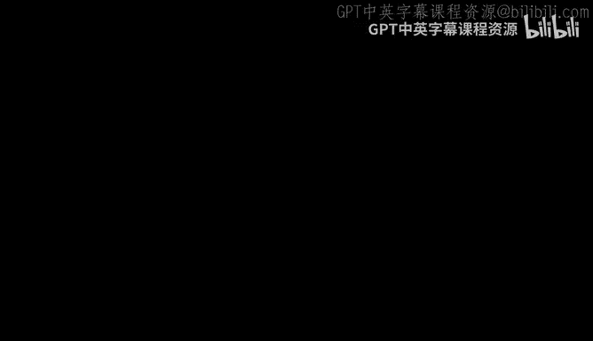
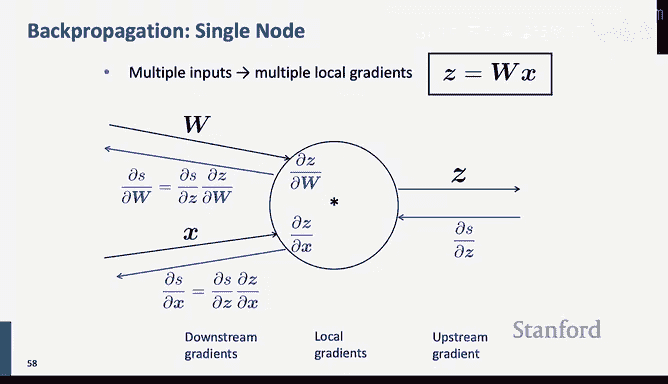
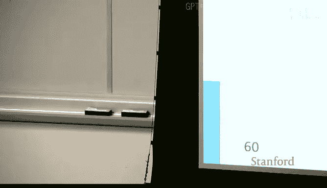
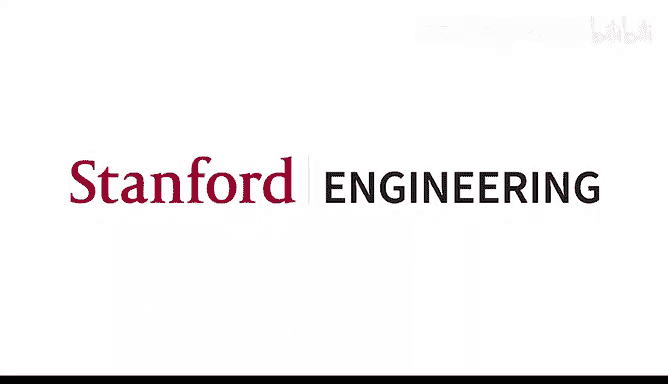

# 斯坦福大学《深度学习自然语言处理｜Stanford CS224N NLP with Deep Learning 2024》中英字幕（deepseek-R1 - P3：-03-Lecture 3 - Backpropagation, Neural Network.zh_en - GPT中英字幕课程资源 - BV1U5RNYgEfp

Okay， hi， everyone， I'll be getting started。 Okay， so it's Tuesday of week 2。

 So hopefully that means everyone has done the assignment 1。 Everyone done assignment 1。 you know。

 if I'm saying this song I'm probably saying it to the wrong people。 But it seems like every year。

 some people blow some of their late days on assignment 1。

 And it's really just the wrong place to use them。 So yeah。

 hopefully you've all done assignment 1 and did not that this is meant to be the easy on ramp。

 And then we go straight on from that so that out to we have assignment 2。

 So assignment 2 has two purposes purpose 1 is to make you do some math。

 some understanding of what neural networks really compute and how they can。😊。

Computed and that's what I'm going to talk about today is also going through that math。

 But then simultaneously， maybe it does three things in assignment too。

 So we're going to be learning something about dependency parsing。

 which will be actually something about language structure and linguistics。 But then thirdly。

 for assignment 2， we're going to start using Pytorch。

 So Pytorch is one of the leading software frameworks for deep learning and the one that we're going to use for this class。

 So for Pi， I mean。😊，The assignment 3 Pitorrch is exceedingly scaffolded。 So it's sort of， you know。

 here's this thing。 And you have to write these two lines， use these two functions。 But nevertheless。

 for help people get up to speed and get started using ptorrch on Friday at 3，30 in Gs B01。

 or it all again be recorded。 we have a tutorial on ptorrch。

 And so that's a great way to get more of a sense of ptorrch and how it works before doing assignment too。

😊，Yeah。The other things， yeah， so for nearly all the lectures。

 we've got further reading of places that you can look of all the classes in the entire quarter。

 this。😊，For many people might be a really good one to look at the suggested readings。

 We have several readings which are sort of shorter tutorials and reviews of the kind of matrix calculus and linear algebra that we need for this class。

 So really encourage you to look at those， if you decide that one is your favorite。

 you can tell us on Ed， which one you think is the best one to choose between them。

 I kind of like the one that's first on the list， but maybe you'll feel differently。 Yeah。

 conversely， yeah， so today will be sort of all math。

 And then Thursday will be kind of all language and linguistics。

 Some people find the language and linguistics hard as well。 So I guess different kinds of people。😊。

Okay， so getting straight into it。 so where we started last time。

 I'd sort of shown these baby neural networks and sort of said， well。

 we can think of each of those orange things as basically like a little logistic regression unit。

 and the crucial difference from then the kind of statistics machine learning you see in the stats class。

109 and wherever is that in those， you have one logistic regression and you're defining the input features to it。

 and you've got some decision variable that you want to under。😊，Have it at the output。 here。

 you're sort of building these cascades of little logistic regressions。

 And so the idea is right at the end， we're going to define what we want。

 We're going to capture that by our objective function or loss function。

 But for the stuff in the middle， that that stuff in the middle is going to be a chance for the neural network to learn by itself。

 what would be useful inputs to further downstream neurons。

 what kind of functions should I come up with in terms of my inputs that will help me provide useful outputs to help the final computation down the track。

 And， you know， if you haven't sort of seen and thought about this much before。 I mean， I think。

 you know， it's worth sitting with that idea for a moment。

 because this is really a super powerful idea， which is what's made。😊，Ne networks。

 more powerful and most circumstances than other forms of machine learning。

 The fact that you have this selforgan of intermediate levels of representation that you use to compute things that will be useful downstream for what you eventually want to do。

😊，The other reason I was bringing back up this picture is I've sort of wanted to go straight from here to matrices。

 So while you could sort of wire together neurons however you wanted to and arguably if you look at human brains。

 they look more like neurons wired together however you wanted to。

 but for what's done with neural networks， basically there's always this kind of regular structure of layers。

 So once we have this regular structure of layers， we're taking the output of one of our neurons at one layer and we're feeding them together with weights to produce the inputs to the next layer。

 so we're taking the X1 x2 x3 outputs， we're multiplying them all by weights， we're adding bias term。

😊，And then we're gonna put it through a nonlinearity。

 And that will give us the value at the next layer。

 So if we then kind of collapse that to a vector and this to a vector。

 that then collapses into a computation， that， first of all， we're doing a matrix multiplication。

 We're calculating W X of the inputs。 And then we're adding on the biases as vector of biases。

 which gives us this intermediate value Z。 And then we have this non nonlinearity or activation function which is applied to that。

 which gives us the values and the next layer of the neural network。

 And the activation function is applied to a vector and produces a vector。

 But it's operating on each of the individual components of that vector one at a time。

 So we've got some scalealar function that we're just applied into each element of the vector。😊，嗯。

And so that's the kind of picture we saw when I did this example。

 And I'm going to continue to use this example in today's class。 Remember。

 we were going to decide whether the word in the middle of the input window was a location or not。

 And so we were doing the matrix multiplication， putting it through the non nonlinearity。

 We then just doing a dot product here And then were gonna that got stuck into sigmoid to predict yes or no。

😊，And the final thing I wanted to say a little bit about is these Fs。

 the non nonlineararity or the activation function。 Where do they come in。 Well。

 the starting point of where they came in in the history of neural networks is when people came up with this idea that well。

 you could represent the operation of a basic neuron by doing a matrix multiplication of the inputs and then having a bias term or here represents a threshold term to see whether the neurons should fire or not。

 that was actually in the very first implementation。

 which dates back to the 1940s as done as a threshold right so that if the activation was greater than theta。

 you output one， otherwise you output  zero And well， if you have a threshold， the two lines。😊。

A flat， right。 So there is no slope。 There is no gradient。

 So that's actually makes learning much harder。 So the whole secret of what we build with neural networks。

 And in particular， an alternative name that's popular in some circles these days is gradient based learning and the entire idea of gradient based learning is if we actually have some slopes。

 Then it's like going skiing during spring break。 you can work out where it's steeper。

 And you can head down where it's steeper。 And that will allow us to optimize our function to learn much more quickly。

 And so。😊，That's one reason that we don't just want to have threshold units。

 We want to have things with slopes。 So we have gradients。 So in subsequent work。

 people started using activation functions with slopes。

 And so the first popular one was this sigmoidal logistic that we've seen from mapping to probabilities。

 But， you know， it's sort of imperfect， It seemed because， you know。

 the output was always non negativegatives。 So that sort of tends to push things towards bigger numbers。

 So， there was quite a bit of。😊，Use then of this 10 H function。

 And you'll actually see 10 H when we do assignment 3。

 we'll be using 10 H in our current neural networks。 And so。

I've written there the formula usually give for 10 H in terms of exponentials。 Yeah。

 if your math is rusty， it's not obvious that 10 H and logistic have much to do with each other。

 But if you want to treat this as a math problem。 that a 10 H is literally just a rescale logistic。

 you're stretching it by two and moving it down by one， it's the same function。Okay， but， you know。

 so that's nice。 But if you're calculating 10 Hs， you have to do all of these exponentials and。

 you know， exponentials are kind of slow on your computer and things like that。

 You might wonder whether you couldn't get away with something much cheaper。

 And so people thought about that and thought， oh， maybe we could just use a so-called hard10 H where it has a slope of one in the middle and is then just flat outside that area。

 And you know， that seemed to work in many cases。 And so that then LED to the popularity of the rectified linear unit。

 So the rectified linear unit is simply0 on the negative region and then as y equals X in the positive region。

 Now， this seems kind of wonky and goes against what I was saying about gradient based learning because once you're in the negative region there's no gradient you're just dead but。

😊，In the positive region， there is gradient， and the gradient is particularly simple。 right。

 The slope is always one。 And so， you know。😊，This still feels slightly perverse to me。 But， you know。

 this really became the norm of what people use for a number of years because people found that although for an individual neuron。

 it was dead half the time。 any time it went negative that overall for your neural network。

 some things would be alive。 So it kind of gave sort of a form of specialization and the fact that the slope was always one meant that you got really easy productive backward flow of gradients in a way we'll talk about later。

 And so learning with re use turned to be out to be very effective and people started using the re nonlinearity everywhere。

 and it sort of became the default in the norm。 and you'll see us using it in the assignments in particular。

 we use an assignment too。 And so you'll get to see that it works。 But nevertheless， at some point。

 people sort of had second thoughts。And decided， you know。

 having a dead over half of its range maybe isn't such a good idea after all。

 even though it seemed to work great for a few years。

 And so a lot of what's happened since then is then to come up with other functions which are。

 in some sense， well you like， but not actually dead。 So。Okay， I don't。 Yeah， here we go。

 with enough。 Allright， So one one version of that is the socalled leaky value。

 So for the leaky value， you make the negative half straight line as well with a very minus slope。

 But still it's got a little bit of slope。 there was then a variant of that called the parametric value。

 where you have one extra parameter， which is actually what the slope of the the negative part is。

 And people showed some positive results with that。 more recently， again。

 and this is what you often see and recent transformer models is you see non nonlinearities like Swiss Sw and jello。

 So both of these are sort of fancy functions。 but kind of what they both look like is basically this is y equals x to intents and purposes not quite but approximately。

 And then you' got sort of some funky bit of curve down here。😊，Which again gives you a bit of slope。

 It sort of the curve is going the opposite way。 That's sort of a bit funny。

 but they seem to work well commonly used in recent transformer models。 So you know。

 that's a bit of a dump of all the nonlinearities people use。 I mean。

 the details of that aren't super important right now。

 But the important thing to have in your head is why do we need non nonlinearities。

 And the way to think about that is that what we're doing with neural networks is function approximation。

 There's some very complex function that we want to learn， you know。

 like maybe we want to go from a piece of text to its meaning or we want to be interpreting visual scenes or something like that。

 And so we want to build really good function appromators。 And well。

 if you're just doing matrix multiplies a matrix multiply of vector vectors of linear transform。😊。

So that doesn't let you multiply complex functions。

 I guess strictly if you put a bias on the end in an a find transform， but place to keep it simple。

 linear transforms， right， So if you're doing multiple。If you're doing multiple matrix multiplies。

 you're doing multiple linear transforms， but they compose。

 So you could have just multiplied these two matrices together。

 and you'd have a single linear transform。 So you get no power in terms of representation by having multilayer networks that are just matrix multiplies。

 you know， as a little aside， in terms of representational power。

 having multi layerer matrix multiplies gives you no power。

 But if you think about in terms of learning， actually， it does give you some power。

 So in the theoretical community， look at neural networks。

 there are actually quite a few papers that look at linear neural networks。

 meaning that they are just sequences of the multiplies with no non nonlinearities。

 because they have interesting learning properties。

 even though they give you no representational power。

 but we'd like to be able to learn functions like this， not only functions like this。

 and to be able to learn。😊，Fs like this。 We need more than linear transforms。

 and we achieve those by having something that makes us be calculating a nonlinear function。

 And it's these activation functions that give us nonlinear functions。😊，Okay， cool。Okay。

 so then for getting onto today。 So the whole thing we want to do now is gradientbased learning。

 right， This is our stochastic gradient descent equation where here， you know。

 that upside down triangle symbol， right， That's our gradient。

 We're wanting to work out the slope of our objective function。

 And so this is how we're going to learn by calculating gradient。

 So what we want to know is how do we calculate the gradient for an arbitrary function。

 And so what I want to do today is， first of all， do this by hand for math。

 and then discuss you know， how do we do it computationally which is effectively the famous thing that's taken this powering under powering all of neural nets。

 which is the back propagation algorithm。 But the back propagation algorithm is just automating the math。

😊，Okay， and so for the math， it's matrix calculus。 And at this point。

 then there's a huge spectrum between people who know much more math than me and people who barely ever learn this。

 But you know， I hope to explain the essentials。 or remind people of them enough that you're at least at a starting point for reading some other stuff and doing homework。

 too。 So let's get into that。 And so I'm gonna spend about half the time on those two halves。 And。

 you know， the hope is that after this， you'll feel like， oh。

 I actually understand how neural networks work under the hood Fing crossed。 okay。😊，So here we go。

 So if you're a Stanford student， you maybe did mathth 51， or else you could have done mathth 51。

 which teaches linear algebra， multivariate calculus and modern applications。

 Math 51 covers everything I'm going to talk about and way more stuff。

 So if you actually know that and remember it， you can look at Instagram for the next 35 minutes。

 But I think the problem is， that， you know， quite a part of the fact a lot of people do it as Fro。

 you know， this is a lot to get through in 10 weeks。

 And I think that a lot of the people who do this class sort of by two years later。

 don't really have much ability to use any of it。 But you know。

 if you actually look at this book really hard for a very， really long time。

 you would have discovered that actually right towards the end of the book in appendix G。

 There's actually an appendix on neural networks and。😊，Multivariable chain role。

 which is precisely what we're going be using for doing our neural networks。

 But there are only two problems。 One problem is that this is page 697 of the book。

 And I'm not sure anyone ever gets that far。 And the other problem is， even if you do get that far。

 you know， know， I find these pages that they're really dense text pages。

 it's not even easy to understand them。 if you have gone there。 So here's my attempt on that。

 So the mantra to have in your head is G， if I can remember basic single variable calculus。 You know。

 that I've got 3 x squared and the derivative of that is 6 x。 that's all you sort of need to know。

 right， The mantra is multivariable calculus is just like single variable calculus except you're using matrices。

 Okay， so that's our article of faith。 and we're going to do that。😊。

And so what we're wanting to do is to do matrix calculus or the generalization of that tensor calculus。

 sort of using vectors， matrices and higher order tensors。

 because if we can do things and what's referred to as vectorized gradients in the neural network world。

 that that will be sort of the fast efficient way to do our operations。 you know。

 So if you want to think it all through you can do a single variable at a time and check that youre doing the right thing and I sort of try to indicate that in the first lecture。

 But if we want to have our networks go room， we want to be doing matrix calculus。😊，Okay。

So let's work up to doing that。 Okay， so this is the part that I trust everyone can remember， right。

 so we have f of x equals x cubed and we can do single variable derivative and the derivative is3 x squared。

 Everyone remember that one。 Okay， that's something we can all start from。

 And remember this derivative is saying the slope of things， right。

 So the slope of things lets us work out where is something steep， So we'll be able to go skiing。

 right That's our goal。 right， And so you can think of the slope of things as how much the output will change。

 if we change the input a bit， that's our measure of steepness。

 right So so since the derivative is 3 x squared。 if where x equals one。

 that means the slope is about three times。😊，Once go add 3。

 So if I work out the value of the function for 1。01。

 it's gone up by about three times0 I move the x by 001 and the output moved by 003。

 where if I go to x equals 4， the derivative is 3 times 4 squared is 48。

 And so if I work out the value of the function at 4。01， I get approximately 64。

48 versus 64 right that the small difference from 4 to4。01 has been magnified 48 times in the output。

Okay， so now we just remember the mantra。 It's gonna be exactly the same single value calculus。

 but with more stuff。 So if we have a function with n inputs， we then going to work out its gradient。

 which is its partial derivative with respect to each input。

 So it's gradient will now be a vector of the same size as the number of inputs。

 and there's this funky symbol which people pronounce various ways。 I mean， you know。

 this kind of originate as some kind of someone's weird way of drawing a calligraphic D right。

 So it is really a D。 So I think I'll mainly just call it D。

 but sometimes people call it partial or funky D or some some other name， right So you have D FD X 1。

 D FD X2 for each of the variables。 Okay， So if we go beyond that and then have a function。😊。

N imports and M outputs， what we then get for the gradient is what's referred to as the Jacobian。

 Now， actually， the dude this is named after was a German Jew。 So it should really be Yakobe。

 but no one says that in this country， Jacobbian。Okay。

 so the Jacobian is then a matrix of partial derivatives where you're working out for each output and each input。

 the partial derivative between the component of the input and the output。

 So this looks like the kind of thing that we're going to have when we have a neural network layer。

 because we're going to have n inputs and M outputs for the two layers of our neural network。

 So we'll be using these kind of Jacobians。😊，Okay， so then， you know。

 the whole idea of neural networks is we've got these multi level computations and they're going to correspond to composition of functions。

 So we need to know how to compose things both for calculating functions and for calculating their gradients。

 So if we have a one variable functions。 and we want to work out its derivative in terms of a composition of two functions。

 What we're doing is multiplying our computations。 Okay， so if you compose together Z of y。

 that's the function that we did at the beginning， that gives you， no， it's not so it's different。

 Okay， Z of y gives you 3 x squared， right， And so we know that the derivative of that is 6 x。😊，エス？

Okay， but if we do it in terms of the pieces， we can work out the Z D Y， which is just going be 3。

 And the Y D X is 2 x。 And we can work out the total derivative by multiplying these two pieces。

 and we get 6 x， the same answer， right， So matrix calculus is exactly like single variable calculus。

 except we're using tensors of different So the word tensor is used to mean as you go up that spectrum in N its size。

 So from sort of scale， it a vector a matrix to then。😊，You know。

 what computer science is normally still has multidimenional arrays。

 That spectrum is then tenss of different dimensions。 Okay。

 so when we have multiple variable functions， we're going multiply Jacobian。

 So here we have a function that we X plus B， and then we compose the。😊，Non nonlinearity F G H。

 And so we're going to be able to compute that in the same way as a product of these partial derivatives。

 which are Jacobians。Okay， so let's start looking at a few examples of what we get。

 So let's count with start with an elementwise activation function。

 So when we have a vector that's being calculated is the activation function of a previously computed quantity。

 Well， we're computing that component wise， as I explained before。 So H equals F of Z I。

 and where this sort of F is our activation function that actually applies to a scalar。 But you know。

 overall， this layer is a function with n outputs and n inputs。

 And so it's going to have an n by n Jacobian。 And what that's gonna So this is our definition of the Jacobian。

 But in this case， this is sort of a special case because if I equals J。

 then we're going to have the output。😊，系。The H J， depending on Z I。 and otherwise， it's gonna be0。

 because for the off diagonal entries， it doesn't matter how you change the value。

 It's not changing the output， because the output only depends on the corresponding index。

 And so what we're gonna get for this Jacobian of activation functions is a matrix where everything is 0 apart from the diagonal terms but correspond to where we calculating the activation function。

 And for those ones， we're going to have to work out how to compute the derivative of our activation function。

 That was on assignment 1。 one of the questions on assignment 1， I do believe。 on assignment 2。 No。

 no， it's assignment2。 One of the questions on assignment 2， I got that wrong。

 One of the ones on the new assignment is say， hey。

 can you work out the derivative of a logistic function。 Well。

 then we'd be able to plug that straight into。😊，If prime。

 so I'm not going to give that answer away today。 Okay， so other things that we want to do with。

Jacobian is， well， we have this layer of our neural network where we're calculating W X plus B。

 and we can want to work out the partial derivative of that with respect to X。 you know。

 this is the kind of place where it actually works to remember the mantra and say matrix calculus is just like single variable calculus but with matrices。

 So if you just don't use your brain too hard and think it's just like single variable calculus。

 So what should the answer be， It's obviously going to be W right， And indeed it is。 Similarlyly。

 if we want to do the same thing for W X B and work out the partial derivative with respect to B。

 Well， that would be one in terms of single variable calculus。 And so a matrix calculus。

 that becomes an identity matrix。 Okay slightly different。 that same idea。😊。

But that's reflecting the fact that B is actually a vector。 So we need。

 we need it to be coming out as an identity matrix。 Okay， so。Higher up in my example picture。

 I did this sort of vector dot product of U T， H。 And well， what happens if we work out the。

To Co in of that， what we end up with strictly is we come out with H T。 And， you know。

 this is sort of like when you are working out， Well， we did this in the first class。

 right when we did a a dot product calculation that you kind of get for each individual element。

 you get the opposite term。 And so you get the other vector coming out。

 these are sort of good ones who are computed at home for practice to make sure you really do know the answers and why they work out the way they do。

😊，Okay， so let's go back to our little neural net。 This was most of our neural net up above our neural net。

 There was the nonlineity。 Now I'm going leaf that out of this time。 see I got it wrong。

 It's on assignment too。 But you know， normally you be calculating the partials of the output。

 the loss function with respect to the inputs。 But since the loss functions on assignment2。

 I'm going to leave that out。 and I'm just going calculate derivatives with respect to this score that feeds into the loss function。

 So we first of all got the neural network layer， the non nonlineararity and then we're doing this dot product to work out a score for each position which feeds into the logistic function。

 So if we want to work out DSSDB。 So that's with respect to the bias first。 So the way we do it is。

 you know， we break up。😊，Our equations into our individual pieces that are composed together。

 And so that means whether we break this up。 So we first calculate the Z equals W X plus B。

 Then we apply the activation function to the different components。 Okay， then after that。

Well what we remember to do is okay， to work out our。

Partial derivatives of B of S with respect to B that what we're going to be doing is doing the product of the partial derivatives of the component pieces。

 So we're applying the matrix calculus version of the chain rule。

 So DSSDB equals DSDH times DHDZ times D ZZB and which corresponds these three layers that are composed together。

 And so at that point， we remember our useful Jacobians from the previous slide。

 and we can just apply them。 So the top one， theSDH is the U transpose。Or else， or maybe it's you。

 Let's come back to that。 I've there's a fine point on that that I will explain more about later。

Okay， then for the DHDZ， that was the activation function where we got the diagonal of the derivative of F of Z。

 and then for DZDb that's where we got the identity function， okay so we can simplify that down。

 And so what that's going to end up as is the U transpose that funny symbol there times the vector element wise derivative of F。

 this symbol， which doesn't normally turn up in your regular math course。

 but turns up all the time in neural networks is referred to as the Hadamma product and the Hadabama product is meaning elementwise multiplication。

 So it's not like a crossproduct where you put two vectors together and you get out one number of scalar。

 you put two vectors together， you element wise。😊，Multiply them all。

 And youre left with another vector of the same type。Okay。

 so that so now this gave us a working out of the partials of DSSD B。 And for a neural network。

 we want to work out all the other partials as well。 So overall here in the picture， right。

 we had the X。😊，The W， the B and the U And we'd like to work out partials with respect to all of those variables so we can change their values and learn so that our model predicts better。

 So so suppose we now want to calculate DSD W。 So again。

 we can split it up with the same chain rule and say DSSD W equals the product of these three things。

 And the important thing to notice is that two of those three things are exactly the same ones that we calculated before。

 The only bit that's different is that at the end， we're now doing D ZD W rather than D ZDB。

 And so the first central idea that we will come back to when we do computation graphs is we really want to avoid doing repeated work。

 So we want to realize that those two。😊，Lot of things are the same。

 And since we're just so multiplying these partial derivatives together， right。

 we can just compute what that party is and reuse it。 And so。If we wan to， wait， yeah。Okay。

 so if we're wanting to calculate DSSD W， the part that's the same。 this part here。

 we can refer to as deelta。 So Delta is sort of the upstream gradient or the error signal。

 the part that you've got from sort of starting at the beginning， D SDHDHD Z。

 this sort of shared upstream part， we can calculate that once。

 And then we can use it to calculate both of these two things。 And for DSD B。

 because the D ZDB just comes out as the identity matrix。 the answer is just deelta。

 But for the SD W， we need to work out the D Z E W before we finished。😊，Okay， so what does。

What do we get for that last piece， So one question you might start off with and is normally a good thing to think about when you're doing assignment problems on this and other things is the first thing to think about is。

 you know， what do things look like like。Am I should the answer be a vector， a matrix。

 What size should it be and things like that。 So for DSD W， W is an n by M matrix。 and S is a scalar。

 So therefore， since we have one output and n times M inputs。

 the answer according to math should be that we've got a one by M times M Jacobian。

 a big long row vector。 But here's where things get a teeny bit tricky And theres sort of we end up with this weird。

😊，Mess of math and engineering convenience， because， you know， immediately。

 what we're wanting to do is we're wanting to take our old parameters。

 which will be in stored in the form of matrices vectors and so on that we're using as coefficients And we're going want to subtract from our you know。

 a fraction of our calculated gradient。 So what we'd like to do is have our。

 calculated gradient in the same shapes as our parameters， because then we can just do subtraction。

 whereas if they've turned into a gold almighty row vector that's not quite so convenient。

 So it turns out that what we end up doing is using something that gets referred to as the shape convention that we。

😊，啊。Reshape our Jacobians。 So they fit into things that are of the same shape as the parameters that we are using。

 So we're going to represent DSSD W as an N by M matrix laid out as follows。

 And that's a place that one people can get confused。 Okay。

 so that's what we want to calculate that kind of matrix。

 and so that matrix is going be deelta times D Z D W。 So Delta is going be part of the answer。

 And then we want to know what D Z DW is。 And the answer is going to be。

 it's going come out like this。 So DSSD W is going be Delta T times X T。

 So it's going to be the product of the upstream gradient。

 which was the same thing we calculated before for the other two quantities。 And then a local input。

😊，Bll， which is。Input signal， which is here coming out to X T。Okay， and， you know。

 so we're taking the transposes of those two vectors。

 which it means that we end up calculating an outer product of those two vectors which gives us our gradient。

 And so why is that the right answer。 Well， you know。

 it kind of looks convenient because that's giving us something of the right shape for what I was arguing we want to find out。

 and we have the right number of terms。 Now I'm going to rush through this。

 So I encourage you to read the lecture notes and do this more carefully。

 But let me at least a little bit explain why it makes sense， right？

 So if you think of one weight so all of these connections our matrix， right。

 the matrix is being represented by all these lines and in neural network。

 So if you think of one number in the matrix。 So here is W2，3。 So it's connecting from input。😊，3。

 or it's multiplying input 3 to give part of the answer of H 2。 right， So it's this line here。

 So for this line here， this weight is being used only in the calculation of H 2。

And the only thing that's dependent on is X 3。 So that if you're then wanting to work out the partial of。

H。2。Or Z 2， sorry， Yeah， sorry， Yeah， sorry， Z 2， the partial of Z2 with respect to X 3。

 it's sort of depending on these two pieces only。 And that's what you're achieving by working out the sort of outer product like that。

Okay， yeah。 So let me just come back one more time to this。

 the sort of question of the shape of derivatives。You know。

 so I already sort of flushed it when I was sort of talking about。

 should I put the the transpose there， or should I nod and get a row vector versus a column vector。

 So there's sort of this disagreement between whether you kind of have the Jacobian form。

 which is what actually makes the chain rule work right in terms of doing multiplication versus the shape convention。

 which is how we store everything for our computations and makes doing stochastic gradient descent where you're subtracting whatever kind of ten you have easy。

 So。You know， this can be a source of confusion。 since we're doing a computer science course for the answers in this assignment。

 we expect you to follow the shapepe convention。 So， you know。

 if you're working out the derivatives with respect to some matrix。

 It should be shaped like a matrix with the same parameters。 But you know。

 you may well want to think about Jacobian forms and computing your answers。 I mean。

 there are sort of two ways to go about doing this。

 One way of doing it is to sort of work out all the math using Jacobians All math 51 and at the end。

 just to reshape it， so it fits into the same shape as the parameters according to our shape convention。

 I mean， the other way is to sort of do each stage following the shape convention。

 but then you sort of have to be gamed to sort of reshape things as needed by sort of doing transposing to have things work out at the different stages。

Okay， that was my attempt to quickly review the math。Most people are still here。

 I will now go on to the second half and go on to the how we do the computation， right， So， you know。

 so most of。😊，Yeah， so the famous thing that powers neural networks is the back propagation algorithm so the back propagation algorithm is really only two things。

 you know， its invention made people famous because it gave an effective learning algorithm but you know at a fundamental level the back propagation algorithm is only two things。

 T one is you use the chain rule。 two calculus a complex functions and thing two is you store intermediate results so you never recompute the same stuff again。

😊，That's all there is to the back propagation algorithm。And so let's just go through that。

 So if we're computationally wanting to deal with， you know， functions and doing back propagation。

 we can think of them as being represented as a graph。 And then some way or another。

 this kind of graph is being used inside your neural network framework。

 So here is here is a rerepresentation of my little neural network for finding whether the word at the center as a location。

 So I'm taking the x factor input。 I'm multiply it by W。 I'm adding B to it。

 I'm putting it through the non nonlinearity。 And then I'm doing the dot product with my back to U right。

 So that was my computation。 And so the source nodes， the inputs in this graph， the interior nodes。

 then the operations， I do and so then the edges。😊，That connect those together。

 then pass along the results of each operation。 So I pass along W X to the addition function with B。

 Then I that gives me Z that I pass through the No nonlinearity， which gives me H。

 which I then dot product with the U to get S。 Okay， so I do precisely this computation。

 And this is referred to as forward propagation or the forward pass of a neural network。

 So the forward pass just calculates functions。😊，Okay， but then once we've done that。

 what we want to do。Is then work out gradients so we can do gradient based learning。

 And so that part is then referred to as back propagation or the backward pass。

 And then we run things backward。 So for running things backward， we're going to use the same graph。

 and we're going to backwards pass along at gradients。 And so we start at the righthand side。

 and we have DSSDS。 So DSSDS is just one because， you know，😊，You've changed S， you've changed S。

 and then what we want to do is sort of then work further back so we can work out DSSDH， D SDDZ。

 DSDB， DSDW， DSDX as we work back。 And so this is what we want to work out with gradients。

 And so how are we going to do that， well， if we look at a single node。 So， for example。

 our our non nonlinearity node， but any node where H equals F of X。

 what we're going to have is an upstream gradient， DSDH。

 and what we want to do is calculate the downstream gradient of the next variable will down the DSSDZ。

 And the way that we're going to do that is we're going to say， well， let's look at F。

 what is F's gradient And that's going to be。😊，A local gradient。

 And then this is immediately what gives us the chain role that DSDZ is going to be the product of our upstream gradient。

 D SDH times the DHDZ， the local gradient that we calculate at that node。

 So downstream gradient equals upstream gradient times local gradient。😊，嗯。Oh yeah。 that's what。

 that's what here' when I press that again。 Okay， so this is the sort of the single。The single input。

 single output case， though those inputs might be vectors or matrices or something like that。

 we then have sort of more complex graph cases， so。I think I should have retitled this。 yeah。

 So still so sorry。 So the next case is for our node， it might have multiple inputs。

 So this is where we're calculating W X。 So in that case。

 we still have an up we have a single upstream gradient。

 And then what we're going to do is we want to calculate the downstream gradient with respect to each input。

 And the way we're going to do that is we're going to work out the local gradient with respect to each input。

 And then we're going to do the same kind of multiplication of upstream gradient times。

 local gradient with respect to each input。 again， chain rule。😊。

Okay， so here's a little example of this。 So this isn't really the kind of thing you normally see in a neural network。

 but it's an easy example。 So F of x， Y， z is going to be x plus Y times the max of Y Z。

 and we've got current values of x， Y and z of12 and 0 respectively。

 So here's our little computation graph。 And so for Ford propagation。 you know。

 we're going to do this edition， we're going to do this max function。

 and then we're going to multiply the two。 and that gives us the value of F。

 So we can run that with the current values， X， Y， and z。 and this is what we get。

 So the max of 2 and 0 is 2。 addition is3。 the answer is 6。 Okay， so then after having done that。

 we can run the backward propagation。 And yeah， so this proceed。😊。

you know， it's not actually special in your networks， right。

 You can use it for any piece of math if you want to just run your math on Py torch。

 rather than working it out in your head or Mathematica。 Okay， so now we work out。Backwards。

 so we want to know the local gradient。 So D A D Z is going to be one。So， I say that wrong。

 D A D X is gonna be1。 So a equals x plus y。 D A DY equals1。 for the max function。

 that's going to depend on which of the two is larger because it's going have a slope of one for the one that's the biggest and 0 for the one that's the smallest。

 And then for the product that's like what we saw with vectors that the FDA is going be B and the FDADB is going be a。

 So those are all our local gradients。 And so then we can use those to calculate out the derivatives。

 So the FDADF is one we then multiply that by the two local gradients that are calculated。😊。

We A and B。 So that gives us two and three where you're swapping over the numbers。

 then for the max that we're having the one that is biggest。 we're taking the upstream time to one。

 So it gets three， the other one gets0。 and then for the plus we're just sending the gradient down and both directions。

 and so both of them come out as two。And so that gives us the FD X。 So the final function value is 2。

 D FD Y， we're taking the three and adding the two。 I'll mention that again in a minute。

 which gives us 5 And then the FD Z is 0。 and we should be able to again be able to quickly check that we've got this right。

 right， So if we consider， you know， the slope around z， as you change0 little。 So z is 0。

 if we make z0。1。 That makes absolutely no difference to what the computer function value is。

 So the gradient there is 0， that's correct。 So if I change up the top， if I change x a little bit。

 if I change x to 1。1， then I'll be calculating 1。1 plus。😊，2 was 3。1。

 And then I'll be taking the max， which is 2。 And I'll be calculating 5。1。And so。Wai， no。

 I think that wrong。Oh， times 2， right， okay。I didn't do the multiplication ride。So， Yeah。

 So we get the 3。1 that's multiplied by 2 that gives us 6。2。

 So a change of  point1 in the x has moved things up by 。2。

 So that corresponds to the gradient being 2。 And so then the final case is， Well。

 what if we change y to So y started off as 2 and made it 2。1。 Then we're going to get 2。

1 multiplied。By one is 2。1。いこイは。And， right， and then we've got the 2。1 here。sorry。

 I keep doing this wrong。2。1 plus 1 equals 3。1。 And then we've got 2。1 is the max。 So we've got 2。

1 times3。1。 And that comes out to be 6。51。 So it's approximately gone up by。 So our 。

1 difference has gone up to approximately 。5。 Thiss just an estimate。

 And so that corresponds to the gradient being 5。 right。

 We get this five times multiplication of our changes。Okay。

 and so that that fact that illustrates the fact that the right thing to do is when you have outward branches in your computation graph。

 and you're running the back propagation that what you do is you sum the gradients。 right。

 So that for this case， we had why being the y is sort of going into these two different things in our previous chart。

 So once we've worked out the upstream gradients， we sum them to get the total gradients。

 And so that's what we did back here， we had two outward things。

 and we sort of took these calculated upstream gradients and2 and3 and we just sum them to get 5。

 and that gave the right answer。😊，Okay， and so you can think about that for the sort of just generally how the sort of things to think about as sort of gradients move around in these pictures。

 So that when we have a plus operation that plush just sort of distributes gradients。

 So the same gradient that's the upstream gradient goes to each input when you have a max。

 it's kind of like a router of gradients。 So the max is going to send the gradient to one of the inputs and send nothing at all to the other inputs。

 And when you have a multiplication， it's a little bit funky because your sort of doing this sort of switching of the forward coefficient。

 So you're taking the upstream gradient multiplied by the opposite。😊。

Ford coefficient gives you your downstream gradient。Okay。

 so we kind of have this systematic way of being able to sort of forward past。

 calculate the values of functions， then run this backward to work out the ingredients heading down the network。

 And so the main other thing of the back propagation algorithm is just that we want to do this efficiently。

 So the wrong way to do it would be to say， well， gee， I want to calculate DSSDB， DSSD W， DSSD X。

 DSSDU。 So let me start doing those one at a time。 And when I've done them all， I will stop。

 because that means if you first calculate DSSDB。 you do all of the part that's in blue。

 But then if you went on to DSSDW， you'd be calculating all the part in red。 And well。

 just as we saw in the math part when we。😊，Doing it as math。 These parts are exactly the same。

 You're doing exactly the same computations。 So you only want to do those that part once and work out this upstream gradient or error signal that is being then sort of calculated and is then being shared。

 So the picture that we want to have is you're doing together the shared part。

 And then you're only sort of doing separately the little bits that you need to do。😊，Okay， boy。

 I seem to have been rushing through today， and I'm going to actually end early unless anyone is going to slow me down。

 But I do have just a few more slides to go through。 Yeah。

 so the sort of generalization of this is an algorithm is， you know， in the general case， you know。

 so we normally have these sort of neural network layers and matrices。

 which you represent as vectors and matrices。 And， you know， it's sort of nice and clean。

 and it looks like， doing that in calculus class。 I mean， strictly speaking， that isn't necessary。

 So the algorithm for forwardd propagation and backward propagation that I've outlined that you can have it work in a completely arbitrary computation graph providing it's a dag that doesn't have cycles in it。

 So the general algorithm is well。😊，You've got a whole bunch of variables that depend on other variables。

 There's some way in which we can sort them so that each variable only depends on variables to the left of it。

 So that's referred to as a topological sort of the outputs。

 And so that means there's a way we can do a forward pass where we're calculating variables in terms of ones that have already been calculated。

 But you know， if we want to have some extra wonky arc。

 So it's not like nice matrix multiplies or anything， we're totally allowed to do that。

 or we can have things not fully connected， right， So there's no connections across here。

 we can have an arbitrary computation graph。 And so that gives us our forward propagation。

 And then once we've done the forward propagation。 we can initialize the output gradient as as one。

 And then we're going to visit。😊，The nodes in reverse order。 And for each node。

 we're going to compute it a gradient by using the upstream gradient and the local gradient to compute the downstream gradient。

 And so then we can head back down the computation graph and work out all of the downstream gradients。

 And so the crucial thing to notice is that if you do it correctly， that。😊。

Working out the gradient has the same big O complexity as working out the forward calculation right。

 so that if you're doing more， you know， if in terms of big O terms， right。

 you might have different functions， depending on what the derivatives are。 But in big O terms。

 if you're doing more work in the backward pass than you're doing in the forward pass。

 that means that you're somehow failing to do this。Efficient computation。

 and that youre recomputing some of your work。Okay， so because we have such a good algorithm here。

 you should be able to just work out the backward pass automatically and that that gets referred to as automatic differentiation。

 So if you had the symbolic form of what you're calculating with your forward pass you should just be able to say your computer can you work out the backward pass for me and you know。

 kind of mathematicallike， it could look at the symbolic form of all of your functions。

 work out their derivatives and do the entire thing for you So early on。

 there was a pioneering deep learning framework Theiano principally from the university in Montreal。

 which attempted to do precisely that that you had the entire。😊。

Forward pass computation started in symbolic form and it just did the entire thing for you and worked out the backward pass automatically。

 But you know somehow that sort of proved to be too heavyweight or hard to deal with different things or people just like to write their own Python or whatever it is。

 So that idea did not fully succeed。 So what in practice。

 all of the current main frameworks have fallen back on is something that's actually less automated than that。

 So it's sort of like we've gone backwards in time。 but the software has gone a lot better really。

 it's a lot stabler and faster。 So all of the modern deep learning frameworks sort of say。

 look I will manage the computation graph for you。 and I can run the forward propagation pass。😊。

The backward propagation pass。 But you're going to have to work out the local derivatives yourself。

 So if you're if you're。Putting in a layer or putting in， you know。

 a function like an activation function in the， in the neural network， your class。

 your python class that represents that。 you're going to have to tell me what the forward computation is。

 And what the local gradient is。 And I'm just going to call your local gradient and assume it's correct。

 So there's a bit more that has to be done manually。 So。😊，So the part that's automated then is that。

 you know when you know， not precisely this code， obviously， but roughly you know。

 inside the deep learning software， it's computing with a computation graph and it's got a forward and a backward and it's doing what I presented on the pictures before。

 So for the forward pass， it's topologically sorting all the nodes of the graph。

 and then it's going through them， and for each node in the graph， it's calling its forward function。

 which will be able to compute its local value in terms of its inputs。

 which have already been calculated because it topologically sorted。

 and then it's running the backward pass and in the backward pass。

 you're reversing your topological sort。 and then you're working out the gradient which is going to be the multiplication of the。

😊，Ustream error signal times your local gradient。 And so what a human being has to implement。

Is that for anything， whether it's a single gate， heres a multiply gate or a neural network layer。

 you have to implement a forward pass and a backward pass。

 So here for my baby example since we're just doing multiplication。

 my forward pass is that I just multiply the two numbers and return it。

 So I'm specifying that for the local node。 And then the other part is that I have to work out those gradients。

 And well， we sort of know how to do that because that's the examples that we've doing doing here。

 But notice that there's sort of a trick， right for what I've got now。

 you kind of can't write down what the gradients are because you know， what these because you know。

 backward is just taking as an input， the upstream gradient and you can't work out what the downstream gradients are going to be。

Unless you know what。Function values you're calculating it at。 So the standard trick that all。

 which is how everyone writes this code， is you're relying on the fact that the forward is being calculated before the backward。

 And so your forward method shoves into some local variables of the class。

 what the values of the inputs are。 And then you have them available So when you get to the backward pass。

 you can do what we did before。 that the D X is going to be the upstream error signal times the opposite input。

 and and simile for D Y。 and that's going to give us the answer。😊，Okay。

 just two last things then to mention。 Yeah， so doing this your。You need to write。

You need to get the math right for what's the derivative of your function。

 So you get the right backward calculation。 So the standard way to check that you've got the right backward calculation is to do manual gradient checking with numeric gradients。

 So the way you do that is you sort of like for the couple of examples I did when I said， oh。

 let's check it by for going from 1 to 1。1。 What should the slope be approximately。

 we're going to do that in the automated way。 And so we're going to say at the value X。

 let's estimate what the gradient should be。 And the way to do that is to。😊，Pick a small H。

 There isn't a magical number because it depends on the function， but typically。

 you know if neural networks， around 10 to the -4 is good。😊。

A small H and work out the function value I forward pass at x plus H and x minus H divided by the run。

 which is 2 H。 And that should give you an estimate of the slope。

 what the backward pass is calculating。 And you want those two numbers to be approximately equal。

 you know， within some 10 to the -2 of each other。 And then probably you're calculating the gradient。

 right。 And if they aren't equal， that。You probably have made a mistake。 Yeah。

 so note that this formula for the version I did for my examples， I just compared to X with x plus H。

 right， I did a one sided estimate， which is normally what you get taught in a math class。

 If you're doing this to check your gradients numerically， you're far。

 far better off doing this two sided estimate because it's much more accurate and stable when you're doing equally around both sides of your H。

 Yeah， so this looks easy to do if if this was just so good。

 Why doesn't everyone do this all the time forget about calculus。 You know。

 the reason you don't want to do this is that doing this is incredibly slow， right。

 because you have to repeat this computation for every parameter of your model that you're not getting the kind of speed up。

😊，You're getting from the back propagation algorithm。 But， you know。

 it's useful for checking your implementation is correct。 You know。

 in the old days before frameworks like Pytorrch， you know。

 we used to write everything by hand and people often got things wrong。 But nowadays， you know。

 it's less needed。 But it's good to check that if you've implemented your own new layer that it's doing the right thing。

😊，Okay， yeah， so that's everything that we need to know about neural net back propagation is the chain rule applied efficiently forward pass is just function application backward class is chain rule applied inefficiently so you know we're going to inflict pain on our students by making them do some math and calculate some of these things and do the homework and I know that'll be harder for some of you than others you know。

😊，That in some sense， you don't actually need to know how to do this。

 The beauty of these modern deep learning frameworks is they'll do it all for you。

 They predeefine common layer types， and you can just plug them together like pieces of Lego and they'll be computed right。

 And this is precisely the reason that high school students across the country and the world can now do deep learning projects for their science fairs because you don't actually have to understand any of this math。

 you can just use what's given to you。 But， you know。

 we kind of want to hope that you actually do understand something about what's going on under the hood and how neural networks work。

 So therefore you make you suffer a little bit。 And of course， you know。

If you sort of wanting to look at and understand more complex things。

 you need to have some sense of what's going on。 So later on。

 when we get on to a current neural networks， we'll talk a bit about things like exploding and vanished ingredients。

 And if you want to have some understanding about， well。

 why things aren't working and things are going wrong。

 then you sort of want to know what it's actually calculating rather than just thinking it's all a black box magic。

 And so that's why we hope to have taught something about that。 Okay， I think I'm done。

 if the audience is sufficiently stunned。 and we can stop for today。 Okay， thank you。😊。

