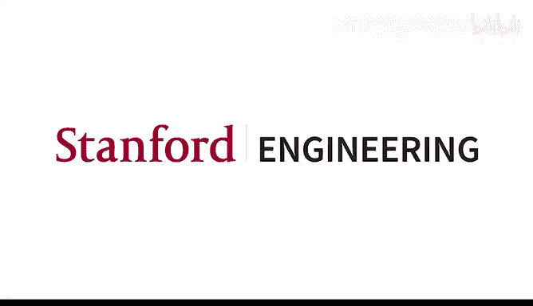
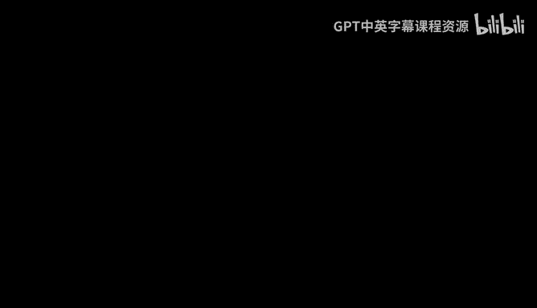
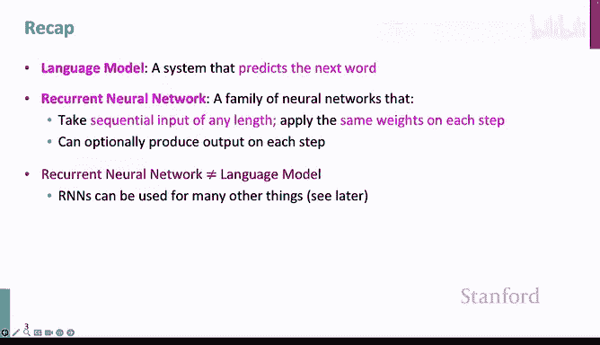
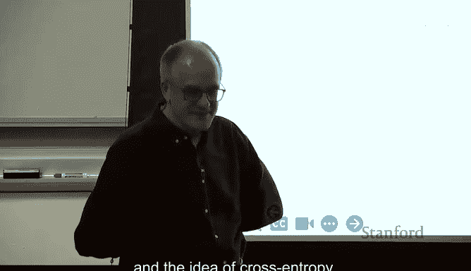
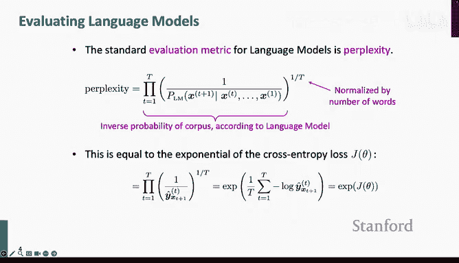
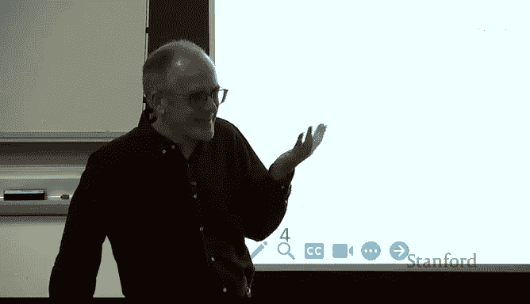
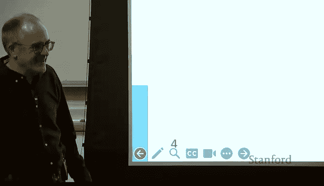

# 斯坦福大学《深度学习自然语言处理｜Stanford CS224N NLP with Deep Learning 2024》中英字幕（deepseek-R1 - P6：-06-Lecture 6 - Sequence to Sequence Models.zh_en - GPT中英字幕课程资源 - BV1U5RNYgEfp

Okay， hi everyone。Back from more CS224N。😊，For today the plan is essentially a continuation of what we started on Tuesday。

 so I'm going to say more about language models and more about RNNs in particular introducing a more advanced form of recurrent neural network which was a for a while very dominant LSTMs we'll talk about those and then in the latter part as something to be done with recurrent neural networks we'll start looking at neural machine translation。

😊，Okay， so on Tuesday， what we did was we introduced language models。

 a system that predicts the next word。 And then I introduced recurrent neural network。

 So that's was this new neural architecture that can take sequential input of any length and it applied the same weights at each step and can optionally produce output on each step。

 So these are two distinct notions。 they tend to go together。

 So recurrent neural network can be used for other purposes on any kinds of sequence And I'll mention a few of those later today。

 and language modeling is a traditional component of many NLP tasks。

 Anything to do with generating text or estimating likelihoods of pieces of text。 And indeed。

 in the modern instantiation of large language models， essentially。

 everything we do NLP is being done by language models。 So。😊。

， one way to do it is with the recurrent neural network。

 It's certainly not the only way we also talk last time about Ngramm language models。

 which are language models。 And then starting next week， we'll start to talk about transformers。

 which are now the most widespread way that's used for building language models。

So just finish off a teeny bit that I didn't get to last time on evaluating language models。 Well。

 one way to evaluate language models is what I did in class last time， generate some text and say。

 hey， doesnt this text look good。 But you know often we want something more rigorous than that。

 and the standard way to evaluate language models is to say， well， you know。

 a language model scores a piece of text and says how likely it is。

 and our standard for text in the language is stuff produced by human beings。

 So if we find a new piece of text which wasn't text that the model was trained on right。

 we want some fresh fresh evaluation data and we show it to a language model。

 we can then ask the language model to predict the successive words of this text and the better it is at doing that。

 the better a。😊，Wage model it is because it's more accurately able to predict a human written piece of text。

 And so the standard way that that is measured is with this measure that's called perplexity。

 And so for perplexity， we're taking the probability of a prediction from the language model。

 we're inverting it。 So instead of it being， you know。

0002 or something we're turning into 500 or something like that。😊。

And then we're taking those numbers， we're taking the product of them at each position， the text。

 and then we're finding the geometric average of them。 So that's the measure that's normally use。

 But if we in this class we've been tending to look at negative log likelihoods and the idea of crossenttropy。

 And so what perplexity is is it's just the exponential of the crossenttropy。

 So if you've already familiar with negative log like per word negative log likelihoods。

 if you just exponentialiate that you then get the perplexity now there's one other little trick as to what base you use for your logarithms and exponentials。

 I mean， traditionally thinking of sort of binary and stuff a lot of the time people use base to for measuring perplexity。

😊。

That's kind of gone out Now a lot of the time now people are using natural logs。

 but if you're comparing perplexity numbers， they're going to be different depending on what base you're using for things used to be aware of this so from a sort of a modern perspective it kind of makes those sense why perplexity is used the story of why perplexity was used was you know。

 in the bad old days of symbolic artificial intelligence when all of those famous people like John McCarthy and Ed Feigenbaum were around doing logicalbased systems。

 some people then essentially at IBM， including Fred Geenck started exploring probabilistic methods for speech recognition and other similar methods and the story Fred Geenck used to tell。

😊。

Was， well， at that time， this was in the late 70s or early 80s that none of the AI people that he was trying to talk to understood how to do any real math and didn't understand any information theory notions of。

Of doing things like cross entropy or cross entropy rate。

 So he had to come up with something simple that they could understand。

 And so what he came up with is by sort of doing this expentiated perplexity。

 you can think of perplexity number as being equivalent to how many uniform choices you're choosing between。

 So if the perplexity of something is 64。 That's like having a 64 sided dice that you're rolling at each time。

 And that's your chance of your chance of getting a one on that is your chance of getting the right word。

 So that was why perplexity got introduced。 But it's kind of stuck。

 And so when you see scores for language models， you generally still see perplexities。

 So a lower perplexity is better。😊，So here are the kind of numbers and where progress was made with neural language models。

 So before that， people used Ngram language models and people used clever ways to smooth them。

 using methods。 I vaguely alluded to last time of this ad case smoothing and doing back off。

 actually， people use cleverer methods around the 200 decade。

 the cleverest method known of smoothing Ngram language models was this thing called interpolated knessa I smoothing And so for a big language model using that the perplexity was about 67。

 which in some sense means you weren't very good at predicting the next word。 But you know。

 that had actually been an enormous progress。 You know when I was a young person doing NLP， you know。

 perplexities were three figure numbers you were commonly seeing， you know。

 perplexities of 150 or something like that so。😊，Yeah。Progress was made。

 So when R Ns were first introduced， people weren't really actually able to do better with a sort of a pure RN。

 But they could do better by combining an R N with something else。

 such as a symbolic maximum entropy model， which I'm not going to explain that those numbers like that 51。

 But where progress really started to be made was when LSTM started to be used as an improved R N。

 which is what I'm going to come to next。 So here are some LSTM models。

 And now you're getting numbers like 43 and 30。 And so for 30，' sort of halved the perplexity。

 which in。😊，Cross entropy terms means you've reduced the cross entropy by about 1 bit。

 And so you've made real progress in your language modeling。 Now， by modern standards。

 these numbers are still really high， right， for the best language models that we have now。

 you're getting perplexities in the single digits。 You're getting models that are very often able to guess exactly the right word。

 though， of course， not always， because no one can predict what words gonna to be said by someone next in a lot of circumstances。

Okay， so to motivate LSTMs， then wanted to sort of say a bit about how there are problems with RNs and why that motivated fixing things。

 And these are the problems of vanishing and exploded ingredients。 So what we wanted to do was say。

 okay， we've tried to predict a word position for and often we're going to get we're not going predict it with 100% probability。

 So we have a loss that's a negative log likelihood we give to that word。

 And we're going want to back propagate that loss。 through the sequence and work out our gradients as we always do。

 Now just one note about something someone asked me after class last time， you know。

 I sort of showed a back propagating the whole sequence。 But we're doing this at every time step。

 right， So we're going to back propagate a loss from time step 2， backaggate a loss。😊，Time step 3，4。

5，6，7。 we're doing it for each one。 And then one of the slides last time we then discussed how we're going to sum all of those losses or work out the average loss。

 But for doing this one， when we back propagate this loss， What happens， Well。

 what happens is we're going to do the same kind of chain rule where we're multiplying these partial derivatives at every time step。

 And well， here we've only got a few of them。 But you know。

 maybe we're going to have a sequence 30 long。 And so we're going to be multiplying each time。

 the partial of H K with respect to the partial of H K-1。

 And so what kind of effect is that going to have in particular， you know， we might ask。

 what happens if these are small or what happens if these are large。 Well， if they're small。

 the gradient will gradually。Get smaller and smaller and disappear as we back propagate along the sequence。

 yeah。Chris so why we're taking partial J over partial age。

 should we take parking chain as perspective？啊。Sure， I mean， we're doing that as well， but you know。

😊，In general， we have to walk the partials along and then you know。

 we then have a W at the next step。I mean， if we're thinking of the sort of computation graph that we're sort of doing the chain rule backwards along。

 we're going to be going through a W at each step and then arriving in another H， right？嗯。Yeah。So。

 I mean， at this point， you can。You can do some math and thinking about things。

 And there's a couple of papers that are mentioned at the bottom here。

 which I'm actually rushing ahead， not going to do very carefully。

 But the point is that if you're taking the partial of H T with respect to H T-1。

And if you make a simplifying assumption and say suppose there isn't a nonlinearity。

 suppose sigma is just the identity， then what the partial will be is the matrix WH。

 And so if you keep on back propagating along the recurrent neural network what you're going to be doing is ending up with powers of the matrix WH。

 And then there's the question of what happens when you raise that matrix to higher and higher powers Well at that point you can represent the matrix in terms of its eigenvectors and eigenvalues。

 and then there are two possibilities， either all the eigenvalues are less than one。

 And that means that that number will begin smaller and smaller as you raise it to higher power or it can have eigenvalues that are larger than one and then things。

will get bigger and bigger as you go further back。 So essentially as you back propagate the gradients backwards unless things are sort of just precisely corresponding to a largest eigenvector of largest eigenvalue of approximately one。

 You're either going to get a vanishing or an explosion。 And both of those will be kind of bad。

So why is vanishish ingredient a problem， I mean。In a sense， you could think it's。It's not a problem。

 It's what should be happening because all else being equal。

 you know the closest words are the most relevant ones。

 and so that's where you should be updating your parameters the most and to some extent that that's true but nevertheless this vanish ingredient in this model happens much too severely so that if you're looking at the loss from a later position and comparing it to the loss from an earlier position and then you're seeing how things are updating it's sort of primarily the update is being determined by the very nearby loss and not by the far away loss that the gradient signal from far away is much。

 much smaller and well that's bad because you know overall from language modeling。

 there are lots of cases where we want to be able to transmit signals a long distance here。

My piece of text。 when she tried to print her ticket， she found that the printer was out of toner。

 She went to the stationary store to buy more toner。

 It was very overpriced after installing the toner into the printer， she finally printed her， Yeah。

 so， you know， to a human being， you know， it's obvious。

 we can predict this with pretty much probability1， you know。

 So really low perplexity for making this decision。 But， you know， if you're。😊。

That' depends on getting back to the tickets， which are sort of about 20 odd words back， right。

 if you're just seeing installing the toner into the printer， she finally printed her。

 could be anything。 It could be her paper， her invitation， her novel。 lots of things that could be。

 you're certainly not going to guess tickets， so。😊。

We sort of want to have these really long distance dependencies。

 but we're only going to be able to learn these long distance dependencies if we're actually getting sufficient signal between that position and when the word tickets appears near the beginning that we can learn the fact that having that ticketss 20 words back is the good predictive thing for predicting tickets here。

😊，And what we find is that， you know， when the gradient becomes very small。

 the R And N doesn't learn these kind of long distance dependencies。

 And so it's unable to sort of make these predictions well at test time。 I mean。

 this is a very sort of just rough。Back of the envelope estimate。

 But you know what people actually found is that， you know with the kind of simple R andN that we've introduced up until now that the amount of effective conditioning you could get was about7 tokens back that if things were further back than that it just never learnt to condition on them and so you know compared to when we were talking about N grams and I said usually the maximum people did was5 grams occasionally a bit bigger because of the fact that there was this exponential blowout。

 although in theory， we've now got a much better solution in practice because of vanish ingredients。

 well we were kind of getting the equivalent of 8 grams so we haven't made that much progress it feels like。

😊，So there's a reverse problem， which can also happen of expding gradients。

 So if the gradient becomes very large because the eigenvalues of that matrix are large， Well。

 what we're doing for the parameter update is you know， we've got a learning rate。 But essentially。

 if the gradient is very large， we're going to make a very very large parameter update。

 and that can cause very bad update。 because， you know。

 we're sort of assuming that we're taking a step in the direction of the gradient。

 and well we might overshoot a little， but we'll be in a roughly in the right zone。 But you know。

 if we had an enormously exploded gradient， well， we could kind of be sort of walking off anywhere。

 And， you know， we think we're heading to the Sierras and we end up in Iowa or something like that。

 right， you know， that we could just go arbitrarily far and where we're ending up。

 might not be making any program。Whatsoever，So explode ingredients are a problem。

They can also cause infinities and nands， and they're always a problem when you're training models now for。

For dealing with exploding ingredients， this is the accepted wisdom。 This unfortunately， doesn't。

This isn't highfauting math， really。 What people use for exploitd gradient is a crude hack。

 They clip gradient。 But， you know， it works really well。

 And you really want to know about this because clip is often essential to having neural networks not having problems。

 So what we do for gradient clipping is we work out the norm of the gradient。

 And if it seems too large。 And that varies。 But， you know， that's normally 5，10，20。

 something like that for a norm of the gradient is seen as the limit of what's okay。

 If the norm of your gradient is too large。 you just scale it down in every direction and you apply a small gradient update。

😊，It works。😊，Yeah， so that problem is solvable。 but fixing the vanished ingredient seemed a more difficult problem。

 right， that this was the problem that our R Ns effectively couldn't preserve information over many time steps。

 And well， what seemed to be the problem there。 the problem seems to be really that we've got sort of an architecture that makes it very hard to preserve information。

 So if we look at sort of the hidden state from one time step to the next time step。

 It's completely being rewritten， right， So we're taking the previous time steps hidden。

Hidden vector， we're multiplying it by a matrix， which completely changes it in general。

 adding in other stuff from the import。 So if we just like to say we'd like to say we'd like you to carry forward information。

 There's useful stuff in H T -1。 Can you just kind of keep it around for a while。

 It's not actually very easy to do in this formulation because， you know， trying to learn。

W vectors that all mostly preserve what was there before isn't a tall and obvious thing to do。

 So the question was， could we design an R N。Which had a so memory where was easy to preserve information。

 Yes， so in one of the earlier slides you mentioned。

 the exponation happened during analysis that removed the of。😊，So for having on the year。

Sot of vanishing actually doesn't。 I mean， you can make an argument that it should help because you've got effectively。

 if you've got something like10 H， you've got a flattening function。 so it should help somewhat。

 but it doesn't solve it even if you're using a10 H non nonlinearity。 Well。

 so it I guess it should sorry， it should help with exploding though。Actually。

 that even that still happens， but definitely doesn't help with the vanishing。If you have a sayoid。

 then I think that。Partial that is one way that to say quite value。

 so you're always pushing the only。So it's not going up working down' steak， which is over one。

But so， yeah。Is Europe an interesting way？Well， I guess where' did it go up and not quickly。

So if you have a really small value， that becomes one minus that a really small value。

one times1 minus。哦，我我真我 so okay。Yes， so can we have a different。Architecture。

 So we have a memory that you can add to。 And so that LED into this new kind of neural network the LSTM。

 So this is going back a few years。 But any rate， this was trying to improve series suggestions。

 and the big breakthrough that they were described was being described was， oh。

 we are now using an LSTM in the keyboard prediction and the whole advantage of that was it was going to be able to predict context further the back。

 So you could differentiate between the children are playing in the park versus the orioles are playing in the playoff。

😊，Okay， so so the sort of big thing that was seen as very successful was these LSTMs long short term memory just to say a little bit of the history here right just on how to par this name right that I think people often don't even understand it right So what you're wanting to do was model short termm memory right。

 because for humans， people this normally distinguish between the short termm memory of stuff that you heard recently versus things that you permanently stored away And the suggestion was。

 well in short termm memory， humans can remember stuff for quite a while right， you know。

 if you're having a conversation， you can still remember the thing that the person said a few turns ago in the conversation say bring back up of oh didn't you say they took last weekend off or something。

😊，ThingRight， And well， the problem was that the simple R N Ns。

 their short term memory was only about 7 tokens。 And so we'd like to make it better than that。

 And so we wanted long short term memory。 And that's where this name came about。

 And so this was a type of recurrent neural network that was。😊。

Proposed by Hockride and Schmid Hoover in 1997 as a solution to the problem。 I mean。

 there's actually a second relevant piece of work that came a few years later that。

 you know that first paper is the one that everybody cites。

 but there's then a second paper by Gus and Schmid Hober in 2000。

 which actually introduceds a crucial part of the LSTM as we've used in the 21st century that wasn't in the original paper。

😊，And you know， so there's sort of an interesting。😊，Ting's story of all of this。 So， you know that。

Yogen Schmid Hoer and his students did a lot of really crucial foundational work in neural networks in the sort of these years in the later years of the 90s when just about everybody else had given up on neural networks。

 So unlike these days where， you know， doing pioneering work in neural networks is a really good way to get yourself hugely compensated jobs at Google Me or open AI。

 it really wasn't actually in these days。 So， you know， if you asked ge。

 what happened to these students of Hora and Gs that both of them are still in academia。

 But Gus seem to give up on AI and neural networks altogether and does stuff in the area of multimedia and Seep Hawkra。

😊，Is still in machine learning。 But， you know， for quite a long time。

 he sort of basically gave up on doing more general neural networks stuff and went into bioinformatics。

 So if you look at his publications from about 2002015。

 theyre all in bioinformatics and most of them weren't using neural networks at all。 kind of nicely。

 I mean， he's actually gotten back into neural networks more recently as publishing in neural networks again。

 yeah， so really not much attention was paid to this work at the time。

 and so it only sort of really kind of gradually seeped out further。

 So Schmid Hober had a later student in the mid-200s decade。

 Alex Graves and Alex Graves did more stuff with LSTMs and for people who've seen speech recognition where people commonly do CTC loss and decoding Alex。

😊，Graves invented that， but most crucially， Alex Graves then went to Toronto to be a postdoc for Jeff Hinton。

 and that sort of brought more attention to the fact that LSTMs were a good model and then Jeff Hinton went to Google in 2013。

 And that was then sort of the use of LSTMs at Google in the sort of 2014 to 16 period was when they really sort of hit the world and became for a while the completely dominant framework people use for neural networks。

😊，In the world of， I guess， startups， this is what you call being too early for the first people。

 Yeah， Okay， long short termm memories back to the science。 So let's see。

 there's a slide here that talks about long short termm memories。

 but maybe I'll just sort skip straight ahead and start to show the pictures。

 So we've still got a sequence of inputs Xt。 And the difference now is inside our neural network。

 we're going to have two hidden things。 one that's still called the hidden state and the other one that's referred to as the cell state。

 And so what we're going to do is we're going to modulate how these things get updated by introducing the idea of gates。

 And so gates are calculated things， vectors。😊，Whose values are probabilities between 0 and one。

 And there are things that we're going to use to sort of turn things on or shut them off in a probabilistic way。

 So we're going to control the movement of information by having gating。And so we're going to。

Calculate three geating vectors。 So these vectors are the same length as our hidden states。

And so the way we calculate these gating vectors is with an equation that looks basically exactly the same as what we were using for a current neural networks。

 apart from the sigma there is definitely going to be the logistic that goes between 0 and1。

 So we get probabilities。 And the three gates we're going to calculate is a forget gate。

 which is going to say how much do we remember of the previous times hidden state。

 I think the forget gate was actually wrongly named。

 I think it makes more sense to think of it as a remember gate。

 because it's actually calculating how much you're remembering Okay。

 then we've got an input gate and the input gate is going to say how much you're going to pay attention to the next input。

 the next X and put it into your hidden state。 And then you have an output gate and the output gate is going to control how much。

😊，What's in the cell， which is your primary memory。

 are you going to transfer over to the hidden stay of the network？😊，Okay， so once we have。

Once we have those gates。What we're then going to do has have these equations。

 which are how we're going to sort of update things。

 So the first thing we're going to do is work out。Work out a potential new cell content。

 So the new cell content is going to be calculated exactly using exactly the same kind of equation we saw last time for a current neural network。

 We're going to have these two matrices the cell W and the cell U。

 and we're going to multiply one by the last time hidden state and the other by the new input add on a bias。

 And that's the potential update to the cell。 But then how we're actually going to update the cell is by making use of our gates。

 So we're going to say the new cell content is going to be the old cell content Hadamama product with the forget gates。

 So that's how much to remember of the previous cell content plus this calculated update。😊。

Haama producted with the input gate， How much to pay attention to this new potential update that we've invented。

 And then for calculating the new hidden state， that's going to be the Hadamm product between the output gate and。

Our C T having been put through a tan0 H。 and you know， one idea here is， you know。

 we're thinking about how much to keep on remembering what we've had in the past。 but you know。

 for thinking about sort of only sending some information to the hidden state sort of a way to start thinking about that is。

 you know， the hidden state of a recurrent neural network is sort of doing multiple duty， right。

 like on one part of it is we are going to feed it into the output to predict the next token。

 but in another thing it's going to do is we just want it to store information about the past that might come in useful later and that we'd like to kind of have carried through the sequence。

 And so really only some of what's in the hidden state we want to be using to predict the current word。

 some of it isn't relevant to predicting the current word。

But would be good stuff to know for the future， right， So， you know。

 if the previous words were set in for predicting the next word。

 we basically just need to know we're in a setin context where that or a will come next。

 But you know if earlier on the sentence had been saying the king of Prussia。

 we somewhere in the hidden state。 We want to be keeping the information that there's a king of Prussia because that might be relevant for predicting future words。

 And so it makes sense that we only want to have some of what's in our memory being used to predict the next word in the current context。

 So the cell is our long short termm memory And then we're moving over to the hidden state。

 things are going to be relevant for generation。😊，嗯。Yeah， I've sort of said that， okay。

All these are vectors of the same length N。 Yeah， so all of， all of these things。

 both the gates and the new values for the cell and hidden state， They're all vectors of length N。

 and part of。😊，How things actually get convenient when you're actually running of these is up until here。

 all of these things have exactly the same shape。 so you can actually put them all together into a big matrix and do the computations of all four of these in terms of one big matrix if you want。

 question should been。😊，if this bid wasn't here。Then you would not need an output date。Well。

Because FT and I would have been able to express it。I going' to put it in。

My question is how much does having oh wait， Well， no。

 to the extent that you want to mask out part of what's in the cell。😊。

So it's not visible when you're generating the next token。

 Isn't it still useful to have an output game。You can essentially have X is equal to C right。许多他办。

But you don't want H T equal to C T。 You want H you want some of the contents of C T to be masked out。

 So you're not seeing it when generating the output。

 Dr Mus would have been accounted for by F and I this。No， because you want to keep it in C， T。

 You want。 there's information You want to keep in C， T for the future。

But you don't want visible when generating the current next word。Yeah。嗯。In some sense。

 a bit I have the hardest part explaining is， why is it necessarily better to have a tan each year。

 I mean， you can sort of。Igue that it's a way of this can just stay unbounded real numbers。

 And then this is getting it back in the shape of stays between 0 and1。

 which is good for the hidden state。 but it's a little bit。I guess they did it that way。

 and it seemed to work well。Okay， here's another way of looking at it。

 which may or may not be more helpful as a picture。 So， you know， at each time step。We've got。

 you know， as before an import a hidden state。 and then we're going to calculate an output from that hidden state。

 But we've sort of got this more complex computational unit。 And these pictures of this more complex。

 computational unit， were diagrams that were made by Chris Ola， who's someone who now。

It now works anthropic。And so if you blow up in that， this is sort of showing the computation。

 So you're sort of feeding along recurrently the C。Sell as the primary recurrent unit。

 but you've also got carried along H because H is being used to calculate stuff in the next time step。

 and then a new H is being generated And so you're computing the forget gate。

 you're forgetting some of the cell content， youre computing an input gate。

 you're using that to compute a potential new cell content， you write some of that into the cell。

 depending on the input gate then you compute an output gate and then some of the cell will go into the computation of H depending on the output gate。

 and then just like for the previous recurrent neural network for working out what the predicted next word is。

 you're working out an output layer by taking the H and doing another。Matrix U H plus B2。

 And then using a softm on that to actually predict the next word。Okay， so， you know。

 this all seems very complex。 And， you know， back in， do you have a question， yeah。😊，And so。

How are we exciting the thresholdful I imagine it just。

Some sort of threshold around the probability of like what we're remembering and what we're forgetting。

So， you know， so we're getting more than a threshold。

 right because we're actually we're calculating a whole vector of forgetting and remembering。

 So therefore it can choose to say， okay， dimensions 1 to 17。

 keep all of that and throw away dimensions 18 to 22 or really probabilistically to different extents。

 And so it's sort of unspecified。 It's up to it what it learns。

 but we we're hoping that it will learn that certain kinds of information。

 It's useful to keep carrying forward for at least a while。

 but then we can use both the content of the hidden state in the cell sorry of the next input to decide to throw away certain information。

 So we might think that there are certain cues for example， you know。

 if it sees the word next it might think okay， change of topic now would be a good time to forget more stuff and reset。

 but it's sort of。😊，Learning which dimensions of this vector are haul around in an unconstrained way。

 Whatever is useful to do a better language model。Okay， yeah。

 so this all looks like a very complex and conkerous design。 And， you know， quite honestly， you know。

 when teaching this around 2000 you know，1617。 And this was the best kind of neural network we had the language modeling。

 You know， we literally， you know， spent hours of class time going through LSTMs and variants of LSTMs with different properties。

 because you know， there are different ways you can do the gating you can have less gates or more gates and do different things and it seemed the most important thing to know。

 in 2024， you know， it's probably not the most important thing to know。

 But on LSTMs a thing to be aware of we are going use them for the assignment 3， but， you know。

 you can just ask Pytorch for LSTM。 and it'll give you one that does all。😊，St， But， you know。

 there is one thing that I really want to sort of focus on as to you know why what is the good thing that an LSTM achieves and you know。

 really the secret for why you get this fundamentally different behavior in an LSTM is you have that plus sign right there。

 that for the simple recurrent neural network at each time the next hidden state was a result of multiplicative stuff and therefore is very hard just to preserve information whereas the essence of the LSTM is to say。

 well， look， you've got this past memory of stuff you've already seen and what we want to do is add some new information to it。

 which fundamentally seems like kind of right for human memories that they're sort of basically additive。

 And when I said， actually。😊，Was the second Gos paper that introduced a crucial part of the LSTM。

 The first version of the LSTM didn't have the forget gate。

 So it was a purely additive mechanism that you were deciding what to add to your memory as you went along。

 But， you know， that proved to be not quite perfect。

 because if you keep on adding more and more stuff over a long sequence that tends to be dysfunctional after a certain point。

 And so the big improvement was then to add this forget gate。 So some of it went away。

 But nevertheless， having things basically additive。😊，Fixes the problem of gradient flow。

 You no longer have vanished ingredients， and it makes it something that seems much more memory like you're adding to the things that you know。

Okay， so the LTM architecture allows you to preserve information over many time sets in the cell。

 right， So if you set the forget gate to one and the input gate to 0。

 youre just linearly passing along in the cell indefinitely the same information。😊，Okay。

 it's not the only way that you can do long distance information flow。

 And we're going to look increasingly in other in future lectures at other ways you can do。

Long distance information flow。 and just to sort of give a bit of a peek about those now and to think about other architectures。

 But there's a question。 No， no question， yes。So since you're mentioning I've go plus that like。

M premium。Does it help with the exploding gradient at all it does it make it worse。

 is there like no difference？NoIt also helps with explodelod ingredients because the fact that you're not doing this sequence of multiplies all the time that you sort of have this addition operator。

嗯。So one thing you could wonder is that is vanishing and explod gradient just a currentrent neural network problem。

 And it's not。 I mean， it occurs earlier and worse when you've got long sequences。

 But if you start building a very deep neural network， Sure the same thing is happening。 you know。

 the parameters aren't the same。 So it's not quite just raising one matrix to power。

 But surely depending on your matrices， you tend to have the same problem that either your gradients are disappearing or else they're exploding。

 And that's what people found。 And that was part of the reason why in the early days。

 people weren't very successful building deep neural networks was because they suffered from problems of this sort that if you had basically vanish gradients in a deep neural network。

 you got very little gradient signal in the lower layers， therefore。Crameters didn't really update。

 Therefore， your model didn't learn anything in the lower layers。 Therefore。

 the network didn't work well。 And you know， that was part of why things were stuck in the days around the early 200s of deep networks didn't work。

 And so there are other ways you can think about fixing that。

 So one common way of fixing that is to add more direct connection。 So， you know。

 the problem when we went through our recurrent step was we were sort of had this in between stuff of doing a matrix multiply and blur。

 And that kind of caused indirectness and the possibility for things to either explode or vanish。

 So this network is written sort of upside down when I stole the picture from the paper。

 So we' just have to deal with that。 So we're going downwards from here to the next layer。 So。

You know， rather than going through sort of weight layers and weight layers。

 which will start to produce the same kind of problems。

 what you can do is sort of apply the same trick in a vertical network and say， well， look。

 I can also just carry the input around with an identity function and added on here。

 And so then I've got this sort of direct carrying of information。

 And so that LED to the residual network。 which was what completely transformed computer vision models and made them much more learnable than pure networks that lacked these residual connections。

If you sort start heading down that path， you can think， well。

 why only provide these residual loops that take you one step。

 maybe I could directly connect each layer to all the successive layers。

 And so people played with that idea。 And that led to the so-called densenet where you have these kind of skip connections linking to every other layer。

 a variant of the residual network， the resnet， which was actually again。

 introduced by Schchmid Hober and students was to say， well。

 rather than just directly adding in the input，😊，Summed with the output of the neural network layer。

 maybe again， we'd be better off having gating so that you are deciding by gates how much of the input to have skip around。

 And so that LED to a variant， the the highway net， where you've got sort of gated residual network。

 So various ideas of doing that。not going to say more about that right now。

 I want to skip her head and sort of do the rest of neural nets and get on to machine translation。

Okay， so。Once you have RNs where R NNs is including LSTMs， normally in practice LSTMs。

 you can use them for anything else where you're doing sequences。

 And so there are lots of places they use an NLP。 So if you want to assign words。

 parts of speech like nouns and verbs that would be commonly done with a part of speech tagging LSTM。

 If you want to be assigning named entity labels like location。

 right I did this toy version where were assigning a label to the middle of a window。

 but you wanted to assign a label at each position， you can use an LSTM for named entity recognition。

 you can use an R N as a encoder model for a whole sentence。

 So if we want to do sentiment classifications， see whether a piece of text is positive or negative。

 we can say run an LSTM over it and then use this as a representation。😊，Of the sentence to。

Work out whether it's positive or negative piece of text。 And well。

 the simplest way of doing that is to use the final hidden state because after all。

 that final hidden state is the hidden state you've gotten from having seen the entire sentence and use that and then have a sort of a classification layer a logistic regression on top of that to give you positive or negative。

😊，In practice， though， people have found it's often better to use every hidden state and take some kind of mean or element wise max and feed that in as the sentence encoding。

😊，You can also use R andNs for lots of other purposes where you're using it to generate text based on other information。

 So if you want to do speech recognition or summarization or machine translation that will come to later。

 you can have an input source which you'll use to condition your network。

 and then you'll generate the speech recognition or the machine translation， as we'll see later。

 And so we refer to those as conditional language models。

 because rather than just generating text starting from nothing from a start token。

 we're generating it conditioned on some source of information。😊，嗯。

One other idea on what normally happens when people use these， you know。I suggested。That you know。

 we could sort of do this averaging at each position。

 if you think of these about these hidden state representations， these hidden state representations。

 that representation isn't only about the word terribly。

 It has some information about what came before it。 The movie was terribly。

 but it has no information about what comes after it。

 And well you might think you'd like to have a representation of terribly that knows what came before it。

 but also what came after it。 And so people sort of came up with the next obvious idea to deal with that。

 which was to build a bidirectional LSTM。 So you ran a forwardd LSTM。

 and then you start another LSTM that's shown in that sort of greenish teal。

 and you ran it backwards。 And so then you had a forwards and backwards vector at each position。

And you just concatenated them both。 And then you had a two sided context for a representation of word meaning。

And so these networks were pretty widely used。 So we were sort of running a forward R N N and backward R NN and concatenating the states together。

And those were then sort of commonly sort of written like this to suggest that in a compact way。

 you're running a bidirectional R N that and。You know， these were very popular for language analysis。

 Theyre not。 They weren't workable if you were wanting to generate text。

 but you were using them in a lot of places as a representation。 But more recently。

 transformer models have normally taken over from that。

One more idea which we'll see for machine translation is。😊，You know。

 R Ns are sort of deep in the sense that they unroll over many time steps。 But up until now。

 they've only been shallow RNs in the sense that we just had one hidden state。

 But you can also make them deep by having multiple layers of hidden states。

 or also commonly called stacked RNs。 So you'd have several layers of R Ns built above each other。

 And you might wonder， does this really do anything， are they just big vectors above the words。

 But precisely because you have sort of this extra neural network layer between here and here。

 You get exactly the same power advantage You get otherwise with neural networks that you can do successive layers of feature extraction。

 And so you get more power out of your neural network， to some extent， what people。😊，Nice， yeah。I思。

Okay， to some extent， what people found。With R Ns in those days is that having multiple layers definitely helps。

 But unlike what was happening in those days with other kinds of neural networks for vision， etc。

 people still use relatively shallow R Ns。 So， you know。

 you always got a lot of gains by having two layers rather than one。 But you know， commonly。

 it started to be more if， whether you got extra value from three or four layers。 So commonly。

 people were running two or three layer， LSDMs。 And that's what people were using。

 But that's completely changed around in the world of transformers， where nowadays。

 people are building very deep transformer networks for doing language understanding。😊，Okay。

 but I should skip ahead and say a few words before time runs out about machine translation。

 So machine translation is one of the key natural language processing task where we're translating words from sentences in one language to sentences in another language So we're starting off with a sentence in some language here in French and what we want to do is output it in a different language here English。

😊，So。That。Machine translation was actually where NLP started， right？ So in the early 50s。

 there wasn't artificial intelligence yet。 There wasn't a field of NLP yet。

 but people started to work on machine translation。

 And the story of why people started to work on machine translation was essentially you know。

 computers were first developed during the Second World War。 And during the Second World War。

 computers were used for two things。 One of them was calculating artillery table targets。

 artillery tables to sort of work out what angle to put your gun on to to land in the right place。

 not very relevant to what we're doing。 But the other thing。

The other thing that computers were used for was code breakinging so after the Second World War。

 it moved very quickly into the Cold War and there were you know concerns on both sides you know of keeping up with the science that was being developed on both sides and people had the idea of gee。

 maybe we could think of translation between languages as like code breakinging and that thought occurred to important relevant people and science funding agencies and actually lots and lots of funding was poured into this idea of can we use computers to do machine translation between languages and you know at the time in the 50s you know after some initial very impressive lookingc demos it was sort of basically a complete flop and the reason。

😊，You know， there are lots of reasons why it was a complete flop。 You know。

 one was people knew almost nothing about the structure of human languages。 I mean， in particular。

 when I was mentioning the other day the Chomsky hierarchy， right。

 and knowing about sort of context-fr languages， right。

 the Chomsky hierarchy even hadn't been invented yet。

 sort of formal properties of languages hadn't really been explored， but also， you know。

 the computers that people had in the 1950s， right。

 the amount of computing power or memory or anything like this that those computers had in those days was laughable。

 right， these days， you know， the little power brick for your laptop has more computing power inside it than the big mainframe computers that they used to be using in those days。

 so。😊，Basically， people were to build very simple lexiconons and rule-based substitution rules and nothing like the complexity of human languages。

 which only gradually， people began to understand。 but machine translation started to become more alive in the 1990s and 200s decades。

 once people started to build empirical models over lots of data。

 And the approach then was called statistical machine translation。

 And so when Google translate was first introduced to the world。

 It was sort of the big unveiling to the world of statistical freezebased machine translation systems。

 where what you were doing was you're collecting a large amount of parallel data。😊。

Words are being translated from one word to another。 And， you know， not for all languages。

 but for quite a few languages， there are quite a few sources of parallel data。

 So the European Union generates a huge amount of parallel data among European languages there are places like Hong Kong where you get English Chinese if a certain dialect of Chinese parallel data。

 the Un generates a lot of parallel data。 So getting sources of parallel data and trying to build models。

 And so the way it was done was based on that model。

 we're going to try and learn probability model for translation。

 So this the probability of a translation， given a source sentence。

 and the way it was done at that time was breaking it down using Be's rule into two subproble。

 So the probability of the translation， given the source is going to be。

The inverted probability of the source， given the translation times the probability of the translation。

 And， you know， you could think that this makes it no simpler because you've just， you know。

It reversed the order of X and Y。 But the reason why it made it simpler and people were able to make progress was the translation model was treated as a very simple model as to how words tended to get translated to words in the other language。

 And it didn't need to know anything about， you know。

 word order grammar structure of the other language。

 And then all of that was being handled by just this probability of y。

 which was a pure language model， as we've talked about before。

 So you could have a simple translation model， which just sort of said， you know。

 if you see the word o in French， you might want to translate it as man or person or put some probabilities on that。

 And then most of the cleverness was in the language model。

 which was telling you what would be a good。Sentence in the target language。Okay。

 and so that was important because， you know， translations get pretty complicated， right。

 So you not only have to know how to translate words and those translations of words buried in context。

 but you get a lot of reordering of words in sentences。

I'm not going to be able to spend a lot of time on this。 But you know。

 here here for a while was my favorite example machine translation sentence。

 So this is actually a translated sentence。 So it comes the original comes from the book Gus germs and Steel。

 if you're familiar with that。 But it was that book by Jared Diamond。

 But this book was translated into Chinese。 So here's a sentence from the book in Chinese。

 And you know， I guess in the 200s decade， I was involved in building statistical machine translation systems。

 And I guess there was a empty evaluation that we did where our system did terribly on this sentence。

 and I trade it out on Google Translate。 and it also did terribly in this sentence。

 So what the sentence should say is in 1519。😊，600 Spaniards landed in Mexico to conquer the Aztec empire with a population of a few million。

 They lost twotds of their soldiers in the initial clash。

 So here's what Google translate said in 20092009，1519，600 spananards landed in Mexico。

 millions of people to conquer the Aztec empire。 The first two thirdds of soldiers against their loss。

 Now， it's partly bad because the word choices and the translations aren't very good。 But， you know。

 it's especially bad because it's just not actually able to capture and use the modification relationships of the sentence。

 So you know， here's the part of the Chinese thats saying the Aztec empire。

 And over there in orange is the few million people。 And in Chinese， there' this explicit little。

ctor here Du， which is saying that stuff in orange modifies this stuff in green。

 which is what is meant to be in the correct translation of Aztec empire with a population of a few million。

 But Google translate completely fails on that。 And it suddenly it's the millions of people who are going to be conquering the Aztec empire。

 And you know， thats sort of in a way the worst thing that's happening here。 you know。

 the 1519600 ist exactly a very good translation。 and the first two thirds of soldiers against their loss isn't very good either。

 But， you know， so for a while， I used to sort of update this and see what happened， you know。

 in 2013， it almost seemed like progress had been made。 But by 2015。

 it had gone downhill back to how it was before。 So it just seemed like they got lucky into。😊。

hou13 rather than the systems were working any better。 And indeed。

 this sort of seemed to be the problem， although some kind of progress had been made in machine translation。

 the systems just you know， sort of never really worked all that great。

 And so that LED to this amazing breakthrough in 2014。

 where we then moved to neural machine translation and neural machine translation was much better。

 So what did we do in neural machine translation。 So we built a neural machine translation system as a single end to end neural network。

 And that's been a powerful idea in neural network systems in general， including in NLP。

 if we can just have a single big system and put a loss function at the end of it。

 And then we can back propagate。😊，Right back down through the system。

 It means we're sort of aligning all of our learning for the final tasks we want to do。

 And that's been very effective。 whereas earlier models couldn't do that。

 So we built it with a sequence to sequence model。 So that sounds like our LSTMs。

 But it's meaning that we're going have two of them， one of them to encode the sentence。

 the source sentence and one to produce the target sentence。 So that's what we're building。

 So for the source sentence。 we're taking here it says RN。

 but let's just think LSTM because that's what we're going to use in practice is much better。

 And so we're going to chunk through it encoding what we've read using an RN。

 So this RN isn't going to output anything， right， We're just building up a hidden state that knows what's in the source sentence。

 So we're going encoding of the source sentence。 And we're going to use that final。

Hidden state to condition the decoder R N， which is going to then generate the translation。

 So for the decoder RN， it's also an LSTM。 but it's going to be an LSTM with different parameters。

 So we're going to be learning one one LSTM with source encoding parameters。

 and then for the different language。 We're learning a different LSTM thatll know about the target language。

 And so we give it start and say， well， feed in feed in your past what you've encoded from the encoder RN as your starting point。

 And then we're going to be Ias thatll be count as the previous hidden state you're feeding into your LSTM。

 And then we're going to generate the first word of the translation。

 and then copy that translated word down using this as a generative model as I did last time。 and we。

😊，Start translating through。 He hit me with a pie。Okay， so。That sort of makes sense of the model。

Yeah， okay， so。Okay， there's some notes， sorry。Yeah， sorry。 what I was going to say yeah。

 So the little pink note here。 So what I was showing you is the picture of using it at sort of runtime at runtime。

 We're going to encode the source and then generate the words of the translation。 at training time。

 We're going to have parallel text， We're going to have sentences in their translations。

 We're going to run with the same architecture， But as before then for the decoder network。

 we're going to try and predict each word and then say what probability did you assigned the actual next word and that will give us a loss and we'll be calculating the losses at each position。

 working out the average loss working out the gradients back propagating them through the entire network。

 both the decoder R and N and the encoder R and N networks and updating all the parameters of our model and that's the sense in which it's being。

😊，Trained end to end。Okay， so sequence， so this is sort of a general notion of an encoder decoder model。

 which is a very general thing that we use in all kinds of places， right。

 that we have one network then something， which produces a representation。

 which will then feed into another network that we use to decode something。

 And even when we go on to do other things like use transformers rather than LTMs。

 we're still commonly going to use these kind of encoder decoder models。

 because if we want to do not only machine translation， but other tasks like summarization or。😊。

Textter speech or other things like that。 We're going to be in this space of using encoded decoder networks。

Yeah。Between this and quarterly quarter model and just using a deeper neural network with more layerss。

嗯。Well， a lot is sequenced， right， So it has never been very you're meaning like。

 why don't you just build on top of the source， right。

 people haven't tried that occasionally is's never been very successful。

 And I think part of the reason is all of what I was trying to show before about all of the word order changes around a lot between languages。

 And if you're sort of just trying to build stuff on top of the source sentence。

 It's very hard to cope with that in particular， it's not even the case that the length stays the same。

 One of the big ways in which languages vary is what little words that they have。

 So that in English you're putting in a lot of these auxiliary verbs and articles where it's in Chinese。

 you don't have any of those。 And so you're neither needing to depending on direction。

 add a lot of words or subtract a lot of words， which is very hard to do is you're sort。

Build on top of the source of it。Is it quick。 Yeah。

 love side I that somethingal or just like like the encoder。 Yeah， so you， youd totally think。

 and it could be that the encoder is bidirectional， and that might be better for the。

 for the famous original instantiation of this that was done at Google。

 They actually didn't make it bidirectional。 So it was simply taking the final hidden state。

 but that's absolutely an alternative that you could do。😊，Okay。Yeah， so I'd sort of said it was。Okay。

 usable for lots of things。 Okay， yeah， so this is our conditional language model so we're now kind of directly calculating the probability of y given X。

 right， that the decoder model is generating language expression as a language model directly conditioned on X。

 And so we train it with a big parallel corpus。 And that's the only case I'm going to talk about today。

 recently， there's been sort of some interesting work on unsupervised machine translation。

 meaning that you're got only a little bit of information about how the languages relate。

 You don't really have a lot of parallel text。 but I'm not going cover that today。 Yeah。

 so for training it， we have paired sentences we。😊。

Work out our losses in the predictions at each position。

 And then we're working out our average loss and back propagating it through in a single system end to end。

 as described。Yeah， so in practice， when people built big machine translation systems。

 this was one of the places where absolutely it gave value to have multi layer stacked LSTMs。

 And so typically， people were building a model， and you'll be building a model， something like this。

 that's a multi layer LSTM that's being used to encode and decode。😊，In my two minutes remaining。

 I just wan to sort of quickly say， So building these neural machine translation systems was really the first。

Big success of natural language processing， deep learning。 Now， in this， in this sense， you know。

 it depends on how you define what parts of language。

 If you look at the sort of the history of the Renaissance of deep learning。

 the first place where deep learning was highly successful was in speech recognition systems。

 The second place in which it was highly successful was in object recognition and vision。

 And then the third place that was highly successful， was then building machine translation systems。

 So， you know， Google had a big statistical machine translation system。

 and it was it was only in 2014， that people first built this sort of LSTM deep learning machine translation system。

 but it was just sort of obviously super good， and it was so super good。😊，That in only two years。

 it was then deployed as the live system that was being used at Google。

 But it wasn't only used in Google that neural machine translation was just so much better than what had come before。

 that by a couple of years after that， you know， absolutely everybody。

 both US companies and Chinese companies， Microsoft。

 Facebook 10cent by do everybody was using neural machine translation systems。

 because there are just much better systems。 And so this was an amazing success， right。

 because statistical machine translation systems like the Google system。

 that this is something that had been worked on for about a decade。

 hundredres of people had worked on it， There were millions of lines of code。

 lots of hacks built in for particular languages and language pairs， But really a simple small。😊。

Neural machine translation system was able to work much better。

 There was an article published about it when it all went live in the New York Times that you can find in that link。

 It's a little bit of praising piece where you could be a little bit critical But， you know。

 basically， it's sort of talking about how just the difference in quality was so obvious that everyone immediately noticed even before Google had announced it of。

 suddenly， machine translations gone so much better。😊，Okay， so that's basically today。 So， for today。

 you know， we've learned that LSTMs are powerful。 If you're doing something with a current neural network。

 you probably want to use an LSTM。 You should know about the idea of clipping your gradients。

 bidirectional LSTMs are good when you've got an encoder。

 but you can't use them to generate new text and encoded。

 decoder neural machine translation systems were a great new technology that advance the field。

 Thank you。😊。

