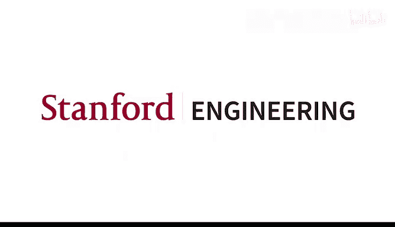

# 斯坦福大学《深度学习自然语言处理｜Stanford CS224N NLP with Deep Learning 2024》中英字幕（deepseek-R1 - P7：-07-Lecture 7 - Attention, Final Proj - GPT中英字幕课程资源 - BV1U5RNYgEfp

Okay， welcome everyone to week four into now。😊。

So for today， what I want to do is first of all， Ill a couple more bits on machine translation。

 especially just talking a little bit about evaluating machine translation that I want to spend a while on attention。

 So attention is a very fundamental concept and of neural networks。

 which was originally developed in the context， a machine translation there's also then a very central concept when we're talking about Transers which we then start talking about on Thursday。

 Okay， so getting straight into it。 so this is the picture that we saw towards the end of last time that this is how we were baking machine translation system where we were using a multilayer LSTM where we were feeding in a source sentence and then we were flipping to。

😊，Then turning the model into a decoder with different parameters。

 which would generate one word at a time to generate the translated sentence。

So here I've gotten German sentence and it's produced an English translation that looks a pretty good one。

 And but， you know we're going to want to have a way of deciding， well。

 are we producing good translations or not。 And so we need some way to evaluate machine translation。

 Now， this is a complex area because， you know， if you start poking around in the literature， people。

😊，Have proposed literally hundreds of different measures that could be used to evaluate machine translation systems。

 I'm guilty of writing a couple of papers on it myself。 So I'm contributed to the problem。

 but you know by far the most commonly common measure that you see to this day was essentially the first measure proposed to automatically evaluate machine translation。

 which was the blue measure， which was proposed to understand for bilingual evaluation under studydy。

 though it went along with the fact that was proposed by IBM， probably not a coincidence。

 So until this point the only way that people had really used for evaluating translations was getting human beings to look at them and say how good of a translation this is。

 And you know， that's still a gold standard measure that is widely used for evaluating translations。

😊，Because， you know， many of the automatic measures have various kinds of biases and problems that make human evaluation useful。

But on the other hand， a lot of the time， we'd like to you know iterate quickly on evaluations。

 We'd like to use evaluations and training loops and things like that。

 and the IBM people with the blue paper suggested well。

 maybe we can come up with a halfway decent automatic method of doing translations and the idea of what they proposed was this。

 that we're going to have one or more reference translations for a piece of text。

 So these a human written translations and then we can score any automatic translation mainly on how often they have overlapping one。

2， three and four grams。 The number four isn't special you could have only gone up to three or five but four were seen as a reasonable length overlapping Ngrams with one of the reference translations and the more overlap。

😊，You have the better。😊，And we there's discussion of this evaluation in the assignment so you can think about it a bit more。

 And I won't go actually through all the formulas right now。 But， you know。

 that's most of it And so here's a picture of how that looks。

 So the original idea was what we should do is you know， have several reference translations。

 And then we'd get a machine translation。 And then we'd look at this machine translation and try and find pieces of it in the reference translation。

 So we can certainly find the ungram the。 We can't find American at all。

 but we can find international airport and it in the second reference translation。

 So we're gonna get a for gra match for that。 We can find that again。

 that's easy Off all receives ones called self the sand Arab。 not a very good translation this。

 right， So that all misses， but。😊，Then you start to find other pieces that do overlap and you use those to work out a score。

 The original idea was you should always have multiple reference translations so that you can sample the space of possible translations and have reasonable coverage。

 in practice for what's been done more recently， it's not so uncommon that people do this with only one reference translation。

 And the argument then is still on a kind of a probabilistic basis。

 the more often you have a good translation， the more often you'll get matches and therefore your score will be better。

😊，Yeah， so wide？😊，You know， why did people come up with this and why is it still imperfect？ Well。

 the problem with translation is that there isn't one right answer。

 It's not like the kind of classification things you see in machine learning where you show people a picture and the right answer is to say this the class of this object is whatever labra or right dog breeds or something right that for any sentence。

 there are many different ways to translate it。 and you know。

 translate it consider around and argue that， this phing is a little bit nicer than this phrase but to a first approximation。

 you can translate the sentence in lots of ways and those different ways of translation can involve different word orders So you can't really sort of check the words off as you come down in the sentence。

 And that's what motivated this idea of sort of matching ngrams anywhere so you can get reasonable credit。

Having the right matches。 But you know， nevertheless， it's a pretty crude version of it right。

 you know， you can still get a poor blue score for good translation。

 just because the words you chose didn't happen to match a reference translation and also you can get points for things without really having a good translation at all。

 right if you just have words that match even if they're having completely the wrong role in the sentence。

 you will get some points， but it's harder to get Ngram matches unless you're for larger N unless you're using words the right way。

 there's one other trick in the blue measure， that there's a penalty for two short system translations because otherwise you could leave out everything difficult and only translate the easy part of the sentence and then for the bits you have translated you could then be getting a high score for the precision of those pieces。

😊，で。Okay， so we'll use when you're developing your M T systems for assignments 3。

 we'll use them with blue。So now we have a evaluation measure。 we can start looking at how well。

How well do systems do on a blue score And blue scores are theoretically between 0 and 100。

 but you're never going to get to 100 because of the variations of how you can translate things。

 And so typically， if you can start to get to the 20s。Tranlations。

 you can sort of understand what the source document was about。 Once you get into the 30s and 40s。

 the translations are getting much， much better。Yeah。

 so statistical phrasebased translation was pioneered by IBM in the late 90s actually and was sort of redeveloped in the 200s decade and was what Google launched as Google translate in the 200s decade and it continued to be worked on for sort of the following decade。

 but there was basically a strong sense that progress in translation had doing statistical phrase based systems had basically stalled that it got a little bit better each year as people could build traditional Ngram language models with more data every year and things like that。

 but the numbers were barely going upwards。 So in the years from about 2005 to 15 or May 14。

 The dominant idea in the machine translation community was the way we were going to get better machine。

😊，Tranlation is doing syntaxbased machine translation。

 If we actually knew the structure of sentences and we'd pass them up。

 then we'd know what the role of words was in sentences。

 and then we'd be able to translate much better。 And this was particularly invoked by looking at languages where translation worked terribly。

 So in those days， translation worked sort of okay for languages like French to English。

 or Spanish to English， which are kind of sort of similar European languages。

 But the results worked way worse for Chinese to English or German to English。

 And even though English is a Germanic language。 German has a very different word order to English with commonly verbs at the end of a clause and different elements being fronted。

 And so was it was so people tried to work on。Gmmar-based syntaxbased methods of statistical machine translation。

 And I was one of those who worked on those in the late 2000s decade。 but you know。

 the truth is it sort of didn't really work right if the rate of progress in syntaxbased machine translation had slightly more slope than phrase-based machine translation over these years the amount of slope wasn't very much So things were completely then thrown on their head when neural machine translation got invented because as I explained。

 you know， the first attempts were in 2014， the first cases in which it was evaluated and bakeoff evaluations was 2015 And so in 2015。

 it wasn't as good as the best other machine translation methods。

 but by 2016 it was and it was just on this much， much steep a slope of getting way。

Better and that this graph only goes up to 2019， but it's continued to go up and so it's not that uncommon these days that you see blue numbers in the 50s and 60s for new or machine translation systems。

😊，So that's a good news story。 So after this， I want to go on and sort of introduce this idea of attention。

 which is now a very fundamental， important idea in neural systems。

 it's also interesting because it's actually something novel that was invented kind of recently So for everything that we've done in neural networks up until now。

 really， it had all been invented before the turn of the millennium right So basic feed for neural networks。

 recurrent neural networks， LSTMs， other things that we haven't yet haven't talked about like convolutional neural networks。

 they were all invented last millennium it was really a waiting game at that point until there was sufficient data and computational power for them really to show how good they were。

 but attention was。😊，hThat that actually got invented in 2014 in the origins of neural machine translation。

 And it proved to be a very transformative idea for making neural networks more powerful。😊。

So the idea of what motivated attention was looking at exactly this kind of machine translation problem。

 So were running our LSTM over the source sentence。

 And then we were using this hidden state as the previous hidden state that we're feeding into the generator LSTM for the target sentence。

 And what that means is everything useful about this sentence has to be stuffed into that one vector。

 And well that's maybe not so hard。 if you've got a four word sentence。 But you know。

 maybe you've got a 40 word sentence out here。 And it seems to be kind of implausible that' would be a good idea to be trying to fit everything about that sentence into this one hidden state。

 And well obviously there are crude solutions to this。 you make the hidden states bigger。

 And then you've got more representational space。 you use a multilayer LSTM。

 you've got more representational space。 but。😊，Still seems a very questionable thing to do。

 And it's certainly not like what a human being does， right。

 Like if a human being is translating a sentence， they read the sentence and they've got some idea of its meaning。

 But as they start to translate， they look back at the earlier parts of the sentence and make use of that in that translation。

 And so that doesn't seem like it's a very plausible model。

 So the idea should be that our neural network should be able to attend to different things in the source so that they can get information as needed looking back in the sentence。

 And so this is the idea of attention。 So on each step of the decoder。

 we're going to insert direct connections to the encoder so we can look at particular words in the sentence。

So I've got a bunch of diagram sentences that go through what we do。 And then after that。

 I'll present the equations that go along with this。 Okay。

 so once we're starting to translate we've got a hidden state at the start of our generator。

 And then we're going to use this hidden state as our key to look back into the encoder to try and find useful stuff。

 So we're going to。😊，Compare， in a way I'll make precise later the hidden state with the hidden state。

At every position in the source sentence。 And based on our comparisons。

 we're going to work out an attention score。 where where should we be looking at in the source sentence while generating here。

 the first word of the translation。 And so based on these attention scores。

 We'll stick them into a softm， as we commonly do， and we'll then get a probability distribution or weighting over the different positions in the sentence。

 And then we will use this weighting to compute a representation based on the encoder。

Which is then going to be a weighted average of the encoder states。 So on this particular case。

 it'll be nearly entirely the representation above the first word Eel， which means he in French。

 So then we'll take that attention out。And we'll combine it with the hidden state of our decoder。

 and we'll use both of them together to generate an output vector。

 which we stick through our softm and generate a word as the first word of the translation， Y1。

 And so then at that point， we just repeat this over。😊。

So we then go on to generating the second word。 Well， you know。

 we copy down the first word generator。 It starts to generate the second word。

 We work out attention at every position。 It gives us。嗯。Oh sorry， there's a little note there。

 which is a little fine point， which maybe I won't deal with， but it points out。

 Sometimes you also do things。 I stick the previous time steps。

 attention output into the next step as an extra input。 And we actually do that in。

 It should say assignment 3 there。 That's buggy。 So there are other ways to use things。

 but I'll sort of gloss over that。 So。We generate another word and we sort of repeat over。

 and at each time step， we're looking at different words in the source and they will help us to translate the sentence。

Yeah。to the attention。Wt wait again green part the green Okay so。😊，The green vector。

 the hidden vector of the decoder is going to be used together with the hidden states。😊。

The hidden vectors of the encode are one at a time to calculate the attention scores。

 So the attention score at a position is going to be a function of the hidden state of the decoder at that position and the current hidden state of the decoder。

And。Explain exactly how in a moment。Any other questions？Okay。Well， so here it is in math。😊，Okay。

 so we have encoder hidden states， which we're going to call H。😊，嗯。So we have decoder hidden states。

 which we're going to call S。 So there's something different。

 And we're going to at each point be in some particular time step T。 So we'll be dealing with S T。

 So to calculate the attention scores for generating the word for time step T We're going to calculate an attention score for each position in the encoder。

 Okay I'll discuss alternatives for this in a moment。

 but the very easiest way to calculate an attention score。

 which is shown here is to take a dot product between the hidden state of the encoder and the current hidden state of the decoder。

 And so that's what we're showing here。 So that will give us some dot products。😊。

Which is just any number at all。Then the next thing we do is we stick those E T scores into our softm distribution。

 And then that gives us our probability distribution as to how much weight to put on each position in the encoder。

 And so then we are calculating the weighted average of the encoder hidden states。

 which we're just doing with the obvious equation that we're taking the weighted sum of the hidden states of the encoder based on the attention weights。

 And then what we want to do is concatenate our。😊，Our attention output and the hidden state of the decoder。

 and we're going， which is giving us then a double length vector。

 And then we're going to feed that into producing the next word from the decoder。 So typically。

 that means we're multiplying that vector by another matrix and then putting it through a softm to get a probability distribution over words to output and choosing the highest probability word。

😊，Okay。That makes sense， I hope。Yeah， okay， so attention is great。

 So inventing this idea was completely transformative。

 So the very first modern neural machine translation system was done at Google in 2014。

 and they used a pure， but very large， very deep。😊，And。LSTM。

 So as an eight layer deep LSTM with a very large hidden state for the time。

 and they were able to get good results。 but very shortly thereafter。

People at the University of Montreal， Dimabadenau， Kangun Cho and Yoshua Benjiio did a second version of machine translation。

Using attention and with a much more modest compute budget of the kind that you can afford in universities。

 they were able to get better results because attention was their secret thing。

 So attention significantly improved an empty performance and essentially every neural machine translation system since has used attention like we've just seen。

 You know， as more humanlike as I was indicating， because it's sort of what a human would do。

 You'd look back in the sentence to see what you need to translate。

 And it solves this bottleneck problem。 You now no longer have to stuff all the information about the source sentence into one hidden state。

 You can have the whole of your representational space from your entire encoding and use it as you need it。

 It also helps with the vanished ingredient problem。

 This is connected to what I was saying last time when it talking about residual connections a way out of。

A banish ingredient problem is to direct connect things and this provides shortcut connections to all of the hidden states of the encoder。

😊，And another nice thing that attention does is it gives you some interpretability。

 So by looking at where the model is attending， you can basically see what it's translating at different time steps。

 And so that can be really useful。 And so it's kind of like we can see what we're translating where without explicitly having trained a system that does that。

 So for my little toy sentence here if he hit me with a pi。 you know， the first position，s， you know。

 it was looking at the first word Eel he， which it translates， then theres in French。

 this there's this sort of verb on tarate is a sort of pi somebody， I guess in English as well。

 you can use pi as a verb， right？ So so the R is is a sort of perfect past auxiliary。

 So sort of like he has me pi。😊，Is what the French words are one at a time。

 And so the hit is already looking at the pie。 Then the me is attending to them， which means me。

 And then all the with the pie is attending still to Ante。

 which is basically the right kind of alignment that you want for words of a sentence。

 So that's pretty cool， too。😊，Okay， so I've presented up until this point， just this。Said， oh。

 we could do a dot product。 But， you know， in general， there's more to it than that。

 So what we have is we have some values H1 to Hn and we have a query vector。

 And we want to work out how to do attention based on these things。

 So attention always involves computing some attention scores and taking the softm to get an attention distribution and then getting an attention output。

 But the part where there's variation is how do you compute these attention scores。

 And a number of different ways have been done for that。

 And I just want to go through that a little bit。So the simplest way that I just presented is this dot product attention。

 We just take the hidden states and dot product the whole of them and。That sort of works。

 but it doesn't actually work great。 And I sort of discussed this a bit when talking about LSTM's last time。

 right， that， you know， the， the hidden state of an LSTM is its complete memory， right。

 So it has to variously store lots of things in that memory。

 It's got to be storing information that'll help it output the right word。

 It has to be storing information about the future about other things that you'll want to say。

 given the kind of sentence context， grammar and previous words you've said， right。

 it sort of got all kinds of memory。 And so it sort of makes sense that some of it would be useful。😊。

Liinking up for looking back and some of it would be less useful。

 You sort of want to find the parts that are related to what you want to say immediately。

 Not all the parts and do all of the rest of the future。So， that suggested。

Maybe you could do a more general form of attention。

 And so Tang Luong and me in 2015 suggested maybe we could introduce what we call bilinear attention。

 which I still think is a better name。 that the rest of the world came to call multiplicative attention。

 where what we're doing is between these two vectors we're sticking a matrix。

 And so we're then learning the parameters of this matrix。

 just like everything else in our neural network。 And so effectively， this matrix can learn。😊。

Which parts of。The generator hidden state， you should be looking to find where in the hidden states of the encoder。

 In particular， it no longer requires that things have to match up dimension by dimension。 You know。

 it could be the case that the encoders storing information about word meaning here。 and the。

And the decoder storing information about word meaning here。

 And by learning appropriate parameters in this matrix。

 we can sort of match those together and work out the right place to pay attention。 So that seemed。😊。

Kind of a cool approach to us。 Yeah， why don't go in yeah and even build like a neural network been H has an input and output。

😊，You can do that。 And I was going to get to that on the next slide。 Actually， that's in a way。

 sort of going backwards。 But， I will get to it on the next slide。 But before I do that， I will。😊。

Show you these other versions。 So the the the one thing you might wonder about doing it this way is。

 you know， there's a lot of parameters that you have to learn in the matrix W。 You know。

 there aren't that many in my example because they are only 36。

 but that's because my hidden states are only of length 6， right。

 And if your hidden states are of length 1000， say。

 then you've got a million parameters in that W matrix。

 And that seems like it might be kind of problematic。 And so the。😊，Way to get beyond that。

 which was fairly quickly suggested thereafter is， well。

 maybe rather than having that whole big matrix in the middle， instead。

 what we could do is form as a low rank matrix。 and the easy way to make a low rank matrix is you take two skinny matrices like this where this is the rank of these of the pieces and multiply them together。

 which would give us the big matrix that I showed on the last slide。

 And so this gives you a low parameter version of the biline attention matrix from the last slide。

 But at that point， if you just do a teeny bit of linear algebra。

 this computation is exactly the same as saying， well。

 what I'm going do is I'm going take each of these two vectors and project them to a lower dimensional space using this low rank transformation matrix。

😊，And then I'm going take the dot product in this low dimensional space。And on Thursday。

 when you get to transformers， what you will see that transformers do is this。

 that they're taking the big factor and they're projecting it to a low dimensional space and then taking dot product attention in that low dimensional space。

😊，Okay， back to the question。 Yeah， you're totally right。 And， you know， at this point。

 I'm going sort of， you know， in an ahisical manner because， yeah。

 actually the first form of attention that was proposed in the bad now at Al paper was， hey。

 let's just stick a little neural net there to calculate attention scores。 So， we take the。😊。

The S and the H， we multiply them both by a matrix， add them， put them through a tan H。

 multiply that by a vector。 And we get a number。 You know。

 this looks just like kind of computations we used everywhere else in an LSTM。

 So there's a little neural net that's calculating the attention scores。

 And then they go into a softm as useful usual。 in most of the literature。

 this is called additive attention， which also seems to be a really weird name。 I mean。

 I think kind of saying you've got a little neural net makes more sense for that one。😊，So。

 but anyway， so this is what they proposed and used。 And， you know， at this point。

 it's a little bit complex， to be honest， I mean， you know。

So like when we wrote our paper the next year， we had found that the biline attention work better for us。

 but there was subsequent work， especially this massive exploration of neural machine translation architectures that argued that actually with the the right kinds of。

😊，Good hyperparameter optimization。 Actually， this is the best kind。

 This is better than the bilinear attention。 But， you know。

 this is a lot more complex and a lot slower than doing what you're doing in the upper part of the chart。

 So regardless of whether it's better or not， in practice， what's completely one is doing this。

 And this is what transformers use。 And just about all other neural net that are used these days。😊。

Okay，Quions on attention will be found in assignment 3。 Yeah。

 so I won't say much more about this now。 And， you know， we'll see more of it just next lecture。

 But attention is a very general technique， right， it was a great way to improve machine translation and that was how it was first invented。

 But， you know， for all kinds of neural architectures for all kinds of purposes。

 you can stick attention to into them and the general finding was that always improve results。

 So in general， anywhere where you have a vector of values。

 a vector query and you can use attention to then sort of get a weighted average of the values which finds relevant information that you can use to improve your performance。

😊，And so maybe I won't try and even give examples of that now。

 but you'll sort of see another example of attention immediately when we do things on Thursday where we then sort of start doing self attention and side transformers yes。

😊，No， we did not。啊啊。I mean， it didn't seem especially necessary。 I don't know。 don't know。

 We did not。Okay， well， this is the end of the part with attention。 Are there any other questions。

Yes。😊，For the R&N attention stuff， is there a need for position？

Or if that not required just on the advice I need for positional information。嗯。So。So there was none。

 and it seemed like it wasn't very required， I mean。You could。Yeah， I mean， you could make some info。

 you could make some argument that maybe position information might have been useful。

 but there's also a good argument that it wasn't necessary and the sort of recent。

Everywhere usage or positional information only becomes necessary when you get to a transformer。

 And the reason for that is， you know， going back to the pictures。For these encoder states。

 they're being。Calculated with respect to the previous encode estate， right。

 because it's a recurrent neural network。 And therefore。

 the representation here knows something about the past。 So it kind of knows what position it's in。

 basically。 And so that， you know， that's giving a lot of that information。

 or another way to think about it is this final representation will give a certain overall sense of the semantics of the sentence。

 And so to the extent that you're looking backwards。

 the more sort of associative matching of similar semantic content that's needed。

 seems sufficient and you don't really need additional positional information。Okay。I will go on。

 Okay， so that's that's the neural networkss content for today。 And so for the remaining 39 minutes。

 I wanted to talk final projects， but also a bit about data experiments and things like that。 Okay。

 so this is a reminder on the class。 So we've got the four assignments， which are 48%。

 And then the big other part of what you need to do， is the final project， which is 49%。

 almost completing things out， except for the participation。😊。

And let me just give one note back to collaboration and the honor code。 I mean， four final projects。

 it's quite usual that people use all sorts of stuff that were written by other people。

 That's completely fine， We don't expect you to implement everything from scratch。

 But you must document what you're using， you give references or URLs if you're using other people's code rather than writing your own。

 we do not want to know what code you wrote yourself and what things you downloaded from Pipepee。

 And in particular， in thinking about final projects。

 the question of interest for us is what value addd did you provide， right。

 So you haven't done something great if you've downloaded a really good neural network and run it on some data and it produces really good results。

 That's not much value add。 So if you want to have value add in that context。😊。

You at least want to be doing something interesting of understanding why it works so well。

 what kind of examples it doesn't work well on， doing some thorough experimental analysis。😊，嗯。Yeah。

 a couple of other points there。Okay， so for the final project for this class。

 there's a binary choice。 you can either do our default final project。

 which I'll talk about more a bit later， or you can come up with your own final project and I'll talk about that a bit too。

 So we allow team sizes of one to three。 the complicated thing that comes up。😊，Oh actually sorry。

 I should say the other point first。 Yeah， so if you do we generally encourage people to form teams。

 it means that you can do something more interesting， It's more motivational you can make friends。

 whatever。 So teams are good。 on expectations for teams our expectation for teams is that a bigger team should be able to do proportionly more work now。

 and so when we're grading things， we expect to see more work from larger teams。 Now。

 how this works out is kind of I will admit a little bit complicated because you know。

 there's sort of a quality issue that's separate from the amount of work。 So， you know。

 the reality is that it's just always the case that several of the very best projects one person efforts because。

😊，Just somebody who has a good idea and knows what they want to do and does it by themselves and it is great。

 but you know they're also great multi personson projects as well。😊，The point I'm meaning is。

 well you know it kind of doesn't work if you're a one person project and you try and attempt a huge amount of stuff and you can only get one third of the way through it。

 That's not a good recipe for doing well and the final project for any project you really need to so be completing something and showing something。

 but you know， nevertheless， if you're a one person and you can show something kind of interesting。

 even if our reaction is well。😊，This would have been much better if they'd shown it was better than this other kind of model or would have been really nice if they'd run abllations to work things out。

 Well， if you're one person will give you a buy and say， oh but was only one person。

 Whereas if you're a threeper team。 and it seems like you obviously should have compared it to some other models。

 and you obviously could have run it on some other data sets。 then we'll feel like， well。

 as a threeper team， they obviously should have done that。

 and therefore we should give them a less good score。 And that's how that is worked out。

 The complication comes with other things people are doing at the same time。

 we allow people to do final projects that are shared with multiple classes。😊，But you know。

 our expectation is， again， that you'll do more work。

 So if there are two of you who are using one project for both this class and CS S 2，31 and say。

 then it's sort of like the four personson project and you should be doing a lot of work for it。

 There are other cases。 Sometimes people have RA ships or their PhD rotation students or other things。

 if you're doing it for other things。 We'd like you to tell us and we expect you to be doing more work for it。

😊，Okay， I'm very happy to talk to people about final projects and have been talking to people about final projects。

 But unfortunately， there's only one of me， so I definitely can't talk to 500 people about final projects。

 So I do also encourage you to talk to all of the T As about final projects。

 So on the office hours page under all of the T As。

 there's some information about things that they know about。

 So if you know what your projects is about， you could at least try and find one of the most useful Ts or just find a T A with a friendly face whatever mechanism you use。

 talk to Ts about final projects。😊，Yeah， so default final project。 So what it's going be is。

 so Bert was a famous early transformer， and we're going to be sort of building and experimenting with a minimal Bt implementation。

 So if you do this， there's part of a。😊，A part of an implementation of B and you're meant to finish it off and you're meant to fine tune it and get some data results for doing sentiment analysis。

 And then basically， we want the even the default final project to be an open-ended project where people can do different things。

 And so then there's lots of other ideas， or you can come up with your own of ways you could extend this system and make it better。

 which might be with paraphrasing contrast of learning， low-ran adaptation， something。

 and you can do something。 And that is your final project。😊，So why choose the final project。

 So if you haven't had much experience with research。

 you don't have any real idea of what you want to do for a final project or youd like something with clear guidance and a goal。

 and a leader board because we provide a leader board for people doing the default final project of how good your performance is on the task we provide。

 then you can do the final project。 And I mean， honestly， I think for many people。

 the best option is to do the final project。 for so past performance。

 typically about half the students do the final project。

 including some people who start off thinking I'll do a custom final project。

 Then after a couple of weeks， they decide this makes no sense what I suggesting it's not working at all。

 I'm just going to abandon and flip to the default final project。😊，Okay。

 but we also allow custom final projects， and there are good reasons to do custom final projects。

 So if you have some topic or research idea that you're excited about。

 maybe you're already even working on it or you want to try something different on your own or you just like to have more of the experience of trying to come up with a research goal。

 finding their ser data and tools and starting from scratch。

 which is actually very educational if considerably harder， well。

 then the custom final project is fine for you。 restriction on topics。

 I think we'd already sort of signal this oned we insist for CS224 N final projects that they have to substantively involve both human language and neural networks。

 you know because this is the NLP class So we'd like people to know。😊。

And learn something about human language I'm totally aware of the fact that you can use these same models for bioinformatic sequences or music or radar or whatever but we'd like you to do something with human language for this class that doesn't mean it has to be only about human language so people have done things like visual language models or music and language so it can have a combination of modalities。

 but it has to you know substantively not completely trivially involve human language if you've got any questions about that ask and it also has to substantively involve neural networks so again it doesn't have to be wholly about neural networks if you've got some ideas thinking oh I think I could show using kernel machines that they work just as well as having multila neural networks or something like that'。

😊，Of course， fine to do as well。Gamesmanship。 yeah。

 the default final project is more guided but it's not meant to be a complete slacklaers ride where're hoping that people do the same amount of work for either kind of project。

 But on the other hand， it does kind of give you sort of a clearer focus and course of things to do。

 But it is still an openended projects。 So， you know。

 for both default final projects and custom final projects。

 therere a great projects and there are not so great projects。 you know。

 if anything there's a bit more variances in the custom final projects。 So you know。

 the path of success is not to do try and do something for the custom final projects that just looks really weak compared to people's default final projects。

 Okay， you can get good grades either way。😊，We guess give best project awards to both kinds of projects。

 So yeah， it's really not that there's some secret one you have to pick。Computing， yeah， so。

To be honest with the confessions right at the beginning。

 we're actually in a less good position for computing than we've been in recent years。

 and it's all open AI's fault。 No that part。😊，But you know， up until and including last year。

 we were actually had invariably managed to get very generous cloud computing giveaways from one or other cloud computing provider。

 which really provided a lot of computing support。 but you know there's the great GPU shortage on at the moment due to the great success of large language models and it turns out that cloud computing providers just aren't being as generous as they used to be and ge I guess the AWS rep was pointing out that my course was their single largest grant of free GPU last year。

 So its getting harder to do。 So so really people will have to patch things together more in many cases and so we'll be relying on the ingenuity of students。

😊，To be able to find free and cheap stuff。 So Google is giving $50 credit per person on GCP。

 which can be used for assignment 3，4 and the final project。 on all the clouds。

 if you haven't used a cloud with an account before。

 you can usually get some free starter credits which can be a useful thing。

 the sort of Jupiter notebooks in the cloud。 So the most used one is Google coabab。

 which allows limited GPU use It often tends to get tighter later in the quarter。

 So you might find it a good investment to not have a couple of las and pay 10 bucks a month to get coab pro。

 which gives you much better access to GPUs。 But there are alternatives that which you might also want to look at。

 So AWS provides a Jupiter notebook environment。😊，You make a studio lab and， you know。

 also owned by Google Keeggel separately provides Kegggel notebooks。

 which actually commonly give you better GPU access than Google coabab provides even though you know there are otherwise not as nice kgel notebooks are sort of just bare bones。

 Jupiter notebooks whereas coab has some fancier UI stuff grafted on it。 So other possibilities。

 modal is a low priced GPU provider and allows a certain amount of free GPU usage a month。

 So that could be handy。 There are other lower cost GPU providers like fast AI。

 which could be of relevance And then the other thing that I'll say more about in a minute is you know the way things have changed with large language models。

 there are lots of projects that you might want to do where you're not actually building models。😊。

Toall yourself， but you're wanting to， you know， do experiments on large language models or you're wanting to do in context learning with large language models or other things of that sort And then what you want is to have access to large language models。

 And in particular， you probably want to use have API access so you can automate things。

 So another thing that we have been able to get， is through the generosity of together AI that together AI is providing $50 of API access to large language models。

 which can actually be a lot。 how much of a lot it is depends on how big a model you're using。

 So something you should think about is how big a model do you really need to use to show something because if you can run a $7 billion parameter language model on together。

 you know， you can put a huge number of tokens through it for 50 bucks。😊。

Whereas if you want to run a much bigger model， then， you know， the number of token starts。

 you can get through it goes down by orders of magnitude。 So that's good。

 And I mentioned some other ones。 So we've already put a whole bunch of documents up on Ed that talk about these different GPU options。

 So do look at those。😊，Okay， jumping ahead。 So the first thing you have to do as a project proposal。

 So it's one per team。 So I guess the first step is to work out who your team is。

 And so for the project proposal， part of it is actually giving us the details of your project。

 But there's another major part of it， which is writing a review of a key research paper for your topic。

 So for the default final project， we provide some suggestion。

 So you can find something else if you've got another idea for how to extend the project for your custom project。

 you're finding your own。 But what we want you to do is get some practice at looking at a research paper。

 understanding what it's doing， understanding what's convincing what it didn't consider what it failed to do。

 And so we want you to write a twopa summary of a research paper。 And the goal is for you to be。😊。

Thinking critically about this research paper as you know。

 of what did it do that was exciting versus what did it claim was exciting。

 but was really obvious or perhaps even wrong， etca。Okay， and that right， So then up so。After that。

 you know， we want you to say what you're planning to do that may be very straightforward for a default final project。

 but it's really important for a custom final project and in particular you know， tell us about。

 you know， the literature you're going to use if any and the kind of models you're going to explore。

 but you know， it turns out that when we're unhappy with custom final projects。

 the two commonest complaints about what you tell us about custom final projects is you don't make clear what data you're going to use because we're sort of worried already。

 if you haven't worked out by the project proposal deadline。

 what data you can use for your final project and if you don't tell us how you're going to evaluate your system we want to know how you're going measure whether you're getting any success as a new。

😊，This year we'd like you to include an ethical considerations paragraph outlining potential ethical challenges of your work。

 if it were deployed in the real world and how that might be mitigated。

 This is something that now a lot of conferences requiring and a lot of grants are requiring。

 So I want to give you a little bit of practice on that by writing a paragraph of that。

 how much there is to talk about varies somewhat on what you're trying to do and whether it has a lot of ethical problems or whether it's a fairly straightforward question answering system。

 but in all cases you might think about what are the possible ethical considerations of this piece of work。

😊，Okay， the whole thing is maximum 4 pages。Okay， so for the research paper summary， Yeah。

 do think critically， right， I mean， the worst。The。

 the worst summaries are essentially people that just paraphrase what's in the abstract and introduction of the paper。

 And we want you to think a bit harder about this。 You know， what were the。

Novel contributions of the paper。 Is it something that you could use for different kinds of problems in different ways。

 or was it really exploiting a trick of one data set。

 Are there things that it seemed like they missed or could have done differently or you weren't convinced or done properly。

 Is it similar or distinctive to other papers that are dealing with the same topic， Does it suggest。

 Perhaps something that you could try that extends beyond the paper。Okay。

 and for grading these final project proposals， most of the points are on that paper review。

 and so do pay attention to it。 There are some points on the project plan。 But， you know， really。

 we're wanting to mainly give you formative feedback on the project plan and comments as to how you think it's realistic or unrealistic。

 But nevertheless， we're expecting you to sort of have an idea。

 have thought through how you can investigate it， thought through how you can evaluate it， data sets。

 baselines， things like that。 yeah， I should emphasize this， do have an appropriate baseline。

 So if anything that yourre。Doing you should have something you can compare it against。

 So sometimes it's the previous system that's exactly the same thing。

 But if you're doing something more novel and interesting。

 you should be thinking of some see of the pants obvious way to do things and proving that you can do it better。

 And what that is depends a lot on what your project is。 But you know。

 if you're building some complex neural net that's going to be used to work out textual similarity between two pieces of text。

 Well， a simple way of working out textual similarity between two pieces of text is to look up the word vectors for every word in the text and average them together and work out the dot product between those average vectors。

 And unless your complex neural network is significantly better than that。

 it doesn't seem like it a very good system。 So if you always attempt to have some baseline。😊。

After the project proposal， we also have a project milestone stuck in the middle to make sure everybody has making some progress。

 This is just to help make sure people do get through things and keep working on it。

 So we'll have good final projects for most。😊，Final projects， I'll say more about this in a minute。

 We， the crucial thing we expect for the milestone is that， you know。

 you've kind of got set up and you can run something。

 It might just be your baseline of looking up the word vectors。

 But means you've kind of got the data and the framework and something that you can run and produce a number from it。

😊，And then there's the final project。 We have people submit their code for the final projects。

 but final projects are evaluated almost entirely unless there's some major worries or concerns based on your project report。

 So make sure you put time into the project report which is essentially a research paper like a conference paper。

 and they can be up to eight pages and it varies on what you're doing。 But you know。

 this is the kind of picture， typically of what people look like or have an abstract and introduction it'll talk about other related work。

 Itll present the model you're using the data you're using and your experiments and their results and have some。

😊，Insful comments in its analysis and conclusion at the end。Okay。

 finding research topics for custom projects， all kinds of things you can do， you know。

 basic philosophy of science。 youre normally either starting off with。 Here's some problem。

 I want to make some progress on。 or here's this cool idea for a theoretical technique or change in something。

 and I want to show us better than other ways of doing it and you're working from that。

 We allow different kinds of projects。 you， one common type of project is you've got some task of interest and you're gonna to try and solve it or make progress on it somehow that you want to。

 you know， get information out of State Department documents And you're gonna see how well you can do it with neural NLP。

 A second kind is you've got some ideas of doing something different with neural networks。

 And then you're gonna see how well。😊，Works， or maybe given there are large language models these days。

 you're gonna see how using large language models， you can do something interesting by in context learning or building a larger language model program。

 So， you know， nearly all2，24 N projects in those first three types where at the end of the day。

 you've got some kind of system and you've got some kind of data and you're going to evaluate it。😊。

But that's not 100 percent requirement。 There are different kinds of projects you can do。

 And a few people do。 So you can do an analysis interpretability project。

 So you could be interested in something like how could these transformal models possibly understand what I say to them and give the right answers to my statements。

 Let me try and look inside the neural networks and see what their computing how recently。

 there's been a lot of work on this topic often under titles like mechanistic interpretability circuit training and things like that。

 So you can do some kind of analysis or interpretability project。

 or you could even just do it look at the behavior of models of some task。

 So you could take some linguistic task like。Metapphhor interpretation and see which neural networks can interpret them correctly and which can't or which kinds of ones they can interpret correctly or not and do things like that。

Another kind is a theoretical project。 Occasionally。

 people have done things looking at the behaviour of。Well， that's a good example。

 somewhere that's in the math。 So an example that was actually done a few years ago and turned into a conference paper was looking at in the estimation of word vectors。

 the stability of the word vectors that were computed by different algorithms。

 word de versus glove and。😊，Diving results with proofs about the stability of the vectors that were calculated so that's allowed。

 but we don't see many of those here very quickly as sort of just sort of random thing。

 So a lot of past projects you can find on the 224 n web page。

 you can just find different past year reports and you can look at them to get ideas as you wish So deep poetry was a gated LSTM where the idea was as well。

 So of a language model that generated successive words they had extra stuff in it to make it rhyme in a poetry like pattern that was kind of fun you can do a reimplement of a paper that has been done previously。

 This is actually a kind of an old one， but I remember it well so。😊。

Back in the days before Transers Deepmined these kind of interesting papers on neural tuuring machines and differentiable neural computers and but they didn't release implementations of them。

 And so Carol said about writing her own implementation of a differentiable neural computer。

 which in a way was a little bit crazy and a few days before the deadline。

 She still hadn't gone it working。 So it could have been a complete disaster。

 but she did get it working before the deadline and got it to run producing some interesting results。

 So that was kind of cool。 So if it's something interesting， it doesn't have to be original。

 it can be sort of reimplementing something interesting。😊，Okay。

Sometimes papers do get published later as interesting ones。 This was a paper that was sort of。

 again， from the early days。 and it was sort of fairly simple。 But， you know。

 it was a novel thing that gave progress。 So the way we've sort presented these R and Ns。

 you have sort of word vectors at the bottom， and then you kind of compute the softm at the top。

 But if you think about the sort of multiplying by the output matrix and then putting that into the softm。

 that output matrix is also like a set of word vectors。 because you have a column for each word。

 And then you put it to you get a score for each output word and then you putting a softm over that。

 And so their idea was， well， maybe you could sort of share those two sets of vectors and you'll be able to get improvements from that。

 and you could。😊，Okay， maybe I won't talk about that one。

 Sometimes people have worked on quantized models。 That's more of a sort of a general neural network technique。

 But providing you show you can do useful things with it， like have good language modeling results。

 even with quantized vectors will count that as using language。So in recent times。

 these two last tour from 2024， you know， a lot of the time people are doing projects with pretrained large language models。

 which we will be talking about next three models， three lectures and then doing things with And so you can do lightweight parameter efficient fine tuning methods。

 you can do in context learning methods and things like this。

 And I suspect that probably quite a few of you will do projects of this kind。 So you know。

 here's an example。 So lots of work has been done on producing code language models。😊。

And so these people decided to improve the generation of Fortrann。 Maybe they were physicists。

 I don't know， and so they were able to show that they could use parameter efficient fine tuning to improve co lama for producing fortran。

😊，Now， where is the natural language， code has natural language comments in it and the comments can be useful for explaining what you want the code to do。

 and so it was effectively doing translation from human language explanation of what the code was meant to do into pieces of code。

😊，Here was another one which was doing AI fashion driven cataloging。

 transforming images into textual descriptions， which again。

 was starting off with the existing visual language model and looking at how to fine tunenet。😊，Okay。

Other places to look for stuff。 So， you know， you can get kind of lots of ideas of areas and things people do by looking at past papers。

 They're also welcome to have your own original ideas thinking about anything you know or work on in the world。

 So for NLP papers， there's a site called the ACL anthology that's good for them there are lots of papers on language that also appear in machine learning conferences。

 So you can look at the Europes or eyeC proceedings。 you can look at past 224 projects。

 and then the archive preprint servers， got tons of papers on everything。

 including NLP and you can look there。 But I do actually think it' you know some of the funnest best projects are actually people that find their own problem。

 which is an interesting problem in their world。 You know。

 if there's anything about a cool website that has text on it。

 and you think you could kind of get in。😊，Out of automatically by using a language model or something。

 There's probably something interesting and different you can do there。

 Another place to look is that there are various leader boards for the state of the art on different problems。

 And you can start looking through leader boards for stuff and see what you find there。😊，But。

 you know， on the other hand， the disadvantage of looking at things like leader boards and past conferences is you sort of tend to be trying to do a bit better on a problem someone else has done。

 And that's part of why， you know， really often in research。

 it's a clever thing to think of something different。

 Perhaps not too far from things that other people have done。 But somehow different。

 So you'll be able to do something a bit more original and different for what you're doing。Yeah。

 I mean I do just want to go through this a bit quickly， that。You know。

For the sort of decade that I've been doing natural language processing with deep learning。

 there's sort of been a sea change in what's possible。

 So in the early days of the deep learning revival。 you know。

 most of the work in people's papers were trying to find better deep learning architectures。

 So that would be here is some question answering system。

 I've got an idea of how I could add attention in some new place or I could add a new layer into the neural network and the numbers will go up。

 And there were lots of papers like that。 And it was a lot of fun。

 And that's what a lot of good C S 2224 N projects did， too。

 and people were often able to build systems from scratch that were close to the state of the art。

 But， you know， in the last five years， your chances of doing this have been to become。😊，Pretty slim。

 frankly， you know， you can if you've really got a good idea and it's something different than original by all means。

 but it's kind of hard。 So most work these days， even for people who are professional researchers that you know。

 they're making use of existing large pretrain models in some way。 And then once you're doing that。

 that actually sort of fixes a lot of your architectural choices because your large prechain neural network has a certain architecture and you kind of have to live with it。

 you know， you might be able to do interesting things by adapting it with something like low-ran adaptation around the side or something。

 But nevertheless， there's sort of constraints on what you want to do。 So， you know。

 for just about any practical project， like you've got some data set and you want to understand it and get facts out of it or something like that。

 essentially。😊，Only sensible choice is to say I am going to use huggingface transformers。

 which we have a tutorial on coming up ahead， and I will load some pretrain model and I will be running it over the text。

 And then I'll be working out some other stuff I can do on a top and around that。 So。

 you know building your own architecture as really only a sensible choice if you can do something in the small。

 which is more a sort of exploring architectures project。 If you've kind of got an idea of， hey。

 I've got an idea for a different non nonlinearity that I think will work better than using a reello。

 Let me investigate kind of thing because then you can do small experiments。😊，Yeah。

 maybe I won't read out all of this list， but there are lists sort of some of the ideas of what's more interesting now。

 but you know。Do be cognizant of the world we're in in terms of scale。 I mean。

 one of the problems we now have is that people have seen the latest paper that was being pushed by Deep mindd。

 whoever doing some cool graph structured， reasoning search to do things。 And they turn up and say。

 I want to do this for my project。 But a lot of the time， if you。Read further into the paper。

 You'll find that they were doing it on 32 a 100s for a month。

 And that's not the scale of compute that you're going to have available to you in almost all circumstances。

 Maybe they're one or two industry students for the industry students that you can do that。

 And if so， go for it。 But for the vast majority of people not likely So you do have to do something that is practical。

 But， you know， that practicality is true for a vast majority of the people in the world。

 And if you look around in blogs and so on， you find lots of people doing stuff in lightweight ways and describing how to do that。

 And that's why methods like parameter efficient fine tuia really popular because you can do them in lightweight ways。

 The question related to that。And I'll end on this is， you know。I just wanted to sort of。嗯。

Sort of mention again， you know， if you want to， you're welcome to use G 4 or Gemini Pro or Clade opus or any of these models in your project。

 But， you know， it has to be then API usage。 You can't possibly train your own big models， I mean。

 even for the models that are available open source and like those。 you know， for big models。

 you can't even load them into the kind of GPs you have。 So， you know。

 probably you can load a Lama 7 B model， but you can't just load into your GPU or Lama 70 B model。

 So。You have to be realistic on that size。 But， you know。

 there's actually now lots of interesting things you can do with API access。

 doing things like in context learning and prompting and exploring that or building larger language model programs around these language model components。

 And you're certainly encouraged to do that。 lots of other things you can do such as analysis projects。

 which look at these models sexist and racist still。

 or do they have good understanding of analogies or can they interpret love letters or whatever is your topic of interest。

 lots of things you can do， and that's totally allowed。 But again， you know。

 remember that well be trying to evaluate this on what interesting stuff you did。

 So your project shouldn't be ran this stuff through G for and it produce great summaries of the documents。

 I am done the。😊，is， what did you do in addition to that to have an interesting research project。

 Okay， I'll stop there。 Thanks a lot。😊。

