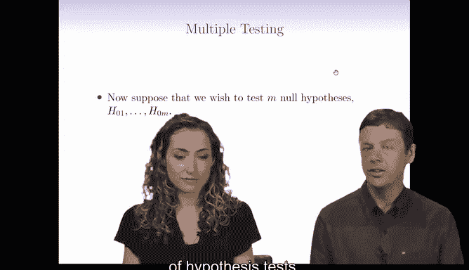
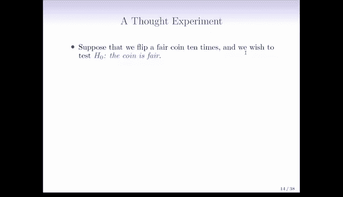
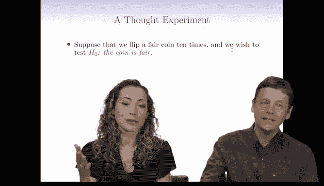
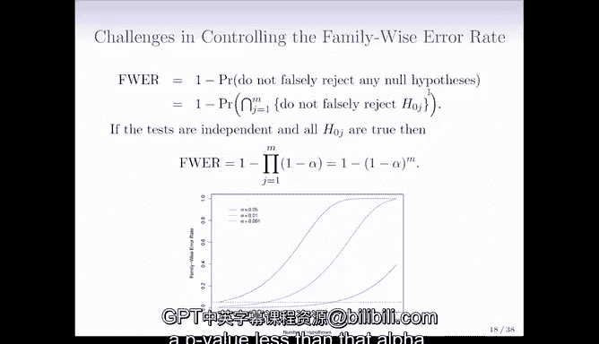

# 斯坦福大学《统计学习导论2023Python版｜An Introduction to Statistical Learning with Python》中英字幕 - P100：-100-Statistical Learning_ 13.2 Introduction to Multiple Testing and Family Wise - GPT中英字幕课程资源 - BV1u4421A7ZU

Now we're going to move on to the topic for this chapter which is dealing with multiple hypothesis tests so now the situation is that we don't have just one hypothesis or one null hypothesis we want to test but M different ones and as I mentioned at the start we've had the sort of concept and statistics forever but the typical value for M was very small single digits two or three。

 something like that and the methods for adjusting in that situation worked pretty well but these days we often have situations where we want to test thousands or tens of thousands of hypothesis tests and the complications from that become even larger so suppose that we simply rejected all null hypothesistheses for which the corresponding P value falls below say1% so what happens if we do that。

 then if we reject all of those null hypothesistheses that four below 1% how many type 1 errorss are we likely to make turns out if M is large a lot。

To sort of illustrate that idea， we constructed a little thought experiment here it's not a very exciting one。

 but I think it does illustrate pretty clearly the issue that you can run into here so let's suppose that we just pick a coin and we flip it 10 times check if it's fair and by the way my sons both have statisticians as parents so they do this quite a bit just for fun。

😊。

I was thinking too bad we don't have a coin right here。

 We could demonstrate this as you're gonna to see it's going to involve flipping a coin a whole bunch of times。

 but I'm sure you guys don't have anywhere to go。 So so well。

 let's pretend we sort of edited that out and we got to the end point here。

 So if we just did this once and we toss this coin 10 times then we'll probably get approximately the same number of heads and tails roughly five heads and five tails。

 And if we calculated a P value for that null hypothesis that the coin is fair it has a 50% chance of landing on heads or tails。

 then it's most likely that we'll get a relatively large P value and we won't reject the null hypothesis。

 that's the whole way that hypothesis tests are constructed。 But now let's imagine。😊。

And instead of just flipping one coin10 times， we somehow find under the sofa1024 fair coins At this point。

 it's very clear that this is just a thought experiment。 you haven't seen my sofa。

 but so then we flip this coin each one of these coins 10 times So we now this could take a while。

 so we'll edit that part out， but if we do that， why did we choose 1024 as the number here， Daniela。

I think it's because that's two to the tenth0th Gareth and so the probability that if we flip one coin 10 times that we get 10 tails。

😊，Is。Exactly one over 1024， one over 10 to the2 to the 10 so if we flip that many coins 10 times then on average we would expect to get about one coin where it came tails every single time and if we were to form a hypothesis test on that one particular coin we'd get a P value of about 0。

002 so a very small P value and why is a 0。002 Gareth。

Because the probability of a coin coming up tails 10 times in a row is only 0。

002 or coming up heads 10 times in a row because it's one over 1024 plus1 over 1024 there's two ways that we could get this extreme in outcome because we would be really surprised if we think that the coin's probably fair and that's on all hypothesis we'll be really surprised if we get 10 tails we'd be equally surprised to get 10 heads presumably so that's why to get the P value it's one over 1024 plus1 over 1024 because we're not specifying that it's more likely to be tails or heads under the alternative it's just not equal。

So if we were to look at that one particular coin and do a hypothesis test on that coin。

 it's almost certain that we would end up rejecting the null hypothesis The other coins maybe we don't reject。

 but the point here is that if we perform enough hypothesis test even when we insist on a very small P value。

 it's almost certain that we make some in this case type1 mistakes。

 this would be a type1 mistake because these coins are in fact fair the null hypothesis is true but at least for that particular coin we' incorrectly rejected it。

And this slide here I think this cartoon sort of illustrates this idea pretty nicely so I'm not sure if you can read this on the screen。

 but the concept here is that they perform a hypothesis test on jelly beans to check if there's a relationship between jelly beans and acne and of course there is no relationship between jelly beans and acne I mean we should probably did the experiment gas I don't like jelly beans so I'm not going to do it。

 but if you want to you can try but in this particular cartoon at least they found no relationship they had a large P value。

 but then the claim was well maybe it's not jelly beans in particular it's particular colors of jelly beans So you notice here that we have exactly 20 of these cartoons corresponding to 20 different colors in the rectangular big box and that corresponds to 20 colors and for 19 of those colors they also failed to reject a null hypothesis with a P value of 5% but it turned out that the green jelly beans had a P value below 5%。

And so you see suddenly here that there's a newspaper story that green jelly beans are linked to acne but the reality is we just performed a large number of hypothesis tests。

 probably the null hypothesis was true in every one of them。

 but if we do enough we're almost guaranteed to get one false positive and so this relates to all the reproducibility issues and things as well happen these days and it also relates to the idea that if you want to either sound really smart or be really annoying potato potato then whenever you see a headline about any kind of scientific or social science study or anything like that。

 you can just be like。I think they had a multiple testing problem and like you're number one you're probably right。

 but also very annoying statisticians don't get invited to a lot of parties that is definitely but there's probably more than one reason for that that's true yeah。

Okay， so this just sort of illustrates the challenge that we have in doing a hypothesis test that we test these large number of hypotheses。

 all of which are true， we reject any null hypothesis with a P value below say 1%。

 then we're going to have approximately 0。01 times M whatever the value of Ms null hypothesistheses that we falsely reject So that's type 1 errors we're going to have 0。

01 times M type1 errors if all of the null hypothesistheses were true So for example， if we had 10。

000 tests and all of the null hypothesistheses were true then we'd expect to falsely reject about 100 null hypothesistheses by chance so suddenly there's 100 newspaper articles about these fantastic discoveries at a very low P value in the reality as we just perform too many hypothesis tests or at least without correcting for at that issue So a lot of type1 errors false positives。

Allright， so then what's sort of an approach that we can take to try to deal with this situation。

 We just discussed that if we perform enough of these hypothesis tests。

 we're almost certain to have some type1 errors， we don't want type1 errors。

 So how can we try to control for the situation where we're doing a lot of these tests and the sort of most classical approach here is something called the familywise error rate and the familywise error rate is just defined as the probability that we make at least one type1 error。

 So if you think about it， if you have a low familywise error rate。

 then you're saying that there's a low probability of making any type1 errors sounds great right So this table here is just sort of an analogous table to Daniella's one that she showed us earlier。

 this again has sort of the four possible situations。

 the two possible real states of the world and the two possible decisions that we could make here and the letters here just represent if I do M of these hypothesis tests how many of those tests。

into each of these four buckets and so for example。

 the bucket that we're really concerned about here is the one where HO is true。

 but we reject HO that's the type one era each night he means each night。HO is true So V here。

 the letter V here just represents the number of type1 era that we're making out of M hypothesis here。

 so the family Y08 here is by definition the probability that V is greater than one。😊，So to be clear。

 we know how many null hypothesisses we've rejected and we know how many we haven't rejected。

 so we know R and we know M minus R， and of course we know M which is the number of hypothesis tests we've conducted。

 but we don't know which column what the values and the columns are， so we don't know the value of V。

 we don't know the value of S and so on。But we can in general calculate or at least approximate the probability that V is greater than one or this family Y zero rate or we can hope to try to control what that value is and that's what we're going to talk about it now some approaches for trying to control that family Y zero rate and just before we go on to that I just want to say Gareth in your courtroom analogy I think that the idea here is we have M defendants each of whom is being put on trial。

AndV corresponds to finding one of the defendants guilty when， in fact。

 none of them are guilty and we would be really， presumably。

 we would not want to find even one of the M defendants guilty if， in fact。

 they're all innocent So that's why were stressed about the possibility of V being greater than equal to one。

 we want that familywise error rate， the probability of wrongfully convicting someone to be very。

 very small， wrongly convicting anyone among the M to be very small how does it go better to let 10 innocent people go 10 guilty people go than to convict one innocent person。

 So Although here they're all innocent because the familywise error rate。

 we're thinking about than all hypotheses all being true。

Okay so controlling the familyY0 rate sounds like a good thing if we have a small familywise0 rate。

 we're likely to make no type1 errors， but in practice it's often hard to actually control that and this formula here sort of illustrates how you might calculate the family Y0 rate and what it's really saying is that it's equal to one minus the probability of the intersection that we do not falsely reject the J null hypothesis now in practice that probabilities hard to calculate in the general situation。

 but if we simplify things and imagine that each of our hyposes tests are independent so that intersection becomes a product of the individual probabilities。

 and we assume that all the null hypothesistheses are true and we only reject the P values less than alpha then it's not too hard to show that that family wise0 rate is equal to this one minus alpha all to the M quantity。

And so what does that look like for different values of m and different values of alpha？

 So this plot here just shows for three different values of alpha5%1% and 。01%。

 and different values of M， what happens to that family Y0 rate and the dotted line down the bottom is at the 5% level。

 So if you wanted to have a family Y 0 rate of 5%， what value of M is going to work for that。

 And basically what this shows you is that when M gets even moderately large。

 you can end up with family Y0 rates that are close to 100%。 So in that sense。

 the family Y0 rate is not helping you at all because you're almost certain to make at least one type 1 error here。

 So the way we read this plot is if you look at the purple curve， like when m equals 50。

 So when're at 50 on the x axis。The purple curve is right around 0。05。

 and so that means if you reject any null hypothesises， if it P value is below 0。001。

 but you have 50 null hypotheses， then there's a 5% chance of making a family wise。E。

 a type1 error type1 error at least one type1 error but you can see that once you get up to say 500 here。

 even at that very， very low value of alpha， you're already up to about a 40% chance of making at least one type1 error So this familywise error rate is essentially a very hard quantity to control for very large values of M and the only way to control it is to have your alpha be tiny and remember alpha is the type1 error that you're trying to control So it's like the threshold at which you're going to reject an allll hypothesis if you see a P value less than that alpha。

