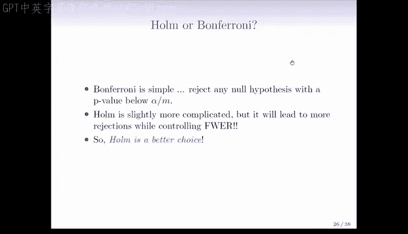
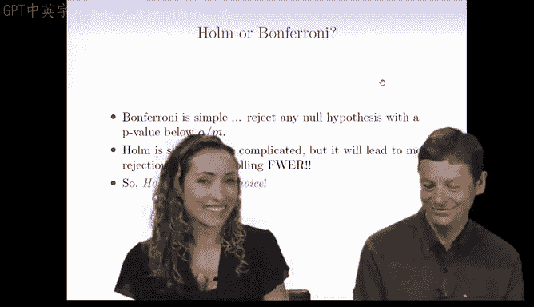

# 斯坦福大学《统计学习导论2023Python版｜An Introduction to Statistical Learning with Python》中英字幕 - P102：-102-Statistical Learning_ 13.4 Holms Method for Controlling FWER.zh_en - GPT中英字幕课程资源 - BV1u4421A7ZU

Okay， so I'm going talk about one other method that's a little bit superior to Bfronne in some ways。

 and， but it's a little more complicated。 So it's not quite as popular， I think。

 But let me quickly go through how this approach works。 So this is known as Holmes method。

And it starts the same way as Bon Frona， you just perform standard hypothesistheses tests on your M hypothesistheses and calculate standard P values P1 through PM。

 so it's exactly the same as before。But now what we do is we order the P values from the smallest to the largest。

 so this P1 with parentheses just represents the smallest P value， P2 is the second， etc。

 so they ordered from smallest to largest。And then we apply this rather strange looking calculation where we try to find the first p value where the value of that p value is greater than alpha。

 say 5% if that was our cutoff， let's say over m plus1 minus J so just to give you a feeling for that suppose that j is1。

 then the smallest p value， we'd be looking at that and comparing it to alpha over m or alpha over m plus 1 minus1。

 So alpha over m， which of course is the same as the bond for only cutoff So for the smallest p value。

 we're looking to see whether that value is past alpha over m。

 if it's not then we go on to the second p value and we ask is the second smallest P value greater than alpha over m minus1。

If not， then we go to the third one is that smaller than alpha of m minus2 etc cetera。

 and we find the first point where we break that rule where the P value is above that value。

 and then we simply reject all null hypothesisses where the P value for that null hypothesis is less than this cutoff P value so。

This is also guaranteed to control the family wise errorerate and it turns out that it often will reject more hypotheses than the B fronone method it's always going to reject at least as many as the B fronone method right and you can see that because you compare the smallest P value to Al over M so if homes fails to reject that P value then Bo fronone won't reject that either。

So again， let's look at this on the fund manager data。

 so I've ordered the P values now from smallest to largest。

And it turns out that when we apply Hol's procedure that the first two null hypotheses get rejected and that's because the smallest P value is less than 0。

01， that's the alpha over m but the second P value is also less than alpha over m minus1 and that turns out to be 0。

0125 so now fund manager 3 just sneaks in under the threshold right under the wire under the wire and is also rejected which is a good outcome for the manager and just be clear that's fund managed3 because P parentheses2 is the second smallest P value and that corresponds to Man 3。

But of course the other managers the P values are still very large so we don't reject those So this is just a very simple example of a situation where home rent managers to reject two null hypotheses but bond fny does one but both methods are controlling the family wise zero rate at 5% and by the way this is because bond fny is sometimes overly conservative we guarantee that the family wise0 rates no more than 5% but in practice it might be quite a bit less than 5% so we've been overly conservative。

These pictures here just illustrate one more way that you can see home beating out Bo Ferroni。

 so here we have 10 different hypothesis tests that we performed and these are the P values associated with those hypothesis tests ordered from smallest to largest。

The black horizontal line here is the alpha over M threshold that Bonfroni uses so every point under that is rejected by Bon froni so here alpha is 0。

05 and M is 10 so that's the 0。005 level in black exactly and the blue line here is the cutoff for home after you order the P values from smallest to largest and you can see that it starts at exactly the same point as Bonfroni but then as strictly above that。

The black points where both home and Boon fronni get the same conclusion either rejecting or failing to reject。

 but this one red point you see at number eight here is rejected by home because it's below the blue line but is not rejected by Bon froni so that's like the red what is a discovery that we made using the home correction but not using the Bonfnie correction and we want to make as many discoveries as possible subject to controlling the family wise error rate so that red one represents a real win for home exactly and just one more picture to illustrate a more extreme example here this is sort of unusually extreme but this illustrates that here we've got only three hypotheses rejected by the boonfni approach but we actually managed to reject eight hypotheses using home so potentially you can get a lot more discoveries this way。

Okay， so which is preferable again it just comes down to which you prefer Boonfronni is a little simpler home is slightly more complicated。

 though not dramatically both will reject the family Y zero rate home is a better choice in terms of getting more rejections Well I think this has to do with whether you're is it satr versus maximizeimr because I personally think Boonfoneia is usually good enough and home is just a little bit showoffy。

But。Yeah。😊，And let's be I'm like just lazy to the level where I do Bonfroni and along with 99% of other people because Bonfronni is by far the most popular approach here Yeah but with alpha equals 0。

01， Garreeth can reject an all hypothesis because that  one%。😊。

