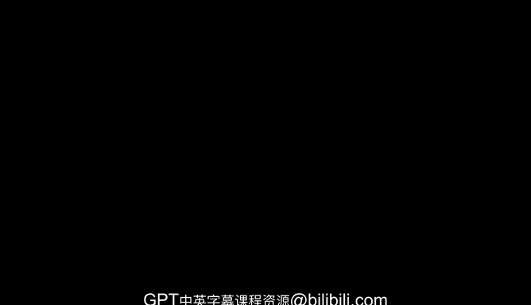
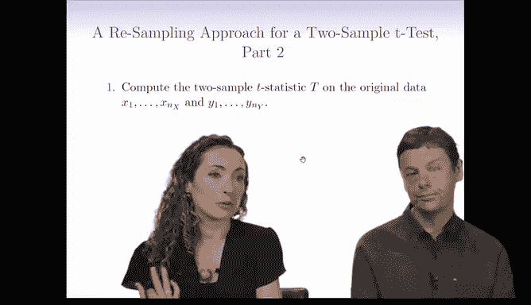
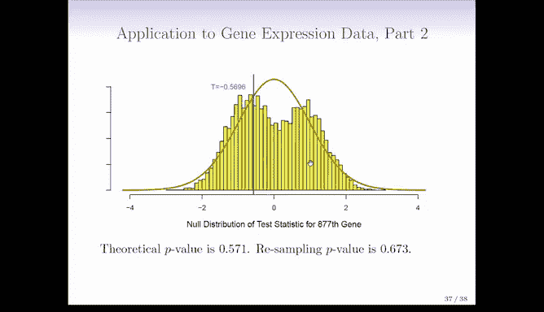
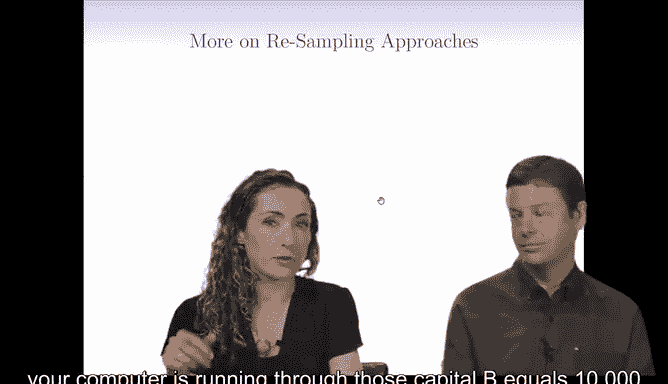
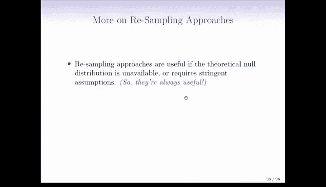
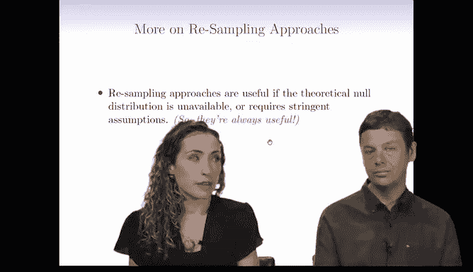
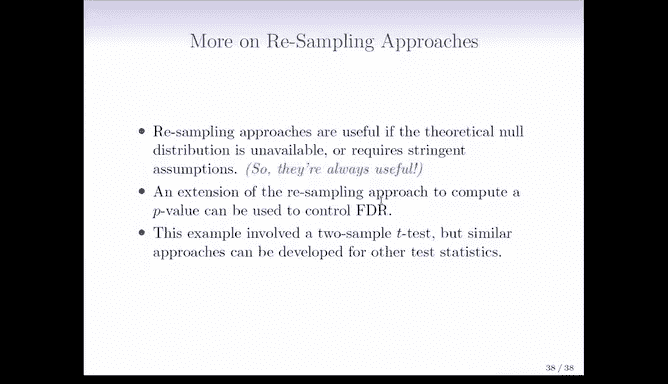

# 斯坦福大学《统计学习导论2023R语言版｜An Introduction to Statistical Learning with R》中英字幕 - P102：-102-Statistical Learning_ 13.6 Resampling Approaches II.zh_en - GPT中英字幕课程资源 - BV1yU421o7WA

And so the way that we're going do this is by saying well under the null hypothesis。

 there's really no difference between the x's and the y's。

 they all have the same mean under the null hypothesis。 So I'm just going to scramble them。

 I'm just going to shuffle them together。 I'm going to permute them。

 I'm going to resample them and I'm going to generate a tea statistic on that shuffle data。

 I'm going to do that a huge number of times in order to。😊。

Simulate the null distribution。And the idea here is that if I shuffle the data。

 I'm essentially guaranteeing that the null distribution is correct。

 because even if there was a difference， once I've shuffled it that difference will go away or stated another way under the null distribution。

 it doesn't matter whether we shuffled our data， it's all the same either way。

So the first thing we're going to do is we're going to compute a two sample T statistic on our data。

And then we're going to do something a huge number of times where B is a really big number。

 Like if you're lazy， then B might be 100。 And if you are a very energetic person。

 or actually maybe if you're a lazy person because your code will run for a long time。

 So you'll have a long time to go get a coffee。 Well， whatever your B might be larger， like 10000。

But bigger B is better。 So what you're going to do is you're going to randomly shuffle the observations。

And then you're going to call the first n sub X observations x1 star through x and X star。

 and the remaining observations are going to be y1 star through Y and Y star。

 So all that you've done so far is you took your x's in your Y's， you put them in a basket。

 you shook up the basket， you grabbed N X and called them X stars。

 you grabbed NY Y called them Y stars。And now you're going to compute a two sample T statistic on this shuffle data and you're going to call it T star。

😊，Where the little bee is because this is a little beef。Time that we're going to do this procedure。

And then after we've done this capital B times like 1，000 times， we're going to compute a P value。

 and the P value is just the fraction of the time that the T statistic on the shuffle data exceeded in absolute value。

 the T statistic on the real data。So what does this notation mean Gareth that one with the subscript So this is just counts as a one a value of one if this quantity the in the parentheses is true and zero otherwise so it's just so with the summation here this is just counting the number of times that it's true Yeah。

 so this the numerator is just the number of simulated data sets or the number of resample data sets reshuffled data sets for which the test statistic exceeded the test statistic that we got on our real data and I'm dividing it by the number of times I did this reshuffling。

And the reason we have these absolute values here is because we're computing a twosided P value where we're equally interested in if the means are unequal。

 we're equally interested and the x is mean being larger than the Y mean versus the Y is mean being larger than the x is mean this is a two sided P value if you only wanted a one sided P value。

 you could get rid of those absolute values and the concept here is that if the resampled T statistics are almost all smaller than the observed T statistics。

 then we're pretty suspicious that the null hypothesis is not true。

 but if we get quite a few resampled T statistics that are just as larger or even larger than what we observed。

 then we're not so interested， we're no longer suspicious about that value right。

So here's what we get if we take some gene expression data and we look at a particular gene where we have a control group and treatment group measured for this gene and for this particular gene on the real data our t statistic is negative 2。

09 that's the blue line and in orange I'm showing you the theoretical null distribution for that t staistic so that's an orange and if I take this shuffling or resampling approach in order to simulate the null distribution I get the histogram shown in yellow and indeed what I see here is that the yellow histogram so that reshuffled distribution that I got for the null distribution is pretty similar to the theoretical null distribution shown in orange doesn't really matter much that I did reshuffling and in fact here the theoretical P value if I use that theoretical normal 01 distribution as my null distribution for the T statistic is 。

041 my resampling P value is 0。042 so in this particular example this was a big load of nothing and the reason it was a big load of nothing again is because the theoretical null distribution actually was pretty close to my reshuffled null distribution anyway。

It just didn't really matter though it does add confidence that we had the right answer Yeah。

 there is something to be said for just like using a resampling approach when you can because like why not。

 it just feels a little like。Like you've made fewer assumptions and actually here's on the same data set a different gene and you can really see now here's a gene where our results are actually a bit different depending on whether I use the theoretical null distribution shown in orange versus the reshuffled null distribution shown in yellow as the yellow histogram and we can see that actually those two distributions do look a bit different our observed test statistic is negative 0。

5696 and my theoretical P value resulting from the theoretical null distribution is 0。

571 whereas the resampling p values is 0。673 So in this particular case， both p values are large。

 so this won't really probably affect any conclusions that I draw about the data or rather conclusions that I draw from the data but nonetheless we can see here that sometimes a resampling approach can give you result that is a bit different and in general。

 a resampling approach you're like kind of trading off computational time for making slightly weaker assumptions。

And the computer doesn't mind doing that extra work， so a computer doesn't mind doing the extra work。

 that's true。And it's always a good excuse to like go get a long coffee while your computer is。

runningning through those capital B equals 10，000 reshuffles。

All right， so when our reampling approaches useful， well。

 they're they're definitely useful if the theoretical null distribution is unavailable。

 So in the case of a two sample T statistic， if you have a large sample size。😊。

This is just my opinion a different side might disagree with me。

 I feel like if you're doing a two sample T statistic and your sample size is really really large。

 maybe you don't really need a resampling approach， but if your sample size is smaller。

 then that's a really good reason you might want a resampling approach for two sample T test because in that case we actually don't know the theoretical null distribution or maybe there' is a test statistic that you're interested in or null hypothesis you're testing for which you really just don't know the theoretical null distribution at all without making some really strong assumptions。

So one way to think about this is that resampling approaches。

 maybe we can just say they're always useful because they don't usually cost us very much to do and。

They can allow us to overcome some hurdles associated with not knowing a theoretical nu distribution。

So here we've talked about using resampling to compute a P value。

 It turns out you can also use a resampling approach to control the FDR。

 if you look it up in the textbook， actually， we work through that and we also work through it in the R lab so you can see how we can use resampling to control FDR in the book。

 We're not going to cover it today。In this lecture。 and then finally。

 here we talked about a two sample tea test， but you can develop similar approaches for other test statistics。

 It just requires a bit of thinking。 it's not usually like just a command and R where you just like type in and then you get a P value out。

 you need to think about like how would you design a resampling approach based on your particular null hypothesis and your particular test statistic and it's not always so clear how to do it。

 a two sample T statistic is kind of like a very easy example， but it can often be trickier。

 All right， well， that's fit。 I'm looking forward to trying to do all of this in the I lab next。 Yes。

 if there any if anything doesn't run， it's because we're using Garret's computer So just be warned Can I make a joke about how your computers doesn't like PCs I've never been seen with a PC before。

 this is hopefully you wanted to make it clear that this is not who I actually wanted to put an apple sticker on this but I did not have one with me So I wasn't able to do that。

😊。

Dll would probably su you as well。