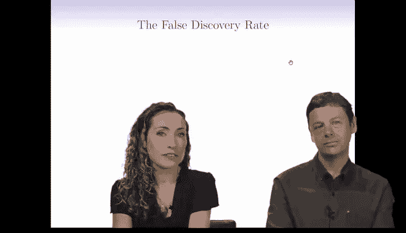
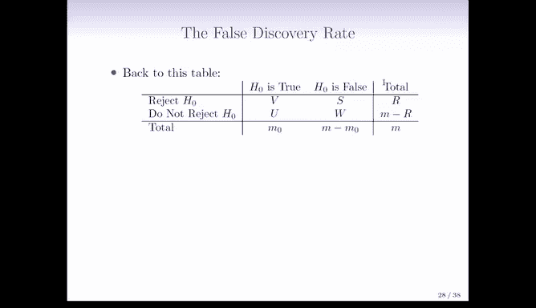
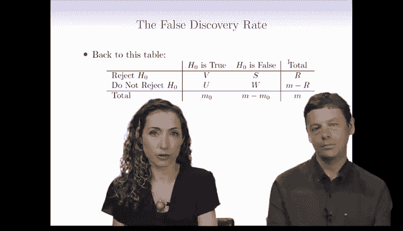
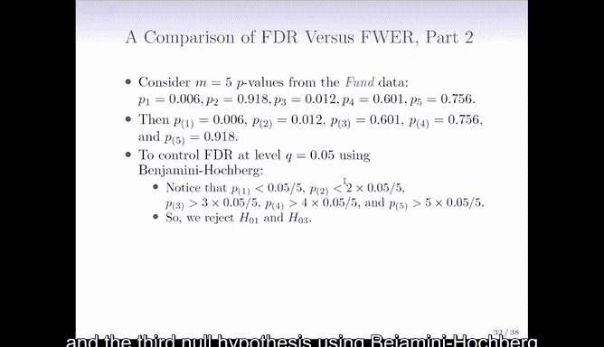

# 斯坦福大学《统计学习导论2023Python版｜An Introduction to Statistical Learning with Python》中英字幕 - P103：-103-Statistical Learning_ 13.5 False Discovery Rate and Benjamini Hochberg Meth - GPT中英字幕课程资源 - BV1u4421A7ZU

All right， so that's it for the family wise error rate and now we're going to move on to a topic called the F discovery rate。

 which is sort of a more contemporary take on multiple testing so it really goes back to this table where remember this corresponds to the possible outcomes for m hypothesis tests that we've conducted。

And we can control free hypothesis test， which row we're in because we know how many hypotheses we rejected and how many null hypotheses we haven't rejected。

 but we don't ever know what the values in the columns are because the columns correspond to the ground truth。

 which of course we don't have access to。 So the familywise error rate focuses on controlling the probability that V is greater than one。

 The probability of falsely rejecting any null hypothesis。

 And in Garrett's example of a criminal defendant。 again。

 this corresponds to the idea of having M defendants on trial And V is the event that we falsely convict someone who's innocent。

 That's really bad。 So the familywise error rate is what we've been talking about so far。

 we want it to be small。

But the issue is that in a lot of settings， we're not actually dealing with potentially sending someone to prison for a crime they didn't commit in a lot of settings。

We might be okay occasionally having a type 1 error。

And the reason we might be okay with the typepe1 error is because trying to avoid any type 1 errors like the familywise error rate is doing might just be too tough of an ask when M is large it might involve just us never rejecting anything right and so again。

 in the case of a criminal defendant that might be okay because maybe the cost of falsely convicting even one person is just a cost that we're not willing to bear。

 but there are other settings where we might be able to occasionally make some type 1 errors in exchange for being able to reject a larger number of null hypotheses。

So that leads to this idea called the false discovery rate and the false discovery rate or the FDR is the expectation of v divided by R。

 So if we look at this table， R is the total number of null hypotheses we reject and V is the subset of those rejected null hypothesistheses for which the null hypothesis actually holds。

 so those are the errors。So the FDR is just the fraction of the rejected null hypotheses that were actually true that we actually shouldn't have rejected and that e notation means that this is an expectation on average。

 we might have a false discovery rate of say， what would a good number be here 20%。

 let's say 20% and so that would indicate that of all the null hypotheses we rejected。

We expect about 20% of those to be false discoveries and 80% of them to be correct discoveries。

 So this idea of false discovery rate is useful in some applications and not others。 So again。

 in the context of a criminal defense setting we would be really really unhappy if 20% of the people who we convicted were actually innocent like that is clearly not going to be okay but there's some other settings where a false discovery rate could make sense。

 So for example， let's say that you're a scientist and you're testing M drug targets where M is maybe 10000。

To see if they might be useful against。I don't know， hypothetically。

 a virus that's caused a huge pandemic the last 18 months， hypothetically。

And you don't want to have too many false positives， but on the other hand。

 you might be okay with the false discovery rate of 20% because any drug target that seems promising against COVID。

 you're going to of course follow up on in the lab extensively。

 so that's a setting where you'd be okay with having a larger number of type 1 errors in exchange for having a lot of drug targets that you can do follow-up investigation on。

 but you don't want too many type1 errors， you want that false discovery rate to be capped at maybe 20% or 10% depending on how many resources your lab has to follow up on those drug targets。

All right， so the false discovery rate， it's the expectation of this ratio。

 which is the number of false rejections divided by the total number of rejections， we have 20。

000 drug candidates， we want to identify a smaller set of promising candidates to investigate further。

But we don't want the smaller set of promising candidates to have too much garbage。

 We want some assurance that that set of quote unquote promising drug candidates really is promising。

 So we want the FDR to be not too big in the setting。

 familywise error rate really isn't the right thing because familywise error rate would help the scientists be sure that no drug targets are false positives。

 but again， some false positives are okay one the reality is that if you tried to control the familywise error rate and that saying you probably just end up finding nothing That's right exactly。

Because 20，000 is a really big number。Allright， so it turns out that there's a really。

 I don't want to say easy way to control the FDR because as you'll see。

 it's sort of a little bit unintuitive。 but let's just say a very clearly defined procedure that's actually going to allow us to control the FDR。

 And this is called on Benjamini Huckberg。And I think that one of the videos as part of this online course actually may possibly include an interview with Benenjimini。

So here's the idea behind the Benjamin and the Hawkburg procedure。 First， you're going to specify Q。

 That's the level at which to control the false discovery rate。

 So when we were talking about type 1 error and family wise error rate。

 we usually use alpha as our letter， and now our letter is going to be Q。

And now we're going to compute P values for each of our am hypotheses。

We're going to order those P values where again， P sub1 with the parentheses indicates the smallest of the MP values and P sub M indicates the largest of the MP values。

So so far， this looks a lot actually like that home procedure that Gareth showed us。

 and now I'm going to define L and L is going to be the largest value of J such that the J's smallest P value is less than Q J over M。

Oh goodness， Gareth， that's quite a mouthful。 that's why I let you present it， right。So。Again。

 it's the largest value of J， such that the J smallest null hypothesis is less than  Q。

 which is my FDR threshold like maybe 0。1 or something times J divided by M where m is the number of null hypotheses。

And then we're going to reject all of them all hypotheses。That have P values smaller than p sub L。

 so P value is smaller than the L's smallest P value。And if we do this procedure， then through magic。

 the false discovery rate is going to be less than or equal to Q。It's not really magic。

Statistical theory statisticalal theory， should we call it that Okay。

 so the FDR is going to be less than or equal to Q。

 I'll say the argument for why Bon Ferroni procedure works， Gareth showed twice。

 it was a couple of lines。 The argument for why that Benjamin Hawkberg procedure works is is more involved。

😊，All right， so in this slide we can sort of see。What happens if we compare the false discovery rate to the family wise error rate and this is an example where we have a whole bunch of P values in particular。

 2000 P values for m equals 2000 null hypotheses and here the P values have been ordered。

From smallest to largest， so the x axis indexes those ordered p values and the y axis shows you the value of the P value on the log scale。

And suppose that we want to control the family wise error rate at level alpha equals 0。

1 using a bond fori correction。 Well， that corresponds to rejecting any null hypotheses for which the P value is below the green line。

 So you can see that horizontal green line that corresponds to 0。1 divided by 2000。Remember。

 the wax is on the log scale。And we can see that none of these 2000 P values fall below the green line。

 That's disappointing。 It's very disappointing。 It's like， you know。

 we put in all this money to conduct this study。 We tested 2000 things。

 and we're unable to reject any of them at an F W E R at a false familywise error rate of level alpha equals 。

1。 So it's very sad。 Even though some of those P values look pretty small。 They do look pretty small。

 don't they。 Yeah， I'm feeling really disappointed actually by this finding， lack of finding。

 You can't publish a paper on this。But if instead said， we think about the false discovery rate。

 if we control the false discovery rate at level 0。1 or 10% with Bennjamini Hburg。

 then that amounts to rejecting all of the null hypotheses that are shown in blue。

And you can see that's a whole bunch of blue null hypotheses， or rather a whole bunch of P values。

Corresponding to null hypotheses that we're going to reject。 So what's going on here， Well。

 if you look at that red line and we go back to the Bennjamini Hawkckberg procedure。

 the red line corresponds to a line with slope Q over M。

 And that's because if you look at step 4 here， I want to find the largest value of J。

 such that the the P value is less than Q J over M。So this red line has slope Q over M。

And what I want is the largest P value index。Such that the P value falls below that red line。

 and that actually is right here。 Can you see that it's like the。The right most blue point。

 So that's why the blue points are all here is because these are the the P values that are less than the L largest P value。

 where here L is。The last time。That a P value falls below that red line。So using Benjamin Hopper。

 we were able to reject a lot of null hypotheses Gary。 This is really great。 But remember， FDR。

 it seems like a win because it allowed us to reject a lot more null hypotheses。

 But the guarantees that we're getting are really different。 So again， with a familywise error rate。

 We're saying we're not willing to make any mistakes。 or rather we。

 we want no more than a 10% chance of having any false positives。 And with FDR， I'm like， hey。

 false positives are fine。 Like， I'm cool with false positives， please just don't give me too many。

 I don't want more than 10% of my discoveries to be false。😊，All right。

 so we can go back actually to the fun data where we have these 5 P values。We order them again。

 so the smallest is 0。006， the largest is 0。918。 and we can think about applying Benjamin the Hberg。

 so we need to compare the smallest P value to 005 over 5。 The second smallest p value to 2 times 。

05 over 5 the third to 3 times 005 over 5， the fourth to 4 times 005 over5 and finally the fifth that gets compared just to 。

05。 And then we need to look for the largest index such that the P values is less than the threshold that we're comparing it to。

 And we see that for P1 and for P2 those p values are smaller than the threshold。

 but starting with the third smallest p value， the P values actually exceed the threshold。

 So that means that we can only reject the null hypothesistheses corresponding to the two smallest p values。

And again， that corresponds to the first and the third manager。

 So we're going to reject the first and the third and null hypothesis using Benjamini Hberg at level 。

05。 So this is actually an example where on this fund data， the。

Using FDR as opposed to， the home procedure did not lead to more discoveries。

But usually the time when we're going to see a difference between FDR and family wise error rate is if M is really really large and here M is pretty small so we're not seeing much difference This sort of is more like the classical city something like familywise error rate could make sense right so here here on this slide we're saying that using Bonfronian and controlling the familywise error rate。

 we only reject H not1 but if you can recall from a few slides ago when we use home to control familywise error rate we did actually reject both the first and third manager。

