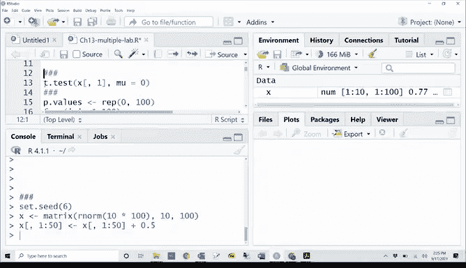

# 斯坦福大学《统计学习导论2023R语言版｜An Introduction to Statistical Learning with R》中英字幕 - P103：-103-Statistical Learning_ 13.R.1 Bonferroni and Holm.zh_en - GPT中英字幕课程资源 - BV1yU421o7WA

Allright， well welcome back。 We're now going to walk through the lab on multiple testing and of course the first thing that we do whenever we sit down at our computers is that we should set a random seed so that you'll get the same results that we get so here are C the6 and now we're going to simulate some data and the data is going to correspond to 100 hypothesis tests each of these hypothesis tests is going to be that the mean of a particular vector equals 0。

 let's create this matrix x and so what we have here is a matrix x with 10 rows and 100 columns each column corresponds to hypothesis that we're going to test which is that the elements of that column have mean  zero。

 And right now this x matrix， all of its elements are normal01。

But we're going to modify the first columns of x so that their mean is actually 0。5。

 So that's what we've done here。 We've taken the first 50 columns of x， and we've added 0。

5 to each of those first 50 columns。And again， we're going to test the null hypothesis that for each of the 100 columns of x。

 the null hypothesis or rather the mean is zero。 so we can use the t dot test command to test the null hypothesis on let's say the first column here and you see that when we do this we get some output And in particular。

 the P value is 0。07 So for this first column did the null hypothesis hold or did not hold I can't remember So for the first column it did not hold the null hypothesis did not hold but we got a P value of what now 0。

07 So just because we get a slightly larger P value of course doesn't guarantee that the null hypothesis that's true So this is actually a guilty criminal but we failed to reject the null hypothesis that they're innocent and because we didn't get evidence beyond reasonable data That's right there's still a reasonable doubt we happen to know because we simulated the data that the null hypothesis does not hold for this first column but our P。

doesn't show us that in this case。So that's how we're going to testin nu hypothesis for the first column but we're going now make a full loop to testestinal hypothesis for all 100 columns right and so now what we're going to do is look at which of these P values were less than5% and which ones were greater and so to do that we first create a vector with 100 elements and at each one that says do not reject the null hypothesis and then we go through and select out the elements where the Pvalue is less than 5% change out to a rejection decision and here's the table of counting all the various possibilities and this corresponds to the tables we were looking at in the slides and of course because this is simulated data and we know the truth we can actually calculate all four components of that table and so for example here the situations where we manage to reject the null hypothesis even though the null hypothesis is true。

 that's this three here， that corresponds to V the type 1 errors that we had previously。

So this two by two table that Gareth just created for us。

 it looks like those two by two tables from the lecture although notice that like a couple of the columns have been swapped like left right and up and down so you got to look carefully to understand how this corresponds to those tables from the lecture so in particular though V here V is the number of false rejections or type1 errors V is what now Gareth。

😊，3，3， and why how can we conceptualize the fact that it's three。

 like what would we have expected it to be if we're rejecting。

 so let's think about this we we're rejecting any null hypothesis for which the P value is less than 005 and there were 50 null hypotheses。

So we would expect about two and a half that we falsely reject。 So yeah。

 we expected to falsely reject around two and a half。 We actually falsely rejected around three。

 Does that pass the sniff test seems reasonable seems reasonable。 Yeah。

 so we have three false rejections and then we can feel really happy about the fact that out of the。

😊，Well， let's see then all about this was true for 50。 so we had three false rejections。

 and then that means， of course， 47 that we didn't falsely reject。So that's good。

 but we we can't actually feel so good about what's happening in that leftmost column because out of the 50 null hypotheses that didn't hold。

We only managed to reject for 10 of them and that was because the。

Even though they didn't hold they weren't too far off from the truth and so we didn't have enough data to be really sure to reject them。

 remember we only have 10 observations here for each of these hypotheses So like remember we had that P value of 0。

07 even though we happen to know in our hearts because we simulated the data that that null hypothesis was false for the first column we weren't able to reject a to for that first column and that shows up in that top left corner here So those are like 40 failures to reject So the bottom line here with this two by two table is that out of the times that the null hypothesis held out of the hypotheses for which the null hypothesises held。

 we only falsely rejected three times out of 50 and that's again what we would expect based on controlling the type 1 error at level alpha equals 。

05 so that's good news and then the bad news that's a little bit disappointing is that out of the 50 null hypothesistheses or rather the 50 hypotheses where the null hypothesis didn't hold we actually only successfully rejected 10 times and that's just really because。

For the other 40 times that the null hypothesis didn't hold。

 we just didn't quite have that preponderance of evidence that we need to reject at level 0。

05 and that's because even though the null hypothesis didn't hold for those 50 we were only 0。

5 different the means were only differed by 0。5 or rather that the mean was only 0。

5 away from the null hypothesis right and so not a very strong signal as we sometimes talk about in hypothesis testing so let's repeat this calculation very quickly but with a larger mean difference for the 50 where the null hypothesis doesn't hold instead of using 0。

5 will' use one here and repeat everything else we'll recalculate the P values。

And recalculate the table。And now what do we see Well now I'm a lot happier because out of the 50 null hypotheses that did not hold。

 so that's the look in the first column H n was false 50 times we actually successfully rejected 41 times out of 50。

So that's really good。 Excel。 Now， what about the right hand column though， Garyeth。

 what's going on Well， so of the situations where HO was true。

 there's was actually only one time where we rejected the null hypothesis。

 So that's pretty good as well。 and that discrepancy between the three that we got before and the one that we have now。

 How can what can we chalk that up to just random variation in the hypothesistheses random variation。

 Yeah， we would expect on average again， to be。😊，Rejecting falsely rejecting the null hypothesis two and a half times on average so that bottom right number should be something around two and a half it was three the first a little bit Yeah a little bit lucky all right okay so the next thing we're going to do then is talk about the family error rate and one of the plots that we showed was with the simplified calculation where we assumed that the null hypothesistheses werere all independent from each other and calculated for differing values of M what the familywise error rate looked like and so I'm going to reproduce that plot here it's a relatively simple calculation make a vector m from one to 500 and then we're just applying the same formula that was in the slides for different values of alpha and then i'm just going to plot these three curves。

Now we have our first plot。And our second and our third。

 so these correspond to the three different values of alpha here。

 and you can see again that as M gets larger and larger。

 the family Y0 rate rapidly goes up towards one， except for maybe the green line when alpha is really small。

 but eventually even that one would get close to one。

 so just emphasizing that for large values of M it's very hard to control the family Y0 rate。And oh。

 here's the 5% cut off。Okay， so now we're going to move on and look at those fund managers data。

 the five fund managers， and this data is in the ILR2 library so we're going to load in that library and we're going to start off by looking at the data set itself has thousands of fund managers in it。

 but we're just looking at the first five here， so just subset it off the first five fund managers。

Calculated a T test for the first of those fund managers and you can see here the P value is 0。006。

 which is what we saw in the slides previously so this is just matching the data that we had before we're going to calculate the P values for all five of these managers and it's going to print them on the screen here so you can see these again are the five P values that we saw previously in the slides and we can see fund managers one and three have the smallest P values and fund managers245 have very underwhelming P values definitely wouldn't stick with those ones。

So now we're going to apply the bonfron and home methods and fortunately we don't have to be very clever in implementing these methods in R because R does the calculation for us automatically using this P dot adjust function so how does this work so if I use P dot just I feed it the P values and then I just tell it method equals Bfoni and it automatically adjust the P values and essentially all it's doing really is multiplying them by M and cutting off at one where M is the number of tests exactly so in this case M is5 and if you look at this all it's done is just multiply each one of my P values by5 and some cases that would result in a value greater than one so it just caps it at one and you can just emphasize that I've done a little calculation here where I've just manually done the same thing and you can see it's identical to the bonfonone。

Okay， and then just the final one here using the home method home was a little more complicated to describe。

 but it's actually trivial to calculate in R because again。

 we use exactly the same command and just tell method equals home and it makes those adjustments and you can see that the smallest P value the one associated with fund manager one hasn't changed at all here。

 which is what you'll always see with home。 but the really important one is fund manager 3 where the P value using Boon Ferroni。

 the adjusted P value if you like was just a bit above 5% and now using home it's a little bit below 5%。

 So this is why we can now reject at least at the 5% level of significance。

 the nu hypothesis for fund manager 3。 So we're happy。 we're happy， as you all know by now， I'm lazy。

 So I prefer Boon Feroni to home。 I know that Gareth is on team home。

 But what I will also tell you is like 0。05， this is just like an arbitrary threshold for family wise error rate and like。

😊，You know， the idea that we would be rejecting for fund manager one if we use home because that adjusted P value is just barely below 0。

05 but using Boon fny we wouldn't reject that sort of shows how arbitrary these cutoffs are there's nothing magic about 0。

05 but it also emphasizes that this Bo forny number is probably of 0。

058 is is probably a little more negative than it needs to be a little more conservative that Yeah we can actually we can be a little more sure than Bo fny suggesting about fund manager 3 Well I don't feel sure。

Okay。I feel a little more， oh he feels more sure than I do。

But neither of us are investing in him so it doesn't matter， well he works at a business school。

 I'm only going to do what he tells me to do when it comes to investing。

