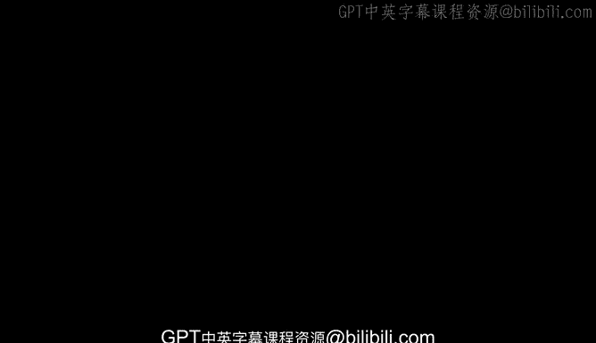
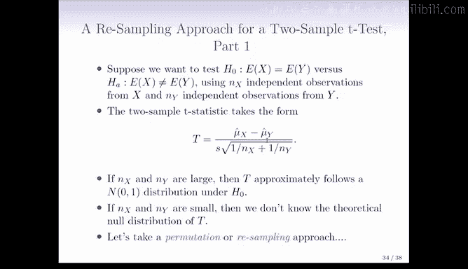

# 斯坦福大学《统计学习导论2023Python版｜An Introduction to Statistical Learning with Python》中英字幕 - P104：-104-Statistical Learning_ 13.6 Resampling Approaches.zh_en - GPT中英字幕课程资源 - BV1u4421A7ZU

And now we are on to just sort of the last topic， which has to do with the resampling approach and resampling approaches are a really。

 really powerful tool。

That gives us a way to conduct hypothesis testing， either a single hypothesis test or a lot of hypothesis tests。

In a way that's relatively assumption free。So what is this all about Well in this lecture so far。

 we've assumed that we're in the scenario where we want to test some null hypothesis H not。

 we have a test statistic T， and most importantly， we know where else we feel like we can assume the distribution of T under the null hypothesis。

And that's how we were able to compute the P value was by knowing the distribution of the test statistic under the null hypothesis。

 So remember this figure from before。 and the distribution of T under the null hypothesis was this yellow curve in this particular example。

 the distribution of T under the null was a approximately a normal distribution， than in general。

 depending on your null hypothesis depending on your T statistic。

 that null distribution of the test statistic could be a different distribution an unknown or it could be unknown。

 right， And in fact， that's the idea here is what if this theoretical null distribution is actually unknown。

We just don't know what it looks like， or alternatively。

 we could make some assumptions under which we might know what it looks like。

 but maybe we feel a little bit weird making those assumptions because we don't really think they're going to hold。

Oh， we're worried they might not hold at least we're worried they might not hold。

 We just want to do something that's a little bit more assumptionfr。

 So one way we can do this is using a resampling type of approach and the thing we should say about resampling approach before we get into the details is that it's a very general framework that needs to be instantiated in a specific way depending on the type of hypothesis you're testing and the type of test stat you're using So today we're going to talk about what a resampling approach will look like for conducting a twosample T test but in general。

 if you're testing a different type of null hypothesis it's not just a difference in means or if you have a test statistic that's not just a twosample test。

 you're gonna need to figure out whether there is an appropriate resampling approach for you and also what that resampling approach looks like so this is going really require some hard thinking and it's not plug and play the way that a lot of things that we've seen so far in this lecture are So the idea is supposed we want to test the null hypothesis that the mean in one group equals the mean in another group versus the alternative。

that they're unequal and here we have n sub x independent observations from x and n sub y independent observations from y。

 well then as we've already seen today， the two sample T statistic takes the form of just the sample mean in group x minus and sample mean in group Y divided by an estimate of the standard deviation between mu of x minus mu y。

And if Nx and NY are large， then as we've already said。

 T approximately follows a normal 01 distribution under the null hypothesis。

But what happens if Nx andnyy are small， Well， in that case。

 we actually don't know the theoretical nll distribution of T unless we make further assumptions about the distribution of the data。

 the distribution of the x' is and the Y's。So what we can do is we can try to take a resampling approach and the idea behind a resampling approach is that instead of just like looking up in a textbook what the theoretical null distribution of T is or taking our word for it or drivingr it yourself if that's your thing。

 we're actually just going to let a computer sort of simulate for us what the null distribution of T would look like under the null hypothesis。

