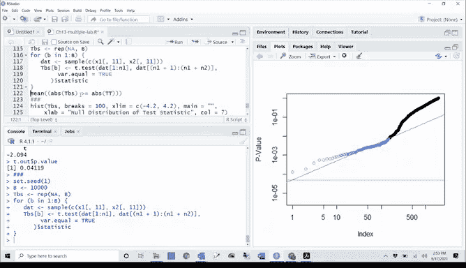

# 斯坦福大学《统计学习导论2023R语言版｜An Introduction to Statistical Learning with R》中英字幕 - P104：-104-Statistical Learning_ 13.R.1 Bonferroni and Holm II.zh_en - GPT中英字幕课程资源 - BV1yU421o7WA

All right， so now we're going go on to talk about the false discovery rate and it turns out that this fun data set in the ILR2 package has not just five managers。

 but actually 2000 managers。 So we're gonna to load them all in。

 Garreeth is going do the honors here。 I'm going do the work。 his computer， as you all know。

 I don't work with PCs。 so I really don't have a choice。😊。

Okay， so we read this in and now for each of these 2000 managers， we're going to compute the P value。

 okay， done。And now it turns out that we can use the same P dot adjust function to adjust those P values using Benjamin Hckberg。

In other words， to compute what is sometimes known as a Q value instead of a P value。

So if we do that here， we see that for the first 10 managers， the first managerss Q value is 0。089。

 the second fund managerss Q value is 0。99 and so on so we can think about this as telling us like the threshold for FDR control at which we would be rejecting any one of these particular fund managers So for example if we wanted to use an FDR threshold of 0。

1 then we would be rejecting the null hypothesis for any fund manager that has a Q value below 0。

1 So we would reject like for the first one because it's Q value is 。

08989 and also for the let's see the61 because the Q value is 0。

075 but not for the second third4 or5 ones and in total here out of those 2000 fund managers 146 ended up with a Q value below 10% So how do we interpret this Q value below 10% this is saying okay well I'm this is saying I want to reject the N null hypothesis for any fund manager。

correspondingorsding to an FDR or a Q value below 10% so that's saying that I basically want a list of fund managers for whom I'm fairly confident that most of them really are getting。

Non zero excess return。 Did I get that wording right， Yes， you're learning。 Thank you。

 I'm a really fast learner。 So we're， we're trying to reject the all hypothesis for any。😊，嗯。

Fund manager where I'm thoroughly confident that the access return is non-zero and in particular。

 if I'm rejecting the null hypothesis for a fund manager。

 I want to know that not more than 10% of those fund managers for which I'm rejecting the null hypothesis are actually false positives so to try to say that a little bit more simply。

 if I give you a list of fund managers where I say you know I'm fairly certain that these are the ones who have non-zero access returns。

I want no more than 10% of those to be false positives。

 That's what it means to be controlling the false discovery rate at level 10%。

 and there's 146 such fund managers where probably out of these 146 around 14。

6 or maybe 15 of them are actually false positives， but most of them。

I can be fairly confident have really non zero excess return。Exactly。Okay。所以。If we look at the。

Bon Ferroni cut off bad news bears we wouldn't have picked any of these fund managers using this is using 10% cutoff here。

 So if we use Bonfronone to control the familywise error rate at 10% We couldn't reject any of these 2000 and of course familywise error rate and false discovery rate are really telling us two different things familywise error rate is saying I don't want to falsely reject any any nu hypothesisth correspond to a fund manager I don't want more than a 10% chance of any false rejection that's just a really it's unrealistic it's unrealistic it's unrealreasonable whereas FD is saying okay I want no more than 10% of them to be false positives。

 All right so we had just shown you how to perform Benjamini Hopper using the pit out of just function and that is a really good strategy if you want to live in easy life where you just let R do the work for you but if you want to really roll up your sleeves I don't have sleeves to roll up but Gareth does if you want to roll up your sleeves and do the work yourself instead of relying。

P adjust， you can actually implement Benjamin Hthberg yourself， that's what we're doing now。

First of all， we sorted the P values， then we are having M be the number of P values in this case that's 2000。

 we're setting Q to be 0。1 because that's the FDR threshold that we want to use。

And now what we're doing is we're creating this object called WH doPs， which stands for W doPs。

 and that's going to contain the indices of the P values。

That are less thanq times1 to m divided by M。 so what's going on here？Well。

 P's is this object that contains assorted P values。

And WHWPs is going to contain the indices of the sorted P values where like the J smallest P value is less than  Q times j over n。

So basically below that red line that you had in your plot that you showed earlier， exactly。

 so like for the first smallest P value。WHP is going to contain the number one if the first smallest P value is less than  Q over m and it'll contain the number two if the second smallest P value is less than  two times  Q over m and so on。

Okay。And now we are going to just store the largest of those WHPs because I want to know the largest P value index that was part of that WH doP object。

 and if the WHP object is just empty， I just want WH to not throw an error。

 which is why there's this F L statement here。Okay， so let's do some plots。

So this is just plotting the P values sorted right from smallest to these are the sorted P values again。

 my Y axis shows the P values is on the log scale actually the Xx is also on the log scale This is a log log plot。

Okay， and。And now we've colored in blue。P values。That are。Less than the。

Benjamin Hawkper cutoff right below ones that are below the Ben well that at least are less than the last one that's below right。

 so remember my WHDP's object tells me which of the P values falls below the red line。

So WH doP tells me which P values fall below the red line and then WH tells me。

The largest of the P values that falls below the red line。

 And that's like the right most blue1 is the largest。

 And so everything smaller than that largest one I've colored in blue。

 because those are the null hypotheses that we're going to reject at Engeni Mini Hoburg。

 F DR caught off of 10%。 And these are the 146。 Yep， there's 146 of them， exactly。

And then the green line。Is nobueno， that's the bon Ferroni threshold again at 10%。

 and we can see we didn't manage to reject because that that involves like 0。1 divided by 2000。

 that's just。2。Much to ask of our poor P values Okay， all right。

 so that's the manual way of doing it or you can use the automated approach。

Which is the P dot adjust function with method equals BH reling approach resampling yeah this is this is the fun part Well I know it's all been fun。

 but now we're going to attach this con data set， which is this gene expression data set。😊。

And it consists of a training set and a test set， but for this particular analysis we don't need that division into a training and a test set。

 so we're just going to smsh them together using the R bind function and if you're not familiar with Rb it just creates a big matrix by binding together the rows of twoes two matrices。

 yeah， and then we're also going to create a y vector which just is going to tell us which class and observation is in we have to combine why train and Y test again because we don't care about the training versus test set distinction here。

And so we have a end up with a matrix of 83 rows and 2308 columns。

 so each column here represents a gene。And we're going to do what does each row represent each row represents an observation。

 an observation of a patient or yeah， exactly and and so we're going to perform 2。

308 hypothesis tests here。Okay， so here we can see that there's actually four classes， classes one。

 two， three and four， but to make things easy here。

 we're actually just going to compare two of the classes。

We're going to have a comparison between the observations in class two and the observations in class4。

 so all that we've done here is we've set the data matrix X to contain x1。

 which is the observations in the second class and X2， which is the observations in the fourth class。

 there's N1 observations in X1 and there's N2 observations in x2。所以。In one here and in two。😔，Okay。

 so 29 observations in x1 and 25 observations in x2。All right。

 and now we can conduct a T test on let's say the 11th gene， this is a two sample T test。

 you can notice this argument that says ver dot equal equals true。

 so there are like a million flavors out there of two sample T tests all of which make slightly different assumptions and this is just like a super plain vanilla one where we're assuming that the variance in each of the two classes is the same it's not terribly important。

And if we compute this T test on the 11th gene， we get a T statistic of negative 2。09。

 which corresponds to a P value that's。04119。this P value is calculated under the assumption of a t distribution That's right。

 which is basically very similar to a normal distribution。

 It's just an assumption that is' using the theoretical null distribution for T so basically under the null hypothesis we're using the fact that this test statistic should have a t distribution with let's see 29 plus 25 minus2 so 52 degrees of freedom and a t distribution with 52 degrees of freedom is basically indistinguishable from a normal01。

So this P value is under the theoretical null distribution。

 but we had to make a few assumptions to get to here。

 so now we can use resampling approach to see if that seems reasonable Yeah let's do it。

So I'll set the seed equal to one， so the results are reproducible。

And we're doing the non lazy approach I'm not lazy right now。

 so we're going to have a big value of B， we're going to sort of reshuffle our data 10，000 times。

We're going to have TBs be a vector so tBs is a vector containing the the test statistics for our reshuffle data first we're going to set tBs equal to NA。

 that's just like a convenient thing to just set the elements of a vector to while we are waiting to。

Update it。So first we initialized TPs to just be a vector of NAs。And then for B from1 to capital B。

 which is 10，000。The first thing that we do is we create what we're calling debt。

 And that just like a reshuffled version of the。11th Jane。Using the sample function。

 which is reorders the elements of a vector at random。And then we're going to compute。

On that reshuffle data， the test statistic that two sample T test again。

Where this time we've to taken the reshuffle data and we've taken the first N1 observations。

And we're thinking about that as our x1 and then the remaining and two observations。

 we're thinking about that as our x2。And you saw that loop took less than a second to compute。

 so for a simple calculation like this， even 10，000 doesn't require a lot of energy。

What does this tell us Well， what we found is that remember our true test statistic was around negative two。

 I think， and that was called Tt。And the empirical or the resampling null distribution that we got for the test statistic is the TBBs。

 and we found that only 4。16%。Of the TBBs are as large an absolute value as the test statistic for our true data。

Which almost perfectly matches the theoretical P value we got previously of 0。04119。

So what this means is that our resampling P value is 00416， the theoretical P value is 0。

04119 all is well in the world in this particular instance it didn't really matter whether or not we use resampling to obtain our P value。

 but if we feel nervous about the assumptions that went into that theoretical P value then we can be happy to know that our resampling P value made fewer distributional assumptions Garret sort of jumped ahead here。

 but what we can see here is this figure showing in orange。

 that theoretical null distribution which was again a t distribution with 52 degrees of freedom which is basically the same as a normal zero1 distribution。

And then the reampling all distribution， which is the yellow histogram。

 they really are almost identical， the blue line is the observed test statistic of negative 2。09。

And it should be no surprise that based on how similar the yellow histogram is to the orange theoretical null distribution。

 it should be no surprise that the theoretical P value and the resampling P value in this case are basically identical。

Just reconfirms that it's reasonable to use the T distribution here，So I think that's it。

 there are a couple topics in the lab in the textbook that we haven't covered today。

 one of them is twoki's test。Is that right， was a twoiess， yeah， twokis method。

 which is sort of a specialized approach for controlling family wise error rate in a very particular setting？

And we also skipped some of the late latter material in the chapter on doing resling with FDA resampling to compute false discovery rate so yeah check it out on your own and thanks so much this is fun Yeah we'll see if Gareth and I are still on speaking terms when the cameras turn off Yeah you won't know。

 but I'm optimistic。