# 斯坦福大学《统计学习导论2023Python版｜An Introduction to Statistical Learning with Python》中英字幕 - P106：-106-Statistical Learning_ 13.Py Multiple Testing I 2023.zh_en - GPT中英字幕课程资源 - BV1u4421A7ZU

Welcome back。 today， we're going talk。 We're going go through the lab for chapterpt 13。

 Multi testing。 and we're gonna focus on。Two main criteriaiterion for multiple testing。

 family error rate and false discovery rate， as well as how to estimate things like false discovery rate。

Okay， so as usual， we have our。

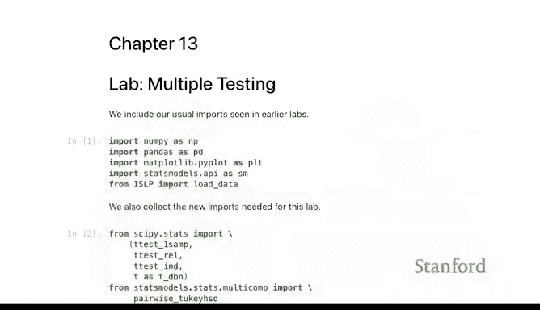

Our standard inputs， these are all familiar by now， And then we have a few new ones。

 Most of the new ones are these T test functions from the s pi stats package。

 And they're just going to be used to。

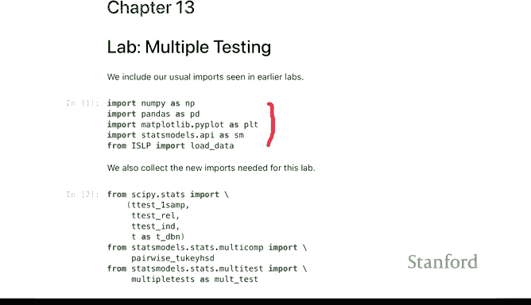

We're going to do a lot of comparisons that the T test is a simple comparison。

 So there's a one sample T test， a a two sample independent T test and then a pair T test。

 So end stands for independent RE stands for related and then we' we use this underscore or multiple test function from the stats models package to compute these adjusted P values。

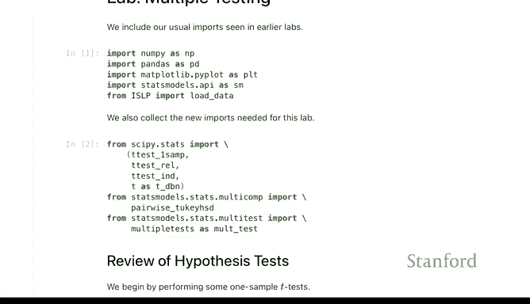

Okay， so we're first going。Do some basic hypothesis test using these T test functions。

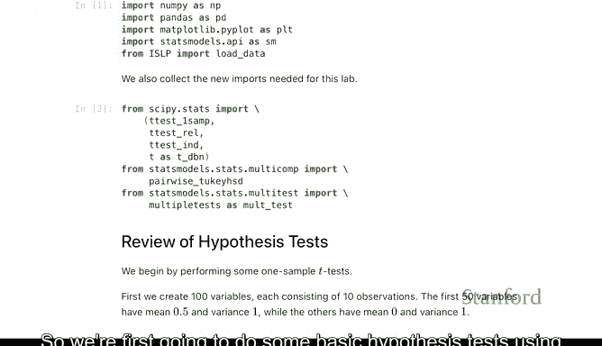

So we're going to start off by。

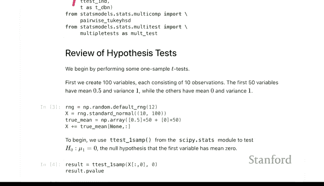

Making some data。 and we're what we're going to do is we're going to look at the the one sample test。

 We're gonna have 100 instances of 10 draws of normal data。 The first 50 columns are going have。

Mean 0。5。 and the last 50 are going to have mean 0。 So we have 50% that are， you know。

 really true signal， nonze signals and 50% nulls。Okay。And so the way we， you know， we're gonna。

 we're gonna compute the T statistic testing， whether the。You know。

 the mean in the first column of the data is 0 or not。

And this result here has an attribute called P value here。 the P value is 93%。

 So that's actually very far from the usual threshold of 5%。

 So there's not a lot of evidence that the mean isn't zero in this column。

 And that may be a little bit surprising because well。

 we had a mean of a half for each of the entries here。

But I guess this means that we just don't have a strong signal。Okay。

 so we could compute now 100 P values here， and this is where the topic of multiple comparisons come in。

 We can compute 100 because we have 100 different columns in the data set。

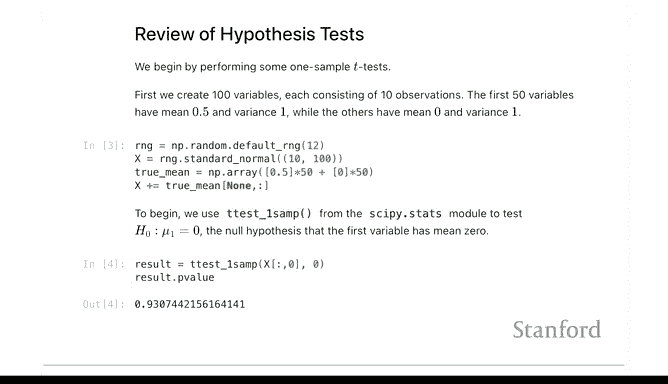

Okay， so let's compute all ourRP values。 So we're going to。Run a for loop。

 and we're going to store all 00 P values in our for loop。And we're gonna look at， you know。

If we choose to threshold that 0。05， we're going just cut the P values at 005 and。

Take a look at how these 100 different P values behave。So we'll make a little table。

 a two by two table similar to a table you can see in the textbook。

 And we there's typical labels that are assigned to each cell here。

 So the way this table is laid out is the columns indicate whether the。

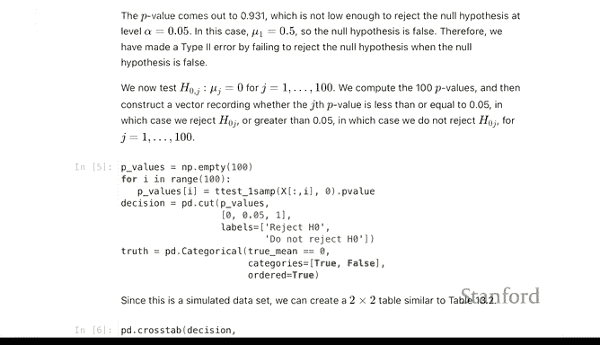

In truth， the null hypothesis is true or false。 So this is like the true version of the hypothesis。

 And this is our decision， whether we rejected or did not reject H not。Okay， so you know。

 for instance， this number here， five here， there are five true null hypothesisses that we decided to reject。

And so that's 5 out of hundred0。 So that's actually a false positive rate about。Of， sorry。

5 out of 50。 There were 50 true nulls， and we were5 and not a false positive rate， about 10 per cent。

The false positive rate can be computed using this column here。嗯。And in the book。

 we talk later about false discovery rate or false discovery portion that's computed from this row here。

 So this in the， this letter is usually called V for， that's the letter given in in a summary。

 And the sum of these two things。5 plus 15。 that's usually called R。And the FDP， we'll see later。

Is V over R。 So the false discovery proportion。 If we look at all the ones we decided to reject。

 we rejected 20 and five out of 20 of them were false。 So about 25% false discovery possible。

Proportion， so the name of the game in these multiple comparisons tasks is just sort of。

Consider these 0 different hypotheses and make decisions。 That is。

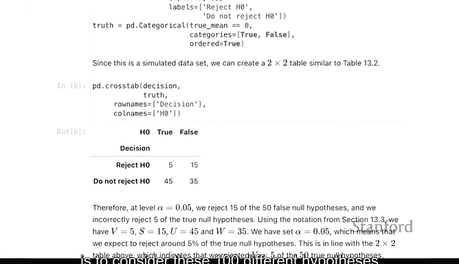

Choose a cut like 5% in such a way that well maybe we。

 we limit the number of false positives we make or we， we limit the， the false discovery proportion。

 That's sort of how these things go。

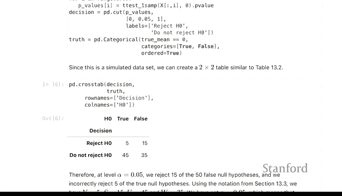

Okay， so。

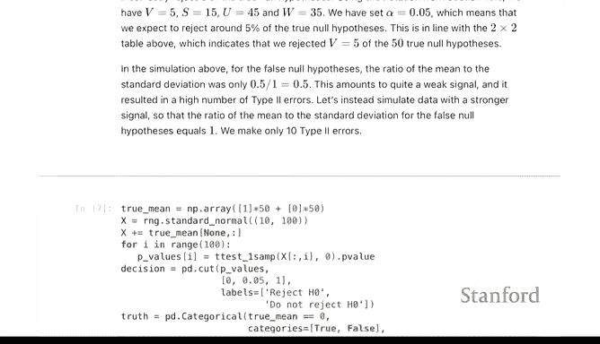

We're gonna repeat the experiment， but with a slightly higher signal。And。So， instead of having a。

5 in the first 50 columns。 We're gonna to have a one。

 And so as we increase the signal strength we'd expect。

 we would have more discoveries because at least in the first in the first 50 rows。

 but hopefully not too many more false discoveries。 So we'll recreate the table with the same cuts。

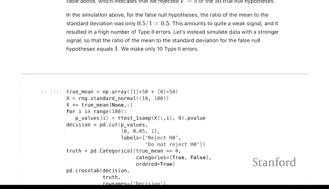

嗯。Okay， and now we see well we only have two out of 48 false positive。 That's good。

 The other flip side of a false positive is a false negative。

 and that would be a case where there really is a signal。 that is the null hypothesispo is false。

 but we fail to reject。 So here 10 out of 50 true well， truly false null。

 That is where there really is a signal。 we did not reject。

 So we have false negative right here is about 20%。Okay。So， now。When we。Have multiple。P values。

Well we saw we're going to make some false positives， right here we did two out of 50 earlier。

 we did five out of 50。Okay， so above we saw that if we have100 different samples。

 we're going to get 100 different P values and we got a little feel for you the number of false positives one makes in doing 100 tests and a little bit for the false discovery proportion by looking at that summary table of the 100 outcomes and a decision rule for each of the 100 outcomes。

So the field of multiple comparisons， what it is sort of based on is trying to。Make decision rules。

 and each decision rule makes one of those tables like this one above to satisfy certain properties。

 And one property that people are， I've been interested in for some time is the femin wise error rate。

 And this is out of the 10 decisions we made above the feminized error rate is whatever decision rule we make。

 What's the chance we make any false positives。 So what's the chance that this number is greater than 0。

And you can construct a procedure so that the chance of making a false positive is， say less than 5%。

Now we already saw that procedure is not going to be just making the decision at level 5% for each test because what we saw。

Very easily that we make， we make false discoveries when thresholding at。

 even if all the 500 hypotheses were， were the nu hypotheses were true。 At 5%。

 youd expect to make about 25， you'd probably expect to decay 25 of them significant， yeah。

So we're going to have to make a stricter threshold for that and so we have a plot here for we can compute for independent tests at least what's the fannoiser rate as a function of that threshold which above was 5% and M is the number of tests。

So here's a little plot below。And we can see you know at using what we call the nominal threshold of 5%。

 even at one hypothesis， there's a 5% chance， so the feizer rate is 5%。

 but as we decrease the threshold， we're going to get this feamizer rate is going to decrease and we see for about 100 hypothesis we need about even less than 0。

01。 In fact we need 0。0005 as our threshold or that will be safe in any case。

 because that's 5% divided by 100。 So what that says is if you use a 。

0005 level for each of the tests， then the chance of getting any false positive is going to be controlled it。

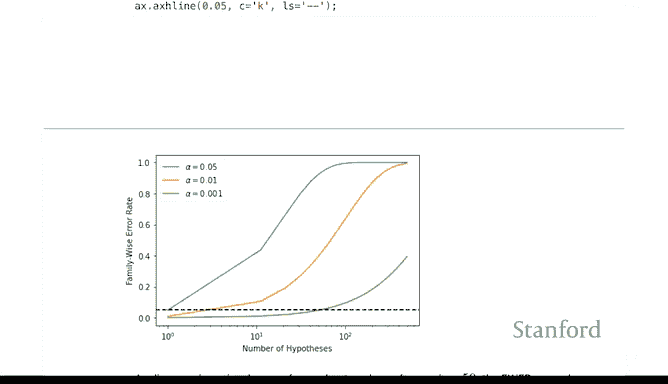

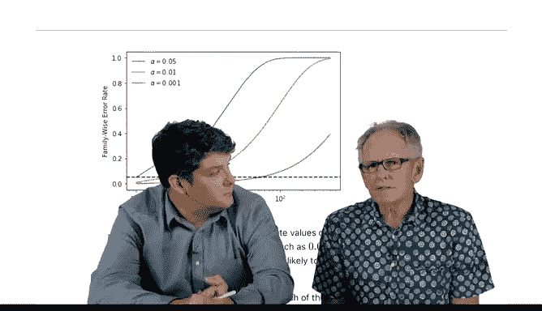

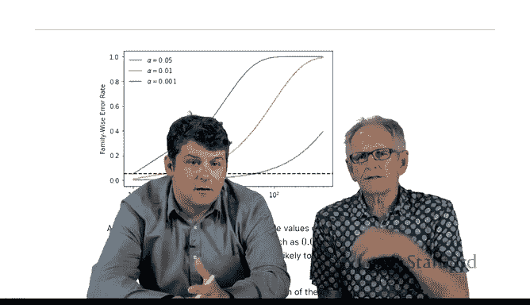

5%。 Yes， yeah。 so clearly that's very strict。 right， because it puts a burden。

 high burden on the the， the the， the hypothesisthees whose null is false or where the alternative is true。

 because it has， they have to have small P values in order to。

 to get declared significant or in order to not reject their null hypotheses。

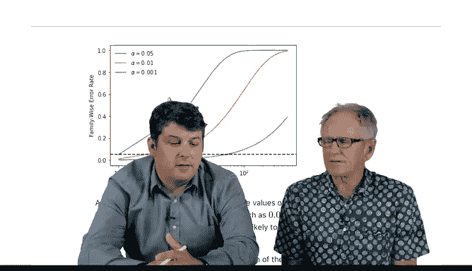

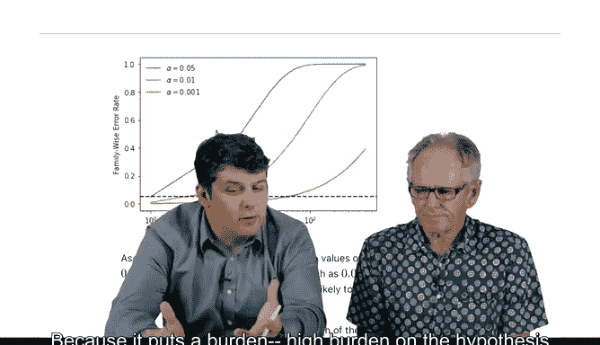

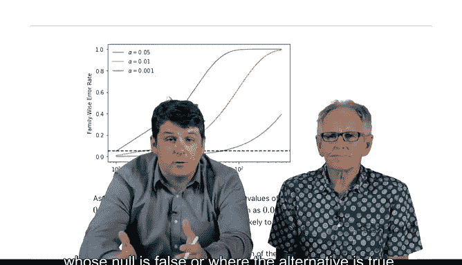

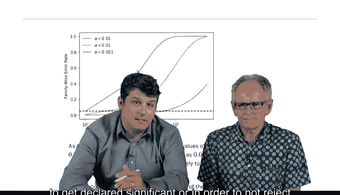

But nevertheless， you can actually， you know there are methods to control the familys that rate and we're going to look at some of those methods。

 so we're going to use one of the data sets。

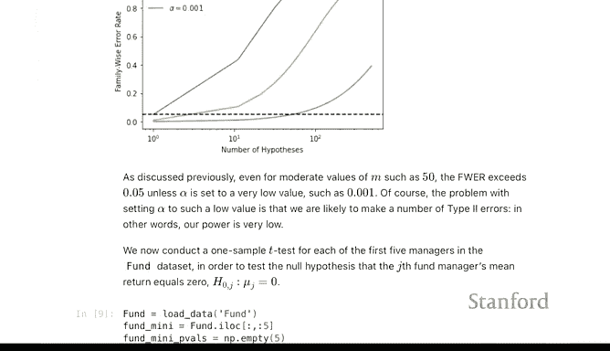

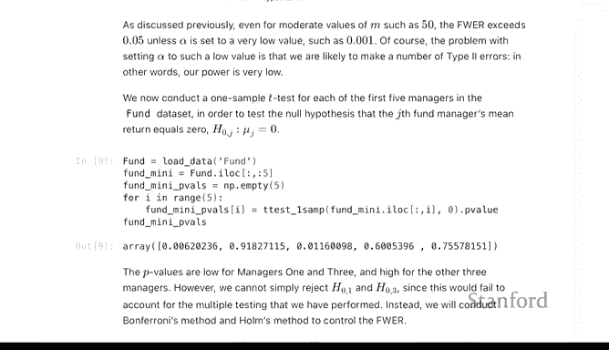

TheThe fund data from the package using our low data function。

 and I believe here there are 500 managers。Well， some number of managers。

 and that's the point that's multiple comparisons as many managers。Okay。

 so first we're going to look at rather than looking at all of the P values and once we're just going to look at a small sample of five of them。

 so we'll compute that we'll test whether each fund manager is beating the market。

 that's whether the returns average zero or not and compute the the one sample T test。

And we see that sometimes the Pvalue are low when this first manager is doing pretty well。

 Second manager is maybe not doing not having a good year this year or。

 or didn't have a good 10 years or 10 quarters。 What I think we had have many observations we have。

 Jonathan， we should try and get the name of that first manager。 Yes， yeah， well， I know it。

 but I'm not， I won't share with。 do luck at the share。 yeah。Okay， well yes， I'll tell you later。

What we're going to do is is look at some method， how we can take these original P values and and use a method to control the famoid error rate in this case at 5%。

 two common methods out there are are called bonferroni and Hols method。 that bonferroni threshold。

 That was that  point。0005%。 effectively the bonferroni method。

It just rescales each of these by the number of tests we do。 So if we had 100 fund managers。

 then this P value would be converted to 0。6 instead of 0。006。 And that's not less than 5% anymore。

 that would be rejected。 It would be not rejected。 Yes， yes， so it's quite strict。

 So another method is called the Hols method， which is works under similar conditions for Bon Ferroni。

 but is known to be slightly more powerful。 So let's just look at those P values for those corrected P values for those two methods。

So we use this multi test function。 This is the multiple test function from the stats model package。

 We give it a set of P values， and wed say how to adjust the P values。 Here， we'll use the bofroni。

And。TheWhat we get out of that are decisions like whether to reject the null hypothesis or not。

 as well as the adjusted P values。 So actually this will tell us how many fund managers there are because we'll be able to see the correction for P values shortly。

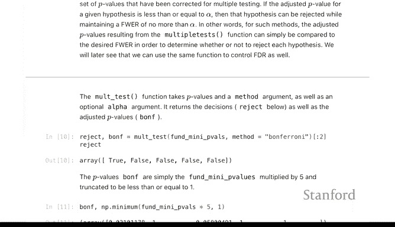

So sorry， we only pledged to five of them， so we'll know here there were five。So it was 0。

006 before now it's 0。03， which is 5 times 0。006。

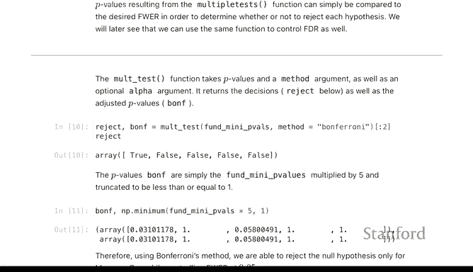

Okay， so here we see actually， even with only five。

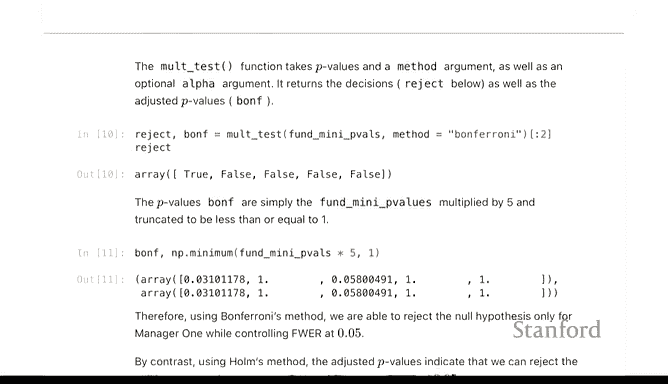

Five of the fund managers， this first one who looked to be doing quite well before is has an adjusted P value even closer to 5%。

This third manager， who was the second one who seemed to be doing well。

 is actually sort of already gone over the threshold。

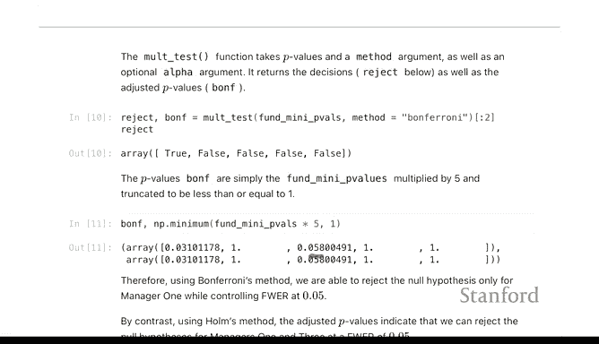

So the okay， the next method is this， this homess method。

 which the smallest P value is always adjusted P value is always identical to bofroni。

 but then subsequent ones get get get a little bit remain a little bit smaller。

 So at the 5% threshold， this third manager would still survive the home for。

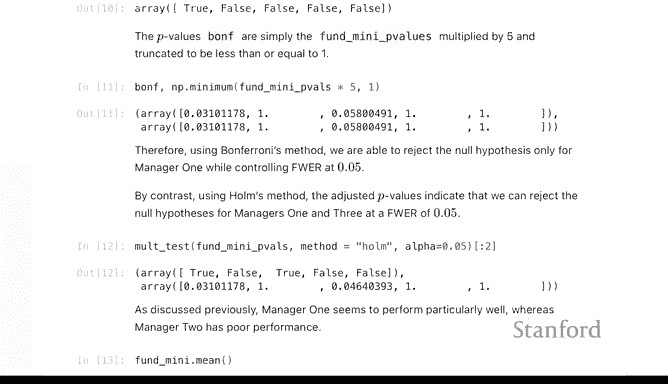

Yeah， and that could make a big difference， actually。

 if bonus is based on that or something like that。 And the other of these P values。

 whether they adjusted P values were。Deemmed to be over one。 So a P value can't be bigger than one。

 So it's just been cut off at one。Okay。So now we see that there are some managers that seem to do well and a few others。

 this second one didn't seem to be doing well。

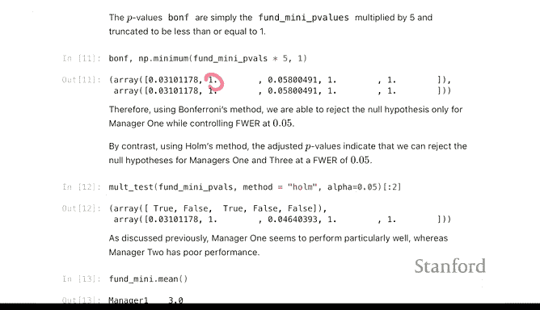

Why don't we start to look for some compare differences between managers。

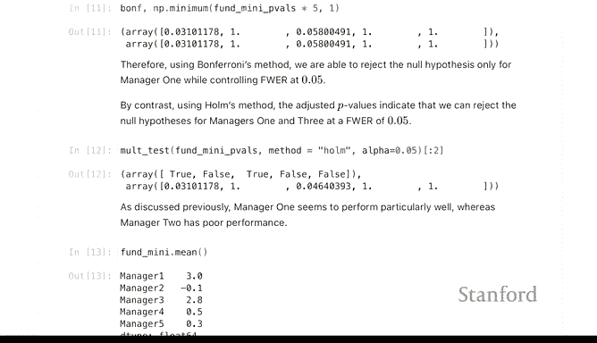

So， as noted before。These are the two we talked about earlier。1 who seems to be doing well， One。

 it does not seem to be doing well。 Maybe we could test the hypothesis that maybe manager 1 is better than manager 2。

 So this is slightly different than the test we did before。

 where we are checking whether each manager beat the market by test comparing to 0。

 And so we need a slightly different test。 for that， we use this paired T test。

 this T test underscore RE for related， this means。And for this test， remember。

 as you will have read in the chapter that the indices effectively have to be the same so if these are trading days or quarters。

 whatever the index is， they have to be the same for each manager one and manager2。

 so we can compare how well manager one does each in the first quarter of last year and manager two in the first quarter of last year。

And then we， again， we perform a T test and get a P value of about。04， that's less than 5%。

 So there does seem to be evidence that manager 1 is better than manager 2。

So we might want to wrap it up there and say， we've found a better performing manager。However。Well。

 why do we to do the， to， to， to run this test？ Well， of course， you know。

 we saw that manager 1 was the best。 Manager 2 was apparently the worst。 So that's。

 so there were some sort of data snooping going on。 So we maybe should not trust this one too much。

So with these five different managers， there are at least five well。

 there are five two two comparisons you can make， and that's 10 if I'm not mistaken。And so there are。

 if we were to apply the boferroni procedure to the 10 possible comparisons， well。

 this P value would be about 0。3， so that would not be very strong evidence。

So there are some methods because， you know， this problem of having different categorical variables here at which manager。

And， and a common outcome。 This is a kind of common， common problem or a problem of common interest。

 There's a few methods out there that that sort of s take care of all simultaneous differences。

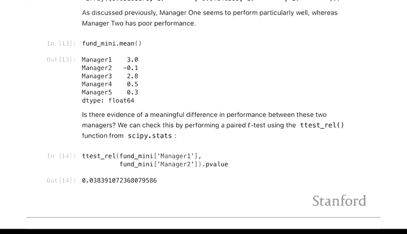

So one of them is called twoki's highest significance difference。

And what rather than dwell too much on those， we'll just look at the adjusted P values。嗯。

And so similar to the bonfronni method。It produces an adjusted P value for each of the possible。

Hypotheses。 so earlier， we had five hypotheses， and we had。Each five different adjusted P values。

 Now， we have 10 hypotheses because we have 10 comparisons。 and this 01862。We know well。

 that's not exactly the bofronone adjustment， it's a little bit different。

 it's a little bit more favorable than the bofronone adjustment， but it's still not less than 5%。

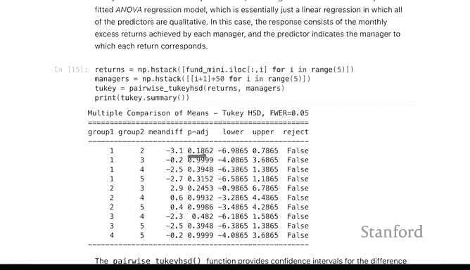

So there's a nice summary plot of this。

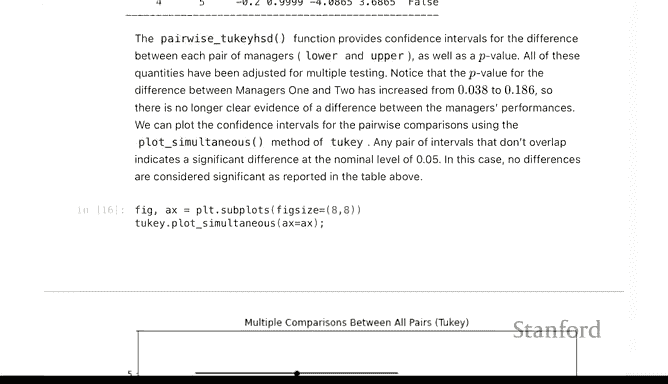

You can create， create with this。This two key object。 And it produces effective confidence intervals。

 And I will， they're not exactly confidence interval， but they're intervals for each。

For each manager or each， whatever the categorical variable is。

 And the way this plot is to be interpreted is if you see two intervals that don't happen to overlap。

 then they would have a significant a pay would be significant in this table we saw before so in this case。

 and it's actually more compact than the table because well。

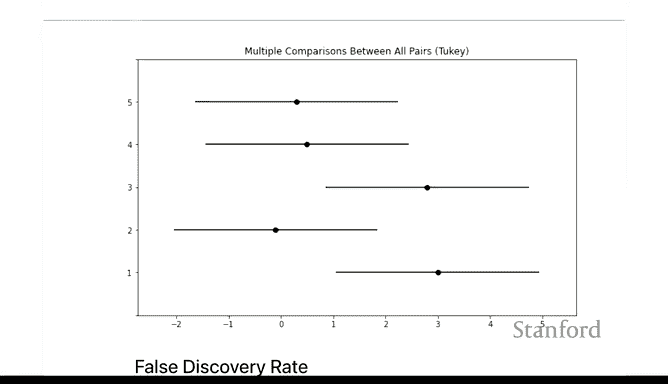

It's not a big difference when we have 5 to go from 5 to 10。 but if we get 25 or 50， Yeah。

 that's a big difference， yeah。

