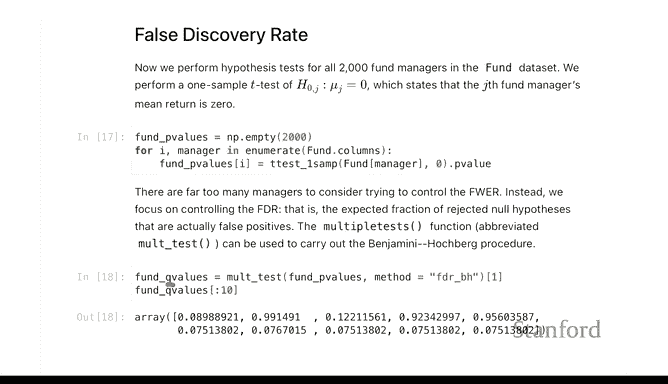
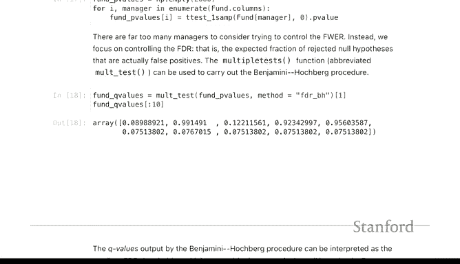
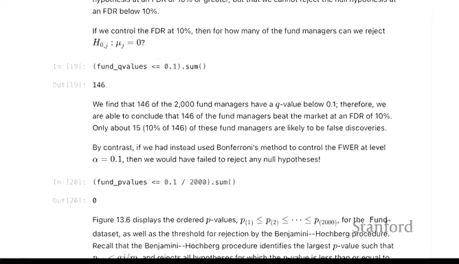
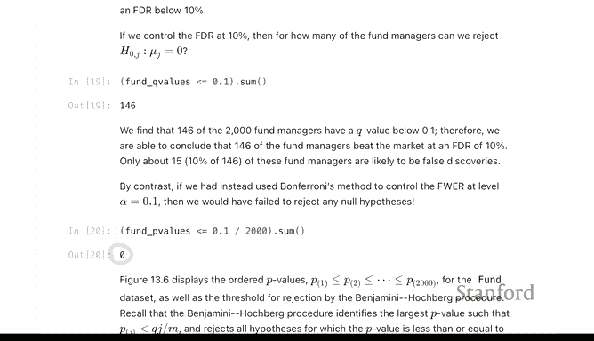
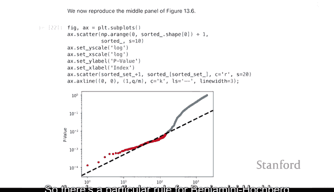
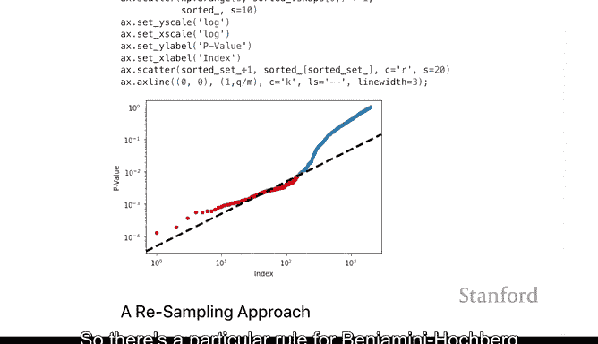
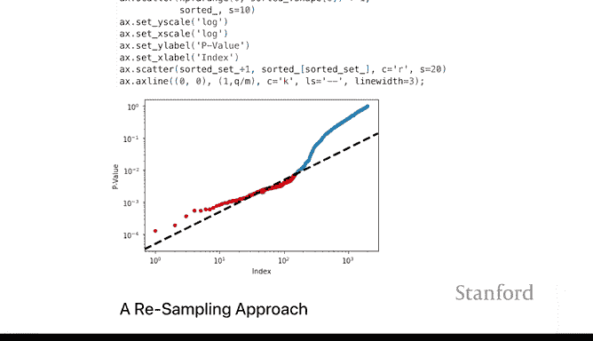
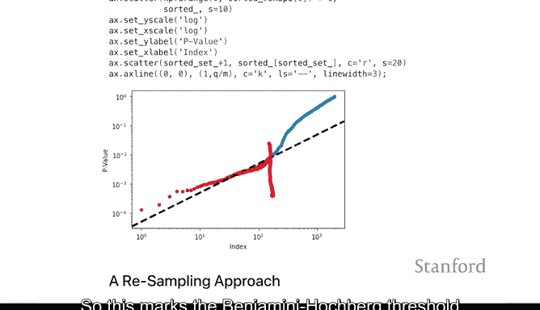
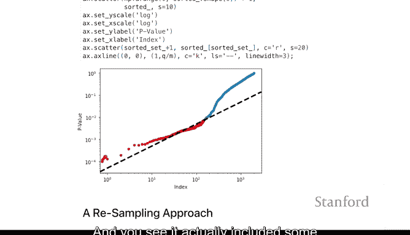
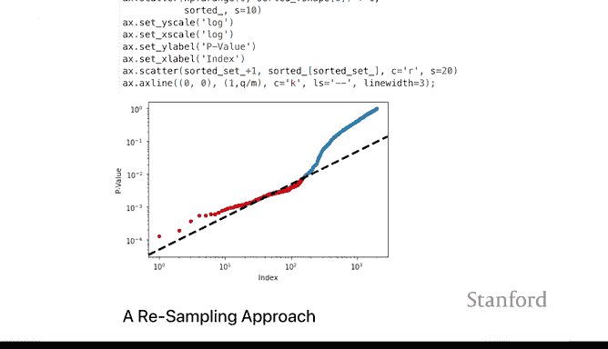

# 斯坦福大学《统计学习导论2023Python版｜An Introduction to Statistical Learning with Python》中英字幕 - P107：-107-Statistical Learning_ 13.Py False Discovery Rate I 2023.zh_en - GPT中英字幕课程资源 - BV1u4421A7ZU

Our next topic is the false discovery rate。 This is similar to the fammooid error rate。

 This is a sort of quantity that， you know statisticians have worked out how to design testing procedures so that we have a guarantee that we can control this quantity at a reasonable level。

 And so the big difference between the false discovery rate and the feammoise error rate is the false discovery rate is really not as strict。

 The famminise error rate。What it tries to control is the chance making any mistakes and the fast discovery rate。

 roughly speaking， tries to control the proportion of mistakes among the rejected that that we make。

 So if if we reject 100 hypotheses， you know we can expect if we control the fast discovery rate around 20% that about 20 of those 100 are likely to be truly now that we didn't actually make a discovery。

 but on the other hand， we would have made maybe 80 out of 100 true discoveries in many situations。

 this is much more useful， you think of a biologists is looking to find genes that are responsible for that type of cancer。

If you declare there's 25 genes responsible based on testing and you say the false discovery rate is。

 is， is。5%。 then， you know， you have a good eye， you have some idea of of those 25 genes that you've discovered。

 how many are likely to be false discoveries， But the bulk of them will be good discoveries。

 That's more， that's a more meaningful way of controlling the error rate when you do multiple testing。

Yes， yeah。 So there are some， some places where fwayiser might be like in， in a clinical trial。

 for instance， if you don't want to have any really adverse reactions。

 that might be better rather than having some proportion of adverse reactions。

 you might want to have very few。 So their， their， their applications vary。

 but false discovery rate is certainly very， very popular and and meaningful in many contexts。

So we' we're instead of genes like Trevor's example here。

 we're we're going to apply the false discovery rate to our fund managers。

 So we have 2000 fund managers earlier。 we looked at five of them。And we're going to try and。

Choose a a threshold for the P values that。To control the， the， the， the。

The false discovery rate and the big difference in terms of implementation。

 we're going to use the same。Function to compute adjusted P values。

 It's using instead of home and bo Ferroni， we give this FDR B8 as the argument。

 So FDR stands for false discovery rate。 BH stands for Benjamin Hberg。

 which is the the procedure that's used to control the fan discovery rate。Okay。

 and so when we look at the these things are called often called Q values rather than P values。

 So when we look at now the first 10 Q values， we actually see a really strong performing manager actually no longer is under 5%。

 on the other hand， Well， it's not necessarily clear that 5% is the right threshold， often for FDR。

 people choose a threshold like 20% instead of instead of 5%。 So the 20% FDR cutoff manager。

The first manager looks pretty well。 So maybe you will still want this phone number later， Trevor。

Okay。

So。Let's take a look comparing these two methods。 So suppose we control fossil discovery at 10%。

How many of our managers are， you know， out of the 2000 seem to be beating the market at a level of 10%？

Well， it seems there are 146 of them that beat the market that。

 according to this threshold of 10% are beating the market。 So we'd expect out of these 1 hundred50。

 you know， roughly 15 or so would be。You know， it might be ones who all can't really beat the market and or may be guessing randomly or something like that。

Let's compare that to Bonferroni。So the simple way to implement the po ferrononic procedure is just to take the raw P values and。

We either multiply them and compare to 10% or take the 10% and divide by the number of P values。

 the 。01 divided by 2000。 And we see here actually。

 no one seems to be upperforming the market that way。

 So if these were genes and there were actually some really important genes。

 well we would have made more discoveries for potential future research if we controlled false discovery rate then fyloid error rate。

So there's a plot that goes along with the Benjamin Hawk procedure that's quite popular。

 and we're just going to take a look at it below。

So， there's a。There's a particular rule for Benjamin Hawkburg。 and I'll just write it quickly here。

 It compares the， the Js smallest P value。 That's P underscore J to。

The quantity alpha， that's say 10%。1 times J over M。 So it compares these two things。P， you。

It asks whether the JP value is smaller than that threshold or not。

 and that's what this line here represents。And the way the the procedure is done is。

 it finds the let's see， the the largest J that is the most liberal threshold。

 the last time that PJ is less than or equal to alpha J over M。And that's you can see here。

 these are the P values。 and this is the last time this curve is below this dashed line。

 So this marks the Benjamin E Hckbro threshold， and it rejects everything to the left。

 And you see it actually included some of these P values that to start off didn't seem to get under that line So if if we stopped the first time the P value was not less than that。

 we would have stopped here。 and that would be you know that would be nothing。

So this is a sort of visual description of the Benjamin Hawk procedure。

