# 斯坦福大学《统计学习导论2023Python版｜An Introduction to Statistical Learning with Python》中英字幕 - P108：-108-Statistical Learning_ 13.Py Multiple Testing and Resampling I 2023.zh_en - GPT中英字幕课程资源 - BV1u4421A7ZU

Okay， our last example in today's lab is going to be。

So a sort of nonparmetric test procedure rather so what we've done up to now we've been using these functions。

 T test from underscore independent or or related various ones from the spi stats package now the way those tests are constructed is well some statistician。

 the T test goes back to student at the Guinness brewweery worked out how you know's the you know what does the test statistic look like when the null hypothesispo is true。

 what does the distribution look like and so they make various assumptions。Now。

 those assumptions may or may not be true， so there's often interest in procedures that work better when the assumptions may not of the T test may not specifically hold and so what we're going to look at here is what sometimes called a permutation test what we're going to build up a null distribution from the data itself where we assume the null hypothesis is true。

 and we can use this。Distribution as a substitute for the T table that the T test functions use to construct the PI。

The data we're going to use is the con data that we saw in our chapter on unsupervised learning。

 that was last chapter。And so remember， there are， I think。呃。2000 genes。 and。

Several83 patients patients， and they in four classes。And these are all childhood cancers。

In four different categories。Yes。

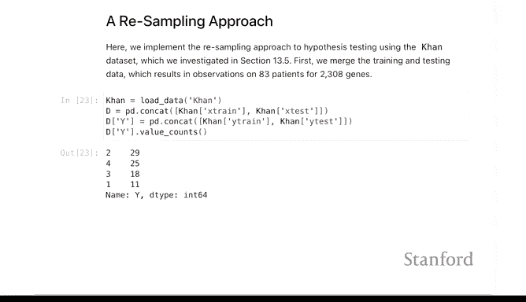

Okay， so。

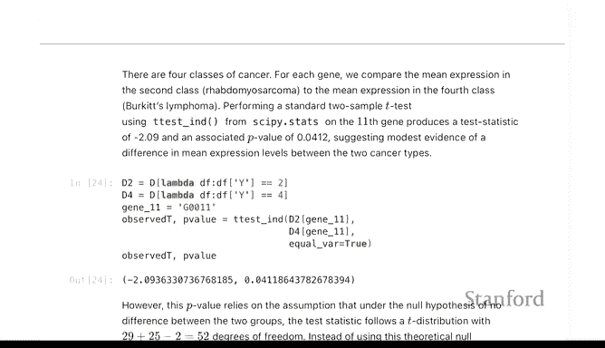

Let's just。Fit the run the T test on on one of the one of the genes。 So we'll take。

Gene 11 here and we'll compare class two to class 4。

This decision about which class to compare is something that a researcher might will have made beforehand。

 and we want to compare the microwave or the genetic data at gene 11 for the y equals 2 group and the y equals 4 group and it constructs a P value here we've even used this so-called pool variance by making this argument equal variance equals true。

So， now， when we。Interpret this P value and we look to see whether it's less than， say 5% or not。

 we're making some assumptions about the way the data looks， and when those assumptions hold。

 then there's only a 5% chance this P value will be less than 5% if the no were true。So。

Rather than trusting that distribution， we're gonna make this。Resampled one。

 So the what the basis of this reampling procedures， we assume the null hypothesis is true。 That is。

The y equals 2 group at for gene 11 is basically the same in distribution as the y equals4 group in gene 11。

So then we random evenly reassign the data in group two to the data in group four。

Keeping the sample size in group two and group four the same， and then we recompute our T statistic。

And by doing this many， many different times， we get some idea of assuming there's no difference between group 2 and group 4。

 what are reasonable values for this T statistic to look like？So we're going to do this 10。

000 times here。What we're going to do is。We're going to keep the。The， you know， this earlier。

 we had the first。Number of observations were in group 2。

 and the first the remaining were in group 4， but we're going to reshuffle the response before running the T test function so that we use this shuffle function。

 and we're going to store the test statistic。 Now， we'll have 10000 test statistics。And we can see。

 how does that compare to our observed test statistic， The P value here is about， again， about 0。04。

 and that's very close to what we saw before， almost you know。

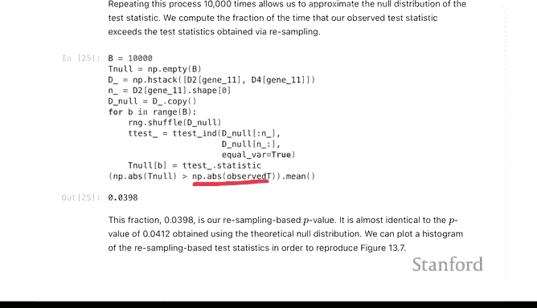

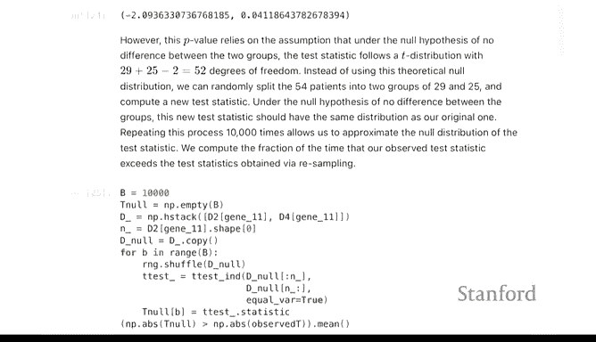

嗯。If I were to round it to two decimal places， they would agree。Or sorry。

 two significant is to would agree。Okay， so let's just take a look at。

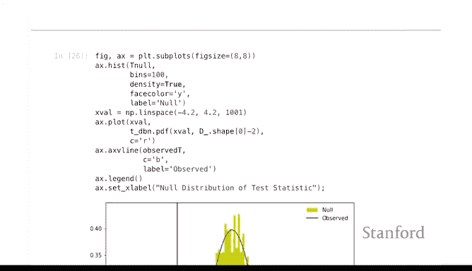

The collection of those T statistics。 So when what we're plotting here is a histogram of those 10000。

Statistics we computed by shuffling the data or and random under the nu。 Yes。

 and the red curve is the actual T distribution。 Yeah， this is the。

 the curve that's used to compute that  point041 P value。 So actually， for this gene， they。

 they look quite similar。So for assuming the null distribution looks quite similar。Okay， and。

Of course。This is for a single gene， but if we could repeat construct this histogram for every gene and make a nonparmetric test for every gene。

 so if we have multiple genes， then we'll have multiple P values。

 we could apply B Feroni to these P values or we could apply Hols procedure or we could apply our Bjaamine hoburg procedures。

 this is really just a different way to get a P value that we can later use for the multiple comparisons。

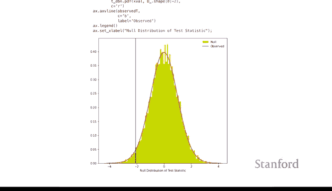

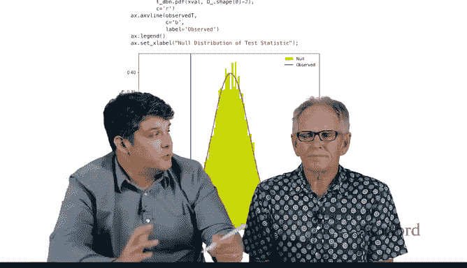

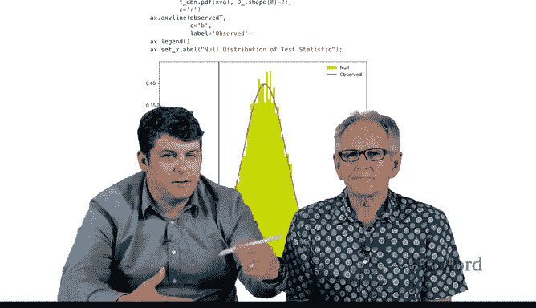

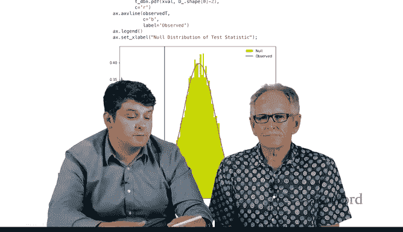

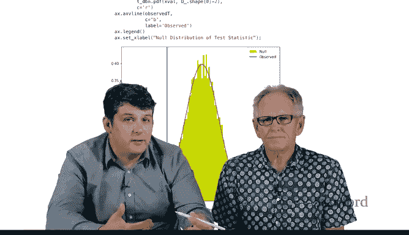

So the remainder of the lab shows how to use these P values to do false discovery rate analysis or the Benjamin Hberg procedure on these P values。

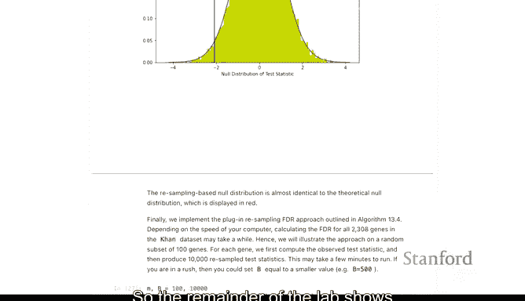

What's really happening is。We're just using this procedure to construct new P values and then running Benjamin Hopper on those so you can see。

The final outcome is the。あ、い know。Forgiven。Threshold of FDR。

 We again get a list of significantly selected genes。

 The the big difference between the fund example and this one is just the P values were computer with the nonparmetric test here rather than the T test function。

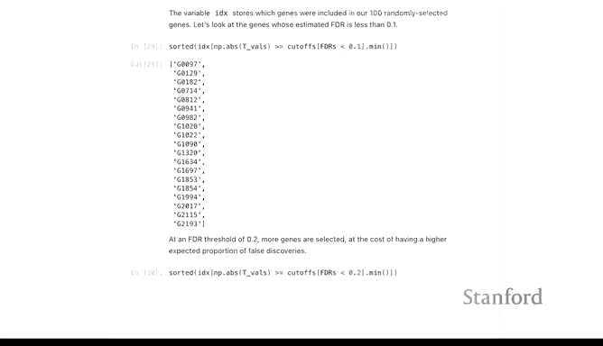

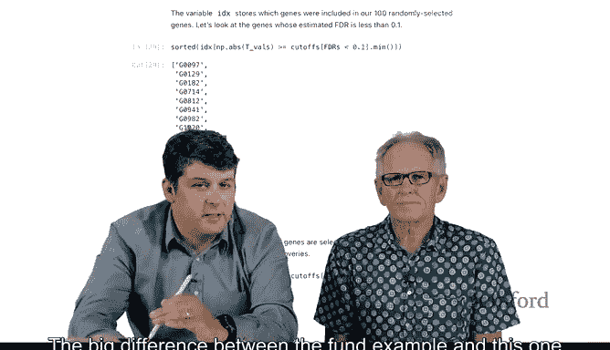

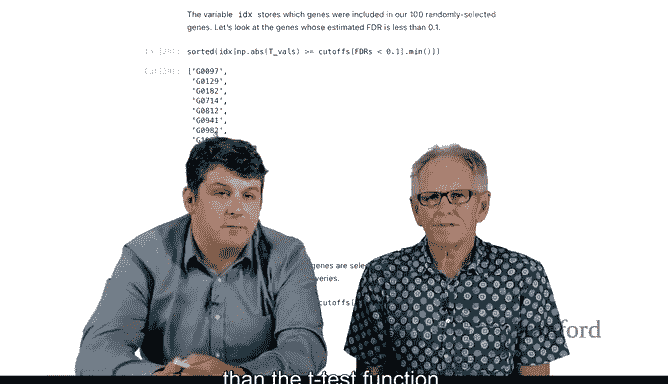

And we' leave the remainder of the lab for you to finish offline。

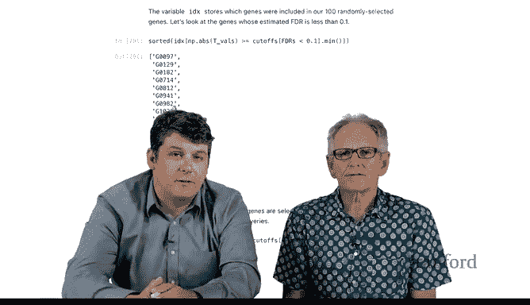

