# 斯坦福大学《统计学习导论2023Python版｜An Introduction to Statistical Learning with Python》中英字幕 - P10：-010-Statistical Learning_ 2.Py Data Types, Arrays, and Basics I 2023.zh_en - GPT中英字幕课程资源 - BV1u4421A7ZU

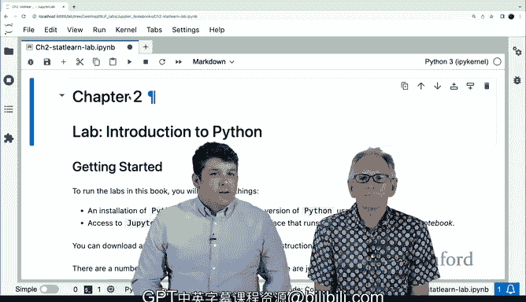

Okay， so here's our first lab this lab introduces some basic concepts in Python。

 Python' is a very popular programming language and if any of you have taken any programming classes prior to this class in statistical learning。

 you'll likely have seen some Python already so。

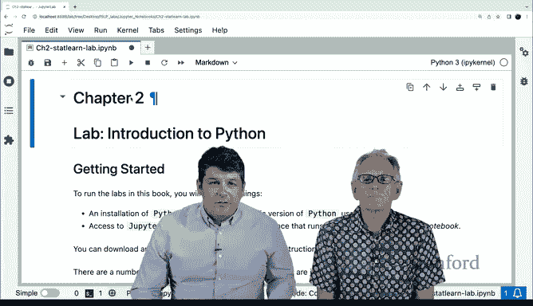

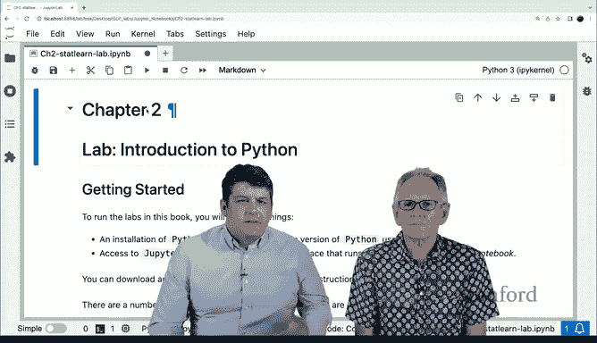

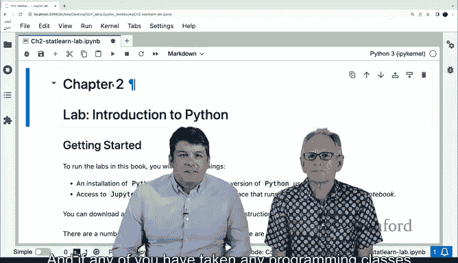

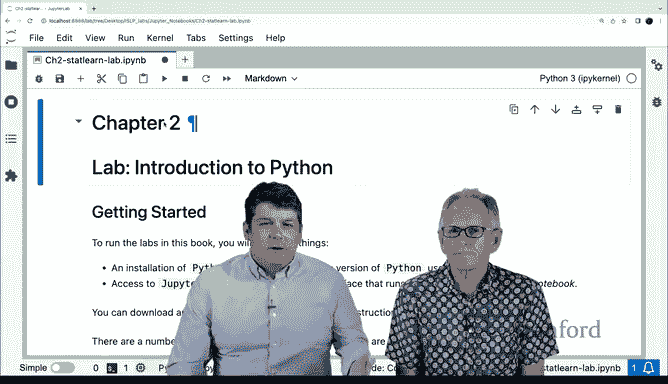

That's also a warning to say that this is not a complete exhaustive introduction to the language of Python。

 There are lots of tutorials out there for Python。 we've included。

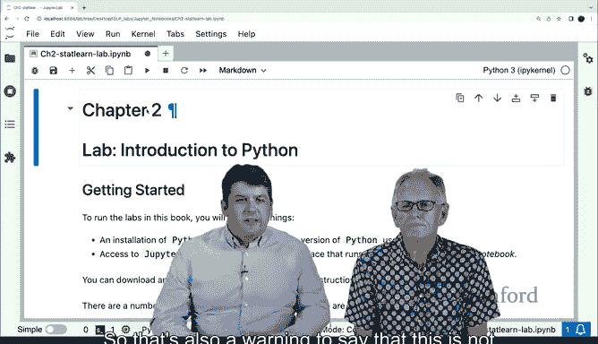

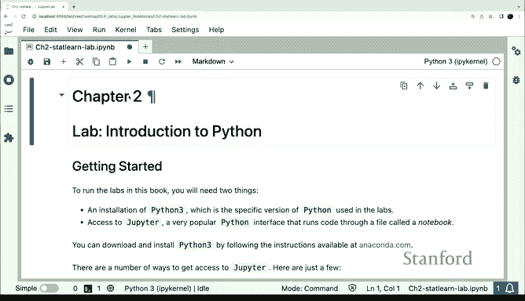

A link。Below for the， the basic Python tutorial。 And we're also going to be using。

Several common packages， pandas and nuumpy， and you can find tutorials for those online as well。

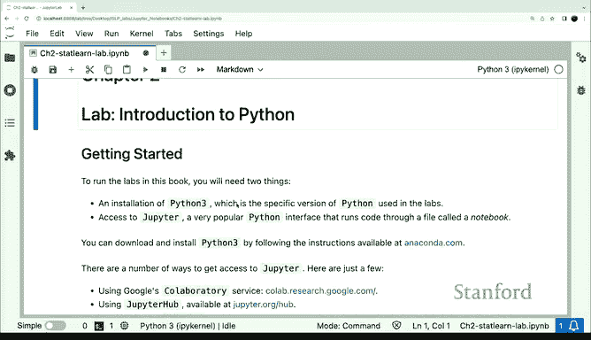

um。And also， the text and everything you see on this page is exactly what's in the。

 in the lab in the book。 Yes， and， as I said， this is the one1 I downloaded just off the start learning statistical learning website。

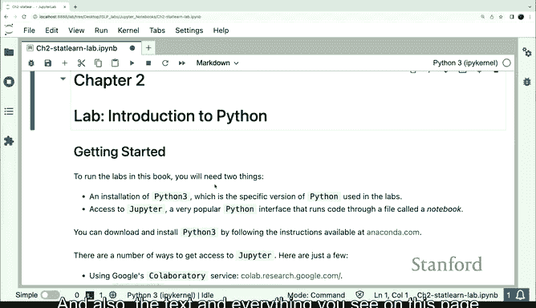

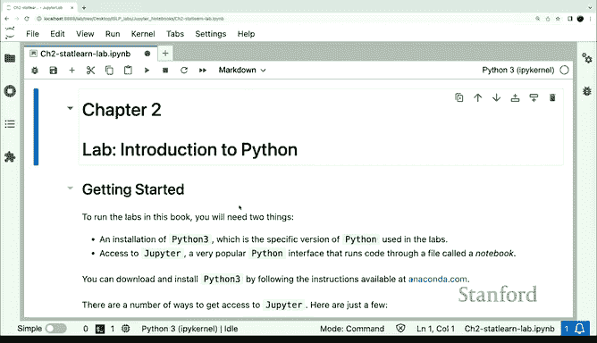

Okay。We're not going to read all the text here， sitting in the lab。

 we're going to go through just some of the code， you can follow along in more detail by running the labs as this is the code that you have access to on the website and is the code that's in the book。

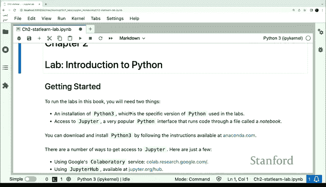

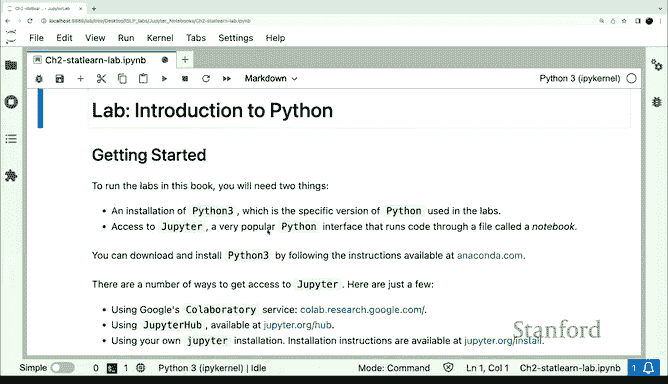

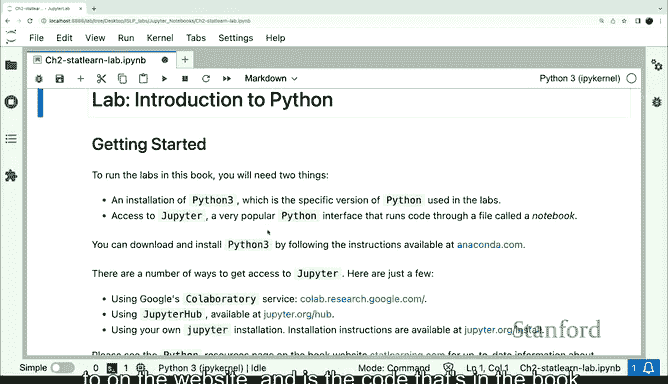

Okay so。Let's start off with some basic objects in Python。U。

So there's as most languages have different types of objects。

For us we'll be interested in numeric objects， but Python itself is a language that evolved not to do data analysis。

 but just as a general purpose language in any case。

 so there are lots of different types standard types of objects in Python let's just start with a string and this is an example of calling a function。

Almost everything we do in a in these computer computations。 we'll be calling some kind of function。

 Here's an example。 we'll call the print function。Okay， and this is an example。

 You can see how the Jupyter notebooks run。 There's a little text box of。

Code that is executed and the output of the code shows up beneath。And just pressed return。

 I pressed shift return for each cell， yes。And that will run the code and move it down。

As in lots of environments， you might have some questions about， you the functions you're using。

 there the help system in Jupiter， you can access help by putting a question mark after the name of the function。

And it will give you what's called its dostr。 so if you have a function where you're not sure exactly what it does。

 you can use this question mark and many functions have very helpful dostrs。

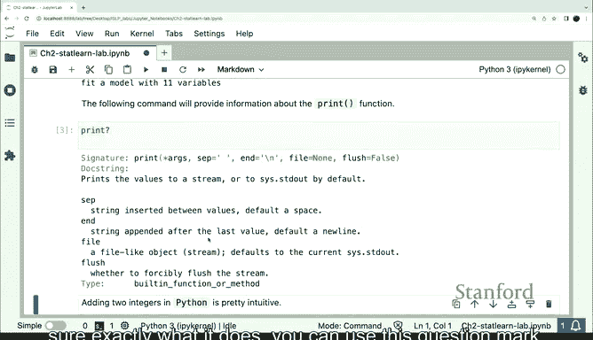

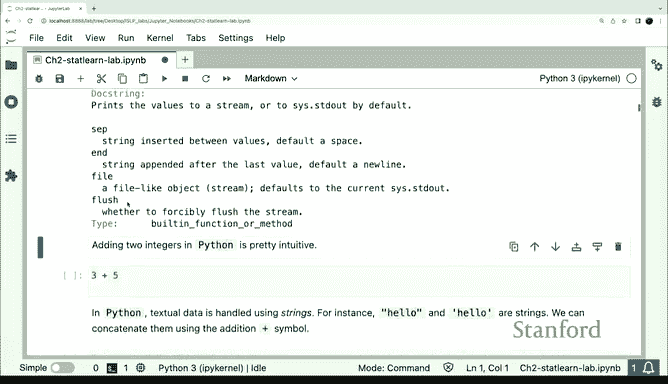

Okay， beside strings， there are of course， numbers。

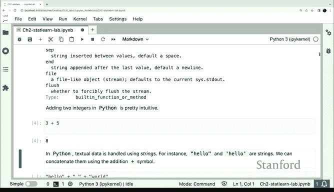

Numbers 3 plus 3 and 5 add up to 8。And。

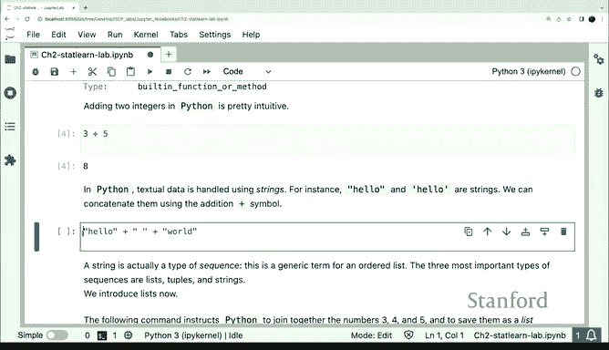

You know， surprisingly enough， you can also add other types of objects here， we can add strings。

 And when we add strings， it is concatenation。 Most of our work will not be adding strings。

 This is just， you know。

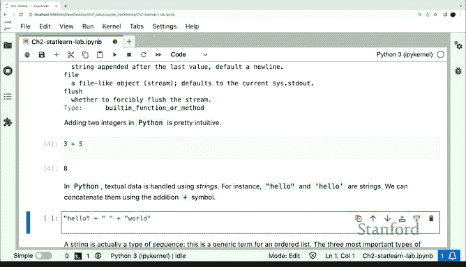

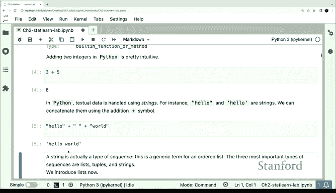

The typical hello world introduction to， to a language。

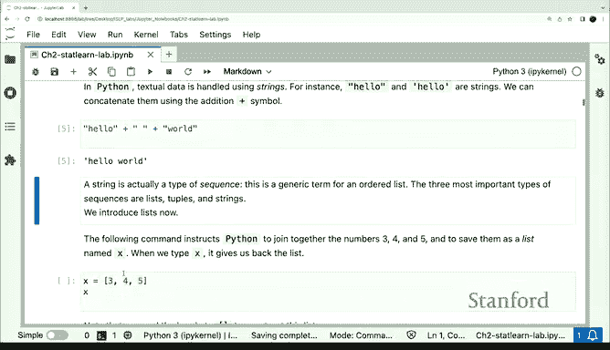

So we've seen numbers， we've seen strings， There are other objects in Python that start to look like things we might use in computing that start to look like a vector。

 so down here I've got something that's called a list in Python is denoted by these square brackets。

 and it's the number list of the numbers 3，4 and 5。

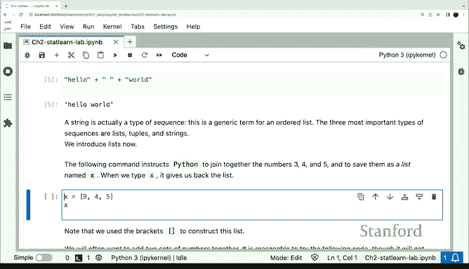

Okay。

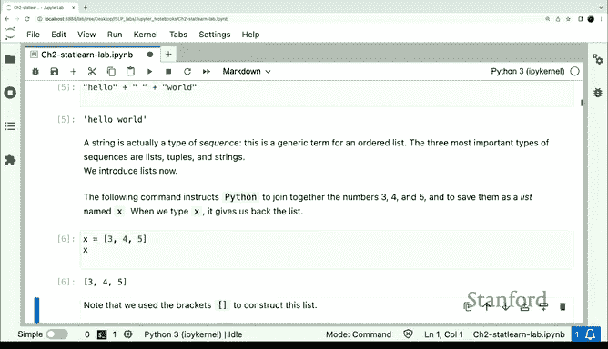

嗯。And in doing calculations， you'll often want to add two of them。 So let's make another list， 4。

9 and 7， and let's try adding them。

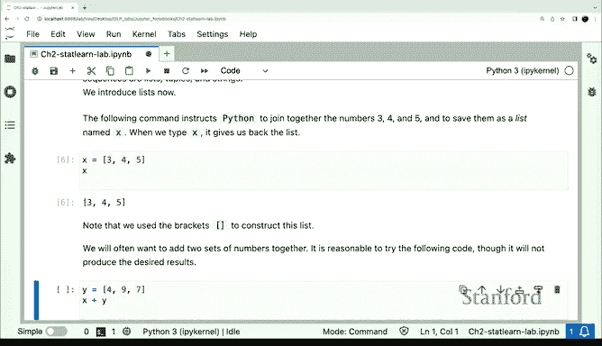

And there's some counter counterintuitive results here because this illustrates in some sense that you know Python is not necessarily。

 it doesn't do perhaps the most natural thing you'd think to do with two list of numbers。

 it concatenateates the list instead of adding them element wise and that's well。

 that's because there's lots of different types of objects in Python for data analysis what we'll really want to use are arrays that is you know representations of numbers in the computer。

 and when we have two vectors we'd expect when we add them。

 the results should be the sum of the vectors。 and for that we're going to use this package Ny。

 which is the standard numerical library in Python。

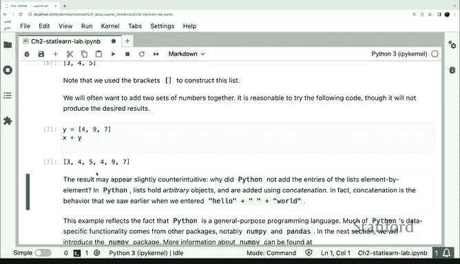

Okay， we'll see some aspects of NumpI in this lab and here is a link to a more exhaustive tutorial or the quick start with links to more in depth tutorial if you need。

So Jonathan， lists can have items of arbitrary different types。

 right that that's why you can't just add That's a great question。 You can add3 to hello。 Yes。

 So Trevor points out here that here， my list had numbers， but actually。

 we could have a string in there as well。And we could have other things as well。

 We could have even the p print as a function。 We could add that to the list。 And when we add it。

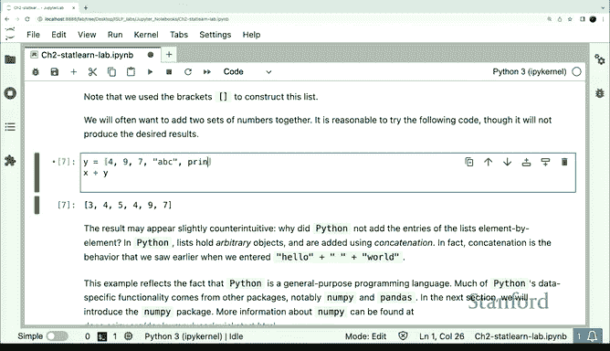

You'll see it concatenates。X with this new list Y， so that's。

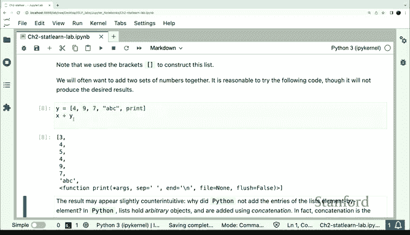

Lists are， are just sequences of any arbitrary Python objects。 There's another type of sequence。

 we'll see in a moment called the tuple that looks a lot like a list， but is slightly different。

 Anyways， This illustrates that Python has a lot of。

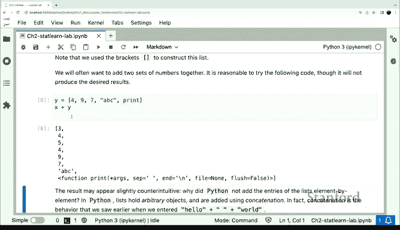

Generic programming functionality that really has nothing to do with numerics。

 And that's why we use these libraries， Ny and， and for more structured data。

 we use pandas the that use so calledled data frames。

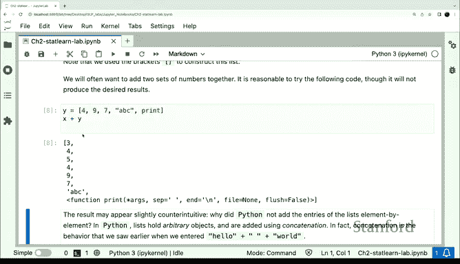

Okay。So we're going to use this package nuy for numerical Python。

It's our first example of a library that we'll use and。

So library is just some other code that's been added to the language or is not， let's say。

 loaded into the。Into the program when we start the program。We have to access it。

 and that uses this this import statement。 So in the further labs。

 we'll see that every lab will start off with many of these type of import statements。

 This actually is what tells the computer where to find the code that we will use later when we want to run these specific functions。

 okay。

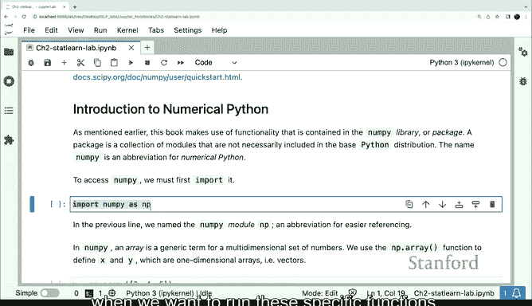

So once we have nuumpy loaded we can start to make arrays and so if you look at the syntax。

 we called the module or the package is called Ny and we decided to name it MP that means when we want to find a function in the Numpy library we use this notation NP that's the library Numpy dot that refers to something within the Numpy library and here we're using the function array and this makes an array with the numbers 3。

4 and 5 as I had for x above and 497 for y Now when we add these two。

Which NP is an abbreviation in that case。 Yes， and we， we could have called this anything。

 We could have called it fo。 if we'd called it fo， we'd have to put fo down here。 That's our choice。

 But N is a standard abbreviation for Ny in the， in the literature。 So now。

 when we add these two arrays。We get more of what we expect。 That's a relief， yes。

So this array is the basic type of object for manipulating numbers in Python。

 This is a one dimensional array because it's made from a list well just a one dimensional organization of numbers。

 there are two dimensional arrays， three dimensional arrays， four dimensional arrays。

 matrices are simply two dimensional arrays with well with numbers in them。

 you can have arrays with things that aren't numbers。But we don't have to start with that。Okay。

 so here's an example of a two dimensional array。So we give it a list of lists。

 so if you know there's two square brackets， the first entry in the list is the list 12。

 the second is the list 34， and this is going to make a2 by two array or a 2 by two matrix that we can use for multiplying later。

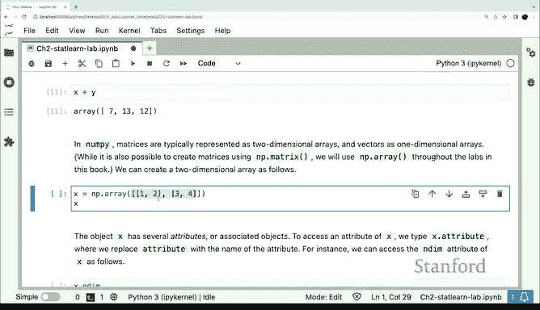

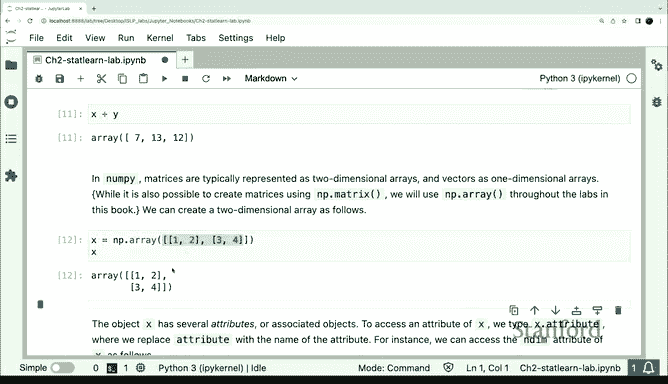

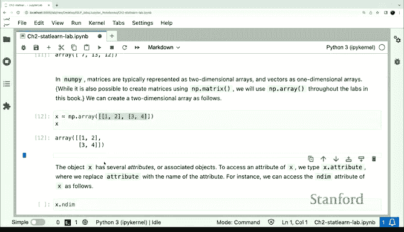

Okay， now given an object in Python。There are， you know， we。

 we may will'll want to know some things about it。 So some things we'll want to know is maybe to find some of it。

 the entries in the array， and we can do that with this square bracket。

 We'll see more in indexing later。 But objects also have these thing called attributes， so。

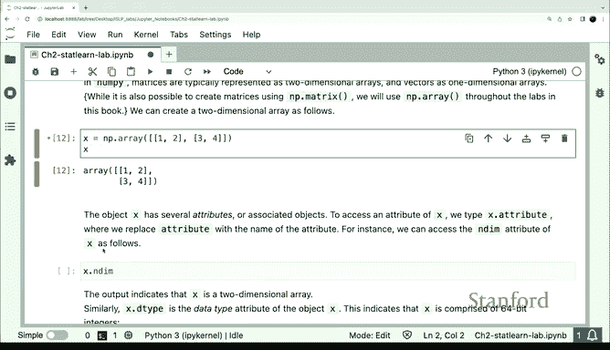

Early it uses the same sort of dot notation to reference something associated with x。

 so if I wanted to know the end in tells us what the dimension of the array is。

 it's a two dimensional array that shouldn't be surprising。

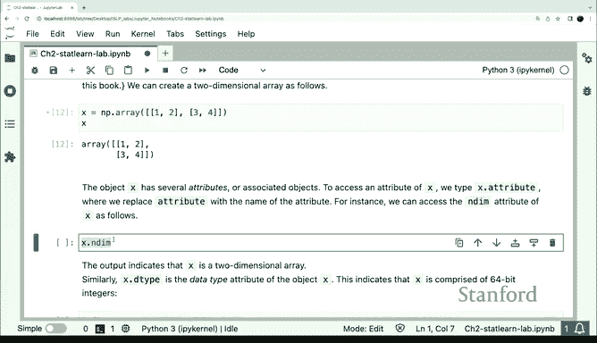

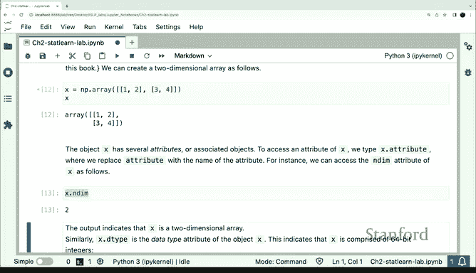

We can， we can also ask what kind of。

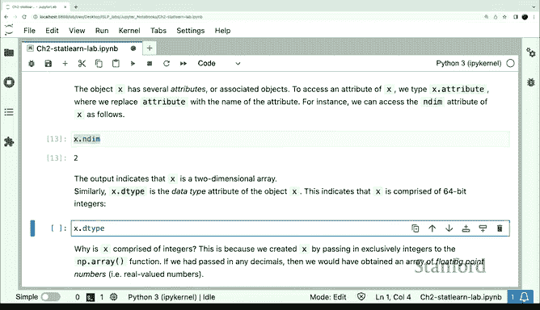

Data is represented in the array， and these were integers。 If you saw above， we had put in integers。

 So there are various attributes that are that any any Python object has many has attributes。

 and you can inspect them by using this sort of reference here。

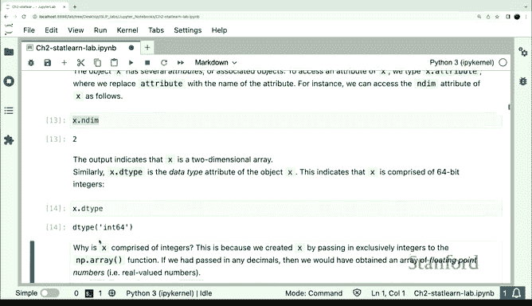

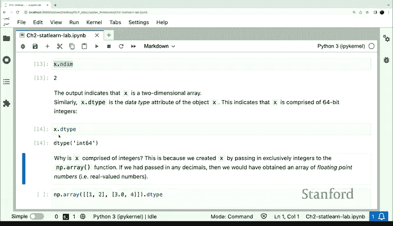

Okay。So。

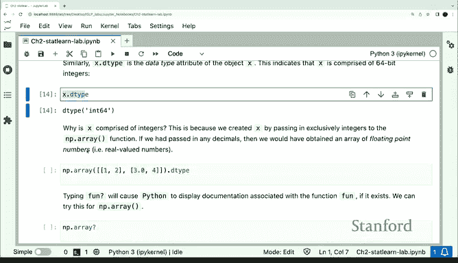

Let's move on a little bit。 So we might， instead of having integer， we。

 we might want to use floating points。 That's the the representation of decimals in the computer。

 We can do that by adding an argument float when we call an array。

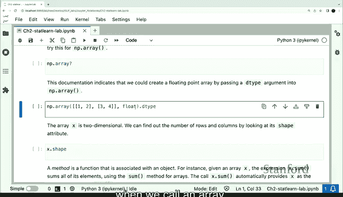

And if you note， I checked its D type。 that is what kind of data is collected。

 Other attributes are its shape。 We won't dwell in all the attributes。 There， There are many of them。

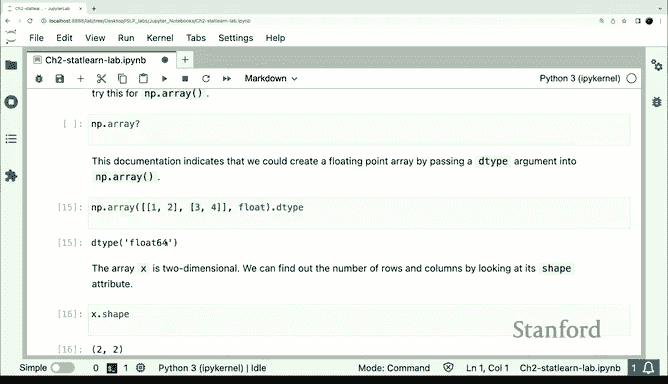

Okay， so。

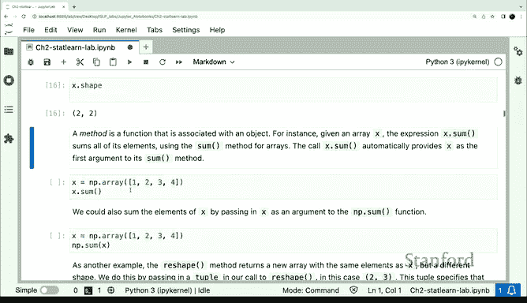

Besides attributes， Python objects also have methods， so here's my array。It's just the list1，2。

3 and 4， and I'm going to call this method， the sum method on x。

 So what is a method it's like an attribute。In that it's associated to x， but it's a function。

 we see it's a function because it has these round curly braces。 So not surprisingly。

 when we call the sum method on x， it returns the sum of the values of x。 So this should be 10。

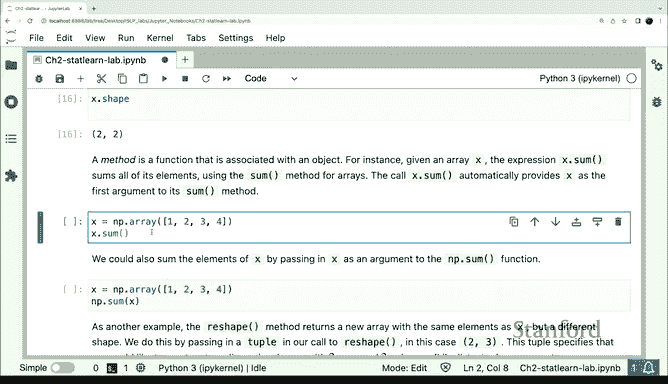

Okay。Well you can also compute the sum of an array with a function。

 There's a function called sum in the nuP library， NP do sum of x computes the sum。

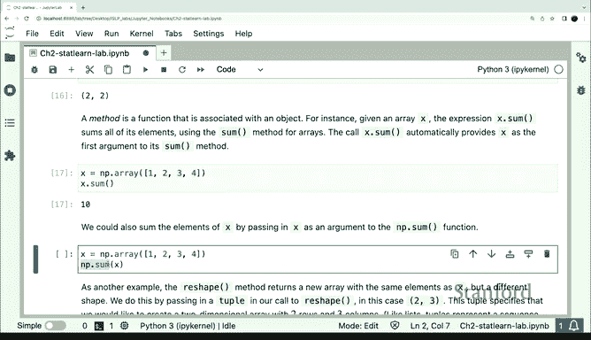

Whether we use a method or a function will often depend on the context。

 but this is just to know that these are basic things that Python objects have。

 attributes and methods， and we can call functions on them as well。Okay。

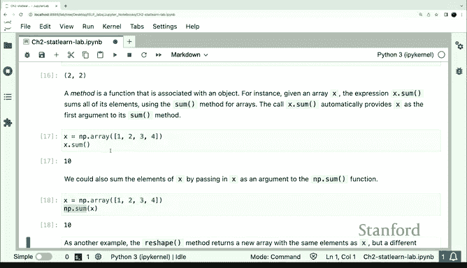

Moving on。嗯。So。This next example talks about reshaping an array， which is， which。We will not。

 I don't think it's worth spending a lot of time on。

 One thing I want to show in this example is something about how Python uses reference instead of value。

 So I'm just going to move on a little bit。

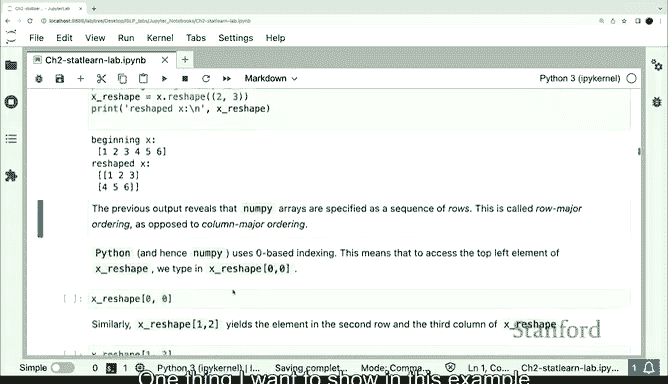

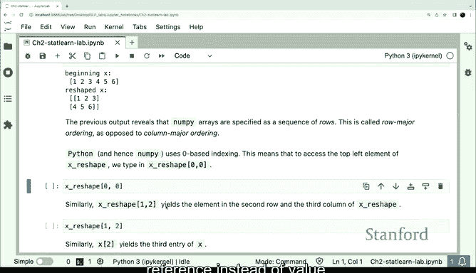

To get to this point。 So without having。Dwelt on all the examples above， we had an original array X。

 and then we made this new array x reshape。X was an array of length six。

 and we made it into a2 by3 matrix。

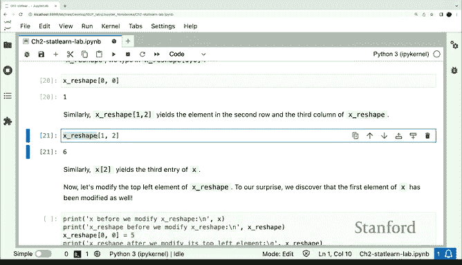

We can just check that。

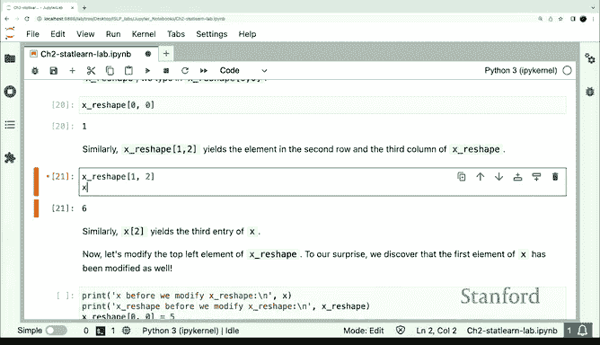

Down here。Bye。Plooting that， so it's a two by3 matrix。

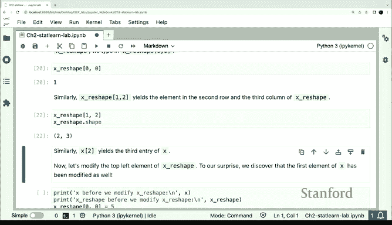

And what I， what I want to show in this quick example is something kind of important about Python is that it uses reference instead of value。

 So this X reshape， it was actually。Derived from x， it actually has the same data as x。

 So let me just。

Excuse me while I scroll up one little bit。

So here， this x reshape。Was found by calling the reshape method of x。 So it's another array。

 It's not x。 It's something different。 It has a different shape。

But。When we， so X started off as a one dimensional array。 Yes， that's right。 shape。

 you made it a two dimensional array。 That's right。 So that was， which is with the same numbers。

 but arranged in a two dimensional array。 That's right。

Oh， I'm sorry。 I see a tight。

Put a dot instead of a comma。See even the Xs swing。So this just to show that x， as Trevor had said。

 is a one dimensional array of ps6， and x3sha is 2 by 3。

The one of the pertinent things I want to show in this is I'm going to change one of the entries of x reshape。

 so I'm going to change here I this notation here， square brackets is how you access elements in the array。

 And here I put zero comma 0。 and that's actually first the entry in the first row in first column。

For those of you who have programmed in other languages。

 you might wonder why I didn't put one comma1 for the first row in the first entry。

 and that's because well Python is a zero based indexing compared to other languages。

 And I would say these days， I think zero-based indexing is quite is more common。

 C- based languages use it but any case， zero is always the first。

 It can be a bit confusing for those who are used to one being the first， but that it was for me。

 Yes。Okay， so I'm sending the entry of the first row and first column of x shape to be 5。

So we should expect when we look at x re shape again， that's what we'll do in the next line。

 it's changed to5。

But X will also have changed。So。

So after I've changed the first entry。Of x reshape， it has a five in the first row and first column。

But X also has a5 in its first entry。 And that's because both x reshape and X。 they still。

 they refer to the same place in the computer's memory。

 And when we change the number sitting in that part of the memory for x reshape。

 we've also changed it for X。 And this is just a useful thing in when you start to see a language to know whether it uses this reference system or copy。

 So using this reference system is a way to be more efficient sometimes。 So that's just a heads up。

That I wanted to pass on when talking about arrays。 So on whenever possible， numy will make a。

Will not copy the array， and it will make what is called a new view of the array。

 So it viewed the same numbers as a two by three matrix with x free shape as x viewed them as effective length。

 Another important thing that we'll use over and over in the book is we'll generate random numbers。

So let's， let's look a little bit。 And we'll talk about the best practice way to do that。

 And so that our results are reproducible。 So the， the nuumpy library has ways to generate random numbers。

 This will generate some random， normal。Variables。And one of the things that's important in in writing something going through a lab like this is to have reproducible results。

 So， of course， the numbers in a random number generator will change from time to time。

 If I rerun this block， the numbers of change。 and that's because they're random。

 So we want to be able to set a seed for the random number generator。 So the best。

Practice way to do that currently is to set a seed as follows。

 we make a specific random number generator using this default RG。

And what we can what it allows us to do is have reproducible results。

 And now instead of using the function NP dot random normal， we use the function R and G do normal。

 And there I said function， it's actually a method here。 but these distinctions are kind of fluid。

 So now we've created two random memory drainers with the same seed and they're going to give us exactly the same data。

 So that will be how we will have reproducible results throughout the the lab。

