# 斯坦福大学《统计学习导论2023Python版｜An Introduction to Statistical Learning with Python》中英字幕 - P11：-011-Statistical Learning_ 2.Py.3 Graphics I 2023.zh_en - GPT中英字幕课程资源 - BV1u4421A7ZU

So besides doing computations with arrays， we'll often want to plot results。

 and so that brings us to the topic of graphics， the main plotting library in Python is this mat plot Lib。

Library， and we're going to talk about a little bit of the Matpl Lib model and how we can。

 how we make plots in Python。So it is another library so we will have to import something。

 we're going to use this function subplots over and over throughout the labs and it creates for us a figure of a given size。

 we'll see later we can get a grid of figures but the basic format is it gives us this thing that's a figure object and a thing called an access object and the access object is where we actually call make the direct calls to plots so what we're going to do here is we'll have a figure and access。

 we'll generate some data and then we'll plot it。Okay， so X and Y are random normal。

 And we see when we plot it， we got this strange looking mess。

 We probably wanted a scatter plot here。 So for that， we're gonna， instead of using plot。

 we're gonna change the plot a little bit。 Oh， we' joined all the points up with lines。 Yeah。

 made a line plot and yeah， which sometimes is useful， but not in this example。 Yes， so this， Okay。

 you'll have to。 let's see the point plot。 Okay， so we can do that by。

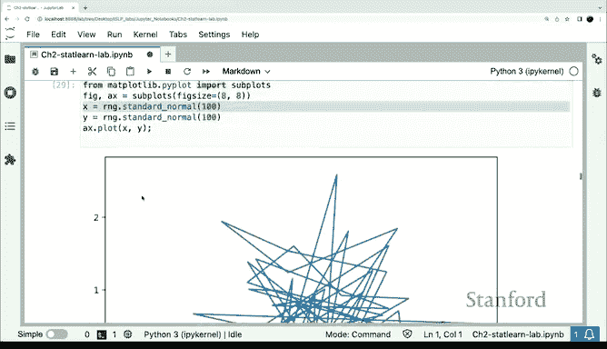

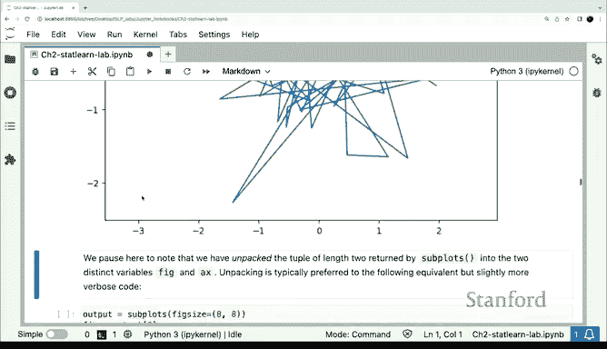

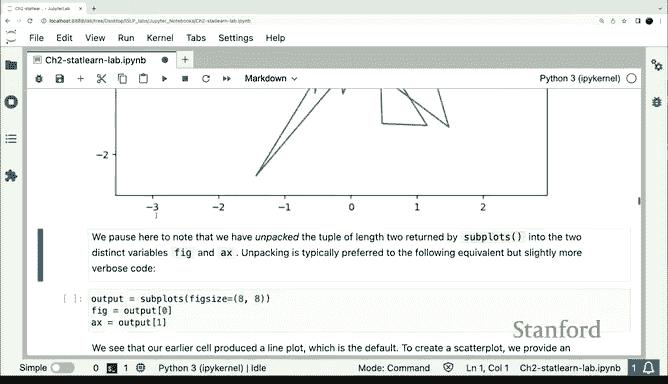

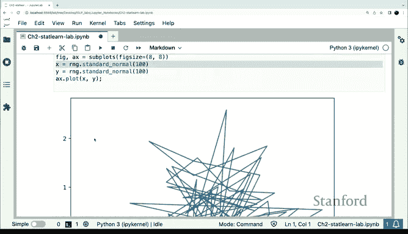

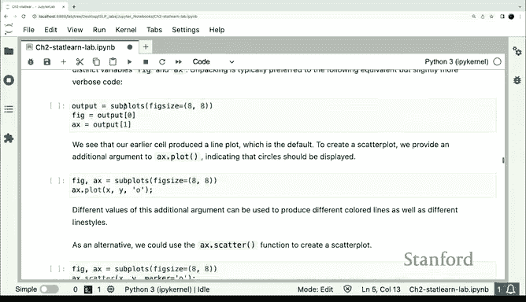

Changing， adding an argument to to the plot method。

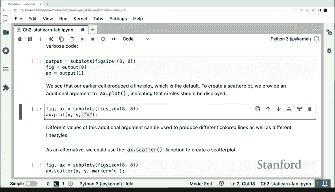

So if we put an O here， this O is sort of supposed to represent a circle。

 and that tells the plot method that we actually wanted a scatter plot instead of a line plot。

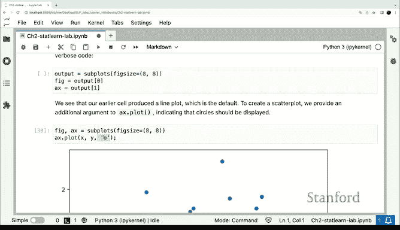

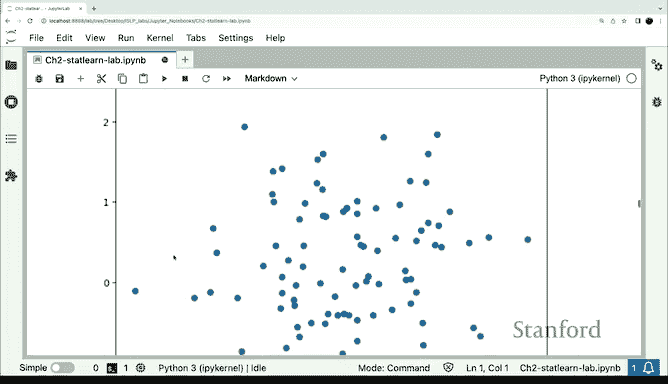

嗯。Okay。There's also actually a scatter method if we directly want to use a scatter plot， okay。

 moving on。

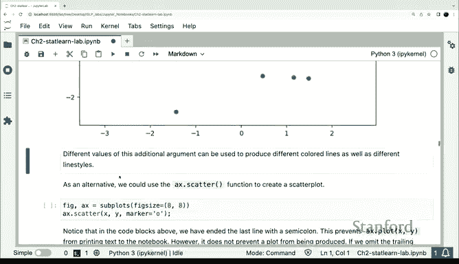

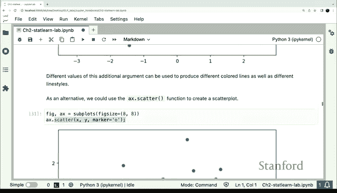

So this is a big library。 There's a very good documentation for it。 if you have any other questions。

 so we'll often want to do things like you know make a nice plot， so we want to set labels。

 There are methods for that。 The set X label unsurprisingly sets the X label axis and the rest of them are。

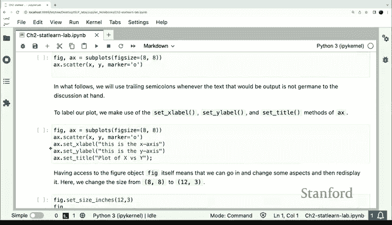

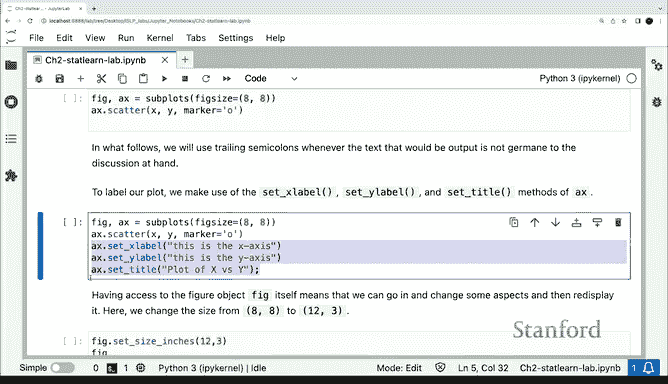

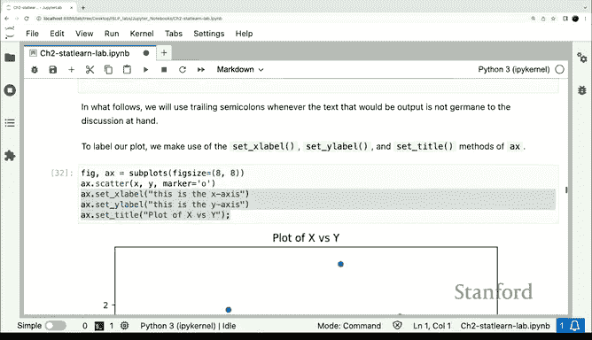

Pretty self explanatory。OhSo you can make the plot and then add things to annotate the plot。

 I that doing。 Oh， yeah， this that that's a good point。 That's one of the the strengths。

 I think of the， of the map plot lid models is that the axis is an object。 It's just a Python object。

 You can change it， and then it will change what， you know， what。

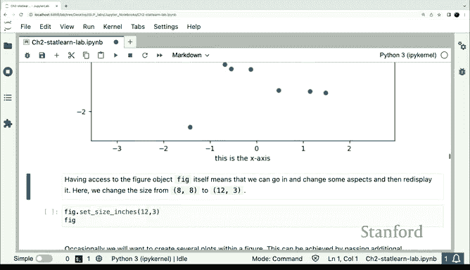

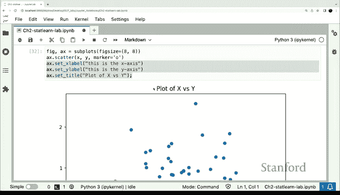

What is represented in the figure， so if you red displayplay the figure after changing the axis。

 you'll see those changes so you can make a plot step by step and plot it in stages until you like it。

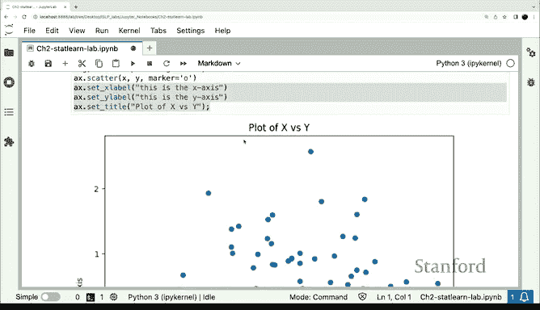

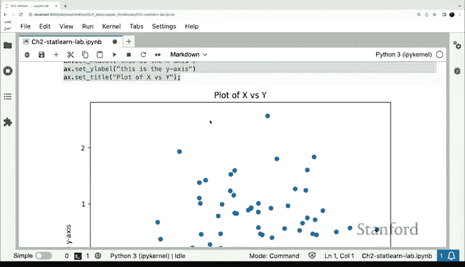

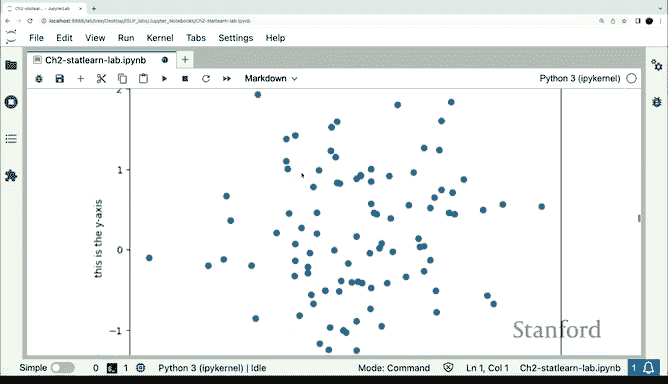

Rather than having to get everything out。At once。 So the figure object is， well， this is。

 if we had changed something to access， we can reddiplay the figure by just typing ending a cell with Fig。

 So in this example， we were just going to change the size of the figure。 It has methods as well。

 and we see we changed it from 8 by 8 to 12 by 3。

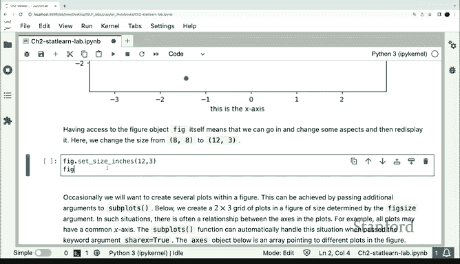

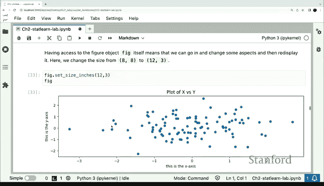

So we'll often， you know。We might want to make a grid of plots。

It has these rows and columns arguments。

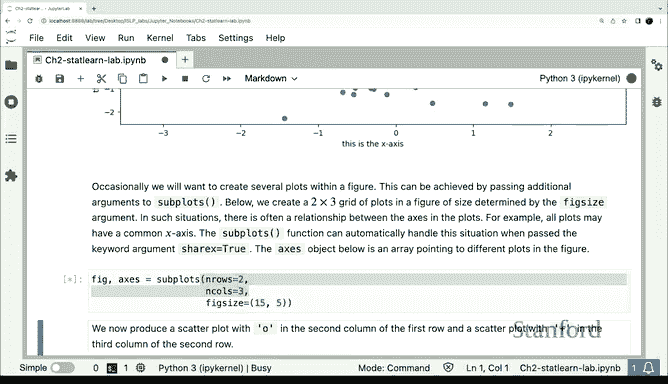

And。Here we added a few things。To the figure we' we put a plot in two of the squares there and then reddiplay the figure。

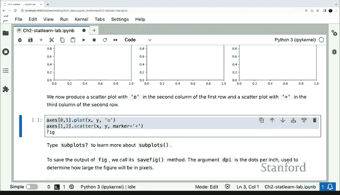

Okay， this is not a very interesting plot， but you can imagine if you have a delicate， you know。

 delicate computation to make， you can fill these things one by one and then reddiplay at the end with calling fig。

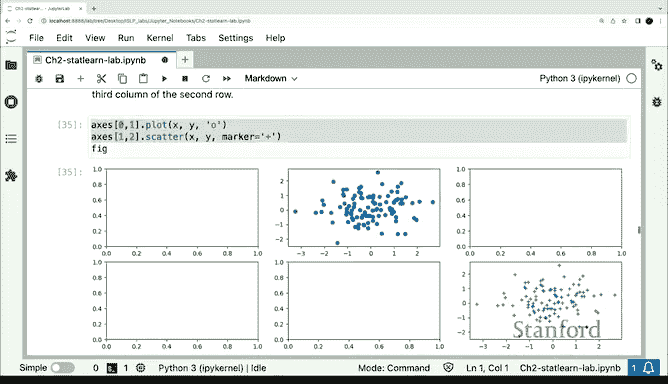

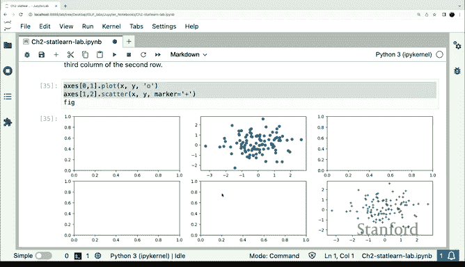

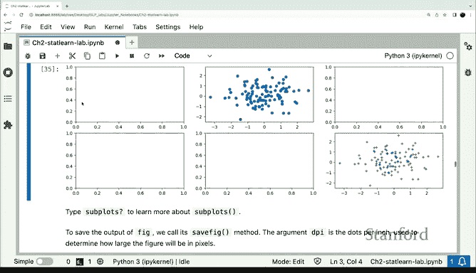

Of course， for homework or for other things， for a paper we'll want to save them。

 there's a safe fig method that we can use to save the final answer。

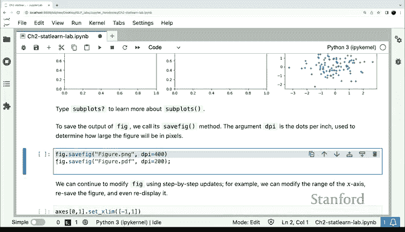

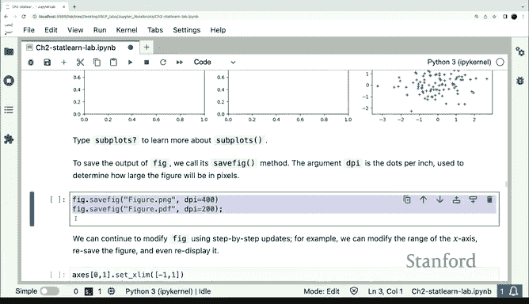

So that's very nice。 I mean， it's really important to be able to make plots easily in in when you do statistics and applied statistics。

 And so having a nice way of laying out plots and annotating them is really important。

 So this is very nice。

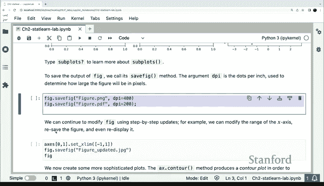

Yeah， it's a， it's a very nice library and takes a bit of getting used to the fact that you call。

 you plot things to the access object。 But after that。

 you'll see throughout the labs in the book that Jonathan's used a consistent style of creating figures using。

This， this kind of layout subplots layout and， and so by the time you've done all the labs。

 you'll become experts in in using them as well。 Yes， yeah， so this lab。

 this first lab sets up of several things that we'll see over and over again like the R G。

 the the default random number generator， we use that， wherever we。

 wherever we create random number generator So we have reproducible results。

 We'll have the same way of creating plots two big things。 You've got some pretty plots to show us。

 Well， yeah， there's some contour plots。 if you like。So here's if we have you know。

 a grid of x values and a grid of y values and we evaluate a function of x and y。

 we can create a contour plot with that。1， okay， let's show it。 Yeah， and there。

 there's one additional thing that's introduced here。 This is the outer method， so。So。

MP do multiply unsurprisingly takes a arrays and multiplies them。

 The outer multiply takes the entry wise product of these two vectors。

 you can also add dot outer and subtract dot outer， many standard functions have these outer methods。

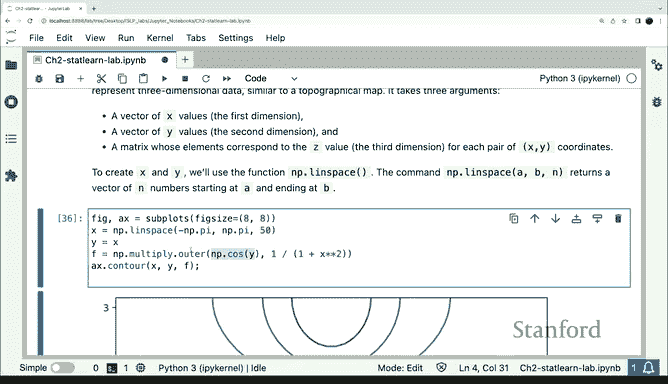

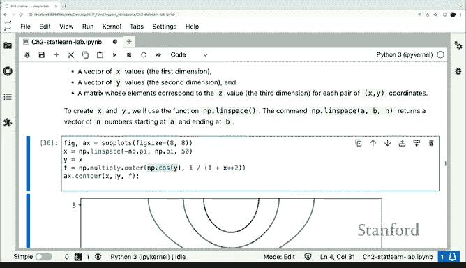

So it has nice default contour plot。 You can change the number of contours， if you like。

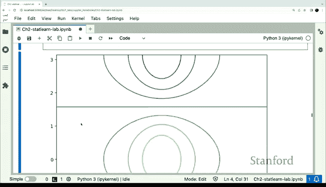

And by inspecting the arguments of Contour， you can find more about that。 It's a weird function。

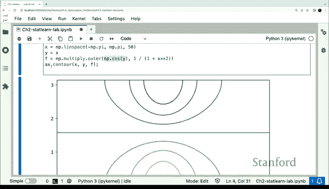

Yes， okay。 alright。 And one last thing is。Instead of a contour plot。

 you may want to just make a heat map， and that is the IS message plots makes a heat map from an array of data。

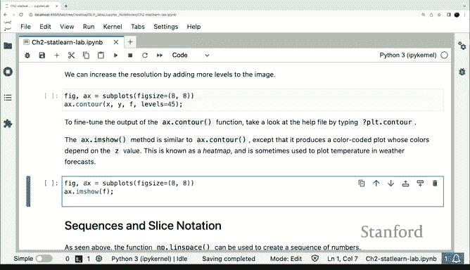

Now you show off。

