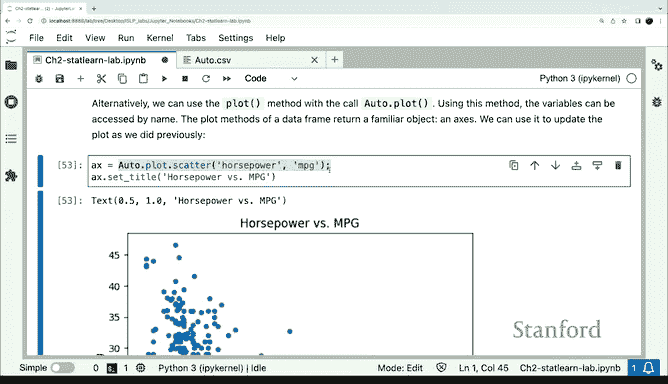

# 斯坦福大学《统计学习导论2023Python版｜An Introduction to Statistical Learning with Python》中英字幕 - P12：-012-Statistical Learning_ 2.Py Indexing and Dataframes I 2023.zh_en - GPT中英字幕课程资源 - BV1u4421A7ZU

Okay， after making some plots， there are a few other topics in the lab that we we're going to not go through in the interest of time。

And you can see if you ever want to know the subparts of the lab。

 you can use this sort of table of contents tab here。

 So we have some examples about how to access data in arrays and how to use slices in general for sequences in Python that is important。

 but I think more important we're going is to talk about data frame。

 So we're going to jump here to this loading data。Part of the lab。 Okay。

 so we've talked now about nuy arrays， which are representations of numbers in the computer。

There are lots of， you know， lots of ways to represent data in a computer。 not all data is numeric。

 And so we need there's an object that's something like an array or a matrix。

 but it's called a data frame that is sort of familiar in many。

 many languages that for data analysis。 So the library that implements data frames in Python is the pandas library or that's the the default library。

 So if you have a data file here， this is a so-called CSV file， we can read it in using pandas。

 And if you want， we can take a quick look at the data file。 So here's the。The auto data file。

 and I'm going to open it up so we can see what it looks like。And it's in a file。

 The first row is the column names and then the data separated by columns。 I see。 So there's。

 there's numbers as well as categorical。嗯。Yeah， these names here。

 this is the name of this is a file about different。Models of cars。

 I think it's from the late 70s or 80s and has some measurements on each model of car。

 So you can see that you need something in a computer to represent the model of car。

 It's different than than an MPG。 and MPG is a decimal number right。

 but some columns will be numbers and some will be character Yes。

 that's the the big distinction between a data data frame and an array is an array。

 All the entries kind of have to be the same type。 A data frame。 they can be different types。Okay。

 so these files here， I've copied them from from the data directory。 If you go back。

 this is the directory we are on the desktop in the data directory there， the auto files。

 I've just copied them back into this。Into this Jupyter notebook file so that the computer knows where to find them。

Okay。Let's go back to。Where we were。 And let's get rid of the sidebar。Okay。Okay。

 so we're going to read in the file and let's take a look at a data frame。Well。

 we see it has these columns those are that's the first row of the data file we saw and we see these it has recognized that the name。

Column or strings。 And the some columns were floats here。 It has a decimal for the acceleration。

 So recognize that should be treats of floatat， and that should be treats。

 I think this example also shows Jonathan that a CSV file is a good format for。

And put in data because it's got the column names and， and。

 and you just have to read it in and everything was preserved。Yes。

 yes CSV is a very very common format for ver tababular data that we can think of as having you know where the rows are each corresponding a different car here or a different person and the columns are different measurements on each of the row variables Yeah that makes it nice and easy。

Okay。There's another version of the file。' let's move on from that so we can access columns by using the same sort of square bracket notation we saw for arrays。

 but here we can give a column name， so auto horsepower。

Is going to be those numbers we saw in the horsepower column above。

 There's a comment in the lab here that says this should be an object data of type。

 that's because I skipped a line and let's just do that。Just to be honest， the reason。

 this is called the this is not recognized as float。 That's because there are some。

Missing values represented by question marks。 So I've looked at the unique values in a。In the array。

 And I see there are some， it's everything is treated here as a string。

 You can see that by the quotes。 And there was a question mark。 So when Pinda tried to read it in。

 it didn't recognize them all its floats， we have to tell that something is a。

 is represents a missing values。 curd missing values。 Yeah， the curse of data analysis。 Yes。

 and here we only have a few。 But of course， most data has， you know， a lot of missing values。

So that's not a problem if we know at the how missing values are represented， we can give it。哎呀。

A set of possible missing value strings， and now we see it actually is a represented as a float because when I computed sum。

 it gives me a number， whereas earlier if they were all strings， the sum would be a string。

 of course。So when you， when you do the summer， it skips over the missing values。

 Well actually this1， I've reread it in with the missing values。 I see。 And if we look at horsepower。

 this will now be。A float instead of an object。 Oh， I see。 So it it， it。

Removed the rose where there was I sorry removed the rose where they were missing。Well。

 it notes the rose， I should say， yes， and when it did the sum， it does skip over them。

So to actually get rid of all the entries with missing values。

 we can use this drop NA method and we see that instead of having 397， we get 392 entries。

 that means there were five rows that had a question mark and so in this case。

 it was reasonable just to drop the rows with missing values。 Yes， only five row effects。Okay。

 so a few things we'll want to do is often we' want to select columns of a data frame and rows of a data frame so we can find the columns by looking at the columns methods。

And well， there are several ways to。Indexed data in a data frame。 If we only want the first three。

 this is an example of using the slice notation R colon 3 gives us the first three entries。

 the first three rows of the data frame， and these are them。You can also， if you have a test。

 if you want to find all you know， cars that were created after 1980。

 you can make this Boolean vector and。Selecting。With a Booleing vector will give you all the cars that were created after 1980。

Okay。Now， rows N columns are also， you know well sometimes want to select both and let me just get rid of this this is annoyingly big。

嗯。Okay。For several columns。If we give a list of columns。

 this will give us a new data frame with only those two columns。

And there are actually quite a few examples here of indexing that I， it's important。

 I think you go through。Many of them， but we won't go through all of them。

 I want to wrap up this topic on data frame by talking about plotting from a data frame。

So when we have variables in a data frame。I'm just going to move on。To the plotting part。

And as you see， there is a lot of content in the labs that we won't be able to get through in these videos。

 and it's important that you follow through when doing the homeworks。So。For this。

 this first lab is also intended for， for people who don't know Python。

 And so they'll be learning Python for the first time。 And so is it necessary。

 it's necessary for them to go through a lot of Yes， this is， this is the things。

 a longer lab than that several of the other ones。 And that's because this is the first lab。嗯。Okay。

 so suppose we want to。Ploot， so I just， this last little example here shows how data frames are sort of aware of self aware in terms of plot。

 So that is a data frame has a plotting method。 So first。Well， we might want to。

There are columns called horsepower and MPG in in the auto。

 And we might think we could just plot them by using the plot method， of course。

There's nothing called horsepower， so the computer is going to complain。

 and there's nothing called Miles pergalon。It will say we'll get an error。

 This is an example of what Python shows you when you run code that is gives an invalid output。

 It's called it an exception， and it rightly says there is no variable called horsepower。

 There is a column called horsepower in auto。And so we can if we do the following。

This will give us the horsepower values。That will be easy to find and the emptyity values。

 And we can make a scatter plot。Okay， but。Data frame data frames， as I said， actually。

Know something about how to make a plot。 So instead of directly plotting with to the axis。

 you can call the plot method of a data frame， and so here we can make that same scatter plot using the plot dot scatter method。

And let's just run this。And what a has returned is an axis like the axe we saw when we made the plots above。

So we can set the title of the axis。 We could set the X label。

 We could do all the other things we do to a regular axis。

 but for plotting certain things from a data frame， the data frame can often help us out。

